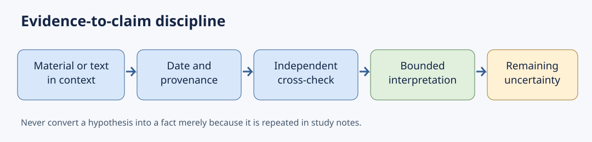

# TGPSC Group I — Paper II, Unit I, Topic 1

# Early Indian Civilizations, Religious Movements and Classical Culture

**Cycle79 integrated student master — academic rebuild required, not approved.** This is original practice material, not authenticated TGPSC previous-year questions. The 17-page original PDF remains unchanged. This coherent master uses the October 25 depth-repair as the primary narrative and does not repeat the earlier segmented detailed-notes verbatim. The current edition remains short of one full page per concept; source and MCQ audits are incomplete.

## Official syllabus wording and coverage

## Official wording

Early Indian Civilizations-Indus and Vedic; Emergence of Religious Movements in the sixth century BC - Jainism and Buddhism; Indo- Greek Art and Architecture – Gandhara, Mathura and Amaravathi Schools; Social and Cultural condition under the Mauryan, Satavahanas and Guptas .

## Conceptual branches

1. Indus civilization: environment, urbanism and evidence
2. Vedic society: textual evidence and transformation
3. Sixth-century BCE religious movements
4. Gandhara, Mathura and Amaravati schools
5. Mauryan, Satavahana and Gupta social-cultural worlds

Official source: https://websitenew.tgpsc.gov.in/preview/RElSRUNUUkVDUlVJVE1FTlROT1RJL05PVElGSUNBVElPTl9OT18wMi0yMDI0X0dyb3VwLUlfU2VydmljZXMgKDEpMjAyNDAyMjAxNDA3MzcucGRmr95v17a0y2d8i13v

## Quick revision

## Archaeology and Harappan civilization
- Mature Harappan urban phase: approximately **2600–1900 BCE**; avoid treating the dates as sharp boundaries everywhere.
- Major sites: Harappa, Mohenjo-daro, Dholavira, Lothal, Kalibangan, Rakhigarhi.
- Urban evidence: drains, wells, standardized weights, seals, crafts, regional water systems.
- **Do not claim:** Indus script deciphered; a single accepted cause of urban decline; certain identity of rulers.
- De-urbanization was regional and gradual; continuity of population and traditions matters.

## Vedic transitions
- Early Vedic evidence: Rigvedic hymns; kinship, cattle, chiefs, assemblies.
- Later Vedic evidence: later samhitas and prose texts; agriculture, territorial formations, complex ritual, philosophical questioning.
- **Trap:** textual prescriptions are not demographic surveys of all communities.

## Jainism and Buddhism
- Jainism: jiva, karmic bondage, five vows, anekantavada, aparigraha.
- Buddhism: Four Noble Truths, Eightfold Path, dependent origination, anatta, Middle Way.
- **Key difference:** Jainism affirms jiva; Buddhism rejects permanent self.
- Both built monastic and lay patronage networks, with distinct doctrines.

## Three art schools
| School | Core region | Typical material | Identification cue |
|---|---|---|---|
| Gandhara | Northwest | Grey schist and others | Drapery and naturalistic modelling |
| Mathura | North India | Red-spotted sandstone | Robust forms; Buddhist, Jain and Brahmanical images |
| Amaravati | Lower Krishna | Limestone | Narrative Buddhist reliefs and dynamic compositions |

## Three major political-cultural contexts
- **Mauryan:** Ashokan edicts, dhamma, imperial communication; do not equate dhamma with Buddhist doctrine alone.
- **Satavahana:** Deccan networks, Prakrit inscriptions, coins, Buddhist patronage, inland–coastal trade.
- **Gupta:** Sanskrit literary and artistic developments; question the unqualified 'Golden Age' label.

## Rapid recall
1. Why does undeciphered writing limit Harappan political history?
2. Explain the difference between anatta and jiva.
3. Compare Gandhara, Mathura and Amaravati using region, material and patronage.
4. Why is a royal prashasti not a neutral record?
5. How does Ashokan dhamma differ from a strictly sectarian doctrine?

## Source-critical detailed concepts

**Early Indian Civilizations, Religious Movements and Classical Culture**  
**Status:** Original supplementary academic draft, 25 October 2026. It supplements, but does not replace or independently validate, the original 17-page PDF. All MCQs are original practice questions, not official PYQs.

## 1. Official syllabus map and analytical method

The recorded syllabus clause reads: “Early Indian Civilizations-Indus and Vedic; Emergence of Religious Movements in the sixth century BC - Jainism and Buddhism; Indo- Greek Art and Architecture – Gandhara, Mathura and Amaravathi Schools; Social and Cultural condition under the Mauryan, Satavahanas and Guptas.” The exact words are preserved in the existing syllabus index. The direct commission PDF was not independently re-opened during this repair; treat this as a transcription awaiting final original-file comparison.

This topic is not a single dynastic narrative. It asks five different historical questions: how archaeological urbanism functioned; how Vedic textual society changed; why the shramana traditions attracted followers; how three sculptural workshops developed distinct visual languages; and how political formations structured cultural life. A chronology alone cannot answer these questions. Evidence must be sorted into excavated contexts, inscriptions, coinage, normative religious texts, literary works and later retrospective traditions. Each source has a characteristic bias. A coin legend can establish a royal name or title but not the welfare of every subject. A royal eulogy establishes how a court wished to portray conquest, not the consent of conquered communities. A ritual prescription establishes an ideal, not its uniform observance. The responsible answer identifies a source, explains what it supports, and then states what remains uncertain.

**Evidence ladder:** (1) directly observed material or authenticated text; (2) inference from multiple independent traces; (3) contested hypothesis; (4) legend or unsupported claim. An examination answer improves when it distinguishes these levels rather than making the prose artificially certain. Chronologies are approximate because radiocarbon ranges, textual composition, inscriptions and regnal lists do not share a single precision. “Sixth century BCE” is an intellectual-history convention, not a claim that every canonical teaching was written down in that century.

## 2. Harappan ecology, settlement hierarchy and the limits of a single ‘Indus city’ model

The Mature Harappan phase is usually placed around 2600–1900 BCE, with earlier and later regional developments. The geographic name “Indus” can mislead students into locating all settlements along one river: sites extend through present-day Pakistan and western/northwestern India, with important centres in Gujarat and Haryana. Harappa and Mohenjo-daro demonstrate planned urban quarters, brickwork, wells and drains, but Dholavira's stone architecture, reservoirs and fortifications reflect an arid island environment. UNESCO's 2021 inscription dossier identifies seasonal streams, multiple reservoir systems, craft workshops and a cemetery with varied memorial forms at Dholavira. The evidence therefore supports coordinated urban labour and differentiated settlements; it does not reveal a named constitutional structure or an identifiable emperor.

A settlement hierarchy can be reconstructed from site size, location, specialised production and exchange, but each variable is incomplete. A large town might coordinate craft production or redistribution without being the seat of an empire. Standardised weights suggest shared commercial conventions; their spread does not by itself prove one political ruler. Seals and sealings may mark transactions or identities, but because the script remains undeciphered, translating a seal into a modern bureaucratic office is conjecture. Differences in domestic architecture and burials suggest social differentiation, yet the available evidence does not justify reading later varna or jati labels backward into the Bronze Age. A strong comparison separates **infrastructure**, **authority**, **social hierarchy** and **belief**, rather than assuming one proves the others.

Urban planning also required maintenance. Wastewater channels had to be laid out, repaired and connected to household spaces; reservoirs needed catchments and access rules. These are institutions in a broad sense, even where no written charter survives. At Dholavira, the use of local stone and water harvesting shows ecological adaptation; at Mohenjo-daro, wells and drainage show another engineering strategy. Calling all Harappan cities “identical grid towns” hides the most instructive regional differences. Similarly, describing a monumental basin as a “dockyard” at Lothal should be qualified because interpretations of the structure and its hydrology have been debated.

## 3. Harappan production, mobility, trade and urban transformation

Craft production involved carnelian beads, shell objects, copper alloys, ceramics, faience and stone weights. The raw materials came from different ecological zones, implying procurement routes and knowledge of distant sources. Mesopotamian texts referring to Meluhha are often discussed in connection with Harappan exchange; the identification is widely argued but does not mean that every object or trader can be assigned an ethnic label. Coastal settlements and inland craft centres participated in networks whose scale changed through time. The archaeological record cannot tell us exactly how profits were distributed among merchants, producers and political elites. It does, however, allow historians to ask how standards, transport and specialised skills reduced the friction of exchange.

After about 1900 BCE, several large urban centres contracted while settlement patterns shifted in different directions. No single flood, invasion, river change or climatic episode can explain every site. River-course changes, changing monsoon patterns, soil and water pressures, altered exchange and regional economic adaptation are plausible contributing processes. The disappearance of one urban form is not the disappearance of its people. Later settlement horizons show continuities and changes in farming, ceramics and habitation. The careful term is **regional de-urbanisation and reorganisation**, not a dramatic overnight extinction. This is also a lesson in causal reasoning: if the same cause cannot explain geographically different trajectories, the model is incomplete.

**Source-critical method: weighing objects against claims (Cycle 79).** The Ashmolean Museum's catalogued chert cubical weights from Mohenjo-daro (accessions EAMd.7–9) are physical objects, not translated account books. The museum describes graduated weight sets found over a wide area. This supports the existence of measurement conventions across settlements, but cannot identify an empire-wide tax rate, fixed commodity prices, or the identity of an official who used a weight. The British Museum's accessioned steatite seals preserve actual inscriptions and animal motifs; because the Indus script has no generally accepted decipherment, a seal cannot yet be read as a named merchant's contract. UNESCO's Dholavira dossier independently records bead workshops, reservoir engineering, and exchange links with Mesopotamia and the Oman peninsula. Together these observations suggest skilled production and interregional movement, while leaving open the balance between private exchange, redistribution, and tribute. A careful inference compares findspot, archaeological layer, workshop waste, storage facilities, and regional distribution before proposing a political institution. A standardized measure is evidence for a shared practice, not a complete theory of government. Sources: Ashmolean accession EAMd.8; British Museum 1947,0416.3; UNESCO World Heritage listing 1645.**

**Worked comparison:** A question asks whether drainage proves a centralized Harappan empire. First establish the observed drains and standardized elements. Second explain that coordination could occur through city authorities, neighbourhood bodies, guild-like groups or other arrangements. Third note that undeciphered writing prevents identification of office-holders. Conclude that sophisticated governance is plausible but a single empire is unproven. This earns more analytical credit than simply writing “well-planned cities show a strong central government.”

## 4. Early Vedic evidence: a corpus, not a population census

The Rigveda contains hymns composed and transmitted through specialist oral traditions. They illuminate ritual patrons, kin groups, cattle wealth, chieftainship, conflict, gift exchange and religious vocabulary, but their social reach was selective. A hymn that praises cattle does not prove that farming was unknown; a ritual that elevates a patron does not describe all households. The distinction between composer, performer, patron and wider population is essential. Terms such as rajan, vis, jana, sabha and samiti should be interpreted within their textual contexts. Sabha and samiti are not directly comparable to a universal franchise legislature, and scholarship disputes their precise composition and authority.

Early Vedic social categories cannot be mapped neatly onto a later rigid caste hierarchy. The Purusha Sukta in the tenth mandala is often cited in discussions of four varnas, but textual layers, composition history and social practice require caution. The presence of a verse is evidence for an ideological formulation; it is not proof that all people in the subcontinent were organised by it. Women appear in different ritual and poetic roles, and later idealised claims about a uniformly egalitarian or uniformly oppressive “Vedic age” are both overbroad. Material archaeology is a necessary companion, not a simple illustration of a sacred text.

## 5. Later Vedic society: land, iron, sacrifice and philosophical criticism

The later Vedic corpus, including Brahmanas and early Upanishads, emerged across changing political and ecological settings. Agriculture and settled territorial authority gained prominence in several northern regions; iron tools became part of some expanding economies, though iron cannot alone explain the rise of states. Surplus production, land access, labour relations, military competition and control over routes all mattered. Ritual systems developed more elaborate sacrificial performances, making priestly expertise a source of prestige and patronage. At the same time, Upanishadic debates questioned the relation between ritual action, knowledge, self and ultimate reality. “Vedic religion” was thus internally dynamic, not a static orthodoxy suddenly challenged from outside.

Janapadas and later mahajanapadas represent territorial consolidation, but the timing differed regionally. Gana-sanghas or oligarchic polities should not be equated with modern egalitarian republics: political participation could be restricted to ruling lineages. The growing Ganga plain cities provided conditions for competing religious specialists, ascetics and merchants. For a mains answer, connect the social basis of urbanisation with intellectual diversification without asserting that commerce mechanically “caused” Buddhism or Jainism. The traditions drew on older debates and developed their own distinct ethical arguments.

## 6. Sixth-century BCE ferment and the danger of the ‘reaction-only’ explanation

The standard shorthand says that Buddhism and Jainism arose as reactions to expensive sacrifices and social hierarchy. This is part of the story, not the whole explanation. Northern India witnessed expanding settlements, trade, urban concentrations, new political formations and interactions among Brahmanical, ascetic and non-Vedic intellectual communities. People debated action, rebirth, self, liberation, knowledge, renunciation and ethical conduct. The shramana movements offered institutional settings for these questions through monastic communities and networks of lay patrons. Religious authority was not simply transferred from priests to kings: monks, nuns, merchants, householders and rulers negotiated resources and legitimacy.

The word “heterodox” is relative to a particular Brahmanical classification and should not imply that all non-Vedic schools shared one doctrine. The Ajivikas and other schools also belong to this landscape, even though the syllabus emphasises Jainism and Buddhism. Surviving Buddhist and Jain accounts of rival teachers are polemical and should not be treated as neutral surveys. Later canonical redaction complicates efforts to reconstruct the precise words of historical teachers. The historical problem is therefore to explain why the institutions grew and how their teachings differed, while respecting textual chronology.

## 7. Jainism: the ethical architecture of non-violence

Jain tradition places Mahavira as the twenty-fourth tirthankara and also remembers Parshvanatha as an earlier teacher. Its ontology distinguishes living jiva from non-living categories and explains karmic bondage as a material process associated with conduct and passions. Liberation requires stopping karmic influx and shedding accumulated bondage. The five vows—ahimsa, satya, asteya, brahmacharya and aparigraha—organise monastic discipline; householders undertake moderated forms. Ahimsa has far-reaching implications for food, occupations, movement and the treatment of living beings. Yet one should not claim that every Jain follower practiced monastic austerity: lay communities were integral to survival and patronage.

Anekantavada concerns the many-sidedness of reality; syadvada concerns qualified assertion. These doctrines are not equivalent to “every opinion is true.” They invite disciplined awareness of the conditions and standpoints of claims. The distinction matters in comparing Jain epistemology with Buddhist dependent origination. Digambara and Svetambara traditions later differed over monastic practice, canonical preservation and other questions; their later institutional identities should not be projected unchanged onto Mahavira's lifetime. Jainism's long-term endurance depended on regional patronage, teachers, communities, temples, texts and mercantile networks, not simply on a one-time royal conversion.

## 8. Buddhism: suffering, dependent arising and social institutions

The Four Noble Truths articulate dukkha, its arising, its cessation and a path to cessation. The Noble Eightfold Path connects wisdom, ethical conduct and mental discipline. Anatta rejects a permanent independent self; dependent origination treats phenomena as conditioned rather than isolated substances. This does not mean Buddhism denies moral responsibility. The teaching links intention, action and consequence within a process account of personhood. The Middle Way avoids both indulgence and self-mortification. These ideas should be explained conceptually before listing later schools and councils.

The sangha was an institutional innovation because it required rules for ordination, discipline, collective decisions, property use and relationships with donors. Monks and nuns did not exist outside society: they relied on lay gifts, agricultural surpluses, transport routes and sometimes royal support. Stupas, relic veneration and pilgrimage became durable forms of religious community. The social impact cannot be reduced to the claim that Buddhism “abolished caste.” Buddhist texts contain criticism of inherited superiority and moral revaluation, but historical Buddhist societies retained varied social distinctions. In a Telangana context, the Phanigiri monastery and Dhulikatta remains make the infrastructure of Buddhist patronage concrete rather than merely philosophical.

## 9. Jainism and Buddhism: doctrine, patronage and comparison

Both traditions value disciplined ethical action and the pursuit of liberation from rebirth, and both developed monastic and lay relationships. Their doctrines are not interchangeable. Jainism accepts jiva and explains bondage through karmic matter; Buddhism teaches anatta and conditioned arising. Jain restraint often gives particular weight to avoiding harm to minute living beings; Buddhist ethical reasoning places substantial weight on intention and the cultivation of the path. Jain anekantavada is not Buddhist emptiness, and the two should not be conflated in a comparative table.

Patronage offers a second comparison. A donor inscription may record a merchant, craft worker, monk, nun or household member; it does not automatically prove a king founded the monument. Buddhist architectural networks could persist across changes of dynasty. Jain communities also developed robust urban and regional institutions. The central lesson is that religious history has both doctrinal and social dimensions: teachings explain ideals, while inscriptions, monuments and gifts reveal institutional life. Neither dimension substitutes for the other.

## 10. Gandhara: a frontier workshop, not ‘Greek art transplanted’

Gandhara developed in a northwestern crossroads shaped by local traditions, Achaemenid and Hellenistic contacts, Central Asian routes and Buddhist institutions. In the Kushan and related contexts, workshops created Buddha and bodhisattva images with modeled anatomy, patterned drapery, halo motifs and architectural frames. Grey schist is prominent but not universal; stucco and other materials also occur. A stylistic resemblance to Mediterranean drapery is evidence of artistic exchange, not proof that every sculptor was Greek. Nor should the appearance of anthropomorphic Buddhas be assigned confidently to one school at one precise date; Gandhara and Mathura developed overlapping iconographic traditions.

The image must be read in its religious setting. Bodhisattva jewellery, mudras, attendants and narrative episodes make meaning for patrons and worshippers. The workshop could combine locally meaningful Buddhist narratives with internationally circulating visual devices. Calling the entire school “Indo-Greek art” is an examination shorthand; historically, the chronology extends beyond Indo-Greek political rule. An excellent answer separates the region, periods, materials, iconography and sources of artistic influence.

## 11. Mathura: a multi-religious centre of image making

Mathura workshops used locally available red and mottled sandstone, developing robust standing figures, distinctive treatment of robes and frontal sculptural presence. Buddhist images are important, but Mathura also produced Jain tirthankara and Brahmanical images. This plurality is a defining feature. Images attributed to Kushan patrons and dated inscriptions assist chronology, but style alone should not be used as an infallible date stamp. Patronage by lay communities and religious institutions helps explain how workshop skills could serve multiple traditions.

Mathura and Gandhara are often contrasted as “indigenous versus foreign.” That binary obscures mobility of people, materials and ideas, and it makes local creativity in both centres disappear. Mathura was not untouched by exchange; Gandhara was not merely imported. Compare the sculptural handling of the body, garment and sacred signs while recognising regional variability within each school. Do not assume every red sandstone sculpture is Mathura or every grey figure is Gandhara without provenience.

## 12. Amaravati and lower-Krishna narrative relief

The Amaravati school flourished around the lower Krishna region through successive phases of Buddhist monumental activity. Limestone railing and drum slabs display dense narrative scenes, rhythmic movement, architectural settings, floral ornament and symbolic representations. An object may depict the Buddha through an empty throne, footprints or another sign, while other phases and contexts contain anthropomorphic images. Therefore “Amaravati never depicted the Buddha in human form” is too absolute. The sculptural programme belongs to a monument, a patronage economy and a sequence of rebuilding, not merely to a free-standing aesthetic style.

The Archaeological Survey of India's Amaravati museum preserves reliefs, while India's National Mission on Monuments and Antiquities catalogues sculptures and epigraphic material. Students should distinguish the Amaravati stupa site in present-day Andhra Pradesh from Buddhist sites in present-day Telangana. Phanigiri in Suryapet and Dhulikatta in Peddapalli are not geographically part of the Amaravati monument, but they illuminate connected Deccan Buddhist patronage and limestone sculptural practices. Claims of direct workshop migration between specific sites require provenance and stylistic studies rather than simple regional proximity.

## 13. Comparative art history: material, patron and narrative

Gandhara, Mathura and Amaravati are not three mutually exclusive dynastic capitals. They are scholarly labels for workshop and visual traditions with changing boundaries. Gandhara's northwestern stone and stucco works often emphasise modeled folds; Mathura's sandstone figures emphasise vigorous bodily presence across Buddhist, Jain and Brahmanical imagery; Amaravati's limestone reliefs are especially associated with elaborate Buddhist narrative surfaces. These are tendencies, not rigid rules. A work should be identified using provenience, inscription, material, iconography and comparison, in that order when available.

**Interpretive exercise:** A fragment depicts a lotus, railings, donors and a scene from the Buddha's life. Can it be assigned to Amaravati? The scene is compatible, but iconography alone is not conclusive. Determine excavation context, stone type, carving technique, scale and associated inscriptions. If those are absent, describe the fragment as “Amaravati-like” rather than inventing its findspot. This is the difference between evidence-led art history and an attractive but unsupported exam mnemonic.

## 14. Mauryan social and cultural life beyond a ruler list

The Mauryan empire developed mechanisms for revenue, military mobilisation, communication and provincial oversight, but the degree of uniform control across its territories is debated. The Arthashastra is a composite normative text with complex dating and cannot simply be read as Chandragupta's day-to-day office manual. Megasthenes survives through later writers, making its descriptions indirect and selective. Archaeology, coins and inscriptions must be combined with these literary sources. The empire's social world included cultivators, artisans, merchants, religious specialists, frontier populations and local authorities whose experiences were not uniform.

Ashoka's edicts are unusually important because they are public royal communications found across diverse regions. Their languages, scripts and locations show an attempt to address subjects and officials beyond a courtly audience. Dhamma urged forms of restraint, respect and welfare-oriented conduct, but it should not be equated exactly with the full doctrinal system of Buddhism. Some inscriptions describe administrative tours and officers concerned with dhamma; they remain royal representations of policy rather than proof of perfect implementation. The Kalinga war and Ashoka's expressed remorse are central, yet the edicts do not warrant the claim that all coercive power disappeared afterward. The state's punitive and administrative capacities remained relevant.

## 15. Satavahanas: Deccan connectivity and contested origins

Satavahana political chronology and territorial reach are reconstructed from coins, inscriptions, Puranic lists and archaeological horizons; the sources do not yield one uncontested founding date or capital. Gautamiputra Satakarni and later rulers appear in inscriptions and coin series, but titles and victory claims must be assessed as political language. The Nasik inscriptions and Naneghat records reveal dynastic self-representation, donation, lineage and ritual claims. The Deccan economy combined agriculture, craft centres, inland routes, river corridors and coastal exchange. Coins indicate circulation and political claims, not a precise modern GDP or uniform monetary economy.

Women appear prominently in some Satavahana inscriptional records, including royal mothers and donors. The famous Gautami Balashri inscription is evidence of dynastic commemoration and political legitimacy; it should not be treated as a transparent survey of ordinary women's status. Prakrit was prominent in inscriptions, while religious donations crossed doctrinal boundaries. Buddhist establishments benefited from donors who may have included merchants, officials and households; royal support did not make every monastery a state institution. Satavahana culture should be analysed as a plural Deccan world rather than an exclusively Buddhist or Brahmanical kingdom.

**Telangana evidence:** The Telangana Heritage Department's Karimnagar museum identifies Satavahana-period bricks, beads, terracottas, pottery and coins from Dhulikatta, Peddabankur and Kotilingala. These finds place the Godavari basin inside the early historic network. A concentration of early coins at Kotilingala supports the importance of that centre, but the claim that it was certainly the first Satavahana capital is debated. At Dhulikatta, Buddhist architectural fragments alongside habitation and trade material allow analysis of religion and economy together. A state-level mains answer gains strength by naming these sites and distinguishing excavated material from disputed capital traditions.

## 16. Guptas: court culture, landholding and the limits of ‘Golden Age’

Gupta-period inscriptions, coins, temples and literary works reveal an influential political and cultural formation, but its territorial reach and the experience of subjects changed across reigns. The Prayaga prashasti associated with Samudragupta is a courtly composition praising conquest and hierarchy; it provides valuable political names and relationships but cannot be read as a neutral census of subjugated peoples. Gold coins demonstrate elite monetary representation and political iconography; they do not prove universal prosperity. Land grants show relations among kings, beneficiaries and local rights, but their economic effects varied and require regional comparison.

Sanskrit literary culture, mathematical and astronomical work, sculpture and temple architecture flourished in important settings, often associated with the Gupta age. Calling it a “Golden Age” without qualification hides inequalities, warfare, labour burdens and regional diversity. Textual ideals about women and varna must be compared with inscriptions, donations and actual institutional practice. The Gupta state should not be assumed to have reproduced Mauryan centralisation. An analytically sound comparison contrasts Mauryan inscriptional imperial messaging, Satavahana Deccan patronage networks and Gupta courtly Sanskrit and landholding patterns without making any dynasty culturally homogeneous.

## 17. Telangana-linked case study: the Phanigiri archaeological landscape

Phanigiri in Suryapet district preserves a large Buddhist monastic complex. Telangana Tourism and the district administration describe a major stupa, chaitya-related structures and viharas; the Department of Heritage reports excavation seasons and museum collections including sculptural and inscriptional objects. These remains allow an integrated explanation of how religious establishments required land, construction labour, stoneworking, routes, donations and ritual activity. The monuments are evidence for institutions and patronage, not direct proof that all inhabitants of surrounding villages were Buddhists. A footprint motif is an object of veneration; it is not an actual footprint that can be independently authenticated as the Buddha's.

For an administrator planning interpretation at the site, the historical method has practical consequences. A signboard should separate excavated architectural features from legend, date phases cautiously, identify the authority for conservation, and avoid placing modern administrative borders into ancient inscriptions. Museum displays should disclose the findspot and accession history of sculptures. These practices reduce misinformation while preserving religious and cultural significance. The Phanigiri example also helps compare a local monastery with the monumental sculptural tradition at Amaravati without falsely asserting they are the same site.

## 18. Telangana-linked case study: Dhulikatta and Kotilingala

Dhulikatta, Peddabankur and Kotilingala are important for early historic Telangana. Museum descriptions confirm pottery, bricks, coins, terracotta and Buddhist sculptural material. Their significance lies in the coexistence of settlement evidence, exchange and religious patronage. Coins may name rulers and reveal circulation, but the political jurisdiction of every issuing authority cannot be drawn as a modern district map. A fortified settlement does not automatically identify its royal capital. Buddhist monuments do not by themselves prove a homogeneous Buddhist population.

An evidence-based district heritage brief would first list excavated contexts and artefact classes, then separate established facts from hypotheses about a first capital, Roman commerce or dynastic origins. It would compare the Godavari corridor's settlement history with the lower-Krishna Buddhist network, while acknowledging differences in chronology and excavation history. It would also assess threats from construction, erosion, illegal antiquities removal and uncontrolled tourism. Such an exercise turns an examination topic into a problem of cultural-resource governance.

## 19. Cross-period comparison: governance, patronage and inequality

Harappan cities show coordination without deciphered royal titles; Vedic texts show selective ideals of lineage and ritual; Mauryan edicts show public imperial communication; Satavahana inscriptions show Deccan dynastic and religious networks; Gupta prashastis and grants show courtly legitimation and local property relations. These are not points on a simple ladder from “primitive” to “advanced.” Each source is differently preserved and differently motivated. The apparent abundance of royal names in one era and their absence in another may reflect the survival of writing, not the absolute sophistication of society.

Social and cultural history must ask who paid for monuments, who worked in workshops, whose donations were recorded, and whose voices are missing. Archaeology may reveal labour and consumption while inscriptions privilege patrons. The presence of women donors does not prove equality, just as patriarchal prescriptions do not prove identical restrictions in every locality. A defensible synthesis describes overlapping religious communities, trade routes, caste and status formation, regional languages and courtly cultures with specific evidence and limitations. The examiner is assessing historical explanation, not a catalogue of dynasties.

## 20. Syllabus-clause matrix and evidence cautions

| Syllabus branch | Minimum evidence and explanation | Avoid this overclaim |
|---|---|---|
| Indus | Excavation, regional cities, weights, craft, Dholavira reservoirs, uncertain script | One Harappan emperor or deciphered language |
| Vedic | Rigvedic and later textual strata; changing settlements and ritual; comparison with archaeology | All Vedic society was identical across India |
| Jainism | Jiva, karmic bondage, vows, anekantavada, lay-monastic links | Anekantavada means all claims are equally correct |
| Buddhism | Four truths, path, anatta, dependent origination, sangha and patronage | Buddhism erased every social hierarchy |
| Gandhara | Northwest, diverse materials, workshop exchange and Buddhist iconography | Every image made by a Greek sculptor |
| Mathura | Sandstone, Buddhist/Jain/Brahmanical patronage, bodily forms | Entirely isolated “pure Indian” art |
| Amaravati | Lower Krishna limestone, narrative reliefs and changing representation | Amaravati is in present-day Telangana |
| Mauryan | Ashokan edicts, dhamma, administrative messaging, diverse social worlds | Ashoka abandoned all state coercion |
| Satavahana | Coins, Prakrit inscriptions, donations, Deccan trade, Telangana sites | Kotilingala unquestionably first capital |
| Gupta | Prayaga prashasti, coins, grants, Sanskrit and temple cultures | Uniform prosperity or universal “Golden Age” |

## 21. Revision for prelims and mains

**Prelims:** distinguish site-state pairs (Dholavira–Gujarat; Phanigiri–Telangana; Amaravati–Andhra Pradesh); do not confuse Mathura sandstone with Amaravati limestone; recognise that Jain jiva contrasts with Buddhist anatta; distinguish an inscription from a later literary reconstruction. **Mains:** define the issue, identify two evidence classes, explain a mechanism, compare alternatives, add a Telangana example where germane, and conclude with a limit on inference. Do not insert modern district labels into ancient texts. Never attribute a question to an official commission examination without the original paper and question number.

## 22. Original analytical diagrams

**Evidence → inference chain:** material or text → context/date → cross-check → bounded interpretation → unresolved question.  
**Religious network:** doctrine ↔ monastic organisation ↔ lay donors ↔ routes and settlements ↔ monuments.  
**Art attribution:** findspot + material + inscription + iconography + style → provisional school assignment, never style alone.

## Original analytical diagrams

## Thirty original explained MCQs (not official PYQs)

**All 30 questions are original practice material; none is presented as an official TGPSC PYQ.**

### Q1. Which conclusion is best supported by Harappan standardized weights?

A. Identical royal tax rates operated at every Harappan settlement

B. Shared measurement conventions could facilitate exchange across settlements

C. The weights establish the exact prices charged for all traded commodities

D. The weights identify the language written on every Harappan seal

**Correct answer: B.** The Ashmolean Museum catalogues graduated chert weights found across a wide area. This supports a shared measuring practice, not a deciphered price list, uniform tax schedule, or readable language. Source: Ashmolean, cubical weight EAMd.8. The distractors are claims not established by the object record.

### Q2. Dholavira is especially useful for explaining which historical problem?

A. Capturing seasonal runoff in reservoirs in an arid settlement

B. Dependence on a perennial river without a substantial storage system

C. Reliance on a tidal estuary as the city's main source of fresh water

D. Exclusive dependence on household wells rather than shared reservoirs

**Correct answer: A.** UNESCO identifies Dholavira's seasonal streams and an extensive network of reservoirs. Its water-harvesting strategy contradicts B, C and D. Source: UNESCO World Heritage Centre, Dholavira listing 1645.

### Q3. Which statement about the Harappan script is methodologically sound?

A. Its language is certainly Sanskrit

B. Its royal titles are fully translated

C. It remains undeciphered, limiting political reconstruction

D. It proves there were no rulers

**Correct answer: C.** Without a generally accepted decipherment, administrative titles and languages cannot be read securely. The absence of deciphered titles is not proof that authority did not exist.

### Q4. The most careful description of post-1900 BCE Harappan change is:

A. An overnight disappearance of all people

B. A single invasion across every settlement

C. Uniform expansion of all large cities

D. Regionally varied de-urbanisation and adaptation

**Correct answer: D.** Urban contraction and settlement shifts varied across ecological zones. Single-cause explanations do not account for the whole archaeological record.

### Q5. Which source best reveals Rigvedic ritual ideals?

A. Rigvedic hymns

B. Dholavira cemetery

C. Prayaga prashasti

D. Amaravati drum slabs

**Correct answer: A.** The hymns are primary textual evidence for particular ritual communities. They are not a census of all contemporary inhabitants.

### Q6. Sabha and samiti should be described as:

A. Modern elected legislatures

B. Assemblies mentioned in Vedic texts with debated composition

C. Buddhist monastic vows

D. Gupta revenue taxes

**Correct answer: B.** The terms occur in Vedic contexts, but exact membership and authority are disputed. Modern democratic labels create anachronism.

### Q7. Which approach best explains later Vedic territorial formations?

A. Iron tools alone caused states

B. One simultaneous change across India

C. Agriculture, settlement, authority and competition interacted

D. Urban life disappeared everywhere

**Correct answer: C.** Technologies operated within changing ecological, political and social conditions. A single-factor explanation overlooks regional diversity.

### Q8. A key limitation of the Purusha Sukta for social history is that:

A. It is an excavated coin

B. It proves uniform caste practice in every village

C. It was written by Ashoka

D. A textual ideal cannot establish universal social practice

**Correct answer: D.** The hymn contributes evidence about varna ideology and textual traditions. Its existence does not demonstrate identical practice across all communities and periods.

### Q9. Which pairing is doctrinally correct?

A. Jainism—jiva; Buddhism—anatta

B. Jainism—anatta; Buddhism—jiva

C. Both deny karma

D. Both reject ethical discipline

**Correct answer: A.** Jainism affirms living soul and karmic bondage, while Buddhism rejects a permanent independent self. Both discuss ethical action, but through distinct frameworks.

### Q10. Anekantavada is most accurately understood as:

A. Denial of all knowledge

B. Recognition of reality’s many aspects

C. The Eightfold Path

D. An Ashokan administrative office

**Correct answer: B.** Jain many-sidedness encourages qualified understanding. It does not claim that mutually contradictory statements are all unconditionally correct.

### Q11. What makes the Buddhist sangha important to social history?

A. It abolished all social distinction

B. It was only a royal military unit

C. It had rules, property relations and lay-donor networks

D. It required no material support

**Correct answer: C.** Monastic institutions relied on donations and developed internal discipline. Their survival connected religious ideas with settlement, labour and patronage.

### Q12. The Middle Way in early Buddhism is associated with:

A. Exclusive royal patronage

B. A rule against all trade

C. A single art school

D. Avoidance of indulgence and extreme self-mortification

**Correct answer: D.** The Middle Way is an ethical and contemplative teaching. It should not be confused with a political doctrine or a geographical school of sculpture.

### Q13. Which statement avoids reducing sixth-century BCE religious history to one cause?

A. Urbanisation, debate, patrons and older ideas all mattered

B. Only royal decree caused Buddhism

C. Only one social class adopted Jainism

D. Brahmanical thought had no internal debate

**Correct answer: A.** Religious change involved multiple institutions and intellectual conversations. A reaction against costly rituals alone cannot explain doctrine, monasticism or long-term growth.

### Q14. Gandhara is best characterised by:

A. Exclusively red sandstone and Jain images

B. Northwestern Buddhist workshops with diverse artistic contacts

C. Only lower-Krishna limestone relief

D. Gupta land-grant charters

**Correct answer: B.** Gandhara drew on northwestern and transregional traditions, with schist and stucco among its media. Describing it as purely Greek neglects local Buddhist agency.

### Q15. Why is Mathura not accurately described as only a Buddhist school?

A. It was exclusively a Harappan port

B. It used no inscriptions

C. It produced Jain and Brahmanical images as well

D. It was located in present-day Telangana

**Correct answer: C.** Mathura workshops served multiple religious communities. Material, provenience and patronage matter more than a single religious label.

### Q16. The Amaravati school is particularly associated with:

A. Harappan seals

B. Vedic fire altars only

C. Gandharan grey schist exclusively

D. Lower-Krishna limestone Buddhist narrative reliefs

**Correct answer: D.** Amaravati's sculptural remains include elaborate reliefs on stupa architectural components. The monument is in present-day Andhra Pradesh.

### Q17. An unknown sculpture resembles Amaravati reliefs. What is the best attribution method?

A. Check findspot, material, inscription and style

B. Declare it Amaravati based on lotus imagery alone

C. Date it from modern district boundaries

D. Ignore archaeological context

**Correct answer: A.** Style can suggest a comparison but cannot independently establish provenance. Excavation context and epigraphy provide stronger constraints.

### Q18. Which site lies in present-day Telangana?

A. Amaravati stupa

B. Phanigiri

C. Sanchi

D. Dholavira

**Correct answer: B.** Phanigiri is a Buddhist monastic site in Suryapet district. The other listed sites lie in Andhra Pradesh, Madhya Pradesh and Gujarat respectively.

### Q19. Ashokan dhamma is best described as:

A. Identical to every Buddhist doctrinal text

B. A Gupta land-revenue category

C. A public ethical and administrative programme in royal edicts

D. The name of a Harappan script

**Correct answer: C.** The edicts promote restraint and respect while communicating royal policy. Dhamma should not be reduced to a complete sectarian Buddhist theology.

### Q20. Which caution is appropriate when using the Arthashastra?

A. It is an excavated Harappan seal

B. It is the original 2014 Reorganisation Act

C. It is certainly Ashoka’s personal diary

D. It is a composite normative text with contested dating

**Correct answer: D.** The Arthashastra is valuable for political ideas but cannot be read uncritically as a direct account of daily Mauryan administration.

### Q21. The strongest evidence for a named Satavahana ruler is typically:

A. A securely read inscription or coin legend

B. A modern film scene

C. A tourist slogan without provenance

D. An undated oral rumour

**Correct answer: A.** Inscribed records and coin legends can establish names and titles when authenticated. They still need contextual interpretation to reconstruct political reach.

### Q22. Kotilingala’s importance is supported most directly by:

A. Its certainty as the first capital

B. Its early coin assemblages and settlement evidence

C. A Gupta pillar inscription at Prayaga

D. Harappan undeciphered seals

**Correct answer: B.** Telangana museum collections identify coins and early historic artefacts from Kotilingala. The “first Satavahana capital” interpretation remains disputed.

### Q23. What can donor inscriptions at Buddhist monuments help reconstruct?

A. Every inhabitant’s religious identity

B. An exact modern GDP

C. Patronage and institutional networks

D. The entire Indus language

**Correct answer: C.** Donor records may name contributors and social roles. They cannot by themselves show that surrounding populations shared one faith or economic status.

### Q24. Which Gupta source needs caution because it praises a ruler?

A. Harappan weight set

B. Rigvedic hymn

C. Phanigiri museum catalogue

D. Samudragupta’s Prayaga prashasti

**Correct answer: D.** The courtly eulogy contains political information but is designed to glorify a ruler. Its claims should be checked against other inscriptions and material evidence.

### Q25. Why is the term “Gupta Golden Age” qualified by historians?

A. Elite artistic achievements do not establish universal prosperity

B. It refers only to the Bronze Age

C. There were no literary works

D. No coins survive

**Correct answer: A.** Sanskrit literature and art flourished in important centres, but social inequality, warfare and regional differences complicate a blanket judgement.

### Q26. Which statement about Mauryan and Gupta states is safest?

A. Both had identical administrative reach

B. Their governance must be compared using period-specific evidence

C. Both used only Prakrit inscriptions

D. Neither used political legitimation

**Correct answer: B.** Mauryan public edicts and Gupta courtly inscriptions have different purposes. A uniform centralisation model imposed on both obscures historical change.

### Q27. What does the Karimnagar museum collection contribute to Satavahana history?

A. Proof of the exact first capital

B. A deciphered Indus constitution

C. Material from Dhulikatta, Peddabankur and Kotilingala

D. Original full Gupta census

**Correct answer: C.** The museum identifies coins, bricks, pottery and sculptural material from these sites. The artefacts ground a Telangana-specific account of early historic life.

### Q28. The Sanchi complex demonstrates which historical process?

A. One single construction campaign

B. Only Gupta patronage

C. No Buddhist narrative art

D. Repeated additions across dynasties and centuries

**Correct answer: D.** UNESCO documents Mauryan initiation and later additions, including gateways and shrines. Monuments often preserve layered histories rather than one ruler’s project.

### Q29. Which distinction is crucial when reading a royal prashasti?

A. Royal self-representation versus independently established outcomes

B. Baked brick versus stone alone

C. Sculpture versus pottery alone

D. Buddhist versus Jain vows

**Correct answer: A.** A eulogy tells us how a court constructed legitimacy. Claims about conquest and obedience need comparison with other records.

### Q30. A historically rigorous mains answer on ancient India should:

A. List names without evidence

B. State evidence, explanation, regional comparison and uncertainty

C. Present contested hypotheses as certain

D. Treat all ancient societies as identical

**Correct answer: B.** Source-based explanation, clear comparisons and bounded conclusions show historical reasoning. Unsupported certainty and dynastic lists alone are weak answers.

## Six original structured mains answers

**These are original practice questions, not authenticated previous-year questions.**

## Mains 1. Evaluate the relationship between Harappan urban planning, environment and political authority.

**Introduction.** Mature Harappan settlements combined planned infrastructure with regionally varied ecological strategies. Their urban achievements are visible, but the precise structure of political authority remains unresolved because the script is undeciphered.

**Urban organisation.** Mohenjo-daro's wells and drains demonstrate investment in household and shared facilities. Standardised bricks and weights suggest conventions extending beyond one neighbourhood. Such systems required coordination of skilled labour, maintenance and resource access. Yet shared standards do not identify a single ruler or a uniform imperial bureaucracy.

**Ecological adaptation.** Dholavira, located in an arid setting, developed reservoirs and channels drawing on seasonal water. Its stone architecture differs from the baked-brick emphasis of other cities. UNESCO documentation also identifies craft workshops and varied residential areas, demonstrating a complex settlement rather than a universal grid template.

**Political interpretation.** Monumental structures and differentiated houses suggest organisation and social distinctions, but neither a palace nor a king can be securely named from these observations. Local institutions, merchant conventions and wider networks may all have contributed to coordination. The distribution of craft areas, reservoirs and streets must be compared across excavation phases before identifying a central authority.

**Conclusion.** Harappan urbanism should be explained as technically sophisticated and regionally adaptive, while political centralisation remains a hypothesis to test. The distinction between excavated evidence and reconstructed authority is the key to a defensible historical answer.

*Answer body: 212 words under Cycle79 body-only method; original practice.*

## Mains 2. Discuss changes from early to later Vedic society and limitations of textual evidence.

**Introduction.** The early and later Vedic phases reflect changing settlements, political relations, ritual practices and intellectual concerns, not a sudden replacement of one complete social system by another.

**Early Vedic setting.** Rigvedic hymns foreground cattle wealth, kin relations, ritual patrons and chiefs. Terms such as rajan, sabha and samiti point to authority and assemblies, but their membership and powers cannot be equated with modern democratic institutions. Farming existed alongside pastoral activity; the textual emphasis does not quantify their relative economic shares.

**Later transformations.** In parts of northern India, more extensive cultivation, settlement and territorial politics accompanied changing technologies and competition. Elaborate sacrifices strengthened specialist ritual roles, while early Upanishadic discussions examined knowledge, self and liberation. Varna ideas gained textual elaboration, but prescription should not be confused with uniform social practice.

**Evidence limits.** Vedic compositions were transmitted orally, assembled over time and associated with particular communities. Archaeology offers a different view of settlement and material life. Neither source automatically confirms every claim of the other; regional diversity and dating uncertainties must be acknowledged.

**Conclusion.** The shift is best understood as a long, uneven interaction of economy, political authority and thought. Comparing source types produces a stronger account than the crude binary of an entirely pastoral early society and an entirely agricultural later one.

*Answer body: 203 words under Cycle79 body-only method; original practice.*

## Mains 3. Explain the rise of Jainism and Buddhism and compare their central doctrines.

**Introduction.** Jainism and Buddhism developed within a wider shramana and Brahmanical debate over action, suffering, rebirth and liberation in the first millennium BCE. Their expansion had intellectual as well as institutional causes.

**Historical context.** Urban growth, trade, new political formations and lay patronage created settings in which teachers and renunciants could build communities. Criticism of costly ritual was relevant, but no single economic or social cause explains the emergence of both traditions. Older ascetic ideas and competing philosophical schools also mattered.

**Jain teaching.** Jainism affirms jiva and explains karmic bondage through conduct and passions. Liberation requires ethical restraint, especially non-violence, truthfulness, non-stealing, chastity and non-possession. Anekantavada highlights the many-sidedness of reality, not unrestricted relativism.

**Buddhist teaching.** Buddhism teaches the Four Noble Truths, the Eightfold Path and the Middle Way. Dependent origination explains conditioned processes, while anatta rejects a permanent independent self. The sangha provided disciplined monastic institutions supported by lay donors.

**Social significance.** Both traditions expanded networks of teaching, gifts and monuments. Their historical communities were diverse; neither can be reduced to the assertion that all caste distinctions disappeared. Lay donors and merchants also supported institutions, so religious expansion cannot be explained by royal sponsorship alone.

**Conclusion.** The shared emphasis on ethical liberation should be balanced against the fundamental difference between Jain jiva and Buddhist anatta, alongside their distinct institutional histories.

*Answer body: 211 words under Cycle79 body-only method; original practice.*

## Mains 4. Compare Gandhara, Mathura and Amaravati schools of art with reference to Telangana.

**Introduction.** Gandhara, Mathura and Amaravati designate overlapping regional workshop traditions, not three fixed dynastic capitals. Their comparison requires attention to provenience, material, iconography and patronage.

**Gandhara.** Northwestern Buddhist sculpture reflects interaction among local workshops and Hellenistic, Iranian and Central Asian visual traditions. Schist and stucco figures often show modelled bodies and deeply worked drapery. The label “Greek art” alone obscures local agency and later chronology.

**Mathura.** Workshops associated with mottled red sandstone produced Buddhist, Jain and Brahmanical images. Their robust figures and varied patrons reveal a multi-religious production centre. Calling Mathura completely isolated from foreign contact is as misleading as calling Gandhara entirely foreign.

**Amaravati.** The lower-Krishna tradition is especially known for limestone narrative reliefs, railings and stupa slabs. Dynamic compositions and Buddhist symbolism developed across building phases. Amaravati lies in present-day Andhra Pradesh, not Telangana.

**Telangana link.** Phanigiri in Suryapet and Dhulikatta in Peddapalli preserve Buddhist architectural and sculptural material within related Deccan networks. They illuminate regional patronage, but stylistic similarity does not prove a single workshop or direct migration.

**Conclusion.** A careful comparison identifies typical features while resisting rigid labels. Findspot, inscriptions and material context are stronger evidence than colour or a single decorative motif. Chronological phases and donor records further refine any attribution, especially for displaced museum fragments.

*Answer body: 204 words under Cycle79 body-only method; original practice.*

## Mains 5. Assess the social and cultural character of the Mauryan and Satavahana periods.

**Introduction.** Mauryan and Satavahana formations reveal distinct patterns of political communication, economic exchange and religious patronage. Neither can be understood from a list of rulers alone.

**Mauryan society.** The empire mobilised revenue and officials across diverse regions, but its control was not necessarily uniform. Ashoka's edicts publicly promoted dhamma, restraint and respect, while communicating royal expectations to officers and subjects. Dhamma should not be equated exactly with Buddhist doctrine. The Arthashastra is a composite normative text, not a verified daily administrative diary.

**Satavahana society.** Deccan agriculture, river routes, craft production and exchange supported political and religious institutions. Coins and Prakrit inscriptions reveal royal claims, donors and networks. Royal mothers and other women appear in inscriptional contexts, but such records cannot establish the condition of every woman.

**Religious culture.** Buddhist monasteries received donations, while rulers and households also participated in other ritual traditions. Patronage was plural rather than an exclusively sectarian state programme.

**Telangana evidence.** Dhulikatta, Peddabankur and Kotilingala have yielded coins, pottery and early historic objects. These sites demonstrate Deccan connectivity; identifying Kotilingala conclusively as the first Satavahana capital remains debated. Objects must be assigned to secure archaeological layers before they can support claims about a particular dynasty.

**Conclusion.** Mauryan edicts illuminate public imperial ethics, whereas Satavahana inscriptions and archaeological networks illuminate regional patronage. Both require source criticism and attention to ordinary producers.

*Answer body: 213 words under Cycle79 body-only method; original practice.*

## Mains 6. Critically examine the Gupta “Golden Age” label in social and cultural history.

**Introduction.** The phrase “Gupta Golden Age” reflects notable literary, artistic and scientific achievements, but it risks treating elite cultural production as proof of prosperity for an entire population.

**Cultural achievements.** Sanskrit courtly literature, religious imagery, temples, mathematical inquiry and astronomical traditions developed in influential Gupta-era settings. Coins and inscriptions show sophisticated political representation. These achievements are historically important and should not be dismissed simply because the label is contested.

**Evidence and bias.** Samudragupta's Prayaga prashasti is a eulogy designed to legitimise conquest. It provides names and political claims, not a neutral account of the welfare of conquered groups. Gold coins reveal royal ideology and monetary practices in particular contexts, not universal affluence. Land grants illuminate rights and beneficiaries but have regionally different implications.

**Social limitations.** Varna prescriptions, labour obligations, unequal access to resources and warfare complicate a celebratory account. Women's position cannot be inferred from a single literary ideal. Nor did every region of the subcontinent experience the same Gupta political or cultural trajectory.

**Comparative perspective.** Mauryan edicts and Gupta prashastis address different audiences and purposes; Satavahana Deccan inscriptions reveal yet another patronage environment. A meaningful comparison avoids ranking societies through one cultural indicator.

**Conclusion.** Retain the Gupta age as a period of important cultural creativity, but qualify “Golden Age” by asking: golden for whom, where and according to which sources?

*Answer body: 210 words under Cycle79 body-only method; original practice.*

## Current-affairs integration

**Research cutoff:** 22 October 2026. Only developments with clear relevance to this syllabus topic are included.

## 1. Rakhigarhi scientific investigation — June 2026

The Ministry of Culture reported on **22 June 2026** that human skeletal remains from the 2025–26 excavation season at Rakhigarhi, Haryana, were transferred by the Archaeological Survey of India to the Anthropological Survey of India for advanced research. Eight burials were uncovered at Mound No. 7, including three complete skeletons transferred for examination. **Why it matters:** archaeological evidence can reveal health, diet, burial practices and population history, but DNA analysis and interpretations must await published scientific findings. It is premature to treat research plans as final genetic conclusions.

Source: https://www.pib.gov.in/PressReleasePage.aspx?PRID=2276489

## 2. Sarnath UNESCO inscription — July 2026

UNESCO announced on **25 July 2026** that the Ancient Buddhist Site of Sarnath was inscribed on the World Heritage List, becoming India's **45th** listed property. Sarnath is associated with the Buddha's first sermon and the subsequent growth of Buddhist monastic and pilgrimage institutions. **Why it matters:** connects the sixth-century BCE religious movements to the long-term material heritage of Buddhism and modern heritage governance.

Sources: https://www.unesco.org/en/articles/ancient-buddhist-site-sarnath-inscribed-unesco-world-heritage-list and https://whc.unesco.org/en/list/927/

## 3. Ongoing archaeological excavation — July 2026

A Ministry of Culture parliamentary reply dated **20 July 2026** listed continuing ASI excavations, including **Rakhigarhi**, **Lothal**, and **Janampet in Bhadradri Kothagudem district, Telangana**. **Why it matters:** ancient-history knowledge changes through field evidence; the Telangana site provides a regional bridge, but excavation activity alone is not evidence of any particular finding until formally reported.

Source: https://www.pib.gov.in/PressReleasePage.aspx?PRID=2286588

## Mains application

Use the Rakhigarhi case in an answer about archaeological methods; use Sarnath in an answer on Buddhism's cultural legacy; use Janampet to illustrate the need for ongoing Telangana archaeological research. Do not insert these developments into unrelated questions.

## Source and verification register

## Official syllabus
- TGPSC Group-I Services Notification 02/2024, Annexure-II, Paper II, Unit I, Topic 1 (official syllabus clause reproduced in `syllabus-index.md`).

## Verified contemporary sources (accessed 22 October 2026)
1. Ministry of Culture / PIB, 22 June 2026, *Human Skeletal Remains from Rakhigarhi Transferred to Anthropological Survey of India for Advanced Scientific Research*: https://www.pib.gov.in/PressReleasePage.aspx?PRID=2276489
2. UNESCO, 25 July 2026, *Ancient Buddhist Site, Sarnath inscribed on UNESCO World Heritage List*: https://www.unesco.org/en/articles/ancient-buddhist-site-sarnath-inscribed-unesco-world-heritage-list
3. UNESCO World Heritage Centre, *Ancient Buddhist Site of Sarnath*: https://whc.unesco.org/en/list/927/
4. Ministry of Culture / PIB, 20 July 2026, *Excavation of Sites by ASI*: https://www.pib.gov.in/PressReleasePage.aspx?PRID=2286588

## Core historical reference types to cross-check in full audit
- NCERT history textbooks covering early civilizations, Vedic society, religious traditions and early states.
- ASI excavation publications and epigraphic corpora for site- and inscription-specific claims.
- Peer-reviewed scholarship on Harappan archaeology, early Buddhism/Jainism and South Asian art.

**Audit status:** Contemporary items above checked against institutional publications. Historical textbook references are not yet page-level audited. Verified TGPSC PYQ collection remains pending.

## Cycle79 direct-source correspondences (29 October 2026)

- **Ashmolean Museum, University of Oxford, cubical weight EAMd.8:** https://jameelcentre.ashmolean.org/collection/921/object/11118 — directly viewed object catalogue, graduated chert weights found over a wide area; supports the bounded Q1 key, not royal-tax or price claims.
- **UNESCO World Heritage Centre, Dholavira, listing 1645:** https://whc.unesco.org/en/list/1645/ — directly viewed property dossier, seasonal streams, reservoirs, craft workshops and regional trade; supports the bounded Q2 key and water-management explanation.
- **British Museum, Indus stamp-seal 1947,0416.3:** https://www.britishmuseum.org/collection/object/A_1947-0416-3 — directly viewed museum object record; shows an inscribed steatite seal, not a deciphered contract.
- **NCERT, Class XII Themes in Indian History-I index:** https://ncert.nic.in/textbook.php?lehs1=3-4 — book index viewed; individual chapter PDF was NOT examined, so this is not page-level textbook verification.
- **TGPSC Group I Notification 02/2024 PDF:** commission preview link in `syllabus-index.md` returned HTTP 403 on 29 October 2026. Existing syllabus transcription retained, but direct original PDF authentication remains IN_PROGRESS.

**Bounded verification only:** Q1 and Q2 keys and their six distractors were reviewed against the institutional records above. The remaining 28 keys and 84 distractors are not independently verified. All six mains answers now pass the 200–250 body-only word-count check, but historical claims require separate review. No original TGPSC PYQs or archival documents were claimed.
