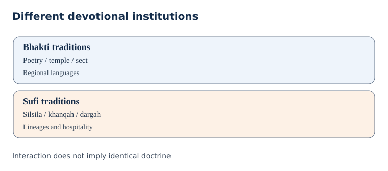
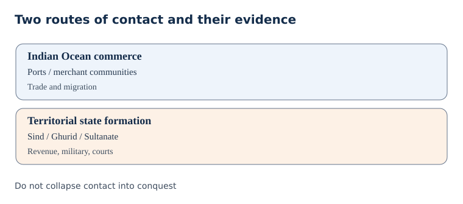
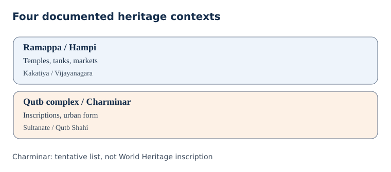

# Paper II · Unit I · Topic 2 — Islam, Bhakti–Sufi Traditions and Composite Culture

**Cycle80 integrated editable student edition | 29 October 2026 | ORIGINAL PRACTICE, NOT OFFICIAL PYQs | NOT academically approved.**

**Provenance:** one integrated manuscript using the 25 October authorial depth repair, five new source-bounded concept expansions, six corrected original practice MCQs, the existing six mains answers and original diagrams. Earlier segmented notes and the 17-page original PDF remain separately preserved. No text is repeated verbatim as a second full chapter.

## Official-syllabus wording (historically reported, not reauthenticated this cycle)

> Advent of Islam and its impact on Indian Society – Nature and significance of Bhakti and Sufi Movements; Contribution of Kakatiya, and Vijayanagara rulers to Language, Literature, Art and Architecture: the contribution of Delhi Sultans and Mughals to Language, Literature, Art, Architecture and Fine Arts, Monuments; Emergence of Composite Culture in the Deccan and India.

**R1 caveat:** the 2024 notification wording was recorded in earlier work, but the original commission-hosted PDF has not been independently reopened in Cycle80. Do not upgrade R1 to PASS from this statement.

## Quick revision and common pitfalls

## Ten distinctions to retain

1. Maritime trade contact is older than the conventional 1206 Delhi Sultanate starting date.
2. The iqta was a revenue-service assignment, not simply private freehold ownership.
3. The Qutb complex's Alai Darwaza is dated 1311; its reused materials are specific archaeological evidence.
4. Bhakti is a family of regional traditions, not one centrally organised institution.
5. Alvars: Vishnu; Nayanars: Shiva; vachanas: Kannada devotional compositions.
6. Kabir, Ravidas and Mirabai offer different critiques and devotional voices; textual attribution needs scrutiny.
7. Silsila: lineage; khanqah: teaching/hospitality centre; dargah: shrine; sama: devotional listening.
8. Ramappa: Kakatiya temple at Palampet; UNESCO-inscribed 2021; linked to tank and dance imagery.
9. Hampi: Vijayanagara capital; UNESCO-inscribed 1986; Talikota 1565.
10. Charminar: founded 1591; Qutb Shahi monuments placed on UNESCO **Tentative List** in 2010, not inscribed.

## Mains answer skeleton

**Background → political/religious institutions → named material or literary evidence → social limits → Telangana example → balanced conclusion.**

## Three traps

- Do not claim Bhakti or Sufism eliminated caste.
- Do not describe every Persianate technique as an import without local craft labour.
- Do not mistake a ruler's religious affiliation for the beliefs of every subject.

## Source-critical detailed concepts

## 1. A method for reading a connected but unequal medieval history

The commission combines Islamic contacts, devotional traditions, royal patronage and composite culture in one syllabus item. These are related but not interchangeable processes. A port settlement might contain Muslim merchants centuries before a nearby ruler accepted a sultan's authority; a temple could acquire new donors while a Persianate court employed Telugu accountants; and a Sufi shrine could attract visitors without erasing doctrinal differences. Therefore chronology, geography and social position must precede claims about influence. The appropriate unit of analysis changes with the question: an inscription identifies a patron, a land grant reveals a revenue relationship, a poem articulates a moral position, and an urban plan reveals investment and circulation. None alone proves the experience of an entire population.

A useful four-part test asks: who produced the evidence, for whom, under which institutional incentives, and what remains invisible? The political language of a victory inscription may conceal the cost of warfare; a hagiography can turn a complex saint into an exemplary miracle-worker; a court chronicle may present a sovereign's tolerance as an ideal while local disputes continued. The test matters particularly for the word 'composite': it should designate demonstrable borrowing and coexistence in specific practices, not an unqualified claim that medieval society was uniformly harmonious. Conversely, recording conflict does not justify reducing centuries of shared markets, craft techniques and language formation to perpetual antagonism.

## 2. Islamic contact: the sea route and the political route

Arabian Sea trade linked western Indian ports with the Persian Gulf, Red Sea and East African circuits before the Delhi Sultanate. Merchant communities, maritime credit, shipping technology and the circulation of religious specialists created opportunities for Islam to be practised in coastal settings without requiring a territorial conquest. The early eighth-century conquest of Sind under Muhammad bin Qasim was a separate military-political event, not the origin of every Indian Muslim community. The campaigns of Mahmud of Ghazni in the eleventh century and Muhammad of Ghor in the late twelfth century likewise differed in their aims and enduring political consequences.

After the defeat of Prithviraj Chauhan at the Second Battle of Tarain in 1192, Ghurid authority developed through military commanders; the conventional start of the Delhi Sultanate is 1206 under Qutb al-Din Aibak. This date marks a state-formation convention, not the 'arrival' of Islam in India. Contacts also spread through craftspeople, scholars, soldiers, marriage networks and pilgrimage. In an exam answer, distinguish the geography of trade from the geography of conquest and explain how regional societies negotiated the new political institutions. Avoid treating a ruler's religion as an automatic description of the religion of all his subjects.

## 3. Delhi Sultanate: authority, iqta and the agrarian foundation

The Sultanate is commonly periodised into the Mamluk, Khalji, Tughlaq, Sayyid and Lodi dynasties. Dynastic labels are a chronological aid, not proof of identical administrative practice. The court needed military retainers, fiscal resources, fortified towns and provincial intermediaries. The iqta was primarily an assignment of revenue collection and obligations associated with service; it should not be described as an unrestricted hereditary ownership of land. Under different rulers, the centre tried to supervise assignees, assess cultivation and restrain the autonomy of commanders. The durability of these controls varied with local power.

Alauddin Khalji's market measures, revenue demands and military expenditure are linked in chroniclers' accounts; the political objective of provisioning a large army helps explain why grain prices and supply mattered. Muhammad bin Tughlaq's ambitious policies should be assessed with attention to administrative capacity and regional response rather than a stock caricature of irrationality. Firuz Shah Tughlaq's canals and endowments show another pattern of legitimacy-building, though contemporary descriptions need corroboration. The Sultanate's importance extends beyond succession lists: it stimulated Persian record-keeping, military labour markets, town construction and new channels for artisans, while relying on pre-existing agrarian communities and regional elites.

## 4. Evidence from the Qutb complex: patronage, reuse and technique

**Material sequence and what it can prove.** The UNESCO World Heritage Centre describes the Qutb complex as a group rather than a monument erected in a single campaign: its early mosque, minar, Iltutmish tomb, later Alai Darwaza and incomplete Alai Minar have different patrons and construction contexts. The Alai Darwaza is specifically dated **1311**, whereas the Qutb Minar's main construction belongs to the early thirteenth century. These differences allow a chronology of political ambition and changing technical practice, but a surviving façade alone cannot establish every builder's identity or the conditions of employment. The institution explicitly identifies architectural material reused from Hindu temples at the Quwwatu'l-Islam mosque. That is evidence for this complex, not a quantified account of every Sultanate building. [UNESCO, Qutb Minar and its Monuments](https://whc.unesco.org/en/list/233).

**How to examine the site.** Separate four layers of evidence: visible building fabric, contemporary inscriptions, later written descriptions and modern conservation interpretation. A stone block reused in a wall may retain earlier carvings; it documents material transfer but does not automatically tell us who ordered it, why, or whether every artisan shared the patron's faith. A dated inscription can strengthen attribution, although it is itself a statement of power. Compare the mosque and gate's plan, arch profile and decoration rather than reducing the ensemble to a simple Hindu-versus-Muslim label. This is especially relevant to a Telangana mains answer comparing Delhi with Golconda: different patronage and chronology must be specified before discussing cultural adaptation.

The Qutb complex near Delhi supplies a material counterpoint to court narratives. UNESCO records the Qutb Minar, early mosque, Iltutmish's tomb and the Alai Darwaza, constructed in 1311. Its description also identifies reused temple architectural material in the Quwwat-ul-Islam mosque. This evidence should not be concealed in a simplistic harmony narrative, but neither should it be extrapolated into an unsupported claim that every medieval building followed the same history. Stonework reveals artisans' technical skills, reuse practices, new epigraphic programmes and changing royal symbolism.

Arches, domes and vaulting involve structural questions as well as aesthetic ones. A pointed arch is not simply a decorative 'foreign style'; it transfers loads differently from a corbelled opening, and actual buildings often combine techniques. Inscription bands communicate patronage and sovereignty, while tombs make dynastic memory visible. The Alai Darwaza's form can be compared with earlier complex components to trace experimentation. For Telangana administrators responsible for heritage, the same evidentiary discipline applies: conservation decisions should rest on fabric studies, inscriptions and documented alterations, not merely on tourist brochures or religiously charged generalisations.

## 5. Bhakti: devotion as a family of traditions, not a single organisation

Bhakti denotes devotional orientations, but there was no single medieval 'Bhakti Movement' with one founder, programme or membership. Tamil Alvar and Nayanar poetry, Karnataka's Virashaiva vachanas, Maharashtra's Varkari compositions and north Indian sant traditions arose in different historical environments. Their languages, theological premises, ritual commitments and relationships to institutions differ. The categories saguna and nirguna are helpful for comparing devotion to a deity with attributes and devotion to an ultimate reality beyond form; they are not boxes into which every verse fits neatly.

The popularity of vernacular composition changed who could hear and participate in religious debate. Yet oral performance, manuscript transmission and later compilation complicate attribution. A verse ascribed to Kabir in a later collection may reflect editorial selection, not a verbatim fifteenth-century transcript. Bhakti poetry could challenge hierarchy and open public argument, but it also coexisted with temple endowments, sectarian authority and established social distinctions. Its historical significance lies in this tension: devotional voice could expand participation without automatically abolishing the material organisation of caste, gender or landholding.

## 6. Alvars, Nayanars and the political economy of temples

The Tamil Alvars celebrated Vishnu, while Nayanars expressed Shaiva devotion; their compositions are associated with the development of temple-centred religious landscapes in the early medieval south. Later canonisation and institutional incorporation helped connect itinerant song, ritual recitation and patron-supported temples. The temple was simultaneously a ritual centre, employer, landholder, store of artistic skill and site of public assembly. Endowments might fund lamps, feeding, festivals or personnel, creating recurring claims on agrarian surplus.

A careful explanation does not equate temple patronage with universal prosperity. Land grants could sustain learning and craft production while reinforcing unequal control over resources. Nor is the presence of devotional songs proof that every social group entered the inner ritual hierarchy on equal terms. This dual character is crucial for comparing the Kakatiya and Vijayanagara cases: the patronage of dance, sculpture and vernacular literature expanded cultural production, while inscriptions still disclose rulers, donors and local elites as gatekeepers. Temple history therefore links belief to labour, taxation, gender and the environment, especially irrigation tanks that made agrarian endowments sustainable.

## 7. Basavanna, vachana literature and contested social change

The Virashaiva or Lingayat tradition associated with Basavanna in twelfth-century Karnataka is often discussed for its critique of ritual status, inherited privilege and social exclusion. Vachanas are short, direct compositions that allow an intensely personal and ethical religious voice. Their style contrasts with elaborate courtly panegyric and supports questions about access to religious expression. Women vachana authors, including Akka Mahadevi, are important for analysing the possibilities and constraints of female spiritual agency.

The historian must separate a normative rejection of caste from evidence that caste disappeared in practice. Sectarian institutions, changing political alliances and later community histories complicate any claim of immediate social revolution. Attribution and dating also require care because oral transmission and subsequent anthologies can transform a tradition's textual record. A mains answer should explain both emancipatory argument and institutional limits, citing the form of the vachana itself as a source type rather than merely memorising saint names.

## 8. Kabir, Ravidas, Mirabai and competing visions of devotion

Kabir's attributed compositions question hollow ritualism and religious pretension across communal boundaries; they are particularly useful for studying nirguna devotional language. Ravidas is significant for a religious ethic of dignity that challenges the humiliation associated with caste. Mirabai's devotional voice demonstrates a woman's capacity to contest social expectations, but the poems' manuscript histories and later biographies demand source criticism. Tulsidas's Ramcharitmanas belongs to a different theological and literary context; it cannot be presented as identical to Kabir's teaching merely because both used a regional language.

The exam-relevant distinction is between a poet's claim and its social outcome. A line against caste hierarchy demonstrates criticism, not the immediate disappearance of caste-based labour. A female devotional persona indicates a discursive possibility, not proof that all women enjoyed autonomy. The influence of these compositions spread through singers, sectarian communities, manuscripts, printing and modern public memory. Their meanings also changed over time. The appropriate comparison therefore covers doctrine, language, intended audience, patronage, textual transmission and the social problems to which the compositions responded.

## 9. Sufism: silsila, khanqah, dargah and the plurality of practice

Sufism comprises varied Islamic traditions of ethical discipline, spiritual teaching and remembrance of God. A silsila traces a lineage of teaching; a khanqah is a setting for instruction, hospitality and collective life; a dargah is a shrine associated with a revered figure, often developing after that person's death. Dhikr concerns remembrance, while sama can refer to devotional listening and performance, whose acceptability was debated. These terms must not be used as synonyms.

The Chishti and Suhrawardi traditions provide an instructive comparison, but statements such as 'Chishtis never accepted rulers' gifts' are too absolute. Particular masters differed, and later successors adapted to local patronage. Nizamuddin Auliya's Delhi milieu illustrates a khanqah's urban connections; Muinuddin Chishti's shrine at Ajmer illustrates the growth of pilgrimage memory. Shrine participation across community lines is historically significant, but attendance is not evidence that religious distinctions disappeared. Sufi networks moved with scholars, disciples, merchants and migrants; their archives include malfuzat (reported conversations), letters, biographies and inscriptions, each requiring critical assessment.

## 10. Bhakti and Sufi comparison without false equivalence

Bhakti and Sufi traditions both produced vernacular or accessible religious expression in some settings, but their philosophical languages and institutional structures differed. A Sufi lineage often placed strong emphasis on a master-disciple chain within Islamic practice; a devotional sect might centre on a deity, a poet-saint, a temple or a community of singers. Some groups criticised status distinctions, yet neither category guarantees identical attitudes toward ritual, women or political power.

The strongest comparison asks five questions: what is the path to spiritual transformation; which text or performance mediates it; who authorises teachers; how is economic support organised; and what relationships develop with local rulers? A khanqah's hospitality could bring diverse people into contact, while a temple festival could connect artisans, cultivators and patrons. Both could become sites of hierarchy as well as exchange. 'Composite culture' is an outcome to demonstrate in particular contexts—such as shared musical idioms or linguistic borrowing—not an attribute automatically possessed by every Bhakti or Sufi institution.

## 11. Kakatiya state and Telugu cultural production

**Ramappa as a test case, not a generic Kakatiya label.** UNESCO's inscription dossier locates Rudreshwara (Ramappa) Temple at Palampet, associates its construction with the Kakatiya period beginning in **1213**, and documents its distinctive combination of sandstone, carved dolerite, granite and lightweight porous bricks in the vimana. Its bracket figures depict movement and regional dance traditions. The Ramappa Cheruvu reservoir and surrounding agricultural landscape are integral to the site's setting, not incidental scenery. The temple was inscribed on the World Heritage List in **2021**; this is an actual inscription, unlike the tentative listing of the Qutb Shahi Hyderabad monuments. [UNESCO, Ramappa Temple](https://whc.unesco.org/en/list/1570).

**Political economy of an architectural achievement.** An exam answer should ask how an elite-sponsored temple was sustained by artisans, material procurement, transport, ritual personnel and agrarian surplus. The inscriptional or monumental record may identify a donor while leaving many workers unnamed. Dance imagery proves that artists represented a regional repertoire; it cannot independently reconstruct the exact performance of every medieval dancer. Likewise, the reservoir demonstrates landscape planning, but its existence alone does not establish the distribution of irrigation benefits among cultivators. Compare this evidence with Kakatiya-era epigraphy before asserting administrative policies. A responsible heritage administrator also distinguishes conservation of the temple fabric from the management of its lake, approaches, village livelihoods and visitor traffic. UNESCO's conservation discussion makes this wider setting part of the heritage question.

Kakatiya rule in the Telugu region brought together military authority, temple construction, irrigation systems and literary patronage. The Ramappa temple at Palampet is a well-documented example: UNESCO identifies its 1213 construction commencement, distinctive stone carving, lightweight brick superstructure and relationship to the nearby tank. These features should be analysed together. Water storage supported cultivation and settlement; agricultural surpluses supported donors and artisans; temples displayed political authority and sacred legitimacy; sculpture preserved forms of dance and regional aesthetic knowledge.

The Kakatiya cultural story also includes Telugu literary production and the role of courtly and non-courtly authors. Palkuriki Somanatha's works associated with Virashaiva traditions demonstrate that regional literature cannot be reduced to the royal court alone. Tikkana's Telugu Mahabharata contribution belongs to a wider Telugu literary world in which patronage networks crossed present-day administrative boundaries. Rudrama Devi's rule invites analysis of gendered legitimacy, inscriptional titles and political succession rather than a generic celebration. A defensible answer names specific monuments, textual traditions and evidence types while acknowledging that surviving royal inscriptions overrepresent elite priorities.

## 12. Vijayanagara: urban infrastructure, languages and contested narratives

**Reading Hampi as an urban system.** UNESCO describes more than **1,600 surviving remains** at Hampi, including fortifications, sacred and royal precincts, riverside structures, markets, water installations and stables. This spatial range matters: Vijayanagara was not simply a cluster of temples. The Tungabhadra basin shaped its transport and water arrangements, while courtly patronage drew on agriculture, trade and skilled labour. Secular structures such as the Elephant Stables and Queen's Bath display architectural adaptations that UNESCO characterises as Indo-Islamic elements within the wider Vijayanagara landscape. The evidence is incompatible with a claim that every artistic form in the city belonged to one unchanging religious style. [UNESCO, Group of Monuments at Hampi](https://whc.unesco.org/en/list/241).

**Conquest, destruction and continuity must be separated.** The Battle of Talikota in **1565** and subsequent damage to the capital are major chronological markers, but the fate of the royal centre should not be conflated with the instantaneous disappearance of all Vijayanagara institutions or cultural forms elsewhere in south India. UNESCO's heritage narrative identifies extensive destruction and abandonment of the capital, while the longer political history includes successor centres and surviving traditions. The site was inscribed in **1986**, a date different from the sixteenth-century events. In a mains comparison, place Hampi alongside Ramappa and the Qutb complex using three questions: how did rulers mobilise resources, which craft and spatial choices survive, and how far do later heritage descriptions allow us to infer historical experience? A UNESCO summary is an institutional interpretation, not a substitute for primary inscriptions, excavation reports or travellers' texts.

Vijayanagara, with its major capital at Hampi, developed from the fourteenth century into a powerful political and cultural centre. UNESCO's Hampi record describes sacred complexes, markets, palaces, water systems, gateways and extensive urban remains. These are not separate 'religious' and 'economic' worlds: pilgrimage routes attracted commerce; reservoirs enabled urban supply; festivals required labour and finance; monumental gateways made sovereignty visible. Krishna Deva Raya's reign (1509–1530) is a prominent point for Telugu and Sanskrit patronage, including his Telugu Amuktamalyada, while Kannada and Tamil literary worlds also mattered.

The 1565 Battle of Talikota and the subsequent damage to the capital are essential to its political history, but the decline of one capital did not instantly end all Vijayanagara successor networks. Nor should the conflict be rendered as a simple clash of two permanently unified religious blocs: Deccan politics involved changing alliances, diplomacy and military service across courts. Travel narratives such as those associated with Domingo Paes and Fernao Nuniz illuminate markets and spectacle, yet their outsider vantage and later transmission require corroboration against archaeology and inscriptions.

## 13. Delhi Sultanate literary culture and urban fine arts

Persian served as an important language of administration and courtly writing under the Delhi Sultanate, but its prominence did not eliminate Sanskrit, regional literary languages or oral traditions. Amir Khusrau is associated with Persian literary experimentation and with the Indo-Persian cultural environment of the Delhi court and Sufi networks. Claims that he personally invented every later musical form attributed to him are often retrospective and should not be repeated without evidence. The growth of towns created audiences and employment for calligraphers, masons, musicians, metalworkers and manuscript specialists.

A historian should examine language through actual genres: farmans and revenue records communicate authority; chronicles construct political memory; devotional poetry circulates ethical argument; inscriptions advertise patronage; music moves through performance communities. Architecture likewise reveals the labour of artisans trained in multiple traditions. The Qutb complex demonstrates how inscriptional bands, stone carving and building forms developed through patronage and local skill. This avoids the misleading binary that Persianate art was entirely imported while Indic traditions remained unchanged.

## 14. Mughal patronage: court histories, translation and architecture

Mughal culture combined imperial ideology with diverse workshops and regional contributors. Babur's memoir is an autobiographical source with a ruler's viewpoint; Abu'l Fazl's Akbarnama and Ain-i Akbari document and celebrate Akbar's court and administrative ambitions. They should be read as authored works, not transparent statistical databases. Akbar's translation bureau and interreligious discussions illustrate intellectual exchange under imperial sponsorship, while the principle often described as sulh-i kul concerns an imperial ideal of broad accommodation, not a guarantee that every locality was free of conflict.

Mughal miniature painting emerged from collaboration among artists, including Persian-trained and Indian practitioners, and developed distinctive portraiture, manuscript illustration and naturalistic observation. The architectural record ranges from Humayun's Tomb and Fatehpur Sikri to the Taj Mahal, with differences in purpose, materials and design. Monumental building depended on land revenue, skilled labour and supply chains; a polished marble surface should therefore prompt questions about artisans and economic organisation. Regional courts adapted Mughal forms rather than simply copying them, and the Deccan's Persianate culture had important independent histories.

## 15. The Deccan: Bahmani, successor sultanates and political exchange

The Bahmani Sultanate and its successor states were major actors in the Deccan, with Persianate administrative and artistic practices shaped by local languages and social conditions. Political competition did not prevent the circulation of soldiers, architects, merchants and scribes. Telugu, Kannada, Marathi, Dakhni and Persian interacted unevenly across towns, courts and religious settings. 'Dakhni' is not merely defective Persian or a synonym for modern Urdu; it has a distinctive historical literary trajectory and must be located in its own period.

The Deccan's cultural formation is visible in inscriptions, urban design, tomb architecture, music and courtly literature. Royal patronage might encourage literary experimentation while also excluding groups lacking access to education or power. The regional case helps correct two simplifications: that Delhi alone determined Indian Islamic culture, and that cultural borrowing meant political peace. Military conflict, shared artisanal methods and bilingual service could coexist. Exam answers should show these simultaneous processes rather than forcing the evidence into a single moral verdict.

## 16. Qutb Shahi Golconda and Hyderabad: a concrete composite city

**Urban evidence and the distinction between listing statuses.** India's submission to UNESCO's **Tentative List on 10 September 2010** groups Golconda Fort, Qutb Shahi Tombs and Charminar, but these are not thereby World Heritage-inscribed properties. The submission identifies Charminar as a ceremonial marker of Hyderabad's foundation in **1591**, situated at the crossing of the old city's principal axes. It also describes the fort's defensive and water systems and the tombs as a royal necropolis with dated epitaphs. This is an unusually concrete basis for discussing courtly memory, planned streets and the relation between an earlier fortified capital and a newer urban centre. [UNESCO Tentative List 5573](https://whc.unesco.org/en/tentativelists/5573/).

**Source criticism.** A tentative-list nomination is a case advanced by the submitting State Party; its claims about exceptional value and cultural synthesis are not the same as independent inscription by the World Heritage Committee. Some chronologies are supported by dated epitaphs, while others rely on later chronicles or stylistic interpretation. For a Telugu-region history answer, separate documented bilingual service and courtly literature from a generalised assertion that all subjects experienced harmony. Commercial exchange, military competition and differentiated access to state patronage can occur simultaneously. For conservation policy, the monument's axial relationship to its surrounding streets is as important as its decorative stonework: traffic redesign or intrusive construction can affect the historic urban setting even when the four minarets remain standing.

The Qutb Shahi dynasty ruled Golconda and Hyderabad from the sixteenth to the late seventeenth century. India's 2010 UNESCO tentative-list submission identifies Golconda Fort, the Qutb Shahi tombs and Charminar as an interconnected historical ensemble, and dates the founding of Hyderabad's Charminar to 1591. This is a tentative listing, NOT a UNESCO World Heritage inscription. The source describes Persianate and Indic design features, planned axial streets, royal funerary architecture and inscriptions. The material evidence allows a stronger discussion of cultural synthesis than vague statements about 'unity in diversity'.

Muhammad Quli Qutb Shah's literary patronage and Dakhni compositions, and the wider Qutb Shahi engagement with Telugu culture, illuminate multilingual court life. However, language patronage should not be confused with universal equality: social stratification and political violence remained possible. Golconda's fortification, commercial circuits and urban water systems link cultural production to revenue and defence. The tombs' dated epitaphs offer a firmer chronological anchor than later romantic stories. A good Telangana example traces one monument from its original function to its present conservation regime and distinguishes documented inscription from tourism folklore.

## 17. Comparative case: Ramappa, Hampi, Qutb complex and Charminar

**Comparison by evidence rather than dynastic stereotypes.** Ramappa's UNESCO record emphasises a temple integrated with a reservoir and sculptural dance forms; Hampi's dossier describes a capital with sacred, royal and hydraulic systems; the Qutb dossier documents a multi-period Delhi complex, including reused building material; and India's Hyderabad tentative-list submission sets out a fortified capital, royal tombs and a planned ceremonial node. These four records support *different* types of inference. Ramappa and Hampi are World Heritage properties (inscribed in 2021 and 1986), as is the Qutb complex (1993); the Qutb Shahi Hyderabad ensemble is only on the Tentative List (submitted 2010). Listing dates should never be confused with construction dates. [UNESCO Ramappa](https://whc.unesco.org/en/list/1570); [UNESCO Hampi](https://whc.unesco.org/en/list/241); [UNESCO Qutb](https://whc.unesco.org/en/list/233); [Hyderabad Tentative List](https://whc.unesco.org/en/tentativelists/5573/).

**A workable comparative answer.** Use four columns: physical setting and water, institutional patronage, material or literary evidence, and conservation implications. A lake-facing temple requires landscape management; a former imperial city requires protection of dispersed precincts; a Sultanate complex demands stratigraphic care when identifying different building phases; a historic urban crossroad requires street-level planning. This method explains why 'composite' cannot substitute for detailed observation. It also exposes a limit: UNESCO dossiers prioritise heritage value and preservation, not comprehensive social histories of labourers, women, religious minorities or rural producers. Those questions require additional records and should be flagged rather than filled with confident speculation.

Four heritage ensembles permit comparison across religious and dynastic labels. Ramappa demonstrates Kakatiya stone craft, dance imagery and reservoir-linked landscape. Hampi shows Vijayanagara's integrated sacred, commercial, royal and hydraulic spaces. Delhi's Qutb complex documents early Sultanate architecture, inscriptional sovereignty and material reuse. Hyderabad's Charminar and Qutb Shahi monuments display an urban grid and a Deccani architectural synthesis. Each has a different chronology and patronage system; similarities should be specified rather than asserted.

A comparative matrix asks what the original function was, who financed construction, which communities worked on it, what technologies were used, and what conservation threats exist today. This prevents the common exam error of listing monuments without explaining the institutions behind them. It also connects historical learning to administration: zoning, visitor movement, encroachment, maintenance and local livelihoods can be evaluated without treating heritage as a decorative afterthought. Inscriptions and measured architectural surveys should be prioritised over unsupported origin legends.

## 18. Limits of the composite-culture concept

Composite culture can be demonstrated through shared vocabularies, music, craft methods, architectural forms, foodways and urban coexistence. But the term can become misleading if it suggests a uniform national synthesis with no conflict or power imbalance. Different communities had unequal access to land, courts, education and mobility. Some monuments preserve traces of conquest and reuse; some poems express sharp religious disagreement; some courtly patronage excluded subaltern voices. Historical explanation must hold these facts together.

The opposite reduction—to a history consisting only of invasion and hostility—also fails because it cannot explain multilingual literary courts, mixed craft traditions, pilgrimage economies and everyday trade. A rigorous conclusion is neither celebratory nor condemnatory by default. It identifies the level at which exchange occurred, the sources proving it, the institutions sustaining it and the people whose experience is not documented. For TGPSC, this balanced method produces stronger answers than slogans and helps distinguish the past from present-day political uses of history.

## 19. Applied Telangana heritage administration: three decisions

Case A: a proposed road near a protected monument. The district team should first establish the legal protection boundary, commission a heritage-impact assessment, consult ASI or the competent state authority, and examine alternative alignments. An attractive tourism estimate cannot substitute for statutory permissions. Case B: a school textbook claims that Charminar is already a UNESCO World Heritage Site. The factual correction is that the Qutb Shahi monuments were submitted to UNESCO's Tentative List in 2010; this differs from inscription on the World Heritage List. The teacher should demonstrate the difference between nomination, tentative listing and inscription using primary institutional records.

Case C: a public exhibition says Bhakti and Sufism eliminated caste divisions. The curator should replace the categorical statement with examples of anti-hierarchical critique, the diversity of traditions and evidence of continuing social inequality. Exhibit labels should distinguish poems, hagiographies and inscriptions. These cases show that historical accuracy is not merely academic: it affects planning decisions, educational content and the representation of communities.

## 20. Synthesis for mains and high-yield revision

The full topic is best understood as interaction among political institutions, religious expression, language and material culture. Islam's presence spread through different routes; Sultanate administration connected revenue and military power; Bhakti and Sufi traditions expanded ethical debate but differed internally; Kakatiya and Vijayanagara patronage linked temples to land, labour and literary production; Delhi Sultanate and Mughal courts supported distinctive arts; Deccan cities adapted and combined forms without eliminating political competition.

For a 200–250-word answer, use a four-part architecture: contextual background, three mechanisms, named regional evidence and a qualified conclusion. Give dates only where securely supported, identify source limitations and reserve a sentence for contrasting interpretations. A strong answer can compare Ramappa, Hampi and Charminar while explicitly stating that the last belongs to a UNESCO tentative-list ensemble, not an inscribed World Heritage site. This is more accurate than an inventory of dynasties or an unsupported claim of uninterrupted harmony.

## Original analytical diagrams

**Diagram limitation:** These pre-existing diagrams are embedded as study aids. Their full-resolution historical and accessibility audit remains pending.

## Original practice MCQs (not authenticated previous-year questions)

### Q1. Which distinction best explains early Islam in India?
A. All communities began with the Delhi Sultanate
B. Maritime contact preceded some territorial conquests
C. Islam spread only by military campaigns
D. Trade ended after the eighth century

**Answer: B.** Arabian Sea trading communities and territorial state formation followed different timelines.

### Q2. What does 1206 conventionally mark?
A. First Muslim merchant in India
B. Establishment of Mughal power
C. Beginning of Delhi Sultanate under Aibak
D. Battle of Talikota

**Answer: C.** 1206 is a political periodisation marker, not the first arrival of Islam.

### Q3. Which Sultanate institution was linked to revenue and service?
A. Iqta
B. Dargah
C. Vachana
D. Sama

**Answer: A.** Iqta concerned revenue assignments and service obligations, not absolute private land ownership.

### Q4. Which evidence most directly records a medieval patron on a monument?
A. Modern travel blog
B. Contemporary inscription
C. A television serial
D. Unattributed proverb

**Answer: B.** A securely dated inscription gives stronger patronage evidence than modern retellings.

### Q5. Which component of the Qutb complex does UNESCO specifically date to 1311?
A. The earliest Quwwatu'l-Islam mosque
B. The tomb of Iltutmish
C. The Alai Darwaza ceremonial gateway
D. The original Qutb Minar construction

**Answer: C.** UNESCO explicitly dates the Alai Darwaza to 1311; the other components belong to earlier phases. Source: https://whc.unesco.org/en/list/233. **Bounded check:** all four alternatives compared against the site chronology.

### Q6. The reuse of temple materials at the Qutb complex shows:
A. Every monument shared identical construction history
B. Material reuse in a documented specific setting
C. There was no local craft labour
D. All inscriptions are modern

**Answer: B.** The specific evidence should neither be denied nor generalized to every site.

### Q7. Which statement about Bhakti is historically defensible?
A. It had one central headquarters
B. All poet-saints rejected temples
C. It encompassed varied regional devotional traditions
D. It began in 1857

**Answer: C.** Bhakti encompasses diverse traditions across regions, periods and theological positions.

### Q8. Alvars are especially associated with devotion to:
A. Vishnu
B. Shiva exclusively
C. The Mughal emperor
D. Sufi lineages

**Answer: A.** Alvar poetry is associated with Vaishnava devotion in the Tamil region.

### Q9. Nayanars are especially associated with:
A. Shaiva devotion
B. Mughal miniature painting
C. Iqta administration
D. Dakhni court poetry

**Answer: A.** Nayanar traditions are associated with Shaiva devotional expression.

### Q10. A vachana is best understood as:
A. A Mughal revenue order
B. A concise devotional composition
C. A royal tomb
D. A Delhi fortification

**Answer: B.** Vachanas provide a distinctive Kannada devotional literary form.

### Q11. Why must Kabir verse attribution be treated cautiously?
A. No verses survive anywhere
B. Transmission and later compilations affect texts
C. All texts were official edicts
D. Kabir wrote only Persian court histories

**Answer: B.** Oral and manuscript transmission can alter attribution and wording.

### Q12. Ravidas is especially relevant to discussions of:
A. Imperial market price controls
B. Caste dignity and devotional critique
C. Hampi fortification
D. Mughal cavalry manuals

**Answer: B.** Ravidas is central to anti-hierarchical devotional ethics.

### Q13. Which concept means a Sufi spiritual lineage?
A. Silsila
B. Iqta
C. Mandapa
D. Farman

**Answer: A.** A silsila identifies a lineage of teaching and authority.

### Q14. A khanqah differs from a dargah because it is primarily:
A. A dynastic capital
B. A centre of teaching and hospitality
C. A market-tax ledger
D. A military fort

**Answer: B.** A khanqah is a living institutional setting; a dargah is a shrine associated with a revered figure.

### Q15. Sama in Sufi contexts concerns:
A. Irrigation canals
B. Devotional listening
C. Land-revenue assignment
D. Temple tower design

**Answer: B.** Sama concerns forms of attentive devotional listening and was contested in some settings.

### Q16. Which comparison avoids overgeneralisation?
A. All Chishtis rejected every royal gift
B. All Sufis followed one identical rule
C. Specific masters and periods differed in patronage
D. Sufism was identical to Bhakti

**Answer: C.** Institutional practices varied across masters, places and time.

### Q17. Which named landscape element is specifically linked with Ramappa Temple in UNESCO's description?
A. The Tungabhadra riverine capital at Hampi
B. The Kakatiya-built Ramappa Cheruvu reservoir
C. The Alai Darwaza in the Qutb complex
D. The axial streets around Hyderabad's Charminar

**Answer: B.** UNESCO places Ramappa in relation to Ramappa Cheruvu; the alternatives refer to different sites. Sources: https://whc.unesco.org/en/list/1570 and the Hampi, Qutb and Hyderabad entries. **Bounded check:** four alternatives compared by site.

### Q18. Which of the following heritage-status statements is correct?
A. Hampi was first inscribed on the World Heritage List in 2021
B. Ramappa Temple was inscribed on the World Heritage List in 2021
C. Qutb Minar and its Monuments were first inscribed in 2021
D. The Hyderabad Qutb Shahi ensemble was inscribed in 2021

**Answer: B.** Ramappa: 2021; Hampi: 1986; Qutb complex: 1993; Hyderabad ensemble: 2010 Tentative List submission, not inscription. Sources: https://whc.unesco.org/en/list/1570, https://whc.unesco.org/en/list/241, https://whc.unesco.org/en/list/233 and https://whc.unesco.org/en/tentativelists/5573/. **Bounded check:** all four status claims compared against institutional records.

### Q19. Which capital–polity pairing is established by UNESCO's Hampi description?
A. Hampi — Bahmani Sultanate
B. Hampi — Vijayanagara Empire
C. Hampi — Qutb Shahi dynasty
D. Hampi — Delhi Sultanate

**Answer: B.** UNESCO identifies Hampi as the former capital of Vijayanagara, rather than a capital of the other named polities. Source: https://whc.unesco.org/en/list/241. **Bounded check:** all alternatives assessed against the identified capital.

### Q20. Which year does UNESCO connect with the Battle of Talikota and extensive damage to Hampi's urban fabric?
A. 1311
B. 1526
C. 1565
D. 1687

**Answer: C.** UNESCO links the battle and destruction of Hampi to 1565; the other dates are not the event year. Source: https://whc.unesco.org/en/list/241. **Bounded check:** all four year alternatives assessed against the UNESCO chronology.

### Q21. Which work is associated with Krishna Deva Raya?
A. Amuktamalyada
B. Ain-i Akbari
C. Tarikh-i Firuz Shahi
D. Baburnama

**Answer: A.** Amuktamalyada is a Telugu literary work attributed to Krishna Deva Raya.

### Q22. Which scholar is associated with Akbarnama and Ain-i Akbari?
A. Abu al-Fazl
B. Kabir
C. Basavanna
D. Domingo Paes

**Answer: A.** Abu al-Fazl authored court histories and administrative descriptions under Akbar.

### Q23. What is the correct caution about Ain-i Akbari?
A. It has no historical value
B. It is an authored imperial work requiring criticism
C. It is a modern census
D. It describes the Kakatiyas exclusively

**Answer: B.** Courtly statistical and administrative claims must be contextualised.

### Q24. Mughal miniature painting is best characterised by:
A. No collaborative workshops
B. Only anonymous European painters
C. Court-supported collaboration and regional adaptation
D. Absence of manuscript illustration

**Answer: C.** Workshop collaboration and diverse artistic inputs shaped the tradition.

### Q25. Which statement correctly distinguishes the heritage status of Charminar?
A. It is a World Heritage property inscribed in 1986
B. It is a World Heritage property inscribed in 1993
C. It is included in India's 2010 Qutb Shahi Tentative List submission and is associated with 1591
D. It was inscribed on the World Heritage List with Ramappa in 2021

**Answer: C.** India's 2010 tentative-list submission identifies Charminar with Hyderabad's foundation in 1591; tentative listing is not inscription. Other years correspond to Hampi (1986), Qutb (1993) and Ramappa (2021). Sources: https://whc.unesco.org/en/tentativelists/5573/, https://whc.unesco.org/en/list/241, https://whc.unesco.org/en/list/233 and https://whc.unesco.org/en/list/1570. **Bounded check:** four options checked against site status and chronology.

### Q26. Which period best identifies Qutb Shahi rule in Golconda/Hyderabad?
A. 1518–1687
B. 1206–1290
C. 1757–1947
D. 1948–2014

**Answer: A.** The UNESCO tentative-list submission identifies the Qutb Shahi period as 1518–1687.

### Q27. Dakhni should be understood as:
A. A language without its own literary history
B. A distinctive Deccan literary tradition
C. The sole language of all Mughal documents
D. A synonym for Sanskrit

**Answer: B.** Dakhni developed in multilingual Deccan settings and should not be dismissed as defective Persian.

### Q28. Which source best dates Qutb Shahi tombs?
A. Dated epitaph inscriptions
B. Unverified local legends
C. Modern film dialogue
D. Anonymous tourist comment

**Answer: A.** Epitaphs provide direct chronological evidence for named tomb occupants.

### Q29. Which approach best defines composite culture?
A. All conflict disappeared
B. Only conquest mattered
C. Documented borrowing and coexistence alongside inequality
D. All religions became identical

**Answer: C.** Composite culture is an evidenced interaction, not a claim of universal harmony.

### Q30. Which is the correct heritage-management first step near a protected monument?
A. Approve road immediately
B. Determine statutory boundaries and competent authority
C. Ignore inscriptional evidence
D. Treat a tourist brochure as permission

**Answer: B.** Conservation and land-use decisions require legal and technical checks.

## Six original mains practice answers (not authenticated previous-year questions)

## Model answer 1: Explain the multiple routes of Islam into India and their cultural consequences.

**Background.** The history of Islam in India cannot be dated from a single conquest. Maritime contact, migration and the establishment of states operated on different timelines. Indian Ocean commerce connected western Indian ports with West Asia and East Africa before the Delhi Sultanate developed.

**Routes and institutions.** Merchant settlements carried religious practices through trade, family networks and learned visitors. The conquest of Sind in the early eighth century represented a separate military and administrative process. Later Ghurid expansion helped establish a northern political centre; 1206 conventionally marks the Delhi Sultanate under Qutb al-Din Aibak, not Islam's first appearance in the subcontinent. Persian administration, revenue assignments, garrison towns and craft demand changed opportunities for scribes, artisans and soldiers. Local institutions continued to shape these changes.

**Cultural interaction.** Courtly Persian writing, regional languages, Sufi networks and architectural experimentation developed through encounters rather than unilateral replacement. The Qutb complex records new building forms and inscriptions alongside reused earlier materials. Its evidence is specific and should not be generalized to every region. The Deccan later developed its own multilingual court cultures and urban practices.

**Conclusion.** The strongest historical interpretation distinguishes political conquest from social contact, identifies particular institutions and uses inscriptions, material remains and contemporary texts critically. Neither a story of uninterrupted harmony nor one of uninterrupted hostility explains the evidence.

*Body word count (headings excluded): 211.*

## Model answer 2: Assess the social significance and limitations of Bhakti traditions.

**Background.** Bhakti denotes varied devotional traditions rather than a centrally directed medieval organisation. Tamil Alvars and Nayanars, Karnataka's vachana authors, Maharashtra's Varkari tradition and northern poet-saints arose in different settings.

**Significance.** Vernacular songs and compositions widened the audience for ethical and theological debate. Kabir's attributed verses challenged empty ritual and pretension; Ravidas articulated dignity against caste humiliation; Mirabai's devotional voice contested expectations imposed on women. Temple-centred devotional traditions also sponsored music, festivals and literature. In many places, performance circulated beyond the narrow audience of courtly scholarship.

**Limits and evidence.** The critique of caste in a poem does not establish that caste hierarchy disappeared. Temple institutions could organise labour and endowments while retaining unequal authority. Theological positions differed: saguna and nirguna are analytical categories, not proof of a single doctrine. Attribution of poems may be affected by oral circulation and later manuscripts. Women authors' voices reveal possibilities for dissent, not universal female emancipation. Specific communities could become institutionalised and develop their own internal boundaries.

**Conclusion.** The distinction between literary critique and material change also explains why a poem can inspire later reformers without proving immediate institutional transformation. Bhakti's importance lies in opening religious argument and sustaining vernacular cultures, while its social effects were uneven. A sound assessment pairs literary claims with inscriptions, institutional records and evidence of continuing inequality.

*Body word count (headings excluded): 217.*

## Model answer 3: Compare Bhakti and Sufi traditions without erasing their differences.

**Background.** Bhakti and Sufi traditions are often grouped as medieval movements of devotion and social interaction. The comparison is useful only when the differences among traditions and institutions remain visible.

**Institutions.** Bhakti might centre on a deity, poet-saint, temple or community of singers. Sufi practice often emphasised a teacher-disciple lineage or silsila. A khanqah provided teaching and hospitality; a dargah commemorated a revered figure. Dhikr concerns remembrance, whereas sama involves forms of devotional listening and was not uniformly accepted. Chishti and Suhrawardi practices differed across masters and places; neither can be reduced to an absolute rule about royal patronage.

**Social effects.** Some Bhakti poems criticised ritual exclusiveness and caste status. Some Sufi centres enabled hospitality, urban association and pilgrimage across communities. Yet neither category proves that hierarchy or doctrinal difference disappeared. Poems, malfuzat, hagiographies and inscriptions are different kinds of evidence. Later compilation and saintly biographies can idealise earlier events.

**Conclusion.** Comparison should name a specific master or text and establish its date before attributing a social effect. Pilgrimage records and endowment inscriptions can help test literary ideals against institutions. Both traditions contributed to ethical debate and cultural circulation, but they followed different religious premises and organisational patterns. Composite culture must be demonstrated through particular contacts rather than assumed from the labels Bhakti and Sufi alone.

*Body word count (headings excluded): 211.*

## Model answer 4: Discuss Kakatiya and Vijayanagara contributions to language, art and architecture.

**Background.** Kakatiya and Vijayanagara patronage shaped south Indian cultural production, but their achievements should be studied through institutions, labour and landscape rather than monument lists alone.

**Kakatiya contributions.** The Ramappa temple at Palampet exemplifies Kakatiya stone carving, dance imagery, distinctive construction and an irrigation-linked setting. UNESCO identifies construction beginning in 1213 and the temple's relationship with the nearby reservoir. Telugu literary networks included royal and non-courtly authors; Palkuriki Somanatha demonstrates the importance of devotional writing. Political power, agrarian endowments and artisan skill jointly supported monuments.

**Vijayanagara contributions.** Hampi preserves sacred complexes, bazaars, palaces, water structures and fortified spaces. Its urban form reveals connections among pilgrimage, commerce and state authority. Krishna Deva Raya supported literary production, including the Telugu Amuktamalyada, within a multilingual courtly environment. Accounts of foreign travellers provide useful observations but require checking against archaeology and inscriptions. The Battle of Talikota in 1565 damaged the capital, without instantly eliminating every successor network.

**Conclusion.** For Telangana, the temple-reservoir landscape is particularly valuable because it connects cultural heritage with local agrarian infrastructure. In Hampi, archaeological remains connect ceremonial space to commercial streets and urban water management. Both polities made major contributions through patronage, but the cultural record also reflects artisans, cultivators and donors. Their histories must acknowledge unequal control of resources and the limits of elite sources.

*Body word count (headings excluded): 211.*

## Model answer 5: Evaluate Delhi Sultanate and Mughal contributions to literature and fine arts.

**Background.** The Delhi Sultanate and Mughal Empire shaped Indian literary and artistic production through courts, towns and workshops. Their contributions were adaptive rather than simple imports of a fixed foreign style.

**Delhi Sultanate.** Persian chronicles and administrative writing grew alongside regional languages. Amir Khusrau is associated with Persian literary experimentation and Sufi-connected cultural circles, although claims that he invented every later musical genre require caution. The Qutb complex illustrates inscriptional patronage, stone carving and evolving building techniques. The Alai Darwaza, dated to 1311, is a strong material example.

**Mughal developments.** Abu al-Fazl's Akbarnama and Ain-i Akbari represent imperial scholarship but are authored court sources. Akbar's translation projects supported cross-tradition intellectual exchange. Mughal painting relied on collaborative workshops, manuscript illustration and increasingly naturalistic observation. Architecture from Humayun's Tomb to the Taj Mahal displayed differences in function, planning and material. Craftspeople and revenue networks made monumental patronage possible.

**Limits.** A stronger comparison distinguishes the Persian-language court chronicle from a painted manuscript and a dated building inscription, because each answers a different historical question. Architectural innovation also depended on trained local artisans. Court culture primarily records elite priorities; it cannot represent all communities equally. Regional patrons adapted techniques, while conflict and inequality persisted. A careful answer links named works to institutions and distinguishes securely documented innovations from later legends.

*Body word count (headings excluded): 213.*

## Model answer 6: Analyse composite culture in the Deccan with special reference to Hyderabad.

**Background.** Composite culture in the Deccan refers to identifiable exchanges in language, architecture, music and urban practice. It should not be interpreted as the disappearance of political conflict or religious difference.

**Regional foundations.** Bahmani and successor sultanates employed mobile soldiers, scribes and artisans in multilingual settings. Persianate forms interacted with Telugu, Kannada, Marathi and Dakhni literary worlds. Courts supported particular genres, while markets and pilgrimage networks connected communities beyond court boundaries. Dakhni developed a distinctive history rather than being merely an imperfect version of another language.

**Hyderabad example.** The Qutb Shahi dynasty governed Golconda and Hyderabad from 1518 to 1687. India's UNESCO tentative-list submission dated 10 September 2010 describes Golconda Fort, Qutb Shahi tombs and Charminar as an interconnected ensemble. Charminar dates to 1591 and anchors an urban grid. Tomb inscriptions offer reliable chronological evidence, while the buildings combine Persianate and regional artistic practices. The submission is a tentative listing, not World Heritage inscription.

**Assessment.** A district heritage plan should also separate the conservation of original fabric from commercial tourism projects and document community livelihoods before modifying access routes. Dated epigraphy is preferable to attractive but unverified legends. These cases show exchange without requiring an idealised narrative of equality. Royal patronage coexisted with hierarchy and warfare. Composite culture is therefore best demonstrated through documented practices and institutions, not slogans. Modern heritage planning should protect this layered material record.

*Body word count (headings excluded): 223.*

## Bounded source register and unresolved checks

**Scope:** These are contemporary institutional monument descriptions, not direct consultation of medieval inscriptions, manuscripts or original 2024 commission syllabus. The 2010 Hyderabad text is India's submitted Tentative List nomination; it is not a World Heritage Committee inscription decision. Five concept sections and six original-practice MCQs (5,17,18,19,20,25) were checked against the following records. The remaining 24 MCQ keys, 72 distractors and all six mains claim sets remain pending independent verification.

- U1 | UNESCO World Heritage Centre, Qutb Minar and its Monuments, Delhi; inscribed 1993; Alai Darwaza 1311, early mosque and reused temple materials. Direct page checked 29 Oct 2026. https://whc.unesco.org/en/list/233
- U2 | UNESCO World Heritage Centre, Kakatiya Rudreshwara (Ramappa) Temple, Telangana; inscribed 2021; temple setting, reservoir, sculptures and materials. Direct page checked 29 Oct 2026. https://whc.unesco.org/en/list/1570
- U3 | UNESCO World Heritage Centre, Group of Monuments at Hampi; inscribed 1986; Vijayanagara capital, 1565 damage, riverine urban systems. Direct page checked 29 Oct 2026. https://whc.unesco.org/en/list/241
- U4 | UNESCO World Heritage Centre, India State Party Tentative List entry 5573, submitted 10 Sep 2010; Golconda Fort, Qutb Shahi Tombs and Charminar, 1591; **submission claims, not independent inscription**. Direct page checked 29 Oct 2026. https://whc.unesco.org/en/tentativelists/5573/

**Outstanding:** direct original syllabus recheck; primary epigraphy/archaeological reports and medieval texts; remaining MCQ option-level audit; all mains claim-level audit; diagrams' historical precision; full-resolution browser/accessibility QA; named independent expert. No authenticated official PYQs asserted.
