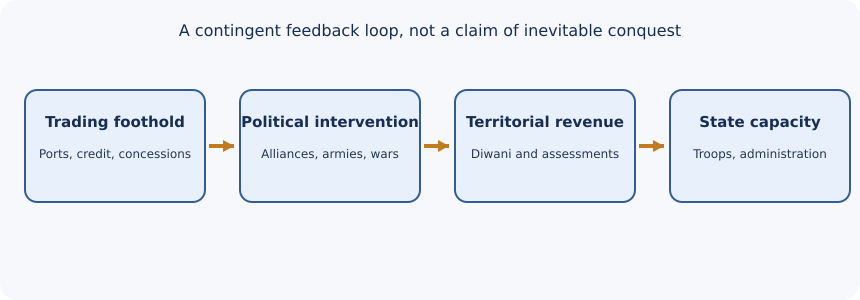
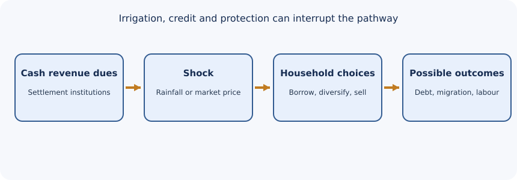
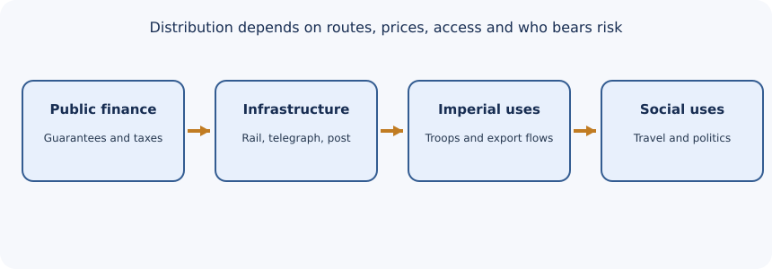

# TGPSC Group I — Paper II · Unit I · Topic 3

## British Colonial Expansion and Economic Transformation — Cycle81 integrated student draft

**NOT academically approved.** Original 12-page topic PDF preserved. The 30 MCQs and six mains prompts are original practice, not authenticated official PYQs. Full-page-per-concept, independent claim audit and browser accessibility remain outstanding.

## Official 2024 syllabus mapping

Directly opened Notification 02/2024, Annexure-II, Paper II, Item 3 [S00]: Carnatic, Plassey, Mysore, Maratha and Sikh wars; land settlements, agrarian labour, famines, crafts, drain, trade and rail/telegraph/post. **R1 PASS only.**

## Quick revision and answer framework

1757 Plassey → 1764 Buxar → 1765 diwani; distinguish 1760 Wandiwash, 1761 Pondicherry and 1763 Paris treaty. Compare Mysore war outcomes including 1784 Mangalore, 1792 Seringapatam and 1799. Distinguish Permanent Settlement (zamindar), ryotwari (cultivator) and mahalwari (village estate); contractual railway guarantees versus realised investor returns. Mains: **Background → mechanism → dated evidence → consequences → counterargument → Telangana distinction → conclusion.**

## Source-critical detailed concepts

## 1. A trading company becomes a fiscal-military power

The East India Company did not begin as an Indian government. Its seventeenth-century factory networks depended on permissions from Asian sovereigns, shipping, credit and commercial partnerships. During the eighteenth century the decline of central Mughal authority opened political space, but regional polities did not simply collapse. Bengal, Awadh, Hyderabad, Mysore and Maratha centres possessed revenue systems, armed forces and diplomatic options. The Company's advantage arose partly from converting maritime trade and political concessions into a dependable stream of tax income that could maintain professional armies and purchase supplies. This is a fiscal-military explanation rather than a story of inevitable European superiority.

The Battle of Plassey on 23 June 1757 was fought in a Bengal political crisis involving Siraj ud-Daulah, Company officials and disaffected elites, notably Mir Jafar. Defection and negotiated elite support were crucial. It is inaccurate to imagine a straightforward national war between Britain and India. The Battle of Buxar in October 1764 was strategically different: Company forces confronted a coalition associated with Mir Qasim, the Nawab of Awadh Shuja ud-Daulah and Mughal emperor Shah Alam II. The 1765 grant of **diwani** (revenue-collection authority) over Bengal, Bihar and Orissa gave the Company fiscal resources, but responsibility for governance and coercive control remained institutionally complicated. The dual arrangement was later reorganised. The correct sequence is **political intervention → military victory → revenue rights → administrative consolidation**; the dates are not interchangeable.

Company directors faced a principal-agent problem: servants seeking private fortunes could weaken trade, revenues and legitimacy. Parliamentary scrutiny and the Regulating Act of 1773, Pitt's India Act of 1784, Charter Acts of 1813 and 1833, and the Government of India Act of 1858 mark different steps in bringing the Company under metropolitan control. They did not all have the same function. The 1813 Charter Act ended most Company monopoly trade with India (with qualifications), whereas the 1833 Act ended its remaining commercial character. The 1858 transfer to the Crown followed the rebellion of 1857. British Library India Office archival series IOR/A and IOR/B provide a route to charters, statutes and directors' minutes; cataloguing a series does not mean the original individual documents were read here.

**Archival precision:** British Library Mss Eur G49 catalogues an Awadh–Company agreement dated 16 August 1765. Its catalogue is **not** a direct reading of the separate imperial diwani grant. The 1765 diwani chronology is corroborated in UK Parliament's institutional history, but the original grant has not been inspected here. [S03], [S01].

## 2. Carnatic Wars: three connected contests, not one battle

The First Carnatic War (1746–1748) grew out of the War of Austrian Succession and Anglo-French naval rivalry. French seizure of Madras and subsequent European settlement illustrated how coastal trade rivalry could intersect with regional politics. The Second Carnatic War (1749–1754) involved succession struggles in Hyderabad and the Carnatic: claimants were political actors, not puppets devoid of agency. French and British forces, locally recruited troops, financiers and rival claimants negotiated power. The Third Carnatic War (1756–1763) connected the Indian theatre to the Seven Years' War. British victory at **Wandiwash in 1760** and the fall of Pondicherry in 1761 sharply weakened the French bid for territorial supremacy. The 1763 Treaty of Paris restored some French trading establishments, so 'French disappeared from India' is false.

Hyderabad is central to understanding the Second Carnatic War because succession politics in the Deccan helped create opportunities for intervention. Distinguish the **Nizam's court and regional claimants** from the later British subsidiary system. A useful causal diagram is: European naval rivalry plus Indian succession disputes plus access to revenue and sepoy forces → company intervention → altered political bargaining. The battle sequence alone does not explain why European companies could finance armies; merchant credit, local suppliers and fiscal concessions are necessary parts of the answer.

**Treaty-text evidence.** Article XI of the Treaty of Paris (10 February 1763) required restoration of French factories held in India at the beginning of 1749, while restricting later French territorial acquisitions on the Coromandel and Orissa coasts. It also restricted French troops and fortifications in the Bengal subah, and recognised Mahomet Ally Khan in the Carnatic and Salabat Jung in the Deccan. Article XXIV separately prescribed a period for factory restitution. Thus the 1760 Wandiwash defeat, 1761 fall of Pondicherry and 1763 treaty were distinct military, territorial and diplomatic events. The treaty disproves the claim that every French commercial establishment vanished. It does not make Indian succession contenders passive: they negotiated and fought with different external partners. An analytical answer distinguishes military predominance from commercial presence and legal restrictions. **Evidence [S02]:** Treaty of Paris, Articles XI and XXIV, in the Yale Avalon transcription. The autograph treaty was not examined.

## 3. Mysore: adaptive state-building and shifting alliances

The four Anglo-Mysore Wars were fought in 1767–1769, 1780–1784, 1790–1792 and 1799. Haidar Ali and Tipu Sultan deployed diplomacy, cavalry, infantry, artillery and rocket technology, and sought to sustain military resources through revenue administration and commercial strategy. The **Treaty of Madras (1769)** ended the first war; the **Treaty of Mangalore (1784)** ended the second; the **Treaty of Seringapatam (1792)** followed the third; Tipu was killed at Seringapatam in 1799 during the fourth. The outcomes cannot be reduced to a single story of unbroken Company battlefield success.

Mysore's adversaries and allies changed. The Nizam and Maratha forces were not permanent members of one stable anti-Mysore coalition; they pursued their own territorial and security calculations. Company diplomacy deliberately isolated opponents. Rockets and other innovations show that Indian armies were not technologically inert, but innovation alone could not overcome the fiscal, military and diplomatic balance in 1799. Nor was Tipu's struggle modern Indian nationalism in its twentieth-century sense. His priorities included dynastic sovereignty, revenue, military security and commerce. A sophisticated answer avoids both colonial caricature and uncritical heroic mythology.

**War outcomes and shifting coalitions.** The four Mysore wars cannot be treated as four identical British victories. The 1769 Treaty of Madras followed the first; the 1784 Treaty of Mangalore ended the second through a negotiated settlement involving restoration of territories. The third war concluded with the Treaty of Seringapatam in 1792 and territorial concessions; the fourth ended with Tipu Sultan's death in 1799 and a reconfigured Mysore government. The Nizam and Maratha powers pursued changing security interests rather than remaining permanent allies of one side. A university teaching text describes the Mangalore settlement and the coalition surrounding the third war. A stronger mains comparison identifies **causes, alliances, military resources, settlement and political consequence** for each conflict. Mysorean rockets and reforms show innovation, but their existence alone cannot establish strategic success. Nor should Tipu's dynastic objectives be automatically equated with twentieth-century nationalism. **Evidence [S08]:** Alagappa University BA History material; signed treaty originals were not consulted.

## 4. Maratha confederacy: why institutional fragmentation mattered

The Anglo-Maratha Wars are conventionally dated **1775–1782, 1803–1805 and 1817–1818**. The confederacy included powerful centres such as the Peshwa, Scindia, Holkar, Bhonsle and Gaekwad, whose interests could diverge. The Treaty of Salbai (1782) concluded the first conflict. The Treaty of Bassein (1802), by which Peshwa Baji Rao II accepted a subsidiary arrangement, helped precipitate the second war: rival Maratha leaders viewed the Peshwa's dependence as a threat to the confederacy. The third war ended the Peshwa's political position and strengthened Company paramountcy.

The explanatory problem is not that 'Indians were disunited' in an ahistorical moral sense. A confederated political order has multiple revenue bases, patronage networks and military chains of command. The Company could exploit rivalry and bring revenues from Bengal and other possessions to bear in different theatres. Subsidiary alliances constrained independent diplomacy, imposed military expenditure and sometimes preserved dynastic administration. Distinguish **annexation**, which changes territorial sovereignty, from **subsidiary dependence**, which limits it without necessarily abolishing a ruler's internal government.

## 5. Anglo-Sikh Wars: army, regency and annexation

The First Anglo-Sikh War (1845–1846) followed political instability in the Lahore kingdom after Maharaja Ranjit Singh's death in 1839 and tensions between the Khalsa army and Company forces. The Treaty of Lahore (1846) imposed political and territorial terms; the separate Treaty of Amritsar (1846) shaped the disposition of Kashmir. The Second Anglo-Sikh War (1848–1849), associated with revolts and renewed fighting, ended in the annexation of Punjab in 1849. The two wars must not be conflated into one event or explained solely by British weaponry.

For a comparative answer, contrast Mysore's ruler-led military adaptation, Maratha confederate bargaining and Sikh military-political instability. Each faced a Company increasingly able to deploy troops and finance across regions. The underlying process was not automatic: outcomes depended on leadership, alliances, finance, legitimacy and contingent military decisions. Treaty texts and administrative correspondence would provide stronger primary verification than modern exam summaries; the full original treaty corpus was not retrieved in this run.

## 6. From conquest to land settlement: property is a political decision

Land revenue was central to colonial governance because it funded armies, civil administration and public works. Three broad arrangements must be distinguished. **Permanent Settlement (1793)** in Bengal fixed the government's revenue demand on zamindars, who were treated as proprietors for revenue purposes; it did not fix tenants' rents or guarantee cultivator security. **Ryotwari**, developed in important parts of Madras and Bombay, assessed cultivators more directly, but this did not remove high assessment, debt or the possibility of losing land. **Mahalwari** arrangements in parts of northern and north-western India used village estates or groups as the assessment unit. The systems varied over time and geography; no single label accurately describes every district.

The critical analytical distinction is **unit of assessment versus incidence of burden**. Who signed the settlement is not necessarily who ultimately paid. Landlords could transfer pressure to tenants; a directly assessed peasant could borrow from a moneylender to meet cash obligations. Revenue collection interacted with monsoon uncertainty, grain prices, customary tenure, legal enforcement and access to credit. Colonial land law also transformed the evidentiary status of rights: written records and court-enforceable titles sometimes advantaged those able to navigate bureaucratic processes. The NITI Aayog land-tenure history explicitly distinguishes the three systems and notes the absence of tenant safeguards in Bengal's Permanent Settlement. That is a stronger source for legal structure than a memorised 'zamindari bad, ryotwari good' formula.

**Legal assessment versus economic incidence.** NCERT's *Ruling the Countryside* distinguishes the Permanent Settlement of 1793, which fixed the Company's revenue demand on zamindars, from mahalwari's periodically revised assessment of a village estate and ryotwari's more direct settlement with individual cultivators after field survey. The fixed zamindari demand did **not** permanently fix every tenant's rent. Under mahalwari, a village headman handled collection; a *mahal* could comprise a village or group of villages. These are institutional models, not evidence that every district operated identically. The burden borne by a cultivating household could exceed its formal legal liability when rents, moneylending and crop-price shocks intervened. NCERT describes excessive assessments, inability to pay and deserted villages in some places. To explain rural distress, trace the state demand, the legally liable intermediary or ryot, household cash flows, credit and possible loss of land. Even a nominally unchanged demand becomes harder to pay when produce prices fall. **Evidence [S04]:** IIT Kanpur SATHEE reproduction of NCERT; original settlement returns not examined.

## 7. Landlessness is a social process, not a direct arithmetic consequence

The rise of landless agricultural labour cannot be inferred from one tax statute alone. Population growth, fragmentation of holdings, indebtedness, land transfer, commercial crops, tenancy insecurity, unequal caste relations and environmental shocks interacted. Some households shifted between cultivation, wage work, craft production and seasonal migration; others became dependent on agricultural wages. This means landlessness should be studied as a **household livelihood trajectory**, not simply as the outcome of an administrative category.

A useful village-level hypothetical illustrates the mechanism. A tenant growing subsistence grain begins producing cotton for a trader. Cash revenue dues remain payable even if the cotton price falls; a drought forces borrowing at high interest. The cultivator may mortgage land-use rights, lease out fields or migrate for work. None of these steps is historically inevitable: better irrigation, a cooperative lender, diversified crops or favourable prices could change the outcome. For examination purposes, present a causal chain with **contingencies**, and do not claim that every farmer experienced identical impoverishment.

## 8. Commercialisation: market access and unequal bargaining power

Commercialisation of agriculture means a larger share of output was produced for sale, not necessarily that all cultivation became export-oriented. Cotton, indigo, opium, jute, tea and wheat entered different commercial circuits. Some were linked to contracts, monopolies or coercive systems; others were shaped more by prices and transport. The American Civil War cotton boom in the 1860s is a useful example of a temporary external demand shock that could raise prices before a later reversal. A farmer's gross sales might rise while net security deteriorated because input costs, credit and risk increased.

The key comparison is **price incentive versus bargaining structure**. A market offers opportunities, but debt contracts, limited storage, dependence on one buyer and inflexible revenue obligations can undermine choice. It is misleading to treat 'commercialisation' as either a synonym for development or a synonym for total coercion. Study who controlled transport, credit, land and export channels, and whether cultivators retained the capacity to diversify crops. Distinguish the Company's earlier coercive commercial practices from later private merchant networks rather than projecting one system across the entire nineteenth century.

## 9. Crafts and deindustrialisation: a contested measurement problem

'India was deindustrialised' is a useful thesis only when it specifies industry, region and period. Traditional handloom weaving faced pressure from British machine-produced cloth, shifting tariff structures, changing patronage and access to credit. Yet handloom producers adapted in some regions, and later factory industries grew in Bombay, Bengal and elsewhere. The loss of courtly demand affected luxury crafts differently from ordinary textile production. A decline in a craft's share of employment is not automatically proof that its absolute output fell every year. Reliable assessment needs occupational census categories, production series, wage evidence and trade data, all with attention to their historical limitations.

Three interpretations deserve comparison. **Nationalist economists** emphasised unequal trade policy and wealth transfer. **Economic historians stressing global industrial competition** examined productivity differences and transport-cost changes. **Revisionist regional studies** show mixed outcomes and local adaptation. These positions are not mutually exclusive: technological competition, colonial policy and regional institutions could act together. Do not assert that Britain destroyed 'all Indian industry' or that colonial markets were neutral. A strong answer identifies causal mechanisms and evidentiary gaps instead of choosing slogans.

## 10. Famines: climatic shocks filtered through political economy

Major nineteenth-century famines included the Great Famine of 1876–1878, the famine of 1896–1897 and the famine of 1899–1900. Rainfall failure was often a trigger, but mortality and deprivation depended on grain prices, purchasing power, wages, public relief, transport, disease, administrative priorities and household assets. The existence of railways did not guarantee that poor people could purchase food transported to a market. Similarly, exporting grain during a famine does not by itself establish the entire causal mechanism; one must examine local entitlement failures and the decisions of governments and traders.

The **Indian Famine Commission of 1880** is an important institutional turning point in debates over prevention and relief. A July 1880 House of Commons record confirms that its first report had been received and printed. That parliamentary exchange is evidence of a report's administrative status, not proof that all recommendations were implemented or effective. Colonial famine codes and public works relief must be evaluated by eligibility, wages, distance, disease risk and timely action. For a Telangana comparison, avoid imposing British provincial famine-code jurisdiction automatically on the Nizam's Hyderabad State; identify local institutions and archival records separately.

## 11. Drain of wealth: define transfers before estimating them

Dadabhai Naoroji's **Poverty and Un-British Rule in India** (1901) organised nationalist economic criticism around the proposition that India financed payments abroad without receiving equivalent domestic benefits. Discussed channels included pensions and salaries paid overseas, government 'home charges', interest on debt, remittances and some costs of imperial administration. Naoroji's argument was not merely that imports exceeded exports. Trade balances can coexist with outward transfers, and an export surplus does not automatically mean domestic prosperity. His work connected economic accounting to political demands for Indian control over taxation and expenditure.

The historian must distinguish a **mechanism**, an **estimate**, and a **normative judgment**. Whether a particular payment was a drain depends on the services or capital flows it financed and on the counterfactual use of resources. Nationalist critics viewed many payments as structurally unequal; later economic historians debated magnitude and accounting. Avoid using one memorised percentage as if it applied to 1757–1947. The 1901 book is identifiable in Harvard's public-domain bibliographic record and Open Library's edition record, but the entire primary text was not subjected to a line-by-line audit here. For a mains answer, define the channels and then explicitly acknowledge measurement uncertainty.

## 12. Trade and commerce: integration without equal power

Colonial economic transformation connected ports, interior markets, commodity exchanges and financial institutions. The Company began with privileged trade and later exercised territorial sovereignty; after its commercial monopoly was curtailed, private British and Indian merchants played larger roles. Indian business groups were not passive spectators. Agency houses, indigenous bankers, merchants, mill owners and railway contractors competed and collaborated under changing rules. Export composition shifted, and imported manufactures competed with domestic production. The state also collected customs and excise and used commercial information to govern markets.

A careful answer distinguishes **trade volume**, **terms of trade**, **industrial capacity** and **distribution of income**. An increase in exports can coexist with falling artisan employment in one region and rising incomes for merchants in another. Railways can improve internal arbitrage while channelling raw materials to ports. The overall evaluation depends on access to capital, technology, education, property rights and political influence. Nationalist critiques of colonial trade remain important, but historical analysis should not erase Indian enterprise or regional variation.

## 13. Railways: who selected the route, who carried the risk?

India's first passenger railway service is conventionally dated **16 April 1853**, between Bombay (Bori Bunder) and Thane. Railway construction subsequently expanded under different ownership and guarantee arrangements. A guarantee could assure private investors a return while transferring downside risk to public revenues; this financial architecture matters as much as the locomotive. Lines served military mobility, administrative integration, exports and internal trade. They also reduced travel time for pilgrims, migrants, workers and political organisers. Railway workshops and station towns generated new occupational communities.

Avoid the false binary 'railways were purely exploitative' versus 'railways modernised India for everyone'. Ask whether route choices connected famine-prone interiors, whether freight tariffs privileged exports, how construction was financed and who could afford passenger fares. Even when a line improved market integration, its gains might be unequal. Telegraphs and railways together strengthened the state's capacity to coordinate troops and respond to unrest; the same networks later supported nationalist communication. An infrastructure project can produce **imperial control and public spillovers simultaneously**.

**Railway finance is not a single welfare verdict.** The Indian Railway Board dates the Bori Bunder–Thane inaugural passenger service to 16 April 1853 and the Howrah–Hooghly service to 15 August 1854. These are transport milestones, not proof of aggregate economic benefits. A peer-reviewed study by Bogart and Chaudhary documents five-percent guarantees for early private railway investment, under which government revenues could cover shortfalls in net earnings. It also describes later changes toward government ownership and lower guarantees. Crucially, the study did **not** find guaranteed railway securities systematically earned excessive realised market returns relative to other Indian railway securities. A legal guarantee, realised budget transfer, security-market return and benefit to Indian travellers are different measures. This complicates both an unqualified extraction narrative and an unqualified modernisation narrative. Railways could support imperial troop movement and export routes while also increasing mobility, market connections and political communication. Evaluate route choice, access, fares, taxation and distribution separately. **Evidence [S05], [S06]:** Railway Board and peer-reviewed study; original investment contracts not inspected.

## 14. Telegraph and postal networks: communications as state capacity

The electric telegraph accelerated official communication across long distances and became important in the Company's response to the rebellion of 1857. Postal reforms, including the **Post Office Act of 1854** and later postal expansion, helped standardise the movement of letters and information. But it is misleading to claim that Indians had no postal networks before British rule: couriers, merchants and rulers used earlier systems. Colonial reform altered scale, tariffs, administration and integration with railways and government offices.

Communication technology affected **time**, **territorial reach** and **information asymmetry**. Faster dispatches could aid military operations and tax administration, while newspapers, traders and nationalist associations also used postal and telegraph systems. For mains, contrast the intended imperial administrative function with unplanned social and political consequences. Check precise statute titles and network dates against legislative and departmental records before making very specific claims; this supplement does not claim exhaustive archival verification of each office opening.

## 15. Hyderabad and Telangana: indirect colonialism, not Bengal replicated

The Telangana region lay within the **Hyderabad princely state**, whose Nizam retained internal governmental powers while British influence constrained diplomacy and military decisions. Subsidiary treaties in 1798 and 1800 deepened British strategic influence; the precise clauses and financial terms require examination of original treaty instruments. Hyderabad's internal land tenures included jagirdari and other locally specific arrangements, and its nineteenth-century reforms cannot be mapped mechanically onto Bengal's Permanent Settlement. Later railway development and the Hyderabad Contingent were shaped by separate agreements and fiscal decisions. The 1853 Berar arrangements are especially important but should be analysed using treaty texts rather than a simplified 'Hyderabad annexed' label.

A concrete local case is **Medak**. Telangana's district administration recounts Medak's inclusion in the Nizam's dominions and the role of French officer Michel Raymond in late eighteenth-century regional politics. This evidence helps students connect the Carnatic-era Franco-British contest to the Deccan without assuming that Medak was directly administered by the Bengal presidency. A good Telangana answer compares three overlapping structures: (1) British provinces with directly imposed revenue settlements; (2) princely Hyderabad with its own internal administration; and (3) imperial diplomatic, military and commercial constraints affecting both. Colonialism's economic influence could cross formal jurisdictional borders without making legal systems identical.

## 16. Applied case study: a district officer evaluates a famine policy

Suppose a late nineteenth-century district administration faces two consecutive weak monsoons, grain price inflation and declining agricultural wages. A narrow response might focus only on moving grain by rail. A better historical policy analysis asks who lacks **purchasing power**, whether relief wages meet subsistence needs, whether women and children can reach worksites, whether disease spreads in relief camps, and whether local records capture marginal households. Transport may lower the cost of moving grain, but it does not substitute for access to food. The case demonstrates why climate, markets and government action must be analysed together. It is an original teaching scenario, not a reconstructed actual district file.

## 17. Applied case study: two villages, two settlement structures

Village A is in a zamindari area; Village B is in a ryotwari area. Both experience a price collapse after switching to cotton. In Village A the tenant may face demands from an intermediary and weak tenancy security; in Village B a cultivator may face direct assessment and moneylender debt. The legal pathways differ, but both households can suffer distress. The correct comparison identifies who is liable to the state, who controls land and credit, and which remedies are available. The example is analytical rather than a claim about specific villages.

## 18. Applied case study: interpreting a colonial railway investment

A proposed railway promises faster cotton exports and lower inland transport costs. The state guarantees investors a return. Evaluate it on **four ledgers**: treasury exposure, private investor returns, merchant and producer access, and public benefits such as passenger travel or relief logistics. A single cost-benefit total can conceal who bears fiscal risk and who gains from route selection. A contemporary administrator can learn from this by publishing distributional impact, not merely headline traffic volumes. The scenario is original and does not represent a particular historic line's accounts.

## 19. Comparative historiography and limitations

A textbook answer should neither treat empire as a uniform engine of progress nor assume identical impoverishment in every province and decade. **Nationalist political economy** highlighted structural transfers, fiscal coercion and unequal opportunity; **institutional histories** examine the legal and administrative systems that made revenue extraction possible; **market-centred histories** emphasise technological change, prices and regional commercial adaptation; **subaltern and social histories** ask how labourers, women, artisans and marginal cultivators experienced these transitions. These approaches answer different questions and may complement one another.

Historical statistics are particularly difficult. A colonial occupational census may not classify part-time weaving and agriculture consistently. Export data can omit domestic circulation. Administrative famine reports reflect officials' incentives and may undercount vulnerable people. Treat such sources as **evidence to interrogate**, not transparent windows onto every household. For mains, explain the claim, name the evidence type, state a limitation, then offer a defensible conclusion. This is more valuable than a list of unsourced 'economic impacts'.

## Original analytical diagrams

**Interpretation:** Conditional fiscal-military feedback, not inevitable conquest.

**Interpretation:** Revenue, shocks and household choices jointly affect agrarian risk.

**Interpretation:** Fiscal risk, imperial uses and social uses require separate evidence.

## Original four-option practice MCQs — 30 items (NOT official PYQs)

**Authorship:** Newly written practice questions, 25 October 2026. **Not official TGPSC PYQs.** Each question has exactly one best answer and an explanation. Questions are designed to test mechanisms rather than memorised slogans.

### Q1. What was the decisive institutional significance of the Company's diwani grant of 1765?
A. It abolished the Mughal emperor's title across India.  
B. It granted revenue-collection authority in Bengal, Bihar and Orissa.  
C. It established the first Indian railway.  
D. It ended the Company's commercial privileges.  
**Answer: B.** The grant gave the Company access to territorial revenues after Buxar. It did not abolish all Mughal authority or end commercial privileges. Distinguish a fiscal right from complete territorial sovereignty.

### Q2. Which sequence best captures the Bengal transition?
A. Diwani → Plassey → Buxar.  
B. Buxar → Plassey → diwani.  
C. Plassey → Buxar → diwani.  
D. Plassey → diwani → Buxar.  
**Answer: C.** Plassey occurred in 1757, Buxar in 1764, and the diwani grant in 1765. The distinction helps explain how political intervention became fiscal-military government.

### Q3. The Second Carnatic War is especially associated with which mechanism?
A. Hyderabad and Carnatic succession disputes combined with Anglo-French rivalry.  
B. Sikh succession politics in Punjab.  
C. The Bengal Permanent Settlement.  
D. The 1857 rebellion.  
**Answer: A.** Indian succession contenders actively sought alliances and European companies intervened for political and commercial advantage. It was not solely a naval battle between European states.

### Q4. What follows from Article XI of the 1763 Treaty of Paris?
A. All French factories in India disappeared permanently.
B. France acquired unrestricted military rights in Bengal.
C. Certain French factories were restored, but territorial and military privileges were restricted.
D. France acquired Bengal's diwani.
**Answer: C.** The treaty combines restoration with restrictions. A denies restoration, B reverses the troop restriction and D confuses the 1763 treaty with 1765 diwani. [S02].

### Q5. Which treaty ended the Second Anglo-Mysore War?
A. Treaty of Mangalore (1784).  
B. Treaty of Seringapatam (1792).  
C. Treaty of Bassein (1802).  
D. Treaty of Lahore (1846).  
**Answer: A.** Mangalore ended the second conflict; Seringapatam followed the third. Bassein concerned Maratha politics and Lahore followed the First Anglo-Sikh War.

### Q6. What is the best interpretation of Mysorean military rockets?
A. They prove Mysore had no other military institutions.  
B. They show technological experimentation, but not automatic strategic victory.  
C. They prove the Company never won a battle.  
D. They originated during the Anglo-Sikh Wars.  
**Answer: B.** Rockets are evidence of innovation. Military outcomes also depended on finance, alliances, logistics and diplomacy; technological ingenuity alone did not decide the 1799 war.

### Q7. Why was the Treaty of Bassein (1802) politically consequential?
A. It gave the Company the Bengal diwani.  
B. It made Tipu Sultan the Peshwa.  
C. It created a subsidiary dependency for the Peshwa, alarming other Maratha chiefs.  
D. It annexed Punjab.  
**Answer: C.** The treaty altered the balance inside the Maratha confederacy and helped precipitate the Second Anglo-Maratha War. It was not a general treaty signed by all Maratha chiefs.

### Q8. Which statement best characterises the Maratha confederacy?
A. A single centralised administration with no regional autonomy.  
B. A network of major chiefs whose interests could diverge.  
C. A French colonial possession.  
D. A political organisation formed in 1857.  
**Answer: B.** Scindia, Holkar, Bhonsle and other powers had distinct military and revenue interests. Political fragmentation shaped bargaining but does not imply a lack of institutions.

### Q9. Which outcome followed the Second Anglo-Sikh War?
A. Annexation of Punjab in 1849.  
B. Restoration of the Bengal Nawab.  
C. First Anglo-Mysore War.  
D. Permanent Settlement in Madras.  
**Answer: A.** Punjab was annexed in 1849 after the second war. The 1846 Treaty of Lahore followed the first war and should not be mistaken for the final annexation.

### Q10. Which pair is correctly matched?
A. Treaty of Lahore — 1792 Mysore.  
B. Treaty of Salbai — 1782 First Anglo-Maratha War.  
C. Treaty of Bassein — 1765 Bengal diwani.  
D. Treaty of Mangalore — 1849 Punjab annexation.  
**Answer: B.** Salbai concluded the first Anglo-Maratha conflict. The other pairs confuse separate regions, wars and institutional events.

### Q11. Under the Permanent Settlement of 1793, what was fixed?
A. Every tenant's rent in perpetuity.
B. The Company's revenue demand on zamindars.
C. The periodically revised mahalwari village assessment.
D. Railway investors' guaranteed return.
**Answer: B.** A extends the fixed demand to rents, C describes mahalwari, and D concerns railway finance. [S04].

### Q12. What defines a typical ryotwari settlement?
A. Direct assessment of surveyed individual cultivators.
B. Permanent revenue fixed on Bengal zamindars.
C. Village-estate assessment through a headman.
D. A customs duty on exported cotton.
**Answer: A.** B is Permanent Settlement, C is mahalwari and D is not land-revenue assessment. [S04].

### Q13. Which description fits mahalwari?
A. An unchanging levy on individual ryots everywhere.
B. Fixed state demand on Bengal zamindars.
C. Periodically revised village-estate demand collected by the headman.
D. A guarantee of railway shareholder returns.
**Answer: C.** The *mahal* could be a village or group of villages; A/B confuse the unit and permanence; D concerns railway finance. [S04].

### Q14. Why can the incidence of land-revenue burden differ from its legal assessment unit?
A. Intermediaries may pass costs to tenants and borrowers.  
B. No cultivator ever paid taxes.  
C. Land settlements did not use written records.  
D. Prices never affected cultivators.  
**Answer: A.** The economic burden can pass through rents, credit and market transactions. Identifying the formal taxpayer is only the first step in distributional analysis.

### Q15. Which claim about commercialisation of agriculture is most defensible?
A. More output sold in markets always improves farmer welfare.  
B. More market production can increase income opportunities and exposure to volatility.  
C. It means no crops were eaten locally.  
D. It began only after 1947.  
**Answer: B.** Market access can bring gains while cash dues, credit dependence and price shocks heighten risk. Outcomes depend on bargaining power and diversification.

### Q16. The American Civil War is relevant to Indian cotton history chiefly because it:
A. Caused the First Carnatic War.  
B. Created a temporary external demand shock affecting cotton prices.  
C. Ended the Company's rule in 1757.  
D. Introduced mahalwari to Bengal.  
**Answer: B.** Disruption of American cotton supplies stimulated alternative sourcing, including from India, but a boom could reverse and leave indebted producers exposed.

### Q17. Which statement about colonial deindustrialisation is methodologically strongest?
A. Every Indian craft disappeared by 1800.  
B. Every region industrialised at the same rate.  
C. Trends should be tested by industry, region, period and evidence type.  
D. Export data alone reveal all household wages.  
**Answer: C.** Handloom decline, adaptation and later factory growth varied. Occupational and trade data need careful interpretation rather than a universal claim.

### Q18. A decline in weaving's employment share necessarily proves:
A. Absolute weaving output fell every year.  
B. No weaving survived.  
C. No single conclusion about absolute output without additional data.  
D. All artisans became zamindars.  
**Answer: C.** Shares can change when other sectors grow or census classifications shift. Absolute output requires production or other appropriate evidence.

### Q19. What is a core feature of Naoroji's drain argument?
A. Resources transferred abroad without equivalent domestic return.  
B. All imports are intrinsically illegal.  
C. India had no merchants before colonialism.  
D. Railways had no passengers.  
**Answer: A.** Naoroji emphasised payments such as home charges, salaries and pensions. Estimates and counterfactual benefits remain matters for historical accounting.

### Q20. Why should a single drain percentage not be applied to 1757–1947?
A. All revenue records are identical.  
B. Transfer channels and available data changed over time.  
C. Naoroji wrote before the East India Company existed.  
D. Trade balances have no relation to national accounts.  
**Answer: B.** Political arrangements, capital flows and measurement assumptions varied. A precise estimate must specify years, components and sources.

### Q21. Which statement about the 1880 Famine Commission is supported by the July 1880 Hansard record?
A. Its first report had been received and printed.  
B. All Indian famines immediately ended.  
C. Every recommendation had been implemented.  
D. It abolished railways.  
**Answer: A.** Parliamentary discussion confirms receipt and printing of the first report, not implementation or effectiveness of its recommendations.

### Q22. Why might a railway fail to prevent famine deaths even if grain reaches a market?
A. Railways always prohibit food transport.  
B. Households may lack purchasing power to buy available grain.  
C. Markets never set prices.  
D. No famine ever coincided with a railway.  
**Answer: B.** Entitlement, wages, relief access and disease affect survival. Physical availability alone is not sufficient for food security.

### Q23. Which interpretation of early colonial railway guarantees is most defensible?
A. A five-percent contractual guarantee meant exactly five-percent realised investor market returns.
B. Public revenues could cover shortfalls, without this alone proving excessive realised market returns.
C. Railway investment imposed no public financial risk.
D. All guarantee contracts remained unchanged through 1947.
**Answer: B.** A conflates contractual and market returns; C denies public exposure; D ignores later changes in railway finance. [S06].

### Q24. Which first passenger service is recorded by the Railway Board?
A. Bori Bunder–Thane, 16 April 1853.
B. Howrah–Hooghly, 16 April 1853.
C. Bori Bunder–Thane, 15 August 1854.
D. Madras–Arakkonam, 16 April 1853.
**Answer: A.** The Board dates Howrah–Hooghly separately to 15 August 1854. B/C mix those dates and D misattributes the first service. [S05].

### Q25. What was an important dual use of the colonial telegraph?
A. Military-administrative coordination and later broader information exchange.  
B. Replacement of all handwritten documents overnight.  
C. Automatic elimination of social inequality.  
D. End of postal services.  
**Answer: A.** Telegraphs supported rapid official coordination, including during 1857, while communications networks also helped commerce and political organisation.

### Q26. Which comparison of the 1813 and 1833 Charter Acts is correct?
A. The 1813 Act ended the China tea monopoly and 1833 restored it.
B. The 1813 Act transferred India to the Crown.
C. Both were enacted after the 1857 rebellion.
D. The 1813 Act reduced most Company trading monopolies; the 1833 Act ended its remaining China tea monopoly and commercial role.
**Answer: D.** UK Parliament's history distinguishes the two stages. A reverses the sequence, B confuses 1858, and C is chronologically impossible. [S01].

### Q27. Which statement best describes colonial Hyderabad's constitutional position?
A. It was legally identical to Bengal presidency.  
B. The Nizam retained internal administration under British strategic and diplomatic constraints.  
C. It was annexed directly in 1798.  
D. It had no political ties with the Company.  
**Answer: B.** Hyderabad was a princely state under indirect imperial influence. Directly applying Bengal's Permanent Settlement to all Telangana would be an error.

### Q28. What is the best way to interpret the 1798/1800 Hyderabad subsidiary arrangements?
A. They ended the Nizam dynasty immediately.  
B. They constrained external and military autonomy while retaining internal rule.  
C. They introduced the 1853 Bombay–Thane railway.  
D. They established the Bengal diwani.  
**Answer: B.** The agreements altered the balance of sovereignty. Exact treaty clauses and financial amounts require original documents, not extrapolation from summary descriptions.

### Q29. What is the strongest evidence approach for estimating craft decline?
A. One unsourced anecdote about a weaver.  
B. A combination of occupational, output, wage and trade evidence with regional controls.  
C. A single universal percentage copied from a guidebook.  
D. Assuming every district had the same tariff exposure.  
**Answer: B.** Triangulation helps distinguish structural decline, local adaptation and classification changes. Each dataset still requires source criticism.

### Q30. Which conclusion best integrates colonial infrastructure and political economy?
A. Infrastructure had only one beneficiary.  
B. Railways had no fiscal costs.  
C. Imperial control, market integration and later public uses could coexist with unequal distribution.  
D. Communication technologies never affected nationalism.  
**Answer: C.** An infrastructure system can serve military priorities and enable mobility or political communication at the same time. Financing and distribution determine its net effects.

## Original structured mains practice — six model answers

**Original practice, not official TGPSC PYQs.** Each model answer targets 200–250 words excluding its question and section labels. Answer blueprints are embedded as headings.

## M1. How did the East India Company convert commercial influence into territorial rule between 1757 and 1765?

**Background.** The East India Company entered eighteenth-century Indian politics as a trading corporation dependent on local permissions, merchant credit and regional alliances. Fragmented Mughal authority created opportunities, but Bengal remained a wealthy and politically active state.

**Political intervention.** Plassey in 1757 followed conflict with Siraj ud-Daulah and involved support from dissatisfied Bengal elites. Defections and negotiations mattered alongside battlefield tactics. The victory strengthened Company influence over the nawab's government, but did not yet confer general revenue rights. Local commercial interests and access to credit helped make subsequent political leverage sustainable.

**Fiscal turning point.** At Buxar in 1764, Company forces defeated a coalition associated with Mir Qasim, Shuja ud-Daulah and Shah Alam II. The emperor's diwani grant in 1765 authorised revenue collection in Bengal, Bihar and Orissa. Territorial income helped finance troops, procurement and further intervention.

**Institutional consequences.** Military power, fiscal claims and administrative responsibility developed unevenly. The Company faced problems of corruption, private trade and accountability, prompting subsequent parliamentary scrutiny and reforms.

**Counter-view.** Expansion was not predetermined by European technology. Indian rulers, bankers, soldiers and commercial networks shaped its possibilities and outcomes.

**Conclusion.** The decisive transformation was a feedback loop between political influence, military success and territorial revenue. Distinguishing Plassey, Buxar and diwani produces a causal explanation rather than a sequence of memorised dates.

## M2. Compare the Anglo-Mysore, Anglo-Maratha and Anglo-Sikh Wars as processes of British expansion.

**Background.** The Company's territorial expansion involved different regional political systems. It repeatedly combined armed force with treaties that shifted the costs and risks of regional security. Mysore, the Maratha confederacy and the Sikh kingdom cannot be reduced to a single pattern of Indian resistance or British superiority.

**Mysore.** Haidar Ali and Tipu Sultan combined military innovation, diplomacy and revenue mobilisation. Four wars between 1767 and 1799 ended differently; the Treaty of Mangalore in 1784 and Treaty of Seringapatam in 1792 reflected changing coalitions. Tipu's death in 1799 followed sustained military and diplomatic pressure.

**Marathas.** Confederated chiefs held distinct territories and interests. The Treaty of Bassein in 1802 made the Peshwa dependent on Company protection and aggravated divisions. The third war of 1817–1818 ended the Peshwa's political authority.

**Sikhs.** After Ranjit Singh's death, Lahore politics and Khalsa army tensions affected relations with the Company. The First Anglo-Sikh War produced the Treaty of Lahore in 1846; the second ended in Punjab's annexation in 1849.

**Comparison.** In every theatre, fiscal resources, logistics, alliances and internal politics mattered. Yet rulers and institutions differed, so identical explanations are misleading.

**Conclusion.** British expansion resulted from contingent military victories embedded in changing political bargains. Recognising regional agency avoids both colonial triumphalism and a simplistic claim that every ruler fought a unified national war.

## M3. Evaluate the social consequences of the Permanent Settlement, ryotwari and mahalwari systems.

**Background.** Colonial land revenue supplied a major share of administrative and military finance. Settlement systems defined different relationships among the state, landholders and cultivators, but formal liability did not determine the entire social burden.

**Permanent Settlement.** Introduced in Bengal in 1793, it fixed the government's demand on zamindars. It did not fix tenants' rents or automatically protect their occupation. Intermediaries could transfer pressure through rent demands and eviction.

**Ryotwari.** In important areas of Madras and Bombay, the state assessed cultivators more directly. Removing a landlord intermediary did not eliminate high assessments, debt or vulnerability to price and rainfall shocks.

**Mahalwari.** Village estates or groups formed the assessment unit in parts of northern India. Local power relations and joint responsibility affected how burdens were distributed.

**Social consequences.** Commercial crops, moneylending, land transfer and insecure tenancy could contribute to agrarian labour and migration. However, these outcomes varied with irrigation, credit access, prices and customary rights. Historians therefore need local settlement records and evidence of actual tenancy practices, not only official policy labels.

**Telangana distinction.** The Nizam's Hyderabad was not governed by the Bengal Permanent Settlement. Its jagirdari and other tenure arrangements require separate historical analysis.

**Conclusion.** The systems should be compared by assessment unit, tenant protection, collection pressure and household risk. No settlement label by itself proves that cultivators were either secure or uniformly impoverished.

## M4. Discuss deindustrialisation and the drain of wealth as critiques of the colonial economy.

**Background.** Colonial economic transformation expanded trade and infrastructure while redistributing opportunities and political control. Nationalist economists used deindustrialisation and the drain of wealth to explain poverty and unequal development.

**Deindustrialisation.** Machine-made imports, altered patronage, trade policy and access to capital challenged several Indian crafts, especially textiles. Yet regional handloom adaptation and later factory growth complicate the assertion that all industry disappeared. Employment shares, output, wages and export data must be examined separately.

**Drain theory.** Dadabhai Naoroji argued that official remittances, pensions, home charges and other overseas payments transferred Indian resources without equivalent domestic returns. His 1901 work connected fiscal accounting with demands for political representation and self-government.

**Contrasting interpretations.** Nationalist histories emphasise unequal power and policy. Market-centred historians examine global industrial competition and productivity. Regional studies highlight mixed effects and Indian entrepreneurial responses. These perspectives can illuminate different mechanisms rather than cancel one another. The central question is whether colonial institutions changed the distribution of bargaining power and productive investment.

**Evidence limitations.** Colonial occupational categories, trade figures and transfer estimates contain methodological uncertainties. A single drain percentage cannot be assumed valid across two centuries.

**Conclusion.** Both critiques remain essential because they question who benefited from economic integration. A balanced answer identifies structural inequality while avoiding unsupported universal claims about every industry, district or decade.

## M5. Explain why railways and communications were simultaneously instruments of colonial rule and social change.

**Background.** Railways, telegraphs and postal reforms transformed movement and information during the nineteenth century. Their effects cannot be judged solely by the intentions of imperial officials or by later public benefits.

**Imperial functions.** Railway routes connected ports, commercial hinterlands and military centres. Telegraph lines improved coordination across distant administrative units, including during the rebellion of 1857. Faster troop movement and communication strengthened colonial state capacity.

**Economic structure.** Guaranteed returns to some railway investors could shift financial risk onto public revenues. Freight priorities and route selection shaped which producers and merchants gained access. Lower transport costs did not automatically create equal opportunities.

**Public and political uses.** Passenger travel supported labour migration, pilgrimage and urbanisation. Traders accessed wider markets; newspapers and nationalist organisations benefited from faster circulation of information. These uses were not reducible to imperial military goals. Their benefits nevertheless differed by income, region, caste, occupation and access to affordable transport.

**Famine qualification.** Transporting grain could improve availability, but households without purchasing power might still starve. Relief wages, prices and disease therefore mattered alongside infrastructure.

**Telangana comparison.** Hyderabad's railway and communication systems developed within a princely-state framework under British strategic influence, not through identical Bengal provincial institutions.

**Conclusion.** Infrastructure was a distributional and political system. Evaluating financing, access and actual outcomes explains how coercive imperial networks could also generate long-term social spillovers.

## M6. Why must Telangana's colonial experience be distinguished from directly ruled British India?

**Background.** Much of present-day Telangana belonged to the Hyderabad princely state. British influence reached it through diplomacy, treaties, military arrangements and markets, but this did not make it legally identical to a directly administered province.

**Treaty relations.** Subsidiary arrangements in 1798 and 1800 restricted the Nizam's external and military autonomy. They strengthened British strategic influence while leaving significant internal authority with Hyderabad's ruler. The exact treaty obligations require original texts for article-level analysis.

**Land and administration.** Hyderabad had locally specific tenures, including jagirdari, and its own reform chronology. The Bengal Permanent Settlement cannot be applied to Telangana by analogy. Revenue, policing, education and justice must be traced through Hyderabad's institutions.

**Economic integration.** Trade, railways and finance could transmit imperial influence across political boundaries. Such integration might reshape local employment and commerce without transferring every administrative function to the British provincial government.

**Regional example.** Medak district's official history records the role of French officer Raymond and the district's place within Asaf Jahi dominions. This connects the Deccan to Anglo-French rivalry without treating Medak as a Bengal district.

**Analytical balance.** Princely autonomy was neither complete independence nor simple direct annexation. Its scope changed over time and across policy areas.

**Conclusion.** Telangana history requires a layered model of sovereignty: Nizam administration, British paramountcy and wider economic networks. That distinction prevents major factual errors in Group-I mains answers.

# Cycle81 source and verification register — Topic 2-1-3

**29 October 2026.** Author source-correlation is not independent academic approval. All 30 MCQs remain original practice, not official TGPSC PYQs.

- **S00:** Official TGPSC Notification 02/2024, Annexure-II, PDF page 28, directly opened; Paper II, Item 3 syllabus mapping **R1 PASS**: https://websitenew.tgpsc.gov.in/preview/RElSRUNUUkVDUlVJVE1FTlROT1RJL05PVElGSUNBVElPTl9OT18wMi0yMDI0X0dyb3VwLUlfU2VydmljZXMgKDEpMjAyNDAyMjAxNDA3MzcucGRmr95v17a0y2d8i13v
- **S01:** UK Parliament institutional histories, Plassey/Buxar and 1813/1833 charter distinctions, not original statutes: https://www.parliament.uk/about/living-heritage/evolutionofparliament/legislativescrutiny/parliament-and-empire/parliament-and-the-american-colonies-before-1765/parliament-and-the-east-india-company/ and https://www.parliament.uk/about/living-heritage/evolutionofparliament/legislativescrutiny/parliament-and-empire/parliament-and-the-american-colonies-before-1765/east-india-company-and-raj-1785-1858/
- **S02:** Yale Avalon transcription, Treaty of Paris (1763), Articles XI and XXIV, not the autograph treaty: https://avalon.law.yale.edu/18th_century/paris763.asp
- **S03:** British Library catalogue Mss Eur G49 describes an Awadh–Company agreement, **not** a directly inspected diwani grant: https://searcharchives.bl.uk/catalog/032-002297521
- **S04:** IIT Kanpur SATHEE reproduction of NCERT Class VIII *Ruling the Countryside*, settlement units and burden; not original district returns: https://sathee.iitk.ac.in/ncert-books/class-08/social-science/history-our-past-3/chapter-03-ruling-the-countryside/
- **S05:** Indian Railway Board institutional history, Bori Bunder–Thane 16 April 1853 and Howrah–Hooghly 15 August 1854; not a welfare estimate: https://rb.indianrailways.gov.in/
- **S06:** Bogart and Chaudhary, *Journal of Institutional Economics*, railway guarantees, public risk and qualified realised-return findings, not full welfare evaluation: https://www.cambridge.org/core/journals/journal-of-institutional-economics/article/extractive-institutions-investor-returns-to-indian-railway-companies-in-the-age-of-high-imperialism/91B7BFAB12B66F7840CAAB4E39AA410A/share/06c3237dec03f4578f6c5763db80e407ab5601c5
- **S08:** Alagappa University BA History teaching material on Mysore treaties and coalitions, not signed treaty originals: https://mis.alagappauniversity.ac.in/siteAdmin/dde-admin/uploads/5/__UG_B.A._History%20%28English%29_108%2051_History%20of%20Tamil%20Nadu%20%28Beginning%20to%201947%20AD%29_BA%20%28History%29_9683.pdf

**Bounded MCQ audit:** Nine keys (Q1, Q2, Q4, Q11, Q12, Q13, Q23, Q24, Q26) and their 27 distractors author source-correlated. Seven items rewritten. **21 keys and 63 distractors remain unchecked.** Six mains body-only lengths verified, but historical claims remain unaudited. Original signed treaties, district revenue returns and railway contracts not examined.
