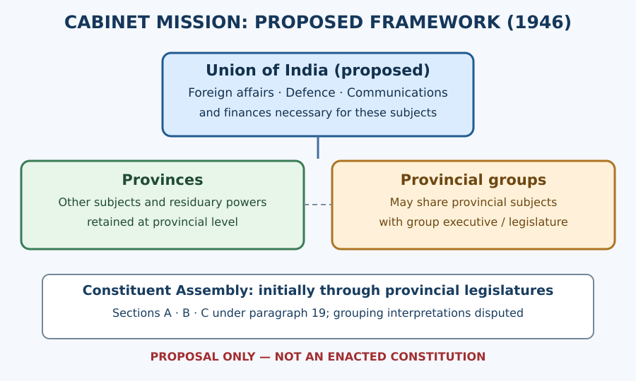
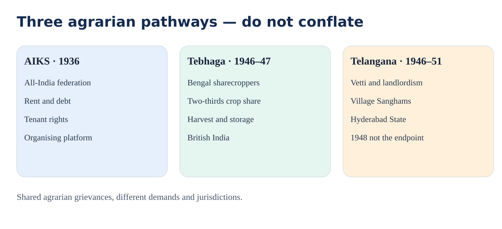
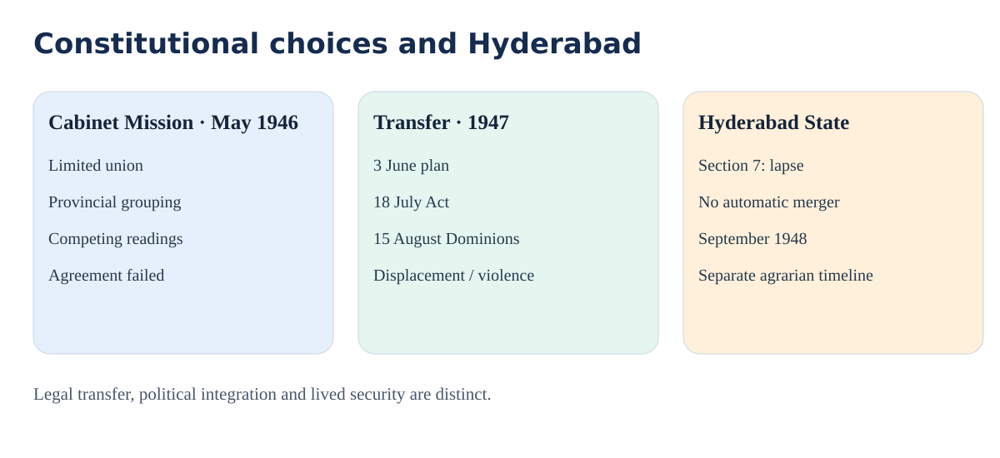
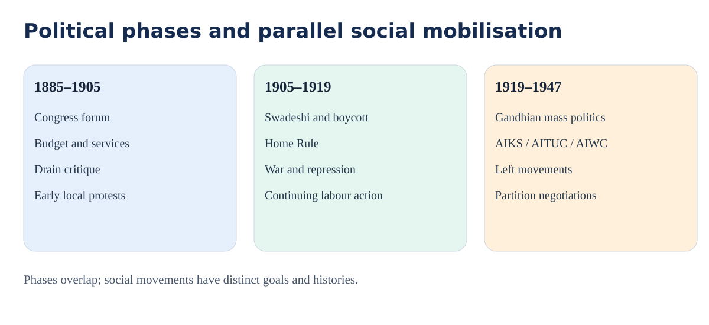

# TGPSC Group I — Paper II / Unit I / Topic 5

## Integrated student edition — Cycle83 (29 October 2026)

**NOT academically approved.** This is one coherent editable master for original practice, syllabus-oriented explanation and source-critical revision. It preserves the separate original 75-topic PDF inventory. No official TGPSC PYQs are asserted. Only five concepts are substantively expanded to 300+ words in this pass; many others still need full-page depth.

### Syllabus coverage and source status

Three phases of the Indian freedom struggle (1885–1947); All India Kisan Sabha, workers and tribal movements; gender and women's movements; socialist and communist movements; communalism; independence and Partition. This mapping comes from the existing repository transcription and a third-party reproduction. The official 2024 commission PDF was not directly reauthenticated in this cycle, so R1 is IN_PROGRESS.

### How to read the material

Each concept distinguishes historical setting, actors, institutions, limits and an exam-use inference. Dates and legal sections are not interchangeable. The 1931 settlement, 1932 representation pact, 1942 mobilisation, 1946 proposal and 1947 enacted statute are separate historical instruments. Earlier segmented drafts and supplements remain preserved in the repository; they are not repeated verbatim here.

# Detailed textbook-style concepts

## 1. Syllabus map and how to study the topic

The commission's Topic 5 wording names **three phases of the freedom struggle (1885–1947)**, the rise and growth of the **All India Kisan Sabha**, **workers' and tribal movements**, **gender and women's movement**, **socialist and communist movements**, **communalism**, and **independence and Partition**. A strong mains answer must connect these strands rather than treat them as unrelated dates. Use a four-part test for every movement: the structural grievance, the organisational vehicle, its relationship to the national struggle, and the historical result or limitation. This prevents an answer from becoming a list of leaders.

The old three-phase classification is useful as a revision framework but not an explanation by itself. Moderate constitutional agitation (roughly 1885–1905), Swadeshi/assertive mobilisation (1905–1919), and mass politics after 1919 overlap. Trade-union and peasant politics did not suddenly begin in the third phase; nor did constitutional methods disappear after Gandhi. Some women demanded legal equality independently of Congress, while many cultivators judged freedom by rent, debt and land. Similarly, the princely state of Hyderabad cannot be placed under the same constitutional arrangements as a British Indian province. Each of these distinctions is examinable.

## 2. Phase I, 1885–1905: political representation and economic criticism

The Indian National Congress, established in 1885, helped create a recurring all-India forum, but early delegates disproportionately represented urban educated professions. Its petitions, resolutions and legislative demands should not be dismissed as mere loyalty: political representation, civil rights, service recruitment and control of finance were practical ways to challenge unaccountable imperial rule. The Indian Councils Act of 1892 expanded discussion without creating responsible government. The difference between permission to debate a budget and power to determine it is essential: formal participation can coexist with executive dominance.

The drain critique associated with Dadabhai Naoroji and R. C. Dutt turned colonial poverty into an argument about state structure. Their claim was that payments abroad and policies favouring imperial interests diverted resources that might otherwise circulate domestically. This was a political-economic diagnosis, not a single universally agreed calculation of losses. It equipped later peasants and workers with a language of structural injustice, but the early Congress did not yet provide most of them with an effective membership-based organisation. Social reform movements and local agrarian protests therefore deserve separate attention; national political awakening did not originate solely in annual Congress meetings.

## 3. Phase II, 1905–1919: boycott, mobilisation and its exclusions

The 1905 partition of Bengal catalysed Swadeshi and boycott campaigns. Consumers, students, traders, writers and women helped turn economic choices into visible public protest. National schools and indigenous enterprises attempted to build institutions outside colonial patronage. Yet access to Swadeshi goods depended on prices, incomes and local supply; the programme could place unequal burdens on poor consumers. Its cultural symbols could widen solidarity but also raise questions about religious inclusion. Historians therefore examine not only speeches but also which groups could participate materially.

The 1907 Surat split exposed disputes over methods and leadership, while the Home Rule Leagues of Tilak and Annie Besant in 1916 renewed constitutional mass campaigning. The Lucknow Pact of 1916 showed that Congress–League cooperation was possible, but its acceptance of communal representation created long-term dilemmas about political identity. World War I sharpened taxation, inflation and coercion. The Rowlatt Acts and the 1919 Amritsar massacre discredited imperial claims to liberal legitimacy. This phase matters as a laboratory of new repertoires—boycott, volunteer networks, publicity and local committees—later adapted on a larger scale.

## 4. Phase III, 1919–1947: the changing mechanics of mass politics

The non-cooperation campaign joined boycotts of colonial institutions with Khilafat mobilisation, but participants often interpreted its promise through local agrarian or religious grievances. Its suspension after Chauri Chaura in 1922 revealed the tension between central nonviolent discipline and diverse local mobilisation. The Civil Disobedience Movement beginning in 1930 made salt a shared symbol of coercive law. The already published Gandhi–Irwin supplement analyses the 1931 truce in depth; it should not be mistaken for the final constitutional settlement or a general amnesty for every political prisoner.

The Government of India Act 1935 introduced provincial autonomy within an imperial framework. Congress ministries formed after 1937 elections in several provinces, but the electorate was restricted and governors retained powers. The Second World War triggered disagreement over whether India could be committed to war without Indian consent. The All India Congress Committee adopted the Quit India resolution on **8 August 1942**; a Nehru Archive edition separately preserves earlier **5 August drafts**, which must not be mislabeled as the final adopted text. Mass action continued after many senior leaders were detained. Local underground networks and parallel authorities demonstrate initiative beyond top-level leadership, but wartime repression and violence complicate simplistic descriptions of one uniform movement.

## 4A. Gandhi–Irwin settlement (5 March 1931): negotiated truce, not constitutional victory

**Background and bargaining problem.** The Salt March of March–April 1930 made the salt monopoly a symbol of the relationship between imperial law and everyday life. Civil disobedience spread through salt-making, picketing, tax resistance and boycotts, but local forms varied and so did the costs imposed on participants. The First Round Table Conference had proceeded without the Indian National Congress, limiting the credibility of a constitutional settlement. Gandhi could not obtain independence by signing a temporary agreement, while Irwin could not convert mass mobilisation into durable cooperation merely by arresting organisers. Both therefore negotiated a truce rather than a final constitutional design.

**What changed.** The provisional settlement was signed and publicly announced on **5 March 1931**. The Gandhi Heritage Portal's dated chronology points to *Collected Works of Mahatma Gandhi*, volume XLV, Appendix VI, for the settlement; that bibliographic pointer is not a substitute for inspecting the signed original. The agreement linked suspension of civil disobedience and Congress participation in the next Round Table Conference with qualified government concessions concerning political prisoners, peaceful picketing, confiscated property and coastal salt-making. It did not abolish the salt tax nationwide, recognise immediate *purna swaraj*, establish a responsible central government or settle the competing claims of different political constituencies.

**Interpretation and opposition.** Gandhi could argue that civil resistance compelled the Viceroy to negotiate with Congress. Critics could answer that the government retained coercive power and that revolutionary prisoners, agrarian grievances and independence were unresolved. Both observations can be true. The pact did not secure commutation of the death sentences of Bhagat Singh, Rajguru and Sukhdev; this point requires separate corroboration against judicial and executive records before R4 can pass. The Second Round Table Conference of 1931 exposed unresolved disputes over representation and safeguards; renewed repression and civil disobedience followed. It is inaccurate to say the Pact ended the freedom struggle or automatically secured Dominion status.

**Mains application.** Organise an answer as causes → negotiated exchange → beneficiaries and exclusions → breakdown → significance. Distinguish what the Gandhi Heritage Portal chronology confirms (the date and CWMG reference) from detailed clauses that still require checking against the complete provisional settlement. The Pact demonstrated the political force of non-violent mass action but also the limits of elite negotiation without an agreed constitutional destination.

**Source anchor:** Gandhi Heritage Portal, 5 March 1931 event record, https://www.gandhiheritageportal.org/fr/gandhi-irwin-pact ; CWMG XLV Appendix VI identified there, not independently opened.

## 8A. Quit India (August 1942): resolution, repression and the limits of a single-leader narrative

**Wartime background.** The Second World War created a constitutional dispute because the Viceroy committed British India to war without a corresponding grant of Indian control over the central executive. The Cripps negotiations of 1942 failed to resolve demands for immediate effective authority. Japan's advance intensified security fears. Congress moved toward a demand that British rule end, but the political coalition remained heterogeneous: some groups opposed the campaign and local organisers differed in priorities. A nationalist movement is not one uninterrupted chain of command.

**8 and 9 August must be separated.** The All India Congress Committee adopted the Quit India resolution in Bombay on **8 August 1942**; Gandhi's address is reproduced by Mani Bhavan's Gandhi museum and reference library. In that address he reaffirmed the importance of non-violence. Detention of Gandhi and other Congress leaders from **9 August** removed central leadership from the immediate conduct of the movement. Students should not collapse adoption, speech and arrests into one event, nor infer that every local action followed the speech's stated method. The museum reproduction establishes the speech's contents; original Congress minutes remain to be checked for full resolution authentication.

**How mobilisation developed.** Hartals, strikes, demonstrations, disrupted communications and underground networks arose in varied combinations. Some districts saw violent attacks on symbols of colonial administration; others emphasised communication and alternative local organisation. Aruna Asaf Ali and Usha Mehta illustrate women's roles in public defiance and clandestine communication, but their prominence should not erase less documented rural participants. Repression constrained the movement, and there was no immediate British withdrawal in 1942. Yet the scale of resistance influenced the legitimacy of post-war rule and the urgency of constitutional settlement.

**Assessing the outcome.** Distinguish the immediate outcome (arrests and suppression) from longer-term political effects (the argument that colonial governance lacked consent). The Communist Party's changing wartime position after Germany's June 1941 invasion of the Soviet Union is a separate institutional story: its leadership did not officially support Quit India, although individual behaviour varied. Avoid claiming Quit India alone caused independence in 1947; war, military morale, constitutional negotiations and communal conflict also shaped the transfer of power.

**Mains structure:** background → resolution and speech → decentralised mobilisation → repression → effects and limitations. **Source anchor:** Mani Bhavan Gandhi Sangrahalaya, 8 August 1942 speech, https://www.gandhi-manibhavan.org/educational-resources/the-quit-india-speeches.html ; separate contemporary resolution and arrest records still needed.

## 5. The Kisan Sabha: why a separate agrarian voice emerged

Agrarian politics had roots in rent disputes, indebtedness, tenancy insecurity, forced labour and the authority of zamindars and intermediaries. A cultivator might favour national freedom yet still face eviction by an Indian landlord. Provincial kisan associations developed before the **All India Kisan Sabha (AIKS)** was constituted at Lucknow in **April 1936**, with **Swami Sahajanand Saraswati** as its first president. The organisation's own historical conference account identifies Congress Socialists, Communists and independent agrarian organisers among the founders. As an organisational source, it is valuable evidence of how the AIKS describes its origins, but its retrospective political interpretation requires independent comparison.

The demand for land and tenant protection could bring kisan activists into conflict not only with colonial officials but also with landlords allied to nationalist parties. This explains why AIKS cannot be treated as merely a rural wing of Congress. N. G. Ranga's agrarian leadership in Andhra provides a regional bridge, but “Andhra” in such accounts should not automatically be equated with the later state of Telangana. The 1936 programme broadened the freedom struggle's social meaning: self-rule would be inadequate if cultivators remained without bargaining power over rent, debt and land.

## 6. Land, crop shares and the comparison with Tebhaga

The **Tebhaga movement in Bengal (1946–47)** challenged the division of produce between sharecroppers and landlords. Its name points to the demand that cultivators retain two-thirds rather than the prevailing half share in many arrangements. The grievance was not simply an abstract slogan about land redistribution; it concerned who bore cultivation costs, who stored grain, and whose claim could be enforced through village power. Organising women, harvest protection and collective bargaining could transform a contractual dispute into a wider political confrontation.

Contrast Tebhaga with the Telangana struggle: both involved agrarian exploitation and left-led mobilisation, but they occurred in different legal and political settings. Bengal lay within British India; Telangana was part of the princely Hyderabad State. Tebhaga's core immediate demand concerned crop shares, whereas Telangana's mobilisation involved **vetti (unpaid forced labour), landlord domination, tenancy, village coercion and the Nizam's state apparatus**. A comparative answer should identify these different institutions before asserting a common “peasant revolution.” Sources differ on the scale and local outcomes of both struggles, so avoid fabricated figures or a single neat endpoint.

## 7. Telangana's 1946–51 peasant struggle: a different state structure

The Telangana peasant uprising is commonly dated **1946–51**, though its phases must be separated. It emerged from village Sanghams, agrarian grievances and Communist-led mobilisation under the Nizam's Hyderabad State. In some localities, coercive landholding practices and unpaid labour helped turn demands for dignity into organised resistance. As conflict intensified, armed confrontation, repression and competing claims to local authority became central. The Hyderabad State's integration into the Indian Union in **September 1948** did not immediately end every agrarian conflict; armed struggle and political reorientation continued into 1951.

This chronology prevents two serious mistakes: treating the uprising as simply a Congress civil-disobedience campaign, and claiming it ended on 15 August 1947. The 1974 study by D. N. Dhanagare is a named scholarly analysis of its social origins; later research also examines caste and gender limitations within egalitarian mobilisation. Villagers did not have one motive, and the Communist movement did not always resolve hierarchies within its own support base. For Telangana mains answers, distinguish the anti-feudal dimension, opposition to autocratic rule, the 1948 turning point, and unresolved questions of land, social equality and violence.

## 8. Industrial labour: unions, workplaces and nationalism

Industrialisation created concentrations of textile, railway, dock, mining and plantation labour. Workers faced long hours, insecure employment, wage pressure and weak channels of negotiation. The **All India Trade Union Congress (AITUC)** was founded in **1920**, with **Lala Lajpat Rai** as its first president. Its creation illustrates how the labour question gained a national organisational platform without being reducible to any one party. Unions combined wage demands, recognition, strike coordination and sometimes broader anti-colonial politics.

Industrial action should be examined as an organisational process: grievances are translated into demands; leaders seek bargaining legitimacy; employers and officials respond with negotiation or repression; and workers assess the costs of a strike. Trade-union federations subsequently divided along ideological lines, so “the working class” cannot be treated as a single political actor. Ahmedabad's labour relations and Bombay's militant industrial unions, for example, embodied different approaches to negotiation and class conflict. Workers sometimes supported nationalist campaigns but could also prioritise immediate workplace survival over Congress calls. An exam answer gains depth by discussing the trade-off between collective action and lost wages rather than presenting every strike as an automatic nationalist success.

## 9. Labour politics in Hyderabad and the regional boundary problem

The Hyderabad State included urban industries, railways, workshops and mineral-based employment, but its political system was not that of the directly governed British provinces. The Nizam's administrative structures and local social hierarchy shaped opportunities for unionisation. The Singareni coalfield, in the Telangana region, illustrates the importance of industrial labour to a wider regional history. However, present-day company or union histories cannot automatically verify every colonial-era strike, membership count or wage claim. Those require dated registers, contemporary newspapers or archival proceedings.

For analytical comparison, ask whether workers sought wage revision, freedom of association, relief from coercive employment practices or political representation. A miner, textile worker and railway employee did not face identical risks. Workers in a princely state could confront local state restrictions alongside commercial management. This matters because the textbook phrase “Indian labour movement” can conceal sharp differences between Bombay Presidency, Madras Presidency and Hyderabad State. The national narrative is more accurate when it includes these different political jurisdictions.

## 10. Tribal resistance: forest rights, customary economies and armed mobilisation

Tribal movements were not merely local versions of Congress politics. Forest reservations, restrictions on shifting cultivation, interference with customary access, moneylending, policing and displacement could threaten an entire way of life. **Birsa Munda's Ulgulan (1899–1900)** preceded the Congress mass phase; its memory nonetheless influenced later accounts of resistance and community rights. In the Agency areas of present-day Andhra Pradesh, **Alluri Sitarama Raju** led the **Rampa/Manyam rebellion (1922–24)** against colonial rule and restrictive forest administration. The Government of India's district repository links the rebellion to restrictions on podu cultivation under forest regulation.

The Gond struggle associated with **Komaram Bheem** belongs to the Hyderabad State's distinct history, not to the British-administered Rampa area. Bheem's resistance is remembered in connection with forests, land and autonomy in the Adilabad region. Some slogans and precise event details are widely reproduced in commemorative accounts but require stronger contemporary documentation before being treated as verbatim historical records. A careful answer identifies the specific forest regime, local authority and community demands, and then explains how these overlapped with—but were not identical to—the all-India anti-colonial struggle.

## 11. Gender: participation was not the same as emancipation

Women entered the national movement through picketing, khadi work, salt-law defiance, public speaking, fundraising, underground communication, relief networks and local leadership. **Sarojini Naidu**, **Kamaladevi Chattopadhyay**, **Aruna Asaf Ali**, **Usha Mehta** and many less-recorded organisers exemplify varied roles, not a single female political experience. Class, caste, region and family resources affected who could travel, face arrest or gain a public platform. Some women's work was celebrated as sacrifice while their claims to property, education and equal representation were deferred.

The **All India Women's Conference**, founded in **1927**, developed an independent institutional agenda in education, child marriage reform and women's legal position. Its official history records its formation, and its presidential register documents leaders across the late colonial period. These are valuable organisational records, but they do not prove that all women shared the same priorities. A historian should contrast nationalist participation with the movement for legal and social equality. Women were not simply auxiliaries: they could influence political strategy and demand a transformation of the social order that independence alone would not guarantee.

## 12. The women's movement and constitutional citizenship

The gender question included franchise, access to schools, age at marriage, personal law, inheritance and professional opportunities. The Child Marriage Restraint Act of **1929** (often called the Sarda Act) was a landmark of legislative reform, but legislation alone could not ensure enforcement. Campaigns for women's suffrage faced a tension between restricted property/education-based franchise and universal political equality. Women's organisations pursued both institutional lobbying and street mobilisation, sometimes with different priorities from Congress committees.

When evaluating achievements, separate formal rights from practical access. A woman could be permitted to speak in a meeting yet remain excluded from its decision-making body. Urban elite women often had greater access to English-language publications and constitutional negotiations than rural women. Conversely, rural women contributed indispensable work to peasant campaigns that left few personal written records. This creates an archival bias: a lack of named biographies is not proof of non-participation. The best answer includes women as agents with autonomous goals and evaluates how caste, religion, occupation and education shaped their experience.

## 13. Congress Socialists: independence and the social order

The **Congress Socialist Party (CSP)** was established in **1934**, with leaders including **Jayaprakash Narayan** and **Acharya Narendra Deva**. It operated within the broad Congress movement while pressing for a more explicitly socialist transformation of the economy. Socialists argued that the end of British rule would not by itself end land concentration, worker exploitation or unequal access to resources. They sought a closer relationship between national independence and social justice, and helped energise peasant and labour organisations.

The CSP was neither identical to the Communist Party nor simply a synonym for Congress. Its members disagreed about organisational discipline, methods of struggle and relations with other left groups. Socialist criticism of elite constitutionalism contributed to the radicalisation of the 1930s, but socialists still confronted practical choices: should they remain within Congress, build independent class organisations, or pursue both? A mains answer should explain this dual strategy. Its influence is best assessed in the language of agrarian reform, unionisation and anti-imperial mobilisation, not through an exaggerated claim that it alone directed the freedom struggle.

## 14. Communist politics: a changing wartime position

Indian Communist organisation emerged through multiple networks in the 1920s, with historical discussions distinguishing **Tashkent (1920)** from organisational consolidation at **Kanpur (1925)**. A simplistic one-date origin story misses these stages. Communist activists organised workers and peasants, faced prosecution and participated in broader anti-imperial debates. Their relationships with Congress and the CSP were variable: tactical cooperation, ideological rivalry and competition for leadership could coexist.

The Second World War created a particularly difficult turning point. After Germany attacked the Soviet Union in **June 1941**, the Communist Party's wartime position shifted toward a “People's War” interpretation and support for the anti-fascist war effort; the party did not officially endorse the **August 1942 Quit India** campaign. This was politically consequential, but it is misleading to infer that every Communist sympathiser behaved identically. Local decisions and personal commitments varied. Telangana's later agrarian mobilisation cannot be understood by projecting one 1942 party directive mechanically onto every village. The historian should distinguish official party line, grassroots participation and retrospective justification.

## 15. Communalism: political institutions and contested identities

Communalism refers to political mobilisation that treats religious communities as fundamentally separate political interests and often assumes that their members share one political will. It is not synonymous with religious practice or every expression of community identity. Colonial census categories, separate electorates, representation rules, local competition and political leadership all shaped the terrain. The **Morley–Minto reforms (1909)** introduced separate electorates for Muslims; subsequent constitutional bargaining institutionalised debates over minority safeguards and political representation. The **Lucknow Pact (1916)** showed cooperation and communal representation could coexist.

The **Lahore Resolution of 1940** became central to Muslim League claims, but the route from its language to the precise territorial Partition of 1947 was contested rather than inevitable. Congress leaders, League leaders, Sikh organisations, provincial parties and anti-caste voices differed in their understandings of security and self-government. A rigorous explanation avoids assigning collective guilt to Hindus, Muslims or Sikhs. Violence was enacted by individuals and organised groups under particular conditions; ordinary people of every community also sheltered neighbours and resisted attacks. The political process must be analysed through institutions and decisions, not stereotypes.

## 15A. Poona Pact (24 September 1932): representation, reservation and constrained political choice

**Constitutional problem.** Colonial electoral arrangements classified representation by community. The British Communal Award of 1932 proposed separate electorates for people then officially described as the 'Depressed Classes'. Gandhi feared that separate electorates would divide the Hindu political constituency; B. R. Ambedkar considered independent political choice for Dalit voters essential to prevent upper-caste domination. This was not merely a personal dispute: it concerned who selects representatives, how voters hold them accountable and whether numbers alone protect disadvantaged groups.

**Negotiation and provisions.** Gandhi began a fast in prison on **20 September 1932**. The **24 September Poona Pact**, reproduced by the Constitution of India project, substituted **joint electorates with reserved seats** for separate electorates. It provided **148 reserved provincial seats** for the Depressed Classes and a preliminary electoral college of Depressed Class voters to select a panel of candidates for final joint-electorate contests. The Pact also addressed public-service representation and educational grants. The number 148 is a provincial allocation in a historical agreement, not a modern parliamentary quota.

**Why interpretation remains contested.** A larger reserved-seat count did not automatically confer the same bargaining power as a separate electorate. Ambedkar's critique emphasised the loss of a distinct vote and the influence that the wider electorate could exert over the final choice. Supporters stressed the increased numerical representation and a settlement avoiding separate electorates. A rigorous answer states both positions and identifies the pressure created by Gandhi's fast without treating either actor's moral argument as a substitute for institutional analysis. The fast ended after the settlement, but caste exclusion and the struggle for political agency did not.

**Conceptual comparison.** A separate electorate permits designated voters to elect their representative separately. A joint electorate with reserved seats shares the final electorate but restricts candidacy for particular seats. The Pact's preliminary-panel procedure is an additional historical feature, not a description of today's electoral mechanism. The agreement belongs both to nationalist politics and to the constitutional history of equality, representation and anti-caste mobilisation.

**Mains conclusion and limit.** The Poona Pact expanded reserved seats while changing the mechanism of selection, producing a continuing debate over descriptive representation and political autonomy. **Source anchor:** Constitution of India project, historical transcription and editorial commentary, https://www.constitutionofindia.net/historical-constitution/poona-pact-1932-b-r-ambedkar-and-m-k-gandhi/ ; signed originals not inspected.

## 16A. Cabinet Mission Plan (16 May 1946): what the proposal actually allocated

**The negotiating impasse.** Congress favoured a united India with an effective centre, while the Muslim League pressed for Pakistan as a sovereign political guarantee. The British Cabinet Mission tried to secure agreement without immediate partition. The **16 May 1946 statement** was read in the House of Lords and recorded in Hansard, volume 141, columns 271–287. This is a contemporary parliamentary record of the proposal, though it expresses the Mission's political reasoning.

**Three levels of authority.** Paragraph **15** recommended a Union of British India and princely states with powers over **foreign affairs, defence and communications**, together with finances required for those subjects. Provinces retained other subjects and residuary powers. Provinces could form groups with executives and legislatures for agreed common subjects. Paragraph **19** established an initial assembly procedure through three sections: A (mostly non-Muslim-majority provinces), B (north-western provinces) and C (Bengal and Assam). Grouping procedures were not identical to abstract voluntary association; disagreements over how and when provinces could leave groups became central.

**Representation and limitations.** Paragraph **18** acknowledged direct universal adult franchise as preferable but considered it too slow for the timetable; provincial legislatures would instead elect representatives under community allocations. The Mission also proposed an advisory committee on fundamental rights, minorities and tribal and excluded areas. These details show a constitutional procedure, not merely a Congress–League compromise. It rejected immediate sovereign partition, but its weak Union and provincial groupings were not equivalent to the strong-centre federation that later emerged.

**Why the arrangement failed.** Congress and League interpretations of grouping and the assembly's freedom to revise proposals diverged. The Congress resolution of **24 May 1946** records objections; later acceptance subject to interpretation did not remove the conflict. Political mistrust and violence further undermined agreement. Do not write that the Mission 'partitioned India': its main proposal sought to avoid that outcome. Do not describe the Plan as an enacted constitution.

**Mains framework:** objectives → Union powers and sections → assembly mechanism → disagreement → significance. **Sources:** UK Hansard, 16 May 1946, https://api.parliament.uk/historic-hansard/lords/1946/may/16/india-statement-by-the-cabinet-mission ; Congress resolution, 24 May 1946, https://nehruarchive.in/documents/congress-resolution-on-the-cabinet-mission-statement-24-may-1946-lp7o7 .

## 17A. Indian Independence Act (18 July 1947): two Dominions and the Hyderabad distinction

**From decision to statute.** The transfer-of-power plan announced on **3 June 1947** preceded the **Indian Independence Act**, which received royal assent on **18 July 1947**. The Act created the legal basis for two Dominions on **15 August 1947**. A political announcement, passage of legislation and appointed day are different events. A question about enactment should not be answered with the appointed day, nor a question about the Dominions' creation with the royal-assent date.

**Section 1 versus section 7.** Section **1(1)** provided for India and Pakistan as two independent Dominions from 15 August. Section **7(1)(b)** provided for the lapse of British suzerainty over Indian States, with related Crown treaties and obligations, subject to transitional provisos for matters including communications. Lapse of paramountcy was not automatic accession of every princely state to either Dominion. The statute also addressed transitional constitutional authority but did not resolve every territorial, administrative or communal dispute. It is a legal instrument, not evidence that public order or refugee protection had been achieved.

**Hyderabad and Telangana.** Hyderabad State, ruled by the Nizam, differed from British Indian provinces. The end of British paramountcy left a distinct political question about its future. Hyderabad's integration with India occurred in **September 1948**, not on 15 August 1947. The Telangana agrarian struggle, emerging under Nizam-era institutions, continued through the changed political setting and was not terminated automatically by the 1948 military operation. In mains answers, keep the chronologies of British India, the princely state and agrarian mobilisation separate.

**Partition as a human process.** The Act does not measure Partition's human cost. Mass displacement, killings, abduction and disrupted livelihoods followed through decisions and violence that cannot be reduced to one legal clause. Casualty estimates vary; do not give an exact certified total without a stated source and method or assign collective blame to a religious community. A balanced answer distinguishes constitutional causation, administrative capacity and displaced people's experiences.

**Conclusion and source boundary.** The Act formalised two Dominions and ended paramountcy, but legal change and social integration followed different timelines. **Sources:** UK legislation enacted text (indexed, interactive full page inaccessible here), https://www.legislation.gov.uk/ukpga/Geo6/10-11/30/enacted ; accessible historical transcription, https://www.constitutionofindia.net/historical-constitution/indian-independence-act-1947-uk-parliament/ . Original printed statute not physically inspected.

## 18. Hyderabad State and Telangana: why 1947 is not the regional endpoint

Hyderabad was a princely state ruled by the Nizam, not a British Indian province. The lapse of British paramountcy under section 7 of the 1947 Act altered the legal framework but did not itself create democratic rule in Hyderabad. The Hyderabad State's political future involved negotiations, popular movements, armed conflict and the Indian government's **September 1948** military action, often called Operation Polo. The Telangana peasant movement overlapped with this period and continued in altered form after 1948.

An integrated Telangana answer must therefore use two chronologies: all-India transfer of power in August 1947, and Hyderabad's political transformation through 1948 and beyond. These chronologies intersect but are not interchangeable. Neither the Nizam's administration nor Telangana's peasant mobilisation should be described as if it operated under the 1935 provincial-autonomy provisions in the same manner as British provinces. The distinct institutional setting explains why questions of feudal landholding, responsible government, linguistic identity and state integration remained politically urgent after the national flag was raised in Delhi.

## 19. Historiographical debates and how to handle evidence

A nationalist-centred narrative stresses Congress leadership and the constitutional transfer of power. A social-history approach asks how workers, tenants, tribal communities and women shaped the struggle and why their demands were not always represented at national negotiations. A Marxist reading foregrounds class relations and imperial economic structures; a subaltern approach tests whether elite political categories adequately capture local agency. These are interpretive frameworks, not mutually exclusive collections of facts. A strong answer uses each to illuminate a specific question and identifies its blind spots.

Evidence must also be graded. A law's enacted text is authoritative for its legal provisions, not for how consistently those provisions were implemented. An organisation's own retrospective history can confirm how it narrates its founding, but is not an independent audit of every claimed success. An edited archival transcription offers access to a dated document but may omit material in the original manuscript. Scholarly secondary work supplies analysis but may disagree on causes and outcomes. Exam notes should therefore distinguish dated primary texts, institutional retrospectives and scholarly interpretation. Where full archival registers were unavailable, avoid exact claims about casualties, strike totals, land transfers or membership.

## 20. Applied comparative cases for mains

**Case A — a tenant in Bengal, 1946:** A sharecropper seeks a larger share of harvested produce. Diagnose the distribution of cultivation costs, storage control and landlord enforcement. Compare with Telangana without treating all agrarian disputes as identical. The immediate demand is crop-share reform; the wider issue is power over production.

**Case B — a Telangana village under the Nizam:** Villagers oppose vetti and coercive landholding. Identify the Sangham as an organisational vehicle, the princely-state jurisdiction, the role of Communist cadres, and the difference between September 1948 state integration and the later end of armed struggle.

**Case C — a textile worker in 1920:** A worker faces long hours and wage insecurity. Explain why trade-union federation creates bargaining capacity and how lost wages, employer resistance and factional divisions limit mobilisation. Compare labour demands with Congress constitutional claims.

**Case D — a forest-dependent community:** Officials restrict podu cultivation. Distinguish ecological regulation from coercive loss of customary access; connect Rampa to British-administered Agency areas and Komaram Bheem to Hyderabad's Gond region. Do not transfer dates or legal jurisdictions across movements.

**Case E — a woman organiser in 1930:** She pickets imported goods but also campaigns for education and legal equality. Explain the distinction between participation in nationalism and an autonomous women's-rights agenda, and identify the archival invisibility of rural women's labour.

**Case F — a Hyderabad resident in August 1947:** Explain why British paramountcy lapses but local political authority does not instantly become that of the Indian Union. Use section 7 of the Independence Act and the separate September 1948 turning point, while acknowledging competing political perspectives and the human costs of conflict.

# Original analytical diagrams

**Diagram 1: Proposed Cabinet Mission allocation.** This diagram is newly authored against Hansard paragraphs 15, 18 and 19. It represents a proposal, not an enacted constitution.

**Earlier diagrams (retained for review; historical accuracy not independently certified):**

# Quick revision and examination traps

### Exam-ready revision and error traps

| Concept | Correct distinction | Common error |
|---|---|---|
| Three phases | Useful overlapping analytical periods | Treating each as exclusive and uniform |
| AIKS 1936 | Independent national peasant organisation at Lucknow | Calling it simply a Congress rural department |
| AITUC 1920 | National labour federation with Lajpat Rai as first president | Equating unions with one party |
| Tebhaga | Bengal sharecroppers' crop-share struggle | Calling it the same movement as Telangana |
| Telangana 1946–51 | Princely-state agrarian struggle crossing 1948 | Ending it on 15 August 1947 |
| AIWC 1927 | Women's autonomous education and rights organisation | Reducing women to Congress auxiliaries |
| CSP 1934 | Socialist current operating within Congress | Identifying CSP and CPI as the same body |
| Quit India | AICC adopted resolution on 8 August 1942 | Confusing the 5 August draft with adoption |
| Cabinet Mission | 16 May 1946 proposed union/grouping framework | Claiming it legislated Partition |
| Independence Act | Assent 18 July; appointed day 15 August 1947 | Assuming all princely states automatically merged |
| Hyderabad | Integration September 1948 | Treating Hyderabad as a British Indian province |

**Self-check:** Can you explain *why* a tenant's, worker's, tribal community's and woman activist's definitions of freedom could differ? Can you compare Congress, CSP and CPI without treating them as interchangeable? Can you use the actual language of sections 1 and 7 of the 1947 Act to explain the distinction between British India and princely states? These are the marks of an analytical answer rather than a memorised chronology.

# Original practice MCQs — 30 four-option questions

**Not official TGPSC previous-year questions.** Six items have bounded source checks; the remaining 24 keys and all remaining distractors require independent audit. Option positions were rebalanced mechanically without changing the intended correct content.

### Q1. Why is the three-phase model of the freedom struggle a limited analytical tool?

A. Constitutional and mass methods overlapped across periods

B. It ignores all events after 1919

C. The Congress began only in 1905

D. Trade unions had no relation to nationalism

**Answer: A.** Political repertoires overlapped; the model helps revision but does not create sealed historical periods.

### Q2. Which demand best illustrates early nationalist scrutiny of colonial institutions?

A. Complete abolition of all trade

B. Indianisation of higher services and financial accountability

C. Immediate universal adult franchise in 1885

D. Dissolution of every provincial council

**Answer: B.** Early Congress leaders pressed administrative representation and budget scrutiny within limited constitutional openings.

### Q3. What was a major practical constraint on Swadeshi consumption?

A. All imported goods were illegal

B. No traders participated

C. Local supply and purchasing power varied

D. National schools were already universal

**Answer: C.** Boycott choices depended on household resources and access to substitutes.

### Q4. Which statement about the Gandhi–Irwin settlement is supported by the Gandhi Heritage Portal's dated chronology?

A. It transferred sovereignty to Congress in March 1931

B. It established the Government of India Act 1935

C. It abolished the salt tax everywhere in India

D. It was a provisional settlement signed and announced on 5 March 1931

**Answer: D.** The dated chronology records the 5 March 1931 provisional settlement and points to CWMG XLV Appendix VI. It does not authenticate all detailed clauses of the signed original.

**Bounded source check:** Gandhi Heritage Portal, 5 March 1931 (chronology; CWMG original not opened).

### Q5. Which sequence correctly distinguishes Gandhi's Quit India speech from the arrests of Congress leaders?

A. Gandhi addressed the AICC on 8 August 1942; leading arrests followed from 9 August

B. The speech was delivered in London in 1946

C. The 1942 resolution established two Dominions

D. All subsequent local actions were centrally directed by Gandhi from prison

**Answer: A.** Mani Bhavan reproduces the 8 August 1942 speech; the arrest chronology needs separate contemporary corroboration. The movement's local tactics varied.

**Bounded source check:** Mani Bhavan 8 August 1942 speech (arrest date not fully independently checked).

### Q6. Where was the All India Kisan Sabha formed in 1936?

A. Karachi

B. Lucknow

C. Bombay

D. Hyderabad

**Answer: B.** The AIKS was constituted at Lucknow in April 1936.

### Q7. Who was the AIKS first president?

A. Lala Lajpat Rai

B. M. N. Roy

C. Swami Sahajanand Saraswati

D. Sarojini Naidu

**Answer: C.** Swami Sahajanand Saraswati led the initial national kisan organisation.

### Q8. Why did peasant organisers sometimes criticise nationalist landlords?

A. Nationalism abolished tenancy

B. AIKS supported only industrial workers

C. Land revenue had ceased in the 1930s

D. Political independence alone would not remove rent and debt burdens

**Answer: D.** Agrarian exploitation could continue under Indian intermediaries despite anti-colonial solidarity.

### Q9. Tebhaga is most closely associated with which demand?

A. Two-thirds of crop share for Bengal cultivators

B. Three-fifths of wages in Bombay mills

C. A separate Dominion for Hyderabad

D. Forest autonomy in the Agency areas

**Answer: A.** Tebhaga challenged produce-sharing arrangements for Bengal sharecroppers in 1946–47.

### Q10. Which distinction between Tebhaga and Telangana is historically sound?

A. Both occurred only in Hyderabad State

B. Tebhaga focused on Bengal sharecropping; Telangana also confronted vetti and Nizam-era structures

C. Both ended on 15 August 1947

D. Neither involved agrarian power

**Answer: B.** Their institutional settings and immediate grievances differed despite shared agrarian themes.

### Q11. What does vetti refer to in the Telangana agrarian context?

A. Free public education

B. Voluntary cotton marketing

C. Unpaid or coerced labour obligations

D. A constitutional assembly

**Answer: C.** Vetti denotes forms of unpaid compulsory labour opposed by village activists.

### Q12. Why is 1948 a turning point but not an endpoint in Telangana agrarian history?

A. The uprising began in 1952

B. The British returned in 1948

C. All land disputes ended by decree

D. Hyderabad integration occurred in September 1948, while the agrarian struggle continued

**Answer: D.** Political integration and the cessation of armed peasant struggle followed different timelines.

### Q13. Which labour organisation was founded in 1920?

A. AITUC

B. AIWC

C. AIKS

D. CSP

**Answer: A.** The All India Trade Union Congress created a national labour federation in 1920.

### Q14. Who was AITUC first president?

A. Jawaharlal Nehru

B. Lala Lajpat Rai

C. N. G. Ranga

D. Annie Besant

**Answer: B.** Lala Lajpat Rai presided over the founding AITUC conference.

### Q15. Why should labour strikes not automatically be equated with Congress campaigns?

A. Workers had no political views

B. All strikes were prohibited

C. Wage, recognition and workplace demands could differ from national constitutional priorities

D. Unions never collaborated with nationalists

**Answer: C.** Workplace bargaining and anti-colonial politics overlapped but were not identical.

### Q16. Which rebellion was led by Alluri Sitarama Raju in 1922–24?

A. Tebhaga

B. Ulgulan

C. Khilafat

D. Rampa/Manyam

**Answer: D.** The Rampa/Manyam movement arose in British-administered Agency areas amid forest and colonial grievances.

### Q17. What is a crucial jurisdictional distinction for Komaram Bheem?

A. His Gond-region struggle belongs to Hyderabad State, not the Rampa Agency

B. He led the Bengal sharecroppers

C. He drafted the 1947 Act

D. He founded the AIWC

**Answer: A.** Bheem is associated with the Hyderabad State's Adilabad/Gond context, unlike Alluri's Agency areas.

### Q18. Which movement preceded the three-phase Congress mass-politics period?

A. Quit India, 1942

B. Birsa Munda Ulgulan, 1899–1900

C. Tebhaga, 1946

D. Cabinet Mission, 1946

**Answer: B.** Birsa Munda’s resistance predates 1919 and shows why tribal histories cannot be fitted into a Congress-only chronology.

### Q19. Which organisation founded in 1927 pursued women's education and rights?

A. AITUC

B. AIKS

C. AIWC

D. Hindu College of 1817

**Answer: C.** The All India Women’s Conference developed its own reform and citizenship agenda.

### Q20. What is the key distinction between nationalist participation and gender emancipation?

A. They are always identical

B. Women did not participate in picketing

C. Education reform ended in 1927

D. Women could campaign for independence while still facing unequal rights

**Answer: D.** Nationalist activism did not automatically resolve property, education or representation inequalities.

### Q21. What was a central subject of the Child Marriage Restraint Act 1929?

A. Age-related restrictions on child marriage

B. Land tax remission

C. Trade union recognition

D. Separate electorates

**Answer: A.** The Sarda Act addressed child marriage; enforcement and social change remained separate questions.

### Q22. Which group formed in 1934 within the wider Congress arena?

A. All India Kisan Sabha

B. Congress Socialist Party

C. AITUC

D. Cabinet Mission

**Answer: B.** The CSP was founded in 1934 and connected anti-colonial struggle to socialist economic demands.

### Q23. Which pairing correctly captures two stages of Communist organisational history?

A. Lucknow 1936 and Poona 1927

B. Bombay 1942 and Delhi 1947

C. Tashkent 1920 and Kanpur 1925

D. Surat 1907 and Calcutta 1905

**Answer: C.** Historians distinguish early Tashkent networks from the Kanpur organisational consolidation.

### Q24. What changed the CPI wartime position after June 1941?

A. Formation of the AIWC

B. The Indian Independence Act

C. The 1905 Bengal partition

D. Germany’s invasion of the Soviet Union and the People’s War line

**Answer: D.** The German invasion of the USSR influenced the CPI’s anti-fascist wartime strategy and its non-endorsement of Quit India.

### Q25. Why is communalism not synonymous with ordinary religious practice?

A. Communalism organises political claims around supposedly uniform religious interests

B. All religious practice is political violence

C. Religious communities never entered politics

D. It began only after 1947

**Answer: A.** The concept concerns political representation and antagonistic group interests, not worship itself.

### Q26. What electoral mechanism did the 24 September 1932 Poona Pact provide for the Depressed Classes?

A. Separate electorates without reserved seats

B. Reserved seats in joint electorates, with a preliminary panel selected by Depressed Class voters

C. No reserved representation in provincial legislatures

D. A direct universal adult franchise in 1932

**Answer: B.** The reproduced Pact provided 148 reserved provincial seats in joint electorates and a preliminary panel mechanism. This is not the same as modern election procedures.

**Bounded source check:** Constitution of India project, Poona Pact 1932 transcription.

### Q27. Under paragraph 15 of the Cabinet Mission statement of 16 May 1946, which powers were assigned to the proposed Union?

A. All provincial residuary powers and land revenue

B. Only municipal government and public health

C. Foreign affairs, defence and communications, with finances required for those subjects

D. Exclusive control over every provincial legislature

**Answer: C.** Hansard paragraph 15 assigns foreign affairs, defence and communications to the proposed Union; other subjects and residuary powers remain with provinces.

**Bounded source check:** UK Hansard 16 May 1946, Cabinet Mission statement paragraph 15.

### Q28. What did section 1(1) of the Indian Independence Act 1947 establish?

A. Automatic integration of Hyderabad on 18 July 1947

B. The establishment of the All India Kisan Sabha

C. A Cabinet Mission federation enacted on 16 May 1946

D. Two independent Dominions named India and Pakistan from 15 August 1947

**Answer: D.** Section 1 created two Dominions from the appointed day, 15 August 1947; the statute received assent on 18 July.

**Bounded source check:** Indian Independence Act 1947 s.1 (indexed UK enacted text; reproduced historical transcription).

### Q29. Which interpretation of section 7(1)(b) of the Indian Independence Act 1947 is accurate?

A. It provided for the lapse of British suzerainty over princely states without automatically integrating them

B. It automatically acceded Hyderabad to the Indian Dominion

C. It abolished every agrarian obligation in Hyderabad

D. It made the 1946 Cabinet Mission Plan the permanent constitution

**Answer: A.** Section 7 concerned lapse of British paramountcy and related arrangements. Hyderabad's political integration occurred later and is legally distinct.

**Bounded source check:** Indian Independence Act 1947 s.7(1)(b), historical transcription and indexed UK enacted text.

### Q30. Which is the best way to use disputed Partition casualty figures in an exam answer?

A. Present the highest number as certified

B. Distinguish uncertainty and avoid an unsupported exact total

C. Omit violence entirely

D. Attribute all deaths to one religious community

**Answer: B.** Historical estimates vary by method and source; careful analysis acknowledges uncertainty and avoids collective blame.

# Original mains practice — six model answers

**Not official PYQs.** Target length: 200–250 body words per answer, excluding question title, blueprint and bold subsection labels. Word-length compliance does not imply claim-level verification.

## Question 1: Evaluate the three-phase model of the Indian freedom struggle and explain why social movements require a broader framework.

**Answer blueprint:** Introduction → analytical headings → regional or institutional comparison → limitations → conclusion.

**Introduction.** The conventional division into moderate politics (1885–1905), Swadeshi/assertive nationalism (1905–1919), and mass mobilisation (1919–1947) is a useful teaching framework, but its boundaries are porous.

**Political evolution.** Early Congress demands for financial scrutiny, civil rights and representation established a common political language. Swadeshi introduced boycott, national education and more assertive public participation. Gandhian campaigns extended mobilisation through non-cooperation, salt-law defiance and Quit India. Constitutional negotiation nevertheless continued throughout, and local participation was uneven.

**Social dimensions.** Peasants judged freedom through rent, debt and tenancy; workers through wages and union recognition; forest communities through access and autonomy. The All India Kisan Sabha, established in 1936, and the All India Trade Union Congress, established in 1920, show that independent organisations developed alongside Congress. Women contributed to nationalist campaigns while seeking education, franchise and legal equality through organisations such as the All India Women's Conference.

**Regional qualification.** Hyderabad was a princely state rather than a British province. Telangana's agrarian struggle crossed the 1947 transfer of power and continued after September 1948 integration.

**Conclusion.** The three phases should organise chronology, not erase overlapping methods, distinct institutions or unequal social experiences. A strong history of freedom combines national political change with the agency of peasants, workers, tribal communities and women. Each strand also requires attention to the specific laws, institutions and political jurisdictions under which people organised.

## Question 2: Compare the All India Kisan Sabha, Tebhaga movement and Telangana peasant struggle in their causes and political contexts.

**Answer blueprint:** Introduction → analytical headings → regional or institutional comparison → limitations → conclusion.

**Introduction.** Agrarian mobilisation linked independence with control over land, rent, labour and harvest, but its organisational forms and political jurisdictions differed.

**All India Kisan Sabha.** Formed at Lucknow in April 1936, the AIKS provided a national platform for peasant demands. Swami Sahajanand Saraswati became its first president. Congress Socialists, Communists and independent organisers cooperated, although the movement could challenge landlords aligned with nationalist parties. Political freedom alone could not guarantee secure tenancy or relief from indebtedness.

**Tebhaga.** In Bengal during 1946–47, sharecroppers demanded a larger share of produce, commonly described as two-thirds. Crop storage, cultivation costs and landlord power shaped the conflict. The immediate issue was a harvest-sharing arrangement within British India's agrarian structure.

**Telangana.** In Hyderabad State, village Sanghams confronted vetti, coercive landlord relations and Nizam-era authority. Communist-led mobilisation escalated into armed conflict. September 1948 integration altered the political context but did not instantly end the struggle, generally dated through 1951.

**Comparison.** All three reflected unequal rural power, yet AIKS was a federation, Tebhaga a crop-share movement, and Telangana a broader agrarian and political uprising in a princely state. Their outcomes cannot be measured by one universal indicator.

**Conclusion.** Accurate comparison specifies demands, leadership, legal jurisdiction and chronology before drawing parallels about class mobilisation. It must also distinguish a national federation from a regional movement and a sharecropping campaign.

## Question 3: Discuss the contribution of workers and tribal movements to the freedom struggle, with regional examples.

**Answer blueprint:** Introduction → analytical headings → regional or institutional comparison → limitations → conclusion.

**Introduction.** Workers and tribal communities enlarged the social meaning of anti-colonial resistance by linking political freedom to economic security and customary rights.

**Workers' organisation.** The All India Trade Union Congress was founded in 1920 with Lala Lajpat Rai as first president. Industrial workers mobilised around wages, hours, recognition and workplace discipline. Strikes could intersect with nationalist boycotts, but lost wages and employer repression created distinct strategic costs. Ahmedabad and Bombay demonstrate that labour relations varied across industries and political traditions.

**Tribal grievances.** Forest restrictions, limits on shifting cultivation, policing, indebtedness and interference with customary institutions motivated resistance. Birsa Munda's Ulgulan (1899–1900) preceded Gandhian mass politics. Alluri Sitarama Raju led the Rampa rebellion (1922–24) in British-administered Agency areas, where forest regulation threatened podu cultivation.

**Telangana qualification.** Komaram Bheem is associated with the Gond region of Hyderabad State, a different political jurisdiction from the Rampa Agency. Industrial labour in Hyderabad and the Singareni region likewise operated within princely-state institutions rather than ordinary British provincial arrangements.

**Limits.** Not every strike was a Congress campaign, and not every tribal demand used nationalist language. Retrospective heroic accounts require corroboration from contemporary records.

**Conclusion.** These movements exposed economic and ecological dimensions of colonial and princely authority, while demonstrating that freedom had different meanings for different communities.

## Question 4: Analyse women's participation in the national movement and the limits of political emancipation before 1947.

**Answer blueprint:** Introduction → analytical headings → regional or institutional comparison → limitations → conclusion.

**Introduction.** Women transformed the public repertoire of nationalism, but participation in anti-colonial action did not automatically secure equality within families, organisations or law.

**Forms of participation.** Women joined picketing, khadi production, salt-law defiance, fundraising, political communication and underground work. Sarojini Naidu, Kamaladevi Chattopadhyay, Aruna Asaf Ali and Usha Mehta illustrate diverse roles. Many rural organisers remain unnamed in conventional archives, creating a bias toward educated urban leaders.

**Independent organisation.** The All India Women's Conference, founded in 1927, pursued education and social reform beyond immediate Congress campaigns. Campaigns addressed child marriage, franchise, access to professional opportunities and legal rights. The Child Marriage Restraint Act of 1929 represented legislative intervention, although enforcement and social acceptance were separate problems.

**Contradictions.** Nationalist organisations often celebrated women's sacrifice without granting equal control over decisions. Class, caste, religion and region affected access to public space and political leadership. Women's rights campaigns also differed over priorities, including constitutional representation and personal-law reform.

**Historical assessment.** Women's activism should be assessed both as a contribution to national mobilisation and as a movement for autonomous citizenship. Counting prominent leaders alone misses local organisers and the labour sustaining protest networks.

**Conclusion.** Independence widened possibilities, but gender justice required institutional change beyond the transfer of sovereignty. An adequate answer recognises women's agency without assuming that nationalist inclusion completed emancipation.

## Question 5: Explain the role of socialist and communist currents in the freedom struggle and the significance of their wartime differences.

**Answer blueprint:** Introduction → analytical headings → regional or institutional comparison → limitations → conclusion.

**Introduction.** Socialist and communist currents linked national liberation to land, labour and social inequality, but differed in organisation and wartime strategy.

**Congress Socialists.** The Congress Socialist Party, established in 1934, included Jayaprakash Narayan and Acharya Narendra Deva. Operating within Congress, it advocated socialist transformation and strengthened links with peasants and workers. Its dual position encouraged mobilisation while raising questions about autonomy from Congress leadership.

**Communist networks.** Communist organisational history includes Tashkent-linked activity in 1920 and consolidation at Kanpur in 1925. Activists worked in unions and kisan associations, encountered repression and debated relations with the nationalist mainstream. Communist and socialist labels should not be used interchangeably.

**War and Quit India.** Germany's invasion of the Soviet Union in June 1941 reshaped the Communist Party's view of the world war. Its People's War line supported the anti-fascist war effort, and the party did not officially endorse the August 1942 Quit India campaign. This did not determine the actions of every individual sympathiser or erase its agrarian organising.

**Telangana.** Communist-led village mobilisation in Hyderabad State later confronted vetti and landlord power, with armed struggle extending across the 1948 political transition.

**Conclusion.** Left currents expanded the social programme of freedom, but internal differences and wartime choices must be analysed rather than concealed under a single nationalist narrative. Organisational positions should be dated rather than projected backward onto every member or local struggle.

## Question 6: Why did constitutional bargaining fail to prevent Partition, and how did the 1947 Act affect Hyderabad State?

**Answer blueprint:** Introduction → analytical headings → regional or institutional comparison → limitations → conclusion.

**Introduction.** Partition followed failed constitutional bargaining, competing political claims and escalating violence; it was not a mechanically predetermined result of religious difference.

**Communal representation.** Separate Muslim electorates under the 1909 reforms institutionalised group representation. The 1916 Lucknow Pact combined Congress–League cooperation with communal safeguards. By the 1940s, disagreements over sovereignty, security and territorial claims deepened amid changing political conditions.

**Cabinet Mission.** The statement of 16 May 1946 proposed a limited union and provincial groupings to avoid immediate division. Congress and the Muslim League differed over compulsory grouping and the locus of authority. Congress's 24 May resolution records objections to provisions it considered inconsistent with provincial choice. Subsequent mistrust and violence narrowed compromise.

**Legal transfer.** The 3 June 1947 plan preceded the Indian Independence Act, assented to on 18 July. Section 1 created two Dominions from 15 August 1947. Section 7 ended British paramountcy over princely states; it did not automatically integrate Hyderabad into India.

**Regional consequence.** Hyderabad's Nizam remained central to a separate political crisis. Integration followed in September 1948, while Telangana's agrarian conflict continued in altered form.

**Human cost.** Displacement, killings and lost property require careful, non-sectarian treatment; exact casualty estimates remain contested.

**Conclusion.** Constitutional failure, accelerated administration and communal conflict must be analysed together, while Hyderabad's distinct legal status prevents a misleading all-India uniform chronology.

## Cycle83 source-audit limitations

The sixth answer's Cabinet Mission and 1947 Act clauses were checked against UK Hansard (16 May 1946) and historical transcriptions of the 1947 Act. This does not certify every claim in any of the six answers. The first five answers still need claim-by-claim documentary review; all six require a named independent academic reviewer before approval.

# Source register and audit boundaries

Source-check status: six bounded MCQs (Q4, Q5, Q26, Q27, Q28, Q29) are correlated with identified historical sources; Q5's arrest date is only partially authenticated. Twenty-four other keys and seventy-two distractors remain unchecked. None is an official PYQ. All six mains answers require claim-level independent verification. Full source register: `source-register-cycle83.md` in this folder.

**Primary/reproduced source anchors:**

- UK Hansard, Cabinet Mission statement, 16 May 1946: https://api.parliament.uk/historic-hansard/lords/1946/may/16/india-statement-by-the-cabinet-mission
- Gandhi Heritage Portal, Gandhi–Irwin chronology: https://www.gandhiheritageportal.org/fr/gandhi-irwin-pact
- Mani Bhavan, Quit India speech, 8 August 1942: https://www.gandhi-manibhavan.org/educational-resources/the-quit-india-speeches.html
- Constitution of India project, Poona Pact reproduction: https://www.constitutionofindia.net/historical-constitution/poona-pact-1932-b-r-ambedkar-and-m-k-gandhi/
- Nehru Archive, Congress Cabinet Mission resolution, 24 May 1946: https://nehruarchive.in/documents/congress-resolution-on-the-cabinet-mission-statement-24-may-1946-lp7o7
- UK legislation, Indian Independence Act 1947 (indexed, full page inaccessible): https://www.legislation.gov.uk/ukpga/Geo6/10-11/30/enacted
- Constitution of India project, 1947 Act transcription: https://www.constitutionofindia.net/historical-constitution/indian-independence-act-1947-uk-parliament/

**Editorial restrictions:** No archival original, inaccessible official syllabus or unexamined PYQ is represented as directly consulted. The original PDF remains unchanged. R9 requires genuine R1–R8 PASS and named independent academic approval; currently ZERO approvals.