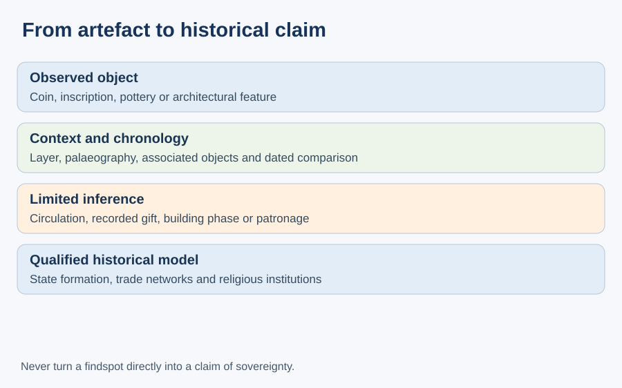
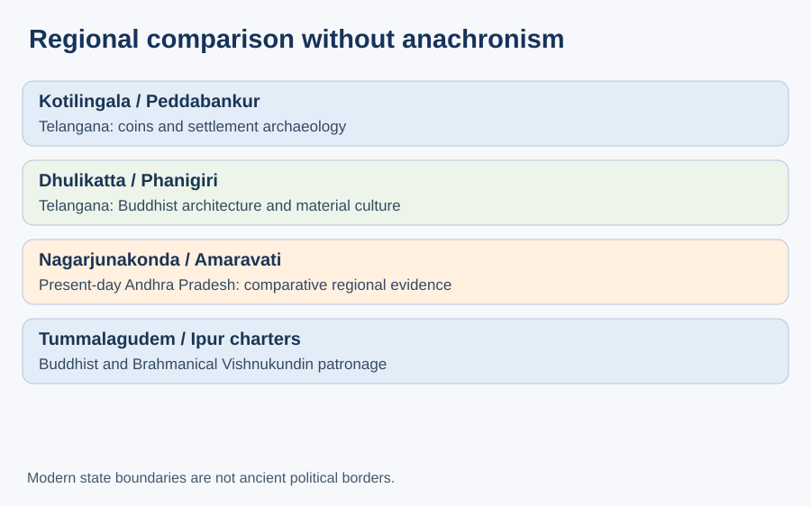
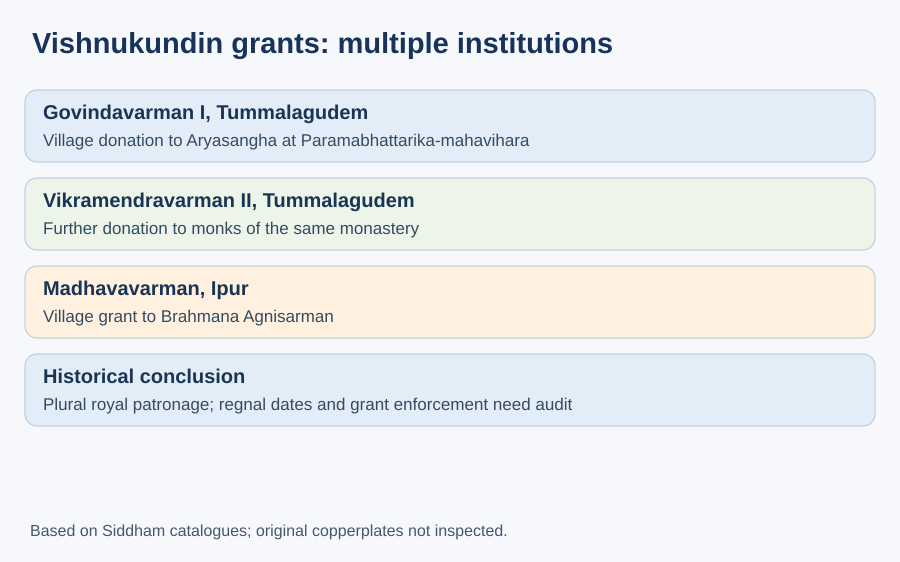

# TGPSC Group I — Paper II / Unit II / Topic 1

## Ancient Telangana: Satavahanas, Ikshvakus, Vishnukundins, Jainism, Buddhism and Cultural Heritage

**Cycle84 integrated editable student master | 29 October 2026 | NOT academically approved.** This manuscript replaces neither the original published PDF nor the earlier research supplements. The original PDF and both dated supplements remain intact. All MCQs and mains questions below are **original practice**, NOT official TGPSC previous-year questions.

## Official syllabus mapping — R1 PASS

Commission Notification 02/2024, Annexure-II, Paper II, Section II, Item 1 directly lists ancient Telangana's Satavahanas, Ikshvakus, Vishnukundins, Jainism, Buddhism, socio-cultural conditions, language, literature, art and architecture. The commission-hosted original PDF was opened and inspected on 29 October 2026. [C84-S1]

## Standalone quick revision

- **Pre-dynastic context:** megalithic burials and iron-age settlements precede the Satavahana political phase.
- **Kotilingala:** important coin site; an official capital attribution is not universal scholarly proof.
- **Peddabankur:** habitation and everyday material culture, not only royal history.
- **Dhulikatta:** stupa with ayaka platforms; one Brahmi label cannot date every building phase.
- **Phanigiri:** excavated Telangana Buddhist complex; 2024 discovery of 3,730 lead coins; ancient dating is separate from discovery date.
- **Nagarjunakonda and Amaravati:** relevant regional comparators in present-day Andhra Pradesh.
- **Tummalagudem charters:** Vishnukundin royal donations to a Buddhist monastery, including one founded by a queen.
- **Ipur charter:** Vishnukundin Brahmana grant; religious patronage was plural.
- **Source rule:** distinguish observed artefact, epigraphic statement and interpretive hypothesis.

# Detailed textbook-style concepts (16 substantive sections)

## 1. Evidence hierarchy: from a find to a historical argument

An early Telangana chapter must begin by separating three questions: what survives, what it records, and what historians infer. A stratified deposit establishes relative sequence only when the excavation context is secure. A coin gives a ruler’s name or emblem in some cases, but its presence may reflect circulation, hoarding, imitation or a later disturbance. An inscription is stronger evidence for a named donation than for the full extent of a kingdom. A royal genealogy is a claim made for political purposes, not a neutral census of ancestors. Temple traditions and modern district histories are useful leads, but they require chronological cross-checks before they become historical conclusions.

The distinction matters in Telangana because Kotilingala, Dhulikatta, Peddabankur and Phanigiri belong to interconnected early historic landscapes yet yield different forms of evidence. The museum at Karimnagar explicitly identifies excavated pottery, beads, iron pieces and coins from several of these sites. Material culture can establish craft activity and exchange even when no named monarch can be assigned to a particular layer. Conversely, an inscribed royal grant may tell us much about a monastery but little about agricultural workers who did not leave inscriptions.

A defensible method moves from object to context to comparison. First record provenience, material, inscription and excavation layer; next assess palaeography, iconography or coin type; then compare securely dated material from other sites. Distinguish a report published in 2024 from an object deposited in antiquity. This disciplined method protects students from misleading shortcuts such as treating a modern state boundary as an ancient frontier or assuming that one royal emblem proves universal political control.

**Method in an examination answer.** Begin with a source ledger: record the object, findspot, depositional layer, excavation season, catalogue number, dating method and the precise claim being tested. A museum display establishes that an object is curated, but the displayed object may have been removed from its original archaeological context. The Karimnagar district museum description confirms that material from Kotilingala, Peddabankur and Dhulikatta is represented in its collections; it does not supply a full stratigraphic register for each object. Distinguish a museum's descriptive summary from a specialist excavation report. For an assertion such as 'this was a royal capital', seek independent administrative inscriptions and sustained urban stratigraphy rather than a single inscribed coin. This prevents an attractive narrative from outrunning the evidence. [C84-S2]

## 2. Megalithic societies before the dynastic narrative

Ancient Telangana did not begin with the Satavahanas. Iron Age and megalithic landscapes show that agriculture, metalworking, social differentiation and ritual organisation had local histories before large Deccan dynasties left abundant inscriptions. Stone circles, cairns, cists and menhirs are different mortuary forms. They must not be compressed into one uniform burial custom, and the contents of a grave cannot be converted into a direct statement about the religion or caste of every inhabitant.

The Department of Heritage describes excavations at Pullur and Narmetta, where iron implements, pottery and differentiated burial constructions were recorded. Mudmal in present-day Narayanpet is known for megalithic monuments and menhirs. Such evidence provides a material baseline for interpreting later settlement change. An iron sickle may indicate agricultural practice; an elaborate grave may indicate ritual labour or unequal access to goods. Neither object by itself establishes a centralized state. The transition to the early historic period was gradual and uneven, with settlements of different size and function coexisting.

Mains answers should therefore distinguish technological change from political change. Increased iron use did not automatically cause one dynasty to appear. The river valleys, local resource zones and routes of exchange offered possibilities that communities used differently. Archaeologists ask how habitation sites relate to burial grounds, whether craft remains cluster near settlements and how radiocarbon or associated artefacts support a proposed date. This pre-dynastic foundation prevents the common mistake of presenting the Satavahanas as the first society to occupy the Telangana region.

**What the burials can and cannot establish.** Telangana's heritage department documents iron implements, pottery and differentiated burial architecture at Pullur and Narmeta. These records are evidence of mortuary practice and technological activity; they do not prove that every contemporary household used identical tools or shared the same ritual beliefs. Burial goods are deliberately selected deposits and may differ from objects used in everyday life. A comparison with habitation sites must ask whether the chronological ranges overlap before constructing a single social picture. When writing about an 'Iron Age transition', avoid implying that iron use began everywhere at once or automatically created centralized states. The defensible inference is a changing regional landscape, with local variation requiring dated excavation contexts. [C84-S3]

## 3. Kotilingala: coins, early rulers and the capital problem

Kotilingala, near the Godavari, is important for early historic coinage and the formation of political centres. The Karimnagar district history describes it as an early Satavahana capital. That is a government heritage formulation, not by itself conclusive proof that every Satavahana ruler governed from a single fixed capital. Coins of early regional authorities and Satavahana-related issues must be assessed by legends, metal, fabric, overstrikes, find context and chronology. The distinction between a place where coins circulated and a royal seat is essential.

A defensible historical reconstruction compares Kotilingala material with inscriptions and numismatic evidence across the western and eastern Deccan. Early Satavahana political geography changed over time; later royal centres need not coincide with earlier ones. A coin hoard may reflect trade, savings, insecurity or ritual deposition. A modern map displaying findspots can illuminate exchange routes but cannot turn every dot into a military conquest. This is particularly relevant where some coins have disputed readings or attributions.

The Godavari corridor matters because movement of grain, forest products, metal goods, traders and religious specialists connected settlements. A stronger explanation of Kotilingala asks how the riverine location supported production and exchange, and why numismatic finds attracted competing claims about origins. For an exam answer, state the district’s attribution, acknowledge the scholarly qualification, and explain the kinds of further evidence—secure stratigraphy, minting debris, dated inscriptions, comparative coin sequences—that could strengthen or weaken the capital hypothesis.

**Coins and the capital hypothesis.** The district museum confirms early historic coins and material culture from Kotilingala, but its short public page does not establish an official Satavahana capital. Numismatic sequences can help reconstruct rulers' names and overlapping networks; they cannot alone settle the location of a court or the duration of political control. A careful answer compares coin distribution with fortification chronology, occupation deposits and independently dated inscriptions. It also distinguishes modern administrative location from ancient territorial reach. If an examination asks for a 'capital', give the traditionally proposed association with an explicit qualification rather than presenting a disputed attribution as settled fact. For deeper R4 verification, obtain the published excavation report and critical numismatic catalogue, not only tourism summaries. [C84-S2]

## 4. Peddabankur and settlement archaeology

Peddabankur offers a necessary counterweight to a king-centred narrative. An excavated habitation can reveal brick architecture, craft residues, domestic utensils and occupational sequences even when it does not contain a spectacular royal inscription. The Karimnagar district museum records early historic objects from Peddabankur alongside material from Dhulikatta and Kotilingala. The Department of Heritage also lists excavation activity at Peddabankur, demonstrating that archaeological work continues to refine the region’s settlement history.

A settlement is not a miniature capital merely because coins or substantial structures occur there. Investigators must distinguish domestic floors from workshops, storage areas from ritual deposits and reused construction from original building phases. Pottery typology gives relative chronology when compared with securely dated contexts; it does not supply an exact year on its own. Beads and metal objects can indicate specialised production or exchange, but the presence of an imported material does not prove that a local merchant personally travelled to its distant source.

For social history, the site encourages questions that royal records rarely answer: what was made locally, what was brought in, how food was stored and which groups performed specialised work? A careful account compares Peddabankur’s everyday material with the more explicitly religious architecture of Dhulikatta. The comparison reveals how monastic establishments depended on a broader economy of settlements, agricultural producers and artisans. It also reminds students that archaeological significance is not measured only by monumental size.

**Everyday economy is not a royal appendix.** Peddabankur's importance is that settlement archaeology can recover production, water use, household material and exchange independently of royal praise. A well or bead-working object is evidence for a particular activity only after its context and date are established. It cannot tell us how many households practiced that activity, whether labor was free or coerced, or whether the entire settlement was wealthy. Compare the domestic assemblage with Dhulikatta's ritual architecture and Kotilingala's coins: the three sources illuminate different questions, and no single one represents all of ancient Telangana. The Karimnagar museum description is an accessible official starting point; a distributional study requires the excavation plans, context sheets and published catalogues. [C84-S2]

## 5. Dhulikatta: architecture, symbolic representation and chronology

The official Peddapalli district description records a Buddhist stupa at Dhulikatta, with a circular drum, dome, circumambulatory path and cardinal ayaka platforms. It also identifies carved limestone slabs and a Brahmi label assigned palaeographically to approximately the second century BCE. The architectural elements have different functions: the drum supports the superstructure; the path permits ritual circumambulation; projecting platforms organize cardinal emphasis. A chaitya hall and a stupa are not interchangeable terms.

The official description uses the older category “Hinayana” for the site and links symbolic representations to the absence of anthropomorphic Buddha images. That classification should be handled cautiously. Art-historical phases do not correspond perfectly to later sectarian labels, and the presence of a footprint or empty throne does not prove a uniform theology among all donors. A single inscribed label may date a particular carved object, not the first foundation, every enlargement or the final use of the monument.

Dhulikatta is a strong case for integrating architectural history with economic history. Limestone carving required material procurement and trained artisans. Ritual activity required maintenance and patronage. The site’s proximity to settlements makes the relationship between lay supporters and monastic life an important question. A well-structured answer first identifies excavated features, then explains what they show about worship and production, and finally distinguishes official interpretation from hypotheses awaiting full stratigraphic and epigraphic publication.

**Architectural sequence matters.** Peddapalli district's official Dhulikatta description identifies a circular drum, lower circumambulatory path, dome and ayaka platforms on four cardinal sides. It also describes a Brahmi-labelled slab dated palaeographically to around the second century BCE. These observations should be separated: the inscription's proposed date does not automatically date every enlargement, carved slab or surviving architectural phase. The district page's sectarian classification reflects a particular descriptive tradition; it should not substitute for a critical study of changing Buddhist iconography. In a mains answer, explain how movement around the stupa, symbolic representation and donations make the site socially meaningful, then state what further excavation documentation is needed to establish sequence. [C84-S4]

## 6. Satavahana politics: inscriptions, conflict and political claims

The Satavahanas occupied a changing political sphere across the Deccan rather than a fixed state with modern borders. The Nasik inscription associated with Gautami Balashri praises Gautamiputra Satakarni and helps reconstruct royal self-representation and conflict with western Kshatrapa powers. Its value lies in an identifiable epigraphic context; its eulogistic language must not be read as a neutral territorial survey. Coinage and inscriptions from different reigns should be compared before drawing a map of stable authority.

Dynastic succession is not merely a memory test. Questions about chronology affect the interpretation of routes, revenue, patronage and the relationship between western and eastern Deccan centres. If two proposed chronologies differ, a responsible answer states the broad early historic sequence and avoids false precision. Likewise, names on coins and names in later literary tradition require critical identification rather than automatic equation.

Satavahana rule also depended on intermediaries and local elites. The presence of a king’s name on a coin does not reveal the entire tax structure of a village. Inscriptions naming donors and officials offer a partial window into relationships among rulers, merchants, monasteries and households. Political competition could redirect patronage and circulation without ending local cultural practices. The most useful analytical conclusion is that Deccan state formation was negotiated through military claims, local networks, monetary practices and religious institutions rather than created by royal command alone.

**Political claims need comparison.** The famous Nasik eulogy for Gautamiputra Satakarni is a royal-family representation, not an impartial map. A ruler's listed victories can indicate political ambition and a memory of conflict, but sustained control over a distant area requires corroboration. Inscriptions issued by opponents, coin hoards and site sequences may support or complicate a chronology. Keep the difference between a dynasty's maximum claimed extent and its ordinary administrative reach. A student should also distinguish the modern Telangana archaeological sites from Deccan-wide events: a western Deccan inscription can inform regional politics without proving that the inscription was produced in Telangana. Full verification requires a critical edition and translation of the inscription, which this cycle has not examined. [C84-S5]

## 7. Satavahana economy: agriculture, guilds and long-distance connections

The early historic economy combined cultivation, pastoral activity, craft production and exchange. Rivers helped connect the interior to wider Deccan routes, while artisans produced pottery, beads, metal objects and building materials. Buddhist sites provide indirect evidence of surplus because permanent monastic buildings required resources and recurrent maintenance. But it is methodologically unsafe to infer exact tax rates, merchant guild membership or population figures from a single stupa.

Coins are especially informative when read alongside find context. Lead and copper issues circulated in local and regional settings, while Roman coins and imported objects elsewhere in peninsular India show broader commercial connections. A Roman coin found inland need not mean that a Roman ship or merchant reached that site. Goods could pass through multiple intermediaries. Similarly, a pot of coins may have been saved, deposited or concealed for reasons unrelated to everyday purchases.

The Phanigiri evidence demonstrates how a religious institution could sit within commercial routes without being reducible to a marketplace. Monasteries attracted donors, craftsmen and travellers; patronage also produced prestige and religious merit. Social relations included women and non-royal contributors, although their visibility is shaped by which inscriptions survive. A high-quality answer links production, circulation and institutional expenditure, then explains the limits of evidence. This is stronger than the simplistic assertion that foreign trade alone caused Buddhist expansion or that every early historic settlement had a monetised economy.

**Exchange without the Roman-colony myth.** Imported coins and objects can reach inland sites through multiple commercial intermediaries; their presence does not establish direct foreign rule, a resident Roman community or a fixed export volume. Lead, copper and other coinages also raise questions about local exchange, not merely international luxury trade. An economic explanation should connect agricultural surplus, transport corridors, craft specialization and the financing of religious institutions, while acknowledging that the relative contribution of each is not measurable from isolated finds. Separate the date of a coin's minting from its eventual deposition, and the presence of a coin from the purchasing power it may have had. This analytical distinction is more valuable than memorizing an unsupported trade figure. [C84-S2]

## 8. Phanigiri: architectural phases and the 2024 hoard

Phanigiri in Suryapet district is a key Telangana Buddhist site because archaeological reporting describes several architectural forms within one complex. The Department of Heritage identifies a 24-pillared congregation hall, chaitya structures, viharas, votive stupas and a stucco Bodhisattva image interpreted as Ikshvaku-period in style. These objects represent different forms of worship, residence and assembly; they should not be merged into one undifferentiated monument. The site’s occupation and architectural modifications require phase-by-phase reconstruction.

In March 2024 excavators reported a pot containing 3,730 lead coins, associated by the department with the Ikshvaku period. This is an important modern discovery, not a date for the ancient building itself. Coins in a closed deposit can help illuminate circulation and relative dating, but the interpretation depends on the archaeological context, typology and potential residual material. The precise relationship between a coin deposit and the construction of a monastic cell needs more than an attractive photograph.

The site also reveals the hazards of anachronism. An Ikshvaku-style sculpture does not prove that every monastic donor served an Ikshvaku king. Nor does a newly excavated object establish that the entire complex was built in one reign. A model answer should use Phanigiri to demonstrate how material finds, epigraphic evidence, religious institutions and artistic networks can be integrated while retaining uncertainty about attribution. The official excavation overview is a strong starting point, but the full excavation catalogue and specialist numismatic study remain necessary for independent academic approval.

**A bounded reading of the 2024 discovery.** The Telangana Department of Heritage records a hoard of 3,730 lead coins found in a monastic cell at Phanigiri in March 2024 and describes architectural remains including a congregation hall, chaityas and viharas. The number refers to a reported find, not a census of ancient currency in circulation. Its Ikshvaku-period attribution rests on archaeological and numismatic interpretation, and the find's modern discovery date must not be mistaken for the coins' ancient date. A full report should test stratigraphy, wear, symbol typology and the circumstances of deposition. The surviving complex spans phases: an image's style, a hoard and a building foundation need not belong to one moment. [C84-S3]

## 9. Ikshvakus: Nagarjunakonda and a regional network, not a relocated site

The Ikshvakus were influential in the eastern Krishna valley after Satavahana political fragmentation. Vijayapuri/Nagarjunakonda, an important source of inscriptions and Buddhist monuments, is in present-day Andhra Pradesh. It is relevant to Telangana because ancient religious, artistic and commercial networks crossed today’s state boundary. It is inaccurate to present Nagarjunakonda as a Telangana monument merely to strengthen a state-specific answer.

Inscriptional records associated with the Ikshvaku milieu are especially valuable for understanding donations by royal women and other patrons. These records help show that women could direct substantial religious resources and participate in public acts of commemoration. Yet the inscriptions disproportionately preserve affluent donors; they cannot prove equal social opportunity for all women. Monastic support coexisted with Brahmanical ritual, and a king’s religious identification does not determine the beliefs of an entire population.

A comparative answer places Nagarjunakonda’s donor inscriptions alongside Phanigiri’s Telangana archaeology. The first offers a richly documented regional centre; the second supplies direct local material evidence. Their relationship illustrates mobility of artistic forms and religious communities without demanding identical political control. Avoid describing all Buddhist establishments as state-owned institutions. Royal, household and merchant donations could overlap, and religious architecture often survived political transitions. The correct unit of analysis is the Krishna-Godavari cultural network, carefully distinguished from administrative boundaries.

**Regional comparison with correct geography.** Nagarjunakonda is in present-day Andhra Pradesh, while Phanigiri is in Telangana. Their shared importance lies in overlapping Buddhist patronage and artistic networks of the eastern Deccan, not in treating them as the same site. Ikshvaku royal women's inscriptions and donations are useful evidence for elite participation, but the number of named women cannot establish the legal or economic status of all women. A source-critical comparison asks which inscriptions are securely dated, which structures belong to which phases and whether the same forms of patronage appear locally. This avoids converting a regional analogy into a claim of direct rule at every Telangana excavation. [C84-S3]

## 10. Vishnukundin charters: Buddhist endowments challenge a one-faith story

The Vishnukundins are often summarized as promoters of Sanskritic royal ritual and Brahmanical land grants. That is only part of the surviving evidence. The Tummalagudem copper-plate charter of Govindavarman I, year 37, records a village donation to the Aryasangha at the Paramabhattarika-mahavihara in Indrapura. The same record attributes the monastery’s foundation to his senior queen, Paramabhattarika Mahadevi. A second Tummalagudem charter, of Vikramendravarman II in year 11, records another donation to monks of the same institution. These inscriptions were found in the Telangana region and are catalogued in the Siddham Asian Inscription Database.

The charters are historically significant because they prevent an oversimplified claim that Vishnukundin political power immediately extinguished Buddhist patronage. They document a specific monastery, donor relationships and royal acts; they do not prove that every Vishnukundin ruler followed the same policy or that the entire population was Buddhist. The Indrapura place-name also requires careful geographic identification; an ancient charter’s place-name should not be casually mapped to a modern locality without scholarship.

The year numbers in these grants are regnal years, not modern calendar years. To convert them into absolute dates, historians need a securely anchored dynastic chronology. The records can also be read as political acts: donating a village directed resources to an institution and displayed legitimacy. This evidence-based discussion is stronger than the blanket formula “Satavahanas were Buddhist, Vishnukundins were Hindu.” Religious patronage varied across rulers, households, periods and localities.

**Religious plurality is a documented question, not a slogan.** The Tummalagudem charters are frequently used to discuss Vishnukundin grants associated with Buddhist institutions and a queen's patronage. Their significance is that surviving royal records may describe different kinds of religious beneficiaries within the dynasty's wider history. The original plates and a critical epigraphic edition have not been inspected in this cycle, so exact Sanskrit or Prakrit formulations, regnal-year conversions and identifications of similarly named kings remain provisional. Do not merge distinct Govindavarmans merely because names recur in genealogies. An effective answer explains the documentary claim, names the evidence gap and resists a simplistic 'Buddhism ended when Brahmanical patronage began' sequence. [C84-S5]

## 11. Ipur charter: land grants, rights and documentary silences

The Ipur charter of Madhavavarman, year 37, catalogued in the Siddham database, records a village grant to a named Brahmana, Agnisarman of the Vatsa gotra. The document identifies the ruler’s genealogy and the issuing camp. Its value is concrete: it names a grantor, beneficiary, place and regnal context. It also shows a different patronage channel from the Buddhist Tummalagudem grants. Together, the documents demonstrate the religious and political plurality of Vishnukundin records.

A copper-plate grant is not a modern land registry. It states an authorised transfer and may describe privileges, but whether rights were contested, fully implemented or understood identically by cultivators is a separate historical question. The survival of plates is selective; many transactions were never recorded in this form. Inferences about expanding landed power must therefore compare multiple grants, settlement archaeology and other documentary traditions.

The historiographical debate concerns whether grants primarily represent royal religious generosity, administrative delegation, political incorporation of local elites or changes in agrarian control. These explanations need not be mutually exclusive. A king could gain prestige while beneficiaries acquired resources and cultivators faced new obligations. A mains answer should distinguish what the charter explicitly states from a broader model of “feudalisation.” That distinction is central to rigorous social and economic history and prevents students from turning a contested interpretive label into an unquestioned fact.

**A land grant is a legal claim, not a village survey.** An Ipur copperplate can record a donor, grantee, locality, privileges and sanctions, but its language is a normative assertion of rights. Actual cultivation, revenue collection and compliance may have varied. Distinguish tax exemptions stated by the issuer from the social costs borne by cultivators, for which the grant may be silent. Place names may have changed, and a modern identification requires topographic and epigraphic comparison. Dating also requires care: a regnal year is counted from a ruler's reign, not automatically a Common Era year. Until the complete critical edition is checked, the student should avoid precise land-area, village-boundary or revenue-rate claims. [C84-S5]

## 12. Jainism: trace the evidence without manufacturing ancient continuity

The rise and growth of Jainism in Telangana must be studied as a distinct religious and institutional history. Jain traditions emphasise disciplined ethical conduct, non-violence, ascetic practice and the liberation of the soul, but the presence of a Jain image does not establish the full chronology of local communities. Some prominent Jain sites and sculptures in the wider region belong to medieval periods; projecting them unchanged back into Satavahana times creates a false line of continuous, uniform patronage.

The proper evidentiary questions are chronological and geographic. Is an inscription securely dated? Does it name a Jain teacher, donor or establishment? Is a sculpture recovered in situ or moved to a museum? Are there later repairs, reused fragments or oral traditions? Jainism and Buddhism shared some broader renunciant settings but differed in doctrine, monastic organisation and historical trajectories. Merchant patronage may appear in both, yet it should not be assumed for every site without inscriptions or associated settlement evidence.

Telangana’s museums preserve material that can help with iconographic comparison. Museum display, however, may group objects from different periods and places. Students should note an object’s recorded provenance and avoid using a modern collection label as proof of an ancient political boundary. A strong answer combines doctrinal distinction with archaeological restraint: demonstrate Jain presence where sources support it, explain what remains uncertain and resist claims that every later Jain shrine was established by a named early dynasty.

**Avoid an unbroken-continuity assumption.** Jain images, caves and temples in Telangana are evidence of particular historical religious practices, but a medieval image does not prove an uninterrupted Jain institution from the Satavahana period. First establish the object's date, provenance and dedicatory context; then ask whether an inscription, excavation or securely dated literary reference links it to earlier phases. Museum relocation can obscure the original setting, and an iconographic identification alone does not settle the date of a cult. A balanced essay compares Jain and Buddhist trajectories without treating either as uniform across every district. The appropriate conclusion is that religious landscapes changed through local patronage, migration, settlement and material practice; exact chronology remains source-dependent. [C84-S2]

## 13. Language and literature: Prakrit, Sanskrit and the limits of court texts

Prakrit inscriptions written in Brahmi-derived scripts are prominent in early historic Deccan evidence. Later Sanskrit charters became important in royal genealogies and grants. These documentary languages tell us about inscriptional practice and political representation; they do not provide a complete inventory of languages spoken by farmers, traders or craftspeople. A script is not a language, and the spread of one literary register does not prove the disappearance of local speech.

The Gathasaptashati is traditionally associated with the Satavahana ruler Hala and offers literary material about social relationships and everyday life. Its composition and transmission history, however, complicate attempts to date every verse to one court or use it as a transparent record of a particular Telangana village. Likewise, Sanskritic royal praise often employs conventional images of universal conquest and ideal kingship. Such texts reveal political ideals as well as information, and historians must identify the genre before treating a statement as literal fact.

For exam purposes, compare three source types: donative Prakrit inscriptions naming donors, literary anthologies reflecting social themes and copperplate Sanskrit charters expressing authority. Their audiences and purposes differ. Students should explain that multilingual and multi-script practices evolved over centuries, often in contact with local languages. The historical development of Telugu cannot be reconstructed simply by equating the first surviving inscription in a script with the first spoken use of a language. Avoid unsupported claims that one ruler “invented” a language or a script.

**Script, language and authorship are separate variables.** Brahmi is a writing system; Prakrit and Sanskrit are languages, and neither language's appearance in an inscription proves that it was the everyday speech of every resident. A literary attribution, such as the association of the Gathasaptashati with Hala, is also different from a securely dated manuscript history. An exam answer should identify whether a statement rests on an inscription, a later literary tradition or modern philological reconstruction. Elite religious and administrative texts overrepresent literate institutions; oral and vernacular practice may leave fewer direct records. Avoid turning the emergence of Sanskrit inscriptions into an abrupt extinction of Prakrit or local speech. [C84-S5]

## 14. Art and architecture: comparison without geographic confusion

Telangana’s ancient architectural record includes burial monuments, early historic settlements, Buddhist stupas, chaityas, viharas and later religious structures. A stupa is a focus of commemoration and devotion; a chaitya is a worship or assembly space; a vihara is a residence and institutional setting for monastic life. The same complex can contain several of these forms. Sculptural style can suggest contacts, but precise attribution requires comparison with securely dated objects and excavation contexts.

Amaravati and Nagarjunakonda are in present-day Andhra Pradesh, although their artistic and religious histories are essential comparative material for the eastern Deccan. Phanigiri and Dhulikatta provide Telangana-based evidence. A comparison should ask how relief carving, stucco, architecture and donor practice differed among sites, rather than treating all objects as products of a single artistic school. The term “Amaravati school” is an art-historical category; it is not a statement that every related panel was carved at Amaravati itself.

Architectural conservation adds another layer of interpretation. Reconstructed walls, restored sculpture and museum-mounted fragments may differ from the excavated appearance. A student should separate original fabric, archaeological restoration and a modern diagram. This distinction is useful for both heritage administration and historical writing. The best synthesis combines form, function, patronage, chronology and geography. It also acknowledges that monuments are only part of the record: everyday houses, craft areas and burial grounds reveal cultural history beyond elite religious architecture.

**Use site-specific visual comparison.** The Amaravati sculptural tradition provides a valuable regional reference, but Amaravati is in Andhra Pradesh; Phanigiri and Dhulikatta provide Telangana cases. A motif's resemblance across sites can suggest artistic contact or a shared religious vocabulary, but it does not prove that one workshop carved every object or that monuments were built in the same year. To establish influence, compare material, carving technique, archaeological context and securely dated inscriptions. Differentiate stupa, chaitya and vihara by function before discussing style. The district Dhulikatta description records symbolic Buddha representations, while the state Phanigiri report documents later sculptural material; their descriptions are not interchangeable chronological labels. [C84-S3][C84-S4]

## 15. Heritage administration and ethical interpretation

Historical study has a practical dimension because excavated sites are vulnerable to erosion, development pressure, unauthorised digging and the loss of contextual information. A coin removed without documentation loses much of its scientific value: its relationship to a floor, pot, layer or other finds may never be reconstructed. The Department of Heritage Telangana and district museums are institutional starting points for conservation and interpretation. A site label should communicate both established findings and uncertainties rather than turn disputed dates into promotional slogans.

The 2024 Phanigiri coin discovery demonstrates why prompt publication of catalogues matters. The public announcement identifies the hoard and a provisional period attribution, but specialists need images, weights, metal analysis, contexts and comparisons to test the conclusion. Similarly, an official district statement calling Kotilingala a capital should be presented with an explicit qualification about the need for broader numismatic evidence. These are not reasons to dismiss heritage departments; they are reasons to distinguish an initial public description from a final scholarly edition.

A responsible policy response would prioritise site inventories, provenance registers, conservation plans, digital records, controlled access and collaboration between archaeology, epigraphy and local communities. Heritage tourism must not compromise fragile deposits. The examination relevance is twofold: the historical significance of Satavahana, Ikshvaku and Vishnukundin cultural landscapes, and the administrative duty to preserve the evidence on which future interpretations depend.

**Conservation changes the evidentiary situation.** Archaeological objects move through excavation, conservation, storage, display and publication. Each stage can improve access but may also separate an object from its precise original context. A responsible museum label should preserve accession number, findspot, excavation season, stratigraphic unit, dating basis and uncertainty. Tourism pages are useful for locating protected monuments but are not substitutes for conservation records. Students should avoid treating a site's present appearance as an untouched ancient landscape: reconstructions and repairs may affect visible features. When using recent finds in a mains answer, state the excavation or announcement year and identify the reporting institution, without pretending that a public summary supplies a full peer-reviewed excavation monograph. [C84-S2][C84-S3]

## 16. Synthesis: competing explanations and a defensible answer

Ancient Telangana should be explained as a changing cultural region rather than a procession of dynasties. Political history shows Satavahana expansion, Ikshvaku-connected eastern Deccan networks and Vishnukundin reorganisation. Archaeology reveals older megalithic societies and local settlements; inscriptions disclose donations and ideological claims; art and literature show overlapping religious and linguistic worlds. No single evidence class supplies the complete picture.

Three competing explanations deserve comparison. A royal-patronage approach emphasizes kings and grants. A commercial-network approach stresses routes, crafts, donors and monasteries. A local-social approach asks about women, households, labour and groups absent from inscriptions. Each explains something, but none alone is sufficient. The Tummalagudem Buddhist grants under Vishnukundin rulers particularly challenge simplistic religious succession. Kotilingala raises the difference between coin evidence and claims about a permanent capital; Phanigiri shows how new finds can alter the interpretation of a site.

For a 200–250-word mains answer, open with the region and chronology, organize three analytical points around evidence, include two Telangana sites and one named inscription, identify a limitation and conclude with an integrated interpretation. For preliminary questions, remember the precise site-state distinction, grant beneficiary and architectural terms. The strongest conclusion is that Telangana’s ancient history is both regionally connected and locally distinctive, with uncertainty treated as part of sound scholarship rather than an embarrassment to conceal.

**How to build a defensible synthesis.** Organize a response around evidence types rather than a list of kings: (1) pre-dynastic settlement and mortuary practice; (2) Satavahana-era coins, inscriptions and exchange; (3) Buddhist monuments and donor networks; (4) Vishnukundin grants and changing institutional patronage; and (5) limits of the surviving record. Each claim should identify a Telangana site when the question is geographically specific. Use Nagarjunakonda or Amaravati only as qualified regional comparators. Avoid a single uninterrupted dynastic timeline when the chronology of a site is disputed. Conclude with the difference between historical continuity of settlement and continuity of any one polity, language or religion. This structure directly serves a 200–250-word mains answer without manufacturing certainty. [C84-S1][C84-S2]

## Evidence-to-inference comparison

| Evidence | Strong direct inference | Claim that needs corroboration |
|---|---|---|
| Coin hoard | Coins were deposited at a site | Issuer controlled all nearby settlements |
| Brahmi label | Text and palaeographic characteristics | All monument phases share its date |
| Copperplate grant | Named donor, beneficiary and terms | Rights were uniformly enforced |
| Monastic architecture | Built space for ritual and residence | Every resident shared one religious identity |
| Royal eulogy | Political ideology and named claims | Literal extent of empire |
| Megalithic grave | Mortuary practice and assemblage | A single religion or caste for the region |

## Original evidence-flow diagrams (schematic, not scale maps)

## Original practice MCQs — 30 explained questions (NOT official PYQs)

### MCQ 1. Which conclusion follows most securely from a coin found at an ancient site?

A. The coin circulated or was deposited at the findspot
B. The findspot functioned as the issuer’s political capital
C. The coin was minted at the same site where it was recovered
D. The issuer maintained a permanent garrison at the findspot

**Answer: A.** A findspot documents presence or deposition; sovereignty and capital status require additional evidence.

### MCQ 2. What is the chief risk in using a royal eulogy to map territory?

A. The text never names rulers
B. Its praise may exaggerate control
C. All inscriptions are forgeries
D. It is always written in Greek

**Answer: B.** Eulogistic royal claims must be compared with other records and archaeology.

### MCQ 3. Which source is most directly suited to studying household craft activity?

A. A modern tourist brochure alone
B. An isolated undated legend
C. Excavated domestic layers and tools
D. A later royal genealogy alone

**Answer: C.** Stratified habitation evidence reveals production and use more directly.

### MCQ 4. Which site is located in present-day Telangana?

A. Sanchi in central India
B. Nagarjunakonda in the Krishna valley
C. Amaravati on the lower Krishna
D. Phanigiri in Suryapet district

**Answer: D.** Phanigiri is in Suryapet; Nagarjunakonda and Amaravati are in Andhra Pradesh.

### MCQ 5. The official Peddapalli description identifies which feature at Dhulikatta?

A. Cardinal ayaka platforms around the stupa drum
B. A monolithic Jain tirthankara image in the central shrine
C. A surviving Gupta-period temple shikhara
D. A rock-cut chaitya hall with an inscribed Ashokan pillar

**Answer: A.** Dhulikatta’s stupa has cardinal ayaka platforms around its drum.

### MCQ 6. A palaeographically dated inscriptional label at Dhulikatta dates most directly:

A. The first occupation of every nearby settlement
B. The inscription or labelled object, subject to its context
C. The completion date of the entire stupa complex
D. The final abandonment of the religious site

**Answer: B.** A label’s date cannot automatically date every construction phase.

### MCQ 7. The March 2024 Phanigiri discovery concerned:

A. 3,730 gold coins at Phanigiri
B. 3,730 lead coins at Amaravati
C. 3,730 lead coins
D. 3,730 copper coins at Nagarjunakonda

**Answer: C.** The state heritage department reported a hoard of 3,730 lead coins.

### MCQ 8. What is the most accurate interpretation of an Ikshvaku-style Phanigiri image?

A. It dates all structures at the site to one construction phase
B. It proves that the sculpture was made at Nagarjunakonda
C. It establishes a royal capital at the site during that reign
D. It suggests stylistic links that require contextual dating

**Answer: D.** Stylistic attribution indicates connections, not universal political control.

### MCQ 9. Which dynasty is associated with the Tummalagudem charters?

A. Vishnukundins
B. Qutb Shahis
C. Mughals
D. Cholas

**Answer: A.** The catalogued Tummalagudem grants belong to Vishnukundin rulers.

### MCQ 10. Govindavarman’s Tummalagudem charter records support for:

A. A Mughal fort
B. A Buddhist mahavihara
C. A Portuguese factory
D. A railway company

**Answer: B.** The grant benefits the Aryasangha at Paramabhattarika-mahavihara.

### MCQ 11. Who is named as the founder of the Paramabhattarika-mahavihara in the charter?

A. Savitribai Phule
B. A Roman trader
C. Paramabhattarika Mahadevi
D. Rani Rudrama Devi

**Answer: C.** The charter attributes the monastery to Govindavarman’s senior queen.

### MCQ 12. What does the second Tummalagudem charter show?

A. The capital moved to London
B. The end of all land grants
C. All Buddhist institutions vanished
D. A later Vishnukundin donation to the same monastery

**Answer: D.** Vikramendravarman II’s year-11 charter records a further monastic donation.

### MCQ 13. The Ipur charter of Madhavavarman concerns:

A. A Brahmana land grantee
B. A railway tariff
C. A medieval Sufi khanqah
D. A British census

**Answer: A.** The record grants a village to Agnisarman of the Vatsa gotra.

### MCQ 14. Why is a regnal year not automatically a CE year?

A. It is a modern tax year
B. It counts years of a ruler’s reign
C. It uses only lunar months
D. It is always fictional

**Answer: B.** Absolute conversion needs a securely anchored reign chronology.

### MCQ 15. Which evidence most directly supports the identity of a named monastery beneficiary?

A. A modern district boundary
B. An unproven oral legend
C. A contemporary grant inscription
D. A tourist map

**Answer: C.** An inscription can explicitly name the institution and donation.

### MCQ 16. Which statement about Nagarjunakonda is accurate?

A. It is in Maharashtra
B. It was founded in 2014
C. It lies in modern Telangana
D. It lies in modern Andhra Pradesh but informs regional history

**Answer: D.** Ancient networks crossed modern state boundaries.

### MCQ 17. Which term means monastic residence?

A. Vihara
B. Stupa
C. Ayaka
D. Menhir

**Answer: A.** A vihara houses monks and institutional activity.

### MCQ 18. Which term best denotes a Buddhist commemorative monument?

A. Mint
B. Stupa
C. Menhir
D. Copperplate

**Answer: B.** A stupa serves commemorative and devotional functions.

### MCQ 19. Why should Jain sculpture in a museum be treated cautiously for dating?

A. All sculptures date to one century
B. All museums are inaccurate
C. Objects may have moved from original contexts
D. Jainism has no images

**Answer: C.** Provenance and secure dating are needed before dynastic attribution.

### MCQ 20. A Roman coin found inland most securely suggests:

A. Direct Roman colonial rule
B. A Roman capital in Telangana
C. No Indian trade
D. Possible long-distance circulation through intermediaries

**Answer: D.** Exchange networks can transmit coins without direct foreign settlement.

### MCQ 21. What is a key difference between script and language?

A. A script writes languages; it is not itself a spoken language
B. Languages cannot be written
C. Only Sanskrit has scripts
D. They are identical

**Answer: A.** Brahmi-derived scripts could record multiple languages.

### MCQ 22. The Gathasaptashati is traditionally associated with:

A. Prataparudra
B. Hala
C. Ashoka
D. Akbar

**Answer: B.** Tradition links it to Hala, though textual compilation history is complex.

### MCQ 23. Which site offers evidence of pre-dynastic megalithic burials?

A. Golconda Fort
B. Warangal Fort
C. Mudmal
D. Charminar

**Answer: C.** Mudmal is known for megalithic burial monuments and menhirs.

### MCQ 24. A copperplate grant establishes most directly:

A. Every farmer’s lived experience
B. Uniform land rights across India
C. A complete population census
D. The grant as recorded and its stated terms

**Answer: D.** Grants state an authorised transfer; social implementation requires further evidence.

### MCQ 25. Which question is best answered by a stratified habitation excavation?

A. Sequence of local occupation and activities
B. The exact number of imperial troops
C. The private beliefs of every villager
D. A complete royal genealogy

**Answer: A.** Stratigraphy and associated artefacts help reconstruct occupation phases.

### MCQ 26. Why are wealthy donors overrepresented in inscriptions?

A. Only wealthy people lived then
B. Inscriptional survival and patronage are selective
C. No women donated
D. Inscriptions were prohibited

**Answer: B.** Surviving records reflect social and material selection biases.

### MCQ 27. Which pair best represents direct Telangana archaeological cases?

A. Sanchi and Bharhut
B. Taxila and Peshawar
C. Phanigiri and Dhulikatta
D. Amaravati and Nagarjunakonda

**Answer: C.** Both Phanigiri and Dhulikatta are in modern Telangana.

### MCQ 28. What would best strengthen a disputed capital identification?

A. A single modern slogan
B. A tourist photograph
C. A dynasty name in a school essay
D. Coin sequence, stratigraphy and contemporary inscriptions

**Answer: D.** Independent, securely dated material is needed for a capital hypothesis.

### MCQ 29. What does the Tummalagudem evidence complicate?

A. A simple Buddhist-to-Brahmanical replacement narrative
B. The existence of all copperplates
C. The location of the Indian Ocean
D. The discovery of iron

**Answer: A.** Vishnukundin rulers supported Buddhist institutions alongside other patronage.

### MCQ 30. Which is the most responsible claim about the 2024 Phanigiri hoard?

A. The announcement establishes every coin’s mint date
B. The reported hoard needs numismatic and contextual study
C. It proves universal conversion
D. It dates all monuments to 2024

**Answer: B.** A reported discovery is evidence, but chronology and attribution require specialist review.

## Six complete original mains model answers (NOT official PYQs)

### Mains 1. Assess the value and limitations of archaeological evidence for ancient Telangana.

**Introduction.** Ancient Telangana’s history must be reconstructed through material remains rather than a continuous royal chronicle. Archaeology supplies evidence about settlements, production, worship and social practices, but each find requires contextual interpretation.

**Settlement and technology.** Megalithic burials at Mudmal and excavated iron objects from sites such as Pullur illuminate pre-dynastic communities. Peddabankur’s habitation evidence adds information about everyday production that royal inscriptions rarely preserve. These objects help trace technological and occupational change without proving a centralized kingdom.

**Religion and economy.** Dhulikatta’s stupa and Phanigiri’s monastic structures show architectural investment, donor networks and connections to routes of exchange. The reported 2024 Phanigiri coin hoard adds numismatic evidence, but its deposition date and attribution must be tested against stratigraphy and comparative coin series.

**Methodological limits.** A coin’s findspot does not automatically establish sovereignty; a royal inscription may exaggerate territory; and a wealthy donor’s record does not describe all residents. Modern state boundaries also cannot be projected backward onto ancient polities.

**Administrative relevance.** A district museum should record excavation layer, accession number and object movement before displaying a coin. Without provenance, even an authentic artefact loses much of its historical value and cannot reliably resolve disputes about settlement sequence or dynastic authority.

**Conclusion.** Archaeology is indispensable when integrated with epigraphy, literature and geography. An evidence-led interpretation distinguishes direct finds from scholarly hypotheses and preserves uncertainty where the record is incomplete.

### Mains 2. Explain the historical importance of Kotilingala, Peddabankur and Dhulikatta.

**Background.** These sites show that early historic Telangana consisted of interconnected settlements, exchange networks and religious institutions, not merely the courts of a single dynasty. Their evidence is complementary rather than interchangeable.

**Kotilingala and political geography.** Coins from the Godavari corridor help reconstruct regional authorities and Satavahana-related circulation. The Karimnagar district history identifies Kotilingala as an early capital, but a permanent capital claim requires independent epigraphic and numismatic corroboration. A coin find does not prove continuous territorial control.

**Peddabankur and social economy.** Habitation archaeology contributes information about brick structures, pottery, craft production and ordinary life. It helps explain how agricultural and artisanal settlements could sustain wider political and religious networks. Everyday objects deserve analysis alongside monumental inscriptions.

**Dhulikatta and Buddhist patronage.** The excavated stupa includes a circular drum, circumambulatory path and cardinal ayaka platforms. A Brahmi label, palaeographically dated to around the second century BCE, helps establish one phase of material history without dating every later addition. Carved limestone demonstrates specialised artistic labour.

**Comparative insight.** These sites also differ in what remains invisible: an inscription names a donor, whereas a domestic assemblage may reveal labour without personal names. Combining them reduces the bias toward elites and avoids equating the most monumental location with the most important settlement.

**Conclusion.** Studied together, these sites connect power, production and religious patronage. Their strongest lesson is methodological: archaeological contexts, inscriptions and comparative chronology must be combined before assigning fixed dynastic labels or universal dates.

### Mains 3. Discuss the contribution of the Satavahanas to early historic Telangana.

**Introduction.** The Satavahanas shaped a changing Deccan political sphere that included parts of present-day Telangana. Their significance lies in political networks, exchange and cultural patronage rather than a permanently fixed territorial map.

**Politics and evidence.** Royal coinage and Prakrit inscriptions illuminate authority, while the Nasik eulogy of Gautamiputra Satakarni reflects conflict and royal ideology. Such praise requires comparison with other sources. Kotilingala is important for early numismatics, but its status as a single dynastic capital remains open to critical evaluation.

**Economic development.** Agriculture supported settlements and craft production. River routes linked inland producers, merchants and religious institutions. Coins indicate exchange in some contexts, not a uniformly monetised economy. Foreign objects could arrive through intermediaries without direct foreign control.

**Society and culture.** Donative records and Buddhist monuments reveal contributions from elites, merchants and women. Dhulikatta’s stupa illustrates specialised building activity, while Peddabankur offers evidence of habitation and material production. Literary association of the Gathasaptashati with Hala must be balanced against questions of textual transmission.

**Historical caution.** The kingdom’s political centres and commercial routes changed across centuries. A coin or literary association should therefore be dated within a particular phase rather than treated as evidence for the entire dynasty. This qualification is central to credible regional history.

**Conclusion.** Satavahana history is best understood through interaction among rulers, local elites, craftspeople and religious donors. Telangana’s sites are essential to that reconstruction, but chronology and claims of sovereignty must remain evidence-based.

### Mains 4. Analyse Ikshvaku connections with Telangana’s Buddhist heritage.

**Context.** After Satavahana political fragmentation, Ikshvaku rulers became important in the eastern Krishna valley. Their influence should be studied as a regional network rather than a kingdom identical to modern Telangana.

**Regional centre.** Vijayapuri/Nagarjunakonda, now in Andhra Pradesh, preserves inscriptions and Buddhist monuments that illuminate patronage, including donations associated with royal women. Its modern location must be stated accurately. Such inscriptions record particular affluent patrons and cannot represent the religious beliefs of every resident.

**Telangana evidence.** Phanigiri in Suryapet contains stupas, chaitya structures, viharas and assembly spaces. The state heritage department describes a stucco Bodhisattva image in Ikshvaku-period style. This is evidence of artistic connection, not automatic proof of direct political control over the entire site.

**Numismatic discovery.** In March 2024, excavators reported 3,730 lead coins at Phanigiri and attributed them to the Ikshvaku period. Their precise dating requires examination of types, context and specialist publications. The modern discovery date must not be confused with the ancient deposit.

**Source limitation.** Artistic style is a comparative tool, not an independent dated royal decree. Excavation reports, inscriptional readings and coin typologies must be considered together before assigning political boundaries or the foundation date of a monument to a named dynasty.

**Conclusion.** The Ikshvaku contribution is visible through a connected religious and artistic landscape. Sound analysis compares Andhra inscriptional centres with Telangana archaeology while distinguishing patronage, cultural influence and political sovereignty.

### Mains 5. How do Vishnukundin grants change our understanding of religious history?

**Introduction.** Vishnukundin history is frequently presented as a shift toward Brahmanical patronage. The surviving copperplate charters demonstrate a more complex religious and institutional landscape.

**Buddhist grants.** The Tummalagudem charter of Govindavarman I, year 37, records a village donation to the Aryasangha at Paramabhattarika-mahavihara in Indrapura. The monastery is attributed to Queen Paramabhattarika Mahadevi. A later charter of Vikramendravarman II, year 11, records another donation to monks at the same institution. These records are catalogued by the Siddham inscription database.

**Brahmanical grants.** The Ipur charter of Madhavavarman, year 37, documents a village donation to the Brahmana Agnisarman. Together, the charters reveal multiple channels of royal patronage rather than exclusive allegiance to one religious establishment.

**Historical interpretation.** Grants disclose beneficiaries, royal claims and intended transfers. They do not prove that every cultivator accepted identical obligations or that all religious communities received equal resources. Regnal years also require separate chronological anchoring before conversion to modern dates.

**Social consequence.** Land endowments potentially changed who controlled produce and services, but the copperplates do not directly reveal the response of cultivators. Economic interpretations must be tested against settlement evidence and the precise language of each grant rather than assumed from a generic model.

**Conclusion.** The Vishnukundin evidence undermines a simple story of Buddhist disappearance followed by Brahmanical dominance. Religious institutions, political legitimacy and land rights interacted in varied local settings across the eastern Deccan.

### Mains 6. Evaluate the role of women, language and patronage in ancient Telangana’s culture.

**Introduction.** Cultural history becomes richer when royal dynasties are studied alongside donors, language practices and the social institutions that sustained monuments. The evidence is selective, but it reveals more than king lists.

**Women and institutions.** Ikshvaku-related inscriptions identify women among important Buddhist patrons. The Vishnukundin Tummalagudem charter credits Queen Paramabhattarika Mahadevi with founding a monastery. These examples demonstrate public religious agency, while their elite character prevents generalisations about all women’s social position.

**Language and literature.** Prakrit inscriptions in Brahmi-derived scripts and later Sanskrit charters represent changing documentary conventions. A script is not a language, and court records cannot establish what every household spoke. The Gathasaptashati, traditionally linked to Hala, must be interpreted with attention to its compilation history.

**Architecture and economy.** Stupas, chaityas and viharas required skilled labour, materials and recurring support. Dhulikatta and Phanigiri illustrate the relationship between religious architecture and surrounding settlements. Monasteries could receive donations from rulers, merchants and households.

**Critical perspective.** Literary prescriptions, elite endowments and excavated domestic objects describe different social groups. Their unequal survival means that the prominence of donors in inscriptions should not be confused with universal prosperity, literacy or religious freedom across the entire population.

**Conclusion.** Ancient Telangana’s cultural history reflects intersecting political, linguistic, economic and religious networks. An evidence-based answer recognises women’s documented contributions without exaggerating their representativeness, and distinguishes securely dated objects from later tradition.

## Answer blueprints

- **Mains 1:** Define scope → source/site evidence → analytical causes or comparisons → source limitation → balanced conclusion.
- **Mains 2:** Define scope → source/site evidence → analytical causes or comparisons → source limitation → balanced conclusion.
- **Mains 3:** Define scope → source/site evidence → analytical causes or comparisons → source limitation → balanced conclusion.
- **Mains 4:** Define scope → source/site evidence → analytical causes or comparisons → source limitation → balanced conclusion.
- **Mains 5:** Define scope → source/site evidence → analytical causes or comparisons → source limitation → balanced conclusion.
- **Mains 6:** Define scope → source/site evidence → analytical causes or comparisons → source limitation → balanced conclusion.

# Source register and verification scope — Cycle84 (29 October 2026)

**C84-S1 — TGPSC Notification 02/2024, Annexure-II, PDF p.28 (printed page 28; zero-based PDF page 27).** Commission-hosted original, directly opened and text inspected 29 Oct 2026. Paper II / II / Item 1 explicitly includes Satavahanas, Ikshvakus, Vishnukundins, Jainism, Buddhism, socio-cultural conditions, language, literature, art and architecture. R1 PASS. [Commission original PDF](https://websitenew.tgpsc.gov.in/preview/RElSRUNUUkVDUlVJVE1FTlROT1RJL05PVElGSUNBVElPTl9OT18wMi0yMDI0X0dyb3VwLUlfU2VydmljZXMgKDEpMjAyNDAyMjAxNDA3MzcucGRmr95v17a0y2d8i13v)

**C84-S2 — Karimnagar District Administration, Archaeology & Museums.** Official public museum description, directly opened 29 Oct 2026; confirms collections from Kotilingala, Peddabankur and Dhulikatta, including coins and household material. Does NOT supply original excavation stratigraphy, full object inventory or a settled capital attribution. [Karimnagar district museum](https://karimnagar.telangana.gov.in/archaeology-museums/)

**C84-S3 — Telangana Department of Heritage, excavation overview.** Official public report directly opened 29 Oct 2026; describes Pullur/Narmeta megaliths, Phanigiri's 2001–2019 excavation phases and 3,730 lead-coin hoard announced in March 2024. Public summary is NOT a complete context-level excavation monograph. [Telangana Heritage excavation overview](https://tgarch.telangana.gov.in/Excavationinfo)

**C84-S4 — Peddapalli District Administration, Buddhist Stupa Dhulikatta.** Official site description directly opened 29 Oct 2026; records circular drum, four ayaka platforms, symbolic representations and a palaeographically dated Brahmi label. Dating the label is NOT dating all building phases. [Dhulikatta district page](https://peddapalli.telangana.gov.in/tourist-place/buddhist-stupa-dhulikatta/)

**C84-S5 — Earlier 26 October source-critical epigraphic supplement.** Retained as prior research, NOT independently reverified here. Original Tummalagudem and Ipur critical editions, Nasik inscription edition, original Nagarjunakonda inscription corpus and Kotilingala excavation report NOT examined in Cycle84. The original supplement is preserved unchanged as `depth-repair-epigraphy-material-culture-2026-10-26.md`.

**Source limitation:** These records support only bounded site descriptions and the syllabus mapping. Do not call original practice MCQs official PYQs, do not infer an ancient capital from a coin alone, and do not present a catalogue entry as direct consultation of the underlying archival record.

## Remaining academic-readiness limitations

Although the 16 analytical sections have been expanded, this does not establish one full printed page per concept. Source verification is bounded to the four directly accessed government records above; all 30 MCQ keys and 90 distractors still need complete independent scholarly checking. The six mains bodies need claim-by-claim review, diagrams need expert checking, and the original epigraphic editions and excavation monographs are not yet authenticated. No named independent academic expert has approved this topic. R9 remains NOT_STARTED.