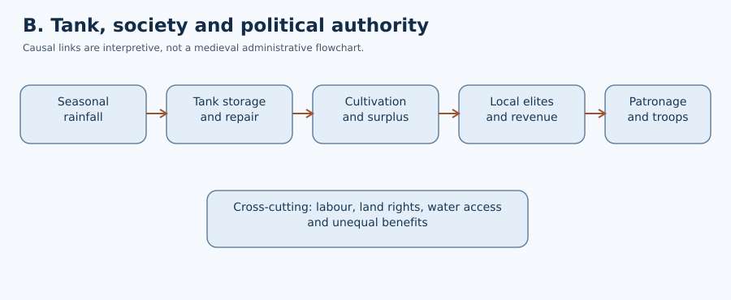
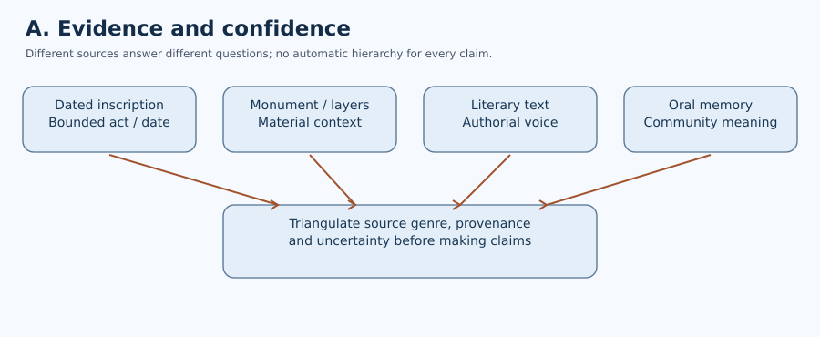
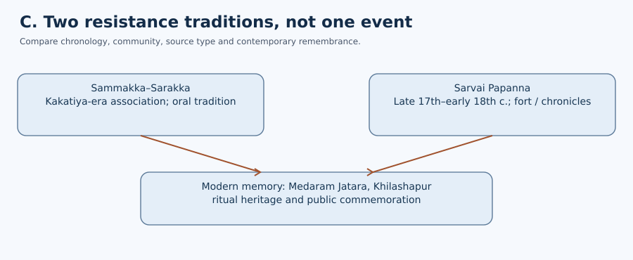

# Paper II · Unit II · Topic 2 — Medieval Telangana

**Cycle85 integrated editable student master. Original 75 topic PDFs are preserved. NOT academically approved. All questions are original practice, NOT official TGPSC previous-year questions.**

## Scope and evidence policy

Kakatiya political and cultural development, Velama successor polities, Qutb Shahi literature and architecture, Sammakka–Sarakka and Sarvai Papanna. This edition separates directly viewed UNESCO/government heritage descriptions from unexamined primary epigraphic and manuscript editions. The original historical depth-repair supplements remain preserved in the source directory; overlapping prose is not appended verbatim here.

## Quick revision

| Period / theme | Exam-essential distinction |
|---|---|
| Kakatiya emergence | Chalukya subordination precedes independent sovereignty |
| Ganapati Deva | Military expansion and access to agriculture and trade |
| Rudrama Devi | Female sovereignty; titles and succession are source-sensitive |
| 1323 | Fall of Warangal; regional society persisted after conquest |
| Nayakas | Avoid conflating every Kakatiya assignment with later Vijayanagara practice |
| Tanks | Water storage plus village labor and maintenance institutions |
| Ramappa | UNESCO inscription in 2021; thirteenth-century monument |
| Rachakonda / Devarakonda | Distinct post-Kakatiya Velama political centers |
| Golconda | Qutb Shahi dynasty early 16th century–1687 |
| Hyderabad | Founded in 1591 under Muhammad Quli Qutb Shah |
| Sammakka–Sarakka | Oral traditions of resistance associated with Kakatiya era; chronology is uncertain |
| Sarvai Papanna | Late 17th–early 18th century; Qutb Shahi–Mughal transition |

## Causal map

Seasonal rainfall → tank construction and maintenance → expanded settlement and surplus → political authority and religious patronage → artisan / literary networks.

## Avoid these traps

1. Treating every legend as an inscriptionally established fact.
2. Dating Sarvai Papanna to the 13th century.
3. Calling 2021 UNESCO inscription a medieval event.
4. Treating Velama courts as identical or continuously united.
5. Confusing reconstructed Perini performances with a continuous unchanged 800-year-old choreography.

# Detailed textbook-style concepts (22 substantive sections)

## 1. Political setting: Telangana between the 11th and 17th centuries

The historical region of Telangana was shaped by contests over agricultural surplus, fortified centers, routes between the Krishna–Godavari basins and the Deccan plateau, and temples that connected local communities to political elites. It was never culturally isolated from coastal Andhra, Karnataka or the northern Deccan. The Kakatiyas emerged from the political world of the later Chalukyas and grew into independent rulers based at Orugallu (Warangal). After the fall of the Kakatiya capital to armies of the Delhi Sultanate in 1323, regional chiefs and new successor polities contested authority; this did not end local Telugu cultural activity. The Bahmani, Deccan Sultanate and Qutb Shahi periods reconfigured trade, court language, military recruitment and urban patronage. “Composite culture” is a hypothesis about identifiable encounters between people, technologies and artistic forms—not an assertion that conflict, social inequalities or separate religious practices disappeared. Explain both interaction and asymmetry.

**Evidence and chronology.** The official Warangal district heritage page identifies Orugallu as a Kakatiya capital and highlights the surviving gateways and fortifications. This establishes a defensible connection between dynastic power and the material urban landscape; it does not prove that every defensive feature was built in one reign. UNESCO's Ramappa description independently situates a major Kakatiya monument in the thirteenth century, close to a reservoir and agricultural fields. Together these records support a spatial account of power: a capital and its military infrastructure, temples that publicly displayed patronage, and water systems that sustained surrounding settlement. They do not establish the exact fiscal relationship of every village to the court. A rigorous answer should therefore separate a dated event or standing monument from a broader explanation of state formation. The later Qutb Shahi record offers a useful comparison: UNESCO's 2010 State Party submission describes Golconda as a fortified urban settlement and Hyderabad as a planned city founded in 1591. The two regimes did not share an unchanged administrative structure; the comparison illustrates how political power repeatedly relied on built space, commerce and water management. **Sources:** Warangal District, Warangal Fort; UNESCO Ramappa World Heritage listing; UNESCO Qutb Shahi Tentative List. **Limit:** No original Kakatiya charter or archaeological field report was examined in this cycle.

## 2. Kakatiyas: origins and transition to sovereign kingship

Early Kakatiya chiefs operated within the political orbit of the Western Chalukyas. Sources mention figures such as Prola II and Rudradeva (Prataparudra I), whose expanding claims and military campaigns marked a transition to a more independent authority. The Anumakonda (Hanamkonda) region was central before Warangal became the principal capital. Royal inscriptions document claims over tributaries, land assignments, victory and religious gifts, but they are purposive commemorations: court rhetoric should not be repeated as literal descriptions of constant territorial control. The Hanamkonda inscription is particularly significant for connecting royal authority with the Thousand Pillar Temple. Political consolidation involved not only warfare but the incorporation of local military lineages, access to irrigation, and the sponsorship of religious institutions. For exam answers distinguish the gradual political emergence of the Kakatiyas from a single mythical founding date.

## 3. Ganapati Deva: expansion and political integration

Ganapati Deva's reign is associated with expansion toward the coastal Andhra region and efforts to coordinate a realm of diverse local centers. Increased reach also meant greater reliance on subordinates, commanders and kinship alliances. It is useful to study the political logic: military campaigning could bring prestige and tribute; ports and trade routes offered customs opportunities; agricultural settlements supplied revenue and soldiers. But a long royal reign did not make administration uniformly centralized. Inscriptional grants and local authority could coexist with loyalty to the Kakatiya monarch. Telugu-speaking areas came under overlapping networks rather than a single standardized bureaucracy. A mature answer should resist interpreting every regional development as the personal innovation of one king.

## 4. Rudrama Devi: power, gender and epigraphic evidence

Rudrama Devi is a major example of a woman exercising royal authority in medieval South India. Her position deserves historical analysis rather than only inspirational anecdote. Succession, the acceptance of royal titles, relationships with nobles and military challenges were central to her rule. Some inscriptions use masculine regnal formulations for her, highlighting the political vocabulary in which sovereignty was expressed; this does not erase her identity as a woman. Resistance from sections of the nobility and warfare formed part of a contested political environment. Marco Polo's narrative, often invoked in popular accounts, must be used critically, with attention to what he could have observed and how his information was transmitted. Women donors and local elites also appear in inscriptions, but one female sovereign does not by itself demonstrate equality for all women. She is best analyzed as a capable ruler negotiating the institutions and expectations of her age.

## 5. Prataparudra II and the conquest of Warangal

Prataparudra II governed under mounting military pressure from the expanding Delhi Sultanate. Raids, siege warfare and changing tribute arrangements affected the political economy and relations among regional chiefs. Warangal fell to the forces of Muhammad bin Tughluq (then Ulugh Khan) in 1323 following earlier campaigns. The event is a turning point in dynastic sovereignty, not a sudden erasure of Telangana's society. Temples, tanks, agricultural practices and local ruling families persisted; some chiefs reorganized political power in the post-Kakatiya situation. Interpret conquest through military logistics, fortification, revenue ambitions and local alliances. Be cautious with folklore that supplies exact dialogue, heroic deaths or comprehensive destruction not verified by near-contemporary records.

## 6. Nayankara arrangements and political-military society

Kakatiya political administration is often discussed in terms of nayakas—military or service elites linked to authority over resources and local territories. It is an error to assume a single rigid “nayankara system” identical to better-documented arrangements in later Vijayanagara. Service obligations, local rights, hereditary claims and royal supervision varied by time and place. A historically useful model is negotiated sovereignty: rulers delegated responsibilities while retaining claims to military support, tribute and legitimacy. This system helped mobilize forces across a large realm, yet powerful intermediaries could pursue their own ambitions when dynastic control weakened. For comparisons, distinguish Kakatiya practice, post-Kakatiya military chiefs and Vijayanagara amara-nayakas rather than collapsing them into one unchanged institution.

## 7. Agriculture, tanks and the ecology of Kakatiya power

Much of Telangana's plateau cultivation historically depended on managing highly seasonal rainfall. Embankments, reservoirs, feeder channels and maintenance practices enabled storage and extension of cultivation beyond immediate monsoon rain. Kakatiya-period patronage of tanks must be understood alongside local labor, village cooperation and community obligations. Named examples such as Pakhal, Laknavaram and Ramappa form part of heritage narratives, though individual structure dates and attribution require project-level corroboration. Tanks created benefits but also required desilting, repair and control over water distribution; unequal land rights could produce unequal access. The core analytical relationship is between water storage, settlement, agrarian surplus and political authority. In mains answers discuss the social institution of maintenance, not simply a spectacular engineering achievement. Modern restoration programmes should be dated and verified separately from medieval origins.

**A source-grounded case: Ramappa Cheruvu.** UNESCO describes the Ramappa temple's location among fields, hills and a Kakatiya-built reservoir, and explicitly connects the setting with historical choices about temple landscapes. This supports a stronger analysis than the simple statement that kings 'built tanks'. A reservoir changes when water is available, where cultivation can be extended and what maintenance labour is necessary. The resulting surplus may finance religious patronage and political authority, but it does not automatically follow that water was distributed equally. Control over access, repair obligations and local disputes must be established through village-level evidence, not assumed from a monument's survival. A tank also has a catchment: modern construction and tourism can affect runoff, siltation and the visual relationship between shrine and water. Consequently heritage conservation must consider the connected landscape, not just the temple walls. A mains answer can proceed through five links: monsoon variability; storage infrastructure; cultivated area and labour; possible revenue and patronage; unequal social consequences. The chain is an analytical model, not an inscriptional proof of a particular village's accounts. **Source:** UNESCO World Heritage Centre, Ramappa property 1570. **Unverified:** Tank-specific labour registers, maintenance accounts and individual village land tenures.

## 8. Society: cultivators, artisans, elites and the limits of inscriptions

Telangana's medieval society comprised cultivators, pastoral groups, craft specialists, traders, religious personnel and armed elites, with regionally variable hierarchies. Inscriptions disproportionately preserve the names of kings, donors, temples and landholding groups. The absence of ordinary laborers from these texts is a source limitation, not proof that they lacked agency. Agricultural expansion could involve clearing land and building new settlements; it also sharpened questions of taxation, service labor and access to common resources. Artisans employed in temple building, sculpture and metalwork were indispensable to royal display, yet their individual names are less commonly remembered. The study of caste and occupational organization requires careful local evidence rather than mechanically projecting modern categories backward. A balanced social history moves beyond dynastic lists to ask who built, funded, cultivated and maintained the historical landscape.

## 9. Warangal urban form and fortification

Warangal's historic landscape includes concentric defensive features, monumental gateways and temple remains that reflect the interaction of military defense, ceremonial authority and regional stoneworking traditions. The Kakatiya Kala Thoranam gateways are among the most recognizable markers of the region. Yet a gateway photographed today is not enough to reconstruct an entire palace or city plan; archaeological survey and inscriptional data are essential. Fortifications were built and modified across different phases, so all standing fabric should not automatically be assigned to one ruler. Capital cities also supported market exchange, artisans, religious establishments and military households. The urban landscape should be read as an evolving assemblage rather than a frozen architectural picture.

## 10. Temple architecture: Hanamkonda, Ramappa and sculptural craft

The Thousand Pillar Temple at Hanamkonda and the Rudreshwara (Ramappa) Temple at Palampet illustrate major Kakatiya-era architectural traditions, though they differ in plan, materials, context and construction history. The Ramappa temple complex is associated with the early thirteenth century and has a prominent inscription recording patronage linked to Recharla Rudra, a general of Ganapati Deva. Its sculpted brackets, pillars, dance imagery and masonry techniques merit close analysis. The term “sandbox foundation” appears in descriptions of Kakatiya construction, but technical details should be taken from archaeological engineering studies instead of popular claims. UNESCO inscribed Kakatiya Rudreshwara (Ramappa) Temple on the World Heritage List in 2021—an important conservation milestone, not evidence that every part is unchanged since construction. Distinguish specific sculptural iconography from broad stylistic attribution.

**Materials, workmanship and attribution.** UNESCO identifies Ramappa as the Rudreshwara temple at Palampet, with construction beginning in 1213 and believed to have continued for decades. Its structural vocabulary is not interchangeable: sandstone is used in the temple body, granite and dolerite in decorated beams and pillars, and lightweight porous bricks in the stepped vimana. The material choices matter because the tower's reduced weight and the sculpture's fine finish illustrate engineering as well as artistic skill. The site's sculptural programme depicts regional dance customs, but an image cannot by itself prove an uninterrupted performance tradition. The official listing names Recharla Rudra among the chieftains associated with the complex; describing the building simply as 'built by every Kakatiya king' obscures the difference between a sovereign, a military patron and a workshop. The adjacent reservoir and natural setting are part of the heritage value, so an architecture answer should connect physical design with its cultural landscape. For an evidence table, separate what is visible in the monument, what the UNESCO nomination reports, what a dated inscription may establish and what requires epigraphic edition verification. **Source:** UNESCO World Heritage Centre, Kakatiya Rudreshwara (Ramappa) Temple. **Limit:** This cycle did not inspect the original Palampet inscription or a complete architectural survey.

## 11. Telugu literary worlds: inscriptions and courtly scholarship

Kakatiya patronage contributed to the growth of Telugu literary culture, though literature was produced across overlapping religious and political networks. Tikkana's Mahabharata translation belongs to the broader medieval Telugu region; assigning all of his work exclusively to the Kakatiya court would be anachronistic. Palakuriki Somanatha is associated with Vira Shaiva devotional literature, notably Basava Purana and Panditaradhya Charitra, using vernacular forms to reach particular audiences. Baddena and later writers illustrate the diversity of moral, courtly and religious genres discussed in regional literary histories, but attributions and dates should be checked against critical editions. Sanskrit continued in scholastic and ritual contexts while Telugu expanded as a medium of literary authority. Do not treat court language, everyday speech and inscriptional usage as identical.

## 12. Music and dance: from textual testimony to living traditions

The Sanskrit treatise Nrtta Ratnavali is associated with Jayapa Senani, a commander during Ganapati Deva's period, and is a major source for studying medieval performance traditions. It documents categories of movement and performance, but textual prescriptions do not automatically prove that all named dances were uniformly performed across Telangana. Perini Shivatandavam is today commonly associated with the Kakatiya martial-performance heritage, including modern reconstruction and revival efforts. An answer should distinguish medieval textual or sculptural evidence from twentieth-century performance revival. Dance depictions at Ramappa offer a visual source that can be compared with descriptions in treatises; such comparison needs interpretation and cannot alone establish an uninterrupted choreography for eight centuries.

## 13. The post-Kakatiya political transition

After 1323, political authority in the Telugu-speaking Deccan was reconfigured among Delhi-appointed officials, local warrior families and successor chiefdoms. The Musunuri chiefs are remembered in regional historical accounts for resistance and reassertion of local authority, but the precise chronology and geographic extent of claims require epigraphic scrutiny. Wider Deccan politics included emerging Bahmani influence and conflict over fortified districts. This was not a simple two-party story of invader and native resister; chiefs could change alliances, negotiate tribute or compete against each other. Local agrarian and religious institutions sometimes survived dynastic turnover. Political history should thus separate territorial conquest from the more gradual transformation of language, land rights and patronage.

## 14. Rachakonda and Devarakonda Velama polities

Velama ruling lineages exercised political authority in Rachakonda and Devarakonda after the decline of Kakatiya sovereignty. Their history reflects the importance of hill forts, localized military households and shifting relationships with other Telugu chiefs, the Bahmani Sultanate and Vijayanagara. Rachakonda and Devarakonda should not be treated as identical courts with a single stable boundary. The political labels “Velama,” “Recharla” and “Padmanayaka” appear in scholarship and popular accounts, but exact genealogies and ruler sequences need inscription-level verification. Patronage of religious institutions, fortifications and Telugu literary networks is historically relevant. A comparative answer should ask how smaller militarized states sustained control and prestige even without the territorial resources of the earlier Kakatiyas.

## 15. Literature and religious life under Velama patrons

The medieval Telugu literary world was supported by multiple courts, temples and learned families. Poet Srinatha's itinerant courtly associations across the Telugu region illustrate that authors did not operate within neatly sealed political borders. Religious patrons could sponsor Sanskrit and Telugu works, temple renovations and festivals while also developing regional courtly styles. Velama political and cultural contributions should be discussed through dated inscriptions and attributed works rather than generic claims that every ruler sponsored every art. The relationship between court prestige and literary accomplishment was reciprocal: poets praised patrons, while patrons gained access to learned cultural networks. In a mains response, give a properly verified example and acknowledge when patronage links are uncertain.

## 16. Deccan Sultanates and the rise of Golconda

The Qutb Shahi dynasty emerged out of the late Bahmani political world and ruled Golconda and the surrounding Telugu-Deccan region from the early sixteenth century to 1687. Sultan Quli Qutb-ul-Mulk consolidated the kingdom; his successors expanded institutions and cultivated courtly prestige. Golconda was both a fortress and a political-commercial center connected to the diamond trade and regional textile networks. Dynastic rule involved Iranian, Deccani and local elites, with changing patterns of military recruitment and taxation. Courtly Persianate traditions existed alongside Telugu expression and Dakhni cultural production; these should not be simplistically described as a single undifferentiated culture. The final Mughal conquest under Aurangzeb in 1687 closed the Qutb Shahi dynasty but did not erase Hyderabad's urban and cultural traditions.

## 17. Ibrahim Qutb Shah and Telugu patronage

Ibrahim Qutb Shah is often remembered in Telugu literary tradition with the honorific “Malkibharam,” associated with his reputation for supporting Telugu cultural activity. This representation reflects important interactions between a Persianate court and Telugu literati. Courtly patronage involved political incentives: cultivating regional elites and poets could help establish legitimacy within a largely Telugu-speaking country. Telugu continued in literary and transactional settings while Persian and Dakhni served other purposes; these languages occupied overlapping, unequal domains. Avoid claiming that one patron introduced Telugu literature into the region or that a period of cultural exchange lacked conflict. The best evidence combines literary prefaces, inscriptions and administrative contexts with scholarship on the Deccan.

## 18. Muhammad Quli Qutb Shah and Hyderabad urban design

Muhammad Quli Qutb Shah founded Hyderabad in 1591 on the Musi River and sponsored the Charminar as a signature monument of the planned new city. Urban investment helped manage trade, ceremonial movement and courtly prestige beyond the older Golconda fort precinct. Markets, water structures and mosques formed parts of the developing urban ecology. Founding stories about the ruler's personal romance are popular but should not be substituted for secure urban history. Muhammad Quli was also known for Dakhni poetry; analysis should distinguish his literary production from the broader multilingual environment of his court. The Charminar became an enduring civic symbol, yet its changing uses and later conservation form separate historical layers.

**A planned city and the limits of a foundation date.** The UNESCO State Party Tentative List submission describes Charminar as the ceremonial centre of the new Hyderabad founded in 1591 under Muhammad Quli Qutb Shah. The city was laid out around intersecting urban axes, with Charminar acting as a symbolic focal point. This is more precise than saying that the dynasty merely 'built a monument'. A planned urban node organised processions, commerce, access and political representation. The same dossier distinguishes Golconda as an earlier fortified capital and the Qutb Shahi tombs as a royal necropolis. A student should not collapse these three places into a single building or infer that the whole present-day city dates from 1591. The Tentative List is also a modern heritage submission: it gives useful architectural interpretation but is not itself a seventeenth-century eyewitness account. Where its claims rely on Persian chronicles or foundation texts, those original editions still need checking. For mains, use a sequence: Golconda's military and trading functions; the 1591 foundation; Charminar and axial planning; multilingual courtly patronage; the urban and social limitations of elite-focused evidence. **Source:** UNESCO World Heritage Centre, Tentative List 5573, submitted 10 September 2010. **Limit:** The original Persian chronicles were not independently examined.

## 19. Qutb Shahi architecture, crafts and commerce

The Golconda fort complex, Qutb Shahi tombs, Charminar and selected religious and civic structures reveal the dynasty's investment in fortified power, dynastic commemoration and urban display. Tomb architecture combines diverse regional and Persianate design idioms; labels such as “Indo-Islamic” should lead to formal analysis of domes, ornament, plans and materials, not replace it. Golconda's economic prominence was connected with mining zones, long-distance diamond commerce and port-linked textile trade. Commerce created opportunities for merchants and artisans while leaving substantial disparities in power. The Qutb Shahi tombs and adjacent heritage precincts have undergone modern conservation initiatives; claim a particular completed intervention only with a dated report from the responsible agency.

**The tomb complex as a chronological archive.** UNESCO's Qutb Shahi Tentative List records Golconda Fort, the royal tombs and Charminar as distinct components of the same dynasty's built heritage. The tombs are not simply ornamental domes: dated Persian epitaphs provide chronological controls for identifiable royal burials and permit comparisons in architectural style. Crucially, the submission also warns that some structures traditionally labelled as tombs of Jamsheed and Subhan lack confirming epitaphs and appear stylistically later. This demonstrates why inherited monument names cannot substitute for inscriptional proof. The same dossier presents Golconda as a fortified urban settlement with military buildings, water systems, ceremonial and residential spaces. Diamond and textile commerce connected it to production zones and trade routes; a trading centre should not be confused with the physical location of every mine. Architectural analysis should therefore distinguish defence, water supply, courtly residence, mortuary patronage and commercial circulation. The site is on India's UNESCO Tentative List, not inscribed as a World Heritage property under that entry. **Source:** UNESCO World Heritage Centre, Qutb Shahi Monuments of Hyderabad, Tentative List 5573. **Limit:** This is a State Party submission; the underlying epitaph editions and excavation records were not independently rechecked.

## 20. Composite culture: languages, ritual spaces and negotiated coexistence

“Composite culture” in the Deccan refers to demonstrable interaction in languages, music, architectural practice, dress, food, festivals and shared patronage environments. Dakhni literary culture was shaped by contacts among regional languages and Persianate forms. Telugu poets received patronage in courts associated with rulers whose primary dynastic identities were different. At the same time, cultural borrowing did not dissolve religious distinction or eliminate fiscal and military conflict. The analytical method is to name a mechanism of exchange—migration of artisans, trade circuits, mixed courts, translation or local patronage—and then give an example. An argument based only on present-day slogans about harmony is historically weak. Religious sites, urban neighborhoods and artisan workshops all contain different kinds of evidence, requiring source-specific interpretation.

**Composite culture as a testable claim.** UNESCO's Qutb Shahi Tentative List describes the court and cities as sites of interaction among Persianate traditions, Deccani networks and local Telugu-speaking elites. The claim should be unpacked rather than repeated as a slogan. Language use differed by setting: courtly writing, devotional and literary activity, commerce and local administration could involve different linguistic communities. Monument design similarly combined construction techniques, artistic forms and urban planning ideas. The submission's account of Golconda's water and defence systems and Hyderabad's axial layout gives material examples, but it does not prove that all groups held equal authority. Elite patronage, military recruitment and commercial opportunities could coexist with stratification and conflict. A defensible answer asks four questions: who sponsored the exchange; what objects or texts show it; which communities benefited; and which exclusions remain visible or unrecorded. The term 'composite' should not erase distinctions between the Bahmani, Qutb Shahi and later Mughal periods. In a diagram, show exchange pathways between court, market, craft workshop and neighbourhood rather than an unsupported claim of complete cultural harmony. **Source:** UNESCO Tentative List 5573. **Limitation:** Specific manuscript folios, Persian court records and Telugu patronage charters require later direct verification.

## 21. Sammakka–Sarakka: resistance tradition and historical caution

Sammakka and Saralamma (Sarakka) occupy a central place in the memory and ritual life of communities associated with the Medaram Jatara. Oral narratives connect their resistance to demands and coercion imposed by Kakatiya-era authority, often stressing forest communities' autonomy and moral claims. The narratives are significant historical evidence of collective memory, identity and resistance even when exact dates and dialogue cannot be independently established through contemporary inscriptions. A serious answer neither dismisses oral tradition nor converts every episode into an epigraphically verified event. Interpret the annual or biennial festival practices carefully; the major Medaram Jatara is commonly held biennially, not every year. Contemporary recognition of the Jatara should be separated from unverified attempts to identify an exact medieval battle site or casualty count.

## 22. Sarvai Papanna: social mobility and armed resistance

Sarvai Papanna Goud is associated with late seventeenth- and early eighteenth-century Telangana, when the fall of Qutb Shahi rule, Mughal consolidation and local revenue struggles produced opportunities and dangers for regional military leaders. His story is important for understanding how people outside dominant elite lineages attempted to mobilize supporters and challenge established power. Fortifications, local traditions and later narratives offer lines of inquiry, but histories differ on precise dates, battles and the relationship between Papanna and Mughal officials. Do not portray him as a contemporary of the thirteenth-century Kakatiyas. His resistance should be situated around the Qutb Shahi-to-Mughal transition and the hierarchy of local authorities. Claims about his exact political titles and territorial reach require cross-checking archival and scholarly sources.

## Evidence diagrams and interpretation

The three preserved SVG diagrams are interpretive learning aids, not independently certified reconstructions. The original source files remain separately available.

## Original practice MCQs (30, four options each)

**NOT official TGPSC PYQs. NOT independently academically approved.** The previous file's 120 options were malformed (labels included `T)`, `I)`, etc., and leading letters were truncated). All 120 options have been rewritten in clear four-option form. Correct-answer positions are deliberately distributed A8/B8/C7/D7; position balance does not validate factual correctness.

**Evidence policy:** Eight items (Q1, Q2, Q5, Q11, Q12, Q16, Q23, Q28) are author-correlated with directly inspected UNESCO pages. The remaining 22 keys and 66 distractors have not undergone independent claim-level checking. Even the eight correlations are not external academic approval.

### Q1. Which evidence most directly anchors the patronage context of the Ramappa temple?

A) The 1213 Palampet inscription associated with Recharla Rudra
B) A modern tourism slogan
C) An undated folk ballad
D) A recent textbook cover

**Answer: A.** The dated inscription provides a specific contemporary patronage anchor; the alternatives do not.

**Source correspondence:** https://whc.unesco.org/en/list/1570/ (author-checked 29 October 2026; not independent review).

### Q2. What is the correct interpretation of Ramappa's UNESCO World Heritage inscription in 2021?

A) The temple was first constructed in 2021
B) It is a modern recognition of the temple's heritage significance
C) Every sculptural figure was carved in 2021
D) It proves that every ritual remained unchanged

**Answer: B.** The 2021 inscription concerns heritage recognition, not construction or uninterrupted ritual continuity.

**Source correspondence:** https://whc.unesco.org/en/list/1570/ (author-checked 29 October 2026; not independent review).

### Q3. Why should Kakatiya nayaka arrangements not automatically be equated with later Vijayanagara institutions?

A) Both were elected village councils
B) Vijayanagara had no armies
C) Military and resource obligations must be compared in their distinct historical contexts
D) Both are known only from films

**Answer: C.** Similar labels or delegated functions cannot establish identical institutions across centuries.

### Q4. What can a dated royal inscription most directly establish?

A) That every peasant supported the ruler
B) That no conflict occurred in the reign
C) That every village used one language
D) That a named donor or grant was recorded in a particular text

**Answer: D.** The inscription is direct evidence of its recorded statement, not a neutral census of society.

### Q5. What does the setting of Ramappa Temple near a Kakatiya reservoir support?

A) Temple building and the water landscape were intentionally connected
B) Every household received equal irrigation water
C) The reservoir required no maintenance
D) All temple masonry was completed in one season

**Answer: A.** UNESCO documents the temple's landscape setting beside Ramappa Cheruvu; it does not certify equal water access.

**Source correspondence:** https://whc.unesco.org/en/list/1570/ (author-checked 29 October 2026; not independent review).

### Q6. What did the capture of Warangal in 1323 chiefly signify?

A) The disappearance of Telugu literature
B) The end of Kakatiya dynastic sovereignty at Warangal
C) The destruction of every regional tank
D) The founding of Hyderabad

**Answer: B.** A political conquest did not erase the region's population, languages or institutions.

### Q7. Which interpretation of Rudrama Devi's rule is most defensible?

A) Her reign proves full gender equality for all
B) She never held royal titles
C) She exercised sovereignty within a society that retained gender hierarchies
D) Her reign was free from military contests

**Answer: C.** A woman could exercise royal authority without dissolving wider social inequalities.

### Q8. How should Rachakonda and Devarakonda be classified?

A) Two identical Qutb Shahi royal tombs
B) Mughal capitals founded in 1591
C) Coastal ports on the Bay of Bengal
D) Distinct post-Kakatiya fortified centres associated with Velama polities

**Answer: D.** These centres belong to post-Kakatiya regional political history; they should not be collapsed into one site.

### Q9. Which pair of sources is most relevant to Kakatiya dance history?

A) Jayapa Senani's Nrtta Ratnavali and Ramappa sculpture
B) Modern television adverts and census tables
C) Railway timetables and revenue ledgers
D) Charminar plans and Mughal farmans

**Answer: A.** A treatise and sculpture provide different kinds of historical evidence, not proof of unchanged choreography.

### Q10. Why does a present-day Perini performance not establish unchanged medieval choreography?

A) Dance can never be studied historically
B) Revival involves interpretation across gaps in the surviving evidence
C) No medieval source ever mentions performance
D) All temple sculpture is historically false

**Answer: B.** Modern reconstructions require evidence of continuity before being described as identical to medieval practice.

### Q11. Which event is associated with 1591 CE?

A) The conquest of Warangal in 1323
B) The UNESCO inscription of Ramappa Temple
C) The foundation of Hyderabad under Muhammad Quli Qutb Shah
D) The beginning of the Papanna heritage programme

**Answer: C.** The UNESCO tentative-list submission dates Hyderabad's founding and Charminar to 1591.

**Source correspondence:** https://whc.unesco.org/en/tentativelists/5573/ (author-checked 29 October 2026; not independent review).

### Q12. What was the status of the Qutb Shahi monuments in UNESCO's 2010 records?

A) An inscription on the World Heritage List
B) An archaeological excavation diary
C) An independent academic peer-review certificate
D) A State Party Tentative List submission

**Answer: D.** UNESCO identifies the entry as a Tentative List submission dated 10 September 2010, not an inscription.

**Source correspondence:** https://whc.unesco.org/en/tentativelists/5573/ (author-checked 29 October 2026; not independent review).

### Q13. Which language combination is appropriate for Qutb Shahi cultural history?

A) Persian, Dakhni and Telugu had overlapping but different functions
B) Only Persian was spoken throughout Telangana
C) Telugu disappeared after 1518
D) Dakhni was invented after 1948

**Answer: A.** Multilingual patronage must be analysed without assigning a single language to every institution.

### Q14. What does Ibrahim Qutb Shah's association with Telugu literary patronage suggest?

A) Every subject enjoyed identical social status
B) A Persianate-connected court could also sponsor regional-language literature
C) Persian ceased to be used at court
D) All literature was authored by reigning kings

**Answer: B.** Cross-linguistic patronage indicates cultural contact, not political or social equality.

### Q15. What is the most defensible interpretation of Golconda's diamond commerce?

A) Every traded diamond was mined directly beneath Golconda Fort
B) The region had no textile producers
C) Trade linked production zones, merchants and urban markets
D) No taxes could ever be levied on commerce

**Answer: C.** A trading centre may distribute goods from several production locations.

### Q16. What is a particularly strong chronological source for identified Qutb Shahi royal tombs?

A) Modern street names
B) Unverified forwarded messages
C) Present-day festival posters
D) Dated Persian epitaph inscriptions

**Answer: D.** UNESCO's tentative-list dossier explicitly describes the epitaph-dated royal tombs.

**Source correspondence:** https://whc.unesco.org/en/tentativelists/5573/ (author-checked 29 October 2026; not independent review).

### Q17. How should the precise medieval battle chronology of Sammakka–Sarakka be treated?

A) As an oral and ritual tradition whose precise medieval dates need corroboration
B) As fully certified by a surviving battle ledger
C) As the Mughal conquest of Golconda in 1687
D) As an eighteenth-century British protest

**Answer: A.** Living memory and ritual practice are historical evidence of commemoration, not automatic proof of each reported medieval date.

### Q18. What is Medaram Jatara's importance to social history?

A) It provides a complete medieval tax roll
B) It sustains Adivasi ritual memory and collective identity
C) It archaeologically proves every oral detail
D) It originated as a Qutb Shahi royal tomb

**Answer: B.** A living festival provides evidence about cultural memory without certifying every historical detail of the tradition.

### Q19. Which approach to Jampanna Vagu is most source-sensitive?

A) Treat red-coloured water as conclusive proof of medieval bloodshed
B) Attribute its name to a Mughal governor without evidence
C) Separate ritual beliefs about its colour from independent environmental explanations
D) Date its creation to 2021 UNESCO recognition

**Answer: C.** Belief and physical explanation are distinct evidentiary categories and should be identified separately.

### Q20. Sarvai Papanna is principally associated with which transition?

A) Harappan urbanisation
B) Early Vedic pastoralism
C) Post-1947 linguistic state formation
D) The late Qutb Shahi and early Mughal Deccan

**Answer: D.** Papanna belongs to late seventeenth–early eighteenth-century Telangana history.

### Q21. What does a modern government statement about Khilashapur most directly establish?

A) Present-day heritage policy or commemoration intentions
B) Papanna's precise battle casualties
C) A surviving 1700 CE tax register
D) An inscription commissioned by Rudrama Devi

**Answer: A.** Modern announcements are evidence of contemporary policy, not direct eyewitness records of early-modern events.

### Q22. How should Sammakka–Sarakka and Sarvai Papanna be compared?

A) As leaders of one campaign in 1323
B) As distinct resistance traditions from different periods and source contexts
C) As co-founders of Hyderabad
D) As individuals named in the same royal epitaph

**Answer: B.** A comparative answer must preserve chronological differences and the different character of available evidence.

### Q23. What should guide heritage assessment of development near Ramappa Lake?

A) Souvenir sales alone
B) Exclusion of local communities from consultation
C) Assessment of impacts on the temple's heritage setting and water catchment
D) Treating every modern repair as original medieval fabric

**Answer: C.** UNESCO documents the significance of the temple's setting and reservoir and the need to manage development pressures.

**Source correspondence:** https://whc.unesco.org/en/list/1570/ (author-checked 29 October 2026; not independent review).

### Q24. What is a central limitation of royal eulogies as historical evidence?

A) They cannot contain historical dates
B) They are always written in English
C) They necessarily record ordinary wages
D) They advance a patron's prestige and are not neutral social surveys

**Answer: D.** Royal praise can preserve facts but must be read against its purpose and other evidence.

### Q25. What would most strengthen a disputed medieval construction date?

A) A dated inscription corroborated by archaeological context
B) An unsourced social-media claim
C) A modern election result
D) A tourism advertisement

**Answer: A.** Independent contemporary and material controls are stronger than unsupported later assertions.

### Q26. What is the key connection between tank irrigation and medieval political power?

A) Tanks eliminated every land inequality
B) Water storage could support cultivation, surplus and revenue claims
C) Irrigation made warfare impossible
D) Reservoirs never required maintenance

**Answer: B.** Irrigation affected resources and labour, but benefits and burdens were socially uneven.

### Q27. Which statement best captures the meaning of Qutb Shahi composite culture?

A) No conflicts occurred between communities
B) All religious groups had identical privileges
C) Artistic and linguistic exchanges coexisted with unequal power and conflict
D) Every monument followed a single architectural tradition

**Answer: C.** Cultural exchange and social hierarchy can exist at the same time.

### Q28. How does UNESCO's Qutb Shahi Tentative List describe Charminar's urban role?

A) A Kakatiya irrigation sluice
B) A nineteenth-century railway station
C) An ancient Buddhist stupa
D) A ceremonial focal point in Hyderabad's planned urban layout

**Answer: D.** The 2010 State Party submission places Charminar at the planned city's axial centre.

**Source correspondence:** https://whc.unesco.org/en/tentativelists/5573/ (author-checked 29 October 2026; not independent review).

### Q29. How should changing Velama political territory be reconstructed?

A) By cross-checking dated inscriptions, forts and changing alliances
B) By projecting fixed modern district boundaries backward
C) By treating every Velama court as one city
D) By ignoring the post-1323 political transition

**Answer: A.** Historical territories and alliances were not necessarily identical to present administrative boundaries.

### Q30. What makes a source-critical mains answer stronger?

A) A long undated ruler list
B) A specific claim, named evidence, its limitations and a reasoned conclusion
C) Unattributed invented battle dialogue
D) Automatic rejection of every oral tradition

**Answer: B.** A good answer matches the certainty of each claim to the strength and limits of its sources.

## Verification register

- Format: 30 questions, each with exactly four A–D options and one keyed answer — structurally PASS.
- Answer distribution: A8/B8/C7/D7 — mechanically PASS, not a correctness check.
- Bounded source-correlated: 8 keys and 24 distractors (Q1, Q2, Q5, Q11, Q12, Q16, Q23, Q28).
- Remaining: 22 keys and 66 distractors require independent claim-level verification.
- No authenticated commission PYQs claimed; R5 NOT PASS; R9 NOT STARTED.

## Six complete original mains model answers

**Original practice, not official previous-year questions. Target: 200–250 words per answer, excluding question and headings.**

### Mains 1. Assess how inscriptions and material remains change our understanding of Kakatiya political power.

### Introduction
Kakatiya rule in medieval Telangana is best understood through the interaction of royal claims, military intermediaries, agrarian resources and cultural patronage. Inscriptions and monuments reveal more than a chronological succession of kings.

### Political evidence
The Hanamkonda inscription associated with Rudradeva and the Palampet inscription linked to Recharla Rudra provide anchors for patronage and sovereignty. Yet a royal inscription celebrates a donor and cannot be treated as a neutral account of every village. Ganapati Deva's expansion depended on commanders and local elites; this complicates the picture of a uniform central bureaucracy.

### Material and ecological evidence
Warangal's gateways and fortifications show ceremonial and defensive investment, while the Ramappa complex links temple architecture to a reservoir landscape. Tanks could support settlement, surplus and fiscal claims, but their construction and upkeep required labour often invisible in royal records. Rudrama Devi's regnal representation also demonstrates that sovereignty was negotiated within gendered political conventions.

### Limits and conclusion
The 1323 conquest ended dynastic authority, not Telugu culture or irrigation. Archaeological layers and critical editions are needed before assigning every structure to a ruler or accepting triumphant inscriptions literally. **Thus Kakatiya power was negotiated and materially sustained**, not simply imposed from a capital. A sound interpretation combines political history with evidence of land, labour and patronage.

### Mains 2. Explain the connection between Kakatiya irrigation, agrarian surplus and social hierarchy.

### Background
The Telangana plateau's seasonal rainfall made water storage a central condition for agricultural stability. Kakatiya-associated tanks were therefore simultaneously environmental works and instruments of political economy.

### Mechanism
A reservoir stored monsoon runoff, supported cultivation and could increase the area from which chiefs or kings claimed revenue. Greater surplus helped finance garrisons, temples, traders and artisans. The Ramappa lake setting illustrates the relationship between water and sacred architecture. But a dam required earthwork, desilting, bund repairs and agreement over sluice operation. These tasks involved local households and specialised workers, not merely a royal decree.

### Unequal outcomes
Benefits were mediated by land tenure, field location and access to authority. Powerful landholders could capture dependable water while marginal cultivators bore labour obligations. An inscription naming a donor rarely supplies a complete distributional account. Pakhal and Laknavaram must also be dated and interpreted separately rather than treated as identical schemes.

### Present relevance
Modern restoration programmes demonstrate the continuing importance of maintenance but do not prove that medieval management matched present engineering rules. Heritage conservation near Ramappa must protect the catchment as well as masonry.

### Conclusion
Kakatiya irrigation strengthened productive capacity and state legitimacy, but its outcomes depended on local institutions and social inequality. **The tank was a negotiated ecological system**, not an automatic instrument of universal prosperity.

### Mains 3. Critically evaluate the contribution of Velama polities to Telangana after the fall of Warangal.

### Context
The fall of Warangal in 1323 ended Kakatiya dynastic rule and opened a period of competing claims over forts, agrarian resources and political allegiance. It did not create a cultural vacuum.

### Political role
Rachakonda and Devarakonda became important fortified centres associated with Padma Nayaka Velama lineages. Their rulers negotiated changing relations with neighbouring chiefs and larger Deccan powers. Strategic forts controlled movement and offered security, while alliances and conflict shaped territorial claims. The two centres should not be represented as a single unchanging state with modern district boundaries.

### Cultural contribution
Local courts continued to support Telugu literary, religious and architectural activity. Forts and temples show investment in craft and ceremonial authority; they also required builders, traders and agrarian revenue. Patronage extended cultural production beyond the fallen Kakatiya capital. Yet praise-poems and genealogies were composed for patrons, so their accounts of victory and legitimacy require comparison with inscriptions and external evidence.

### Historical qualification
District heritage narratives help identify sites but cannot settle every reign date. Nor should relations with Bahmani or Vijayanagara powers be reduced to permanent religious blocs; alliances were often political and contingent.

### Conclusion
Velama polities demonstrate **regional state formation and cultural continuity amid political fragmentation**. Their contribution is best assessed through forts, literary networks and changing power relations, not through an uninterrupted heroic dynasty story.

### Mains 4. Analyse Qutb Shahi composite culture with reference to language, architecture and urban commerce.

### Introduction
Composite culture in the Deccan describes identifiable exchanges among people, languages and artistic forms. Under the Qutb Shahis, these interactions developed alongside hierarchy, military conflict and state taxation.

### Linguistic patronage
Persian served major courtly and administrative purposes; Dakhni became important in poetry and urban culture; Telugu continued in regional literary life. Ibrahim Qutb Shah's association with Telugu patronage and Muhammad Quli Qutb Shah's Dakhni poetry illustrate overlapping audiences. They do not establish identical social power for every language community.

### Architecture and city
Golconda's fortified settlement, waterworks and tombs demonstrate regional adaptations of wider Deccan and Persianate forms. Hyderabad's foundation in 1591 placed Charminar within a planned ceremonial and commercial urban grid. The UNESCO dossier submitted in 2010 documents this ensemble, but it remains a **tentative-list** record rather than World Heritage inscription.

### Economic networks
Diamond commerce and textiles drew merchants, miners, artisans and transport workers into networks extending toward the coast. Court prosperity depended on these producers and on revenue extraction; monument-centred accounts alone hide their contribution.

### Critical conclusion
Multilingual patronage and mixed architectural practices demonstrate cultural encounter, not an absence of inequality. A historically balanced answer names particular texts, patrons and material sites, then asks who benefited from urban wealth. **Composite culture was a process of exchange under unequal power**, not a timeless condition of perfect harmony.

### Mains 5. Compare Sammakka–Sarakka and Sarvai Papanna as resistance traditions in Telangana.

### Introduction
Both traditions are central to Telangana's memory of resistance, but they belong to different periods and different evidentiary contexts. Their comparison requires historical precision and respect for community memory.

### Sammakka–Sarakka
The Medaram Jatara sustains Koya/Adivasi remembrance of a mother and daughter associated with opposition to coercive Kakatiya-era demands. Government heritage accounts describe this as tradition or legend. They establish the importance of contemporary ritual and identity, not a certified date for every medieval encounter. Forest autonomy, taxation and sacrifice are recurring themes.

### Sarvai Papanna
Papanna belongs to the late seventeenth and early eighteenth centuries, amid the Qutb Shahi–Mughal transition. Khilashapur Fort and subsequent public commemorations connect his memory to social aspiration and challenges to entrenched authority. Modern conservation announcements are evidence of present recognition, not contemporary campaign records.

### Comparison
The first tradition is especially accessible through oral ritual transmission; the second invites investigation through forts, chronicles and administrative history. Both challenge simple elite-centred narratives, yet their constituencies, opponents and source types cannot be merged. Nor does modern public honour eliminate historical uncertainties.

### Conclusion
Their shared significance lies in the enduring politics of dignity, autonomy and remembrance. **Responsible history separates the event, the surviving evidence and the later commemoration**, preserving cultural meaning without inventing dates or organisational continuity.

### Mains 6. Design a source-sensitive heritage-management approach for Ramappa, Medaram and Khilashapur.

### Objective
Telangana's heritage policy must protect historical fabric, sustain living communities and communicate evidence accurately. Ramappa, Medaram and Khilashapur present distinct conservation and interpretation challenges.

### Ramappa
The temple's sculptural and architectural significance is inseparable from the surrounding lake and catchment. UNESCO's management material flags potential impacts from development near the reservoir. A heritage impact assessment should evaluate water flows, visitor infrastructure, visual setting and maintenance, while consulting local residents and religious authorities.

### Medaram
The Jatara is living Adivasi ritual heritage, not merely a tourism event. Crowd management, sanitation, forest safeguards and transport planning should be undertaken with community ritual specialists. Official communication must identify the Sammakka–Sarakka narrative as revered oral tradition rather than present an exact medieval battle date as archaeologically certified.

### Khilashapur
Fort conservation should document original fabric, past repairs and proposed interventions. Interpretive panels can explain Papanna's late Qutb Shahi–Mughal context and contemporary Bahujan commemoration, while labelling disputed campaign details. Government restoration announcements must not substitute for early-modern archival evidence.

### Governance conclusion
Each site needs transparent provenance, local consultation and conservation safeguards. Tourism income should not determine historical claims. **A defensible policy combines physical protection, cultural rights and honest uncertainty**, allowing visitors to appreciate heritage without confusing modern recognition with proof of every traditional account.

## Source register and limitations

- **Directly viewed:** UNESCO World Heritage Centre, Kakatiya Rudreshwara (Ramappa) Temple, https://whc.unesco.org/en/list/1570/ (2021 inscription; built heritage, materials, reservoir setting).
- **Directly viewed:** UNESCO World Heritage Centre, Qutb Shahi Monuments of Hyderabad, https://whc.unesco.org/en/tentativelists/5573 (State Party submission dated 10 September 2010; **Tentative List**, not inscribed property).
- **Directly viewed:** Government of Telangana, Warangal Fort, https://warangal.telangana.gov.in/tourist-place/warangal-fort/ (local heritage account; not an archaeological field report).
- **Directly viewed:** Government of Telangana, Golconda Fort, https://hyderabad.telangana.gov.in/tourist-place/golconda-fort/ (local heritage account).
- **Preserved, not page-verified:** Cynthia Talbot, *Precolonial India in Practice* (2001); Richard Eaton, *A Social History of the Deccan* (2005); epigraphic editions and manuscript folios not directly examined.
- **R1 syllabus authentication:** Existing Study Circle syllabus mapping retained; direct 2024 commission-hosted syllabus confirmation not yet completed in this cycle.
- **R5:** Eight original practice MCQ keys and 24 distractors author-correlated with the two UNESCO pages; the other 22 keys and 66 distractors are not independently checked. No official PYQs claimed.
- **R6:** Six mains are original practice. Body-only word counts and claim-by-claim factual verification require separate audit; do not infer PASS from their presence.
- **R7/R8:** SVG, PDF rendering, static links, full-resolution accessibility and actual downloaded GitHub Actions artifact QA must be checked separately.
- **R9:** NOT STARTED. No named independent expert approval.
