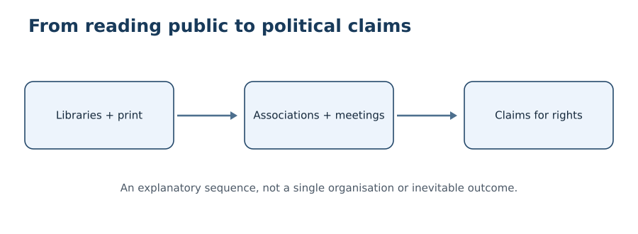
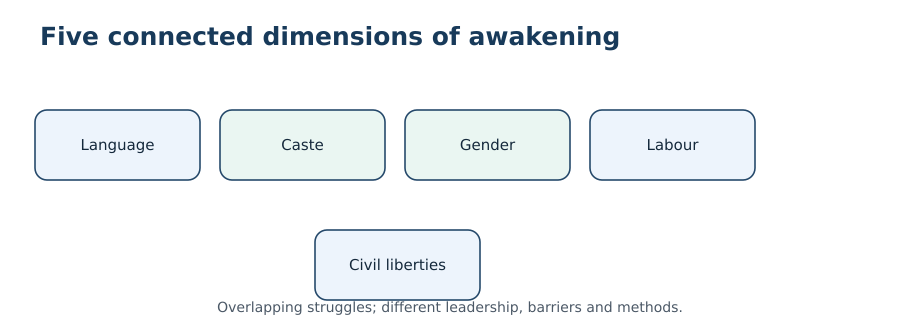
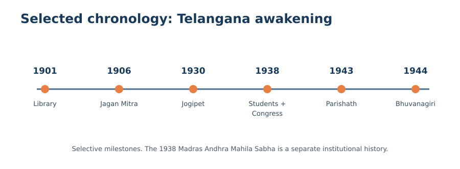

# Socio-Cultural Awakening in Telangana
**Paper II / Unit II / Topic 4 — Integrated student-edition PILOT v0.1 (26 October 2026)**
**Editorial status: readiness work in progress. NOT independently academically approved.**

**What this edition changes:** This is a reorganised reading sequence drawn from the existing original chapter and three previously published research repairs. Major themes appear once in the core narrative; earlier source files and original PDF remain preserved. It is a pilot, not a claim that every R1–R8 gate has passed. Dates that depend on unavailable original minutes or gazette orders are qualified rather than invented.

**Official syllabus scope:** Andhra Saraswatha Parishath; literary and library movements; Nizam Rashtra Andhra Jana Sangham; Andhra Mahasabha; Brahmo Samaj, Arya Samaj, Adi-Hindu and Dalit movements; Bhagya Reddy Varma; Andhra Mahila Sabha and the women’s movement; Hyderabad State Congress; Vande Mataram movement. Vetti/Jogini/Devadasi are supporting social-context concepts; Vetti is also explicitly covered in the preceding syllabus item.

**How to study:** Read the historical narrative in sequence, use the timeline and distinctions to avoid organisational confusion, answer the original practice MCQs, then practise 200–250-word mains responses under timed conditions. The internal evidence log is separate from the exam-facing explanations.

## 1. Historical background: why awakening took multiple forms

### Hyderabad State was not a British province

Hyderabad State was a multilingual princely polity under the Nizam and British paramountcy, not a district of directly administered British India. Urdu's privileged official position affected access to state schooling and employment; it does not mean that every Urdu speaker opposed Telugu cultural activity or that all Telugu-speaking groups shared identical interests. Press censorship, educational inequality, landlord power and restrictions on assembly intersected, but did not always produce a united opposition. Our chronology consequently tracks both collaboration and disagreement, and separates later commemorative traditions from surviving contemporary records.

### Overlapping publics and unequal participation

Hyderabad's urban and regional life included Urdu, Telugu, Marathi, Kannada and other literary traditions. Women's organisations, Muslim educational initiatives, reformist religious groups, workers' associations and caste-based self-help bodies could mobilise around different concerns. A narrative that makes Telugu public awakening the only route to citizenship obscures these parallel histories. It also mistakes language for social class: wealthy Telugu patrons, landless Telugu labourers and Dalit Telugu educators could experience the same administration differently.

### The core historical problem

A language association, an anti-caste school, a women’s meeting, a student protest and a constitutional organisation all widened public participation, but they challenged different barriers. The syllabus is best studied as several connected processes rather than as a parade of founders. Political change did not follow automatically from the existence of a library or a conference; it depended on participation, organisation, state response and material power.

## 2. Literary and library movements: building a reading public

### Origins and a named Telangana example

In a princely state where official language, educational opportunity and public debate were unevenly distributed, a reading room was more than a place to store books. It created a relatively durable public space in which students, teachers, small traders and aspiring writers could encounter newspapers, discuss social problems and organise lectures. The political importance of such spaces depended on who could enter them, what languages they stocked and whether authorities permitted meetings. A library that circulated Telugu books could broaden access for some Telangana readers, while remaining inaccessible to women, non-literate labourers or people excluded by caste. Therefore the growth of libraries should be evaluated as a partial expansion of the public sphere, not automatically as mass democratisation.

Telangana SCERT identifies the Sri Krishnadevaraya Andhra Bhasha Nilayam, established in Hyderabad in 1901 by Komarraju Lakshmana Rao with Nayani Venkatarangarao and Ravichettu Ranga Rao, as a landmark in Telugu literary organisation. The historical point is not merely the year. A named institution shows how language-based cultural work acquired continuity through premises, collections and collective effort. The library connected printed works circulating from the Andhra region with readers in the Hyderabad dominion. That cross-regional circulation did not mean the two regions had identical political interests. Literary exchange and the later debate about employment safeguards operated on different planes.

### How reading rooms became civic infrastructure

A reading room becomes politically important when it supplies three scarce resources: recurring meeting space, a predictable flow of information and a network that outlasts a single charismatic speaker. Sri Krishnadevaraya Andhra Bhasha Nilayam, associated with Komarraju Lakshmana Rao and collaborators and founded in Hyderabad in 1901, became a prominent example of Telugu-language institution-building. The more significant analytical question is what happened after books arrived. Volunteers selected texts, managed subscriptions, organised lectures, taught readers and connected separate towns. In places where overt political assembly attracted official scrutiny, an ostensibly literary meeting could generate the habits of discussion and record-keeping later required by political associations.

### Limits of access and social reach

This should not be romanticised. A subscription library could be dominated by male teachers, lawyers or traders; a woman prevented from travelling after dusk or an agricultural labourer without time to read gained little from its existence. Oral reading and night classes could partially reduce that barrier, but caste segregation and economic dependency remained. A credible assessment asks who controlled the keys, who selected the language of instruction, who paid the fees and who could speak at meetings. The institutional success of a library must be measured by widened participation, not the mere survival of its building.

### Exam interpretation

The key distinction is between an institution and its reach. A library is evidence of organisation; literacy rates, attendance registers and women’s or Dalit participation are evidence of its social outcomes. Do not infer mass democratisation from the founding of one urban library.

## 3. Print culture and Golconda Patrika

### Editorial networks and public debate

The Telugu periodical *Golconda Patrika*, associated with editor Suravaram Pratap Reddy, made Hyderabad State's Telugu-speaking public more visible. Newspapers were not passive mirrors: editors decided which petitions, poems, local abuses and language controversies deserved circulation. An editorial could transform a dispute in one locality into a claim about education or civil rights across Telangana. Reprinting and public reading multiplied a newspaper's reach beyond its paid subscribers. The print public nevertheless differed from the rural population as a whole, because editors depended on literate correspondents, transport routes, printers and funds.

### Chronology and evidence caution

Two evidentiary traps matter. First, retrospective biographies disagree on the paper's initial year: some place its launch in 1925, while other accounts give 1926. Without examining the first surviving issue, this edition does not certify a day-and-month launch date. Second, a newspaper's self-description is evidence of an editorial intention, not proof that every village accepted its claims. A stronger historical inquiry compares a dated issue with a government notice, a reader's letter and an independent report of the same event. The *Golkonda Kavula Sanchika* anthology can be read as a literary intervention asserting a Telangana Telugu canon; its inclusion choices also require scrutiny.

### Historical significance

Print connected otherwise scattered arguments about Telugu language, schooling, social custom and civil liberties. Editors selected stories, while reading rooms and oral circulation extended them. The same selection process creates a bias: a printed editorial represents an organised voice, not automatically the opinion of all agricultural workers or women.

### How a newspaper converted a local issue into a regional argument

A complaint about a school, an editorial on a language dispute and a poem about Telangana's literary inheritance had different immediate audiences. Print could place them next to one another and suggest that they belonged to a larger pattern of unequal opportunity. Correspondents and reading-room organisers then helped circulate those arguments through meetings and oral reading. This was a form of agenda-setting, not proof that a single newspaper commanded a unified popular movement. Its significance was to make grievances comparable across places and to provide vocabulary for public petitions.

### What must be distinguished in examination answers

*Golconda Patrika* belongs to the history of the press, while *Golkonda Kavula Sanchika* belongs to literary assertion through a curated anthology. Both could challenge the invisibility of Telangana Telugu expression, but their formats and audiences were not identical. A date attached to a first issue should be checked against that issue, not inferred from an editor's biography. Likewise, an anthology shows which poets an editor chose to represent; it is not a census of every literary tradition in Hyderabad State. This source discipline makes the argument stronger: a cultural public is constructed through editorial choices, readers and institutions, not simply discovered ready-made.

## 4. Nizam Rashtra Andhra Jana Sangham: language to organisation

### The 1921 language episode

SCERT records an incident in 1921 at a meeting in Hyderabad's Viveka Vardhini College where a proposal made in Telugu was reportedly slighted in favour of English or Urdu. The incident matters because it illustrates how a language hierarchy could become a claim about dignity and equal participation. It should not be simplified into an assertion that every Urdu speaker opposed Telugu. Hyderabad was multilingual, and both Urdu and Telugu were used by internally diverse communities. The relevant political mechanism was exclusion from prestigious forums through unequal linguistic status.

### Organising methods and objectives

Telangana SCERT describes the Andhra Jana Sangham, associated with Madapati Hanumantha Rao and others in the 1920s, as encouraging libraries, reading rooms, students and Telugu manuscripts. Such activity joined cultural assertion to organisational skills: keeping membership lists, raising funds, inviting speakers and coordinating meetings. These skills could later be reused in broader social and political campaigns. However, the organisation's early educational objectives should not be retrospectively converted into a fully formed separate-Telangana demand. The historical meaning of an organisation must be anchored to its contemporary programme, not only its later legacy.

### Why libraries, newspapers and meetings reinforced one another

An analytical comparison helps. A newspaper can spread an argument quickly but may disappear after one issue; a library can sustain access to many publications over years; a public meeting allows collective deliberation but may be vulnerable to restrictions. The three forms reinforced each other. A movement with books but no readers remains narrow; readers without places to meet may remain isolated; meetings without durable records can struggle to build continuity. This is why libraries were important institutions in the social awakening of Hyderabad State.

### Avoiding anachronism

The early Jana Sangham was not established as a movement for a separate Telangana state in the modern sense. Its language and educational demands helped build networks; later political demands emerged through changed circumstances and organisations. Hyderabad’s Marathi-, Kannada- and Urdu-speaking publics also had distinct institutional histories, so Telugu assertion should not be written as an exclusive account of all state politics.

### A mechanism of institutional expansion

The early language grievance had to be converted into repeatable activity. Volunteers collected books, coordinated public lectures, preserved manuscripts, solicited subscriptions and maintained correspondence among local groups. Each task created skills that could later support more contentious public action: recording resolutions, collecting small donations, writing petitions and organising travel. These were organisational capacities, not proof of a predetermined revolutionary objective. When an association's network survived beyond one public meeting, its members could coordinate with newspapers, libraries and regional conferences.

The limitation was social composition. Urban literate men could speak more easily in these forums than women, agricultural workers or Dalit villagers. An account that measures success only by the prestige of Telugu among educated people misses the difference between cultural recognition and equal access to schooling. To evaluate change, ask whether the association addressed the cost of education, local school provision and participation beyond its founding circles. These are questions for archival membership and school records, not assumptions to be filled with invented figures.

## 5. Andhra Mahasabha: from cultural forum to contested mass politics

### Jogipet and the conference form

The Andhra Mahasabha's first major conference at Jogipet in 1930 is associated with Suravaram Pratap Reddy. Its significance was organisational: delegates from dispersed localities could debate public education, language, social customs and rights under one platform. Subsequent meetings in towns such as Devarakonda, Khammam and Sircilla widened regional networks. Conference resolutions reveal aspirations, but their adoption alone does not establish implementation; a demand for schooling, for example, needs to be compared with actual school provision and attendance.

### Rural questions, factions and Bhuvanagiri

By the late 1930s and early 1940s, rural grievances over Vetti, landlord domination and taxation brought the platform into closer contact with peasant activists. Moderates, Congress sympathisers and communists differed over how quickly a cultural forum should become a vehicle of agrarian confrontation. Accounts of the 1944 Bhuvanagiri meeting describe a serious ideological division; that division should be analysed through leadership, resolutions and local organising rather than reduced to a theatrical single-day rupture. A movement's history is not a straight line from language to revolution. It is a record of overlapping constituencies whose alliances shifted when the costs of mobilisation changed.

### How to analyse its transformation

The sequence matters. First, literary and educational activists created a recognisable regional forum. Second, conferences supplied occasions for public resolutions and contact between towns. Third, debates about landlord domination, Vetti and rural rights drew in new interests. Finally, moderates and radical organisers diverged over the pace and methods of confrontation. Do not attribute every later peasant demand to the original 1930 programme, or treat the 1944 ideological division as proof that all delegates suddenly adopted one view.

### What remains to verify

Exact wording of early conference resolutions, delegate composition and the 1944 proceedings require the original printed minutes. Existing educational and secondary accounts support the broad trajectory, but a resolution by itself is not proof of implementation in every village.

### The meaning of a changing programme

A conference organisation can change without changing its name. At first, a regional forum may be dominated by educated advocates of language, education and reform of social customs. As organisers travel beyond cities, the problems brought to meetings can shift toward compulsory labour, rent, landlord authority and access to land. That transition is politically significant because it changes not only the list of resolutions but also who has a reason to join, who bears the risks of activism and what kind of response authorities may make. The Andhra Mahasabha is therefore best understood through successive programmes and constituencies, not as a party with a timeless ideology.

### Moderate and radical strategies

The disagreement associated with Bhuvanagiri in 1944 concerned methods as well as priorities. Some activists emphasised petitions, public meetings and negotiated reform; others believed that entrenched agrarian power required stronger rural mobilisation. Both approaches could invoke the same earlier cultural awakening while proposing different political futures. A mains answer should explain why agrarian issues could sharpen these differences: a library petition asks for recognition and access, while resistance to landlord domination challenges control over labour and resources. To establish precisely who adopted which resolution, however, the original proceedings and local correspondence remain necessary.

## 6. Andhra Saraswatha Parishath: literature, education and continuity

### Founding and early conferences

The Telangana Saraswatha Parishath's own historical account dates the foundation of its predecessor, Nizam Rashtra Andhra Saraswatha Parishath, to **26 May 1943** at a meeting in the Reddy Hostel library hall in Hyderabad. It identifies Lokanandi Sankaranarayana Rao as chair and Burgula Ranganadha Rao and Bhaskarabhatla Krishna Rao as convenors. It records the first Parishath Mahasabha in Hyderabad on **1 June 1943**, followed by gatherings at Warangal in December 1944 and Nalgonda in March 1946. The institution lists aims of literacy, Telugu examinations, publication and literary meetings.

### Institutional memory versus contemporary proof

These dates are stronger than a general secondary assertion because they come from the continuing institution's own record, but institutional self-history is not neutral. It is evidence of how the body remembers its origin, and the founding minutes remain an independent verification target. The same account reports adult education and night schools; these are claims about institutional activity, not proof of literacy gains for each learner. Critically, the Parishath is not the 1930 Andhra Mahasabha: similar names must not lead to conflated chronologies.

### Adult education and later programmes

The Parishath's institutional record reports a Hyderabad adult-education training camp from 15 to 30 June 1950, naming Gadicharla Harisarvotthama Rao as principal and Pathuri Nagabhushanam as chief organiser. It also reports social education centres and night schools, including programmes in coal-mining areas. The date matters: these activities continued after the 1948 integration of Hyderabad into the Indian Union, showing that cultural institution-building was not exhausted by political transition.

The mechanism was practical. Adult learners who could read a notice, calculate wages, sign a petition or compare newspaper accounts had greater capacity to engage institutions. Yet attendance, retention, gender participation and economic outcomes cannot be inferred from the count of centres. The institutional record should be checked against attendance ledgers, examination records and local oral histories. This case therefore teaches a general examination principle: distinguish programme outputs (classes held) from outcomes (sustained literacy and participation).

### Distinguish it from Andhra Mahasabha

The Parishath dates its predecessor’s founding to 26 May 1943 and its first Mahasabha to 1 June 1943. The earlier Andhra Mahasabha held a landmark conference at Jogipet in 1930. The shared word “Mahasabha” does not make them the same body. The Parishath’s reported later adult-education work also shows how literary organisation continued after Hyderabad’s political integration.

### Why institutional continuity is historically important

The Parishath's activities demonstrate that cultural organisation did not simply end when political circumstances changed. A body able to hold meetings, conduct examinations, publish material and arrange adult education could preserve skills and networks across the transition from princely rule to integration in the Indian Union. This continuity should not be confused with an unchanged political programme. A literary organisation's later adult-education work is evidence of adaptation, not proof that it directed every earlier nationalist or peasant campaign. The institution's own dates are useful anchors; original attendance records would be needed to assess the scale of its educational effects.

## 7. Brahmo Samaj and Arya Samaj: distinct reform currents

### Comparison of ideas and methods

Brahmo Samaj and Arya Samaj appear together in the syllabus because both participated in wider debates on education and social custom, but their intellectual premises and local trajectories were not identical. Brahmo reform generally stressed monotheism, critique of ritual orthodoxy and social legislation; Arya Samaj drew on a programme of Vedic reform and developed networks of schools, public debate and religious mobilisation. In Hyderabad, Arya Samaj activity also became entangled with conflicts over religious liberty and political restrictions, especially in the late 1930s.

It is historically careless to equate all Arya Samaj satyagraha with the Hyderabad State Congress movement or to assume that anti-caste, nationalist and religious-reform aims always aligned. Reform could challenge one hierarchy while reproducing another. A useful comparative matrix asks: Who could join? Who funded the schools? Did reform extend to women and oppressed castes? How did the state regulate gatherings? Were demands addressed to society, the ruler or both? Because contemporary petitions and police reports are not yet available, claims about the scale of arrests and motives of every participant remain unverified.

### Why the distinction matters

Brahmo Samaj is generally associated with monotheistic critique, rational religious reform and campaigns around education and social custom; Arya Samaj with a Vedic reform programme, education, social mobilisation and its own debates around religious identity. Their presence in Hyderabad State belongs to the wider history of reform, but they should not be portrayed as one institution or assigned identical methods. Assess specific Hyderabad activities separately from each organisation’s all-India history.

### Historical limits

Reformist rhetoric could coexist with exclusions by caste, class and gender. A sound answer compares leadership, institutions and beneficiaries; it also distinguishes religious reform from constitutional politics under the Hyderabad State Congress.

### Brahmo Samaj: principles and social criticism

Brahmo Samaj developed in nineteenth-century India as a reform current associated with monotheism, critical engagement with inherited ritual and the claim that religion should be compatible with reason and ethical improvement. Its wider reform discussions included education and the status of women. In a Hyderabad State answer, those intellectual principles provide context, but they cannot substitute for evidence about actual local congregations, teachers, meetings or schools. The important analytical question is how religious criticism created room to debate social custom, and whether such debates changed opportunities for people outside educated urban circles.

The movement's reformist language should not be treated as proof that caste and gender inequalities vanished among its supporters. An organisation could advocate enlightened social principles while still depending on affluent patrons and a narrow literate membership. Evaluation must separate doctrine, organised practice and measurable outcomes. The same distinction applies to other reform associations and prevents an uncritical catalogue of benevolent intentions.

### Arya Samaj: Vedic reform, education and public mobilisation

Arya Samaj articulated a different religious foundation, seeking renewal through its interpretation of Vedic authority. Its reform programme placed importance on education, social discipline and collective religious activity; in the Hyderabad setting it also intersected with arguments about public assembly and religious freedom. That intersection does not make it the same as the Hyderabad State Congress. One operated from a religious reform framework, while the other articulated demands for constitutional accountability. Their participants could share concerns about restrictions without sharing every aim or method.

When comparing the two Samajes, use three dimensions: theological starting point, preferred organisational activities and their relationship with state authority. A short answer that says both opposed “social evils” is too vague to demonstrate understanding. A better answer identifies their distinct intellectual premises, explains how schools and meetings created public networks, and then notes the limits of evidence about local membership, inclusion and results.

## 8. Bhagya Reddy Varma and Adi-Hindu self-assertion

### Leadership and early organisation

Bhagya Reddy Varma (1888–1939), born Maderi Bagaiah, is identified in Telangana SCERT as a prominent Dalit reformer. In 1906 he began Jagan Mitra Mandali, using popular performance to spread awareness and challenge caste humiliation. The Adi-Hindu framing asserted dignity and an alternative account of the place of oppressed communities in Indian society. The term should be explained as a reform movement's political vocabulary, not treated as an uncontested historical classification of ancient populations.

### Schools, dignity and the challenge to untouchability

His work is especially important because it exposes the limits of a narrative focused only on elite language associations. For communities denied access to schools, public wells, temples or respectable employment, reform required changes in everyday social power. Educational initiatives, collective organisation and campaigns against the dedication of girls as devadasis or joginis were connected to the struggle against untouchability. SCERT notes efforts to obtain special educational funds from the Nizam's government. A balanced answer should examine both the movement's achievements and the institutional obstacles that limited access.

### Independent political authorship

Bhagya Reddy Varma's importance cannot be reduced to the claim that he helped upper-caste reformers address untouchability. His organisational work, associated with Jagan Mitra Mandali and the Adi-Hindu movement, asserted the right of historically oppressed people to define their own identity, establish educational institutions and speak for themselves. This was a change in political authorship: communities labelled by others could formulate demands through their own platforms. Education supplied practical skills and an arena for challenging inherited status, but did not by itself abolish landlessness, occupational exclusion or social violence.

### Gender, social power and the limits of reform

The gender dimension deserves its own analysis. A campaign against dedication practices addressed coercion and sexual exploitation, but meaningful emancipation also required schooling, livelihood alternatives, social protection and freedom from stigma. Repression of a harmful practice without support for affected women and girls could shift vulnerability rather than remove it. This is a general policy lesson drawn from the history; it is not a claim that all these measures were adopted in the period.

Compare three kinds of evidence: the organisation's own resolutions and publications, Hyderabad State administrative records of schools or census categories, and later commemorative accounts. They answer different questions. A government census category can show official recognition of a term but cannot prove that discrimination ended. A retrospective biography may preserve an important memory while overstating an exact number of schools. The earlier supplement covers Jagan Mitra Mandali's beginnings; the new analytical emphasis is on autonomous representation, schooling governance and the limits of symbolic recognition.

### Evaluation

Bhagya Reddy Varma’s significance is not exhausted by a birth date or one association. The movement contested who had authority to describe marginalised communities, who could enter schools and public spaces, and who could lead collective organisations. Use Jagan Mitra Mandali (1906) as an example, but do not assert exact school counts without contemporary registers.

## 9. Vetti: coerced labour and the caste–agrarian order

### Meaning, context and forms

**Definition and social setting.** *Vetti* refers to compelled labour rendered without fair payment or without a genuinely free choice to refuse. In Telangana's historical caste-feudal order, such obligations could be imposed through village power relations and land dependence. It should not be conflated automatically with every form of agricultural wage labour: the defining issue is coercion and the denial of meaningful consent. The 2026 Telangana SEEEPC survey volume specifically names vetti as forced unpaid labour and situates it among structural forms of caste-feudal exploitation. A textbook account should identify both the material extraction of labour and the degradation of status involved.

### Economic and political mechanisms

**How the system operated.** Control over land, credit, access to village resources and local authority could make refusal costly. Families dependent on landlords or village intermediaries might be expected to supply work for domestic service, agricultural operations, transport or other demands. The form and severity differed across localities. Labour obligations also reproduced social hierarchy: a community assigned compulsory tasks had less time for independent cultivation, schooling or paid work. This created a feedback loop in which poverty increased dependence, and dependence made coercion harder to escape. A single 'unpaid hours' estimate would not capture the loss of bargaining power or humiliation.

### Resistance and historical interpretation

**Resistance and reform.** Anti-caste movements, peasant organisations and expanding educational networks challenged the legitimacy of hereditary servitude. Campaigns for self-respect made the issue political: the claim was not merely that a worker deserved a higher wage, but that no person should be bound by caste to another's service. The later constitutional and statutory framework against forced labour reflects a wider Indian rights transformation; Article 23 prohibits traffic in human beings, begar and similar forms of forced labour, while the Bonded Labour System (Abolition) Act, 1976 addresses bonded labour. These later laws should not be projected backward as if they were already operative under the Nizam.

**Analytical distinction.** *Vetti* and *jeetham* can overlap but are not identical labels. Jeetham is often discussed in relation to debt-linked or bonded service, whereas vetti highlights unpaid compelled labour. Precise local usage requires source-specific evidence. The historian must distinguish debt, caste duty, landlord power and state demands instead of treating them as one undifferentiated category.

**Mains conclusion.** Vetti illustrates how economic exploitation and social subordination reinforced each other. Reform required both rights-based opposition to coercion and changes in access to land, education and collective organisation. The continuing exam lesson is to analyse power relations and lived experience, not merely memorise a definition.

### Why it belongs in this chapter

Vetti is explicitly named in the preceding Asaf Jahi syllabus topic, but it also explains why socio-cultural organisations later addressed agrarian and anti-caste claims. Linguistic dignity alone could not undo labour obligations imposed by landlords or powerful intermediaries. A balanced mains answer separates the labour system, beneficiaries, resistance and consequences.

## 10. Jogini: caste, gender and coercive dedication

### Social context and constraints

**Meaning and context.** The *jogini* practice in parts of the Deccan involved the dedication of girls or women to a deity or religious institution, in settings where the social consequences could include restricted marital autonomy, stigma and sexual exploitation. The precise customs varied, and not every person described by a local religious label experienced identical circumstances. Nevertheless, the historical issue for social reform is whether religious language and caste hierarchy were used to normalise the denial of a woman's choice. Telangana's 2026 SEEEPC report explicitly identifies jogini servitude among the exploitative practices borne disproportionately by Dalit communities.

### Organisation and opposition

**Root causes and mechanisms.** Poverty, unequal control over family resources, caste discrimination, lack of schooling, patriarchal expectations and the power of local patrons could make dedication difficult to resist. An explanation that blames only 'superstition' is incomplete: it ignores the economic and political incentives of people who benefited from women's restricted autonomy. The practice could affect a woman's ability to form a household on her own terms, pursue education, control earnings or secure social recognition. A historian must avoid treating religious practice itself as a sufficient explanation for exploitation; the coercive social arrangement is the object of critique.

### Organised opposition, legal change and lived outcomes

**Organised opposition.** The Telangana SCERT social-studies textbook records that Bhagyareddy Varma and other Dalit reformers campaigned against the dedication of girls as devadasis or joginis, and linked this struggle to education and anti-untouchability work. This matters because reform was not confined to elite legislative debate. Activists used community meetings, schools, popular cultural forms and public arguments to challenge caste stigma and defend dignity. Their initiatives formed part of a wider movement for access to education and equal social standing.

**Law and implementation.** Modern legal prohibitions on dedication practices must be distinguished from historical campaigns that preceded them. The Andhra Pradesh Devadasis (Prohibition of Dedication) Act, 1988 is relevant to the legal history of the region, but a claim about its current Telangana application should be checked against authoritative state legal records and amendments before exam use. Law alone cannot resolve social exclusion if survivors lack schooling, income, healthcare, safe housing or access to justice. An administrative answer should include rehabilitation and community participation, not simply prosecution.

**Mains conclusion.** The jogini issue joins caste, gender, economic vulnerability and the politics of religious authority. Reform is best evaluated by women's actual freedom, education, safety and livelihood options rather than by the formal disappearance of a label.

### Historical interpretation

The analytical focus is whether a girl or woman could meaningfully consent, obtain education, leave the practice and control her livelihood. Do not reduce the problem to an insult against religious believers or treat a modern statutory ban as proof that historical social exclusion disappeared.

## 11. Devadasi: historical variation and coercion

### Terminology and regional distinctions

**Terminology and historical caution.** *Devadasi* is a broad historical term associated with women dedicated to temple service in different regions and periods. It has included complex relationships to music, dance, patronage, ritual and social status. A responsible account does not claim that every devadasi in every period was a victim of the same practice, nor that all cultural performance traditions are reducible to sexual exploitation. However, some forms of dedication became entangled with caste hierarchy, economic dependence and denial of choice. In Telangana reform history, the relevant examination issue is the struggle against **coercive dedication and exploitation**, especially where girls lacked meaningful consent.

### Social and economic dimensions

**Comparison with jogini.** The terms are related in reform literature but should not be used as perfect synonyms. 'Jogini' has a more specific regional usage in parts of Telangana and the Deccan; 'devadasi' is used more widely across South Asian temple-service histories. The SCERT Telangana textbook discusses campaigns against dedicating girls as devadasis or joginis, which supports studying their overlap in social reform without erasing differences of place, ritual, class and historical period. In an exam answer, say 'related but context-dependent institutions' rather than inventing a universal definition.

### Social dimensions and reform

**Social and economic dimensions.** The historical vulnerability of some dedicated women arose from restrictions on education, property, mobility, marriage and access to alternative livelihoods. These conditions could be reinforced by powerful patrons and social stigma. A moralising account that portrays women as responsible for their exploitation reproduces the injustice it claims to criticise. A better analysis asks who controlled the decision to dedicate, who received the benefits, whether exit was possible and what material resources survivors possessed.

**Reform and cultural politics.** Anti-caste organisers, women's advocates and educators questioned the legitimacy of hereditary obligations imposed on girls. At the same time, reform movements sometimes debated how to protect women without dismissing all forms of performance culture. The historian should distinguish preservation of artistic traditions from preservation of coercive social relations. Cultural history and human-rights analysis are complementary, not mutually exclusive.

**Mains conclusion.** Devadasi history requires nuance: examine diversity of institutions, then focus precisely on coercion, discrimination and restricted agency where evidence supports those claims. This distinction improves both factual accuracy and the ethical quality of an answer.

### Exam comparison

Jogini is often used in specific Telangana/Deccan contexts; Devadasi is a wider historical term whose institutions varied across regions and periods. Where girls were coerced into dedication, exploitation must be named plainly. But avoid the historically false claim that every performer or temple-associated woman had an identical experience.

## 12. Women’s education, conferences and Andhra Mahila Sabha

### Do not conflate two institutional histories

The syllabus refers to Andhra Mahila Sabha and the growth of women's movements. Two histories are easily confused. Women's conferences associated with the Nizam Andhra Mahasabha in Hyderabad State addressed education, child marriage, widow remarriage and women's right to participate in public meetings. Separately, the philanthropic and educational **Andhra Mahila Sabha founded by Durgabai Deshmukh in Madras** dates its formal constitution to **1938**, following a 1937 children's club. Its own institutional history documents later schools, health services and a Hyderabad presence. The latter organisation cannot simply be labelled the women's wing founded at the 1930 Jogipet conference.

The distinction changes the answer: the Hyderabad women's conference movement was tied to linguistic and regional political meetings; Durgabai's institution developed a durable service-delivery and education network across locations. Both expanded women's agency, but their founding settings, organisational continuity and methods differed. A high-quality mains answer names the institution being discussed and identifies the evidence for its date. Exact lists of conference presidents and alleged royal orders on widow remarriage should remain provisional until original proceedings and firmans are obtained.

### Education as participation, not just school counts

Women's schooling was not merely a charitable supplement to male-led reform. Literacy changed the possibility of writing petitions, reading medical information, controlling correspondence, qualifying for employment and participating in associations. The effect depended on the curriculum: a school that taught only domestic skills and a school that enabled examination entry produced different opportunities. Purdah, early marriage, distance, family income and the shortage of women teachers could restrict attendance even when a school formally admitted girls. Rural access was particularly uneven.

Women's conferences in the Hyderabad region created opportunities to argue over widow remarriage, child marriage, women's healthcare and the right to speak before mixed audiences. Some reformers framed women's education as a means of improving the family; women activists could use the same institutional openings to demand personal and public autonomy. The historian must therefore distinguish protectionist arguments from self-representation. A school prospectus, attendance register, examination result or conference resolution is stronger evidence of concrete change than a later celebratory biography. This edition does not claim precise district-level enrolment rates without such records.

### Women-led conference versus durable service institutions

Women’s conferences linked to the Nizam Andhra Mahasabha enabled discussion of education, marriage and public participation in Hyderabad State. Separately, Durgabai Deshmukh’s Madras-based Andhra Mahila Sabha traces a 1937 children’s club and formal constitution in 1938; its subsequent work included educational, healthcare and welfare services and a later Hyderabad presence. The two stories share concerns but differ in founding context, organisational continuity and methods. Their exact conference presidents and resolutions cannot be supplied responsibly without proceedings.

### Limits of access

The test of empowerment is who attended, stayed in school, controlled decisions and obtained work or public voice. Gender, caste, fees and distance could restrict participation even when an institution was founded with progressive aims.

## 13. Civil liberties and restrictions on association

### The state and public meetings

Associations needed a legal and administrative environment in which they could meet, publish, raise subscriptions and circulate pamphlets. Hyderabad State authorities could restrict these activities, while officials also sometimes supported educational institutions. A binary of an entirely silent society against an entirely uniform state misses variation among departments, districts and years. Restrictions on a procession and censorship of a newspaper might have different legal bases. The widely cited 'Gasti Nishan 53' should be studied through its actual text, dates and administrative interpretation rather than repeated as a generic label for every prohibition.

### What a historian must verify

A sound source audit distinguishes a movement's allegation of repression from a gazetted order, police file, court record and later oral history. The allegation may be valid but is not identical to the documentary proof. For an exam answer, write that restrictions on meetings and publications shaped the tactical use of literary associations; avoid inventing a clause number or arrest total. Where an original order has not been retrieved, mark it as an archival gap.

### Why it matters

The struggle for civil liberties was not simply a language dispute. Restrictions on meetings, press circulation and student expression affected organisations with different ideologies. Precise clauses attributed to orders such as Gasti Nishan require the original gazette text; do not memorise an unverified paraphrase as statutory language.

### The practical effect of restrictions

Control of public assembly mattered because organisations depended on predictable meetings, lectures, processions, pamphlets and correspondence. When permission was uncertain, organisers faced the risk that a cultural meeting would be treated as political agitation. Such constraints could push activists toward private discussion, religious or literary venues, petitions and networks that crossed towns. The result was not a simple opposition between “legal culture” and “illegal politics”: activities could occupy changing positions depending on official interpretation and the organisation involved.

The examination distinction is between a broad historical conclusion and a precise legal claim. It is reasonable to analyse the consequences of restrictions on meetings, but it is not reasonable to quote the supposed wording, number or territorial scope of an order without the gazette text. Students should state the political significance and avoid fabricated statutory detail. This is especially important where later accounts refer to Gasti Nishan and different phases of bans on associations.

## 14. The Vande Mataram student agitation of 1938

### University space and political expression

The 1938 Vande Mataram controversy at Osmania University became a contest over whether students could publicly sing a nationalist song and challenge institutional discipline. Accounts describe restrictions in late November 1938, student refusal, disciplinary action and the movement's spread beyond the original campus. The controversy is historically significant because the university, an instrument of modern education, also became a setting for political claims. A student who sought academic qualifications could simultaneously challenge a rule viewed as suppressing national expression.

### Significance and contested details

Do not substitute a precise number of suspended students from a newspaper retrospective for an audited register. Published accounts differ on how many were expelled, suspended or admitted elsewhere, and they often combine Osmania students with other institutions. Nor should the agitation be portrayed as a single religious bloc: the political meanings of the song were contested, and students had varied motives. Its long-term importance was the linkage of campus networks, civic liberties and broader debates over Hyderabad's future. A commission answer should state the 1938 context, methods, state response and limitations separately.

### Causal explanation

The controversy demonstrated that educational institutions could become arenas for arguments about political rights. Student solidarity and disciplinary action widened public attention. It intersected with demands for accountable government, but was not identical to the Hyderabad State Congress, Arya Samaj or the Andhra Mahasabha. Exact expulsion and suspension totals are withheld pending university registers.

### Why students mattered beyond the campus

A university could train a modern professional class while also attempting to regulate political expression. Students possessed a concentration of literacy, shared routines and the capacity to act collectively, making a campus a distinctive public arena. A dispute over a song became politically consequential because it raised questions about who could define acceptable expression and whether disciplinary authority should override the right to collective protest. Its wider resonance depended on circulation through newspapers, families, political sympathisers and other educational institutions.

### A balanced interpretation of the agitation

The movement should be placed in the wider 1938 atmosphere of constitutional and social mobilisation, without assuming that every participant belonged to the same party or held identical religious views. The song had nationalist meanings, but political symbolism was not uncontested. A historian should compare contemporary student petitions, university notices and newspaper reports before making claims about exact disciplinary actions. In mains writing, the strongest structure is context, trigger, student response, civic significance, limits of evidence and conclusion. Repeating an uncertain expulsion total adds less value than explaining how university discipline became a civil-liberties question.

## 15. Hyderabad State Congress and responsible government

### The 1938 constitutional challenge

The Hyderabad State Congress emerged in 1938 within a princely state where the Indian National Congress did not directly exercise the same organisational role as in British provinces. Its demand for responsible government concerned the accountability of ministers, civil liberties and representation. This differed from a narrow request for more Telugu textbooks and from a purely agrarian programme. The state imposed restrictions on the organisation; activists used satyagraha and other means to press constitutional claims. Political demands grew through interaction with students, lawyers, reform groups and rural organisers, but these constituencies did not always agree on strategy.

### Distinguish organisations and phases

The State Congress should not be collapsed into the Andhra Mahasabha, Arya Samaj or the later 1947 movement to join India. Those developments intersected but had different leadership structures and immediate objectives. A careful chronology distinguishes 1938 organisational efforts, wartime developments, subsequent legal changes and the postwar constitutional crisis. This repair does not certify exact lifting dates of bans without the relevant Hyderabad Gazette notices.

### What responsible government meant

The core demand was that executive authority should become answerable to representative institutions rather than remain insulated from public scrutiny. Civil liberties, freedom of association and accountability were essential to this programme. This differed from a Telugu literary body’s primary aim of language development, though members and sympathisers could move between overlapping networks.

### Historical limitation

Precise dates and terms of restrictions and their withdrawal remain unverified without Hyderabad State government notifications. Avoid retroactively treating every 1938 constitutional activist as having a uniform programme concerning the later 1948 integration.

### From a reform demand to a constitutional principle

Responsible government concerns the location of political accountability. A ruler's officials may consult selected groups without being answerable to representatives; constitutional reform seeks institutions through which executive decisions can be scrutinised and challenged. In Hyderabad State, this distinction mattered because cultural recognition, administrative concessions and representative government were different kinds of demand. A petition for Telugu education might be granted without transferring executive responsibility. The State Congress placed constitutional accountability and civil liberties at the centre of its programme.

### Political relationships and limits

The State Congress operated alongside student agitation, religious reform associations, linguistic networks and increasingly politicised rural organisations. Overlap in participants did not erase disagreements about religious identity, agrarian transformation or tactics. Its 1938 emergence should be explained in its own context rather than collapsed into the 1947–48 accession crisis. A defensible account distinguishes founding, restrictions, protest methods and later developments; where government orders are not available, it avoids confident claims about precise dates of bans or their withdrawal. This chronological discipline is essential for a credible history of Hyderabad's constitutional awakening.

## 16. Interpreting the awakening: achievements and limitations

### Four complementary interpretations

One interpretation treats language and libraries as the main engines of awakening: literary institutions trained organisers and connected dispersed towns. A second stresses class and agrarian power: the movement acquired mass force when forced labour, landlord domination and land questions entered its programme. A third centres Dalit and women's self-organisation, arguing that a story led only by elite male language activists misses independent political subjects. A fourth foregrounds Hyderabad's plural public sphere and warns against retroactively interpreting every movement as a step toward later Telangana statehood.

### What would distinguish interpretations empirically

These interpretations are not mutually exclusive, but their explanatory priorities differ. Test them against membership lists, meeting resolutions, district correspondence, school registers and contemporaneous newspapers. Did new rural delegates actually change decisions? Were women voting members or ceremonial guests? Did Dalit-run schools control their curriculum? Were multilingual alliances documented? Without these records, causal certainty is limited. The most defensible synthesis is that cultural, social and political awakening advanced through interacting but unequal organisations, with neither an inevitable endpoint nor a single representative leader.

### Synthesis

Libraries and language associations widened communication; anti-caste movements contested who could speak and learn; women’s organisations challenged restrictions on public authority; agrarian activism confronted coercive labour; students and constitutional activists pressed civil liberties and accountable government. Their relationship was interactive but uneven. A high-scoring answer identifies mechanisms, evidence and limits, rather than asserting that every reform flowed from one leader or led inevitably to later statehood.

## 17. Chronology and distinctions

| Date | Institution or episode | Why it matters |
|---|---|---|
| 1901 | Sri Krishnadevaraya Andhra Bhasha Nilayam, Hyderabad | Landmark Telugu reading institution (SCERT educational synthesis). |
| 1906 | Jagan Mitra Mandali | Bhagya Reddy Varma’s anti-caste mobilisation (SCERT synthesis). |
| Early 1920s | Nizam Rashtra Andhra Jana Sangham | Organised language, reading-room and educational networks. |
| 1930 | Andhra Mahasabha conference, Jogipet | Regional conference forum; not the later Parishath. |
| 1938 | Hyderabad State Congress and Osmania Vande Mataram agitation | Separate but intersecting civil-liberties challenges. |
| 1938 | Durgabai Deshmukh’s Andhra Mahila Sabha formally constituted in Madras | Not the same body as Hyderabad women’s conferences. |
| 26 May 1943 | Nizam Rashtra Andhra Saraswatha Parishath founded | Institution’s own historical date; original minutes not checked. |
| 1 June 1943 | First Parishath Mahasabha, Hyderabad | Distinct from the 1930 Andhra Mahasabha. |
| 1944 | Andhra Mahasabha ideological division at Bhuvanagiri | Illustrates divergent moderate and radical strategies. |
| 21 August 2015 | Name Telangana Saraswatha Parishath took effect | Later institutional continuity, not a pre-1948 event. |

### Comparison: institutions often confused

| Institution | Primary focus | Distinguishing caution |
|---|---|---|
| Andhra Jana Sangham | Telugu language, libraries, educational organisation | Early cultural objectives ≠ later statehood demand. |
| Andhra Mahasabha | Conference network, later broader social/agrarian politics | Jogipet 1930; ideological changes over time. |
| Andhra Saraswatha Parishath | Literature, literacy, examinations and adult education | Founding 1943; different body from Mahasabha. |
| Adi-Hindu movement | Self-organised anti-caste dignity, schooling and rights | Not merely elite philanthropy. |
| Hyderabad women’s conferences | Women’s participation within regional public meetings | Do not assign Madras institution’s founding date. |
| Durgabai’s Andhra Mahila Sabha | Madras-origin education and welfare institution | Formally constituted 1938; later Hyderabad institutions. |
| Hyderabad State Congress | Responsible government and civil liberties | Not interchangeable with Arya Samaj or Mahasabha. |

## 18. Revision map

**Causal sequence:** Unequal schooling and limited public forums → libraries and newspapers → language associations and conferences → independent Dalit and women’s organising → students, agrarian groups and constitutional politics. This is an explanatory map, not a claim that all organisations shared a single leadership.

**Five examination cautions:** Do not conflate Mahasabha with Parishath; do not conflate the two Andhra Mahila Sabha histories; do not equate jogini with every devadasi institution; do not quote unverified expulsion or gazette figures; do not label practice questions official PYQs.

**Diagram A:** Cultural institutions → organisational networks → public claims.

**Diagram B:** Language / caste / gender / labour / civil liberties as interacting but distinct axes.

**Diagram C:** Selected chronology.

## 19. Six original mains practice answers (NOT official PYQs)

## Question 1. Evaluate the contribution and limitations of literary and library institutions to Telangana’s socio-cultural awakening.

**Background.** In princely Hyderabad, restricted public politics and unequal access to official education made literary institutions important meeting points. Their significance was institutional rather than merely bibliographical.

**Networks and communication.** Sri Krishnadevaraya Andhra Bhasha Nilayam, associated with 1901 Hyderabad, illustrates the emergence of organised Telugu reading spaces. Libraries circulated books, newspapers and public lectures. Volunteers built habits of subscriptions, discussion, record-keeping and cooperation between towns. Oral reading could extend printed ideas beyond individual subscribers. Telugu editors and authors converted local grievances into arguments about education, language and civil liberties.

**Political transition.** These networks supported the growth of the Nizam Rashtra Andhra Jana Sangham and later the Andhra Mahasabha. As rural grievances entered meetings, an initially cultural infrastructure helped sustain wider mobilisation. The 1943 Saraswatha Parishath, however, was a distinct literary and adult-education institution; similar names must not be confused.

**Limitations.** Libraries were often concentrated among literate, urban, male and relatively prosperous groups. Distance, fees, caste restrictions and domestic labour limited access. A conference resolution cannot prove that village education improved. Organisational memoirs require comparison with membership and school records.

**Conclusion.** Libraries helped create a durable public sphere, but their democratic value depended on who could enter, learn and lead. They were enabling institutions, not automatic substitutes for social reform or representative government.

## Question 2. Explain how the Andhra Jana Sangham and Andhra Mahasabha changed the character of public mobilisation in Hyderabad State.

**Context.** Hyderabad State was a multilingual princely polity with restricted representative politics. Telugu cultural activists sought greater educational and literary opportunities without initially operating as a modern separatist party.

**Early organisation.** The Nizam Rashtra Andhra Jana Sangham, associated with Madapati Hanumantha Rao and other intellectuals, developed a network for language, books, lectures and cultural assertion. The commonly narrated 1921 meeting controversy symbolised exclusion, but the movement had deeper causes in unequal schooling and official patronage.

**Mahasabha expansion.** The first major Andhra Mahasabha conference at Jogipet in 1930, associated with Suravaram Pratap Reddy, gave dispersed local activists a regional forum. Subsequent conferences discussed education, social customs and civil rights. Over time, agrarian problems such as forced labour and landlord domination entered its agenda, linking urban intellectual networks to rural constituencies.

**Ideological tensions.** Moderates and radical organisers differed over political methods. The 1944 Bhuvanagiri division illustrates contested priorities rather than an inevitable march from language politics to revolution. Conference resolutions need comparison with local organisational evidence.

**Assessment.** Telugu identity did not remove caste, gender or class differences. Nor was the Mahasabha identical to the Hyderabad State Congress or the 1943 Saraswatha Parishath.

**Conclusion.** The organisations mattered because they widened the scale and subjects of public debate, while their internal disagreements revealed the uneven nature of Telangana’s political awakening.

## Question 3. Distinguish the women’s conference movement in Hyderabad State from Durgabai Deshmukh’s Andhra Mahila Sabha.

**Problem of identification.** The expression Andhra Mahila Sabha is used for histories that should not be merged. Correct institutional identification is essential before discussing women’s mobilisation in Telangana.

**Hyderabad women’s conferences.** Women’s meetings associated with the Nizam Andhra Mahasabha created public forums for education, child marriage, widow remarriage and women’s participation. Their relationship with regional linguistic conferences gave women opportunities to articulate claims in a restrictive social environment. Exact resolutions and presidents should be checked against original proceedings rather than repeated from later summaries.

**Durgabai’s institution.** Separately, the Andhra Mahila Sabha associated with Durgabai Deshmukh developed in Madras. Its own institutional history records a children’s club in 1937 and formal constitution in 1938. It subsequently established educational, healthcare and welfare institutions, including a later presence in Hyderabad. Its organisational model emphasised enduring services and training.

**Comparative assessment.** Conferences could create public voice and political networks; service institutions could provide qualifications, healthcare and professional opportunities. Neither model automatically included poor rural women. Curriculum, fees, membership and decision-making authority determined how far empowerment extended.

**Evidence and limits.** Institutional retrospectives document self-understanding but are not identical to original founding minutes. One must not assign the 1938 Madras founding date to Hyderabad’s earlier conference movement.

**Conclusion.** Both histories contributed to women’s agency through different routes; distinguishing them produces a more accurate and inclusive account of Telangana’s socio-cultural awakening.

## Question 4. Assess Bhagya Reddy Varma’s Adi-Hindu mobilisation as a challenge to caste hierarchy and political exclusion.

**Background.** Social awakening in Hyderabad cannot be explained only through Telugu literary elites. Oppressed-caste communities also created institutions to challenge exclusion from education, dignity and public representation.

**Autonomous leadership.** Bhagya Reddy Varma’s organisational work, associated with Jagan Mitra Mandali and the Adi-Hindu movement, asserted the right of marginalised communities to define their collective identity. This was different from paternalistic reform in which privileged groups spoke on behalf of others. Self-organised schools and meetings could develop literacy, leadership and the capacity to petition authorities.

**Changing public discourse.** The movement contested untouchability and inherited social status. Its use of the term Adi-Hindu was a claim about identity and respect, not merely a change in vocabulary. It also widened the subjects of public discussion beyond linguistic prestige to caste power and unequal opportunity.

**Limits and evidence.** A government’s adoption of a census category does not prove the disappearance of discrimination. Exact counts of schools, students and official decisions require contemporary registers and administrative orders. The movement’s achievements should be evaluated alongside persistent landlessness, exclusion and labour coercion.

**Comparison.** Language associations, religious reform groups and Dalit organisations sometimes shared educational aims, but their leadership and social priorities differed.

**Conclusion.** Bhagya Reddy Varma’s importance lies in independent anti-caste political authorship and educational institution-building. His work shows why a genuinely inclusive Telangana history must examine who controlled reform, not simply who praised it.

## Question 5. Why was the 1938 Vande Mataram agitation significant for political consciousness in Hyderabad State?

**Context.** In 1938, Osmania University students faced restrictions associated with singing Vande Mataram. The dispute became a wider debate about student expression, institutional authority and nationalist political symbols in princely Hyderabad.

**Immediate mechanism.** Accounts describe late-November restrictions, students’ refusal to comply and disciplinary responses. Students used collective singing, protest and solidarity to challenge rules they regarded as unjust. University space became a political arena even though its formal purpose was education. Networks between students and other institutions helped circulate the controversy.

**Broader significance.** The agitation connected campus discipline to civil liberties and the larger question of accountable government. It demonstrated that a modern educational institution could simultaneously train professionals and restrict their political expression. The movement also provided experience in organisation and public protest to a generation of students.

**Critical cautions.** Retrospective newspaper reports vary in their totals for suspension, expulsion and admission elsewhere. These categories must not be combined without university registers. The political meaning of the song was also contested; participants should not be described as one uniform religious or ideological group.

**Relation to other movements.** The agitation intersected with the Hyderabad State Congress’s demand for rights, but the two were not the same organisation. The Arya Samaj campaigns also had distinct aims.

**Conclusion.** The agitation mattered as a school of civic protest, while its exact scale and composition still require original archival verification.

## Question 6. Trace the relationship between cultural awakening and the demand for responsible government in Hyderabad State.

**Background.** Hyderabad State’s restricted representative institutions, multilingual administration and unequal social relations produced several overlapping reform currents. Their goals did not emerge simultaneously or from one leader.

**Cultural infrastructure.** Libraries, newspapers and Telugu associations built channels for information, meetings and leadership. The Nizam Rashtra Andhra Jana Sangham helped articulate language and educational concerns. The Andhra Mahasabha later widened discussion toward social and agrarian grievances, though moderates and radicals disagreed over methods.

**Independent social currents.** Bhagya Reddy Varma’s Adi-Hindu mobilisation challenged caste exclusion through self-representation and schooling. Women’s conferences raised questions of marriage, education and public voice. Brahmo and Arya Samaj reformers developed different social and religious programmes. These efforts broadened participation but did not automatically create a united political front.

**Constitutional politics.** The Hyderabad State Congress, formed in 1938, advanced responsible government, civil liberties and representative accountability. The 1938 Vande Mataram student agitation showed how educational spaces became arenas of political expression. These organisations interacted, yet their legal status, leadership and immediate demands differed.

**Limitations.** Urban literacy, caste hierarchy, gender barriers and competing ideologies constrained unity. Later statehood narratives must not be projected onto the 1920s or 1930s. Exact bans and arrest figures need original government records.

**Conclusion.** Cultural awakening supplied networks and political language; responsible-government demands transformed those resources into constitutional claims, without erasing separate struggles for caste, gender and agrarian justice.

## 20. Thirty original exam-oriented MCQs with explanations (NOT official PYQs)

### MCQ 1. Which Hyderabad library is associated with the year 1901?

A. State Central Library
B. Sri Krishnadevaraya Andhra Bhasha Nilayam
C. Andhra Saraswatha Parishath
D. Osmania University

**Answer: B.** Telangana SCERT educational history places Sri Krishnadevaraya Andhra Bhasha Nilayam in Hyderabad in 1901.

### MCQ 2. Which organiser is closely associated with Jagan Mitra Mandali?

A. Madapati Hanumantha Rao
B. Suravaram Pratap Reddy
C. Bhagya Reddy Varma
D. Durgabai Deshmukh

**Answer: C.** Bhagya Reddy Varma’s 1906 Jagan Mitra Mandali is a key example of organised anti-caste mobilisation.

### MCQ 3. The early Nizam Rashtra Andhra Jana Sangham focused chiefly on:

A. Telugu language, education and reading networks
B. Immediate demand for an elected responsible ministry
C. Exclusive opposition to forced labour from its founding
D. A separate Telangana state in 1921

**Answer: A.** Its initial cultural and educational programme should not be confused with later political objectives.

### MCQ 4. The landmark 1930 Andhra Mahasabha conference took place at:

A. Bhuvanagiri
B. Jogipet
C. Alampur
D. Madras

**Answer: B.** The Jogipet conference is associated with the early Andhra Mahasabha and Suravaram Pratap Reddy.

### MCQ 5. The 1944 Bhuvanagiri meeting is associated with:

A. The Parishath’s founding
B. An ideological division in Andhra Mahasabha
C. The 1901 library foundation
D. Durgabai’s children’s club

**Answer: B.** Histories identify 1944 Bhuvanagiri with divergence between moderate and radical strands.

### MCQ 6. According to its own history, Nizam Rashtra Andhra Saraswatha Parishath began on:

A. 26 May 1943
B. 1 June 1930
C. 15 August 1947
D. 21 August 2015

**Answer: A.** The continuing institution dates its predecessor’s founding to 26 May 1943.

### MCQ 7. The first recorded Parishath Mahasabha was held in:

A. Jogipet in 1930
B. Hyderabad in June 1943
C. Bhuvanagiri in 1944
D. Madras in 1938

**Answer: B.** The Parishath records Hyderabad on 1 June 1943, distinct from the earlier Andhra Mahasabha.

### MCQ 8. The institution now known as Telangana Saraswatha Parishath adopted that name with effect from:

A. 1901
B. 1930
C. 1948
D. 21 August 2015

**Answer: D.** Its official history records the renaming date as 21 August 2015.

### MCQ 9. The Telugu periodical Golconda Patrika is particularly associated with:

A. Suravaram Pratap Reddy
B. Madapati Hanumantha Rao
C. Komarraju Lakshmana Rao
D. Bhagya Reddy Varma

**Answer: A.** Suravaram Pratap Reddy was a prominent editor associated with the periodical; its exact first-issue date remains unresolved here.

### MCQ 10. The 1938 Vande Mataram agitation in Hyderabad State is especially associated with:

A. Osmania University students
B. Delegates at the 1930 Jogipet conference
C. Parishath adult learners at the 1950 camp
D. Hyderabad State Congress constitutional delegates

**Answer: A.** The agitation centred on student political expression and institutional restrictions in 1938.

### MCQ 11. Hyderabad State Congress was organised around demands for:

A. Responsible government and civil liberties
B. Expansion of Telugu-language libraries as its only demand
C. Anti-caste schooling as its sole constitutional programme
D. Vedic reform and religious reconversion

**Answer: A.** Its constitutional programme concerned accountable government and public freedoms.

### MCQ 12. Which of the following was formally constituted in Madras in 1938?

A. Nizam Rashtra Andhra Jana Sangham
B. Andhra Mahila Sabha associated with Durgabai Deshmukh
C. Andhra Saraswatha Parishath
D. Hyderabad State Congress

**Answer: B.** The Madras-origin organisation’s own history records formal constitution in 1938.

### MCQ 13. The 1937 precursor to Durgabai’s Andhra Mahila Sabha was a:

A. Children’s club
B. Women’s legislative council
C. Hyderabad women’s conference
D. Adult literacy training camp

**Answer: A.** Its institutional history records the Little Ladies of Brindavan children’s club in 1937.

### MCQ 14. Which of the following is a historical error?

A. Parishath began in 1943
B. Jogipet Andhra Mahasabha meeting was in 1930
C. Durgabai’s Madras body was the same 1930 Jogipet women’s conference
D. Vande Mataram agitation occurred in 1938

**Answer: C.** Women’s conferences in Hyderabad and Durgabai’s Madras institution have separate organisational histories.

### MCQ 15. Bhagya Reddy Varma’s reform programme is best characterised as:

A. Adi-Hindu dignity, education and self-organisation
B. Telugu literary organising centred on the Jana Sangham
C. Responsible-government satyagraha as State Congress leader
D. Parishath literary examinations as its founder

**Answer: A.** He is associated with autonomous Dalit social mobilisation and education.

### MCQ 16. The main social relation challenged by Vetti opposition was:

A. Compulsory unpaid labour under local power
B. Coercive religious dedication of girls
C. Unequal official-language status in schools
D. Restrictions on student political songs

**Answer: A.** Vetti describes coerced or unpaid labour linked to agrarian and caste hierarchies.

### MCQ 17. In Telangana reform history, Jogini most directly raises questions of:

A. Coercive dedication, gender and caste vulnerability
B. Compulsory unpaid labour obligations
C. Telugu language exclusion in public meetings
D. Constitutional restrictions on political associations

**Answer: A.** The relevant issue is coercion and restricted agency within social and economic hierarchies.

### MCQ 18. Why should Devadasi and Jogini not be treated as exact synonyms?

A. The practices had no historical regional overlap
B. Devadasi has wider historical/regional meanings and Jogini a more specific Deccan usage
C. Both referred only to women employed at royal courts
D. Both referred only to voluntary performing-arts training

**Answer: B.** Their institutional forms and regional meanings overlap but are not identical.

### MCQ 19. Which reform movement is most directly associated with Vedic reform ideas?

A. Brahmo Samaj
B. Arya Samaj
C. Hyderabad State Congress
D. Andhra Saraswatha Parishath

**Answer: B.** Arya Samaj drew on a Vedic reform programme, distinct from Brahmo Samaj’s monotheistic critique.

### MCQ 20. Brahmo Samaj is best distinguished by its:

A. Monotheistic and rational religious reform orientation
B. Vedic revival and reform under Arya Samaj
C. Demand for a responsible ministry under State Congress
D. Telugu literary examinations under Parishath

**Answer: A.** Brahmo Samaj and Arya Samaj both addressed reform but differed in intellectual premises.

### MCQ 21. Which organisation is most directly associated with Telugu literary examinations and adult education?

A. Hyderabad State Congress
B. Andhra Saraswatha Parishath
C. Arya Samaj
D. Osmania student union

**Answer: B.** The Parishath’s institutional record describes literacy, examinations and adult-education work.

### MCQ 22. Which combination most clearly illustrates distinct reform axes?

A. Library—language; Adi-Hindu—caste; women’s conferences—gender
B. Library—caste alone; Adi-Hindu—official language; women’s conferences—land taxation
C. Library—civil liberties alone; Adi-Hindu—newspaper editing; women’s conferences—religious reconversion
D. Library—land tenure; Adi-Hindu—literary examinations; women’s conferences—official appointments

**Answer: A.** The movements overlapped but addressed different forms of exclusion.

### MCQ 23. Which statement best describes Andhra Mahasabha’s evolution?

A. A cultural conference platform that remained solely literary after 1944
B. A cultural conference platform later engaged social and agrarian questions
C. A literary institution founded at Reddy Hostel in 1943
D. A constitutional organisation founded in 1938

**Answer: B.** The organisation’s agenda and constituencies changed over time, with later ideological disputes.

### MCQ 24. A strong assessment of the library movement should ask:

A. Only the size of its book collection
B. Who had access and whether participation expanded
C. Only the names of its founding patrons
D. Only the number of conferences held

**Answer: B.** Access by gender, caste and class determines whether institutional growth widened the public sphere.

### MCQ 25. Which evidence is best for the precise text of a 1930 conference resolution?

A. Original conference proceedings
B. A later institutional retrospective
C. A contemporary newspaper summary of the meeting
D. A government school textbook summary

**Answer: A.** Original minutes are needed to certify wording and adoption; secondary summaries may be incomplete.

### MCQ 26. Why are exact 1938 Osmania expulsion totals left unconfirmed?

A. University registers establish one undisputed total
B. Retrospective accounts mix suspensions, expulsions and institutions
C. All later newspaper reports give the same category and total
D. The controversy concerned curriculum alone, not student discipline

**Answer: B.** Original university registers are needed to separate categories and verify totals.

### MCQ 27. Which claim is NOT supported by a library’s founding record alone?

A. An institution was established
B. Organisers created a collection
C. Literacy increased in every rural village
D. The founding charter named its organisers

**Answer: C.** Founding a library does not demonstrate universal or measurable educational outcomes.

### MCQ 28. The 1943 Parishath founding account identifies its meeting place as:

A. Reddy Hostel library hall in Hyderabad
B. Viveka Vardhini College in Hyderabad
C. Sri Krishnadevaraya Andhra Bhasha Nilayam
D. Osmania University campus

**Answer: A.** The Parishath’s own institutional history names the Reddy Hostel library hall.

### MCQ 29. Which pair is correctly distinguished?

A. Hyderabad State Congress—constitutional politics; Andhra Jana Sangham—early cultural organisation
B. Hyderabad State Congress—literary exams; Andhra Jana Sangham—responsible ministry
C. Parishath—1930 Jogipet; Mahasabha—1943 Hyderabad
D. Adi-Hindu—Vedic reform; Arya Samaj—Telugu literary examinations

**Answer: A.** The two organisations had different principal programmes, although activists’ networks could overlap.

### MCQ 30. What is the most defensible overall interpretation of socio-cultural awakening?

A. Linguistic assertion alone explains every subsequent movement
B. Distinct linguistic, caste, gender and political movements interacted unevenly
C. Caste reform had no relationship with education or public networks
D. All women’s activism originated in the 1938 Madras organisation

**Answer: B.** Multiple organisations and interests shaped an uneven, non-linear transformation of public life.

## 21. Sources, provenance and unresolved evidence

The following are the principal sources supporting this editorial pilot. Government textbooks are educational syntheses, and institutional histories are retrospective first-party accounts; neither substitutes for original Hyderabad State archives.

- Telangana State Public Service Commission, Group-I Notification No. 02/2024, Annexure II, Paper II History and Cultural Heritage of Telangana, Item 4. Commission-hosted PDF search index checked 26 October 2026; full PDF access returned 502 and remains a final R1 verification step. https://websitenew.tspsc.gov.in/preview/RElSRUNUUkVDUlVJVE1FTlROT1RJL05PVElGSUNBVElPTl9OT18wMi0yMDI0X0dyb3VwLUlfU2VydmljZXMgKDEpMjAyNDAyMjAxNDA3MzcucGRmr95v17a0y2d8i13v
- Telangana SCERT, Class VIII Social Studies, social reform and Hyderabad State history (government educational synthesis). https://scert.telangana.gov.in/pdf/publication/ebooks2019/8th%20social%2022-23%20part2%202022-23.pdf
- Telangana Saraswatha Parishath, official institutional history: founding, meetings, adult education and 2015 renaming (first-party retrospective). https://www.saraswathaparishath.com/english/about_us.html
- Andhra Mahila Sabha, official institutional history and founder account: 1937 club and 1938 constitution (first-party retrospective). https://www.andhramahila.com/history.html
- A. A. N. Raju, “Glimpses of Library Movement in Telangana,” Journal of Information and Knowledge 46(3), 2009 (abstract previously checked; full paper not read). https://srels.org/index.php/sjim/article/view/44154
- Telangana SCERT, Class VIII Social Studies 2020–21 edition, Telugu language and Andhra Jana Sangham (government educational synthesis). https://scert.telangana.gov.in/pdf/publication/ebooks2019/8%20social%20em%202020-21.pdf

**Outstanding source checks:** Original 1930 and 1944 Andhra Mahasabha proceedings; 1938 Osmania student disciplinary registers; Hyderabad State Congress and Gasti Nishan gazette texts; first Golconda Patrika issue; original Hyderabad women’s conference minutes; Bhagya Reddy Varma’s school/association registers. These sources have NOT been examined for this edition.

**Archive:** Older `detailed-notes.md`, all three `depth-repair-*.md` files, prior MCQ/mains sources and original PDFs are retained unchanged. The provenance-labelled `complete-notes.md` remains an archive; this editorial edition is a separate student-facing candidate.