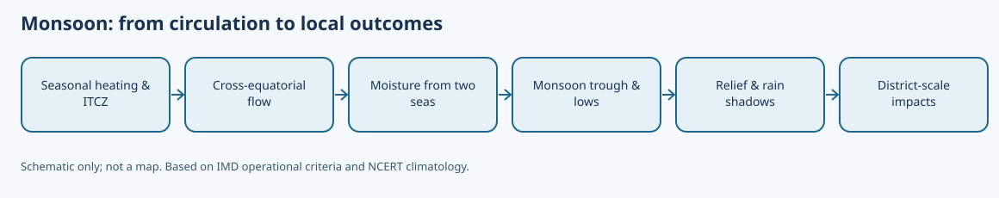
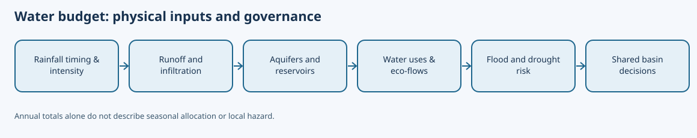

# Paper II — Geography of India and Telangana — Unit III, Topic 1

# India: Physical Setting, Physiography, Monsoon, Resources and Water

**Integrated student edition, working draft — 26 October 2026. Not academically ready or independently approved.** Original 15-page PDF, earlier depth repair, and segmented source files are preserved. This chapter consolidates the existing 25-concept notes and monsoon/resources repair into one sequential narrative rather than linking a disconnected supplement. Editorial deduplication, claim-level source verification and full page review are still pending.

## Official syllabus scope and editorial mapping (R1 not yet PASS)

The source syllabus-index records Paper II Section III Topic 1 as: India—physical setting, physiography, drainage, climate and monsoon mechanism, El Niño/La Niña, rainfall variability, floods/droughts, soils, vegetation/wildlife and conservation, mineral/energy resources and energy crisis, non-conventional energy, marine resources/EEZ, and water availability, interstate sharing and conservation. This text is consistent with published reproductions of Notification 02/2024; the direct official PDF returned HTTP 403 in this run, so **the primary-page check remains pending**.

| Atomic syllabus element | Chapter sections |
|---|---|
| Physical setting and physiography | 1–6 |
| Drainage systems and basin dynamics | 7–8 |
| Monsoon mechanism, ENSO and rainfall variability | 9–12 |
| Floods and droughts | 13–14 |
| Soils, vegetation, wildlife and conservation | 15–17 |
| Minerals, conventional/non-conventional energy and crisis | 18–20 |
| Marine resources and EEZ | 21 |
| Water availability, interstate sharing and conservation | 22–24 |
| Integrated analytical practice | 25 |

## How to use this chapter

Study each numbered concept as **process → spatial pattern → Telangana application → limitation or policy implication**. The numbered explanations are a coherent study sequence, not separate essays. Practice questions are original and are **not authenticated official TGPSC PYQs**. All time-sensitive data must be rechecked at its stated observation date.

# Part A — Integrated textbook explanations

## 1. India as a physical-geographical system

India’s physical geography is best understood as a connected system rather than as separate lists of mountains, rivers, soils and minerals. Relief determines the direction of drainage; relief and latitude influence temperature; the Himalaya and the Tibetan Plateau influence atmospheric circulation; monsoon rainfall shapes river regimes, soil moisture, vegetation and drought risk; and geology influences mineral distribution. Human use then modifies each component through dams, groundwater pumping, mining, urbanization and land-cover change. India extends from the high Himalaya to tropical islands and from the arid Thar to some of the world’s wettest hill slopes. This diversity creates both complementarity and vulnerability. A high-scoring mains answer should therefore repeatedly connect process, spatial pattern and consequence: for example, explain not merely where black soil occurs, but why basaltic parent material, seasonal moisture and clay mineralogy produce its characteristic behavior and crop associations.

**Systems approach and a Telangana application.** A district-scale drought map cannot be interpreted from rainfall alone. Its effect depends on rock permeability, soil depth, watershed slope, groundwater storage, crop water demand and access to irrigation. Telangana’s plateau setting offers a useful test: two neighbouring villages receiving similar rainfall can experience different crop losses because one has deep black soils and functioning tanks while the other has shallow soils, rapid runoff and depleted borewells. This is why physical geography is a causal framework for public policy, not merely a list of landforms. In examination answers, distinguish the physical process from the human exposure that converts it into a problem.

## 2. Geological structure: the long time scale behind the map

Peninsular India contains some of the oldest exposed rocks of the Indian shield, whereas the Himalaya are geologically young fold mountains created by convergence of the Indian and Eurasian plates. The Deccan Traps represent immense basaltic lava outpourings near the end of the Cretaceous, while the Indo-Gangetic-Brahmaputra plains are much younger depositional surfaces built by river-borne alluvium. These distinctions matter beyond geology. Old crystalline terrains often host metallic mineral belts; basaltic terrain is associated with regur or black soils in many areas; young alluvial plains support intensive agriculture but are also highly exposed to floodplain migration. The Himalayan tectonic setting creates steep gradients, high sediment loads, landslide susceptibility and seismic risk. Geology therefore underlies both India’s resource endowment and its hazard geography.

**Structural inheritance and current hazards.** The Indian shield contains ancient crystalline rocks, sedimentary basins and the Deccan volcanic province; their resistance to weathering and permeability affect both landforms and groundwater. Himalayan relief is younger and still subject to crustal deformation, so steep slopes, fractured rocks and intense rainfall can combine to produce landslides. It would be incorrect to infer that every part of the peninsula is earthquake-free or that every Himalayan slope is equally unstable. Geological maps, seismic zoning, land-use history and site investigation are needed before drawing local engineering conclusions. For mains answers, link geological age to landscape process rather than treating age as a hazard rating.

## 3. Himalayan physiography

The Himalayan system is not one single ridge. From north to south it is commonly organized into the Trans-Himalaya, Greater or Himadri ranges, Lesser Himalaya and the outer Siwaliks, while regional divisions distinguish Kashmir or north-western, Himachal–Uttarakhand, Nepal and eastern sectors. High relief, glaciers, deep valleys and active tectonics make the mountains a major water tower for northern India. Orographic lifting contributes strongly to rainfall patterns, but slope orientation creates local contrasts. The Himalaya also form only a partial climatic barrier; atmospheric circulation operates in three dimensions and is influenced by jet streams and synoptic systems. Roads, hydropower, tourism and urban expansion create economic opportunities while increasing exposure when construction ignores slope stability and drainage. Mountain development therefore requires carrying-capacity and basin-scale planning, not a simplistic choice between “development” and “conservation.”

**Relief, climate and settlement interact.** The Greater Himalaya, Lesser Himalaya and Siwalik ranges differ in altitude, lithology and valley form; the Trans-Himalayan zone adds a cold-arid contrast. Rainfall can be very high on exposed southern slopes yet low in rain-shadow valleys. Himalayan rivers transport sediment generated by erosion and landslides, but dams and embankments can redistribute that sediment rather than eliminate it. Roads, tourism and hydropower add livelihoods and connectivity while creating difficult trade-offs in fragile valleys. A good answer should therefore distinguish long-term mountain-building from immediate triggers of disasters such as cloudbursts, earthquakes, slope cutting and blocked drainage.

## 4. Northern plains: a dynamic alluvial landscape

The Indus-Ganga-Brahmaputra plains were built by long-term deposition from Himalayan and peninsular tributaries. Their low gradients, deep alluvium and water availability have supported high population densities and intensive cultivation. Yet a plain is not geomorphologically static. Bhabar belts of coarse sediments along the Himalayan foothills differ from the marshier Terai zone; older bangar alluvium can be distinguished from newer khadar deposits in many tracts. Meandering rivers build levees, flood basins, oxbow lakes and channel bars. Embankments can protect particular areas but may also alter sediment deposition and transfer risk. Treating every flood as an abnormal failure ignores the natural role of inundation in floodplain systems. Planning must distinguish hazard from disaster: flooding becomes disastrous when settlement, infrastructure and vulnerable livelihoods are placed in high-risk zones without adequate warning and resilience.

**The plain is not uniform.** Bhabar gravels promote infiltration along parts of the Himalayan foothills; the Terai belt can have a high water table; older alluvium (bangar) differs from newer floodplain deposits (khadar). These zones are not perfectly continuous across all river basins. Natural levees, backswamps and abandoned channels influence farming, drainage and flood exposure. A river may migrate laterally even without an exceptional annual rainfall total because sediment loads and channel geometry change. Planning needs floodplain zoning and drainage maintenance alongside embankments. For the exam, connect a depositional process to a specific land-use implication.

## 5. Peninsular plateau and associated uplands

The Peninsular Plateau is a mosaic of ancient blocks, uplands, basins and lava plateaus rather than an even tableland. The Central Highlands include areas such as the Malwa Plateau and Bundelkhand, while the Deccan Plateau lies broadly south of the Narmada. The Western Ghats form a pronounced escarpment along the western margin and strongly affect monsoon rainfall; the Eastern Ghats are lower and more discontinuous, intersected by major east-flowing rivers. Rift-related valleys of the Narmada and Tapi create distinctive west-flowing drainage. The plateau’s resistant rocks produce waterfalls and rapids in places and historically limited long navigable reaches, while major dams have transformed river use. Mineral belts and groundwater behavior are strongly conditioned by lithology and fracture systems, especially in hard-rock areas.

**Plateau contrasts matter.** The Deccan Traps, central highlands and eastern uplands should not be presented as a single flat tableland. Basalt weathering can produce clay-rich soils, whereas hard-rock crystalline terrain may have limited groundwater storage in weathered and fractured zones. Western Ghats relief enhances rainfall on the western flank and creates rain-shadow conditions inland, but local convection and monsoon depressions still deliver rain east of the escarpment. Telangana's tank systems and borewell economy reflect this seasonal and geological context. A regional plan that expands irrigation without checking aquifer recharge can transfer drought risk from crops to groundwater.

## 6. Coastal plains and islands

India’s western coastal plain is generally narrower than the eastern coastal plain because the Western Ghats lie close to the Arabian Sea. Short, steep west-flowing rivers often form estuaries; the broader east coast receives major delta-building rivers such as the Mahanadi, Godavari, Krishna and Kaveri. Deltas combine fertile land and dense settlement with cyclone, storm-surge, erosion and subsidence risk. The Andaman and Nicobar Islands are linked to an active tectonic arc, whereas Lakshadweep is dominated by coral-island environments. Coastal geography cannot be reduced to beaches: mangroves, mudflats, lagoons, coral reefs, seagrasses and continental-shelf waters provide fisheries, storm buffering, biodiversity and livelihoods. Ports, tourism, aquaculture and coastal infrastructure must therefore be assessed against erosion dynamics and ecological carrying capacity.

**Coasts are dynamic boundaries.** Deltas accumulate river-borne sediment, while estuaries reflect tidal mixing and changing river discharge. Ports, aquaculture, tourism and offshore energy create economic value but may compete with mangroves, fisheries and coastal wetlands. Shoreline erosion cannot always be solved by a seawall: hard structures can change sediment movement and intensify erosion nearby. Cyclone damage depends on storm surge, coastal elevation, building quality and evacuation capacity, not merely the storm's category. Island settings differ: Andaman–Nicobar islands are linked to an active tectonic arc, while Lakshadweep is largely coral atoll terrain. Treat each coast as a geomorphic system.

## 7. Himalayan versus peninsular drainage

Himalayan rivers such as the Indus, Ganga and Brahmaputra systems are fed by combinations of snow, glacier melt and monsoon rainfall and often carry large sediment loads. Their long courses cross high mountains, plains and national boundaries. Most major peninsular rivers depend much more on seasonal rainfall, though reservoirs regulate flows. The Godavari, Krishna, Mahanadi and Kaveri generally drain eastward across broad basins, while the Narmada and Tapi are important west-flowing systems. “Perennial” should not be interpreted as an unchanging discharge; even large Himalayan rivers show strong seasonality. Likewise, peninsular rivers are not uniformly dry outside the monsoon. River behavior depends on basin rainfall, geology, storage, land cover, sediment, groundwater interaction and human abstraction.

**Flow regime is as important as river length.** Himalayan rivers commonly receive snowmelt and monsoon inputs, but the relative contributions differ by basin and season. Peninsular rivers depend more strongly on rainfall and groundwater contributions, yet their flow regimes vary with reservoir regulation and catchment land use. East-flowing Godavari and Krishna form extensive delta systems; west-flowing Narmada and Tapi follow structurally influenced valleys. Do not assume that every peninsular river is seasonal or that Himalayan rivers are immune to dry-season stress. Reservoir operation, environmental flows and sediment movement can modify the natural hydrograph substantially.

## 8. Drainage basins, sediment and river management

A drainage basin is a functional planning unit because upstream actions affect downstream flows, sediment and water quality. Deforestation or road cutting can alter erosion; dams trap sediment and modify downstream flood pulses; sand mining changes channel morphology; urban impermeable surfaces accelerate runoff. River linking or inter-basin transfers therefore require more than comparing “surplus” and “deficit” annual totals. Ecological flow needs, intra-annual seasonality, sediment, social displacement, pumping energy and climate variability all matter. Integrated river-basin management combines hydrology with institutions, economics and ecology. For mains answers, map the causal chain: land use → runoff and erosion → channel response → flood/drought exposure → management choice.

**Catchment to channel causal chain.** Deforestation, road cuts, mining and urban paving can change runoff and sediment delivery, but the response depends on soil, slope and storm intensity. A large annual sediment load does not automatically mean that dredging will solve flooding; channel capacity, floodplain storage, bridge constrictions and upstream reservoir releases also matter. Basin management must compare upstream and downstream effects. For Telangana, the Godavari and Krishna systems connect local tank storage, irrigation withdrawals and downstream allocations. Distinguish a watershed (a drainage area at any scale) from a whole inter-state river basin when proposing governance.

## 9. The monsoon as a coupled ocean–land–atmosphere system

The southwest monsoon cannot be explained by a single “land heats faster than sea” sentence. Differential heating contributes to seasonal pressure patterns, but the monsoon is embedded in the northward migration of the tropical convergence zone, cross-equatorial flow, the Somali jet, heating over the Asian landmass and Tibetan region, upper-air circulation and evolving ocean conditions. Moist air reaches India through Arabian Sea and Bay of Bengal branches whose paths are modified by relief and synoptic systems. Monsoon onset, active spells and breaks are distinct processes. The monsoon trough shifts, low-pressure systems travel from the Bay of Bengal and intraseasonal oscillations organize rainfall. This dynamic view explains why total national seasonal rainfall can conceal long dry spells, extreme rain episodes or sharp regional deficits.

**Integrated application and analytical extension.**

The southwest monsoon cannot be explained merely by saying that land becomes hotter than the sea. Differential heating is a starting condition, but the seasonal migration of the Inter-Tropical Convergence Zone, the cross-equatorial flow, pressure gradients, the low-level jet over the Arabian Sea and moisture transport from the Bay of Bengal shape the rainfall field. The Western Ghats force moist air to rise and produce heavy windward rainfall, while rain-shadow effects are evident farther inland. The Bay of Bengal branch carries moisture into eastern and northeastern India and interacts with depressions and the monsoon trough. The position of that trough changes rainfall from week to week. A strong all-India monsoon total may therefore coexist with dry spells in a district or severe flooding elsewhere.

For Telangana, this means that a seasonal percentage alone cannot describe agricultural risk. The date of onset, length of dry spells, distribution between June and September and occurrence of intense short-duration events determine sowing success. Cotton and rainfed pulses can be vulnerable to mid-season moisture stress even when the seasonal total looks satisfactory. A good administrative response integrates IMD forecasts with soil-moisture observations, local reservoir storage, crop advisories and contingency seed plans. The monsoon is both a meteorological circulation and a chain of decisions affecting livelihoods.

## 10. Orography and spatial rainfall pattern

The Western Ghats force moisture-laden Arabian Sea winds upward, producing heavy windward rainfall and a rain-shadow tendency over parts of the interior Deccan. The Meghalaya Plateau helps produce exceptional rainfall on south-facing slopes such as those around Mawsynram and Cherrapunji. The Himalaya redirect and lift moist air and restrict easy northward passage. In north-western India, distance from moisture sources, topography and atmospheric pathways contribute to aridity. Tamil Nadu receives an important share of annual rain during the retreating or northeast monsoon season, so a southwest-monsoon-only map gives an incomplete picture. Rainfall distribution is thus the outcome of moisture supply, atmospheric systems, relief, path length and season—not latitude alone.

**Why relief creates unequal rain.** Air lifted over a mountain cools and may condense, but rainfall also depends on moisture supply, stability, wind direction and cloud microphysics. The windward western coast receives strong orographic precipitation in suitable monsoon flows; leeward areas can be drier without being rainless. Khasi and Jaintia hill rainfall reflects local relief interacting with moist Bay of Bengal flow. Rain-shadow language is a tendency, not a permanent boundary. In answer writing, use a labelled windward–crest–leeward sketch and distinguish physical rainfall formation from the distribution of stations and observations.

## 11. El Niño, La Niña and the limits of deterministic forecasting

ENSO describes coupled changes in tropical Pacific sea-surface temperatures and atmospheric circulation. El Niño often weakens the Indian summer monsoon’s large-scale circulation, while La Niña is often associated with stronger monsoon conditions, but neither relationship is deterministic. Indian Ocean conditions, snow cover, intraseasonal variability and the precise evolution of Pacific anomalies can reinforce or offset the signal. Therefore “El Niño equals drought” is an exam trap. In 2026, IMD’s seasonal outlook anticipated below-normal rainfall and developing El Niño conditions; by early August, cumulative rainfall was below the long-period average and IMD reported weak-to-moderate El Niño evolution. This is a useful contemporary illustration of teleconnection, not proof of a one-to-one rule.

**Integrated application and analytical extension.**

El Niño describes anomalous warming of the central and eastern equatorial Pacific, while La Niña involves anomalous cooling. These states alter tropical convection and large-scale atmospheric circulation, which can affect the probability of Indian monsoon rainfall deficits or surpluses. However, the relationship is not deterministic. Indian Ocean sea-surface temperatures, the Indian Ocean Dipole, intraseasonal oscillations, Eurasian snow conditions and the spatial behaviour of monsoon depressions can modify outcomes. A categorical statement that every El Niño year is a drought year is therefore scientifically unsound.

An IMD seasonal forecast is a probability-informed estimate based on a particular model and issue date. It must not be confused with the final observed rainfall. If a forecast is updated, the older forecast should not be retroactively presented as a measurement. District administrators should monitor subseasonal updates and use forecast uncertainty in contingency planning. For example, a forecast indicating elevated dry-spell risk can justify checking seed reserves and drinking-water sources; it does not justify declaring that a drought has already occurred. This distinction between forecast, observation and impact is central to a rigorous mains answer.

## 12. Rainfall variability: scales and consequences

Variability must be analyzed across time and space. Interannual variability changes one monsoon season relative to another; intraseasonal variability creates active and break periods within a season; spatial variability means national averages can coexist with severe district-level deficits or excess. Agriculture responds not only to seasonal totals but to sowing-time rain, dry-spell length and extreme rainfall near harvest. Reservoir storage and groundwater recharge respond differently to short intense storms than to moderate distributed rain. Urban drainage can fail even in a year of normal seasonal rainfall if an exceptional cloudburst exceeds design capacity. The relevant policy shift is from average-climate planning to variability-aware planning using forecasts, soil-moisture conservation, resilient cropping, watershed management and flexible reservoir operations.

**Separate totals, intensity and timing.** Seasonal rainfall percentage can conceal a delayed onset, a three-week dry spell or a small number of extreme storms. Agriculture is sensitive to crop stage and soil-water storage, while urban drainage is sensitive to hourly intensity and blocked outlets. District rainfall averages may also hide village-level differences. IMD's August 2026 parliamentary reply reported below-normal all-India cumulative rainfall and substantial regional deficits at that point; it should not be presented as the final June–September season outcome. A robust assessment compares observed totals, rain-day frequency, dry-spell duration and exposure.

## 13. Floods: natural process, human exposure and compound risk

Floods arise from intense or prolonged rainfall, river overflow, snowmelt, dam releases, storm surge or combinations of these processes. In Himalayan basins, landslides and sediment can intensify impacts; in plains, channel migration and embankment breaches matter; in cities, blocked drains and loss of wetlands amplify pluvial flooding. A flood hazard becomes a disaster through exposure and vulnerability. Structural measures—reservoirs, embankments, drainage—must be combined with floodplain zoning, real-time forecasting, wetland protection, evacuation routes and risk-sensitive construction. “Flood control” is often an unrealistic absolute objective; “flood-risk management” better captures the need to live with hydrological variability while reducing loss.

**Integrated application and analytical extension.**

A flood is not simply “too much rain.” Flood depth and duration depend on catchment slope, soil infiltration, upstream storage, channel conveyance, floodplain encroachment, drainage obstruction and reservoir operations. In urban areas, paved surfaces accelerate runoff while narrowed nalas and blocked culverts raise local water levels. In a large river basin, rainfall far upstream can produce flooding after local skies have cleared. A village downstream of a reservoir may face risks shaped by release schedules as well as natural runoff.

A district disaster plan should map exposed settlements and critical services, establish warning thresholds, maintain communication with upstream authorities and identify safe evacuation routes. Long-term risk reduction includes floodplain zoning, restoring wetlands, protecting tank chains and improving urban drainage. Structural works such as embankments can protect one area while shifting risk elsewhere, so their downstream consequences must be evaluated. Exam answers should separate hazard, exposure and vulnerability: identical floodwater levels can cause different losses where housing quality, warning access and emergency capacity differ.

## 14. Drought: meteorological, agricultural and hydrological

Meteorological drought refers to rainfall deficiency, agricultural drought to inadequate soil moisture for crops, and hydrological drought to reduced river, reservoir or groundwater availability. These can occur sequentially but need not align perfectly. A rainfall deficit may have modest agricultural impact if soil moisture and irrigation are adequate, while groundwater-intensive farming can create hydrological stress even after an apparently normal monsoon. Drought policy therefore combines early warning, crop planning, water budgeting, micro-irrigation, watershed treatment, drought-resilient varieties and social protection. Tank and aquifer restoration can improve local resilience but must be accompanied by demand management where extraction exceeds recharge.

**Integrated application and analytical extension.**

Meteorological drought means a rainfall deficit over a defined period; agricultural drought concerns inadequate soil moisture for crops; hydrological drought concerns reduced river flows, reservoir storage or groundwater availability. They need not begin or end together. A district can receive a late spell of rain that improves the seasonal total while crop yields remain damaged by an earlier critical dry spell. Groundwater depletion may continue long after rainfall has returned to normal because recharge and extraction operate over different timescales.

In the Deccan's hard-rock terrain, groundwater is stored mainly in weathered zones and fractures rather than an unlimited underground lake. Well yields vary sharply over short distances. Responses should therefore combine crop diversification, micro-irrigation where appropriate, tank and watershed management, aquifer budgeting and drinking-water contingency measures. Large-scale groundwater pumping without recharge governance can convert a short rainfall shock into a persistent debt and livelihood crisis. The best answer links physical geography to institutional water management.

## 15. Soils: formation, distribution and management

Indian soils reflect parent material, climate, relief, vegetation, organisms and time. Alluvial soils dominate extensive northern plains and river valleys and vary from sandy to clayey. Black soils are strongly associated with basaltic Deccan terrain and have high clay content, moisture retention and shrink–swell behavior. Red and yellow soils occur across large crystalline-rock areas, often with iron-related coloration and generally lower humus. Lateritic soils form under intense leaching in high-rainfall conditions. Arid soils face moisture and salinity constraints, while mountain soils vary strongly with altitude and slope. Soil classification is only the beginning: erosion, nutrient imbalance, salinization, compaction, organic-carbon decline and contamination are management problems. Contour practices, vegetative cover, balanced nutrients, organic matter, drainage and crop choice must match local soil-water conditions.

**Integrated application and analytical extension.**

Black cotton soils can retain moisture but may have drainage and workability constraints; red soils often differ in texture, fertility and water-holding capacity. Soil suitability cannot be inferred from colour alone. Fertiliser response depends on nutrients, organic matter, water, salinity and crop type. A district-level soil-health programme should use tested field samples, farmer advice and repeated measurement instead of assuming that all farms need the same input package.

Forest degradation can increase erosion and reduce biodiversity, but the hydrological relationship is complex: forest type, rainfall, soil, slope and land use all matter. Conservation measures must account for community livelihoods and legally recognised rights. Protected-area management, restoration of degraded commons and sustainable non-timber forest produce can be complementary if implemented with local participation. Adivasi forest rights and conservation obligations should not be treated as mutually exclusive without examining the applicable legal framework and evidence.

## 16. Natural vegetation: climate, altitude and disturbance

Vegetation patterns reflect rainfall, temperature, seasonality, altitude, soils and human disturbance. Tropical evergreen and semi-evergreen forests occur in high-rainfall zones; moist and dry deciduous forests occupy broad monsoonal belts; thorn vegetation characterizes drier regions; montane vegetation changes with elevation; mangroves occupy suitable tidal and deltaic environments. Actual forest cover does not map perfectly onto “natural vegetation” because plantations, agriculture, degradation and secondary growth modify landscapes. Conservation must therefore distinguish ecosystem quality from tree-cover quantity. Corridors, invasive species control, fire management, community rights and restoration of native ecological processes are as important as expanding gross canopy area.

**Vegetation is a process, not only a colour on a map.** Tropical evergreen, moist and dry deciduous, thorn, montane and littoral formations differ in rainfall, temperature, soils and disturbance. Human land use can shift a landscape from a native woodland to plantations or fragmented scrub without changing its broad climatic zone. A gain in mapped tree cover is not necessarily a gain in native biodiversity or water security. Ecological restoration should consider species composition, fire regimes, grazing pressure, invasive species and local livelihoods. Telangana’s dry deciduous and scrub mosaics require a different management strategy from wet evergreen Western Ghats forests.

## 17. Wildlife and biodiversity conservation

India spans Himalayan, Indo-Gangetic, desert, Western Ghats, coastal, island and north-eastern ecosystems, producing high species richness and endemism. Protected areas are important but cannot conserve biodiversity in isolation because animals move across agricultural, forest and infrastructure mosaics. Fragmentation, poaching, invasive species, pollution, climate change and linear infrastructure create pressures. Landscape-level conservation links protected areas through corridors, reduces conflict, preserves ecological flows and includes local communities. In mains answers, avoid presenting conservation as exclusion alone: rights, livelihoods and biodiversity objectives must be reconciled through participatory and scientifically monitored approaches.

**Connectivity and ecological function.** Protected areas can conserve important habitat cores, but populations of wide-ranging animals also depend on corridors and the wider matrix of agricultural and forest land. Roads, fences, mining and settlements can fragment movement routes. Wildlife conservation therefore includes conflict mitigation, habitat restoration, invasive-species control and community participation, not only stricter protection inside park boundaries. A corridor on paper is ineffective if land use prevents animals from moving through it. For mains answers, distinguish species protection, ecosystem protection and the rights and livelihoods of communities living near conservation landscapes.

## 18. Mineral geography: why resources are uneven

Mineral distribution reflects geological history. Iron ore is concentrated in major belts of Odisha–Jharkhand, Chhattisgarh, Karnataka and Goa; bauxite occurs on lateritic plateaus in several states; manganese is associated with particular metamorphic and sedimentary formations; mica historically occurs in Jharkhand–Bihar and Andhra Pradesh belts; limestone is widespread and crucial to cement. Coal is concentrated mainly in Gondwana basins of eastern and central India, while lignite occurs in younger formations including Tamil Nadu and elsewhere. Mineral reserves are not identical to economically recoverable resources: grade, depth, technology, environmental cost, infrastructure and market conditions affect feasibility. Conservation means efficient extraction, beneficiation, recycling, substitution where possible and minimizing ecological and social damage—not simply leaving all minerals unused.

**Economic geography of deposits.** Minerals are concentrated where geological processes produced and preserved deposits; commercial extraction also depends on ore grade, depth, transport, power, water and environmental permissions. Eastern and central India host major coal and iron-ore belts, while other minerals follow distinct rock associations. It is misleading to equate geological resources with economically recoverable reserves: price, technology and regulation change that boundary. Mining can generate jobs and revenue but also land disturbance, tailings, air pollution and water stress. A balanced answer should connect deposit formation to industrial location and the cost of rehabilitation.

## 19. Conventional energy: coal, petroleum, gas and hydropower

Coal remains central to India’s electricity system and industrial energy but creates carbon, air-pollution, land and water impacts. Petroleum production is limited relative to consumption, making import dependence a major energy-security concern; natural gas has roles in fertilizer, industry, transport and power but depends on infrastructure and supply. Hydropower is renewable in the flow sense but large projects can have substantial ecological, seismic, sediment and displacement consequences. Energy geography must therefore distinguish source availability from energy security. Security involves diversification, domestic capacity, import resilience, grids, storage, efficiency and affordable access.

**Reliability and externalities.** Coal-fired power offers dispatchability but requires fuel logistics, cooling water and pollution controls. Hydropower provides flexibility in some systems yet varies with river flow and can affect sediment, ecosystems and displacement. Oil and gas geography introduces import exposure and infrastructure dependence; domestic extraction cannot be discussed without demand and refining patterns. 'Energy security' must combine affordability, adequacy, resilience and environmental sustainability. Compare resources by their role in a power system rather than calling one universally superior. An integrated transition also needs efficiency, demand management and transmission expansion.

## 20. Renewable and non-conventional energy in the energy transition

Solar and wind resources are widely distributed but variable, creating a different infrastructure challenge from fuel-based generation. High solar potential, declining technology costs and modular deployment support rapid expansion; wind is concentrated in favorable corridors and increasingly considered offshore as well. Biomass, small hydro, waste-to-energy and emerging storage technologies add diversity. Renewable capacity alone does not guarantee reliable electricity: transmission, forecasting, flexible generation, demand response and storage are necessary for high shares of variable renewables. By 30 September 2026, MNRE reported about 299.25 GW of renewable capacity including large hydro and about 308.03 GW of total non-fossil capacity including nuclear; this illustrates the scale of transition while fossil fuels still remain significant to supply.

**Integrated application and analytical extension.**

India's coal deposits, petroleum basins, hydropower sites and renewable-energy resources have different geographies. Installed capacity is the maximum rated output of a power system, not the electricity it actually produces in a year. Solar and wind generation vary with weather and time of day; thermal and hydro plants also face fuel, water, maintenance and environmental constraints. An accurate energy comparison therefore distinguishes capacity, capacity factor, dispatchability, storage, transmission losses and cost at the point of use.

For Telangana, Singareni coal and thermal generation have historically shaped industrial and electricity geography, while solar deployment and grid integration raise new planning questions. Expanding renewables requires flexible generation, storage or demand response and robust transmission. Energy security is not only a count of megawatts: it is the ability to supply households, irrigation pumps, hospitals and industry reliably and affordably. A mains answer should consider emissions and local environmental impacts alongside supply adequacy.

## 21. Marine resources and the Exclusive Economic Zone

Under the law of the sea, an Exclusive Economic Zone generally extends up to 200 nautical miles from baselines, subject to delimitation with neighboring states. Coastal states have sovereign rights for exploring, exploiting, conserving and managing natural resources in the water column, seabed and subsoil, while other states retain freedoms such as navigation under international law. India’s marine-resource geography includes fisheries, hydrocarbons, offshore wind potential, seabed minerals, biotechnology, ports and ecosystem services. Economic opportunity must be balanced against overfishing, habitat degradation, plastic and chemical pollution, coastal erosion and climate-driven ocean change. “Blue economy” is analytically useful only when economic activity and ecosystem sustainability are considered together.

**Integrated application and analytical extension.**

Under the international law of the sea, a coastal state's exclusive economic zone generally extends up to 200 nautical miles from baselines, subject to maritime delimitation and the legal conditions of the convention. The EEZ confers specified sovereign rights over exploration, exploitation, conservation and management of natural resources; it is not the same as full territorial sovereignty over the water column. The territorial sea and continental shelf have different legal regimes, and the continental shelf may extend beyond 200 nautical miles where treaty criteria are met.

India's marine resource management includes fisheries, offshore hydrocarbons, seabed resources, shipping interactions and ecological protection. Fish stocks move, so monitoring and cooperative management are essential. Pollution and destructive fishing can erode the economic value of the resource even where formal jurisdiction is clear. Although Telangana is landlocked, national marine trade, energy supply and food systems influence its economy. Students should not describe the EEZ as if it were an inland river-water entitlement.

## 22. Water-resource availability: abundance with spatial and seasonal mismatch

India receives large monsoon rainfall volumes, yet usable water is constrained by strong seasonality, uneven geography, evaporation, storage limits, water quality and demand. Himalayan and peninsular basins differ in hydrology; arid areas face chronic scarcity while flood-prone regions can simultaneously experience seasonal drinking-water stress. Groundwater is indispensable to irrigation and urban supply but over-extraction can lower water tables, increase pumping costs, induce quality problems and disconnect streams from aquifers. Supply augmentation alone cannot solve scarcity if cropping choices, leakage and groundwater abstraction remain unsustainable. Water security is therefore a question of quantity, quality, timing, access and ecosystem needs.

**Availability versus accessibility.** India receives large seasonal precipitation, yet storage, quality, aquifer characteristics, infrastructure and competing demand determine usable supply. Groundwater can buffer a weak monsoon temporarily but becomes a liability when abstraction persistently exceeds replenishment. Water quality problems can make nominally available supplies unsafe or expensive to treat. Surface-water and groundwater accounts must be linked because pumping may reduce baseflow and river recharge can replenish aquifers. Telangana illustrates the relevance of tank networks, hard-rock aquifers, canal irrigation and urban demand. Policy should use seasonal water budgets, not a single annual per-capita figure.

## 23. Interstate river-water sharing: geography becomes federal politics

Rivers cross administrative boundaries, while states plan irrigation, drinking water, hydropower and industry around their own development priorities. Disputes often arise over how to estimate dependable flows, recognize existing use, allocate drought-year shortages, account for upstream projects and protect environmental requirements. Constitutional and statutory mechanisms can adjudicate disputes, but awards do not eliminate hydrological uncertainty or political contestation. Basin institutions need transparent data, reservoir-operation coordination, demand management and drought-sharing rules. A strong answer avoids framing every conflict as one state “taking” another state’s water; it explains the underlying basin hydrology and the incentives produced by federal development planning.

**Integrated application and analytical extension.**

River disputes involve hydrology and federal institutions. The Inter-State River Water Disputes Act provides a legal framework for tribunal adjudication, while awards and subsequent institutional arrangements address allocation. Yet a legal share does not ensure that water is available during a drought, that a reservoir has storage, or that every farmer receives timely delivery. Upstream withdrawals, evaporation, seasonal variability, environmental flows and monitoring infrastructure all affect outcomes.

Krishna and Godavari basin discussions should distinguish an inter-state allocation from the separate question of how a state plans projects within its territory. Real-time telemetry, transparent release records and common hydrological datasets can reduce disputes over facts. The strongest answer presents an integrated response: conservation, demand management, legally defined entitlements, dispute-resolution mechanisms and basin-level ecological sustainability. No single dam or tribunal order solves all dimensions of water insecurity.

## 24. Water conservation: from structure-building to water budgeting

Rainwater harvesting, watershed treatment, tank restoration, check dams, aquifer recharge, drip and sprinkler irrigation, reuse of treated wastewater and urban leakage reduction can all contribute to conservation, but their effectiveness depends on hydrogeology and governance. Recharge structures cannot sustainably compensate for unlimited groundwater pumping. Micro-irrigation may reduce water applied per hectare, but total basin consumption can still rise if farmers expand irrigated area or switch to water-intensive crops—the rebound effect. Conservation therefore requires measurement, crop and pricing signals, participatory aquifer management and protection of wetlands and floodplains alongside engineering works.

**Conservation must close the accounting loop.** Check dams, farm ponds and recharge pits can help in suitable hydrogeology, but their effectiveness depends on location, maintenance, sediment and downstream consequences. Micro-irrigation may reduce field application losses while enabling larger irrigated areas; basin-scale savings occur only when total consumptive use is controlled. Crop choice, leakage reduction, wastewater reuse, aquifer monitoring and transparent allocation are complementary. A watershed programme should define a baseline, measure recharge and withdrawals, and check whether downstream flows deteriorate. The practical exam conclusion is that water conservation is a governance system as much as an engineering structure.

## 25. Integrated synthesis: how to write this topic in the mains exam

The syllabus is exceptionally broad, so the best answers use process diagrams and spatial examples rather than encyclopedic lists. For climate, show the monsoon circulation and then qualify ENSO effects. For floods and droughts, distinguish hazard from vulnerability. For soils and vegetation, link pattern to climate and geology before discussing degradation. For minerals and energy, connect geological distribution to conservation and the energy transition. For marine resources, define EEZ precisely and then discuss economic and ecological significance. For water, frame interstate sharing as basin hydrology plus federal institutions. Every answer should end with a management principle—risk reduction, ecosystem-based conservation, integrated basin planning, circular mineral use or resilient energy systems—rather than a generic “sustainable development is needed.”

## Geography answer specificity upgrades
**Monsoon:** distinguish ITCZ migration, differential heating, cross-equatorial low-level jet, Arabian Sea and Bay of Bengal branches and orographic effects; **ENSO** modifies probabilities but is not a one-variable rainfall formula. **Water sharing:** **Krishna Water Disputes Tribunals** and **Cauvery tribunal** are institutional, not merely river names; link upstream storage, allocated use, telemetry and environmental flows. **Energy:** compare coal-based thermal baseload economics with variable solar/wind and storage; distinguish installed capacity from output. **Marine geography:** **EEZ extends up to 200 nautical miles** in the conventional legal framework, subject to delimitations; connect fisheries, seabed resources, coastal ecology and surveillance. Avoid flat declarations about 2026 monsoon without a dated IMD release.

**Integrated application and analytical extension.**

Imagine that a Telangana district receives an IMD forecast of below-normal seasonal rainfall while its major tank chain remains partly filled from earlier rain. A district collector should first distinguish forecast probability from observed deficit. The administration should map vulnerable crops, check seed and fodder supplies, review drinking-water sources, identify villages dependent on failing borewells and establish weekly indicators for rainfall, soil moisture and storage. It should avoid a premature blanket declaration of drought and equally avoid delaying help until distress is irreversible.

If heavy rain later arrives, flood and crop-damage risks may replace the original forecast concern. Drainage, reservoir releases and road connectivity then become priorities. The case shows why disaster management requires adaptive decisions based on observed conditions rather than rigid adherence to an early forecast. It also illustrates the connection among monsoon dynamics, groundwater, agriculture and local governance that makes physical geography relevant to Group I administration.

# Part B — Visual reasoning and revision

## Diagram 1 — Indian monsoon mechanism (original schematic)

**Diagram 1:** Seasonal heating and ITCZ migration → cross-equatorial flow and moisture transport → Arabian Sea/Bay branches → monsoon trough and depressions → relief-controlled rainfall → local agriculture and flood risk. [G1–G4]

## Diagram 2 — Basin water-risk chain (original schematic)

**Diagram 2:** Rainfall amount/timing → infiltration, runoff and recharge → reservoirs/aquifers → irrigation, drinking water and ecological flow → governance and drought/flood preparedness.

## Key comparison: geographic hazard versus disaster risk

| Physical driver | Human modifier | Main risk response |
|---|---|---|
| Extreme rainfall | Floodplain construction and blocked drainage | Early warning, land-use zoning and maintained outlets |
| Seasonal rainfall deficit | High-water-demand crops and excessive pumping | Crop contingency, aquifer budgets and drought sharing |
| Landslide trigger | Slope cutting and unstable construction | Site investigation, drainage and risk-sensitive roads |
| Renewable resource variability | Weak grids and inadequate flexibility | Storage, forecasting and transmission |

# Quick Revision — India: Physical Setting, Monsoon, Resources and Water

## Ten anchor relationships
1. **Geology → relief → drainage → soils/minerals.** Old shield rocks and young fold mountains generate different resources and hazards.
2. **Himalaya → monsoon + rivers + seismic/landslide risk.** Mountain systems are active, not static walls.
3. **Western Ghats → orographic rain + Deccan rain shadow.** Relief redistributes, not creates, atmospheric moisture.
4. **ENSO is probabilistic.** El Niño often weakens the monsoon but never mechanically guarantees drought.
5. **National seasonal rainfall ≠ local agricultural outcome.** Timing, dry spells and extremes matter.
6. **Flood hazard ≠ flood disaster.** Exposure, vulnerability and land use convert inundation into loss.
7. **Drought has multiple forms:** meteorological, agricultural and hydrological.
8. **Tree cover ≠ ecosystem quality.** Biodiversity needs native composition, corridors and ecological processes.
9. **Installed renewable capacity ≠ reliable clean supply.** Grids, storage and flexibility matter.
10. **Water scarcity is often a timing/access/governance problem, not only an annual-volume problem.**

## Map memory frame
**North:** Himalaya → Indus/Ganga/Brahmaputra headwaters → alluvial plains.  
**West:** Thar + Aravalli + Narmada/Tapi outlets + narrow Konkan coast.  
**Centre/East:** plateau + Gondwana coal belts + mineral-rich eastern/central belts.  
**South:** Deccan + Western/Eastern Ghats + east-flowing Godavari/Krishna/Kaveri.  
**Coasts/Islands:** deltas, estuaries, mangroves, coral islands, offshore resources and EEZ.

## 2026 hooks
- IMD’s 2026 outlook anticipated below-normal southwest monsoon rainfall and developing El Niño conditions; by 2 August cumulative rainfall was reported 12% below LPA. Use this only as a current example of teleconnection and spatial variability.
- MNRE reported total renewable capacity including large hydro of about **299.25 GW** and total non-fossil capacity about **308.03 GW** as of 30 September 2026. Use this in energy-transition answers, while noting installed capacity is not the same as generation.

## Revision checkpoints

1. Draw the Western Ghats windward–leeward rainfall contrast and explain its limitations.
2. Distinguish an ENSO probability statement from a deterministic prediction.
3. Explain why a river's annual flow total is inadequate for water allocation.
4. Differentiate EEZ resource rights from territorial sovereignty using UNCLOS Articles 56–58.
5. Use a Telangana watershed example to connect soil, tank storage and groundwater withdrawals.

# Part C — Original explained practice questions

# Original MCQ practice — NOT official TGPSC PYQs

### Q1. Which statement best explains why the Indo-Gangetic-Brahmaputra plains are highly dynamic?

A. They are built entirely of volcanic basalt
B. They are active depositional landscapes shaped by large alluvial rivers
C. They receive no tectonic influence
D. They lack seasonal river-flow variation

**Answer: B. Large sediment-carrying rivers continually build and rework floodplains; their channels and depositional surfaces change through time.**

### Q2. Which statement about El Niño and the Indian monsoon is most accurate?

A. Every El Niño produces an all-India drought
B. El Niño has no statistical relationship with Indian rainfall
C. El Niño often suppresses monsoon circulation, but the outcome depends on other ocean-atmosphere processes
D. El Niño affects only winter rainfall

**Answer: C. ENSO is an important teleconnection but its Indian impact is probabilistic and modulated by other climate drivers.**

### Q3. Which river pair is characteristically associated with west-flowing rift valleys in peninsular India?

A. Godavari and Krishna
B. Mahanadi and Kaveri
C. Narmada and Tapi
D. Ganga and Yamuna

**Answer: C. Narmada and Tapi flow west through structurally controlled valleys toward the Arabian Sea.**

### Q4. Agricultural drought most directly refers to:

A. Deficient soil moisture affecting crops
B. Any reduction in reservoir storage
C. A cyclone-induced flood
D. A fall in marine fish catch

**Answer: A. Agricultural drought concerns crop-zone moisture deficiency; it may or may not coincide perfectly with meteorological or hydrological drought.**

### Q5. Which statement about an Exclusive Economic Zone is correct?

A. It gives absolute sovereignty equivalent to land territory
B. It generally provides coastal-state resource rights up to 200 nautical miles subject to maritime delimitation
C. Foreign navigation is automatically prohibited
D. It applies only to fisheries and not seabed resources

**Answer: B. The coastal state has sovereign rights over resources, but the EEZ is not equivalent to full territorial sovereignty and international navigation freedoms continue.**

### Q6. Why can renewable-energy capacity and renewable-energy generation differ substantially?

A. Capacity is a measure of installed maximum capability while actual generation depends on resource availability and operation
B. Capacity is measured in rainfall
C. Generation excludes electricity
D. They are legally required to be identical

**Answer: A. A MW of installed capacity is not the same as the energy actually generated over time; capacity factors and system constraints matter.**

### Q7. Which soil is strongly associated with basaltic Deccan terrain and shrink-swell clay behavior?

A. Black soil
B. Laterite only
C. Desert sand
D. Peaty soil

**Answer: A. Black or regur soils are widely associated with Deccan basalt and high clay content.**

### Q8. Which is the best example of integrated water conservation?

A. Increasing groundwater pumping after constructing recharge pits
B. Combining recharge, demand management, crop choices, reuse and aquifer monitoring
C. Building only larger dams
D. Moving all water from one basin to another

**Answer: B. Integrated conservation manages both supply and demand and accounts for basin/aquifer limits.**

### Q9. A forest-corridor strategy primarily addresses:

A. Mineral beneficiation
B. Habitat fragmentation and wildlife movement
C. Monsoon onset dates
D. EEZ delimitation

**Answer: B. Corridors maintain ecological connectivity among habitat patches and protected areas.**

### Q10. What is the main analytical limitation of describing a river basin as having “surplus” water using only annual totals?

A. Annual totals cannot be measured
B. It ignores seasonality, ecological flows, spatial use and climate variability
C. Rivers never cross states
D. All rainfall becomes runoff

**Answer: B. A basin may have high annual runoff yet face seasonal scarcity; allocation must consider timing, ecosystems, demand and variability.**

## Additional original four-option practice (Q11–Q25; not official PYQs)

### Q11. Which condition is required alongside rainfall to declare monsoon onset over Kerala under IMD operational criteria?

A. A sustained low-level westerly wind field and supportive outgoing longwave radiation
B. A simultaneous monsoon withdrawal from northwest India
C. The completion of sowing across peninsular states
D. A nationwide average of 100 mm rainfall

**Answer: A. IMD combines rainfall at selected stations with wind-field and OLR conditions; the declaration is not triggered by a national rainfall total.** [G2]

### Q12. Which combination is most consistent with IMD's initial southwest-monsoon withdrawal criteria?

A. Increasing atmospheric moisture and strong monsoon westerlies
B. Five dry days, a lower-tropospheric anticyclone and falling atmospheric moisture
C. An El Niño alert and falling Himalayan snow cover
D. A drop in average sea-surface temperature over the Arabian Sea alone

**Answer: B. The operational criteria for the first withdrawal over northwest India require sustained dry conditions, an anticyclone and moisture reduction.** [G3]

### Q13. Which statement best distinguishes the normal monsoon onset date from the actual onset?

A. Normal dates are legal deadlines for crop insurance
B. Actual onset must coincide with the calendar start of June
C. A normal date is climatological; operational onset depends on observed meteorological conditions
D. The actual onset date is computed only from monthly national rainfall

**Answer: C. The climatological normal describes long-term timing; operational declarations use observed rainfall, winds and convection.** [G2, G4]

### Q14. Why is a national monsoon rainfall anomaly insufficient to predict one district's crop loss?

A. Crop losses depend only on irrigation canals
B. National anomalies are measured exclusively over cities
C. The same anomaly always produces identical crop stress in every state
D. Rain-day distribution, crop stage, soil storage and local exposure vary

**Answer: D. District outcomes depend on timing, soil-water storage, crop growth stage and exposure even when national totals appear normal.** [G1, G5]

### Q15. Which landform association is most defensible for parts of the Himalayan foothill plain?

A. Bhabar: coarse permeable deposits; Terai: wetter groundwater-influenced belt
B. Bhabar: tidal mudflats; Terai: volcanic plateau
C. Bhabar: delta distributaries; Terai: aeolian dunes
D. Bhabar: glacial cirques; Terai: coral reefs

**Answer: A. Bhabar and Terai refer to contrasting foothill alluvial environments, though their expression varies by region.** [G1]

### Q16. Why can a river with high annual runoff still face seasonal scarcity?

A. Annual totals uniquely determine every month's flow
B. Most runoff may arrive in a short wet season while demand continues year-round
C. Groundwater has no connection to river flow
D. Ecological water needs disappear outside monsoon months

**Answer: B. Annual runoff conceals seasonal flow, storage constraints, withdrawals and environmental requirements.** [G1]

### Q17. Which statement about a coastal state's EEZ is correct?

A. The EEZ is identical to the territorial sea for all legal purposes
B. Other states lose all navigation rights within it
C. The coastal state has specified resource rights, while other states retain certain freedoms
D. The EEZ automatically extends to 350 nautical miles everywhere

**Answer: C. UNCLOS Part V distinguishes sovereign resource rights from full territorial sovereignty and protects specified freedoms.** [G6]

### Q18. Which feature makes the Narmada and Tapi a useful comparison with many eastern peninsular rivers?

A. Both flow east into the Bay of Bengal
B. Both are primarily delta-building tributaries of the Ganga
C. Both originate in the Himalayan glaciers
D. Both flow west through structurally influenced valleys

**Answer: D. Their westward flow and structural valleys contrast with the broad eastward drainage of Godavari and Krishna.** [G1]

### Q19. Which is the strongest reason that an increase in solar installed capacity may not equal a proportional rise in usable electricity?

A. Generation depends on irradiation, curtailment, grid capacity and storage
B. Every solar plant operates at rated power throughout the night
C. Installed capacity is measured in gigawatt-hours
D. Transmission congestion increases the rated panel capacity

**Answer: A. Installed MW measures rated capacity; energy delivered depends on resource, operations, grid and storage.** [G7]

### Q20. Which policy most directly addresses fragmentation of wildlife habitats?

A. Replacing all native forests with uniform commercial plantations
B. Maintaining functioning corridors between habitat patches alongside core protection
C. Relocating all river mouths outside protected areas
D. Measuring conservation only by the number of trees planted

**Answer: B. Connectivity requires functional corridors and land-use compatibility, not simply a larger tree count.** [G1]

### Q21. Why can a check dam fail to deliver net basin-wide water savings?

A. It necessarily stops evaporation in every season
B. It automatically increases all downstream flows
C. Stored or recharged water may induce extra extraction and reduce downstream availability
D. Its presence makes crop water demand independent of climate

**Answer: C. Recharge structures need demand management and basin accounting to establish net savings.** [G1]

### Q22. Which combination best describes the source of risk in a Himalayan landslide-prone settlement?

A. Rock age alone, independent of slope or rainfall
B. Annual mean temperature alone
C. Distance from the sea alone
D. Slope instability interacting with triggers and human exposure

**Answer: D. Disaster risk emerges from geological and climatic triggers together with exposure and vulnerability.** [G1]

### Q23. What does an all-India rainfall deficit reported as of 2 August 2026 establish?

A. A time-specific cumulative anomaly, not the final June–September outcome
B. A verified final annual drought declaration for every district
C. The amount of groundwater stored in Telangana reservoirs
D. That every El Niño year produces the same deficit

**Answer: A. The parliamentary reply was an interim assessment and should not be used as the completed 2026 monsoon total.** [G5]

### Q24. Which factor most directly explains why black soils can develop on parts of the Deccan Plateau?

A. Uniform deposition of Himalayan alluvium
B. Weathering of basaltic parent material and formation of clay-rich soils
C. Permanent snow cover in plateau valleys
D. Only marine salt accumulation on beaches

**Answer: B. Deccan basalt is associated with many clay-rich regur landscapes; local soil properties also reflect climate and topography.** [G1]

### Q25. Which measure is most likely to improve inter-state river governance under variable rainfall?

A. Fixing allocations from a single wet-year runoff total
B. Ignoring groundwater and environmental flows
C. Joint flow data, pre-agreed drought sharing and transparent reservoir rules
D. Prohibiting all upstream storage regardless of purpose

**Answer: C. Variable basins require common hydrological evidence, operating rules and negotiated drought risk-sharing.** [G8]

# Part D — Mains answer blueprints

# Answer-writing blueprints — original practice, NOT official PYQs

## Q1. Explain the mechanism of the Indian southwest monsoon and critically assess the role of El Niño in determining rainfall.

**Blueprint:** Define monsoon as seasonal reversal/circulation; explain differential heating but go beyond it to ITCZ migration, cross-equatorial flow, Somali jet, Tibetan/Asian heating, monsoon trough, depressions and relief. Then explain ENSO teleconnection, why El Niño often suppresses monsoon, and why IOD/intraseasonal variability prevent deterministic prediction. Use 2026 as a current illustration, not as a universal rule.

## Q2. Show how India’s physiography controls drainage, soils, natural vegetation and hazard patterns.

**Blueprint:** Organize by Himalayan system, northern plains, peninsular plateau and coasts/islands. For each, link geology/relief → drainage → soil/vegetation → hazard. End with the value of integrated regional planning.

## Q3. India faces an energy-security problem even while renewable capacity is expanding rapidly. Discuss with reference to mineral and energy geography.

**Blueprint:** Define energy security as reliable, affordable, diversified supply. Discuss coal and imported hydrocarbons; mineral/resource geography; renewable spatial potentials; grid/storage challenges; current non-fossil capacity; conservation and recycling; conclude with transition rather than abrupt substitution.

## Q4. Why do interstate river-water disputes persist despite legal adjudication? Suggest a geographical approach to cooperative water management.

**Blueprint:** Begin with rivers crossing political boundaries. Explain variable flows, dependable-flow assumptions, upstream/downstream asymmetry, old projects, drought sharing, groundwater and data disputes. Then give basin-scale solutions: transparent data, seasonal rules, joint reservoir operation, demand management, ecological flows and dispute-resolution institutions.

## Q5. Compare flood and drought risk as connected physical-geography and governance problems, with reference to Telangana.

**Blueprint:** Define both risks; distinguish rainfall deficit, crop stress and hydrological drought; show runoff and exposure in floods; apply to Telangana tanks, hard-rock aquifers and urban drains; propose integrated watershed and early-warning governance; conclude with water-cycle resilience.

## Q6. Explain the economic significance of India's Exclusive Economic Zone and critically examine its management challenges.

**Blueprint:** Define EEZ under UNCLOS Articles 55–58 and the 200-nautical-mile maximum; distinguish resource rights from sovereignty; discuss fisheries, offshore resources, coastal livelihoods; assess conservation, pollution and enforcement; propose ecosystem-based management and regional cooperation.

# Part E — Six structured mains model answers

# Complete model answers — original practice, NOT official PYQs

## Q1. Explain the mechanism of the Indian southwest monsoon and critically assess the role of El Niño in determining rainfall.

The Indian southwest monsoon is a seasonal reorganization of the tropical circulation rather than a simple sea-breeze on a continental scale. Summer heating over South Asia and the northward migration of the tropical convergence zone help establish a low-pressure monsoon environment. Cross-equatorial winds turn under the Coriolis effect, producing strong south-westerly flow, including the Somali low-level jet. Moisture is carried from the Arabian Sea and Bay of Bengal, while the Tibetan–Asian heat source and upper-air circulation contribute to the larger circulation. The monsoon trough, Bay depressions, active-break cycles and relief then determine where and when rain falls. The Western Ghats generate strong orographic rainfall and a leeward shadow, while the Himalaya reshape the northern circulation and moisture pathways.

El Niño is an important external influence because warming in the central/eastern equatorial Pacific reorganizes the Walker circulation and can weaken large-scale monsoon ascent over South Asia. Yet the relationship is statistical, not mechanical. Indian Ocean Dipole conditions, intraseasonal oscillations, snow and land conditions, and synoptic systems can offset or reinforce the ENSO signal. Some El Niño years therefore avoid all-India drought, and district rainfall can differ sharply from the national mean.

The 2026 season illustrates the mechanism: IMD anticipated below-normal rainfall and developing El Niño conditions, and by early August cumulative rainfall was below the long-period average, though July’s all-India total and district-level conditions were spatially uneven. Thus ENSO should be treated as one powerful predictor within a coupled system, not as a deterministic monsoon switch.

## Q2. Show how India’s physiography controls drainage, soils, natural vegetation and hazard patterns.

India’s physiography is a framework that organizes several other dimensions of physical geography. The young Himalaya have steep relief, active tectonics, glaciers and deeply incised valleys. They feed major river systems and create landslide, earthquake and high-sediment hazards. Altitude produces strong vegetation zonation, while orographic effects redistribute monsoon rainfall.

The northern plains are low-gradient alluvial surfaces constructed by the Indus, Ganga and Brahmaputra systems. Deep alluvium, groundwater and fertile soils support dense agriculture and settlement, but the same geomorphology creates flood, channel-migration and waterlogging risks. Bhabar, Terai, bangar and khadar illustrate local differences within the broad plain.

The ancient peninsular shield is more stable tectonically and contains plateaus, uplands and structural valleys. Resistant rocks shape waterfalls and seasonal river gradients, while Deccan basalt contributes to extensive black-soil landscapes. The plateau also hosts many metallic-mineral and Gondwana coal belts. The Western Ghats intercept Arabian Sea moisture, creating wet windward slopes, high biodiversity and a drier leeward interior.

Coastal plains and deltas concentrate fertile soils, ports and dense settlements but are exposed to cyclones, storm surge, erosion and salinity. Island environments add tectonic, coral and marine-resource dimensions.

Thus physiography is not a descriptive chapter separate from development. It conditions water, agriculture, biodiversity, minerals and disaster risk. Planning that ignores these physical linkages—such as construction on unstable slopes or wetlands—converts natural processes into avoidable losses.

## Q3. India faces an energy-security problem even while renewable capacity is expanding rapidly. Discuss with reference to mineral and energy geography.

India’s energy-security challenge arises from the scale and growth of demand, uneven domestic resource distribution, hydrocarbon import dependence and the environmental costs of conventional energy. Coal is geographically concentrated in eastern and central Gondwana basins and remains central to power and industry, but mining, combustion and transport impose land, water, air-pollution and climate costs. Domestic petroleum resources are insufficient relative to consumption, making global supply and price shocks significant. Natural gas can support industry and a more flexible power system but depends on pipelines, terminals and supply conditions.

Renewable resources change the geography of supply. Solar potential is widespread, wind is concentrated in favorable corridors, and hydropower depends on river and mountain geography. By 30 September 2026, MNRE reported around 299 GW of renewable capacity including large hydro and more than 308 GW of total non-fossil capacity including nuclear. This is significant, but capacity is not dependable generation. Variable solar and wind require stronger transmission, forecasting, storage, flexible demand and balancing resources.

The mineral dimension is equally important. The clean-energy transition increases demand for materials used in grids, batteries and equipment, making recycling, diversified supply, efficient extraction and circular manufacturing part of energy security. Conventional mineral conservation also requires beneficiation and reduction of waste.

India therefore needs a transition strategy, not a binary fossil-versus-renewable choice: accelerate clean capacity and efficiency, modernize grids and storage, reduce import vulnerability, manage mining responsibly and protect affordability. Energy security is achieved when the system remains reliable through technological, climatic and geopolitical shocks.

## Q4. Why do interstate river-water disputes persist despite legal adjudication? Suggest a geographical approach to cooperative water management.

Interstate river-water disputes persist because political borders divide a hydrological system whose flows vary across seasons and years. States build irrigation, drinking-water, industrial and hydropower plans around expected allocations. Upstream storage can alter the timing of downstream flows, while downstream states may have long-established uses. A tribunal or court may allocate water, but the hydrology continues to change from year to year. Droughts therefore reopen questions about who should bear shortages and how “dependable flow” should be calculated.

The disputes are also shaped by data and development incentives. States may disagree over irrigated area, reservoir operation, return flows or new projects. Groundwater abstraction is often poorly integrated into surface-water allocation even though aquifers and rivers interact. Climate variability introduces additional uncertainty. Ecological needs are frequently treated as residual rather than as part of the basin water budget.

A geographical solution begins with the river basin as the planning unit. States need common real-time hydrological data, jointly accepted flow models and transparent reservoir-operation information. Allocation frameworks should include pre-agreed drought-sharing rules rather than relying only on normal-year quantities. Joint reservoir operations can reduce flood and scarcity risks. Demand-side measures—crop diversification, micro-irrigation where genuinely water-saving, urban reuse, leakage control and groundwater budgeting—can reduce zero-sum competition. Environmental flows and sediment needs must also be recognized.

Legal adjudication remains necessary when interests conflict, but durable cooperation requires institutions that continuously manage a variable basin. The objective is not merely dividing a fixed volume; it is sharing risk, information and responsibility across the hydrological system.

## Q5. Compare flood and drought risk as connected physical-geography and governance problems, with reference to Telangana.

**Background.** Floods and droughts are often treated as opposite disasters, yet both arise from rainfall variability interacting with landscape, land use and unequal access to water. A district may experience damaging cloudbursts during one month and soil-moisture stress during another.

**Physical mechanisms.** Flood hazard increases when intense rain exceeds infiltration and channel capacity; steep catchments, saturated soils and reservoir releases can amplify peaks. Drought develops when precipitation deficits persist and affect crops, reservoirs or aquifers. Meteorological, agricultural and hydrological drought therefore need different indicators. The same monsoon total may conceal both short intense storms and prolonged dry spells.

**Telangana application.** Plateau watersheds, tanks, hard-rock aquifers, borewells and Godavari–Krishna irrigation networks create distinct local vulnerabilities. Urban paving and blocked drains increase flash-flood exposure, while rainfed crops face dry-spell risks even in near-normal seasonal years. Tank rehabilitation helps only when catchment inflows, maintenance and competing withdrawals are considered.

**Policy response.** Integrate IMD short-range alerts with watershed maps, reservoir-operation protocols, drainage maintenance, aquifer monitoring and crop contingency advisories. Avoid building on floodplains, protect wetlands and publish transparent local water budgets.

**Conclusion.** Effective risk management connects the entire water cycle with land-use planning and social vulnerability, rather than treating floods and droughts as isolated emergencies.

## Q6. Explain the economic significance of India's Exclusive Economic Zone and critically examine its management challenges.

**Concept.** Under Part V of the United Nations Convention on the Law of the Sea, the Exclusive Economic Zone (EEZ) lies beyond the territorial sea and normally extends no farther than 200 nautical miles from relevant baselines, subject to maritime boundaries. The coastal state has sovereign rights over resource exploration, exploitation, conservation and management, not unrestricted territorial sovereignty.

**Economic significance.** India's maritime spaces support capture fisheries, aquaculture-linked livelihoods, offshore hydrocarbons, seabed research, marine biotechnology and prospective renewable energy. Ports, shipping and coastal industries benefit from proximity to these resources, although navigation rights of other states continue under the Convention. Island groups add geographical importance but do not eliminate delimitation questions with neighbours.

**Environmental and social challenges.** Overfishing, bycatch, plastic pollution, habitat damage, coastal erosion and warming seas threaten long-term productivity. Industrial fleets and small-scale fishing communities may compete over access. Offshore infrastructure must also account for ecological impacts and disaster risk. Illegal or unreported fishing creates monitoring and enforcement difficulties.

**Governance response.** Use science-based catch management, marine protected areas where justified, vessel monitoring, pollution controls, transparent licensing and cooperation with neighbouring states. Coastal-zone planning should connect land-based waste and sediment management with offshore conservation. Distinguish sustainable yield from short-term extraction.

**Conclusion.** The EEZ offers substantial development opportunities only when sovereign resource rights are exercised alongside conservation duties, maritime freedoms and livelihood equity.

# Part F — Current affairs and evidence

# Current Affairs Integration — verified official sources

## 1. 2026 monsoon and El Niño
The Ministry of Earth Sciences/IMD reported on 12 August 2026 that IMD’s first-stage seasonal forecast had projected 2026 southwest-monsoon rainfall at 92% of the Long Period Average and its second-stage forecast at 90%. The same parliamentary answer stated that weak El Niño conditions formed in June 2026 and strengthened, and that cumulative rainfall as of 2 August was 12% below LPA. **Exam use:** illustrate ENSO teleconnection and the difference between national averages and district-level variability; do not claim El Niño guarantees drought.

Source: Press Information Bureau, Ministry of Earth Sciences, “Parliament Question: South-West Monsoon Forecast,” 12 August 2026. https://www.pib.gov.in/PressReleasePage.aspx?PRID=2298071

## 2. Renewable/non-fossil capacity, September 2026
MNRE’s Physical Achievements page reports, as of 30 September 2026, solar capacity of 171.05 GW, wind 59.20 GW, total renewable capacity including large hydro of 299.25 GW, and total non-fossil capacity including nuclear of 308.03 GW. **Exam use:** demonstrate the rapid energy transition while explicitly distinguishing installed capacity from actual electricity generation and grid reliability.

Source: Ministry of New and Renewable Energy, Physical Achievements, data as on 30 September 2026. https://mnre.gov.in/en/physical-progress/

## Verification limit
No fresh interstate-water award or tribunal decision is included without an authenticated official order. Do not infer a 2026 change in Krishna, Cauvery or other allocations from commentary sources.

## Source and claim-verification register (checked 26 October 2026)

| Tag | Source | Claim support and limits |
|---|---|---|
| G1 | NCERT, *India: Physical Environment*, Class XI, chapters on structure, drainage, climate, natural vegetation and soils (official NCERT textbook). | Background physiography and climatology; chapter-level attribution, individual page citations still pending. |
| G2 | India Meteorological Department, monsoon onset operational criteria: https://mausam.imd.gov.in/responsive/monsooninformation_onset.php | Kerala onset requires rainfall, winds and outgoing-longwave-radiation criteria; onset is not a rainfall-only declaration. |
| G3 | IMD, monsoon withdrawal criteria: https://mausam.imd.gov.in/responsive/monsooninformation_withdrawal.php | Rain cessation, anticyclonic circulation and lower atmospheric moisture; no automatic withdrawal on a calendar date. |
| G4 | Pai et al., *MAUSAM* 71(4), 2020, doi:10.54302/mausam.v71i4.33, https://mausamjournal.imd.gov.in/index.php/MAUSAM/article/view/33 | Recomputed normal onset/withdrawal using modern observational periods; normal onset Kerala near 1 June, not the actual onset in every year. |
| G5 | Ministry of Earth Sciences, PIB parliamentary reply, 12 August 2026, release 2298071: https://www.pib.gov.in/PressReleasePage.aspx?PRID=2298071 | As-of-2-August cumulative deficit 12% and evolving El Niño; NOT a final 2026 seasonal assessment. |
| G6 | UN Convention on the Law of the Sea, Part V, Articles 55–58: https://www.un.org/depts/los/convention_agreements/texts/unclos/part5.htm | Coastal state sovereign *resource rights* and EEZ maximum 200 nautical miles, subject to delimitation; does not confer land-like sovereignty. |
| G7 | Ministry of New and Renewable Energy, Physical Progress, as-of-30 September 2026: https://mnre.gov.in/en/physical-progress/ | Installed capacity snapshot; numbers should be rechecked against the dated table before memorisation. Capacity is not generation. |
| G8 | Inter-State River Water Disputes Act 1956, official statute (India Code). | Statutory dispute framework; exact section text and subsequent amendments need direct source-level annotation. |

**Verification rule:** These tags identify sources relevant to specific claims. They do not certify every sentence, each MCQ distractor, or the entire chapter. Unverified data and interpretations remain provisional. No question below is represented as an authenticated TGPSC PYQ.

## Outstanding academic-readiness issues

- R1: official Notification 02/2024 primary PDF page for this geography item not independently downloaded in this run.
- R2: human editorial redundancy and contradiction pass required after consolidation.
- R3: a substantive chapter exists, but concept-by-concept expert depth review remains outstanding.
- R4: NCERT chapter page citations, mineral geography data, state water disputes and all MCQ claim/distractor checks incomplete.
- R5: 25 original explained MCQs assembled; individual key and distractor validation outstanding.
- R6: six model answers assembled; exact body-word counts and historical/geographical claim checks required.
- R7: diagrams are schematic, not geospatial maps; labels and accessibility require review.
- R8: PDF renderer, all-page inspection, offline portal integration and archive checks pending.

