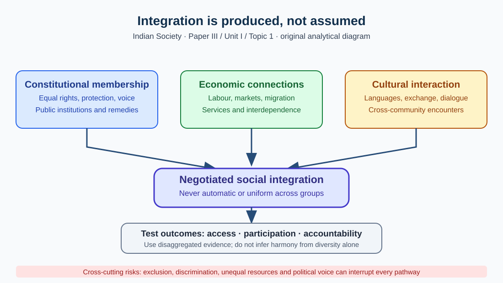
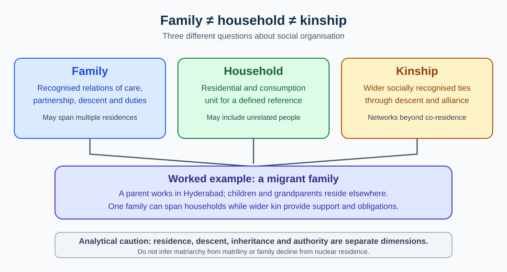

# TGPSC Group I — Paper III · Unit I · Topic 1

## Indian Society: an integrated editable student edition

**Editorial research draft · 27 October 2026. Original legacy 30-page PDF preserved. This is not an authenticated official PYQ collection or an independently approved textbook.**

**Scope:** The following syllabus map, revision, narrative explanations, diagrams, 25 original explained practice MCQs, six structured mains answers and source register form one student-facing edition. Earlier depth-repair text is placed inside its related concepts rather than appended as a disconnected supplement. Fact-level verification and independent academic review remain unfinished.

## Part A — Official syllabus map

**Paper III · Indian Society, Constitution and Governance · Unit I: Indian Society, Structure, Issues and Social Movements · Topic 1**

**Official wording (TGPSC Group-I Notification 02/2024, Annexure II):**

> Indian Society: Salient features, Unity in Diversity; Family, Marriage, Kinship, Caste, Tribe, Religion, Language; Rural – Urban continuum; Multi-culturalism.

## Detailed syllabus checklist

| Syllabus element | High-value subtopics in this chapter |
|---|---|
| Salient features | Structure/process, pluralism and hierarchy, historical layering, cross-cutting identities |
| Unity in diversity | Constitutional/normative, economic/structural, cultural integration; fault lines |
| Family | Family versus household; joint/nuclear; patriliny/matriliny; migration and care |
| Marriage | Endogamy and exogamy; choice and consent; civil marriage law; inequality |
| Kinship | Descent/affinity, lineage, regional variation, Irawati Karve |
| Caste | Varna versus jati; Ambedkar, Srinivas, Béteille; dominant caste and mobility |
| Tribe | Constitutional ST category, local histories and rights, forest governance |
| Religion | Diversity within religions, Article 25–30 rights, plural practice |
| Language | Linguistic families, Census C-16/C-17, mother-tongue education, Telangana |
| Rural–urban continuum | Urbanisation versus urbanism, migration, peri-urbanism |
| Multiculturalism | Recognition, protection, participation and internal inequalities |

**Interpretative standard:** Every bullet is elaborated in the detailed chapter. The official syllabus is the boundary; case studies and sociological thinkers are explanatory material, not extra official subtopics.

## Part B — Flexible quick revision

1. **Structure is not process:** caste is a patterned social position; mobility, migration and reform are processes.
2. **Difference is not inequality:** linguistic variation does not itself entail unequal rights; exclusion concerns barriers to participation.
3. **Unity is institutional:** citizenship, transport, markets, public services and cultural contact produce integration; exclusion can weaken it.
4. **Family differs from household:** kin obligations persist across dispersed residential units.
5. **Joint family has not simply vanished:** assess co-residence, earnings, care and property separately.
6. **Matriliny is not matriarchy:** descent through women is not universal female control.
7. **Marriage rules can coexist:** caste endogamy with specific lineage exogamy.
8. **Kinship varies regionally:** Irawati Karve is the most useful name for regional patterns; do not universalise North/South models.
9. **Jati is not equal to varna:** actual local social groups and hierarchical experiences are more complex than a fourfold framework.
10. **Ambedkar — graded inequality and endogamy; Srinivas — Sanskritisation and dominant caste; Béteille — caste/class/power.** Use each for the right claim.
11. **Tribe is not a static livelihood type:** differentiate identities, constitutional ST status and land/forest rights.
12. **Religion is internally plural:** separate religious practice, communal politics and constitutional rights.
13. **Multilingualism is a capability with unequal returns:** mother tongue, school medium and labour-market language may differ.
14. **Census C-16/C-17 = 2011 reference year:** do not call those numbers 2026 observations.
15. **Rural–urban continuum:** study commuting, remittances, peri-urban land transformation and continued kin ties.
16. **Urbanisation ≠ urbanism:** reclassification/population growth differs from patterns of social life.
17. **Multiculturalism ≠ simple co-presence:** substantive recognition and equitable participation are required.
18. **Telangana evidence:** Bathukamma/Bonalu/Medaram; Hyderabad's Telugu–Dakhni/Urdu–English ecology; Gond/Koya/Kolam; weavers and migrants.
19. **Current affairs:** Telangana SEEEPC survey launched November 2024; triangulate survey measures against Census and relevant administrative definitions.
20. **10-mark template:** define → three explained mechanisms with named case/evidence → critical limitation → conclusion (~200 words).

## Part C — Detailed textbook-style explanation

**Paper III · Unit I · Topic 1 | TGPSC Group-I Mains | Expanded research draft — not academically approved**

## 1. Understanding Indian society: a sociological rather than descriptive approach

Indian society is not simply a population living inside political boundaries. It is a web of **institutions, social relationships, unequal access to resources, shared meanings, political memberships and historical transformations**. A sociological answer must distinguish **social structure** (relatively patterned positions and relations) from **social processes** (change, mobility, conflict, accommodation and integration). For example, caste is a structure of inherited identity and historically unequal social ranking; endogamy, occupational change, constitutional regulation and collective political mobilisation are processes that reshape how caste operates. Similarly, the family is an institution, whereas migration, changing household composition and negotiations about care are processes.

India is internally differentiated by geography, language, region, occupation, religion, class, gender, caste and tribal affiliation. These distinctions intersect: the circumstances of a landless Dalit woman in a drought-prone village cannot be inferred from caste alone, and those of an affluent urban woman cannot be inferred from gender alone. This is **intersectionality**—a tool for investigating overlapping disadvantages, without presuming that every person within a category lives the same experience. Treating Indian society as uniform produces inaccurate policies and weak mains answers. Its analytical hallmark is the **coexistence of durable hierarchy, democratic citizenship and rapid economic-cultural change**.

The principal sources of sociological knowledge include the Census, National Family Health Survey, time-use and labour-force surveys, district-level ethnographies, village studies and historical legal records. Every source has limits: the Census reports classifications and counts for a specified reference year; an ethnography supplies social mechanisms from a particular setting; an administrative register records only the people and events within its rules. Never substitute a compelling local case for a national average, or treat a national average as a complete account of local power.

**High-value mains formulation:** Indian society is best understood through four simultaneous tensions—**continuity versus change; unity versus differentiation; hierarchy versus citizenship; and local identity versus national institutions**. Use these tensions throughout the chapter rather than memorising a list of characteristics.

## 2. Salient feature I: civilisational depth without cultural uniformity

South Asia contains long historical trajectories of agriculture, urban settlement, trade, devotional communities, courts, legal traditions, literary cultures and migration. Social institutions accumulate rather than replacing one another in a neat sequence. A contemporary pilgrimage route may connect older sacred places, regional market towns and modern railway or digital-payment systems. Agricultural festivals can retain older seasonal meanings while becoming organised through municipalities, mass media and urban associations. Historical layering explains **continuity**, but does not establish that a single unchanging 'Indian culture' existed across all regions or classes.

Colonial administration reshaped classification and governance through censuses, law, property rules, modern education and communications. Nationalist politics and constitutional democracy subsequently widened the language of equal citizenship, rights and representation. Post-independence land reforms, expansion of schooling, urbanisation, migration, mass media and digital networks changed the mechanisms through which families and communities reproduce themselves. Yet inherited social capital, residential segregation and local status inequalities have not vanished. Avoid the false opposition that a modern institution must be western and a community institution must be static.

For Telangana, the interactions among Deccan village institutions, craft and market networks, tribal communities, Hyderabad's Persianate and Urdu traditions, Telugu-language literary worlds, the Nizam-era state and post-2014 state institutions illustrate this layering. A strong answer names *specific historical interfaces*, not merely 'rich cultural heritage'.

**Historical method: distinguish continuity from a claim of timelessness.** NCERT's account of caste as an institution explicitly separates textual prescriptions, actual historical practice and colonial administrative classification. A rule appearing in an old text does not establish that every village obeyed it; a census label does not prove that the label had the same social meaning centuries earlier. For example, studying a present-day marriage practice requires attention to inheritance, local law, migration and family bargaining rather than assigning it unchanged to an imagined ancient origin. Similarly, linguistic and religious exchange occurred through specific networks of trade, pilgrimage, education and political rule, not through an automatic fusion of all traditions. The researcher should identify the period, region, social group and type of evidence before making a continuity claim.

**Nation-building is a different analytical question.** NCERT's chapter on cultural diversity distinguishes the political state from the many communities within a nation and warns that compulsory assimilation can alienate subordinated groups. The constitutional solution is not to freeze every custom: it is to permit cultural conservation while securing individual equality and democratic participation. Thus a Deccan example can illustrate historical interaction, but it cannot establish a single timeless regional identity. **Mains test:** name one institution that persisted, one mechanism that changed it, and one group whose experience complicates the generalisation. (Source correspondence: NCERT *Indian Society*, Chapters 3 and 6, IIT Kanpur SATHEE; see source register.)

## 3. Salient feature II: plurality and internal differentiation

Indian diversity includes linguistic families, religions and denominations, caste and jati groups, tribes and other communities, livelihood systems, ecological zones, food practices, household arrangements and gender norms. A person can simultaneously be Telugu-speaking, urban, religiously affiliated, a student, a worker, a member of a kin group and a citizen. These identities are **cross-cutting**, and their strength varies by context. During an election, caste networks may be important; during a flood, neighbourhood and occupational connections may dominate immediate cooperation. Cross-cutting ties can reduce some conflicts, but shared membership in one institution does not automatically eliminate discrimination in another.

Cultural diversity must also be distinguished from **social inequality**. Two regions may have different cuisines without unequal rights; two castes may occupy unequally valued positions within the same local economy. **Difference** describes variation; **hierarchy** describes ranked power; **exclusion** describes barriers to participation. These are related but analytically distinct, and confusing them leads to the shallow claim that every tradition merely enriches a plural society. Exam answers should ask who can inherit land, enter schools, marry freely, access work, or participate in local decision-making.

Telangana examples include Bathukamma, Bonalu and the Medaram Sammakka–Sarakka gathering, while Telugu, Urdu, Gondi, Kolami and Lambadi/Lambani linguistic and cultural practices illustrate layered identities. These examples should not be used to imply that all Telangana residents participate identically or that the same festival has identical meaning across localities. Distinguish **a cultural illustration from representative social data**.

**A two-axis diagnostic prevents celebratory answers.** First map *forms of difference*: language, religion, region, livelihood, household arrangement and community affiliation. Then independently map *distribution of power*: ownership, schooling, public-service access, political representation, safety and ability to challenge decisions. A culturally distinctive group can be economically advantaged or disadvantaged; neither follows automatically from its language or festival. NCERT's chapter on cultural diversity specifically separates diversity from inequality and explains how competition over jobs, public funds and other resources may turn a difference into a political grievance. A good answer therefore gives both the cultural marker and the institutional mechanism.

**Constitutional accommodation has precise boundaries.** Article 29(1) protects the right of a qualifying section of citizens to conserve a distinct language, script or culture. Article 30(1) concerns educational institutions of religious or linguistic minorities. These provisions are not a general exemption from equality guarantees, nor does every sociological minority automatically satisfy the same legal test. An empirical example should specify its population and date: the Census 2011 C-16 table describes *reported mother tongue* by sex and rural/urban residence, not present-day bilingual proficiency. For Telangana, the analytically useful question is whether a Gondi-speaking pupil can obtain comprehensible instruction and administrative assistance, not merely whether Gondi appears on a list. This is an illustrative policy question, not a measured outcome. (Sources: NCERT Chapter 6; Constitution Arts. 29–30; ORGI C-16 metadata.)

## 4. Unity in diversity: what creates integration?

**Unity in diversity** is not a statistical statement that groups agree on every issue. It is a political and sociological achievement produced through institutions and interaction in a differentiated society. Constitutional citizenship, regular elections, common legal protections, inter-state transport, labour migration, internal trade, mass education, democratic organisations and shared public institutions connect communities across difference. Indian films, sports, literature, religious travel and digital communication add cultural spaces of interaction, but their effects are uneven and may reinforce stereotypes as well as solidarity.

**Structural integration** arises when economies and institutions depend on each other: farmers supply urban food systems; workers move between states; public finances and infrastructure link regions. **Normative integration** arises when people recognise common rules and the legitimacy of citizenship despite disagreements. **Cultural exchange** arises through translation, language contact, artistic borrowing and everyday interaction. These three layers should be analysed separately. A multilingual school may foster interaction, yet still reproduce class stratification if admission depends on household income.

Major threats to integration include communal hostility, caste-based violence, linguistic exclusion, social-media misinformation, regional inequality and unequal recognition of marginalised groups. Remedies must address **rights and institutions**, not demand that every minority abandon its identity. Under constitutional democracy, unity should be anchored in equal dignity and participation, not compelled cultural sameness.

**Exam diagram:** Diverse communities → common constitutional membership + economic interdependence + cultural exchange → negotiated integration. At the same time, exclusion and resource competition can interrupt any link. This is a dynamic model, not an inevitable outcome.

### Applied depth: Unity in diversity as a political and institutional task

Diversity does not automatically generate either harmony or conflict. Cooperation is sustained through fair institutions, rights, negotiated practices and opportunities for cross-community interaction. Constitutional equality, protection against discrimination, linguistic accommodation and local democratic participation are important mechanisms. Telangana provides a useful example: a common regional identity helped coordinate statehood mobilisation, yet Dalit-Bahujan, Adivasi, women’s and minority organisations continued to raise distinct demands. Treating those demands as disloyalty would convert unity into enforced uniformity. Conversely, treating every difference as an irreconcilable division would miss shared interests in schooling, livelihoods and accountable administration. A mains answer should identify both bonding ties within groups and bridging ties across groups. Policy success can be tested through participation, representation and grievance outcomes, not only the number of cultural celebrations held.

## 5. Family: institution, household and variation

A **family** is a socially recognised network of relationships involving descent, marriage, partnership, care and obligations; a **household** is a residential and consumption unit. They overlap, but are not identical. Migrant workers may belong to one family while residing in multiple households, and unrelated workers can share a household. Confusing the two produces misleading statements about 'the decline of the joint family'. A joint family generally combines multiple related generations or branches in a recognised unit; a nuclear family centres parents and dependent children; extended kinship may remain influential even when residence is nuclear.

Family arrangements differ in descent (**patrilineal or matrilineal**), residence (**patrilocal, matrilocal, neolocal**), authority and property relations. Matriliny follows descent and certain inheritance rules through women; it must not be confused with matriarchy or universal female control over resources. Household type is affected by migration, employment, housing costs, inheritance, educational mobility, longevity and marital choices. Urbanisation often alters co-residence without dissolving obligations to parents, siblings and relatives. Digital remittances, telephone contact and seasonal return migration can sustain a 'distributed family'.

Families perform care, socialisation, intergenerational transfers and emotional support, but they may also reproduce gendered unpaid work, preference for sons, unequal inheritance or restrictions on marriage. NCERT's treatment of family explicitly asks readers to consider both solidarity and conflict, rather than romanticising household life. Analyse power within the family: whose labour is counted, who decides schooling, who controls earnings, whose older-age care is recognised? The answer is not the same across caste, class, region or gender.

**Telangana application:** Rural–Hyderabad labour and education migration produces households connected by remittances and obligations across places. In a 200-word mains answer, describe *the changed form of support*, not simply claim that the joint family has disappeared.

### Analytical extension: residence, care and bargaining

A family's obligations cannot be measured solely by the number of people sharing a roof. In a migrant household, grandparents may provide childcare in one district while working-age members send remittances from Hyderabad; the arrangement is residentially dispersed but economically and emotionally linked. This is why a census household classification, a kinship genealogy and a survey of unpaid care work answer different questions. For examination analysis, first specify the unit of observation and then explain the mechanism: migration changes residence; schooling and paid work alter bargaining power; inheritance and social expectations affect who bears care costs. These processes do not move uniformly. A family with secure earnings can purchase childcare, while a low-income household may depend on older relatives or an adolescent girl's unpaid work. Neither a nuclear household nor a joint household guarantees equality. Compare decision-making over education, marriage, mobility, care and property, rather than assuming household size determines social outcomes. The policy implication is equally specific: portable social protection, affordable childcare, eldercare and accessible dispute resolution respond to real care networks better than policies built around one idealised family form.

### Applied depth: Kinship, marriage and changing household forms

Kinship describes socially recognised relationships of descent, marriage and care. Marriage patterns in India vary by region, religion, caste, tribe and family history. Terms such as patriliny, matriliny, patrilocality and neolocal residence refer to different dimensions and should not be collapsed into one model. In urban Hyderabad, migration and women’s employment can change residence and caregiving arrangements without erasing obligations to extended kin. Conversely, a joint household does not automatically imply equal authority among women, younger adults and elders. A useful case is the inter-caste couple seeking registration and protection: the administrative question is not whether their choice matches local custom, but whether they meet the applicable legal requirements and can exercise personal liberty without intimidation. Sociological description and legal entitlement must be kept separate. Changes in household form are best studied using Census, survey and field evidence, with caution about differences in definitions.

## 6. Marriage: norms, choice and legal institutions

Marriage is an institution organising socially recognised intimate relationships, kinship, obligations and often reproduction and inheritance. **Endogamy** prescribes marriage within an identifiable group; **exogamy** prescribes marriage outside a specified group. They may coexist: caste endogamy and lineage/gotra exogamy can operate simultaneously. Marriage rules should not be described as universal national norms; practices vary by community, region, law and generation. Sociological analysis distinguishes **prescriptive norms**, **reported behaviour**, **legal rights** and **individual preferences**.

In many Indian settings, marriages have historically been shaped by family negotiation, inheritance, status and alliance-building. Inter-caste and inter-religious unions may challenge established boundaries but can face social pressure or violence. Legal frameworks provide important rights and protections, yet law does not guarantee socially equal ability to exercise choice. Child marriage, dowry demands, domestic violence and access to matrimonial property must be treated as separate social/legal questions with distinct institutional responses. The Special Marriage Act, 1954 provides a civil marriage route irrespective of religious ceremony; it does not make all marriages socially conflict-free.

Demographic and economic factors shape marriage patterns: increased educational duration can alter average marriage age; women's earnings can affect bargaining power; migration enlarges social networks while technology creates new forms of family-mediated matchmaking. The sociological issue is whether **consent, agency, equality and security** improve, not whether a marriage was labelled 'arranged' or 'love'. Use precise language and avoid presenting any community as monolithic.

### Analytical extension: marriage as a negotiation among norms, rights and resources

Marriage has simultaneously social, economic and legal dimensions. Kin groups may regard marriage as a relationship between families; prospective spouses may emphasise companionship and individual choice; law addresses consent, age, registration, maintenance and protection from coercion. These dimensions sometimes reinforce and sometimes contradict one another. Endogamy reproduces group boundaries by restricting the pool of acceptable spouses, while rules of exogamy prohibit unions within specified lineages or kin categories. Neither rule should be generalised across every region or community. An analytical answer should ask who controls choice, which resources are exchanged or inherited, how sanctions operate, and whether a person can seek effective protection when family norms conflict with legal rights. Urbanisation and digital communication can widen opportunities for meeting partners, but may also extend family surveillance across distance. Rising educational attainment alone does not prove freedom of choice. The appropriate policy test is not whether a marriage appears 'traditional' or 'modern'; it is whether consent is meaningful, parties enjoy equal legal protection, and public institutions respond to violence or discrimination without stereotyping communities.

## 7. Kinship: descent, alliance and Irawati Karve's regional insight

**Kinship** is the recognised social system connecting relatives by descent, marriage and sometimes adoption or socially constructed relationships. It affects care, rituals, inheritance, occupation, marriage alliances and migration networks. **Consanguineal** kin are related through descent; **affinal** kin through marriage. These terms describe social categories, not fixed levels of emotional closeness. Kinship networks can mobilise help during illness or job-seeking, but can also reproduce nepotism and pressure to conform.

Irawati Karve's *Kinship Organization in India* is a key starting point for examining regional differences, particularly among northern and southern kinship arrangements. In some South Indian communities, certain cross-cousin marriages have been acceptable or preferred; in other communities they are not. Some northern marriage systems historically emphasised village or lineage exogamy and marriages beyond the natal network. **Exam caution:** regional patterns are tendencies within a diverse social field, never a rule applying to everyone in 'North India' or 'South India'. The marriage of a mother's brother's child differs analytically from marriage within the same patrilineage; students should distinguish genealogical positions before making claims.

Kinship structures change with inter-regional migration, property legislation, urban housing, reproductive technologies and individual choice. A mature mains response can explain that **kinship is both a resource for social security and an arena of unequal obligations**. Telangana's intersection of South Indian regional practices, Deccan multilingual networks and metropolitan migration makes it unsuitable for a single simplified kinship template.

### Analytical extension: kinship terminology and institutional effects

Kinship is not a list of relatives; it is a system that organises descent, alliance, care, property and social expectations. Distinguish consanguineal relationships, commonly described as relations by birth, from affinal relationships created through marriage, while recognising that adoption and local classifications complicate any rigid binary. Descent rules determine how people trace membership, but do not automatically determine where couples live or who exercises authority. Patrilineal descent can coexist with neolocal residence; matrilineal descent does not necessarily imply matriarchal political power. Kinship terminology may also group relatives differently across linguistic and regional contexts, shaping marriage preferences and obligations. A field-based comparison would examine genealogies, household residence, property transfers and actual decisions, rather than inferring practice from one kinship term. In Telangana, mobility between villages, district towns and Hyderabad can separate daily residence from ceremonial, financial and caregiving ties. Such networks may provide security in illness or unemployment, but can also reproduce gendered care burdens and pressure over marriage choices. The analytical distinction is therefore between the social resource of kin support and the unequal power that may accompany it.

## 8. Caste: jati, varna and graded inequality

A **jati** is a historically embedded, locally reproduced social group associated with rules of membership and marriage, social ranking and, in many settings, occupations. **Varna** is a broad ideological schema; it does not map neatly onto the many jatis that exist in actual local social relations. The distinction matters: memorising four varnas cannot explain particular landholding and labour arrangements in Telangana villages. Caste reproduces itself through endogamy, family socialisation, networks, social stigma, marriage constraints, residential patterns and control over resources. The relationship between caste and occupation has changed significantly, but inherited caste identity may remain influential in new occupations.

B.R. Ambedkar analysed caste as a system of **graded inequality** and criticised endogamy and social separation; a strong answer explains why reform requires changes to both attitudes and structural opportunities. M.N. Srinivas described processes such as **Sanskritisation**, **Westernisation** and the **dominant caste**. Sanskritisation concerns particular efforts to claim higher local status through adopting practices associated with higher-status groups; it is not the same as ending caste hierarchy. A dominant caste often combines numerical presence, land or economic resources and local political influence—ritual ranking alone is insufficient. André Béteille's *Caste, Class and Power* helps distinguish ritual status, economic class and political authority without assuming these three dimensions always overlap.

Democratic politics, education, migration, land changes and legal protections alter caste's public operation. Yet social mobility by some members does not eliminate discrimination experienced by others. The Constitution abolishes untouchability under Article 17 and prohibits specified discrimination under Article 15; legal equality, however, must be evaluated alongside access to justice and the lived distribution of resources.

**Telangana lens:** Analyse caste through agrarian land relations, artisan traditions, urban labour markets, education and local political mobilisation. Use the SEEEPC household survey as a current **data-governance example**, not as a substitute for sociological explanation. Resist fixed claims about percentages without confirming survey universe, definitions and final published tables.

### Applied depth: Caste and class are analytically different

Caste usually refers to historically reproduced social status, endogamy and inherited boundaries, while class describes relations to income, occupation, property and economic opportunity. The two interact but cannot be used interchangeably. An affluent member of a historically marginalised caste may face discrimination, while a poor member of a dominant caste may experience economic deprivation without the same inherited stigma. In Telangana, access to land, educational institutions and public employment illustrates the interaction: unequal asset ownership can reinforce social networks that shape recruitment and marriage. A rigorous study should distinguish caste identity, caste hierarchy, class position and the legal status of Scheduled Castes or Backward Classes. Administrative categories are defined by notified lists and law, not by a sociologist’s intuition. A policy targeting only household income may miss discrimination; a policy using caste alone may miss deprivation within groups. Sound governance therefore uses complementary evidence and safeguards individual dignity.

## 9. Tribe: identity, territory, rights and changing livelihoods

The word **tribe** is a governmental and sociological category with contested meanings. India's constitutional-administrative term **Scheduled Tribes** designates communities listed according to applicable provisions and schedules, while lived social identities, languages and economies are diverse. A notified status is not a claim that every person has the same livelihood or that a community is outside history. Communities have long interacted with states, markets, forest systems, agriculture, migration and wage employment. A careful answer distinguishes a community's self-identification, a scholar's analytical description and the State's legal notification; these are related but not interchangeable.

**Why forest access is a social institution, not merely an environmental issue.** A household's access to cultivation, grazing, seasonal collection, water and forest products can shape food security, debt, marriage expenditure and the ability to keep children in school. When access rules change, the effect travels through several institutions: income may fall, seasonal migration may rise, women may spend longer collecting fuel or water, and local political bargaining may shift. The direction of change is not predetermined; a market connection may raise income for some producers while increasing vulnerability for others. To study it, compare land records, customary use, legal recognition, household accounts and locally documented experience rather than assuming every forest-dependent family has the same interests.

**Three legal layers must be kept separate.** Article 244(1) and the Fifth Schedule provide a constitutional governance framework for Scheduled Areas in the relevant states. The **Provisions of the Panchayats (Extension to the Scheduled Areas) Act, 1996 (PESA)** extends Part IX's panchayat framework to Scheduled Areas with specified modifications; it does not automatically apply to every village where Scheduled Tribe residents live. Under section 4, the Gram Sabha's role includes safeguarding community traditions and resources and approving specified local development plans; section 4(i) provides for consultation with the Gram Sabha or the Panchayat at the appropriate level before land acquisition and resettlement in Scheduled Areas. **Consultation is not the same statutory word as an unconditional veto.** An examiner may test that distinction. The **Forest Rights Act, 2006 (FRA)** instead addresses recognition and vesting of specified individual and community forest rights. Its section 3 includes multiple kinds of rights; it is incorrect to reduce the Act to individual cultivation titles. Section 4(5) protects relevant occupants from eviction or removal before recognition and verification procedures are complete, subject to the Act. A right claimed, a right verified and a title issued are three different administrative stages. [PESA: India Code, Act 40 of 1996, §§2–4; FRA: Ministry of Tribal Affairs, Act/Rules guidance and §§3–4; source-access limitations in the register.]

**Worked administrative example.** Suppose a proposed road crosses a Scheduled Area settlement and a family also claims traditional forest use. An officer should first verify the notified Scheduled Area boundary and applicable state rules; then distinguish PESA consultation concerning the project from the FRA process for recognition of forest rights. Meeting minutes alone do not prove that rights claims were adjudicated. Equally, a pending claim does not establish the final extent of a recognised right. A sound process records the affected habitation, women and other participants, accessible language, claim documents, reasons for decisions and available review mechanisms. This example illustrates the *sequence of questions*, not a claim that any particular Telangana project complied with them.

**Telangana application and limits.** Gond, Kolam, Koya, Lambada and other communities have distinct histories and geographic distributions; their names and legal statuses must not be substituted for one another. Forest governance, mining, reservoir projects and language policy can reshape livelihoods and identity. The slogan associated with Komaram Bheem, **Jal, Jangal, Zameen**, helps frame resource and autonomy demands, but exact historical speech quotations require separate archival evidence. A rigorous mains answer compares self-governance, rights recognition and service access without portraying tribal communities as either timelessly isolated or automatically protected because a statute exists.

### Applied depth: Tribe, indigeneity and Scheduled Area governance

Tribal communities are not interchangeable cultural units. In Telangana, Gond, Koya, Lambada and Chenchu histories, languages and livelihoods differ; legal Scheduled Tribe status and Scheduled Area governance must be read from authoritative schedules. Forest dependence, seasonal migration, land alienation and schooling access can intersect but vary sharply by district and household. Article 244 and the Fifth Schedule establish a constitutional framework for Scheduled Areas; the Panchayats (Extension to Scheduled Areas) Act, 1996, and the Forest Rights Act, 2006, address different aspects of local participation and rights. These laws do not prove that every claim is already recognised or implemented. An officer examining a proposed land transfer should verify the specific Scheduled Area status, applicable Telangana regulations, the consent process and documentary rights. Cultural respect means allowing community institutions and knowledge to shape decisions rather than treating Adivasi traditions as decorative folklore.

## 10. Caste and tribe: comparison without stereotypes

Caste typically directs attention to hereditary membership, endogamy and hierarchically ordered relationships within regional societies. The term tribe, in Indian sociology, often directs attention to histories of community identification, territory, language, livelihood and political relations with states. These are **questions to investigate**, not definitions that classify every household without exception. Tribal societies may have internal economic and gender inequalities; caste groups may have strong territorial identities and complex community institutions. Scheduled Caste and Scheduled Tribe designations are legal-administrative classifications with distinct notification procedures and protections; neither can be inferred simply from occupation, poverty or appearance.

**Compare the mechanisms, not stereotypes.** First, examine membership and marriage: how are group boundaries maintained, and how do people negotiate them? Second, examine property: who controls cultivable land, forest use, housing or productive assets? Third, examine labour: are employment opportunities shaped by inherited networks, displacement, skills or market location? Fourth, examine political representation: which bodies decide on resources, and who can speak in them? Fifth, examine legal entitlements: which specific constitutional, statutory or state provisions apply to the *place and person* in question? This five-part comparison reveals overlapping constraints without collapsing caste discrimination into economic poverty or tribal forest claims into cultural folklore.

**Two short case analyses.** A Dalit student may have access to a college seat but face discriminatory treatment in accommodation or social networks. The analytical problem involves unequal status and institutional enforcement, not merely family income. A forest-dependent Adivasi household may face uncertainty about a community forest resource even when an individual cultivation claim is processed. The analytical problem involves tenure, collective governance and administrative recognition, not simply educational backwardness. In both cases, compare the evidence actually available before attributing a cause: a survey can identify disparity, while interviews, administrative files and field observation can help test mechanisms.

**What the law does—and does not—tell us.** The Constitution's abolition of untouchability addresses a form of exclusion historically tied to caste. Fifth Schedule/PESA arrangements concern specified Scheduled Areas and local governance, while FRA addresses qualifying forest rights of eligible forest dwellers. These protections operate through different eligibility conditions and institutions. A PESA Gram Sabha provision cannot be cited as proof that a forest title has been granted; a forest-rights claim cannot be used as evidence that a community has a particular caste ranking. Nor should a Scheduled Tribe notification be mistaken for a sociological conclusion that all notified groups have identical cultural practices. These distinctions are essential for legally accurate mains answers.

**Answer-writing application.** Define the categories; compare boundaries, resources and power; introduce one contrasting Telangana example; then assess both constitutional guarantees and implementation barriers. A balanced conclusion should recommend verifiable land/forest records, accessible grievance channels, non-discriminatory services and meaningful local participation. Avoid asserting that a particular community is legally recognised, or that a specific village falls within a Scheduled Area, without consulting the applicable notification.

## 11. Religion: plurality, institutions and public life

India's religious field includes Hindu traditions, Islam, Christianity, Sikhism, Buddhism, Jainism, tribal/indigenous practices and varied philosophical and devotional communities. **Religion is not simply individual belief:** it may shape household ritual, institutions, festivals, charity, education, identity and political mobilisation. Religious communities are also internally differentiated by language, gender, class, theological practice and local history. Treating one clerical or political organisation as the voice of all members of a religion is sociologically invalid.

Religious pluralism may produce shared spaces and interaction, but cooperation must not be idealised as uninterrupted harmony. Conflict can arise around economic competition, political representation, historical memory and public symbolism. Sociologically sound analysis distinguishes **religiosity, communalism, secularism and constitutional freedom**. Religion as practice is not identical to political mobilisation that casts communities as mutually hostile. India's constitutional arrangements protect freedom of conscience and religion under Articles 25–28 subject to constitutional limits, alongside cultural and educational rights under Articles 29–30. These provisions must be applied precisely rather than reduced to 'religion is respected'.

In Telangana, the cultural histories of Yadadri, Bhadradri, Hyderabad's mosques and dargahs, the Medaram gathering and diverse Christian institutions provide examples of different religious geographies. Their coexistence illustrates plurality; it does not prove equal wealth, influence or freedom in every setting. Examine institutions, access and historical context.

**Mechanism: equal religious liberty versus competing uses of public space.** Consider a proposed procession route passing a hospital, residential streets and places of worship. An administrator cannot assume that religious freedom creates an unrestricted entitlement to a particular route, nor can officials deny permission solely because the organisers belong to a minority community. The decision requires an evidence-based public-order and safety assessment, lawful and consistently applied conditions, emergency access, a hearing or consultation where appropriate, and an avenue to challenge arbitrary treatment. Article 25(1) protects freedom of conscience and profession, practice and propagation, expressly subject to public order, morality, health and other Part III rights. Article 26 concerns denominational affairs within constitutional qualifications; Article 27 concerns taxation for promotion of a particular religion; Article 28 concerns religious instruction in specified educational settings. These are **different legal questions**, not one generic 'secularism article'.

**Limits and counterpoint.** Religious institutions may provide welfare, education and mutual aid, but they can also reflect internal class, caste and gender hierarchies. The state must protect individual freedom, including disagreement within a community, rather than equate the loudest organisation with every member's choice. A useful Telangana comparison is to examine how permissions, access and safety are administered at a local festival or procession without inferring from one event that an entire city is harmonious or hostile. **Evidence:** Government of India, Constitution, Arts. 25–30 (11 November 2025 Legislative Department text). No assertion about a specific unverified incident is made.

### Applied depth: Religious pluralism and secular governance

Indian religious diversity is more than a list of major faiths. Within each community there are sects, reform traditions, regional practices and disagreements about gender, authority and social hierarchy. Hyderabad’s historical interactions among Urdu, Telugu, Persianate and Deccani traditions illustrate layered coexistence, but the existence of shared cultural forms does not mean communal tension never occurs. Constitutional secularism concerns equal citizenship, freedom of conscience and limits on state preference; it should not be confused with the disappearance of religion from public life. When an administrator plans a procession route, the relevant duties include lawful permissions, nondiscriminatory treatment, public safety and dialogue with all affected residents. Evidence of one local dispute cannot justify generalisation about an entire religious group. A strong mains answer distinguishes social pluralism as an empirical fact from constitutional secularism as a normative and legal commitment.

## 12. Language: multilingualism, identity and unequal access

India's languages belong to several linguistic families, including Indo-Aryan, Dravidian, Austroasiatic and Tibeto-Burman groups. **Language is a social resource**: it helps form identity, transmits knowledge, structures schooling, mediates administrative access and affects employment. The Census of India 2011 C-16 tables report population by mother tongue, while C-17 addresses bilingualism and trilingualism. These are time-specific statistical classifications; a respondent's reported mother tongue does not capture every variety of language use, proficiency or shifting linguistic practice.

The Eighth Schedule presently lists 22 languages; it should not be confused with an exclusive list of all Indian languages, nor with a rule that every local language is educationally supported. Multilingualism can enable flexible interaction, yet languages also carry unequal market value. A Telugu-speaking child learning in a school with a different medium may face language barriers even when fluent in a home dialect. Bilingual education and access to appropriately trained teachers can affect inclusion, especially where students speak Gondi, Kolami or other languages in Telangana.

Telangana's linguistic experience is not only Telugu versus Urdu. Dakhni in Hyderabad, English in higher education and IT employment, languages of migration and the speech of Adivasi communities form a layered social ecology. Telugu and Urdu literary trajectories were influenced by distinct courtly, popular and modern institutions; describe the context rather than claiming that every resident speaks both. A strong mains answer connects language identity to **education quality, public services and equal dignity**.

**The administrative pathway from linguistic recognition to usable services.** Article 29(1) protects conservation of a distinct language, script or culture for any qualifying section of citizens; it is not restricted to the 22 Eighth Schedule languages. Article 350 allows grievance representations in languages used in the Union or State, as applicable. Article 350A asks States and local authorities to *endeavour* to provide adequate primary-stage mother-tongue instruction facilities for linguistic-minority children; the constitutional wording should not be misreported as proof that every classroom already has such provision. Article 350B provides for a Special Officer for linguistic minorities. These clauses perform different functions—cultural protection, administrative access, educational facilities and monitoring—so a good answer specifies which barrier each addresses.

**Worked example and measurement.** Suppose children in a tribal-language-speaking hamlet enrol in a nearby school taught primarily in another language. High enrolment can coexist with weak comprehension, absence, grade repetition and eventual dropout. A policy response might combine trained bilingual teachers, locally reviewed learning materials, parent consultation and regular assessment in an understood language, rather than mechanically translating one textbook. To evaluate success, compare attendance, early-grade learning, teacher availability and grievance outcomes, disaggregated by location and language. A Census 2011 C-16 mother-tongue distribution supplies a historical demographic baseline, **not** a current count of fluency, school-medium preference or educational achievement. Treat language as both an identity and an enabling condition for equal citizenship. **Evidence:** Constitution Arts. 29(1), 350, 350A, 350B; ORGI C-16 catalogue PC11_C16-00 (2011 reference year).

## 13. Rural–urban continuum: beyond the village–city binary

The rural–urban continuum treats settlements and livelihoods as interconnected gradations rather than sealed worlds. Rural regions can host commuting professionals, digital platforms, wage labour, industries and high-value commercial agriculture; cities can contain caste networks, ritual associations, peri-urban farming and village-origin social ties. A classification of a settlement as rural or urban tells us something about administration or population characteristics, not everything about residents' daily work.

A useful distinction is **urbanisation** (changes in settlement classification and population concentration) versus **urbanism** (patterns of social relations, anonymity, occupational specialization, institutional diversity and social interaction). This framing is inspired by the sociological literature associated with Louis Wirth, but must be applied critically to Indian cities where kinship, locality and caste associations remain influential. Robert Redfield's folk–urban ideas are historically relevant models; they should not be treated as an uncontested evolutionary ladder.

Rural–urban links include circular migration, remittances, food and water supply, commuting, wholesale markets, health referrals, education and political networks. Telangana's villages connected to Hyderabad through construction employment, education, transport corridors and services illustrate a **functional region** larger than a municipal boundary. Peri-urbanisation converts agricultural land, fragments tank catchments and changes property relations; these consequences are not automatically positive or negative. Where farmland gives way to factories or layouts, assess compensation, worker skills, commuting cost and ecological loss separately.

For a professional answer, compare access to public services by travel time and social exclusion, not by the misleading claim that every village is traditional and every city is progressive.

### Analytical extension: how to observe the continuum empirically

The rural–urban continuum becomes analytically useful when treated as a set of measurable connections, not a claim that every village is becoming a city. A district settlement may be administratively rural while its residents commute to industrial employment, depend on urban hospitals, sell produce through metropolitan wholesale markets and maintain digital financial relationships. Conversely, an urban household may rely on rural land, remittances or kin-based care. Researchers should distinguish the administrative classification of a settlement from its occupational structure, commuting catchment, built environment and access to services. These indicators may change at different speeds. Peri-urban conversion can raise land values for some owners while displacing tenants, agricultural workers and common-resource users. New roads may improve access yet increase flood exposure when tanks and drainage channels are encroached upon. For Telangana, the Hyderabad metropolitan region is a useful illustration, but claims about current urban population shares require a dated census or survey definition. A mains answer should explain the causal chain—land-use change, mobility, labour transition, service demand, governance fragmentation—and propose coordinated planning across municipal and rural jurisdictions, rather than treating a boundary notification as evidence of completed urban development.

### Applied depth: Language, migration and the rural–urban continuum

A rural–urban continuum means settlements are connected through labour, transport, education, remittances, media and markets; it does not deny differences in density or municipal jurisdiction. Hyderabad attracts migrants from Telangana districts and other states, while families may maintain village land, ritual obligations and political ties. Language use in a household can differ from the language of school, employment and administration. Telangana Telugu itself has district variation, and Urdu and tribal languages remain important in the region. Classifying people as either permanently rural or urban can hide circular migration and split households. For public policy, residence-based eligibility rules should be assessed against the needs of mobile workers, especially for schooling and health access. Researchers should distinguish birthplace, usual residence, place of work and mother tongue before interpreting migration statistics. The continuum is therefore a method for studying connections, not a slogan that all settlements are alike.

## 14. Multiculturalism: accommodation versus simple coexistence

**Multiculturalism** is more than noticing that different communities live in the same state. It concerns the **recognition, protection and fair participation of diverse cultural groups** within a common constitutional order. Mere coexistence can persist alongside educational exclusion, language barriers and unequal political voice. At one extreme, coerced assimilation demands that minorities abandon their distinct practices; at another, rigid separation can inhibit common public institutions. Constitutional democratic practice seeks forms of accommodation consistent with individual rights, legal equality and collective cultural expression.

Practical institutional questions include mother-tongue education, minority educational autonomy, cultural preservation, fair representation in services and protection against discrimination. But multicultural recognition can also face internal group inequalities: a policy that acknowledges a community must still consider the rights of women, children and dissenting members within it. The examiner will reward the distinction between **community recognition and uncritical endorsement of every custom**.

The Indian Constitution's cultural and educational rights and the structure of state language policy give legal form to accommodation, while democratic contestation determines implementation. In Telangana, festivals, vernacular literary associations and tribal-language education offer useful case contexts. The policy challenge is to foster dialogue and shared institutions without turning majority culture into the compulsory norm.

**Worked governance trade-off.** Imagine a district designing a multilingual public-service centre. A single-language counter may be administratively cheap but effectively exclude residents who cannot understand forms or grievance procedures. Providing translated forms, trained interpreters and accessible digital interfaces can improve substantive participation. Yet a translation programme must specify who verifies accuracy, how legal terminology is kept consistent, and how a citizen can appeal a mistaken translation. Counting translated pages alone is not an inclusion outcome; successful applications, timely grievance resolution and equitable satisfaction across language groups are more informative.

**Constitutional design and internal rights.** Article 29(1) protects conservation of distinct language, script and culture for qualifying sections of citizens; Article 30(1) concerns educational institutions of religious or linguistic minorities. These rights are not interchangeable, and recognition of a group cannot justify discrimination against individuals within it. Article 15(2) independently addresses specified public-access discrimination. A culturally responsive school or office must also be safe for women, children, persons with disabilities and dissenting members. The policy question is therefore not 'uniformity or diversity' but how **equal individual dignity, fair institutional access and legitimate cultural autonomy** are reconciled under law. Telangana examples should be used as locally testable illustrations, not as evidence that every community has identical representation. **Evidence:** Constitution Arts. 15(2), 29(1), 30(1); see dated source register for directly read clauses.

## 15. Key sociological thinkers: what to use in an answer

**B. R. Ambedkar:** caste is a system of graded inequality; his critiques of endogamy, exclusion and the limits of social reform provide a route from description to structural analysis. Use him when discussing caste and citizenship, not as a generic quotation placed at the end.

**M. N. Srinivas:** Sanskritisation, Westernisation and the dominant caste are concepts explaining how local status and political-economic power interact. Distinguish status aspiration from equality. His village-based fieldwork supports a warning against extrapolating one locality to India as a whole.

**G. S. Ghurye:** a major figure in Indian sociological scholarship on caste, tribe and civilisation; his characterisations of tribes and integration must be presented as historically influential and contested, not as current settled policy.

**Irawati Karve:** regional variation in kinship and marriage; useful for North–South comparisons with explicit exceptions.

**André Béteille:** caste, class and power are analytically distinguishable dimensions that may intersect without always coinciding. Strong for agrarian power and mobility answers.

**S. C. Dube:** village studies and the complexity of rural social life; an antidote to treating every village as a self-sufficient homogeneous community.

**Yogendra Singh:** the 'modernisation of Indian tradition' framework highlights selective transformation rather than a simple vanishing of older institutions.

**Louis Wirth / Robert Redfield:** urbanism and rural–urban conceptual models; useful analytical lenses but not complete accounts of Indian villages or megacities.

**How to select a thinker rather than decorate an answer with names.** Start with the causal question. For a village where a numerically significant landholding community also controls cooperative institutions, Srinivas's *dominant caste* helps investigate how numbers, property and political networks combine; it does not establish dominance without local evidence. Where ritual standing differs from income and office-holding, Béteille's separation of caste, class and power supplies a competing diagnostic. For a marriage or residence pattern, Karve's regional kinship approach asks which descent, alliance and residence rules actually apply, while avoiding an absolute North-versus-South stereotype. When evaluating whether an upward status claim changes hierarchy, distinguish Srinivas's *Sanskritisation* from Ambedkar's normative critique of caste inequality.

**Methodological safeguards.** NCERT Chapter 3 explicitly attributes Sanskritisation and dominant caste to Srinivas and cautions that caste changed under colonialism and after Independence. That establishes a bounded textbook correspondence, not a direct examination of every named scholar's original monograph. Ambedkar, Ghurye, Karve, Béteille, Dube and Yogendra Singh require work-level page checks before attributing quotations or precise historical propositions to them. In mains writing, present a concept, its observable indicators, a concrete counterexample and its limitation. Avoid falsely attributing the rural–urban continuum to a single author as if it were an exclusive invention. **Quick comparison:** status aspiration (Srinivas), structural inequality (Ambedkar), intersecting resources (Béteille), and kinship variation (Karve) answer different questions. (Source correspondence: NCERT Chapter 3; direct original-work audit pending.)

## 16. Case study: Telangana as a connected social field

Consider a student from an Adivasi area who relocates to Hyderabad for higher education. Her journey links tribal-language access in primary schooling, household income, transport, gendered permission to travel, admission processes, residence and urban labour opportunities. **No single label—tribe, gender or rural residence—adequately explains the experience**. An inclusive policy must connect all these mechanisms. This is why structural inequality analysis belongs alongside any discussion of 'unity in diversity'.

Consider a weaver household tied to regional artisan networks but selling through metropolitan intermediaries and online markets. Occupational identity, caste background, skill transmission, credit, migration and market access jointly influence earnings. The household may live in a small town, have relatives working abroad and participate in both rural festivals and urban digital commerce. Calling it 'traditional' would obscure its market integration.

Finally, Hyderabad's old city, Secunderabad, IT corridors and peri-urban belts reveal varied settlement histories. Telugu, Dakhni/Urdu, English and migrant languages may all occur in economic and cultural interaction. **Plurality does not erase unequal access to housing, schooling and employment**; urban planning and public institutions must be evaluated with disaggregated evidence.

**Worked district-level research design (hypothetical, not survey findings).** Suppose a student must compare access to higher education for adolescents from an interior Scheduled Area, a peri-urban settlement and a Hyderabad neighbourhood. Define the outcome first: enrolment, attendance, completion and transition to paid work are different measures. Collect distance and travel time, language of instruction, household care responsibilities, scholarship eligibility, accommodation costs and reported discrimination. Disaggregate by gender and relevant community category, but avoid treating one student's experience as a group average. A household survey may record enrolment and assets while missing the lived reasons for discontinuation; interviews can explain mechanisms but cannot estimate population prevalence without a defensible sampling design.

**Triangulate before prescribing.** Compare administrative enrolment records with appropriately dated population denominators and qualitative interviews. The Telangana Centre for Good Governance describes the SEEEPC exercise as a household-level survey launched in November 2024, with the Planning Department as nodal agency; that establishes the project's existence and broad scope, not the validity of any unexamined district percentage. The Census 2011 C-16 language table uses a different reference year and question universe. A multilingual admissions desk, safe transport and accessible hostels are testable policy options, not proven results. **Mains application:** identify the link between social structure and access, explain the mechanism, propose an indicator, and acknowledge one data limitation. (Sources: CGG SEEEPC project description; ORGI C-16 metadata; NCERT Chapters 3 and 6.)

## 17. Current relevance: Telangana's SEEEPC household survey

The **Telangana Government's Socio-Economic, Education, Employment, Political and Caste (SEEEPC) household survey was launched in November 2024**, according to the state's Centre for Good Governance. It illustrates the use of a multidimensional household instrument to examine education, employment, family characteristics and social identity rather than relying on caste alone. The Planning Department was the nodal agency. The key sociological point is that social stratification is observable through **interacting indicators**: caste identity, educational attainment, occupation, housing, regional location, gender and household assets.

**Exam caution:** a new survey is not automatically equivalent to Census 2011. The universes, questionnaires, response rates, definitions, verification processes and release dates may differ. It would be inappropriate to insert an unverified percentage into a mains answer or treat an administrative exercise as conclusive proof of any policy outcome. Responsible use requires explaining what was measured, when it was measured, and what decisions the findings could inform. This is a verified *survey-existence and methodology* current-affairs connection, not a claim that every reported figure has been independently validated.

### Applied depth: Data ethics in caste and socio-economic surveys

Socio-economic and caste-linked surveys may help governments identify exclusion, but collection creates responsibilities of purpose limitation, accurate classification, security and fair use. Telangana’s 2024 socio-economic, educational, employment, political and caste survey is a contemporary case for discussing these trade-offs; administrative reporting should be checked against the relevant government release before quoting household totals. Survey responses can reflect self-identification, enumerator interpretation and non-response, so categories and denominators matter. A percentage of respondents cannot automatically be treated as a percentage of the entire population without a documented sampling or coverage method. Public dashboards should avoid exposing identifiable household information, particularly when data include caste, disability or income. Policy evaluation must separate descriptive disparities from causal explanations and should offer correction and appeal channels. This illustrates how social science concepts become concrete duties for officials.

## 18. How to construct a high-scoring Paper III Topic 1 mains response

A ten-mark answer of approximately 200 words should not attempt to reproduce all sixteen subtopics. First identify the command word: **explain** asks for mechanisms; **discuss** needs multiple dimensions; **critically examine** requires merits and limits; **compare** demands explicitly parallel criteria. Use a compact conceptual introduction (two sentences); three or four analytical subheadings or tightly integrated paragraphs; at least two precise examples; and a reasoned conclusion. More points are not necessarily better if each is only a label. The goal is **claim → evidence or institution → mechanism → implication**.

Example: 'India has unity in diversity' is a slogan. 'Constitutional citizenship (normative integration), inter-state labour movement (economic integration), and multilingual educational and media spaces (cultural interaction) connect differentiated communities; however, caste and linguistic exclusions show that integration depends on equal opportunity' is an argument. Likewise, 'family is changing' is empty without explaining the distinction between residence and obligation, the role of migration, and variation by class and gender.

**Quality checklist before submitting an answer:** Has each paragraph addressed the question? Are social difference and unequal power kept distinct? Are named thinker concepts used correctly? Is a Telangana example meaningful rather than decorative? Have legal provisions or data years been represented accurately? Is the conclusion conditional and evidence-led? These checks matter more than filling the answer with generic headings.

### Applied depth: Answer-writing integration: social structure and change

An effective Paper III response begins by defining the institution under discussion—caste, kinship, religion, tribe, language or household—and identifying the level of analysis. It then explains the mechanism: socialisation, endogamy, migration, law, economic inequality or political organisation. A Telangana illustration should be specific and relevant, such as multilingual Hyderabad, tribal land governance, migrant households or caste-linked access to opportunities. Add a counterpoint: cultural diversity may coexist with unequal power, and legal guarantees may not ensure implementation. Finish with a feasible governance response, such as nondiscriminatory service delivery, community consultation, reliable data or accessible grievance procedures. Avoid treating a sociological generalisation as a universal rule. The purpose of this method is not to append a generic conclusion to every answer, but to demonstrate a causal chain between social institutions, lived outcomes and public policy.

## Part D — Original learning diagrams

The following diagrams are original editorial learning aids. They are not official TGPSC maps and require a final independent visual-accuracy review.

## Part E — Twenty-five original explained MCQs (not official PYQs)

**No authenticated commission MCQ PYQs for this topic in this checkpoint.** Original educational MCQs are separated below and do not count as prior-year questions.

# Original topic MCQs — not official TGPSC PYQs

## 1. What is the most accurate relationship between family and household?

- **A.** They must always contain identical members
- **B.** A family can span more than one household
- **C.** Only blood relatives can form a household
- **D.** Joint family and nuclear family are legal categories

**Correct: B.** Family is a kin/care network; residential arrangements may be dispersed, and households can include unrelated people.

## 2. Which thinker is strongly associated with the 'dominant caste' concept?

- **A.** M. N. Srinivas
- **B.** Irawati Karve
- **C.** Louis Wirth
- **D.** Verrier Elwin

**Correct: A.** Srinivas stressed local numerical, economic and political resources; ritual status alone cannot explain dominance.

## 3. Which proposition correctly distinguishes Sanskritisation from eliminating caste?

- **A.** Both terms mean the same thing
- **B.** Sanskritisation concerns some groups' status claims within hierarchy
- **C.** Sanskritisation is only industrial migration
- **D.** Sanskritisation legally abolishes endogamy

**Correct: B.** It describes changes in social/cultural practices and status aspiration, not automatic abolition of caste hierarchy.

## 4. A daughter inherits through a matrilineal descent system. Which inference is unwarranted?

- **A.** Descent may be reckoned via women
- **B.** Some inheritance obligations may follow the maternal line
- **C.** All authority necessarily belongs to women
- **D.** Family arrangements vary by community

**Correct: C.** Matriliny describes descent rules; authority and power require separate study.

## 5. Caste endogamy and lineage exogamy can:

- **A.** Never coexist
- **B.** Coexist because they apply to different marriage boundaries
- **C.** Occur only in urban settings
- **D.** Have identical definitions

**Correct: B.** A community may prescribe marriage within a caste while forbidding unions within a particular lineage or gotra.

## 6. Which source is most appropriate for the reference-year distribution of reported mother tongues?

- **A.** Census of India 2011 C-16 tables
- **B.** A current entertainment ranking
- **C.** A city transport map
- **D.** A later unsourced poll

**Correct: A.** C-16 is an official classification by mother tongue; it does not establish present-day proficiency or new 2026 counts.

## 7. Which statement best expresses the rural–urban continuum?

- **A.** All villages gradually become identical cities
- **B.** Villages and cities are linked by gradations of work, migration and services
- **C.** Urban residents have no kinship relations
- **D.** Agriculture exists only outside cities

**Correct: B.** Functional social and economic linkages cut across administrative settlement categories.

## 8. What is 'multiculturalism' in the stronger institutional sense?

- **A.** The mere presence of several foods
- **B.** Recognising diverse groups while ensuring fair public participation and rights
- **C.** Requiring all groups to adopt one language
- **D.** Ending all community identities

**Correct: B.** Multiculturalism concerns recognition and equitable participation, not simply visibility or forced uniformity.

## 9. Which pairing is accurate?

- **A.** Karve — regional kinship studies
- **B.** Béteille — discovery of the Indus script
- **C.** Wirth — abolition of Article 17
- **D.** Srinivas — Bengal Permanent Settlement

**Correct: A.** Irawati Karve's scholarship focused on kinship organisation and its regional variation.

## 10. What was Telangana's SEEEPC survey, according to the Centre for Good Governance?

- **A.** A new national decennial Census
- **B.** A November 2024 household socio-economic, education, employment, political and caste survey
- **C.** A wildlife census
- **D.** A survey of only urban transport

**Correct: B.** The state launched a household survey in November 2024; its definitions and universe should not be conflated with Census 2011.

## 11. Which statement correctly describes the territorial scope of PESA, 1996?

- **A.** It applies to every Indian village where Scheduled Tribe residents are present.
- **B.** It applies to every autonomous district governed by the Sixth Schedule.
- **C.** It extends the Part IX panchayat framework, with modifications, to Scheduled Areas referred to in Article 244(1).
- **D.** It applies exclusively to urban municipalities with Scheduled Tribe wards.

**Correct: C.** PESA sections 2–3 define the Scheduled Area scope and extension of Part IX. A confuses demographic presence with notified territory; B conflates Fifth and Sixth Schedule arrangements; D substitutes urban municipalities for the panchayat framework. **Evidence:** India Code, Act 40 of 1996, §§2–3. **Type:** original practice, not an official PYQ.

## 12. Under PESA section 4(e)(i), what is a specified function of the Gram Sabha?

- **A.** Approving plans, programmes and projects for social and economic development before implementation by the village-level Panchayat.
- **B.** Issuing all mining leases for major minerals anywhere in India.
- **C.** Replacing the State legislature for every law concerning tribal welfare.
- **D.** Automatically granting individual forest-rights titles without the FRA process.

**Correct: A.** Section 4(e)(i) concerns approval of specified development plans. B confuses recommendations about minor minerals with blanket licensing; C attributes legislative power not supplied by this clause; D confuses PESA local governance with forest-rights recognition under another statute. **Evidence:** PESA §4(e)(i), cross-read with §§4(k)–(l) and FRA procedures. **Type:** original practice.

## 13. For land acquisition in Scheduled Areas, what does PESA section 4(i) expressly require?

- **A.** An automatic ban on all acquisition for public projects.
- **B.** Consultation with the Gram Sabha or Panchayats at the appropriate level before acquisition and before resettlement or rehabilitation.
- **C.** Unanimous consent from every adult resident as the exact statutory requirement.
- **D.** A decision solely by the district police without local consultation.

**Correct: B.** Section 4(i) expressly provides consultation, while project planning and implementation are coordinated at the State level. A invents an absolute prohibition; C substitutes a different legal threshold for the word used in this clause; D removes the prescribed local role. Other applicable laws may impose additional requirements, so do not infer that PESA alone exhausts the acquisition process. **Evidence:** PESA §4(i). **Type:** original practice.

## 14. Which statement best reflects the range of rights addressed by the Forest Rights Act, 2006?

- **A.** Only individual ownership of privately purchased urban plots.
- **B.** Only an unrestricted commercial right to clear any protected forest.
- **C.** Only rights already recorded in colonial revenue registers.
- **D.** Specified individual and community forest rights, including certain livelihood and community-resource uses, subject to statutory conditions.

**Correct: D.** FRA section 3 describes multiple individual and community rights. A is unrelated to forest tenure; B falsely treats recognition as unlimited clearance authority; C incorrectly confines recognition to colonial registers. Eligibility, evidence and procedure still matter. **Evidence:** Ministry of Tribal Affairs FRA overview and the Act's §3. **Type:** original practice.

## 15. Which proposition is closest to the safeguard in FRA section 4(5)?

- **A.** Every pending claim must automatically receive title regardless of evidence.
- **B.** Forest-dwelling claimants may always be removed before verification begins.
- **C.** Subject to the Act, relevant forest dwellers shall not be evicted or removed from occupied forest land until recognition and verification are complete.
- **D.** Completion of a Gram Sabha meeting itself conclusively establishes every claimed boundary.

**Correct: C.** Section 4(5) addresses eviction before completion of the statutory recognition and verification process; it does not predetermine the merits of a claim. A confuses procedural protection with automatic grant; B reverses the safeguard; D mistakes one procedural stage for a final determination. **Evidence:** FRA §4(5), cross-read with §6 procedures. **Type:** original practice.

## 16. What does Article 17 of the Constitution of India directly prohibit?

- **A.** The continued use of every caste name in any context.
- **B.** The practice of “untouchability” in any form, with enforcement of resulting disabilities punishable by law.
- **C.** Every form of income inequality, regardless of cause.
- **D.** All community-specific marriage customs by themselves.

**Correct: B.** Article 17 abolishes “untouchability” and forbids its practice; it does not, by its text, abolish all caste identities (A), guarantee identical incomes (C), or ban every marriage custom (D). Other constitutional provisions and laws may govern discrimination or marriage. **Evidence:** Government of India, Legislative Department, *Constitution of India* (11 November 2025 edition), Article 17, English text printed p.9 (PDF p.75). **Type:** original practice, not an official PYQ.

## 17. Which access restriction is expressly addressed by Article 15(2), when imposed on the listed prohibited grounds alone?

- **A.** A statutory restriction on every private club membership regardless of its public character.
- **B.** A restriction on all privately owned farmland transactions, without further legal conditions.
- **C.** A restriction on the eligibility of all foreign nationals for public employment.
- **D.** A restriction on citizens' access to public restaurants or public-use wells covered by the clause.

**Correct: D.** Article 15(2)(a) names shops, public restaurants, hotels and public entertainment; (b) covers specified public-use wells, tanks, bathing ghats, roads and resorts. A and B overgeneralise the covered settings; C substitutes nationality/employment for the clause's specified public-access prohibition. **Evidence:** Legislative Department, *Constitution of India* (11 November 2025), Article 15(2), English text printed p.7 (PDF p.71). **Type:** original practice.

## 18. Who can invoke the cultural-conservation right described in Article 29(1)?

- **A.** Any section of citizens residing in India or a part of it that has a distinct language, script or culture.
- **B.** Only a religious minority operating a privately funded school.
- **C.** Only citizens whose language appears in the Eighth Schedule.
- **D.** Only a State government acting on behalf of its official language.

**Correct: A.** Article 29(1) is framed for any qualifying section of citizens, not only a religious minority (B), an Eighth Schedule language group (C), or a government (D). Do not confuse this cultural right with Article 30's educational-institution right. **Evidence:** Legislative Department, *Constitution of India* (11 November 2025), Article 29(1), printed p.15 (PDF p.87). **Type:** original practice.

## 19. Which institution-related right is specifically stated in Article 30(1)?

- **A.** Every cultural group may require the Union to finance any proposed school without conditions.
- **B.** Only linguistic majorities may set up educational institutions.
- **C.** Religious or linguistic minorities have the right to establish and administer educational institutions of their choice.
- **D.** All educational institutions are automatically exempt from general applicable law.

**Correct: C.** Article 30(1) identifies religious and linguistic minorities and their establishment/administration right. It does not create unconditional funding (A), reserve the right to majorities (B), or supply blanket immunity from regulation (D). **Evidence:** Legislative Department, *Constitution of India* (11 November 2025), Article 30(1), printed p.15 (PDF p.87). **Type:** original practice.

## 20. What is the constitutional formulation of Article 350A on primary-stage education?

- **A.** Every school must teach every subject only in Hindi.
- **B.** States and local authorities shall endeavour to provide adequate mother-tongue instruction facilities for children of linguistic minority groups.
- **C.** Every child is guaranteed admission to any private school irrespective of capacity.
- **D.** The provision concerns only postgraduate university instruction.

**Correct: B.** Article 350A is an endeavour directed at States/local authorities for primary-stage mother-tongue instruction facilities for linguistic-minority children; it is not a universal Hindi mandate (A), an unconditional admission rule (C), or a postgraduate measure (D). Do not rewrite “endeavour” as an already fulfilled universal guarantee. **Evidence:** Legislative Department, *Constitution of India* (11 November 2025), Article 350A, printed p.205 (PDF p.467). **Type:** original practice.

## 21. Under Article 350, what language option exists for a grievance representation?

- **A.** A person may submit a representation to a Union or State officer or authority in any language used in the Union or State, as applicable.
- **B.** Every representation must be in English.
- **C.** Only members of notified linguistic minorities may submit representations.
- **D.** A representation must be made exclusively in the State's most-spoken mother tongue.

**Correct: A.** Article 350 speaks of every person and languages used in the Union or State as the case may be. B and D impose an exclusive language requirement absent from the provision; C wrongly narrows the beneficiaries. This is a grievance-language rule, not proof that every official document must be translated into every language. **Evidence:** Legislative Department, *Constitution of India* (11 November 2025), Article 350, printed p.205 (PDF p.467). **Type:** original practice.

## 22. Which statement most accurately captures the limitation stated in Article 25(1)?

- **A.** Freedom of conscience applies only to members of the majority religion.
- **B.** Religious practice automatically overrides every public-health law.
- **C.** Propagation of religion is mentioned only for State governments.
- **D.** Freedom of conscience and to profess, practise and propagate religion is subject to public order, morality, health and other Part III provisions.

**Correct: D.** Article 25(1) extends to all persons but expressly states these qualifications. A and C misstate its beneficiaries; B disregards the express health limitation. Avoid turning this into a claim that every restriction is automatically valid: the restriction's legal basis and constitutional validity still matter. **Evidence:** Legislative Department, *Constitution of India* (11 November 2025), Article 25(1), printed p.14 (PDF p.85). **Type:** original practice.

## 23. Which breakdown is explicitly described in the Office of the Registrar General's Census 2011 C-16 mother-tongue table metadata?

- **A.** 2026 individual language fluency and school examination performance.
- **B.** Only social-media use by district and occupation.
- **C.** Reported mother tongue by sex and rural/urban residence, with specified census geographic units.
- **D.** A 2026 monthly survey of every person's language preferences.

**Correct: C.** The C-16 catalogue identifies Census 2011, mother tongue, sex and total/rural/urban classifications. A and D invent a 2026 reference year; B describes a different data domain. A mother-tongue count is not a direct measure of multilingual fluency. **Evidence:** Office of the Registrar General & Census Commissioner, *C-16: Population by mother tongue, India — 2011*, catalogue PC11_C16-00. **Type:** original practice.

## 24. Which distinction between varna and jati is sociologically defensible?

- **A.** Varna is a broad normative fourfold classification; jati refers to numerous historically situated local/regional caste groups.
- **B.** Varna and jati are legally identical household-income brackets.
- **C.** Jati means only a language family, whereas varna is a district.
- **D.** Every Indian jati has one unchanging rank across all localities and periods.

**Correct: A.** NCERT distinguishes the broad varna framework from many local jatis and describes historical change in caste relations. B and C confuse classification domains; D falsely imposes a timeless, uniform local rank. This distinction does not validate the normative hierarchy. **Evidence:** NCERT Class XII *Indian Society*, Chapter 3, §3.1, reproduced by IIT Kanpur SATHEE. **Type:** original practice.

## 25. Which generalisation about tribal communities is contradicted by NCERT's sociological discussion?

- **A.** Tribal communities can differ in region, language, livelihood and interaction with wider society.
- **B.** Every Scheduled Tribe community is uniformly forest-dwelling, isolated and engaged in the same occupation.
- **C.** Displacement and resource access can influence tribal livelihoods and identity.
- **D.** Administrative Scheduled Tribe classification and lived cultural practices require separate examination.

**Correct: B.** NCERT describes internal variation and historically changing relationships with wider institutions, so B is the inaccurate universalisation. A and C are consistent with the discussion; D is a sound methodological distinction, though legal listing requires a separate constitutional source. **Evidence:** NCERT Class XII *Indian Society*, Chapter 3, §3.2, via IIT Kanpur SATHEE. **Type:** original practice.

## Part F — Six structured mains model answers

**All questions below are original analytical practice, not authenticated official TGPSC previous-year questions.** The full answers demonstrate distinct points, a sound structure, Telangana illustrations and reasoned conclusions. Target length for these six original practice answers is 200–250 words; this editorial length check is not a source-level factual approval.

## Question 1. "Unity in diversity is an institutional achievement rather than an absence of differences." Critically examine in the Indian context. (10 marks)

### Answer blueprint

**Introduction:** Distinguish common citizenship from cultural uniformity. **Analytical body:** (i) normative integration via Constitution and political participation; (ii) structural integration through markets, migration and infrastructure; (iii) cultural interaction through language and public life; (iv) exclusion and conflict limiting integration. **Telangana example:** Hyderabad's linguistic and occupational interactions. **Judgement:** rights-based, continually negotiated unity.

### Model answer

India's unity cannot be equated with cultural homogeneity. It is the **continuous negotiation of common citizenship across differentiated communities**, supported by institutions rather than by identical lifestyles.

**Constitutional integration:** Equality, freedom of conscience, cultural and educational rights, democratic elections and shared public institutions provide a framework in which distinct linguistic and religious identities can coexist without losing citizenship. However, the formal existence of rights does not guarantee equal access to them.

**Economic integration:** Inter-state migration, food systems, industrial supply chains and public infrastructure create material interdependence. Hyderabad's labour market connects Telugu, Urdu and other language users and workers from different regions. Such contact may expand opportunity, but unequal housing and employment access can still reproduce segregation.

**Cultural interaction:** Translation, cinema, literature, festivals and education create shared public spaces. Cultural borrowing should not be mistaken for the disappearance of separate identities or historical disagreement.

**Persistent constraints:** Caste discrimination, communal polarisation, linguistic exclusion and regional inequality reveal why unity cannot rely on national symbols alone.

**Implementation test:** Rights require accessible grievance mechanisms, multilingual public services and fair local administration; otherwise constitutional promises remain formal rather than lived realities.

**Conclusion:** India's strength lies in **constitutional accommodation plus inclusive institutions**. Unity becomes durable when diversity is recognised, discrimination is addressed, and participation is meaningful—not when plurality is erased.

## Question 2. The Indian family is changing, but kinship obligations are not disappearing. Explain with sociological reasoning. (10 marks)

### Answer blueprint

**Introduction:** Separate family from household. **Body:** residence and migration; caregiving, remittances and extended obligations; women's work and bargaining; class variation and legal change; geographically distinct kinship rules. **Telangana:** rural–Hyderabad education/work migration. **Conclusion:** transformation in organisation, not simple collapse.

### Model answer

The widely repeated claim that India's 'joint family is disappearing' confuses **household co-residence with the continued existence of family and kinship ties**. A family is a network of recognised care, descent and marriage relationships; a household is a residential unit, and the two need not overlap.

**Residential change:** Urban employment, education and housing costs may produce nuclear households or single-person migrant residences. Yet relatives can remain financially and emotionally connected through remittances, digital communication, visits and shared responsibility for older members.

**Gender and authority:** Higher education and paid work may alter women's decision-making power, but unpaid caregiving and inheritance inequalities can survive even in smaller households. A change in household size is therefore not proof of gender equality.

**Kinship diversity:** Irawati Karve's regional perspective highlights that descent and preferred or prohibited marriage relations vary across communities. Matrilineal descent must not be confused with female political domination.

**Telangana illustration:** Students and workers migrating from districts to Hyderabad may establish independent city residences while supporting rural parents and participating in extended ceremonies and property decisions.

**Conclusion:** The more precise description is **reorganisation of residence, authority and support across places**. Sociological analysis should examine who performs care, who controls resources and how obligations persist—not merely count household members.

## Question 3. Distinguish caste, class and power. Why is the concept of dominant caste important in village studies? (10 marks)

### Answer blueprint

**Introduction:** Identify three different inequality dimensions. **Body:** inherited jati status/endogamy; income/property/class; decision-making or political power; dominant caste conditions; exceptions and contemporary change. **Thinkers:** Ambedkar, Srinivas, Béteille. **Conclusion:** intersection without equivalence.

### Model answer

**Caste, class and power are related but analytically distinct dimensions of Indian stratification.** Caste involves historically inherited group membership, endogamy and ranked social status. Class concerns economic position, including property, livelihood and income. Power refers to the capacity to influence collective decisions, institutions and access to resources.

André Béteille's analysis warns against assuming that these dimensions always coincide: a group may claim high ritual status without owning most land, while a prosperous community may exert strong electoral influence despite lower traditional status.

M. N. Srinivas's concept of the **dominant caste** captures this intersection in a local setting. Numerical strength, substantial landholding or other economic resources, and effective participation in political institutions can make a caste locally influential. Ritual prestige alone is not sufficient, and dominance may shift with land reform, migration, education and electoral organisation.

Ambedkar's critique of caste as **graded inequality** adds the institutional and moral dimension: greater mobility for some individuals does not automatically dissolve inherited exclusion or barriers to marriage.

**Telangana application:** Agrarian landholding, village leadership and control over credit or employment can be studied separately rather than attributed to caste rank alone.

**Conclusion:** Good sociological analysis maps the **interaction of inherited status, material resources and decision-making power**, and tests how these relationships change across places and generations.

## Question 4. Explain the rural–urban continuum using Telangana. Why is the traditional village–city binary inadequate? (10 marks)

### Answer blueprint

**Introduction:** Define continuum as linked social-economic conditions. **Body:** commuting/migration, markets, kinship, peri-urban land conversion, urbanism versus classification; inequalities and services. **Telangana case:** Hyderabad-linked districts and tank/landscape impacts. **Judgement:** plan by functional ties, not only municipal border.

### Model answer

The rural–urban continuum describes **gradations of livelihood, settlement and social connection** rather than two mutually exclusive worlds. An administrative label cannot capture the actual relationships between villages, small towns and metropolitan centres.

**Economic links:** Rural workers commute or migrate to Hyderabad for construction, services and education; agricultural produce and household goods flow toward urban markets, while earnings and remittances support rural homes.

**Social links:** Kinship networks, caste associations and festival participation persist across city and village residences. At the same time, mechanisation, online services and industrial employment diversify rural life. Therefore, 'rural equals tradition' and 'urban equals modernity' are misleading shortcuts.

**Peri-urban transformation:** Transport corridors and rising land values convert farmland into housing, warehouses or institutions. These processes affect tenancy, compensation, commuting, water bodies and tank-catchment continuity.

**Unequal access:** Urban proximity does not automatically secure affordable housing, safe mobility or good schools; the quality of access differs by gender, class and location.

**Planning implication:** Compare commuting times, service catchments and watershed impacts before drawing development boundaries; administrative population labels alone obscure these cross-border dependencies.

**Conclusion:** Telangana's urban planning must recognise **functional regions extending beyond GHMC boundaries**, combining transport, watershed protection, livelihood transition and equitable public services. The continuum is a planning reality as well as a sociological insight.

## Question 5. Compare caste and tribe as social categories. Discuss how policy must move beyond stereotypes. (10 marks)

### Answer blueprint

**Introduction:** Define caste and administrative ST categories cautiously. **Body:** historical mechanisms, social boundaries, livelihood and territory, internal variations, legal instruments, Telangana case. **Critical point:** no single tribal economic type; no purely occupational caste profile. **Conclusion:** rights and local agency.

### Model answer

Caste and tribe are historically important categories, but **neither identifies a homogeneous way of life**. Caste analysis typically examines jati membership, endogamy, ranked status and historical occupational relations. 'Scheduled Tribe' is also a constitutional-administrative designation covering socially, linguistically and economically diverse communities.

**Social organisation:** Marriage rules and social identity matter in both settings, but their forms and meanings differ. Tribal communities have long traded, cultivated, migrated and interacted with states; depicting them as isolated or culturally static is inaccurate. Similarly, caste occupations have changed even where identity and exclusion remain salient.

**Institutional context:** Tribal rights debates frequently concern land, forests, local self-governance, displacement and mother-tongue education. The Fifth Schedule, PESA and the Forest Rights Act address different aspects of governance and tenure; they are not interchangeable protections.

**Telangana specificity:** Gond, Kolam, Koya and Lambada communities require culturally and historically informed approaches, not a single 'tribal development' template. Meaningful consultation, language access and livelihood security matter alongside roads and schooling. PESA section 4(i) requires consultation for specified land acquisition and rehabilitation decisions; it does not itself create an unconditional veto. Any stronger consent requirement must be established from the separately applicable law.

**Policy design:** Disaggregate evidence by settlement, gender, livelihood and land tenure. Consult affected communities before relocation or forest-use restrictions and test whether safeguards work in practice.

**Conclusion:** Public policy must move from stereotypes to **community-specific evidence, enforceable rights and meaningful participation**, while also recognising internal inequalities by gender, age and wealth.

## Question 6. Examine multilingualism and multiculturalism as resources for inclusion, using Telangana examples. (10 marks)

### Answer blueprint

**Introduction:** Multilingualism is a practice; multiculturalism is a recognition/participation framework. **Body:** identity, schooling, employment, constitutional rights; power inequalities; Telangana multilingual ecology; policy conclusion. **Evidence:** Census C-16/C-17 2011 for classifications, not current trends.

### Model answer

**Multilingualism** denotes the use or knowledge of multiple languages, while **multiculturalism** concerns the recognition and fair participation of culturally diverse groups in public life. They can reinforce one another but are not synonymous.

**Social capital:** Learning across Telugu, Urdu/Dakhni, English and other languages can expand trade, mobility, public dialogue and access to knowledge. Migrant communities and Hyderabad's varied institutional histories demonstrate the practical value of language contact.

**Unequal opportunity:** Linguistic diversity does not guarantee equal schooling. Children whose home language differs from the instructional medium may face barriers without trained teachers and suitable learning material. English can improve access to some jobs, but unequal exposure may strengthen class advantage.

**Recognition:** Constitutional cultural and educational rights support accommodation, while institutional design must protect individual dignity and prevent discrimination within and between communities.

**Evidence discipline:** The Census of India 2011 mother-tongue and multilingualism tables document specific classifications in a fixed year; they do not demonstrate current language proficiency or equal public-service access.

**Practical safeguard:** Monitor translation access in schools, hospitals and civic offices, and test whether marginalised home-language users can actually submit applications and receive services without exclusion.

**Conclusion:** Telangana can convert diversity into **inclusive capability** through multilingual services, quality foundational education, translation, cultural protection and social mobility—not through either enforced uniformity or separate, unequal systems.

## Exam-writing quality gate for this answer bank

Each model answer begins with a defined analytical claim, makes substantive and **distinct** points, uses the relevant thinker or institution correctly, includes specific evidence or Telangana application, recognises a limitation and finishes with a conclusion that responds to the command word. They remain original practice responses, not commission-verified answer keys. They are examples to learn from, not fixed templates to copy regardless of the question.

## Part G — Dated source register and limitations

- TGPSC Notification 02/2024, Annexure-II, Paper III Section I Topic 1: https://websitenew.tgpsc.gov.in/preview/RElSRUNUUkVDUlVJVE1FTlROT1RJL05PVElGSUNBVElPTl9OT18wMi0yMDI0X0dyb3VwLUlfU2VydmljZXMgKDEpMjAyNDAyMjAxNDA3MzcucGRmr95v17a0y2d8i13v
- NCERT, Indian Society (Class XII) and Social Change and Development in India (Class XII).
- IIT Kanpur SATHEE presentation of NCERT's Social Institutions, Continuity and Change: https://sathee.iitk.ac.in/ncert-books/class-12/sociology/indian-society/chapter-03-social-institutions-continuity-and-change/
- ORGI, Census 2011 C-16 and C-17 language tables: https://censusindia.gov.in/nada/index.php/catalog/10191/study-description and https://www.censusindia.gov.in/nada/index.php/catalog/10262
- Telangana Centre for Good Governance, SEEEPC survey project: https://www.cgg.gov.in/it_project/socio-economic-education-employment-political-and-caste-seeepc-survey/
- Telangana Socio-Economic Outlook archive: https://www.telangana.gov.in/reports/
- Book-guided secondary frame: Ambedkar, *Annihilation of Caste*; Srinivas, *Social Change in Modern India*; Karve, *Kinship Organization in India*; Béteille, *Caste, Class and Power*; S. C. Dube, *Indian Village*; Yogendra Singh, *Modernization of Indian Tradition*.

This register records source leads and confirmed public references; it does not claim that every paragraph received expert or page-by-page corroboration.

## Targeted source correspondence — 27 October 2026 (partial, not R4 PASS)

NCERT Class XII *Indian Society*, Chapter 3, *Social Institutions: Continuity and Change*, accessed through IIT Kanpur SATHEE at https://sathee.iitk.ac.in/ncert-books/class-12/sociology/indian-society/chapter-03-social-institutions-continuity-and-change/ :

- **S01 — Caste:** Chapter §3.1 describes jati, inherited status, endogamy and hierarchy, and distinguishes contemporary caste change from unchanging tradition. This supports the core conceptual distinction in mains Q3; the separate attribution to Béteille/Ambedkar requires direct work-level checks.
- **S02 — Dominant caste:** Chapter §3.1 discusses M. N. Srinivas's dominant caste concept, numbers, agrarian land rights and political influence. This is concept-level corroboration of Q3, not proof of any particular Telangana village example.
- **S03 — Tribe:** Chapter §3.2 cautions against treating tribes as isolated or uniformly primitive and discusses displacement, forests and internal differentiation. This supports the anti-stereotyping argument in Q5; PESA, the Fifth Schedule and Forest Rights Act provisions still need separate statute-level verification.
- **S04 — Family and kinship:** Chapter §3.3 distinguishes family forms, residence/descent rules and matriliny from matriarchy, supporting a portion of Q2. Its examples do not independently verify the Telangana-specific migration illustration.

**Limit:** These are four conceptual correspondences from one textbook chapter, not independent expert review, exhaustive fact-checking, verified official PYQs or a pass of R4/R6. Dates, Telangana illustrations, legal references and other sociological authors remain in the claim-level verification queue.

## Turn23 targeted statutory claim review — 27 October 2026 (partial; R4/R5 NOT PASS)

- **L01 PESA territorial scope and Part IX extension:** India Code official Act 40 of 1996, §§2–3, https://www.indiacode.nic.in/indiacode/handle/123456789/1973?col=123456789%2F1362&view_type=search . The official PDF is indexed at https://www.indiacode.nic.in/bitstream/123456789/1973/1/A1996-40.pdf but direct retrieval returned an invalid URL response; section wording was additionally cross-read against public statutory reproductions. Supports new original MCQ 11, not a blanket claim about every ST-majority village.
- **L02 PESA Gram Sabha planning role:** Act §4(e)(i); checked against reproduced section text, official act identity and scope. Supports MCQ 12. Distinguish planning approval from minor-mineral recommendations and FRA titles.
- **L03 PESA land-acquisition consultation:** Act §4(i); wording provides consultation with Gram Sabha or Panchayats at the appropriate level before acquisition and resettlement/rehabilitation. Does NOT, by itself, say unanimous consent. Supports MCQ 13.
- **L04 FRA individual/community scope:** Ministry of Tribal Affairs official FRA overview https://tribal.nic.in/FRA.aspx and its Act/Rules register; official Act/Rules PDF https://tribal.nic.in/FRA/data/FRARulesBook.pdf indexed but direct web open returned HTTP 502. Statutory §3 wording cross-checked in accessible legal reproduction. Supports MCQ 14, but does not prove any particular Telangana title.
- **L05 FRA §4(5) procedural safeguard:** statutory reproduction checked for no eviction/removal until recognition and verification completed, subject to Act. Official ministry Act/Rules PDF retrieval failed in this run; therefore record as source-correlated, not a direct full official-PDF page verification. Supports MCQ 15.
- **Scope:** Five *new original* questions and their alternatives checked against the stated clauses and explicit exclusions. No authenticated official PYQs. Existing ten MCQs, six mains answers, Telangana-specific claims, full R2 editorial review and PDF publication remain outstanding. Never promote these limited checks to R4/R5 PASS.

## Turn24 original practice MCQs 16–25 — direct source correspondence (27 October 2026; not independent R5 approval)

The ten additional questions were written as **original educational practice**, not commission PYQs. The following direct text correspondences were checked; each item's wrong alternatives were compared against the specific clause or table. This is an author-side source check, **not** an independent reviewer sign-off, nor an audit of MCQs 1–15.

**Primary constitutional source:** Government of India, Ministry of Law and Justice, Legislative Department, *The Constitution of India* (English–Kannada diglot, **as on 11 November 2025**), https://www.legislative.gov.in/static/uploads/2025/07/359f70a69695affb9d72f8393102bd2e.pdf . English pages and PDF indices below were directly read on 27 October 2026.

| New question | Key | Directly checked source / limitation |
|---|---|---|
| 16 | B | Article 17, printed p.9 / PDF p.75: untouchability prohibited, not caste-name abolition. |
| 17 | D | Article 15(2), printed p.7 / PDF p.71: named public-access settings and prohibited grounds; not all private dealings. |
| 18 | A | Article 29(1), printed p.15 / PDF p.87: any qualifying section of citizens with distinct language/script/culture. |
| 19 | C | Article 30(1), printed p.15 / PDF p.87: religious/linguistic minorities and educational institutions. |
| 20 | B | Article 350A, printed p.205 / PDF p.467: State/local-authority **endeavour**, linguistic-minority primary-stage instruction. |
| 21 | A | Article 350, printed p.205 / PDF p.467: representations in languages used in the Union/State as applicable. |
| 22 | D | Article 25(1), printed p.14 / PDF p.85: public order, morality, health and other Part III provisions. |
| 23 | C | ORGI Census 2011 C-16 metadata: mother tongue by sex and rural/urban residence; **2011**, not 2026. |
| 24 | A | NCERT Class XII *Indian Society* Ch.3 §3.1 via IIT Kanpur SATHEE: broad varna / local jati distinction; secondary-hosted NCERT text. |
| 25 | B | NCERT Class XII *Indian Society* Ch.3 §3.2 via IIT Kanpur SATHEE: diverse tribal histories and livelihoods; **B is the incorrect universalisation**. |

**Census source:** https://censusindia.gov.in/nada/index.php/catalog/10191 , catalogue PC11_C16-00, source year 2011; catalogue creation 4 July 2022 is not the census reference year.

**NCERT-hosted source:** https://sathee.iitk.ac.in/ncert-books/class-12/sociology/indian-society/chapter-03-social-institutions-continuity-and-change/ . The search-indexed chapter text was accessible, but a direct page open returned HTTP 403 during this cycle. Do **not** represent it as a fresh full-text download. MCQs 24–25 have source-correlated conceptual keys, not complete independent textual verification.

**Outstanding:** Recheck all 25 questions and 100 answer alternatives in a separate item-level audit, especially the ten inherited MCQs; check every mains factual claim; avoid promoting R5 or R4 to PASS on the strength of these limited correspondences.

**Outstanding gates:** R2 qualitative deduplication, R3 depth, R4 full claim audit, R5 all distractors, R6 mains evidence, R7 independent diagram audit and R8 complete accessibility/browser QA. No R9 approval.

## Cycle87 bounded academic repair — 29 October 2026 (not an R3/R4/R5 approval)

**Directly source-correlated original MCQs:** Q2 (Srinivas/dominant caste), Q3 (Sanskritisation), Q4 (matriliny does not entail matriarchy) against NCERT *Indian Society* Chapter 3; Q6 against ORGI Census 2011 C-16 metadata; Q8 against NCERT Chapter 6's cultural-diversity and institutional-accommodation analysis; Q10 against Telangana Centre for Good Governance's SEEEPC project description. Each of these six keys and its three distractors was compared with the stated source's explicit proposition or the absence of the distractor's claimed equivalence. This is **author-side bounded verification of six questions/18 distractors**, not an independent expert sign-off. Q1, Q5, Q7 and Q9 remain in the direct-source queue; do not claim the entire original ten have passed. The existing Q11–25 source checks remain limited as separately described above.

**Freshly accessed source texts/metadata:** NCERT *Indian Society*, Chapter 3 (SATHEE indexed chapter: https://sathee.iitk.ac.in/ncert-books/class-12/sociology/indian-society/chapter-03-social-institutions-continuity-and-change/ ); NCERT Chapter 6 (SATHEE chapter text: https://sathee.iitk.ac.in/sathee-cuet/student-corner/ncert-books/class-12/sociology/indian-society/chapter-06-the-challenges-of-cultural-diversity/ ); ORGI C-16 metadata (https://censusindia.gov.in/nada/index.php/catalog/10191 ); CGG SEEEPC description (https://www.cgg.gov.in/it_project/socio-economic-education-employment-political-and-caste-seeepc-survey/ ). NCERT publisher-hosted PDF direct requests timed out; Chapter 3 SATHEE direct page open returned 403 but indexed text was accessible. No claim of original sociological monograph consultation. **Caution:** Chapter 6 contains historical population and state-count figures; its sociological concepts are used here, not its obsolete present-tense numbers.

**Remaining gates:** all 25 MCQ keys and 100 distractors still require a separately logged complete audit; six mains claim sets require claim-level review; original diagrams and browser accessibility remain uncertified. No official PYQ provenance and no independent academic approval.
