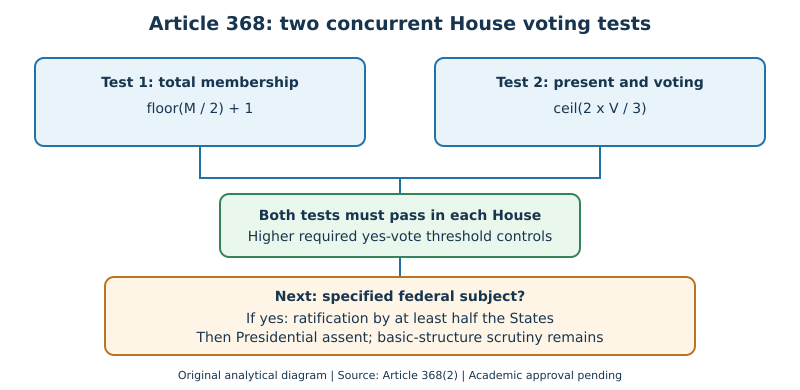

@@CONCEPT@@
### Concept H. Article 368 voting arithmetic and source criticism: April 2026

#### Two simultaneous tests, not one percentage

Article 368(2) requires a constitutional amendment Bill to pass **separately in each House** by (1) a majority of the **total membership** of that House and (2) at least **two-thirds of those present and voting**. If M denotes total membership and V those present and voting, the required affirmative votes are `max(floor(M/2)+1, ceil(2V/3))`. Abstentions, vacancies and negative votes cannot be treated as interchangeable, because the denominators differ. No joint sitting substitutes for the separate approvals. Specified federal changes also require ratification by legislatures of at least half the States, followed by Presidential assent. The official Constitution supplies these rules [S2, S16].

#### Worked constitutional arithmetic

Take a hypothetical House with total membership 600 and 480 members present and voting. The first test requires 301 affirmative votes; the second requires 320. A Bill with 310 votes passes the first test but fails the second. The controlling minimum is therefore **320**, not 301 or 400. This example is deliberately hypothetical and should never be presented as an actual parliamentary vote. Even 320 affirmative votes would not remove the ratification requirement if the proposed amendment changed a category listed in the Article 368 proviso, such as the Seventh Schedule Lists or representation of States in Parliament.

#### The failed 131st Amendment Bill, April 2026

The Constitution (131st Amendment) **Bill**, 2026 failed to pass Lok Sabha on **17 April 2026**; it did not become a 131st Amendment **Act**. News On AIR's 18 April report says 298 votes were in favour and 230 against. Those figures sum to 528, whose two-thirds threshold would be 352. Yet the *same report* also says 489 members were present and gives 326 as the two-thirds threshold. These statements cannot all describe the same division: **298 + 230 is not 489**. The failure of the Bill is corroborated, but the precise division denominator is **not independently authenticated** by the report. A primary parliamentary division record is still required before certifying the arithmetic of that real vote. The related delimitation and Union Territories proposals did not become law merely because they were introduced [S15].

#### Procedure, rights and the basic-structure limit

Article 13(4) excludes constitutional amendments made under Article 368 from Article 13; this is not a blanket exclusion of basic-structure judicial scrutiny. Article 169 offers a separate ordinary-law route for creating or abolishing a State Legislative Council after a qualifying State Assembly resolution; Article 169(3) expressly excludes that law from Article 368. Article 300A protects property from deprivation except by authority of law, but is outside Part III and is not a Fundamental Right. These distinctions illustrate why an exam answer must identify the specific constitutional route and remedy instead of treating every constitutional change as an Article 368 amendment or every legal entitlement as a Fundamental Right [S2, S16].

#### Mains answer blueprint and evidence boundary

Start with the legal rule and both voting denominators. Calculate the two thresholds separately, identify the higher one, then discuss State ratification and basic-structure review only where relevant. For an actual legislative vote, distinguish a directly viewed official report from an authenticated parliamentary division record. When a source contains contradictory numbers, state the conflict explicitly rather than inventing a clean tally. A fact-checking limitation is not a failure of the Constitution; it is a limitation of the available evidence.

@@MCQS@@
**Q26.** Which route does Article 169 prescribe for creating or abolishing a State Legislative Council?  
A. A qualifying State Assembly resolution followed by Parliamentary law, which Article 169(3) excludes from Article 368  B. A referendum followed by a Presidential ordinance  C. An Article 368 amendment ratified by all States  D. A unilateral Governor's notification  
**Answer: A.** Article 169 requires a State Assembly resolution supported by a majority of total membership and at least two-thirds present and voting, followed by Parliamentary law. B invents a referendum/ordinance; C wrongly requires Article 368 and universal ratification; D omits the Assembly and Parliament. [S2, S16]

**Q27.** Which statement accurately describes the constitutional right to property after the 44th Amendment?  
A. It remains a Fundamental Right under Article 19(1)(f)  B. Article 32 alone creates all property entitlements  C. Property may be taken without legal authority  D. Article 300A bars deprivation except by authority of law but is outside Part III  
**Answer: D.** Article 300A supplies the authority-of-law protection outside Part III. A cites the removed Fundamental Right; B confuses a remedy with a substantive right; C contradicts Article 300A. [S2, S16]

**Q28.** Which reading of Article 13(4) is consistent with the basic-structure doctrine?  
A. Every constitutional amendment is immune from judicial review  B. Parliament cannot amend Fundamental Rights  C. Constitutional amendments become ordinary State laws  D. Article 13 does not apply to Article 368 amendments, but the basic-structure limit remains  
**Answer: D.** Article 13(4) concerns Article 13's reach. A incorrectly claims unlimited immunity; B denies the qualified amending power; C mistakes constituent power for ordinary legislation. [S2, S8, S9, S16]

**Q29.** A House has total membership 600 and 480 members present and voting. What is the minimum affirmative vote under Article 368(2)?  
A. 320  B. 301  C. 240  D. 400  
**Answer: A.** The total-membership majority is 301; two-thirds of 480 is 320. Both are required, so 320 controls. B satisfies only one test; C is half of 480; D wrongly takes two-thirds of the total membership. This is a hypothetical, not the April 2026 division. [S2]

**Q30.** After the required parliamentary votes and any specified State ratification, what does Article 368(2) require?  
A. No Presidential assent  B. A joint sitting to settle the Bill  C. A national referendum  D. Presentation to the President, who shall give assent  
**Answer: D.** The constitutional text expressly provides for Presidential assent. A omits it; B invents a joint sitting for amendment Bills; C invents a referendum. [S2, S16]

@@SOURCES@@
- **[S15] News On AIR, 18 April 2026:** https://newsonair.gov.in/hi/131st-constitutional-amendment-bill-not-passed-lok-sabha-vote-count/ — directly viewed; reports failure and 298 for/230 against but also 489 present and a 326-vote threshold. These figures conflict. Parliamentary division record not retrieved.
- **[S16] Legislative Department, Constitution of India (as at 11 November 2025):** https://www.legislative.gov.in/static/uploads/2025/07/359f70a69695affb9d72f8393102bd2e.pdf — directly checked Articles 13(4), 169, 300A and 368(2). Not a claim that every subsequent 2026 constitutional update has been authenticated.
