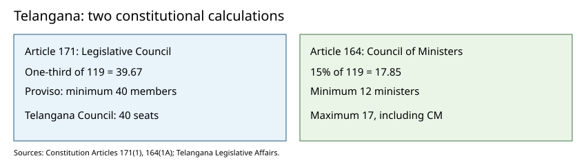
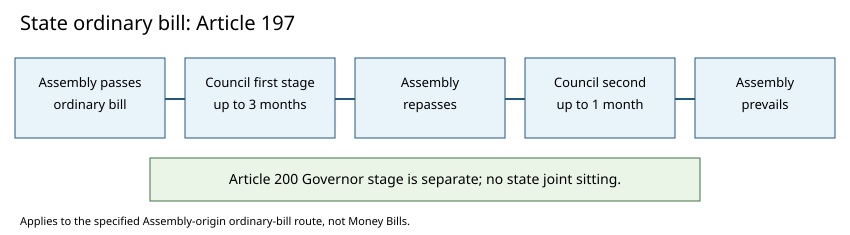

# Visual learning and comparison charts

## Original schematic 1 — Legislative Council versus Council of Ministers



The forty-member floor in Article 171 applies to the Legislative Council, not the State ministry. Telangana's 119 Assembly seats give a maximum of seventeen ministers under Article 164(1A). [S2][S3]

## Original schematic 2 — State ordinary-bill reconsideration



The Council's first-stage delay is up to three months and second-stage delay up to one month. The Assembly prevails under the specified Article 197 conditions; Governor assent is a separate Article 200 step. [S2]

## Chart A — The responsible-government chain

```text
VOTERS ──elect──> LOK SABHA / TELANGANA ASSEMBLY
                       │ confidence + budget + questions
                       ▼
               PM / CM + MINISTERS
                       │ formulate and implement policy
                       ▼
                 DEPARTMENTS / FIELD OFFICES
                       │ outcomes, accounts and legal compliance
                       ▼
              LEGISLATURE + CAG + COURTS

President / Governor: constitutional head; normally acts on constitutional advice.
Rajya Sabha / Legislative Council: review, debate and committees; not the confidence chamber.
```

## Chart B — How to classify a bill

```text
Does it contain ONLY the matters enumerated in Art. 110 (Union) / 199 (state)?
 ├─ YES → Money Bill: lower-house introduction; upper-house recommendations within 14 days.
 └─ NO  → Does it include a financial matter needing special recommendation?
           ├─ YES → Financial Bill: apply Art. 117 / state equivalent; upper-house power may remain.
           └─ NO  → Ordinary Bill: both Houses; Union joint sitting possible in specified deadlock;
                    state Assembly may prevail through Art. 197 (no joint sitting).
Constitutional amendment → Art. 368: separate special majorities; no joint sitting.
```

## Chart C — Privilege boundary

| Conduct | Constitutional starting point | Correct conclusion |
|---|---|---|
| MLA criticises a minister inside Assembly | Art. 194(1)–(2) | Protected speech in House, subject to constitutional/House rules |
| MLA repeats allegation at outside press event | General law and rights | No automatic Art. 194(2) immunity |
| MLA accepts a bribe to vote | *Sita Soren* (2024) | No bribery immunity under Art. 194(2) |
| Assembly punishes constitutional critic for contempt | Art. 194 plus judicial review | Necessity, legality and constitutional limits must be tested |

## Chart D — Legislative institutions and checks

| Institution | Main democratic function | Main risk | Corrective tool |
|---|---|---|---|
| Union Cabinet | Coherent executive policy | Concentration of decision-making | Questions, committees, no-confidence |
| President | Constitutional continuity | Exceptional discretion used politically | Art. 74, floor test, constitutional review |
| Rajya Sabha | Revising and federal voice | Party domination | Committee evidence, published debates |
| Telangana Governor | Constitutional head, assent | Prolonged bill delay | Art. 200, dialogue, limited review under 2025 opinion |
| Telangana Assembly | Confidence, lawmaking, grants | Short scrutiny windows | Session calendar, bill publication, audit |
| Telangana Council | Revision, special constituencies | Delay and patronage | Public hearings, evidence-based scrutiny |
