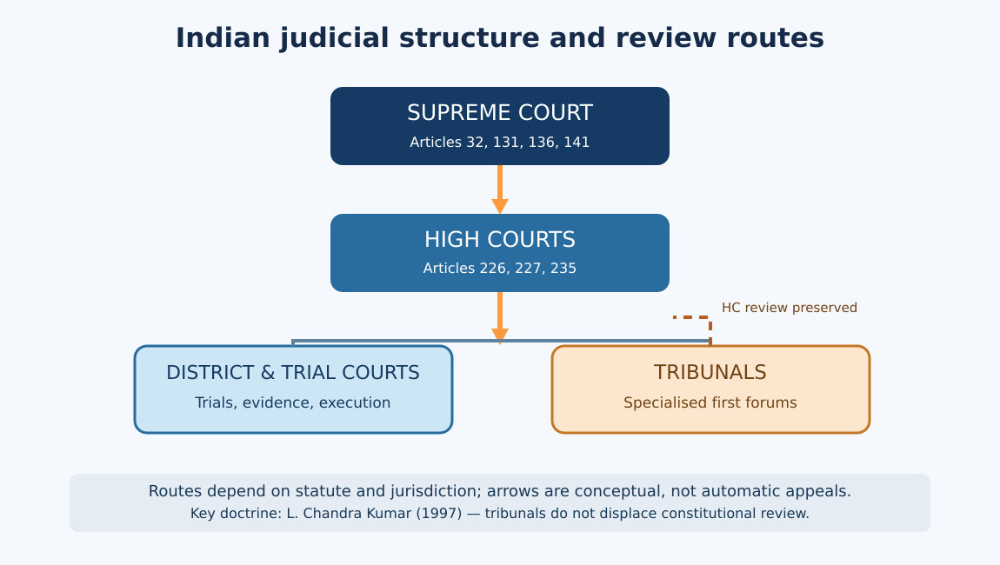
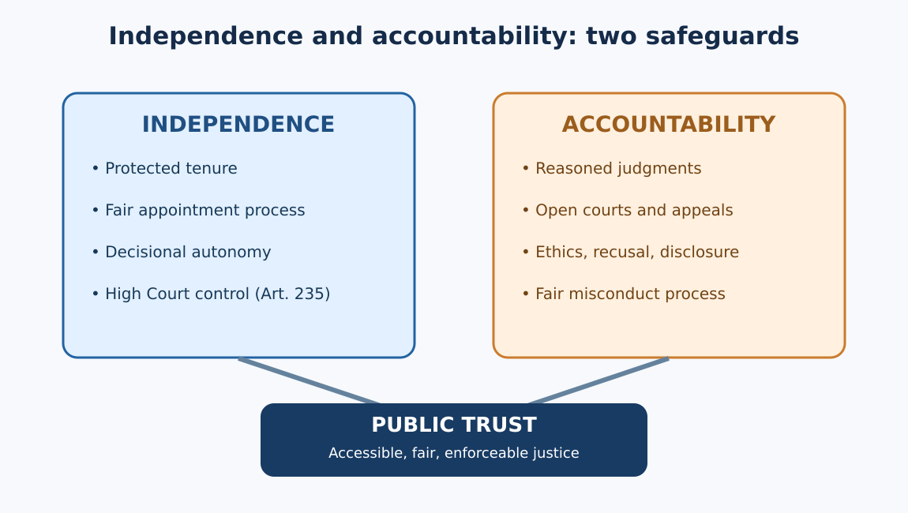

# TGPSC Group I — Paper III / Unit II / Topic 4

## Judicial System in India

**Expanded study draft | 23 October 2026**

Supreme Court · High Courts · Administrative Tribunals · Subordinate Judiciary · Judicial Review · Judicial Activism · Judicial Independence · Judicial Accountability

**Status: Not academically approved. Original practice questions only; no verified official PYQs.**

**Project count: 24 drafts indicated, 51 remaining; 0 academically approved. Cumulative 24-topic master not byte-verified.**


---

# Syllabus Map and Topic Summary

**Topic ID:** P3-U2-T4. **Exam:** TGPSC Group I, Paper III: Indian Society, Constitution and Governance, Unit II: Constitution of India.

**Syllabus wording (Notification 02/2024, Annexure II):** “Judicial System in India: Supreme Court, High Courts & Administrative Tribunals; Subordinate Judiciary; Judicial Review and Judicial Activism; Independence of Judiciary and Judicial Accountability.”

**Source verification qualification:** The exact line is recorded in the previous verified official-notification checkpoint and matches a line-for-line public reproduction of the Commission's syllabus [S1]. The official PDF endpoint returned HTTP 403 during this run; this draft therefore does not pretend to have freshly downloaded that PDF.

| Syllabus phrase | Core examinable distinctions | Detailed sections | Typical mains demand |
|---|---|---|---|
| Judicial System in India | Integrated hierarchy, federalism, separation of powers, Article 50 | 1 | Evaluate constitutional architecture |
| Supreme Court | Articles 124, 131, 32, 136, 137, 141–143; original vs appellate | 2 | Jurisdiction and role in rights protection |
| High Courts | Articles 214–235, 226 vs 32, 227 vs appeal | 3 | State accountability and writ remedies |
| Administrative Tribunals | Articles 323A/323B, CAT, L. Chandra Kumar | 4 | Expertise versus independence |
| Subordinate Judiciary | Articles 233–235, criminal/civil trial, legal aid | 5 | Access, delay, judicial capacity |
| Judicial Review | Articles 13, 32, 226; basic structure, NJAC | 6 | Judicial supremacy versus restraint |
| Judicial Activism | PIL, continuing mandamus, limits of institutional competence | 7 | Activism and democratic legitimacy |
| Independence of Judiciary | Tenure, appointments, collegium, separation | 8 | Reform without executive capture |
| Judicial Accountability | Removal, in-house procedures, disclosure, recusal | 9 | Balance independence and accountability |
| Applied Telangana | TSLSA, Lok Adalat, DLSA, eCourts and delay | 10–11 | Policy design and implementation |

## Topic summary
India's judicial architecture combines a single constitutional hierarchy with State-based administration. The Supreme Court protects constitutional uniformity and fundamental rights; High Courts enforce a wider range of legal rights and supervise the district judiciary; subordinate courts conduct most trials and execution proceedings. Tribunals offer specialised adjudication but cannot eliminate the High Court's basic-structure judicial review. The Court's activism through PIL has expanded access for vulnerable groups, yet structural remedies must respect evidence, institutional competence and democratic responsibility. Judicial independence rests on tenure, appointments and decisional autonomy, while accountability requires reasons, open proceedings, appellate review, ethical standards, disclosure and a lawful process for serious misconduct. Telangana illustrates the difference between formal rights and usable remedies through its High Court, district courts, TSLSA, legal aid, Lok Adalats and digital services. The central evaluative theme is **independence + review + accessibility + accountability**, not any one of these in isolation.

## Learning outcomes
After studying this chapter, a candidate should be able to classify a dispute by correct first forum; distinguish Article 32 from Article 226 and Article 227 from an appeal; explain the basic-structure constraint on tribunal jurisdiction; assess both benefits and risks of PIL; describe the collegium and removal process without confusing the two; and propose feasible Telangana judicial reforms with measurable fairness indicators.


---

# Standalone Quick Revision — Judicial System in India

## The constitutional map
- **Supreme Court:** Articles 124–147; **High Courts:** Articles 214–231; **subordinate judiciary:** Articles 233–237; **tribunals:** Articles 323A and 323B.
- India has an integrated judicial hierarchy. Article 50 is a Directive Principle urging separation of judiciary from executive.
- **SC retirement:** 65; **HC retirement:** 62. Constitutional removal for proved misbehaviour/incapacity is not dismissal by executive order.
- **Article 32:** fundamental-rights enforcement in SC; **Article 226:** fundamental and other legal rights in HC. Article 226 is wider in subject matter.
- **Article 227:** High Court superintendence; **Article 235:** High Court control over subordinate judiciary.
- **Article 131:** defined Union–State/State–State legal disputes; **Article 136:** discretionary special leave; **Article 143:** presidential advisory reference.
- **Article 141:** binding law declared by SC; **Article 142:** complete justice in a pending cause/matter, subject to constitutional limits.
- **Article 137:** review of SC judgments; a curative petition is a narrow exceptional mechanism, not a routine appeal.

## Writ matching
| Writ | Functional trigger | Common trap |
|---|---|---|
| Habeas corpus | Unlawful detention | Not a general bail substitute |
| Mandamus | Enforce a public duty | Does not normally dictate outcome of lawful discretion |
| Certiorari | Quash unlawful lower-forum order | Not ordinary fact rehearing |
| Prohibition | Prevent jurisdictional overreach | Generally preventive rather than quashing completed order |
| Quo warranto | Challenge unlawful holding of public office | Requires a public office and legal defect |

## Tribunals and judicial review
- CAT: Administrative Tribunals Act, 1985; specified Union service disputes, not all employment claims.
- *L. Chandra Kumar* (1997): judicial review under Articles 226/227 and 32 is basic structure; tribunals supplement, not replace, constitutional courts.
- *Kesavananda Bharati* (1973): Parliament cannot destroy basic structure through Article 368 amendment.
- *Minerva Mills* (1980): limits on amending power and constitutional balance.
- NJAC invalidation (2015): appointment design struck down; does not mean collegium is immune to criticism.
- Review standards: legislative competence, fundamental rights, procedural fairness, statutory authority, jurisdiction and proportionality where applicable.

## Activism and accountability
- PIL relaxes standing for bona fide public injury; it is not a substitute for ordinary private litigation.
- Continuing mandamus monitors systemic compliance; risk: judicial micro-management.
- Judicial independence: tenure, protected service conditions, appointments and institutional autonomy.
- Accountability: reasoned orders, appeal, ethics, disclosure, recusal, in-house inquiry, constitutional removal.
- 2025 Supreme Court announcements: published appointment-process details and Supreme Court judges' asset declarations.

## Telangana recall
- Telangana High Court sits in Hyderabad and has supervised the State judiciary as a separate High Court since 1 January 2019.
- TSLSA works through DLSAs in Telangana's 33 districts; legal aid is under the Legal Services Authorities Act, 1987.
- Ordinary Lok Adalat: compromise/settlement; Permanent Lok Adalat for public utility services can adjudicate eligible pre-litigation disputes after failed conciliation.
- TSLSA lists Permanent Lok Adalats at Hyderabad, Karimnagar, Adilabad, Nizamabad, Ranga Reddy and Warangal.
- eCourts Phase III: 2023–2027 programme, approved outlay Rs 7,210 crore; do not confuse allocation with expenditure or universal implementation.
- BNSS, BNS and BSA: commencement from 1 July 2024 with applicable savings/transitions; use current procedural law carefully.

## Five frequent exam traps
1. **False:** Article 32 covers every legal right. **Correct:** Article 32 enforces fundamental rights; Article 226 is broader.
2. **False:** CAT orders are immune from High Court review. **Correct:** *L. Chandra Kumar* preserves constitutional review.
3. **False:** A Chief Justice can remove a High Court judge. **Correct:** constitutional removal process applies.
4. **False:** Every Lok Adalat can decide a contested case on merits. **Correct:** ordinary Lok Adalat requires settlement; PLA is distinct.
5. **False:** Article 136 is a guaranteed appeal. **Correct:** special leave is discretionary.

## Ten-line mains answer template
State the constitutional objective; identify precise Articles and statute; describe institutional roles; apply a named judgment; give a Telangana example; acknowledge the strongest competing argument; explain a practical implementation consequence; suggest measurable reform; preserve due process; end with independence, accessibility and accountability together.


---

# Detailed Notes — Judicial System in India

**Paper III | Unit II | Topic 4 | Expanded working draft | Research cut-off: 23 October 2026**

## 1. Constitutional architecture: an integrated judiciary and the rule of law

### 1.1 Why an integrated judiciary matters in a federal Constitution
India is a federation with Union and State law-making authorities, yet it does not maintain two completely separate hierarchies of federal and State courts. The Supreme Court stands at the apex; High Courts exercise constitutional authority within their territories; district and subordinate courts administer most first-instance justice. This integrated arrangement permits a common interpretation of constitutional guarantees and central legislation across States while leaving substantial judicial administration to the States and High Courts. The Constitution distributes powers rather than treating the judiciary as an administrative branch of the executive. Part V, Chapter IV (Articles 124–147) establishes the Supreme Court; Part VI, Chapter V (Articles 214–231) deals with High Courts; Part VI, Chapter VI (Articles 233–237) concerns the subordinate judiciary. Articles 323A and 323B permit specialised tribunals. [S2]

The rationale becomes clearer through a practical dispute. A Telangana teacher challenges a recruitment decision: the first forum depends on the service rules and applicable tribunal jurisdiction; a High Court may review legality under Articles 226 and 227; the Supreme Court may be approached through the appropriate constitutional appellate route. The teacher does not enter a separate 'Telangana constitutional court' whose view of fundamental rights is independent of the national Constitution. Equally, not every grievance goes straight to the Supreme Court. The system combines hierarchical precedent with territorially accessible remedies, though travel, legal costs and procedural complexity remain barriers.

### 1.2 Separation of powers is functional, not watertight
Articles 50 and 121–122, 211–212 and judicial tenure provisions show the Constitution's concern for institutional boundaries. Article 50, a Directive Principle, asks the State to separate the judiciary from the executive in public services; it is not itself a directly enforceable fundamental right. Legislatures make general rules, executives implement them, and courts adjudicate legality and constitutionality. But this is not an American-style absolute separation: Parliament may change laws after judgments, provided it removes the legal basis of a ruling rather than merely declares the judgment invalid; the executive administers court infrastructure and implements judicial orders; courts formulate procedural directions where rights otherwise lack effective remedies. Institutional legitimacy depends on reasons, jurisdiction and fidelity to the constitutional text—not on claims that one branch is always superior.

**Independence** has external and internal dimensions. External independence means freedom from governmental retaliation or pressure; internal independence means that a trial judge can decide a case without improper pressure from higher judicial administrators, influential lawyers or local interests. The constitutional safeguards include security of tenure, removal procedures, protection of service conditions, control of the High Court over the subordinate judiciary under Article 235 and limits on legislative discussion of judicial conduct. Yet budget dependence, delayed vacancies and opaque case allocation can compromise independence without any overt order from a minister. Independence therefore requires institutions and conduct, not merely an oath. [S2; S6]

### 1.3 The rule-of-law chain
A sound judicial system performs four linked tasks: it makes law accessible; offers an impartial forum; issues reasoned and enforceable decisions; and corrects errors through review or appeal. Article 14 prohibits arbitrary State action; Article 21 protects life and personal liberty according to constitutionally valid procedure; Articles 32 and 226 make rights judicially enforceable. The Supreme Court has called judicial review part of the basic structure, meaning an amendment cannot abolish its essential constitutional function. The doctrine is not a licence to replace every policy choice with a judge's preference: a court may invalidate an arbitrary tender or unconstitutional statute, but ordinarily does not decide which road alignment or health budget is economically optimal where lawful alternatives exist. [S2; S7]

### 1.4 Telangana-specific consequences
In Telangana, disputes over municipal demolition, land records, service recruitment, welfare eligibility, policing and environmental clearance test this architecture. A citizen may seek a writ against an unlawful administrative decision; the State must defend its action by producing the statutory source, records and a reasoned justification. The High Court can supervise lower courts, while the Telangana State Legal Services Authority (TSLSA) and district legal services authorities help vulnerable litigants access representation. The system is only as effective as the capacity to serve notices, provide translation, hear evidence and execute orders. The constitutional right to an impartial forum is undermined when a litigant wins after ten years but cannot enforce the decree. [S3; S10]

### 1.5 Contending viewpoints and evaluation
A strong constitutional court can protect minorities and individuals against temporary majorities. Critics respond that unelected judges should not design policies or displace the representative branches. Both concerns are serious. The proper test is whether the court identifies a legal violation, uses a proportionate remedy, explains its institutional competence and leaves lawful policy choices to the responsible authority. Equally, deference should not become abdication when basic liberties or access to justice are at stake. A mains answer should distinguish *judicial power* (the legal authority to decide) from *judicial capacity* (judges, staff, procedure and public trust needed to make that authority effective).

## 2. Supreme Court: composition, jurisdiction, precedent and remedies

### 2.1 Constitutional position and appointments
Article 124 establishes the Supreme Court of India. Judges are appointed by the President under the constitutional process as interpreted in the Judges Cases; Supreme Court judges retire at 65. Article 124(3) sets eligibility: citizenship of India and either at least five years as a High Court judge, ten years as a High Court advocate, or being a distinguished jurist in the President's opinion. The latter route is constitutionally available but is not a routine appointment channel. Removal is not at the pleasure of the government; it requires the Article 124(4) process for proved misbehaviour or incapacity, with special parliamentary majorities and an address to the President. The Judges (Inquiry) Act, 1968 provides procedural machinery. [S2]

The sanctioned number of judges is fixed by parliamentary law, not permanently by the Constitution. Avoid memorising a floating strength without a date. The structural point is that vacancies and judicial workload must be measured against the then-applicable sanctioned strength. The Chief Justice's administrative leadership—bench formation, roster allocation, registries—must be distinguished from a judge's adjudicative vote. A larger bench can settle conflicting precedent; administrative seniority does not permit a Chief Justice to overturn another bench's judgment outside judicial procedure.

### 2.2 Five routes to the Court
**Original federal jurisdiction (Article 131):** disputes of specified types between the Union and States, or among States, involving legal rights. Not every intergovernmental political disagreement qualifies. **Rights jurisdiction (Article 32):** direct petitions to enforce fundamental rights, with the five constitutional writs; Article 32 itself is a fundamental right. **Constitutional, civil and criminal appeals (Articles 132–134A):** jurisdiction depends on the relevant certificates and statutory provisions. **Special leave (Article 136):** discretionary permission to appeal from courts and tribunals, subject to its constitutional exclusions; it is not an automatic third or fourth appeal. **Advisory jurisdiction (Article 143):** the President may refer qualifying questions; an advisory opinion is distinct from an ordinary adversarial judgment. The Court also has review jurisdiction under Article 137 and limited curative practice under its rules. [S4]

Consider a village's allegation that a State rule discriminates in access to public employment. The Supreme Court can hear a fundamental-rights petition under Article 32, but it may be appropriate for the petitioner first to use the High Court, especially where disputed facts and local records are central. By contrast, a constitutional dispute between two States about the existence of a legal right may engage Article 131. The classification matters: an applicant who mistakes Article 136 for a guaranteed appeal may lose time and resources.

### 2.3 Writs and enforceability
Habeas corpus tests unlawful detention; mandamus compels performance of a public duty; prohibition prevents a lower judicial or quasi-judicial body from exceeding jurisdiction; certiorari quashes an unlawful order; quo warranto questions authority to hold a public office. These labels describe legal functions, not interchangeable slogans. Mandamus generally does not command the government to exercise a lawful discretion in a predetermined way; certiorari is not an opportunity to reweigh every witness as if in a first appeal. Article 32 is focused on fundamental rights, whereas Article 226 can enforce other legal rights too. A writ remedy is discretionary in application but must be exercised consistently with constitutional principles. [S2; S4]

### 2.4 Binding law and complete justice
Article 141 makes the *law declared* by the Supreme Court binding on all courts in India. A careful reader identifies the ratio decidendi—the legal proposition necessary for the decision—rather than treating every illustration or observation as a statutory command. Article 142 enables orders necessary for complete justice in a pending cause or matter, but its use must be reconciled with constitutional and statutory limits; it is not a general power to legislate permanently. Article 144 requires civil and judicial authorities to act in aid of the Supreme Court. Contempt powers protect the administration of justice, while free criticism of judgments remains important in a democracy. [S2; S4]

### 2.5 Critical appraisal
The Court unifies constitutional law and supplies remedies against executive excess, but a large special-leave docket can crowd out constitutional bench time. Frequent interim orders may create policy uncertainty if final decisions take years. Transparent listing, reasoned admission decisions, predictable bench composition and digital accessibility can improve legitimacy without curtailing judicial independence. For Telangana residents, the national apex court remains distant and costly; the strength of the High Court and legal aid system therefore determines whether Supreme Court rights have practical reach. A model answer should contrast constitutional supremacy with practical limits of judicial time, enforcement and public accessibility.

## 3. High Courts: the constitutional bridge between citizens and the State

### 3.1 Status, appointment and tenure
Article 214 requires a High Court for each State, subject to constitutional provisions permitting common High Courts. Telangana has its own High Court at Hyderabad following the separation of the common High Court with effect from 1 January 2019. Articles 216–217 address composition and appointment; a High Court judge retires at 62. A person must be an Indian citizen and have held judicial office for at least ten years or been an advocate of a High Court for at least ten years. The President appoints High Court judges after the constitutionally required consultations, as elaborated by collegium jurisprudence. Article 222 concerns transfer; Article 224A permits the appointment of retired judges with consent under its conditions. [S2; S3]

### 3.2 Article 226 is wider than Article 32
The High Court can issue directions, orders and writs for fundamental rights **and for any other purpose**—the latter phrase covers enforceable non-fundamental legal rights. Article 226(2) addresses territorial cause of action, which may arise wholly or in part within the territory even if the authority is elsewhere. This makes the High Court a particularly important forum for service matters, public contracts, education, licensing, land acquisition and local government. The court may refuse relief when an adequate alternative statutory remedy exists, but the principle has recognised exceptions—for example, a breach of natural justice, lack of jurisdiction or a direct challenge to constitutional validity. An alternative remedy is a rule of prudence, not an absolute erasure of Article 226. [S2]

Suppose a Telangana department rejects an eligible applicant without giving the hearing required by its rules. A writ court may examine the notice, reasons, records and authority to act. It normally does not itself conduct the recruitment interview. A sound order can quash the decision and require reconsideration according to law, protecting fairness without converting the judiciary into a selection board. In land-record disputes, the court may require a party to pursue the designated revenue appeal if the matter turns on disputed title evidence; that is not the same as denying judicial review.

### 3.3 Article 227 and the judicial hierarchy
Article 227 gives the High Court superintendence over courts and tribunals within its territorial jurisdiction, subject to constitutional qualifications. This is supervisory, not a general entitlement to a fresh merits appeal. Article 235 places control over district courts and subordinate courts in the High Court, including important administrative and disciplinary aspects consistent with the Constitution. Articles 228 and 229 deal with withdrawal of cases involving substantial constitutional questions and High Court officers and servants. The High Court is also a court of record under Article 215. [S2; S6]

The distinction between **appeal**, **revision**, **review** and **writ supervision** is exam-relevant. An appeal may permit reconsideration of facts and law within the governing statute. Revision corrects defined jurisdictional or legal errors. Review is reconsideration by the same court on narrow grounds. Supervisory jurisdiction ensures legality and regularity, not unlimited second-guessing. Confusing these routes produces both poor legal analysis and avoidable litigation.

### 3.4 Telangana institutional example
The High Court for the State of Telangana publishes cause lists, case status, notifications and judicial information. Its supervisory role extends to district courts across the State, while the TSLSA coordinates legal aid and Lok Adalat programmes with district bodies. A writ about Hyderabad municipal action and a criminal appeal from a district court are procedurally different matters, even though both may ultimately reach the same High Court. In public-interest environmental cases, the availability of the National Green Tribunal may alter the appropriate first forum. Thus the choice of forum should follow the cause of action and the relevant statute, not a reflex to file a writ in every controversy. [S3; S10]

### 3.5 Institutional tensions
High Courts are closer to State administration and citizens than the Supreme Court, and they can scrutinise local facts effectively. But delays in recruitment, fragmented digital records, heavy service litigation and uneven legal representation impede remedies. Judicial transfer may promote national integration and reduce local influence; critics worry about the impact on institutional continuity and independence if reasons are opaque. Publishing objective vacancy data, strengthening court managers and reasoned roster practices can improve capacity without subordinating the High Court to the State government. The crucial constitutional proposition is that Article 226/227 review is part of the basic structure and cannot be displaced by ordinary tribunal legislation. [S7]

## 4. Administrative tribunals: expertise, speed and the limits of substitution

### 4.1 Constitutional rationale
The 42nd Amendment inserted Articles 323A and 323B. Article 323A concerns administrative tribunals for recruitment and conditions of service of persons appointed to public services and posts; Article 323B permits tribunals for specified subjects such as taxation, industrial and labour disputes, land reforms and elections to legislatures, subject to the constitutional text. The Administrative Tribunals Act, 1985 created the framework for the Central Administrative Tribunal (CAT) and possible State/Joint Administrative Tribunals. Under Section 14, CAT deals with specified Union service matters; Section 15 addresses State tribunal jurisdiction where applicable. A tribunal is not automatically a constitutional court, and not every public employment dispute falls within CAT's reach. [S2; S5]

Tribunals arose from a real problem: courts were overloaded with technically detailed disputes requiring familiarity with service rules, disciplinary procedures and specialist legislation. A forum with judicial and expert members might resolve matters faster and more consistently. However, the same design can invite executive dominance when the department whose decision is challenged controls appointment, tenure, finances or staffing of the adjudicators. Specialisation is valuable only if impartiality is preserved.

### 4.2 L. Chandra Kumar and the review chain
In *L. Chandra Kumar v Union of India* (1997), a seven-judge bench held that judicial review under Articles 226/227 and 32 forms part of the Constitution's basic structure. Tribunals under Articles 323A/323B can act as courts of first instance within their field, but cannot completely replace High Courts as constitutional reviewers. Tribunal decisions ordinarily remain subject to scrutiny by a Division Bench of the relevant High Court. The decision invalidated jurisdiction-exclusion provisions to the extent they attempted to remove the essential constitutional review power. A student should avoid the simplistic statement 'all tribunals are unconstitutional': the judgment preserved tribunals while rejecting their use as exclusive substitutes. [S7]

### 4.3 How to classify a forum
**CAT** is principally for specified Union service disputes; **National Green Tribunal** derives jurisdiction from the National Green Tribunal Act, 2010 over specified environmental matters; **Armed Forces Tribunal** arises under the Armed Forces Tribunal Act, 2007; **Debts Recovery Tribunals** operate under financial recovery statutes. Their powers, limitation periods, composition and appellate routes differ. Article 323B is not a generic source of jurisdiction for every statutory tribunal. The NGT's specialised environmental remedies cannot be inferred from CAT's service jurisdiction, nor can the DRT be treated as an ordinary civil court for every purpose. [S5; S12]

A Telangana public-sector employee should identify the employer, the nature of the service, any applicable tribunal notification, the statute conferring jurisdiction and available review. A citizen challenging an environmental clearance for an industrial project may need to consider NGT jurisdiction and limitation; a citizen alleging violation of constitutional rights may also invoke High Court review in the appropriate circumstances. Forum shopping wastes time and can lead to dismissal on maintainability grounds.

### 4.4 Tribunal independence and reform
The Supreme Court's *Madras Bar Association* line of cases repeatedly scrutinised tribunal appointments, tenure and executive influence. The general constitutional concern is not hostility to expertise but the danger that a short tenure, executive-dominated selection or arbitrary removal could weaken decisional independence. The balance must accommodate qualified technical members without displacing the judicial character of adjudication. A neutral selection process, adequate tenure, secure remuneration, budgetary arrangements and clear appellate pathways matter more than the mere label 'tribunal'. [S8]

### 4.5 Advantages, criticisms and consequences
Tribunals can deliver subject expertise, accessible hearings and less formal procedure. They can also become another litigation layer if parties must contest the tribunal decision in the High Court and then seek special leave. Uneven bench locations, vacancies and inaccessible orders are particularly harmful to rural applicants. For Telangana, the question is not whether a tribunal sounds modern, but whether its regional accessibility, staffing, reasons and judicial review actually reduce the cost and time of obtaining a lawful decision. **Exam synthesis:** specialisation is constitutionally compatible with judicial review; administrative efficiency is not a justification for excluding independent constitutional oversight.

### 4.6 Worked problem: an allegedly arbitrary disciplinary penalty
Assume a central-government employee working in Hyderabad receives a dismissal order after a departmental inquiry. The first question is not whether the penalty feels harsh; it is whether the employee falls within CAT's statutory jurisdiction. Next ask whether the charge-sheet was specific, documents were disclosed, the inquiry officer was impartial, the employee had a reasonable chance to defend, and the disciplinary authority gave reasons. CAT may examine legality and the relevant service rules; it will not ordinarily substitute its own view of witness credibility without a recognised legal basis. The employee can then seek constitutional scrutiny of the tribunal's decision before the jurisdictional High Court in the route described by *L. Chandra Kumar*. This example reveals the tribunal's real value: focused expertise can correct administrative defects early, but an independent constitutional court remains the final safeguard against a structurally biased process.

### 4.7 The tribunal-versus-court debate
A tribunal's promise of speed must be assessed empirically. A vacant tribunal bench or a distant regional sitting can make it slower and costlier than a court. Conversely, a well-staffed specialised bench can decide recurring pension or disciplinary issues consistently. For a public-service aspirant, the examinable tension is between **expertise and independence**, not a binary choice between modern tribunals and outdated courts. An answer should discuss the statutory jurisdiction, the appointment framework, judicial review after *L. Chandra Kumar*, and the lived cost of an additional appeal.

## 5. Subordinate judiciary: the first contact with justice

### 5.1 Structure and legal authority
Most Indians encounter the judicial system not through a constitutional bench but through a magistrate, civil judge, family court or district and sessions court. The structure varies with State rules and subject-specific legislation, but commonly includes district and sessions judges, civil judges, chief judicial magistrates and judicial magistrates. Civil courts resolve property, contract, succession and other civil claims; criminal courts conduct trials and other proceedings under the applicable criminal procedure. Family Courts Act, 1984, Commercial Courts Act, 2015 and special statutes create additional procedural arrangements. Court nomenclature should not be mistaken for identical jurisdiction: a sessions court's criminal powers differ from a district judge's civil powers even when the same judicial officer holds both designations.

Articles 233 and 234 regulate appointments to the district judiciary and other judicial service, with the Governor and High Court playing constitutionally specified roles. Article 235 vests control over district courts and subordinate courts in the High Court. This design limits direct executive management of judges who must hear cases against the State. The Department of Justice notes that recruitment and appointments are principally responsibilities of State governments and High Courts under the constitutional scheme, while the Union can coordinate and assist. [S2; S6]

### 5.2 Trial quality determines appellate quality
A criminal trial depends on lawful investigation, disclosure, representation, admissible evidence, witness protection and reasoned findings. If witnesses are not produced or forensic reports are delayed, a High Court appeal cannot retroactively make the trial timely. In civil litigation, pleadings, service of summons, interim injunctions, discovery, witness examination and execution of decrees determine whether the right claimed is real. **Execution** is often the neglected stage: a decree for possession or maintenance has little practical value until implemented. Judicial reforms must therefore address the entire life cycle from filing to enforcement, not merely the number of judgments pronounced.

### 5.3 Independence below the High Court
The High Court's administrative control includes postings, promotion and disciplinary supervision according to law, but fair procedures and reasons are essential. Judicial officers need security from local political pressure, police interference, litigant intimidation and improper demands from powerful lawyers. At the same time, independence cannot mean immunity from discipline for corruption, habitual delay or misconduct. Service rules, performance review, training through State judicial academies and appellate correction should work together. Judges must also be protected from punishment simply because a higher court disagrees with a reasoned legal view.

### 5.4 Telangana: district access and legal aid
TSLSA reports district legal services authorities throughout Telangana's 33 districts, typically operating from district court complexes. They connect eligible litigants to legal aid, legal literacy, mediation and Lok Adalats. Consider a woman in a rural mandal seeking maintenance or protection against domestic violence. Constitutional rights matter, but practical access depends on transport, language, safe reporting, an available lawyer, the court's schedule and enforcement of an order. Court digitalisation can reduce repeated travel, yet digital-only systems may exclude those without reliable internet or assistance. [S10]

### 5.5 Delay, pendency and competing explanations
It is tempting to attribute backlog only to too few judges. Vacancies matter, but pendency also reflects repeated adjournments, poor service of summons, government litigation, forensic bottlenecks, fragmented case management, inadequate prosecution, appeals and slow execution. The Department of Justice reported that sanctioned subordinate judicial posts rose from 19,518 in 2014 to 25,725 by 22 November 2024; that historical figure must not be presented as a current 2026 vacancy count. The same official material emphasises court infrastructure, technology and procedure. [S6]

Reforms should be differentiated: fill vacancies through predictable recruitment calendars; appoint trained court managers; enforce realistic adjournment discipline without denying fair hearings; modernise forensic and witness facilities; expand legal aid; and measure age of cases and execution success, not just gross disposal. The danger of a purely numerical disposal target is that complex cases or vulnerable litigants may receive inadequate attention. **Evaluation:** faster justice is not necessarily fairer justice; reform must track both timeliness and procedural quality.

### 5.6 Criminal justice after the 2023 codes
The Bharatiya Nagarik Suraksha Sanhita, 2023 (BNSS), Bharatiya Nyaya Sanhita, 2023 (BNS) and Bharatiya Sakshya Adhiniyam, 2023 (BSA) came into force on 1 July 2024, subject to notified qualifications and transitional provisions. They affect procedural vocabulary, investigation and evidence, but the constitutional duty of fair trial remains. A court must apply the governing law to the relevant date and proceeding; a student should not mechanically cite the old Code of Criminal Procedure for every 2026 proceeding, nor assume all pre-commencement cases instantly switch to new procedure. In Telangana, training police, prosecutors, defence counsel and judicial officers on new procedural requirements is as important as acquiring digital equipment.

### 5.7 Bail, undertrial detention and fairness
A bail decision balances liberty, investigation, flight risk, witness interference and the relevant statutory scheme. The Supreme Court has repeatedly treated prolonged unjustified detention and delayed trial as serious Article 21 concerns. Yet a bail order is not an acquittal, and denial of bail is not a finding of guilt. Poor legal representation can turn pre-trial detention into de facto punishment for low-income defendants. District legal services authorities should identify unrepresented accused early; court managers should flag repeated production failures and ageing cases. This is an area where constitutional doctrine becomes concrete in the magistrate's courtroom.

## 6. Judicial review: constitutionality, administrative legality and basic structure

### 6.1 Meaning and constitutional foundations
Judicial review is the power to examine whether legislative and executive action complies with the Constitution and other controlling law. It is different from an ordinary appeal on facts. Article 13 invalidates pre-constitutional and post-constitutional laws inconsistent with fundamental rights to the constitutionally specified extent; Articles 32 and 226 supply remedies; Articles 131–136 structure appellate and original jurisdiction; Article 227 supplies High Court superintendence. Judicial review is not located in a single magic article. The doctrine also operates through the Constitution's supremacy and the distribution of powers. [S2]

A Telangana law affecting property, education or municipal administration may be tested for legislative competence under the Seventh Schedule, violation of fundamental rights, procedural constitutional defects or other applicable limitations. A departmental circular may be struck down for conflict with the parent Act or failure to observe natural justice even if no constitutional amendment is in issue. Courts should identify the source of power and precise legal defect rather than simply call a measure 'unfair'.

### 6.2 Review of constitutional amendments
*Kesavananda Bharati v State of Kerala* (1973) held that Parliament's amending power under Article 368 is broad but cannot destroy the Constitution's basic structure. *Indira Nehru Gandhi v Raj Narain* (1975), *Minerva Mills v Union of India* (1980) and *I.R. Coelho v State of Tamil Nadu* (2007) developed different applications of constitutional limitations and review. Basic-structure doctrine is not a closed statutory list; commonly recognised elements include constitutional supremacy, republican democracy, federalism, separation of powers, judicial review and independence of the judiciary. Each case should be studied for its actual holding rather than an invented universal checklist. [S2; S9]

The 99th Constitutional Amendment and National Judicial Appointments Commission (NJAC) Act were invalidated by the Supreme Court in 2015. The majority considered the independence of the judiciary and the appointments design incompatible with the basic structure. Critics objected that the collegium system itself lacks transparency and diversity. The ruling therefore preserved one constitutional safeguard but did not establish that the existing appointment process is beyond criticism. This is a model example of why constitutional review and institutional reform must be discussed together. [S9]

### 6.3 Standards of review and judicial restraint
For a rights challenge, courts ask whether there is lawful authority, a legitimate objective, non-arbitrary classification and—where applicable—proportionality between the restriction and objective. The exact test varies by right and context. In administrative review, jurisdiction, relevant considerations, procedural fairness, bias, reason-giving and irrationality may be central. A court may strike down a rule that excludes a class without rational basis, but it should not replace a scientifically defensible policy with a preferred alternative merely because both are possible. Judges must distinguish **constitutional invalidity**, **statutory illegality** and **policy disagreement**.

### 6.4 Review of tribunals and State action
*L. Chandra Kumar* makes constitutional review of tribunal decisions essential. A service tribunal can determine a dispute initially, but the High Court's constitutional supervisory role remains. A State cannot make its own decision unreviewable by writing 'final' in an administrative order. Statutory finality clauses are interpreted in light of the Constitution. At the same time, courts may require litigants to exhaust appropriate statutory appeals before writ review, except in recognised circumstances. [S7]

### 6.5 Democratic critique and practical balance
Defenders argue that without judicial review majorities could erode minority rights and executive action could escape legal scrutiny. Critics fear judicial supremacy, uncertainty for welfare schemes and weak democratic accountability. The best response is not an absolute slogan for activism or restraint: courts should protect the constitutional floor, insist on reasons and evidence, and select remedies that preserve legitimate administrative choice. For Telangana, a court may direct reconsideration of a flawed tender or land acquisition decision, while leaving procurement specifications or resettlement design to competent authorities within law. This is a disciplined division of responsibility.

### 6.6 The ninth schedule is not a magic shield
Article 31B and the Ninth Schedule were designed to protect specified laws from certain constitutional challenges. The proposition that every law placed in the Ninth Schedule is immune forever is incorrect. In *I.R. Coelho* (2007), the Supreme Court explained that laws inserted after the basic-structure cut-off are subject to constitutional scrutiny where their effect damages basic-structure principles through rights violations. This does not mean that the Court routinely substitutes its policy preferences for land reform; the inquiry concerns the constitutional effect of protection. For Telangana land-policy questions, always identify the particular law, amendment date and challenged provision before making a Ninth Schedule argument.

### 6.7 An executive order and a statute are reviewed differently
A district officer's circular can fail because it exceeds a parent Act, contradicts a rule or denies a hearing. A State statute can fail because the legislature lacks competence, it violates fundamental rights or it breaches another constitutional restriction. A constitutional amendment is examined under Article 368 and basic structure. These are distinct legal gates. A precise mains answer names the impugned instrument and applies the right test; a vague assertion that 'judicial review checks government' earns fewer analytical marks.

## 7. Judicial activism, public-interest litigation and the boundary of governance

### 7.1 Historical evolution of access
Judicial activism describes a court's proactive interpretation or remedial approach, often to make constitutional guarantees effective. It is not a distinct constitutional article or a licence to act without jurisdiction. Public-interest litigation (PIL) developed to relax traditional standing rules where bonded labourers, prisoners, pavement dwellers, children or other vulnerable groups could not realistically reach courts. Cases associated with *S.P. Gupta*, *People's Union for Democratic Rights*, *Bandhua Mukti Morcha*, *Hussainara Khatoon* and *M.C. Mehta* expanded access and substantive rights in different contexts. Each case arose from specific legal facts; 'PIL' should not be treated as a guarantee that every social concern will be judicially decided. [S9]

### 7.2 Rights made operational
The right to life under Article 21 has been interpreted to include procedural fairness, dignified living and a range of related protections through case law. The *Hussainara Khatoon* litigation highlighted speedy trial and undertrial incarceration; *Vishaka v State of Rajasthan* (1997) supplied workplace sexual-harassment guidelines in the absence of a comprehensive domestic statute, later followed by the Sexual Harassment of Women at Workplace Act, 2013. Environmental PILs required governments to address pollution and conservation failures, though the distributional impact on workers and informal settlements sometimes attracted criticism. Judicial orders can expose administrative inaction, but their success depends on implementation capacity.

### 7.3 Continuing mandamus and structural orders
In a one-off writ, a court identifies an unlawful act and issues a remedy. In structural litigation, the violation may be systemic—prison conditions, pollution or failure to implement welfare obligations—and the court may retain the case to review compliance reports. This 'continuing mandamus' can make rights meaningful where a single order would be ignored. However, prolonged judicial monitoring risks replacing administrative planning with episodic courtroom management. Independent audits, clear benchmarks, affected-person participation and sunset conditions can make structural remedies more accountable.

### 7.4 When PIL becomes problematic
Courts have warned against publicity-oriented, politically motivated or privately interested PILs. A litigant should demonstrate a real public wrong, credible facts, clean hands and an appropriate legal remedy. Filing a PIL to challenge an ordinary contractual dispute, settle a political rivalry or bypass a statutory process can divert scarce judicial time. In environmental disputes, the National Green Tribunal may be the more appropriate statutory forum. In welfare disputes, courts must distinguish a failure to implement an existing legal entitlement from a request that judges invent a budgetary scheme. [S12]

### 7.5 Telangana applications and distributional trade-offs
PILs concerning lake protection, urban flooding, land-use changes, custodial practices or public hospitals can illuminate neglected rights in Telangana. Yet an order to remove encroachments near a water body may protect ecology while displacing low-income residents. The court should examine the statutory basis, scientific record, notice, rehabilitation obligations and competing constitutional interests rather than assume that one slogan resolves all claims. Similarly, mandating facilities in district hospitals without funding or staffing can produce paper compliance. **Critical appraisal:** activism is justified when it supplies an effective remedy for a proven legal violation; it is less defensible when courts dictate complex policy details without evidence, consultation or institutional capacity.

### 7.6 PIL standing and the right petitioner
The relaxation of locus standi responded to the inability of vulnerable persons to approach courts, not to the desire of every political group to litigate policy disputes. A bona fide organisation may represent bonded labourers who cannot individually file petitions; a business rival challenging a competitor's permit may have an ordinary legal remedy but no special entitlement to PIL status. Courts examine public injury, petitioner credibility and alternative remedies. They also consider whether facts require trial evidence rather than affidavits. This is why a PIL should not become a shortcut around civil procedure.

### 7.7 Structural relief and democratic dialogue
Suppose a court finds that hazardous effluent enters a Telangana lake in breach of statutory standards. It can require enforcement, monitoring and reports, but scientific agencies must provide sampling and remediation expertise, and affected communities need a hearing. A remedy that closes a plant immediately may protect water but threaten livelihoods; a phased compliance order may be more proportionate if imminent danger can be controlled. Judicial activism is defensible when it forces lawful administration to act; it becomes problematic when judges decide technical thresholds without a record. An ideal judgment specifies who must do what, by when, and how compliance will be verified.

## 8. Judicial independence and appointments: constitutional safeguards and democratic legitimacy

### 8.1 Structural protections
Judicial independence means impartial decision-making protected against external coercion and internal interference. Supreme Court judges have constitutionally protected tenure until 65; High Court judges until 62. Removal is possible only through the demanding constitutional process for proved misbehaviour or incapacity. Salaries and service conditions are protected against disadvantageous changes after appointment subject to constitutional exceptions. Restrictions on discussion of judicial conduct in legislatures and the bar on post-retirement pleading by former Supreme Court judges under Article 124(7) reflect the same concern. These safeguards do not eliminate the need for ethical conduct, transparency and recusal where bias is reasonably apprehended. [S2]

### 8.2 The three Judges Cases and the collegium
The *S.P. Gupta* (First Judges Case, 1981) approach gave the executive a more prominent position in appointment consultation. The *Supreme Court Advocates-on-Record Association v Union of India* (Second Judges Case, 1993) shifted to judicial primacy in interpreting 'consultation'. The 1998 Presidential Reference (Third Judges Case) clarified collective consultation within the collegium. The 2015 NJAC judgment invalidated the 99th Amendment and implementing Act; the majority regarded the particular appointments arrangement as compromising judicial independence. These rulings are judicial interpretations of the appointment scheme, not a constitutional article literally using the word 'collegium'. [S9]

### 8.3 Competing reform positions
The collegium's defenders argue that judges must not owe their positions to political patrons who later appear as litigants. Critics point to secrecy, inconsistent selection criteria, slow appointments, insufficient social diversity and limited opportunities for public scrutiny. A reform can pursue transparent criteria, publication of reasons consistent with candidate privacy, diversity tracking and a predictable timetable without handing the government unilateral veto power. Judicial independence and democratic accountability are not mutually exclusive, but the institutional design must prevent both executive capture and unreviewable insider preference.

### 8.4 2025 transparency measures
In a press release dated 5 May 2025, the Supreme Court announced publication of the appointments process and information concerning High Court appointment recommendations. It also described a Full Court decision of 1 April 2025 to place Supreme Court judges' asset declarations in the public domain. These are documented transparency steps, not proof that all concerns about selection or ethics have been resolved. A candidate should separate the verified announcement from a broader evaluative claim about its effectiveness. [S11]

### 8.5 Internal independence and the subordinate bench
High Court administrative control over subordinate courts is intended to shield trial judges from executive pressure. Yet case assignment, transfer, promotion and discipline also require objective standards. A magistrate who grants bail against public pressure should not fear administrative retaliation for a legally reasoned order; a judge who delays cases without justification should remain answerable to fair performance processes. Judicial academies, ethics training, speaking orders and independent complaint procedures can protect both impartiality and accountability.

### 8.6 Telangana relevance
For the Telangana High Court, vacancy management, recruitment of judicial officers, adequate court infrastructure and transparent listing directly affect the State's ability to deliver justice. National collegium recommendations concerning the High Court may change over time, so a dated appointment statement should never be used as a current vacancy figure without fresh verification. A State's duty to fund infrastructure coexists with the High Court's control over adjudicative independence. The practical objective is a judiciary capable of deciding disputes against the government fairly and promptly, not an institution insulated from all public evaluation.

### 8.7 Appointment process: consultation is not personal choice
A collegium recommendation proceeds through institutional consultation, intelligence and governmental inputs, reconsideration where applicable and formal presidential appointment. The precise memorandum of procedure and conventions matter; the Chief Justice of India does not appoint judges by personal signature. Likewise, the executive does not have an unrestricted power to choose any preferred candidate after the constitutional case law on consultation. Appointment delay affects litigants by increasing caseload per judge, but appointment speed alone cannot justify discarding integrity checks. Publication of criteria and processing stages may improve accountability while respecting privacy and reputational fairness for candidates not selected.

### 8.8 The age and tenure comparison
The Supreme Court's retirement age of 65 and High Court's of 62 are fixed constitutional features. They differ from the tenure conditions of many statutory tribunal members, which have repeatedly generated constitutional litigation. This distinction helps explain why the Court is wary of treating a short-tenure executive-appointed tribunal as a full substitute for a constitutional court. A proposal to raise retirement ages would require the proper constitutional process; an administrative circular cannot alter them.

## 9. Judicial accountability: ethics, removal, disclosure and public trust

### 9.1 Independence does not mean impunity
Accountability concerns how judicial power is explained, reviewed and corrected. Judicial orders must ordinarily contain reasons and are subject to appeal or review under law. Proceedings are generally open, subject to justified restrictions for privacy, minors, security or sensitive matters. Contempt jurisdiction protects courts from obstruction but must not be confused with protection against reasoned criticism. The Supreme Court's Code of Conduct / Restatement of Values of Judicial Life and in-house procedures seek ethical discipline, while formal removal follows constitutional and statutory safeguards. [S2; S11]

### 9.2 Removal and in-house procedures are different
Under Article 124(4) read with the applicable provisions for High Court judges, removal requires a parliamentary address supported by the constitutionally specified special majority on grounds of proved misbehaviour or incapacity, followed by a presidential order. The Judges (Inquiry) Act, 1968 structures investigation after the statutory process is triggered. In-house inquiries and administrative measures may address complaints or judicial work allocation but do not substitute for constitutional removal. A candidate must not say that a Chief Justice can simply dismiss a sitting High Court judge, or that a parliamentary simple majority is sufficient.

### 9.3 Transparency without trial by allegation
A complaint about a judge should be handled through evidence, fair procedure, confidentiality where necessary and an outcome proportionate to the finding. Automatic public conviction on social media undermines due process; secret internal disposal without reasons may erode trust. The Supreme Court's March–May 2025 press releases about an in-house inquiry into allegations against a sitting judge illustrate that such procedures exist, but the fact of an inquiry is not itself a finding of criminal guilt. Institutional credibility requires careful distinction between allegation, inquiry, established misconduct and constitutional removal. [S11]

### 9.4 Accountability mechanisms and gaps
Mechanisms include published judgments, appellate correction, open hearings, asset declarations, judicial codes, in-house processes, legislative removal procedures and public reporting of court administration. These address different problems. Appeal corrects legal error but may not remedy ethical misconduct; asset disclosure addresses conflicts of interest but not delay; removal protects against serious wrongdoing but is deliberately difficult. The gap is an accessible, fair and independent complaints architecture that neither invites executive intimidation nor shields misconduct. A comprehensive judicial-standards law has periodically been debated; proposals should not be mistaken for enacted, operative rules without checking the legislative record.

### 9.5 Case allocation and recusal
The Chief Justice's role in constituting benches and allocating cases carries administrative responsibility. Objective roster publication reduces the appearance of selective assignment, while judicial recusal rules guard against real or reasonably perceived bias. Excessive unexplained recusals can also frustrate litigants, so courts should balance impartiality with the duty to hear cases. A transparent case-management policy must not allow a party to choose its preferred judge through strategic allegations. The independence of individual judges and the credibility of the institution are jointly at stake.

### 9.6 Public trust in Telangana
In Telangana, delays in bail, property disputes and government-service litigation can create a perception that justice favours those with resources. Legal aid, language accessibility, online cause lists, accessible certified copies and reasoned orders are therefore accountability measures, not mere conveniences. The TSLSA's role in legal awareness and representation matters especially for persons unable to pay for counsel. A sensible reform agenda combines judicial autonomy with verifiable service standards, fair complaint handling and publicly intelligible institutional data. **Exam conclusion:** accountability is the condition that makes independence socially legitimate; independence is the condition that prevents accountability from becoming political punishment.

### 9.7 Financial disclosure and conflicts of interest
Asset declarations may deter undisclosed conflicts, but disclosure alone does not prove integrity. Useful standards also address recusal when a close financial interest is implicated, restrictions on gifts, relationships with litigants, post-retirement positions and accurate public reporting. A judge's financial privacy is a legitimate concern, especially for family members, but it must be balanced against public confidence in impartial adjudication. The 2025 Supreme Court asset-publication resolution is a concrete example of reform; students should state its date and institution rather than imply a universally enacted disclosure statute for all judicial tiers.

### 9.8 Error versus misconduct
A legal error corrected on appeal is not necessarily misconduct. Otherwise every reversal could threaten judicial independence. Conversely, a pattern of deliberate bias, corruption or falsification cannot be excused as judicial discretion. A fair accountability system must distinguish honest disagreement, negligent administration and proved wrongdoing. Removal for proved misbehaviour or incapacity is deliberately stringent, but disciplinary and administrative tools for subordinate judicial officers operate under a different constitutional and service-law framework.

## 10. Access to justice, Lok Adalats and the Telangana institutional ecosystem

### 10.1 Article 39A and legal services
Article 39A directs the State to promote equal justice and free legal aid so that economic or other disabilities do not deny access. The Legal Services Authorities Act, 1987 provides the institutional framework: National Legal Services Authority (NALSA), State Legal Services Authorities, District Legal Services Authorities and relevant committees. Eligibility for free legal services is governed by the Act and applicable rules; it is not accurate to say that every litigant is automatically entitled to a State-funded lawyer for every case. Legal aid includes advice, representation, awareness and help navigating institutions. [S10]

### 10.2 Ordinary Lok Adalat versus Permanent Lok Adalat
A Lok Adalat generally resolves eligible pending or pre-litigation disputes through compromise or settlement. It cannot adjudicate a contested matter on merits merely because settlement fails. An award based on settlement is binding and is treated as a civil-court decree under the statutory scheme. Permanent Lok Adalats for public utility services, created under Chapter VI-A of the Act, are different: they first attempt conciliation and, subject to statutory limits, may decide specified pre-litigation public-utility disputes on merits if conciliation fails. Non-compoundable criminal offences are excluded. TSLSA's official guidance lists Permanent Lok Adalats at Hyderabad, Karimnagar, Adilabad, Nizamabad, Ranga Reddy and Warangal. [S10]

### 10.3 Why forum design matters
A consumer dispute about a utility service, a maintenance case, a property partition and a serious criminal prosecution do not all belong in the same ADR channel. A voluntary settlement may be efficient, but vulnerable parties must not be pressured to surrender rights simply to improve disposal statistics. The neutral facilitator must ensure informed consent and legal awareness. In a Permanent Lok Adalat, the possibility of adjudication after failed conciliation requires clear statutory safeguards. Mediation and conciliation can preserve relationships, but they are not universal substitutes for authoritative adjudication.

### 10.4 District-level implementation in Telangana
TSLSA states that district legal services authorities operate in all 33 Telangana districts and coordinate programmes through court complexes. Paralegal volunteers and legal-literacy camps can help identify persons who would otherwise never file a claim. For example, a worker denied statutory wages may need legal advice on the correct labour forum before settlement is discussed; a domestic-violence survivor may need immediate protection, not a pressured compromise. Success should be measured by quality of representation, enforceable outcomes, time saved and satisfaction of informed parties, not solely by the number of cases shown as 'disposed'. [S10]

### 10.5 Digital access and exclusion
The eCourts initiative offers case status, electronic filing, payments, virtual courts and video conferencing. These tools can lower travel costs for Telangana litigants and help lawyers manage hearings across districts. But access requires stable connectivity, devices, literacy, local-language support and assistance for persons with disabilities. An e-Sewa Kendra at a court complex can bridge the digital gap; a purely online filing requirement without assistance could widen it. The Department of Justice reports an approved Phase III outlay of Rs 7,210 crore for 2023–2027; that is a programme allocation, not a statement that every district has completed digital transformation. [S13]

### 10.6 The core public-policy test
Access to justice should be assessed across five stages: recognition of a legal problem, affordable advice, correct forum, fair and timely decision, and actual enforcement. Judicial review and judicial independence matter most when they improve this full chain. Telangana's institutional ecosystem—High Court, district judiciary, TSLSA, DLSAs, statutory tribunals and eCourts—must operate as a coherent network rather than competing counters. The policy challenge is to expand speed and convenience while protecting consent, due process and judicial quality.

### 10.7 Legal-aid eligibility and informed choice
Section 12 of the Legal Services Authorities Act identifies categories entitled to legal services subject to the statutory framework, including women, children, members of Scheduled Castes or Scheduled Tribes, persons with disability in the relevant statutory sense, persons in custody and other specified groups. A person should not be refused guidance merely because they do not know the correct form or forum. At the same time, legal-aid institutions must screen conflicts and provide competent representation, not only a name on a panel. The quality of advice at the first meeting can determine whether a case proceeds through a labour authority, magistrate, civil court or statutory tribunal.

### 10.8 Settlement pressure as a justice risk
Lok Adalat statistics can look impressive, but settlement must be voluntary in the ordinary Lok Adalat process. A woman negotiating maintenance, a daily-wage worker claiming arrears or a farmer facing a powerful purchaser may accept an unfair compromise due to time or intimidation. Mediators and legal-aid counsel should verify comprehension, consent and enforceability. The policy objective is not merely to close files; it is to produce durable and lawful outcomes.

## 11. Reform agenda: reducing delay without sacrificing due process

### 11.1 Diagnosing the queue
Pendency is a stock: pending cases at the end of a period equal pending cases at the beginning plus institutions minus disposals, subject to transfers and corrections. A high disposal count can coexist with rising pendency if new filings grow faster. Aggregate figures also hide age, complexity, interim stays and the distribution between criminal and civil cases. The National Judicial Data Grid provides case-status dashboards, but a serious answer should specify the extraction date, court tier and definition rather than repeat an undated national total. [S14]

### 11.2 Capacity and process reform
Judicial vacancies, staff shortages, lack of courtrooms and poor record management matter, but simply adding judges cannot fix repeated adjournments or weak investigation. Time standards should be realistic for complex cases; fast-track courts need trained prosecutors, forensic services and defence representation. Court managers can monitor summons, witness availability and age bands. Standardised digital records and interoperable systems reduce duplication. The State government must fund infrastructure, while judicial authorities must preserve control over adjudication and judicial administration. [S6; S13]

### 11.3 Technology as an aid, not an adjudicator
Digitised records, searchable orders, online cause lists, e-filing and remote appearances can improve transparency and reduce travel. AI-assisted translation, transcription and document retrieval may support court staff, but outputs can contain errors and bias. A judicial decision requires human evaluation of admissible evidence, legal reasons and appealability. Data security, privacy of victims and minors, accessibility, and audit trails are essential. Technology that merely moves a procedural burden from a court counter to an inaccessible website is not reform.

### 11.4 Institutional accountability
Performance metrics should include age of cases, time to first effective hearing, adjournment reasons, compliance with orders, availability of legal aid and the proportion of judgments actually executed. Raw case disposal alone can encourage premature settlement or mechanical orders. Publication of anonymised data, audited court budgets and reasoned administrative decisions can support public trust without inviting executive control over outcomes. Judicial independence is strengthened, not weakened, by demonstrable fairness and efficient public service.

### 11.5 Telangana application and conclusion
A practical Telangana pilot could combine digital summons, Telugu-language help desks, scheduled mediation screening, district legal-aid referral and monthly publication of age-wise case statistics. It should separately protect urgent bail, domestic violence and maintenance matters from queue displacement. Independent evaluation should compare similar courts and examine quality indicators, not just a fall in pending cases. The constitutional objective is **accessible, independent and reasoned justice**: faster throughput is a means to that end, never its replacement.
### 11.6 A measurable district pilot
Imagine a six-month pilot in two comparable Telangana district courts. Record the baseline age distribution of cases, average time to service of summons, adjournments caused by absent witnesses, number of unrepresented accused and execution completion rates. Introduce electronic service where lawful, an assisted e-filing desk, witness coordination and monthly review of cases older than five years. Compare outcomes with a similar non-pilot court, adjusting for case mix and staffing. Publish both speed and fairness indicators: percentage of orders set aside on procedural grounds, litigant accessibility and availability of translation. A decline in pendency achieved by rejecting valid filings or coercing settlements would fail this evaluation.

### 11.7 Fiscal and constitutional allocation
Court buildings, staff positions, connectivity and legal aid require budgetary support. Yet the executive should not dictate judicial outcomes in return for funds. High Courts control important subordinate judicial administration under Article 235; governments have a responsibility to supply adequate infrastructure; the Union supports national eCourts infrastructure and reform coordination. A workable intergovernmental compact respects all three roles.


---

# Visual Learning — Comparative Tables and Diagrams

**Original conceptual diagrams (not empirical GIS maps or independently certified illustrations):**






## Table 1: Four different routes to judicial remedy
| Route | Forum | Core question | What it is not |
|---|---|---|---|
| Article 32 | Supreme Court | Has a fundamental right been violated? | General statutory appeal |
| Article 226 | High Court | Is a fundamental or other legal right enforceable? | Automatic fact retrial |
| Article 227 | High Court | Has subordinate court/tribunal stayed within legal bounds? | Unlimited second appeal |
| Article 136 | Supreme Court | Should exceptional discretionary special leave be granted? | Appeal as of right |

## Table 2: Institutional comparisons
| Feature | Supreme Court | High Court | Tribunal | District court |
|---|---|---|---|---|
| Source | Constitution Part V | Constitution Part VI | Constitution + enabling law | Constitution + court statutes |
| Typical work | Constitutional appeals, Article 32, special leave | Article 226 writs, appeals, supervision | Specialised statutory disputes | Evidence, trials, execution |
| Safeguard | Tenure and constitutional removal | Tenure and constitutional removal | Depends on statute; review preserved | HC control under Article 235 |
| Principal risk | Overloaded appellate docket | Delays, vacancies | Executive influence and extra review layer | Witnesses, process, legal-aid gaps |

## Table 3: Activism versus overreach
| Dimension | Legitimate judicial intervention | Warning sign of overreach |
|---|---|---|
| Trigger | Proven legal/constitutional violation | Policy disagreement without legal defect |
| Evidence | Record, expert input, affected persons | Assumptions and untested claims |
| Remedy | Proportionate and enforceable | Open-ended administration by judges |
| Accountability | Published reasons and review | Unclear benchmarks and no exit |
| Telangana example | Enforce lawful pollution standards | Dictate technical plan without agencies |

## Diagram A: Forum and review route
```text
Legal grievance in Telangana
          |
          v
Identify statute, employer, rights and facts
          |
     +----+-------------------+
     |                        |
Specialised tribunal?     Ordinary court / writ?
     |                        |
Tribunal first          District court / High Court
     |                        |
     +----> High Court constitutional review
                         |
                         v
               Supreme Court (proper route)
```

## Diagram B: Independence-accountability balance
```text
Security of tenure ----+                         +---- Reasoned judgments
Judicial appointments -+--> IMPARTIAL JUSTICE <--+---- Open hearings
Article 235 control ---+                         +---- Appeal / review
                                                +---- Ethics / disclosure
                              |
                       PUBLIC CONFIDENCE
                              |
                Timely, affordable, enforceable relief
```

**Reading caution:** Diagrams show common routes and principles, not every statutory appeal, exclusion or exception. Always identify the governing statute before choosing a forum.


---

# Original Practice MCQs — Judicial System in India

**All 25 questions below are newly written practice questions. They are NOT verified official TGPSC previous-year questions.** Each explanation identifies the controlling distinction.

### Q1. Which constitutional arrangement best describes India's judiciary?
A. Separate federal and State supreme courts with unrelated precedents  
B. An integrated hierarchy headed by the Supreme Court  
C. Only tribunals below the Supreme Court  
D. District courts directly administered by Parliament  
**Answer: B.** India has an integrated judicial structure. High Courts and subordinate courts remain institutionally significant, and the Supreme Court's law declared binds courts under Article 141.

### Q2. Article 50 primarily concerns:
A. Abolition of the Supreme Court  
B. Separation of judiciary from executive in public services  
C. Election of district judges  
D. Removal of judges by governors  
**Answer: B.** Article 50 is a Directive Principle; it is not an independent fundamental-rights petition route.

### Q3. Which statement correctly compares Articles 32 and 226?
A. Both are restricted to disputes among States  
B. Article 32 reaches every legal right; Article 226 only fundamental rights  
C. Article 226 can enforce fundamental and other legal rights  
D. Article 226 is exercised only by the Supreme Court  
**Answer: C.** Article 32 protects fundamental rights in the Supreme Court; Article 226 gives High Courts a wider subject-matter writ jurisdiction.

### Q4. The writ principally directed at testing unlawful detention is:
A. Quo warranto  
B. Certiorari  
C. Habeas corpus  
D. Prohibition  
**Answer: C.** Habeas corpus challenges the legality of custody; it is distinct from a general statutory appeal.

### Q5. A tribunal is about to decide a matter outside its jurisdiction. Which writ is most directly preventive?
A. Prohibition  
B. Habeas corpus  
C. Quo warranto  
D. Mandamus  
**Answer: A.** Prohibition restrains jurisdictional excess before completion; certiorari typically quashes an unlawful order.

### Q6. Article 136 provides:
A. An automatic appeal in every civil dispute  
B. Discretionary special leave to appeal  
C. Election of High Court judges  
D. A general power to enact statutes  
**Answer: B.** Special leave is discretionary and subject to constitutional scope and exclusions; it is not a guaranteed further appeal.

### Q7. The Supreme Court's exclusive original jurisdiction for specified Union–State disputes is chiefly in:
A. Article 131  
B. Article 143  
C. Article 227  
D. Article 235  
**Answer: A.** Article 131 covers specified intergovernmental legal-right disputes, not every political disagreement.

### Q8. Which Article makes the law declared by the Supreme Court binding on all courts in India?
A. 50  
B. 141  
C. 200  
D. 323A  
**Answer: B.** Article 141 concerns binding law declared; students should distinguish the ratio from incidental observations.

### Q9. Under the Constitution, Supreme Court judges ordinarily retire at:
A. 60 years  
B. 62 years  
C. 65 years  
D. 70 years  
**Answer: C.** High Court judges retire at 62, an often-tested contrast.

### Q10. A High Court judge's retirement age is:
A. 58  
B. 60  
C. 62  
D. 65  
**Answer: C.** Article 217 provides the High Court retirement age of 62 years.

### Q11. Article 235 vests control over district and subordinate courts primarily in:
A. The Governor personally  
B. The High Court  
C. The Union Cabinet  
D. The State Public Service Commission alone  
**Answer: B.** Article 235 is a structural safeguard of subordinate judicial independence.

### Q12. Which constitutional provisions specifically support creation of certain administrative and other tribunals?
A. Articles 323A and 323B  
B. Articles 14 and 15 only  
C. Articles 72 and 161  
D. Articles 110 and 199  
**Answer: A.** The provisions were inserted by the 42nd Amendment and differ in subject matter.

### Q13. The central holding of *L. Chandra Kumar* (1997) is that:
A. All tribunals are unconstitutional  
B. Tribunals can exclude all High Court review  
C. Constitutional judicial review by High Courts and the Supreme Court is part of basic structure  
D. CAT has jurisdiction over all private employment  
**Answer: C.** Tribunals can act as specialised first forums, but cannot replace constitutional judicial review.

### Q14. The Central Administrative Tribunal primarily handles:
A. Every private employment dispute  
B. Specified Union public-service matters under the 1985 Act  
C. All criminal trials  
D. Inter-State river water disputes  
**Answer: B.** Jurisdiction follows the Administrative Tribunals Act and its statutory qualifications.

### Q15. The basic-structure limitation on constitutional amendments is associated with:
A. *Kesavananda Bharati*  
B. *Vishaka* alone  
C. *Hussainara Khatoon* alone  
D. *Bandhua Mukti Morcha* alone  
**Answer: A.** The 1973 judgment constrained Article 368 amending power without denying Parliament's wide amendment competence.

### Q16. Which statement about the Ninth Schedule is correct?
A. Every inserted law is beyond any constitutional review  
B. *I.R. Coelho* allows basic-structure scrutiny in the relevant circumstances  
C. Ninth Schedule laws are only municipal by-laws  
D. Only the President may review Ninth Schedule laws  
**Answer: B.** Immunity is not absolute after *I.R. Coelho*; the legal test depends on the amendment and its constitutional effect.

### Q17. The 2015 NJAC decision primarily concerned:
A. Abolition of High Courts  
B. Judicial appointments and independence of the judiciary  
C. Creation of Lok Adalats  
D. Subordinate criminal procedure  
**Answer: B.** The Supreme Court invalidated the 99th Amendment/NJAC scheme; debate about collegium transparency continues.

### Q18. PIL's relaxation of standing was principally designed to:
A. Allow private rivals to bypass all remedies  
B. Improve access for persons unable to vindicate public injuries effectively  
C. Make every political disagreement justiciable  
D. Remove the need for evidence  
**Answer: B.** Bona fide public injury, legal grounds and credible facts remain essential.

### Q19. A continuing mandamus is most closely associated with:
A. Ongoing judicial monitoring of compliance in structural litigation  
B. Automatic acquittal in criminal cases  
C. Presidential election  
D. Repeal of a statute by a district judge  
**Answer: A.** Continuing oversight may enforce systemic rights but risks judicial micro-management if not disciplined.

### Q20. Under the constitutional removal procedure, a Supreme Court judge may be removed for:
A. Mere disagreement with the government  
B. Proved misbehaviour or incapacity through the specified parliamentary process  
C. A simple order of the Chief Justice  
D. A State Assembly resolution alone  
**Answer: B.** Article 124(4) requires special parliamentary majorities and a presidential order.

### Q21. The ordinary Lok Adalat differs from a Permanent Lok Adalat for public utility services because:
A. Ordinary Lok Adalat routinely adjudicates contested merits after failed conciliation  
B. Permanent Lok Adalat may adjudicate eligible pre-litigation disputes after failed conciliation  
C. Both conduct serious non-compoundable criminal trials  
D. Neither operates under statute  
**Answer: B.** The distinction is established under the Legal Services Authorities Act; ordinary Lok Adalat ordinarily requires compromise.

### Q22. TSLSA's primary statutory foundation is:
A. The Legal Services Authorities Act, 1987  
B. The Representation of the People Act, 1951  
C. The Companies Act, 2013  
D. The Forest Rights Act, 2006  
**Answer: A.** TSLSA coordinates free legal services, awareness and Lok Adalat programmes in Telangana.

### Q23. The 2025 Supreme Court announcement on judicial transparency included:
A. Abolition of all collegium consultation  
B. Publication of appointments-process information and Supreme Court judges' asset declarations  
C. Election of judges by popular vote  
D. Elimination of appellate review  
**Answer: B.** The Court's 5 May 2025 press release describes these steps; they are not a blanket statutory solution to all accountability concerns.

### Q24. Which is the best measure of meaningful judicial reform?
A. Disposal count alone  
B. Number of new websites alone  
C. Timeliness, fairness, legal aid and enforcement of orders  
D. Lowest possible hearing time irrespective of evidence  
**Answer: C.** Justice delivery is a chain from access to enforcement; pure throughput can conceal coercive settlements or procedural unfairness.

### Q25. The eCourts Phase III approved financial outlay is best described as:
A. Rs 7,210 crore for the 2023–2027 programme  
B. Rs 7,210 crore already spent by every district  
C. An exclusive Telangana grant  
D. A constitutional amendment to Article 32  
**Answer: A.** Department of Justice materials give the approved programme outlay; allocation is not the same as actual expenditure or full implementation.


---

# Mains Practice — Six Original Questions with Model Answers

**These are original practice questions, not verified official TGPSC PYQs.** Each answer is designed for approximately 200–250 words excluding the question and subheading labels.

## M1. Explain the jurisdiction of the Supreme Court and assess its role in protecting constitutional government.

### Introduction / constitutional background
The Supreme Court is the apex of India's integrated judiciary under Article 124. Its central role is to preserve constitutional supremacy, provide effective remedies and maintain consistency in the law declared across the country.

### Jurisdiction and constitutional measures
Article 131 confers original jurisdiction in specified Union–State legal disputes. Article 32 allows direct enforcement of fundamental rights through constitutional writs. Appeals arise through Articles 132–134 and relevant laws, while Article 136 permits discretionary special leave. Article 143 provides presidential advisory references. Articles 137, 141 and 142 concern review, binding law and complete justice respectively. These powers differ in purpose and should not be described as a single unrestricted appeal.

### Practical consequences and examples
A person alleging unlawful detention may invoke habeas corpus; an intergovernmental legal dispute may involve Article 131. Telangana residents also rely on the High Court for accessible fact-sensitive writ remedies. Binding precedent helps ensure that similarly situated citizens receive consistent constitutional protection.

### Critical appraisal
A crowded special-leave docket can divert attention from constitutional benches. Excessive interim intervention risks policy uncertainty, while inadequate review permits arbitrary administration. Transparent listing, reasoned decisions and stronger lower courts can reduce these tensions.

### Conclusion
The Supreme Court's authority is strongest when it supplies principled, enforceable constitutional remedies while respecting lawful democratic choices and the institutional role of High Courts.

## M2. Distinguish the powers of High Courts under Articles 226 and 227 and explain their relevance to Telangana administration.

### Introduction / background
High Courts connect constitutional guarantees with everyday State administration. Their authority is not confined to appellate correction; they also enforce legality and supervise the judicial system within their territorial jurisdiction.

### Powers and objectives
Article 226 authorises writs for fundamental rights and other legal rights, making its subject matter wider than Article 32. Article 227 gives supervisory power over subordinate courts and tribunals. Article 235 separately places control of the subordinate judiciary in the High Court. Appeals, revision and writ supervision have different statutory and constitutional functions.

### Telangana applications
An applicant denied a hearing in a recruitment process may seek Article 226 relief against the administrative order. A district court's jurisdictional error may attract the appropriate appellate, revisional or supervisory route. The High Court for the State of Telangana at Hyderabad also oversees district judicial administration across the State.

### Critical appraisal
Writ jurisdiction is not a universal substitute for statutory appeals or factual trials. High Courts often require exhaustion of adequate alternative remedies, subject to recognised exceptions such as lack of jurisdiction or breach of natural justice. Vacancies and procedural delay reduce the effectiveness of otherwise powerful remedies.

### Conclusion
The High Court protects citizens by reviewing legality without routinely taking over executive decisions. Strengthening its capacity and transparent administration makes Article 226 and Article 227 meaningful for Telangana litigants.

## M3. Are administrative tribunals compatible with judicial independence and the basic structure? Discuss.

### Introduction / background
Administrative tribunals were designed to provide specialist and potentially faster resolution of disputes, particularly public-service matters. Articles 323A and 323B permit specified tribunals, while the Administrative Tribunals Act, 1985 supplies the CAT framework.

### Objectives and institutional design
Expert members can improve understanding of service rules, disciplinary procedure and technical legislation. Less formal processes may reduce cost and relieve ordinary courts. But appointment, tenure, funding and removal rules must protect impartiality, especially when the government is frequently a litigant.

### Constitutional measures and case law
In *L. Chandra Kumar* (1997), the Supreme Court held that judicial review under Articles 226/227 and 32 forms part of the basic structure. Tribunals can function as specialised first forums but cannot displace High Court constitutional review. The *Madras Bar Association* decisions similarly scrutinise executive dominance and tribunal independence.

### Critical appraisal and Telangana example
A Telangana-based Union employee may first approach CAT for an eligible service dispute, then seek constitutional review through the appropriate High Court route. This protects legality but can create an additional litigation layer. Vacant benches and distant sittings can defeat the promised efficiency. The Supreme Court reiterated in 2023 that constitutional review of tribunal decisions survives before the appropriate High Court. This is a safeguard against executive control, not an automatic second merits trial. Reform must address the independence of appointments and practical access to review.

### Conclusion
Tribunals are constitutionally compatible when they complement, rather than replace, independent courts. Reform should secure fair appointments, accessible benches, reasoned orders and review pathways, not merely announce faster disposal targets.

## M4. Critically examine judicial review and judicial activism in a constitutional democracy.

### Introduction / constitutional background
Judicial review tests legislative and executive action against the Constitution and controlling law. Judicial activism describes a more proactive interpretive or remedial approach, often associated with public-interest litigation. The concepts overlap but are not identical.

### Legal foundation and objectives
Articles 13, 32 and 226 support review; *Kesavananda Bharati* limits amendments that destroy basic structure. PIL relaxed standing where vulnerable people could not reach courts. Decisions involving undertrial detention, bonded labour, workplace harassment and environmental protection made constitutional promises operational.

### Practical consequences
A Telangana environmental petition may require authorities to enforce pollution law, publish monitoring data and protect affected communities. Continuing mandamus can ensure compliance when a one-time order would be ignored. Courts should use scientific evidence and hear those facing displacement or loss of livelihood.

### Critical appraisal
Judicial intervention protects rights against arbitrary majorities and administrative inaction. However, broad orders can replace democratic policy choices, strain public budgets and bypass specialist agencies. Publicity-oriented PILs may also consume scarce judicial time. Courts should identify a concrete legal violation, apply proportionality where relevant and frame enforceable remedies.

### Conclusion
Review is an indispensable constitutional safeguard; activism is justified when it remedies proven illegality and improves access. Its legitimacy depends on reasoned restraint, evidence and respect for the lawful responsibilities of elected institutions.

## M5. Discuss judicial independence and accountability with reference to appointments, ethics and removal.

### Introduction / background
Judicial independence prevents political or private pressure from controlling decisions. Accountability ensures that independent power is exercised lawfully, ethically and transparently. A constitutional democracy requires both, rather than treating them as opposing slogans.

### Safeguards and measures
The Constitution protects judicial tenure, service conditions and removal procedures. Supreme Court judges retire at 65 and High Court judges at 62. The Judges Cases developed the collegium system, while the Supreme Court invalidated the NJAC framework in 2015 on basic-structure grounds. Article 235 safeguards subordinate judicial control through High Courts.

### Transparency and practical facts
The Supreme Court announced in May 2025 that information about the appointments process and Supreme Court judges' asset declarations would be published. Reasoned judgments, open proceedings, recusal, appellate review and fair in-house inquiries also support accountability. Formal constitutional removal remains distinct from administrative investigation.

### Critical appraisal
Executive dominance threatens impartial adjudication, but opaque collegium decisions may weaken diversity and public trust. Public allegations must not become automatic findings of guilt; conversely, independence cannot excuse proven corruption. Transparent criteria, fair complaints procedures and published institutional data offer a balanced path.

### Conclusion
An accountable judiciary is not one controlled by government. It is one whose independence is secured by law and whose exercise of power is explained, reviewable and ethically credible.

## M6. Propose a practical programme to improve access to justice in Telangana without compromising fairness.

### Introduction / problem background
Formal rights are ineffective when citizens cannot afford advice, reach a court, understand proceedings or enforce judgments. Telangana's district courts, High Court, TSLSA and statutory tribunals must therefore be treated as an interconnected justice-delivery system.

### Objectives and institutional measures
Article 39A and the Legal Services Authorities Act, 1987 support free legal services for eligible groups. TSLSA coordinates district legal services authorities, legal literacy and Lok Adalats. The eCourts Phase III programme can improve filing, case tracking, video hearings and records. Assisted Telugu-language help desks are necessary to prevent digital exclusion.

### Implementation and evidence
Pilot electronic summons, early legal-aid screening and witness coordination in selected district courts. Track case age, adjournment reasons, unrepresented accused, quality of representation and execution of decrees. Refer suitable voluntary disputes to ordinary Lok Adalats; use Permanent Lok Adalats only within their public-utility jurisdiction.

### Critical appraisal
A disposal-only target may encourage coerced settlements or rushed orders. Rural connectivity, disability access, court staffing and forensic delays must be addressed alongside software. Protect urgent bail, maintenance and domestic-violence cases from administrative queue displacement. The Department of Justice eCourts Phase III dashboard reports e-Sewa Kendras and video-conferencing services, but infrastructure counts alone do not measure fair outcomes. Publish a district-level baseline and evaluate whether assisted filing actually improves access for rural, disabled and unrepresented litigants.

### Conclusion
The test is not how many files close, but whether a person obtains timely, reasoned and enforceable relief. Telangana should measure fairness, accessibility and institutional independence together with speed.


---

# Authoritative Sources, Evidence Register and Internal Audit

**Research cut-off: 23 October 2026. Academic status: expanded draft; NOT academically approved.** Codes in detailed notes refer to the sources below. Source links are provided to support independent checking; references are to laws, provisions and judgments, not student-facing PDF page numbers. A source being listed does not mean every current legal development has received independent expert review.

| Code | Authority / source | URL | Claim checked / qualification |
|---|---|---|---|
| S1 | TGPSC Notification 02/2024, Annexure II, Paper III, II, item 4; publicly reproduced syllabus | https://websitenew.tgpsc.gov.in/preview/RElSRUNUUkVDUlVJVE1FTlROT1RJL05PVElGSUNBVElPTl9OT18wMi0yMDI0X0dyb3VwLUlfU2VydmljZXMgKDEpMjAyNDAyMjAxNDA3MzcucGRmr95v17a0y2d8i13v ; https://prepshark.in/tgpsc/group-1/syllabus | Exact wording checked against prior official-PDF checkpoint and line-for-line public reproduction. Official PDF returned HTTP 403 on this run. |
| S2 | Legislative Department, Constitution of India | https://lddashboard.legislative.gov.in/sites/default/files/coi/COI_2024.pdf | Articles 13, 32, 39A, 50, 124–147, 214–237, 323A–323B, 368. Portal timed out this run; stable constitutional provisions checked against official judicial explanations. |
| S3 | High Court for the State of Telangana, official portal | https://tshc.gov.in/hcts/ | Telangana court identity, court services, notifications and institutional context. |
| S4 | Supreme Court of India, Jurisdiction | https://www.sci.gov.in/jurisdiction/ | Article 32, 131, 136, 143; original, appellate and advisory powers; review/curative practice. |
| S5 | India Code, Administrative Tribunals Act, 1985 | https://upload.indiacode.nic.in/showfile?actid=AC_CEN_26_36_000010_198513_1517807325572&filename=a1985-13.pdf&type=actfile | CAT and State tribunal subject-matter distinctions, Sections 14 and 15. |
| S6 | Department of Justice, subordinate judiciary recruitment / parliamentary answer | https://dashboard.doj.gov.in/vacancy/ ; https://www.doj.gov.in/static/uploads/2025/09/04d247ddf5a1a6df49e2e61b32b58f15.pdf | Articles 233–235 responsibilities; historical 2014/2024 sanctioned-strength figures; NOT a live 2026 count. |
| S7 | Supreme Court, *L. Chandra Kumar v Union of India*, (1997) 3 SCC 261; discussion in official subsequent judgment | https://api.sci.gov.in/jonew/judis/43863.pdf | Basic-structure judicial review, tribunals as first instance and High Court supervision. Exact 1997 primary judgment not downloaded in this run; holding cross-checked in later Supreme Court judgment. |
| S8 | Supreme Court, *Rojer Mathew v South Indian Bank Ltd*, 13 November 2019 | https://api.sci.gov.in/supremecourt/2017/9680/9680_2017_1_1501_18247_Judgement_13-Nov-2019.pdf | Tribunal independence and institutional safeguards; avoid claiming all 2026 tribunal rules have been audited. |
| S9 | Supreme Court, NJAC judgment, 2015; related basic-structure discussion | https://api.sci.gov.in/jonew/judis/43070.pdf | NJAC invalidation, appointment independence, basic structure; references to *Kesavananda Bharati* and other landmark judgments. |
| S10 | Telangana State Legal Services Authority, introduction and Permanent Lok Adalat | https://telangana.nalsa.gov.in/introduction/ ; https://telangana.nalsa.gov.in/permanent-lok-adalat-for-public-utility-services/ | DLSAs across 33 districts, ordinary/PLA differences, locations and services. |
| S11 | Supreme Court press releases dated 5 May 2025 and assets page | https://www.sci.gov.in/press-release-dated-may-5-2025-2/ ; https://www.sci.gov.in/assets-of-judges/ | Appointments-process publication and Supreme Court judges' asset declaration policy; dated not generic all-courts claim. |
| S12 | India Code, National Green Tribunal Act 2010; Armed Forces Tribunal portal | https://www.indiacode.nic.in/ ; https://www.aft.gov.in/ | Tribunal-specific enabling laws and jurisdiction; no assumption that every tribunal shares CAT's rules. |
| S13 | Department of Justice, eCourts Phase III dashboard and 2026 official response | https://dashboard.doj.gov.in/ecourts-projects-phaseIII/ ; https://www.doj.gov.in/static/uploads/2026/04/aa21cd29d4b4a580d660c8c472e24ecd.pdf | Approved 2023–2027 programme outlay Rs 7,210 crore; allocation is distinct from expenditure. |
| S14 | e-Committee, Supreme Court, eCourts services portal | https://ecommitteesci.gov.in/service/ecourts-portal/ | NJDG, e-filing, e-pay, case status and virtual-court services; live pendency not asserted. |
| S15 | India Code, Legal Services Authorities Act, 1987 | https://www.indiacode.nic.in/handle/123456789/12883?view_type=browse | Sections 12–13 eligibility, Chapter VI Lok Adalats and Chapter VI-A Permanent Lok Adalats. |
| S16 | India Code, Bharatiya Nagarik Suraksha Sanhita, 2023 | https://www.indiacode.nic.in/indiacode/handle/123456789/20099?view_type=browse | Commencement 1 July 2024, criminal-court provisions; transitional caveat. |

## Internal doctrinal checks

1. Articles 32 and 226 are **not** interchangeable: Article 226 is wider in enforceable legal rights.
2. Article 227 supervision is not a general second appeal; Article 235 is separate administrative control over subordinate courts.
3. Article 136 special leave is discretionary; Article 143 advisory jurisdiction is distinct from appellate judgment.
4. *L. Chandra Kumar* does not abolish tribunals; constitutional review remains.
5. A tribunal's jurisdiction depends on its own enabling law, not just the general idea of specialisation.
6. NJAC was struck down in 2015; the collegium system remains controversial, not constitutionally infallible.
7. A judicial in-house inquiry is not the Article 124(4) constitutional removal process.
8. Ordinary Lok Adalats settle; Permanent Lok Adalats have limited merits adjudication after conciliation failure.
9. BNSS commencement and eCourts allocation are dated; no live 2026 caseload figure was invented.
10. All MCQs and mains questions are **original practice**, with **zero verified official PYQs**.

## Outstanding full academic-audit tasks

- Obtain the official TGPSC Notification 02/2024 PDF again from an accessible Commission endpoint and independently confirm punctuation and exact scope against the reproduced line.
- Check each doctrinal proposition against the full authoritative constitutional text, current amendments and the full judgments, including 2026 developments not incorporated here.
- Recheck current tribunal legislation and appointment rules, current Telangana High Court procedures, and the applicability of new criminal codes to transitional cases.
- Subject every MCQ to an independent distractor-ambiguity audit and each mains answer to a legal subject-matter review.
- Audit print accessibility, diagram legibility, link correctness, Unicode rendering and all PDF pages; visual render inspection is necessary but not academic approval.
- Recover byte access to the original 19-topic master and Topic 5 archive before claiming a complete cumulative archive.

**Status:** expanded draft, **academically approved = 0**, **official verified PYQs = 0**.

## 27 October 2026 — bounded primary-source correspondence (Cycle 31)

- Supreme Court of India, 3 March 2023, official judgment (reiterating *L. Chandra Kumar*, 1997), https://www.api.sci.gov.in/supremecourt/2021/30987/30987_2021_4_1505_42656_Judgement_03-Mar-2023.pdf — supports the retained High Court Articles 226/227 judicial-review principle. This is a later judicial restatement, **not** direct reading of the original 1997 judgment.
- Department of Justice, eCourts Phase III public dashboard, read 27 October 2026, https://dashboard.doj.gov.in/ecourts-projects-phaseIII/ — confirms programme categories including e-Sewa Kendras and video-conferencing; **no unverified Telangana-specific 2026 figure** is imported. Dashboard values are dynamic.
- The two mains-answer expansions are author-side legal and policy checks only. The other four answers, all 25 MCQ keys/distractors, R1 official syllabus, R2 deduplication, R7 diagram accuracy and R8 browser accessibility remain **not passed**.

