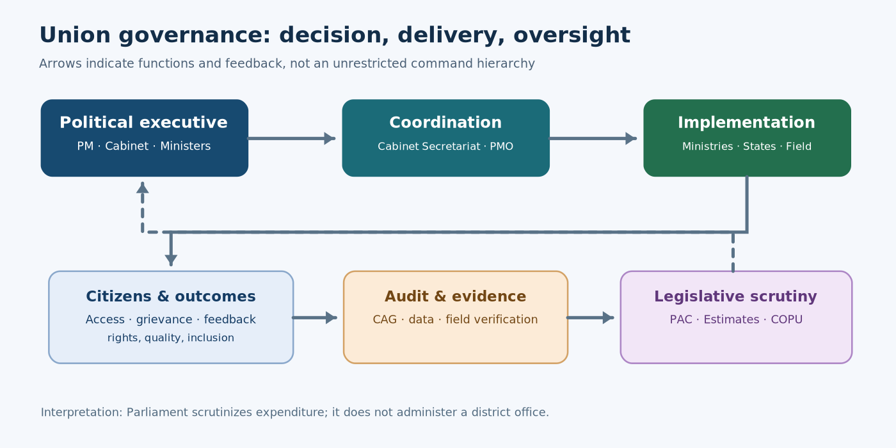
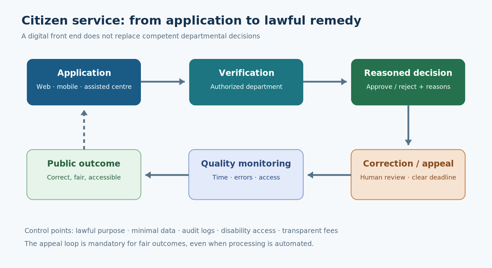

# Governance and Good Governance: E-Governance, Union Institutions, Commissions and Parliamentary Committees

**TGPSC Group I | Paper III | Unit III | Topic 1 | Expanded draft | 23 October 2026**

**ACADEMIC STATUS: NOT APPROVED.** Original practice MCQs and mains answers only; no verified official PYQ claim.

**Reader's guide:** Read the syllabus map first, then the 13 detailed chapters. Use the diagrams, revision sheets, 25 explained MCQs and six structured mains answers for consolidation. Official and primary-source links appear in the evidence register.

# Syllabus map and topic summary

**TGPSC Group I | Paper III: Indian Society, Constitution and Governance | Unit III: Governance | Topic 1.**

**Official syllabus wording (Notification No. 02/2024, Annexure-II):**

> Governance and Good Governance, E-Governance-Applications and Models; Governance at Union level- Cabinet Secretariat, Prime Minister's Office (PMO), Central Secretariat, Ministries and Departments; Constitutional bodies-Finance Commission, Election Commission, Union Public Service Commission, Comptroller and Auditor General of India, National Human Rights Commission, National Commissions for SCs/ST/Minorities and Women; Parliamentary Committees- Estimates Committee, Public Accounts Committee, Committee on Public Undertakings.

**Important correction:** The official syllabus groups all the listed commissions after the phrase 'Constitutional bodies'. In law, NHRC (Protection of Human Rights Act, 1993), NCM (National Commission for Minorities Act, 1992) and NCW (National Commission for Women Act, 1990) are **statutory**. Finance Commission, ECI, UPSC, CAG, NCSC and NCST are **constitutional**. Do not reproduce the syllabus's grouping as a false legal classification.

**Primary verification:** TGPSC's official Notification 02/2024 PDF, Annexure-II, Paper III, Unit III, item 1 [S1]. The wording above is transcribed directly from that official document, not from a coaching summary. No page number is needed in student-facing notes.

## Syllabus-to-chapter map

| Examinable syllabus phrase | Detailed chapters | Core test |
|---|---|---|
| Governance and good governance | 1–2 | Government versus governance; rights, inclusion, effectiveness, accountability |
| E-governance applications and models | 3–5 | G2C/G2B/G2G/G2E, workflow reform, privacy, Telangana MeeSeva |
| Cabinet Secretariat and PMO | 6 | 1961 Rules of Business; Cabinet Secretary versus PMO; coordination |
| Central Secretariat, ministries, departments | 7 | Allocation of business, departmental accountability, policy/field feedback |
| Finance Commission | 8 | Articles 280–281, tax devolution, state/local finance |
| Election Commission | 9 | Article 324, election jurisdiction, independence |
| UPSC and CAG | 10 | Articles 315–323 and 148–151, recruitment versus audit |
| National Commissions for SCs and STs | 11 | Articles 338 and 338A, investigative versus adjudicatory powers |
| NHRC, NCM and NCW | 12 | Statutory mandates, remedies and institutional limits |
| Parliamentary financial committees | 13 | Estimates 30 LS; PAC and COPU 15 LS + 7 RS; functional differences |

## Topic summary

Governance is the process through which the state and other actors make, implement and scrutinize collective decisions; good governance adds legality, transparency, responsiveness, participation, effectiveness and fairness. E-governance can simplify services through digital applications, shared data and assisted channels, but computerization without process reform may reproduce delays, exclusion and opacity. Telangana's MeeSeva illustrates the distinction between convenient front-office submission and accountable back-office decisions. Union administration relies on a political executive, Cabinet Secretariat, PMO, ministries and departments, each with different roles under the Rules of Business. Constitutional bodies support fiscal balance, electoral integrity, merit recruitment, audit and protection of SC/ST safeguards; statutory commissions monitor human rights, minority safeguards and women's rights. Parliamentary financial committees examine estimates, audited accounts and public enterprises. The governing principle is that technology and specialized institutions improve democracy only when legal authority, evidence, remedies and follow-up are clear.

## Five learning outcomes

1. Diagnose a public-service failure using law, authority, workflow, incentives, evidence and remedy rather than generic 'poor governance' claims.
2. Differentiate G2C, G2B, G2G and G2E models and evaluate accessibility, privacy and error correction.
3. Trace a Union policy from ministerial responsibility through Secretariat coordination to implementation and parliamentary oversight.
4. Classify every listed commission correctly as constitutional or statutory, with article or statute and functional limits.
5. Distinguish Estimates, PAC and COPU by membership, evidence and stage/object of financial scrutiny.

# Detailed textbook-grade notes

## 1. Governance, government and the problem of public value

### Conceptual foundations

Government denotes the constitutionally authorized institutions that make and enforce public decisions; governance is the broader process through which public affairs are steered, resources allocated and decisions contested, implemented and evaluated. An elected ministry may decide to improve drinking-water reliability, but the outcome also depends on the engineering department, municipal utility, contractors, laboratories, neighbourhood organizations, regulators, courts and residents who report failures. Governance therefore asks not merely **who possesses legal authority** but **how power is exercised, by whom, under which rules, with what information and for whose benefit**. Public administration is the institutional machinery that translates policy into action; public management examines performance, incentives and organizational techniques; public policy examines the content and consequences of collective choices. The distinctions overlap, but are analytically useful in mains answers.

A government can be legally constituted yet govern poorly if beneficiaries cannot access services, procurement is opaque, complaints go unanswered or policy design ignores implementation capacity. Conversely, a technically efficient service may be normatively defective if it excludes residents without digital identity or provides no appeal against automated rejection. A rigorous assessment combines **legitimacy, legality, effectiveness, fairness and answerability**. The Constitution's Preamble, equality guarantee under Article 14, protection of life and liberty under Article 21, local-government framework under Parts IX and IXA, and the Directive Principles provide normative anchors. Administrative law supplies legality, reasoned decision-making, non-arbitrariness and judicial review. The Right to Information Act, 2005 and audit institutions provide routes for scrutiny.

### Governance actors and accountability relationships

The public sector contains legislatures, political executives, civil services, independent constitutional bodies, courts, local governments and statutory regulators. Outside the state, civil society organizations can mobilize information and represent neglected interests; businesses can supply technology and services; media and researchers can investigate results. None of these actors has identical authority. A contractor running a citizen-service centre does not acquire the power to change eligibility law, and a consultation with residents cannot substitute for statutory legislative approval. Distinguish **participation** (opportunity to influence), **consultation** (views requested), **co-production** (citizens help deliver or monitor), and **accountability** (a duty to explain, justify and face consequences). They are related, not interchangeable.

Principal-agent problems arise because citizens cannot directly observe every decision of representatives or officials; ministries cannot perfectly monitor contractors; officials may have information unavailable to ministers. Controls include service standards, performance audits, public disclosure, social audits, grievance appeal, legislative questions and independent adjudication. However, adding approval layers may reduce corruption risk while increasing delay. Governance reform is consequently a problem of **institutional design and trade-offs**, not a slogan about removing bureaucracy. Public value also involves conflicting legitimate preferences: speed versus procedural fairness, individual privacy versus fraud detection, national standardization versus local discretion.

### Telangana illustration and practical test

Consider an income or residence certificate requested through Telangana's MeeSeva system. The front-end may accept an application and payment, but the underlying record is verified by a competent revenue authority. If the application remains pending, the cause might be incomplete documents, a mismatch in departmental records, an absent field officer, or a software queue. Calling the entire problem an 'IT failure' obscures responsibility. A governance audit would map each hand-off, identify the officer authorized to decide, measure delays by applicant group, disclose fees, and provide accessible correction and appeal. The Telangana State Portal describes MeeSeva as a citizen-centric G2C/G2B delivery initiative using integrated service points [S14]. The claim is an **official programme description**, not proof that every application is timely or inclusive.

### Competing views and examination application

A managerial view stresses targets, efficiency, customer experience and measurable outcomes; a democratic-constitutional view stresses rights, representation, due process and checks on discretion. The best administrative design integrates both. For an examination answer, specify a concrete public problem, identify the legal authority and actor network, describe an accountability mechanism, test distributional effects and conclude with a practical institutional reform. **Exam trap:** governance is not synonymous with privatization, e-governance or simply the activities of the government.

## 2. Good governance: principles, measurement and conflicts

### Normative principles and institutional translation

'Good governance' is a normative judgment about the quality of the governing process. Common principles include participation, rule of law, transparency, responsiveness, consensus orientation, equity and inclusion, effectiveness and efficiency, and accountability. They are useful only when converted into observable institutional arrangements. Participation may require accessible public hearings, publication of draft rules and documented responses to objections. Rule of law requires published criteria, equal application, reasoned orders and independent review. Transparency requires proactive disclosure in usable formats, not a large unreadable data dump. Responsiveness requires realistic time limits and a remedy when the administration misses them. Equity demands examination of who is excluded by language, disability, remoteness, caste, gender or inability to pay.

India's Right to Information Act, 2005 operationalizes transparency through citizens' access to public authority records and proactive disclosure under section 4, subject to lawful exemptions. Public grievance channels, legislative questions, audit reports and service charters supply other forms of scrutiny. But a citizen charter is generally a published service commitment, not automatically a court-enforceable guarantee. Some states enact specific right-to-public-services legislation; an answer must identify the applicable statute before claiming a legal entitlement to compensation. The administrative reform literature uses **Sevottam** to connect citizen charters, grievance redress and service-delivery capability. Distinguish formal existence of these mechanisms from their performance.

### What should be measured?

A governance dashboard should separate inputs (staff and money), processes (applications accepted, inspections completed), outputs (certificates issued, cases disposed), outcomes (time and money saved, lawful benefits actually received) and impacts (reduced exclusion or improved health). A large number of certificates is not by itself evidence of quality. More revealing measures include median and 90th-percentile turnaround, rejection reasons, first-time resolution, appeal reversal rate, downtime, disability accessibility, satisfaction by social group, and grievance recurrence. Measurement can create perverse incentives: offices may close complaints administratively without solving them, or refuse difficult applications to improve turnaround. Independent sampling and beneficiary feedback reduce this risk.

The Department of Administrative Reforms and Public Grievances (DARPG) publishes CPGRAMS reports and National e-Governance Service Delivery Assessment (NeSDA) material. Its March 2026 State/UT CPGRAMS report recorded 83,365 grievances received and 75,245 redressed during that month across States/UTs; these are administrative counts, not a causal evaluation of governance quality [S16]. Comparisons must control for population, reporting access, grievance type, backlog and disposal standards. A state with more complaints may have better access rather than worse administration. Never infer corruption rates directly from grievance volume.

### Rights, efficiency and the problem of unequal voice

Consensus orientation can be difficult when interests conflict: urban expansion may benefit commuters while displacing informal workers; biometric authentication may reduce some duplicate payments but also exclude legitimate claimants with failed verification. A purely utilitarian 'maximum output' test risks ignoring constitutional protection for minorities and vulnerable persons. Equally, endless consultation without a decision can block urgent flood relief. A sound decision process sets minimum rights-based safeguards, publicly states the competing objectives, allows proportionate exceptions for emergencies, and requires subsequent review.

In Telangana, a public service that works through both online applications and assisted MeeSeva centres illustrates a plausible inclusion strategy. Yet centres can charge permitted fees, suffer connectivity interruptions or become dependent on intermediaries. Monitoring must compare advertised fees with actual payments and provide a paper or assisted alternative when appropriate. **Practical consequence:** public trust grows when an adverse decision is explained and appealable, not merely when a portal looks modern. **Exam trap:** 'good governance' has no single constitutional article or one universally binding indicator set.

## 3. E-governance: evolution, applications and interaction models

### From computerization to transformed services

E-governance is the use of information and communication technologies to improve the processes, relationships and public outcomes of governance. Its early phase often involved computerizing registers and payroll; a second phase connected departmental systems and put forms online; mature designs integrate end-to-end workflows, data exchange, payments, status tracking and feedback. The distinction matters. Scanning a paper form into a database without changing the approval chain can preserve the same delays in electronic form. Genuine process re-engineering asks whether a certificate can be issued from authoritative records without requiring a resident to repeatedly submit information the government already lawfully holds.

Four common interaction models are **G2C** (government to citizen: certificates, welfare and grievance systems), **G2B** (business: licensing, tax compliance, procurement), **G2G** (interdepartmental exchange and coordination) and **G2E** (employee services such as payroll, leave and e-office). The models describe relationships, not separate technologies. A single birth-registration service can involve G2C application, G2G verification and G2E approvals. Some texts add C2G for participation or G2N for non-governmental organizations; these are variants rather than constitutional categories. A sound answer names the service, the authoritative record, the transaction and the redress channel.

### India-wide institutional architecture

The National e-Governance Plan (NeGP) emphasized mission-mode projects and shared infrastructure; the Digital India programme broadened digital public infrastructure, connectivity, skills and online services. Important building blocks include the National Informatics Centre, state data centres, state-wide area networks, Common Service Centres, digital identity and authentication where legally applicable, DigiLocker for documents, electronic payments, eOffice for workflow and public grievance portals. These systems have different legal and operational functions: DigiLocker is not a replacement for the official authority to issue a document; a digital signature is not the same as a scanned image of a handwritten signature; Aadhaar authentication is not a universal prerequisite for every public service.

Service integration faces a difficult interoperability problem. Departments may encode addresses, household identifiers and eligibility differently; older records may be incomplete or inaccurate. Data exchange needs lawful purpose, minimal fields, common standards, identity resolution, logging and correction. A common portal can mask fragmented back offices: a citizen may see a single application number while officers still exchange spreadsheets. Interoperability should therefore be evaluated at the level of the **entire decision chain**, not by counting portals or mobile downloads.

### Advantages, risks and a worked service design

Benefits include reduced travel, transparent application status, time-stamped decisions, easier audit and potentially fewer discretionary contacts. Risks include exclusion of people with limited literacy, unreliable connectivity, impersonation, data leaks, cyberattack, vendor lock-in and opaque automated decisions. A district scholarship service illustrates the design challenge. The applicant should receive a clear eligibility explanation, an accessible assisted route, an acknowledgement number, a deadline, an error-correction channel and a reasoned rejection with appeal. Officials need a verifiable eligibility rule, authoritative data, duplicate-detection controls, a manual exception path and audit trails. The department should publish processing-time distributions and appeal outcomes without exposing personal data.

### Telangana application

Telangana's MeeSeva combines online and assisted service points; the official state portal describes PKI-enabled integrated delivery and links to shared state infrastructure [S14]. T-App Folio is described by Telangana district government material as an integrated mobile channel for MeeSeva, transport and payments [S15]. Neither programme should be credited with a specific current transaction count unless a dated official dashboard is cited. The right question is whether a rural resident can complete a service without repeated journeys, unofficial fees or data-entry errors. **Exam trap:** G2G is not a category of local government; it is an electronic interaction between government entities.

## 4. Digital governance: inclusion, cybersecurity, privacy and accountability

### The architecture of trust

Digital service design must reconcile scale with individual rights. A reliable service has a clear legal basis, verified roles, secure authentication appropriate to risk, encrypted transport, tamper-evident logs, backups, retention rules, independent security testing and an incident-response plan. An audit trail should record who accessed a record, what changed and under whose authority. But a log alone does not prove a decision was lawful; officials may follow an invalid rule or a system may contain biased source data. **Privacy by design** means collecting only necessary personal data, restricting reuse and explaining retention, rather than assuming every government database should be linked to every other.

The Digital Personal Data Protection Act, 2023 and the Digital Personal Data Protection Rules, 2025 provide a significant statutory framework for digital personal data; the Ministry of Electronics and Information Technology records notification of the rules on 14 November 2025 and phased compliance arrangements [S17]. The precise commencement of individual provisions must be checked before asserting that every duty is presently enforceable. Public authorities also operate under constitutional privacy protections articulated by the Supreme Court in *K.S. Puttaswamy v Union of India* (2017). A legitimate purpose does not excuse unlimited collection. An examination answer should distinguish the existence of a law, the date of notification, commencement and implementation capacity.

### Inclusion is a design requirement, not a charity add-on

A mobile-first service may fail people who lack smartphones, stable internet, digital literacy or accessible interfaces. Women may have less control over household phones; elderly residents may struggle with authentication; persons with visual disabilities need screen-reader-compatible forms; tribal residents may require language assistance. Assisted service centres, SMS status, telephone grievance channels, accessible documents and human review are not backward-looking concessions. They are part of **equal practical access** to state services. An accessible alternative must also have a clear audit trail so that intermediaries cannot demand unofficial payments.

Consider an automated rejection of an old-age pension because a name differs across two databases. A technologically efficient system may classify the case as a mismatch and close it. Good governance requires an error-correction route, a named responsible authority, time limits and interim protection where livelihood is at risk. The question is not whether automation should be banned but **which decisions can safely be automated**. Routine validation can be machine-assisted; disputed eligibility and rights-affecting decisions require explainability and meaningful human oversight. Algorithmic bias is often produced by biased training data, missing records or unequal access to appeals rather than explicit discriminatory code.

### Procurement and public accountability

Outsourcing software development does not outsource constitutional accountability. The department remains responsible for lawful rules, access controls, vendor management, breach response and grievance decisions. Contracts should specify ownership and portability of public data, open interfaces, source-code escrow or transition arrangements where suitable, security audit rights, service-level metrics, and penalties for persistent failure. Proprietary systems can offer operational advantages, while open standards and modular procurement can reduce lock-in; the choice should be evaluated against actual capacity and lifecycle costs. **Practical consequence:** a district can meet its digitization target and still fail citizens if error correction is impossible. **Exam trap:** transparency does not mean publishing personally identifiable beneficiary records in unrestricted form.

## 5. Telangana e-governance as an institutional case study

### MeeSeva: delivery chain and institutional purpose

MeeSeva, literally 'at your service', provides a useful Telangana case because it links technology to the routine work of revenue, registration, local administration and public utilities. The official Telangana State Portal describes it as a G2C and G2B programme intended to improve efficiency, transparency and accountability, combining service centres and integrated technology infrastructure [S14]. A typical application may start at a centre or portal, pass through payment and document upload, reach a departmental verifier, and culminate in an electronically issued document or a reasoned rejection. The distinction between **front-office access** and **back-office decision authority** is central. A private operator at a centre may facilitate submission but cannot determine caste, residence or income status contrary to governing rules.

The system can reduce travel and create a time-stamped trail. However, a common portal does not automatically repair old land or civil-registration records. Applicants may need corrections at the source department. A useful audit would sample cases from urban Hyderabad and a remote mandal, compare the published service fee with the amount actually paid, examine rejections by cause, and test whether digitally issued documents are accepted without unnecessary physical re-verification. Results should be reported by service type rather than combining a simple bill payment with a contested land-record application.

### T-App Folio and channel choice

Telangana district government describes T-App Folio as an integrated application associated with MeeSeva 2.0 and services such as transport-related requests and payments [S15]. A mobile channel can increase convenience for residents who have smartphones, but a design that assumes universal smartphone ownership can shift administrative cost onto citizens. The more resilient model is **omnichannel**: web, mobile, assisted centres and, where appropriate, telephone or SMS routes sharing the same application identifier and back-office status. Channel neutrality also means the outcome should not depend on whether the applicant used a commercial intermediary.

### How to judge the programme

A serious Telangana-specific answer must distinguish programme objectives from independent evidence. Proposed indicators are (i) successful first-contact completion; (ii) 90th-percentile service time; (iii) number of repeat visits; (iv) accessibility and language support; (v) appeal reversal and correction rates; (vi) verified extra payments; (vii) reliability of digital certificates; and (viii) service continuity during outages. Public dashboards can supply transaction counts but may not report all these indicators. An independent field study or Comptroller and Auditor General audit is required before claiming that digital delivery has eliminated corruption or exclusion.

### Broader state implications

The state's role in data centres, network infrastructure, service standards and departmental integration demonstrates that e-governance is an administrative reform rather than merely a mobile app. Rural users may face electricity and connectivity problems; urban users may face high transaction volume and complex property records. The same platform therefore requires different field-level arrangements. A rights-based redesign would publish a citizen-facing decision rule, allow corrections without starting a new application, send alerts in accessible languages, and provide a named escalation officer. **Critical perspective:** centralization of service delivery may improve uniformity but can weaken local problem-solving if district officials lose the ability to resolve exceptional cases. The objective is standardized safeguards with accountable local discretion.

## 6. Union governance: Cabinet Secretariat and the PMO

### Parliamentary executive and the coordinating problem

India's Union executive operates within the parliamentary system. Article 74 provides for a Council of Ministers with the Prime Minister at its head to aid and advise the President; Article 75 concerns appointment, tenure and collective responsibility of the Council to the Lok Sabha. The Prime Minister sets political priorities and leads the Council, but individual ministries hold allocated business and ministers answer to Parliament. Large problems such as floods, public health, semiconductor policy or digital security cross portfolio boundaries. Coordination mechanisms must reconcile departmental expertise, political responsibility and timely decisions without making ordinary administration dependent on one office.

### Cabinet Secretariat: rules, coordination and crisis management

The Cabinet Secretariat administers the Government of India (Allocation of Business) Rules, 1961 and the Transaction of Business Rules, 1961. Its official description emphasizes secretarial assistance to the Cabinet and Cabinet Committees, inter-ministerial coordination, resolution of differences through committees of secretaries and coordination during major crises [S2]. The Cabinet Secretary is its administrative head. The Allocation Rules determine which ministry or department is responsible for a subject; the Transaction Rules specify procedures for obtaining approvals and consulting other departments. They do not override the Constitution or confer unlimited policymaking authority on the Cabinet Secretary.

Suppose a national programme involves data exchange, education grants and tribal welfare. The sponsoring ministry prepares a proposal; finance and law inputs may be required; disagreements can be escalated under applicable business rules; the Cabinet or competent minister takes the decision; departments implement it within their legal powers. Cabinet Secretariat coordination can prevent conflicting directions, but it should not erase the accountability of the minister who owns the subject. In a crisis, shared situational reports and common decisions reduce duplication; excessive clearance can still delay urgent relief. **Exam trap:** the Cabinet Secretariat is not the same as the Central Secretariat as a whole, nor is it identical to the Prime Minister's Office.

### Prime Minister's Office: assistance, monitoring and political leadership

The Prime Minister's Office provides secretarial assistance to the Prime Minister under the Allocation of Business framework; its RTI proactive-disclosure page identifies the Principal Secretary as head of the PMO's administrative organization [S3]. The PMO assists with policy coordination, appointments and matters requiring the Prime Minister's attention according to allocated procedures. It is an influential coordinating office, not an independently elected legislature or a substitute for the Cabinet. The Prime Minister's constitutional political authority must be distinguished from the PMO's administrative functions. An instruction communicated from the PMO still requires the legally competent ministry or authority to act through valid procedures.

A strong PMO can help unblock cross-cutting programmes and monitor implementation; critics worry about excessive concentration, bypassing cabinet deliberation or weakening ministerial initiative. Neither outcome follows automatically from the office's existence. Evaluate actual decision records, rules of business, consultation and parliamentary accountability. Telangana provides a federal illustration: a centrally designed scheme may require coordination with the state government and district officers. The PMO may review progress, but a state department's statutory powers and budget responsibilities do not disappear. **Practical consequence:** accountability should be traceable from political decision to administrative order to frontline implementation.

## 7. Central Secretariat, ministries and departments: the policy-to-delivery chain

### The anatomy of Union administration

The Central Secretariat is the collection of Union ministries and departments and their secretariat offices that assist ministers in policy formulation, parliamentary business, budget preparation, rules, interdepartmental consultation and oversight. A **ministry** is ordinarily headed politically by a minister; it may contain one or more **departments** with distinct allocated subjects. The Secretary to the Government of India is typically the administrative head of a department and principal adviser to the minister on its business. Attached and subordinate offices, autonomous bodies, statutory authorities and field formations perform specialized implementation or regulatory functions, but their exact legal relationships vary. A department's title is not proof that every agency in its sector reports through the same hierarchy.

The 1961 Allocation of Business Rules determine subject allocation; Transaction of Business Rules regulate decision procedures [S2]. Secretariat officials prepare notes recording the proposal, facts, financial implications, legal basis, alternatives and consultations. This is not clerical paperwork alone: a sound note helps a decision-maker identify what is legally possible, who will pay and how outcomes will be verified. Delegation allows routine decisions at lower levels, but sensitive matters may require finance concurrence, Cabinet approval or parliamentary authorization. EOffice systems can make file movement auditable, although a digital approval trail does not cure an unlawful underlying decision.

### Policy versus execution and the problem of feedback

A ministry may design a centrally sponsored scheme, while states and districts implement it. The Union may define eligibility, transfer funds and require reporting; the state may recruit staff and operate facilities; local bodies may identify beneficiaries. Such divided responsibility can encourage national minimum standards but also produce blame shifting. A useful **responsibility matrix** names the rule-maker, budget-holder, service provider, verifier, complaint handler and independent reviewer. Without it, the citizen is passed from portal to district office to ministry without remedy.

Policy feedback is essential. Suppose a programme shows low uptake in a Telangana tribal mandal. Possible explanations include weak publicity, distance to centres, documentation barriers, exclusionary eligibility or inadequate local staff. A secretariat that measures only funds released may incorrectly declare success. Field inspections, disaggregated administrative data, parliamentary committee findings and citizen feedback can reveal design flaws. Ministries should distinguish **financial utilization** from **substantive outcomes**. Spending the sanctioned budget does not establish that the intended population received a service of acceptable quality.

### Reform and critical appraisal

Arguments for a professional permanent secretariat emphasize institutional memory, neutral expertise, continuity and due process. Arguments for political steering emphasize electoral mandate, speed and responsibility for priorities. These are complementary when ministers decide policy within law and civil servants provide candid evidence and lawful implementation. Excessive centralization can overwhelm top officials; excessive fragmentation can make integrated programmes impossible. Effective reform therefore combines clear business allocation, delegation, transparent files, outcome evaluation and legislative scrutiny. **Exam trap:** do not equate the Cabinet Secretariat (a specific coordinating institution) with the Central Secretariat (the wider administrative system).

## 8. Finance Commission: constitutional fiscal coordination

### Constitutional origin and functions

Article 280 requires the President to constitute a Finance Commission every fifth year or earlier. Its core role is to recommend distribution of the divisible pool of Union taxes between Union and states (vertical devolution) and among states (horizontal devolution), principles governing grants-in-aid under Article 275, and measures to augment state consolidated funds for panchayats and municipalities based on State Finance Commission recommendations. Article 281 requires recommendations and an explanatory memorandum about action taken to be laid before Parliament. These provisions make the Commission a **constitutional recommendatory body**. It does not itself impose taxes, enact the Union Budget or disburse every grant.

The design addresses India's vertical fiscal imbalance: the Union collects significant broad-based revenues while states deliver many costly services. Horizontal devolution addresses differences in population, income capacity, area, demographic performance, forest and ecological circumstances, and other criteria adopted by a particular commission. Each criterion has distributional implications. Greater weight for fiscal need may aid poorer states but be criticized by states that emphasize tax effort or demographic transition. A defensible analysis asks what the formula rewards, what risks it creates and how transparent the data are.

### Sixteenth Finance Commission and contemporary relevance

The Sixteenth Finance Commission submitted its report to the President on 17 November 2025 according to its official notifications [S8]. Its report addresses the award period beginning 2026–27. A student should distinguish the Commission's **recommendations** from the government's **accepted and implemented measures**; do not assume that every recommendation becomes law or a binding allocation automatically. The report itself is the authoritative source for the recommended criteria and quantitative shares, and the Union's explanatory memorandum and budget documents should be checked for actual implementation. The commission's official terms of reference include tax sharing, grants and local-government resource augmentation [S7].

### Telangana application and evaluation

Telangana must finance education, health, infrastructure, local governments and welfare while balancing own-source revenue, borrowing limits, Union tax devolution and grants. The Commission's design can influence predictable resources for service delivery, but a state still chooses spending priorities within its legal framework. A grant tied to local bodies may improve water and sanitation if transferred on time and matched with capable local institutions; it may have limited effect if local bodies lack engineers or audited accounts. Fiscal federalism thus links directly to governance quality: a district cannot meet an unfunded service standard merely because the Union announced it.

### Debate and answer framework

A national equalization perspective supports transfers to fiscally weaker regions so that basic services do not depend entirely on birthplace. A fiscal-autonomy perspective warns that excessive conditions and uncertain transfers reduce state accountability and planning. A balanced reform agenda requires transparent formulas, predictable releases, credible state data, outcome-based review without punitive exclusion, and effective State Finance Commissions. **Exam trap:** the Union Finance Commission under Article 280 is not the State Finance Commission under Articles 243-I and 243-Y; the latter is a separate constitutional mechanism for local finances.

## 9. Election Commission of India: electoral integrity and institutional independence

### Constitutional foundation and jurisdiction

Article 324 vests superintendence, direction and control of preparation of electoral rolls and conduct of elections to Parliament, state legislatures, and the offices of President and Vice-President in the Election Commission of India (ECI). The ECI's official account identifies it as a permanent constitutional body established in January 1950 [S9]. It does **not** administer every local-body election: State Election Commissions supervise panchayat and municipal elections under Articles 243K and 243ZA. Electoral law includes the Representation of the People Acts of 1950 and 1951, related rules and judicial decisions. The Commission's constitutional powers operate within the legal framework; Article 324 is not a licence to disregard valid legislation.

Electoral governance involves voter-roll maintenance, polling arrangements, symbols and party recognition within applicable rules, campaign oversight, expenditure monitoring, accessible voting and dispute-related processes. Election petitions are adjudicated by competent courts under electoral law, not by an unlimited ECI appellate jurisdiction. The Model Code of Conduct is a set of agreed norms enforced through electoral processes and available legal powers; not every breach is automatically a separate criminal offence. This distinction is frequently tested in objective examinations.

### Independence, appointments and accountability

Independence requires protection from partisan pressure, fair procedures, transparent decisions and operational competence. The Chief Election Commissioner and other Election Commissioners are appointed under the constitutional and statutory framework, including the Chief Election Commissioner and Other Election Commissioners (Appointment, Conditions of Service and Term of Office) Act, 2023. An exam answer should describe the statutory framework and any judicial review accurately, not present earlier appointment arrangements as if unchanged. Independence also requires budgetary and staffing capacity, clear public explanations and avenues for judicial scrutiny.

### Telangana illustration

Telangana's Assembly and Lok Sabha elections fall within ECI jurisdiction; elections to gram panchayats and municipalities fall under the State Election Commission. A complaint about a polling-station accessibility barrier in an Assembly election should be routed through ECI's electoral administration, whereas a local-body electoral-roll or polling issue follows the relevant state election framework. Electoral integrity depends on accurate rolls and equal opportunity to vote, not only absence of ballot tampering. Migrants, persons with disabilities and remote communities may face distinct access barriers. Auditing enrolment, correction time and accessibility can reveal these problems without assuming that every discrepancy is deliberate manipulation.

### Critical perspectives

Strong centralized election management promotes uniform standards and impartial administration; critics raise concerns about appointment design, uneven enforcement or opacity. A reasoned assessment compares statutory safeguards, transparent procedures, evidence and judicial review, avoiding partisan accusations without proof. **Exam trap:** ECI (Article 324) and State Election Commissions (Articles 243K/243ZA) are different bodies with different election jurisdictions.

## 10. UPSC and CAG: merit-based administration and financial audit

### UPSC: constitutional recruitment safeguards

Articles 315–323 provide for Union and State Public Service Commissions. Under Article 320, the Union Public Service Commission conducts examinations for Union services and advises on recruitment methods, appointments, promotions and disciplinary matters as specified by constitutional provisions and applicable regulations. UPSC's official functions page confirms these categories [S10]. It is a constitutional body intended to protect merit, continuity and procedural fairness from arbitrary patronage. Consultation requirements have exceptions; the Commission's advice is generally advisory rather than automatically binding in every case. A recruitment examination administered by UPSC does not make UPSC the appointing authority for all posts.

For Telangana candidates, a key distinction is between UPSC recruitment for Union services and Telangana Public Service Commission recruitment for state posts. State Public Service Commissions are constitutionally established under the same broad chapter but have their own jurisdiction. Merit requires not merely a written test but clear eligibility, reservation compliance, secure examination processes, transparent evaluation and a lawful remedy for errors. Where examinations are delayed or compromised, the costs include lost opportunity, distrust and vacancies in frontline administration. Independence and accountability must therefore be designed together.

### UPSC in practice: consultation, recruitment integrity and accountability

The UPSC conducts examinations and selections within an established service-rule framework, but its independence should not be confused with unrestricted control over personnel policy. Parliament and the executive establish services and recruitment rules within constitutional limits; the Commission applies the recruitment framework and advises on specified matters. Article 321 permits extension of the Commission's functions by law; Article 322 addresses expenses charged on the Consolidated Fund; Article 323 provides for annual reporting. Removal safeguards for members, addressed under Article 317, protect institutional autonomy. These are different from the tenure protections of the CAG or judges and should not be mixed in an objective answer.

Consider a Union recruitment examination with an ambiguous question. The relevant remedy may involve representations, published evaluation procedures, expert review and, where warranted, judicial review. The Commission's legitimacy depends on treating similarly situated candidates alike and documenting corrections. For Telangana Group I preparation, comparing this with the state's own recruitment authority helps avoid the mistaken idea that UPSC oversees all state recruitment. It also clarifies why staffing vacancies, secure exam administration and prompt results matter to the eventual quality of public services. A delayed recruitment cycle is not merely an inconvenience to applicants: unfilled posts can increase the workload of field officials and impair welfare delivery.

### CAG: constitutional audit and parliamentary accountability

Articles 148–151 establish the Comptroller and Auditor General of India (CAG), and the CAG's (Duties, Powers and Conditions of Service) Act, 1971 specifies statutory audit duties [S11]. The CAG audits government accounts and expenditure within its mandate, including compliance and performance aspects, and reports are laid before Parliament or state legislatures through the constitutional procedure. The CAG does not directly prosecute every financial irregularity, cancel every contract or function as a parliamentary committee. Audit findings support legislative oversight, especially the Public Accounts Committee, and executive corrective action. The constitutional office's security of tenure and service conditions help protect independence from the executive it audits.

A compliance audit asks whether spending followed applicable authority; a performance audit examines economy, efficiency and effectiveness against criteria. Consider a Telangana public works project. A compliance audit may identify unauthorized payments; a performance audit may ask whether the completed asset actually delivered irrigation or drinking-water benefits. An audit objection is a finding requiring response and possible action, not a criminal conviction. The CAG's reports are especially valuable when linked to committee hearings and action-taken reports rather than treated as headlines alone.

### CAG in practice: audit cycle and limits

A public audit normally starts with risk assessment and selection of auditable entities, followed by examination of records, evidence collection, draft observations, departmental replies and finalized reports. The audit team tests whether transactions comply with law and whether programmes have achieved specified objectives with reasonable economy. The audited department must be able to respond to findings; an auditor should distinguish documented loss, control weakness, delay and suspected misconduct. This safeguards both fairness to officials and credibility of findings. Once a report is placed before the legislature, committees can seek explanations and recommend improvements, while competent executive or judicial authorities handle recovery, discipline or prosecution.

CAG independence is reinforced by Article 148's appointment and removal arrangements, restrictions on post-tenure office, and constitutionally protected expenditure for the office. However, formal independence does not by itself guarantee complete audit coverage, timely records or follow-up. Digital financial systems can supply detailed transaction trails, yet performance audits still require physical verification and beneficiary evidence. A payment recorded as successful may not mean a school received usable equipment or a village water supply is functioning. In Telangana, linking expenditure records to site inspections and public complaints makes the distinction concrete.

### Why these bodies belong together

UPSC addresses the **entry and integrity of administrative capacity**; CAG addresses **use of public resources and evidence of performance**. Both help insulate key state functions from short-term political incentives, yet neither replaces ministerial responsibility, parliamentary deliberation or courts. Their reports and advice must be acted upon by competent authorities. A reform agenda could strengthen transparent recruitment calendars, digital audit trails, timely submission of accounts and public follow-up on audit recommendations. **Exam trap:** UPSC advice and CAG findings are not identical to binding court judgments; they operate through distinct constitutional and administrative mechanisms.

## 11. NCSC and NCST: constitutional safeguards and limits of commission powers

### Origin and constitutional status

The National Commission for Scheduled Castes (NCSC) operates under Article 338; the National Commission for Scheduled Tribes (NCST) operates under Article 338A. The Eighty-ninth Constitutional Amendment, 2003 separated the earlier combined arrangement, with NCST established in February 2004 [S12]. Both are **constitutional bodies**. Their mandate includes investigating and monitoring safeguards, inquiring into specific complaints, advising on socio-economic development and reporting to the President. Reports relating to state matters are also placed before the relevant state legislature through the constitutional process. The Union and states must consult the commissions on major policy matters affecting the respective communities as prescribed by the Constitution.

These safeguards must be understood against historical caste discrimination, land alienation, unequal access to public employment and education, and the distinctive territorial and cultural rights of tribal communities. Relevant constitutional provisions include Articles 15 and 16 on equality and reservation frameworks, Article 17 abolishing untouchability, Article 46 on promoting educational and economic interests, and Fifth Schedule arrangements in Scheduled Areas. The Scheduled Castes and Scheduled Tribes (Prevention of Atrocities) Act, 1989 provides criminal-law protection and related measures; the commissions monitor safeguards but do not replace police investigation, special courts or statutory rehabilitation mechanisms.

### NCSC: caste discrimination and enforceable pathways

The NCSC's inquiry mandate covers the operation of safeguards for Scheduled Castes, including access to public employment, education, protection from discrimination and the functioning of laws designed to prevent atrocities. It can receive complaints and require information, but complainants may also need to approach the police, district magistrate, special court, service tribunal or High Court depending on the legal issue. For example, an allegation that a reserved vacancy was wrongly filled requires examination of recruitment rules and records; an allegation of violence may require immediate criminal investigation and victim protection. The Commission can monitor administrative response and recommend corrective action, but should not be treated as the body that issues criminal sentences.

An effective NCSC investigation should establish the alleged safeguard, the responsible authority, documents and witness accounts, and the relief that authority can lawfully provide. Data should be disaggregated to detect systemic problems rather than counting only individual petitions. A commission report recommending improvements in hostel facilities or scholarship disbursement can shape policy even where it cannot grant direct compensation. The governance problem is whether departments implement recommendations and report reasons when they disagree.

### NCST: land, displacement and distinct tribal protections

The NCST's work has special relevance in Scheduled Areas, where constitutional and statutory arrangements address tribal self-government, land, forest access and protection from exploitation. The Fifth Schedule, the Panchayats (Extension to Scheduled Areas) Act, 1996 where applicable, and the Forest Rights Act, 2006 operate through distinct legal processes. A grievance over tribal land alienation may require revenue proceedings under protective regulations; a forest-rights claim follows the competent statutory committees; displacement can involve rehabilitation law and administrative approvals. The NCST can investigate whether safeguards are being honoured and highlight recurring institutional failures.

For Telangana, a tribal hamlet affected by a project may raise concerns about consultation, land records, livelihood impacts and grievance redress. A high-quality answer should identify the relevant Scheduled Area, the particular legal protection and the authority responsible for a remedy, rather than simply naming 'tribal welfare'. The NCST's comparative strength is national monitoring across states; its weakness is dependence on follow-up by departments and courts. Reports become meaningful when supported by verifiable field evidence, time-bound action and accessible communication to affected communities.

### Investigative powers are not unlimited judicial powers

Under Articles 338(8) and 338A(8), the commissions have specified powers of a civil court for investigating matters or inquiring into complaints, including summoning witnesses and requiring documents. This does **not** convert them into ordinary civil courts empowered to grant every injunction or issue binding final judgments. NCST's official explanation cites the Supreme Court's decision limiting the inference of injunctive powers from these procedural provisions [S13]. A student must distinguish **fact-finding authority**, **recommendatory authority**, **executive implementation** and **judicial enforcement**.

### Telangana examples

Telangana's Scheduled Caste communities may raise issues involving discrimination, access to reserved posts, hostels, educational benefits or atrocity-law implementation. Tribal communities may raise land alienation, displacement, forest-resource access or implementation of safeguards in Scheduled Areas. A complaint to a national commission can prompt inquiry, documentation and recommendations, but immediate criminal protection or land-title adjudication depends on the competent police, revenue, judicial and statutory authorities. Effective governance requires these routes to connect rather than substitute for one another.

### Critical appraisal

Supporters argue that specialized constitutional commissions make structural injustice visible and provide national oversight; critics note limited enforcement power, delays, uneven follow-up and possible overlap with other agencies. A constructive answer proposes time-bound responses by departments, public action-taken reports, better complaint data, independent field investigation and consultation before major policy changes. **Exam trap:** NCSC and NCST are constitutional; NCM and NCW are statutory. A commission's power to summon witnesses is not proof it can award a binding decree.

## 12. NHRC, NCM and NCW: statutory rights-protection institutions

### NHRC: legal basis and scope

The National Human Rights Commission (NHRC) was established under the Protection of Human Rights Act, 1993, as amended, including in 2019. It is **statutory**, not a body directly created by a named constitutional article. Its mandate covers inquiry into alleged human-rights violations or negligence in preventing them by public servants, intervention in court proceedings with permission, inspection of institutions, study of safeguards and promotion of awareness [S4]. It can make recommendations, including compensation or prosecution-related recommendations under the statutory framework; it does not automatically replace a criminal court or constitutional writ remedy. Questions of limitation, jurisdiction and armed-forces complaints require careful attention to the Act rather than sweeping claims that the NHRC can adjudicate every abuse.

### NCM: minority safeguards

The National Commission for Minorities (NCM) is constituted under the National Commission for Minorities Act, 1992 [S5]. It evaluates progress and safeguards for notified minority communities, investigates specific complaints and makes recommendations. Minority rights also derive from constitutional provisions including Articles 25–30; the statutory commission is an institutional mechanism to examine implementation. Not every group that is a numerical minority in a district is automatically a centrally notified minority for the Act's purposes. An administrative answer should distinguish minority status, educational rights, scheme eligibility and the forum competent to resolve a particular grievance.

### NCW: women's rights and legal reform

The National Commission for Women (NCW) is a statutory body established under the National Commission for Women Act, 1990 and constituted in 1992. Its functions include reviewing safeguards, investigating complaints, recommending legislative changes and supporting policy analysis [S6]. The NCW can draw attention to systemic problems such as workplace harassment, violence, trafficking, discrimination and barriers to legal remedies. It does not replace the police, courts, statutory Internal Committees under the Sexual Harassment of Women at Workplace (Prevention, Prohibition and Redressal) Act, 2013, or other competent authorities. The commission's value lies partly in identifying recurring failures across individual cases and proposing institutional reform.

### Comparative jurisdiction: which rights problem goes where?

For the NHRC, the typical entry point is a human-rights allegation involving public authorities or failure by a public servant to prevent abuse. Its investigative powers and limitations are statutory; the Commission may call for reports, recommend action and publish findings, but remedies such as conviction, binding compensation orders or constitutional writs depend on other legal routes. A custodial-violence complaint, for instance, may simultaneously require police investigation, judicial oversight and independent human-rights monitoring. Duplication is not necessarily wasteful when functions are different, but agencies must coordinate to prevent complainants being passed endlessly between offices.

The NCM is concerned with safeguards for notified minorities and can assess whether government schemes and protections are functioning. Its reports may highlight problems with access to education, welfare, cultural rights or administrative discrimination. It is not a substitute for constitutional litigation under Articles 29–30, nor is it empowered to rewrite a university's statutory recognition rules. The Commission's effectiveness depends on quality of evidence and governmental responses to recommendations. The answer should distinguish the six centrally notified minority communities from every possible local demographic minority, and avoid treating a statutory list as an exhaustive account of constitutional minority rights.

The NCW addresses women's rights through complaints, inquiries, review of legal safeguards and policy recommendations. A workplace complaint must be handled under the 2013 workplace sexual-harassment statute's institutional procedures; a domestic violence case may invoke the Protection of Women from Domestic Violence Act, 2005 and relevant criminal-law remedies. NCW can monitor and advocate, but cannot substitute for these adjudicatory and protective mechanisms. Its structural role includes identifying why victims are deterred by retaliation, cost, police response or social stigma. A sound policy response combines confidential reporting, legal aid, trained investigators and independent follow-up rather than relying only on publicity campaigns.

### Telangana-focused application and institutional critique

Suppose women employed by a contractor at a Telangana public institution report sexual harassment. A safe response identifies the employer's obligations under the 2013 Act, the appropriate Internal Committee or Local Committee route, protection against retaliation, and criminal-law options where relevant. An NCW complaint may provide oversight or referral but should not be falsely described as the exclusive or mandatory first step. Similarly, a minority educational institution's regulatory dispute may involve Articles 29–30, statutory regulators and courts; an NCM recommendation is not itself a judicial order.

Specialized commissions offer visibility, research and an accessible channel for grievances, but their effectiveness depends on staffing, investigation quality, public response to recommendations and coordination with enforcement agencies. An overly optimistic answer assumes recommendation equals remedy; an overly dismissive answer ignores the value of monitoring and public pressure. **Exam trap:** the syllabus's phrase 'constitutional bodies' is a grouping label, not a correct classification for NHRC, NCM and NCW.

## 13. Parliamentary financial committees: Estimates, PAC and Public Undertakings

### Why committees are necessary

Parliament approves taxation and expenditure, but full-house debates cannot examine every contract, account or programme in depth. Committees create smaller forums for evidence-taking, technical scrutiny and cross-party questioning. Their authority derives from parliamentary rules and the House, not from being ordinary executive departments. Committee recommendations ordinarily require executive response and political follow-up; they are not criminal convictions or self-executing judicial decrees. Financial committees connect budget authorization, administrative performance and public accountability. Digital Sansad provides the official composition and functions [S18].

### Estimates Committee: prospective efficiency

The Estimates Committee has **30 members, all from the Lok Sabha**, elected annually; ministers cannot serve. It examines selected estimates, suggests economies and administrative reforms, considers whether money is well laid out and recommends improvements in presentation [S18]. It is generally associated with forward-looking examination of economy and efficiency, although its studies may examine existing practices. It does not itself vote the budget or replace the Lok Sabha's control of grants. Example: examining whether a proposed public-service network duplicates existing offices and whether alternative delivery arrangements would reduce costs without excluding remote users.

### Public Accounts Committee: ex-post financial scrutiny

The Public Accounts Committee (PAC) has up to **22 members: 15 Lok Sabha and 7 Rajya Sabha**, with annual constitution. It examines appropriation and finance accounts and CAG reports to assess legality, regularity and propriety of expenditure; its chairperson has conventionally been from the opposition since 1967 [S19]. It is especially concerned with whether funds authorized by Parliament were spent for their intended purposes. Example: an audit shows a scheme's funds diverted or unspent; PAC questions officials, identifies systemic weaknesses and recommends corrective action. PAC is not the CAG: the CAG audits and reports; PAC scrutinizes reports and seeks executive accountability.

### Committee on Public Undertakings: public enterprises

The Committee on Public Undertakings (COPU) has **22 members: 15 from Lok Sabha and 7 from Rajya Sabha**, with annual tenure. It examines reports and accounts of selected public undertakings and relevant CAG findings, focusing on efficiency, autonomy and sound business principles within its remit [S18]. It is not a management board and should not interfere in day-to-day administration of enterprises. Example: it may study governance and financial performance of a public-sector enterprise, while management remains responsible for operations. The scope is determined by parliamentary rules and allocation of undertakings, not by assuming every government-supported company is automatically examined.

### Distinguishing the committees through a single public expenditure case

Imagine a Union programme to equip government schools with digital laboratories. Before or during implementation, the Estimates Committee might ask whether equipment specifications, procurement arrangements and maintenance budgets are economical, and whether alternative designs could serve more schools. After expenditure, the CAG may find that equipment was purchased but remained unusable; the Public Accounts Committee could question officials about why funds were spent without intended benefit, how contract conditions were enforced and what corrective action was taken. If the equipment was supplied through a public undertaking falling within its remit, the Committee on Public Undertakings could examine that enterprise's governance and commercial performance. The example shows why committee functions overlap in public interest but differ in their institutional focus.

The Estimates Committee is restricted to Lok Sabha membership because its role relates closely to the House's control of grants. PAC and COPU include Rajya Sabha members and can scrutinize expenditure or enterprises with technical detail. Committee meetings can draw on officials, experts and records, but reports are recommendations to Parliament and government rather than independent spending sanctions. Ministers are excluded from membership to preserve scrutiny of the executive. The quality of accountability depends on how promptly ministries furnish action-taken notes and whether Parliament revisits repeated audit objections. A committee that publishes many reports without follow-up may create an appearance of oversight without changing administrative behaviour.

### Comparative accountability and limitations

The three committees differ by **object and stage of scrutiny**: Estimates examines how proposed or continuing expenditure could be economical; PAC scrutinizes accounts and audit findings after expenditure; COPU examines public enterprises. None substitutes for courts, police or executive decision-making. Committee effectiveness depends on quality of evidence, nonpartisan questioning, timely reports and measurable action-taken follow-up. Government departments may accept recommendations formally but implement them superficially; committee agendas may lag rapidly changing technology. Publication of action-taken reports and public hearings where permitted strengthen accountability.

For Telangana Group I, connect the national committees to analogous state legislative oversight without claiming that Parliament's PAC audits Telangana's state budget directly. The Telangana legislature and state PAC scrutinize state accounts through their own procedures; the CAG's state reports are laid before the state legislature. **Exam trap:** Estimates Committee is Lok Sabha-only; PAC and COPU draw members from both Houses. Neither committee should be described as having a fixed constitutional article establishing its membership.

# Visual learning and comparison charts

## Diagram 1: Union policy-to-accountability chain

The first diagram traces political responsibility, secretariat coordination, departmental execution, citizen service, CAG audit and parliamentary scrutiny. It separates **decision**, **delivery** and **oversight** to prevent the common mistake of treating the PMO, Cabinet Secretariat, ministries and PAC as one hierarchy.

## Diagram 2: Digital-service decision and remedy pathway

The second diagram begins with a resident's application, distinguishes front-office receipt from departmental verification, and includes an explicit correction/appeal route. A system that records an application but provides no meaningful remedy is not good governance.

## Constitutional versus statutory classification

| Constitutional bodies | Constitutional foundation | Statutory bodies | Enabling statute |
|---|---|---|---|
| Finance Commission | Art. 280 | NHRC | Protection of Human Rights Act, 1993 |
| ECI | Art. 324 | NCM | National Commission for Minorities Act, 1992 |
| UPSC | Arts. 315–323 | NCW | National Commission for Women Act, 1990 |
| CAG | Arts. 148–151 | — | — |
| NCSC / NCST | Arts. 338 / 338A | — | — |

## Governance measurement ladder

| Level | Example in MeeSeva | Why it is insufficient alone |
|---|---|---|
| Input | Computers and centre operators | Resources may be idle or poorly placed |
| Process | Applications submitted | Submission is not a decision |
| Output | Certificates issued | May include delays and wrong exclusions |
| Outcome | Travel and waiting time reduced | Needs before/after and beneficiary evidence |
| Impact | Fairer access to legal entitlements | Requires distributional and causal assessment |

## Complaint routing matrix

| Problem | Primary competent route | Commission/oversight contribution |
|---|---|---|
| Caste atrocity | Police, special court, district administration | NCSC/NCST monitoring of safeguards |
| Human-rights abuse by public authority | Legal and criminal remedies as applicable | NHRC inquiry and recommendation |
| Workplace sexual harassment | Internal/Local Committee under 2013 Act | NCW policy monitoring/complaints |
| Incorrect Union recruitment rule | Recruiting authority, administrative/judicial review | UPSC advice/examination as relevant |
| Questionable Union expenditure | Departmental response, audit, legislature | CAG findings and PAC scrutiny |

# Standalone quick revision — Paper III / Unit III / Topic 1

## One-minute framework

**Governance** = decisions + implementation + accountability across state and non-state actors. **Good governance** = legality, participation, transparency, responsiveness, equity, effectiveness and answerability. **E-governance** = technology applied to governance; a portal alone is not reform. **Union machinery** = political decision (PM/Council/ministers), Cabinet coordination (Cabinet Secretariat), PM assistance (PMO), departmental policy and implementation (Central Secretariat and field agencies). **Oversight** = constitutional and statutory bodies, CAG audit, parliamentary committees, courts and citizens.

## High-yield constitutional map

| Institution | Basis | What to remember |
|---|---|---|
| Finance Commission | Article 280; Article 281 for laying report | Recommends tax devolution, grants and local-body resource augmentation; not a tax authority |
| Election Commission of India | Article 324 | Parliament, state legislatures, President, Vice-President; not local-body elections |
| UPSC | Articles 315–323; Article 320 functions | Recruitment examinations and advice; does not appoint everyone |
| CAG | Articles 148–151; 1971 Duties/Powers Act | Independent audit; report placed before legislature; not prosecutor |
| NCSC | Article 338 | SC safeguards, investigation, recommendations |
| NCST | Article 338A | ST safeguards; separated after 89th Amendment |
| NHRC | Protection of Human Rights Act, 1993 | Statutory, not constitutional |
| NCM | National Commission for Minorities Act, 1992 | Statutory, not constitutional |
| NCW | National Commission for Women Act, 1990 | Statutory, not constitutional |

## Digital governance quick differentiation

| Model | Relationship | Example |
|---|---|---|
| G2C | Government to citizen | MeeSeva certificates and application status |
| G2B | Government to business | Licensing and compliance |
| G2G | Government to government | Departmental verification and records exchange |
| G2E | Government to employee | eOffice, payroll and leave |

**Process reform:** replace duplicate document demands with lawful data exchange; publish eligibility and reasons; retain human review for disputed rights; provide assisted offline access; protect personal data. **Metric trap:** high portal transactions do not prove reduced exclusion. Compare turnaround distributions, first-time success, appeals and field experience.

## Union machinery distinctions

- **Cabinet Secretariat:** Cabinet support, coordination, crisis management; administers Allocation/Transaction of Business Rules, 1961.
- **PMO:** secretarial assistance to the Prime Minister, headed administratively by Principal Secretary; not the Cabinet Secretariat.
- **Central Secretariat:** broader network of ministries/departments supporting policy and parliamentary business.
- **Ministry versus department:** a ministry may contain multiple departments; field agencies implement under different legal relationships.

## Parliamentary committee comparison

| Committee | Members | Focus |
|---|---|---|
| Estimates | 30, all Lok Sabha | Economies, efficiency and examination of estimates |
| Public Accounts | Up to 22 (15 LS + 7 RS) | Accounts and CAG findings; ex-post financial scrutiny |
| Public Undertakings | 22 (15 LS + 7 RS) | Reports, accounts and performance of public undertakings |

**Common traps:** PAC is not CAG; committee reports are not court orders; ministers cannot serve on these financial committees; the PAC chair from the opposition is a convention, not a constitutional article.

## Telangana answer insertions

MeeSeva = integrated G2C/G2B delivery with assisted centres; T-App Folio = mobile channel; compare Hyderabad and remote-mandal access. ECI conducts Telangana Assembly and Lok Sabha elections; State Election Commission handles local bodies. NCSC/NCST complaints may relate to caste discrimination, reserved employment, Scheduled Area land safeguards and implementation of atrocity law. Finance Commission recommendations matter to Telangana's service budgets and local-body transfers. A state CAG report goes to the state legislature and its oversight process, not Parliament's PAC as the direct state auditor.

## Six mains answer blueprints

1. **Good governance:** definition → principles → measurable failures → rights/efficiency tension → Telangana service remedy.
2. **E-governance:** models → process architecture → MeeSeva → exclusion/privacy → omnichannel design.
3. **Union executive machinery:** Article 74/75 → Cabinet Secretariat and PMO → ministries → coordination/centralization debate.
4. **Constitutional/statutory commissions:** correct classification → mandates → investigative limits → Telangana case → follow-up.
5. **Financial committees:** membership → estimates/PAC/COPU tasks → CAG interface → action-taken reports.
6. **Finance Commission:** Article 280 → vertical/horizontal devolution → Telangana needs → equity/autonomy trade-off.

**Original practice only:** No question in this chapter is represented as a verified official previous-year question.

# 25 original practice MCQs with explanations

**Status:** All questions below are original study questions. None is labelled or represented as a verified official previous-year question.

### Q1. Which statement best distinguishes governance from government?
A. Governance refers only to courts, while government refers to ministers.  
B. Governance includes the processes and actors shaping public decisions beyond formal state institutions.  
C. Governance is another term for privatization.  
D. Government is a broader concept because it includes every civil society organization.  
**Answer: B.** Governance examines decision processes, implementation, accountability and interactions with citizens, firms and civil society. Government refers principally to formal public institutions.

### Q2. A district reports 50,000 online applications but does not measure service completion or appeals. Which is the strongest criticism?
A. Applications are an impact measure.  
B. Online applications prove legal compliance.  
C. It has measured a process volume, not whether citizens received correct outcomes.  
D. The number proves that all residents have internet access.  
**Answer: C.** Transaction counts alone do not measure accuracy, timeliness, accessibility or remedy. Outcomes and distributional indicators are needed.

### Q3. Under the RTI Act, 2005, proactive disclosure of specified information is primarily associated with:
A. Section 4.  
B. Section 24 only.  
C. Article 280.  
D. Article 324.  
**Answer: A.** Section 4 establishes proactive-disclosure obligations for public authorities, subject to the statutory framework.

### Q4. Which of the following is an example of G2G e-governance?
A. A resident downloading a certificate.  
B. A company paying a licence fee.  
C. A government employee applying for leave.  
D. Revenue and registration departments exchanging verified records for an application.  
**Answer: D.** G2G denotes interaction between government organizations. The other choices illustrate G2C, G2B and G2E respectively.

### Q5. A portal rejects a pension claim because two databases spell the applicant's name differently. The best good-governance response is:
A. Make rejection final to preserve efficiency.  
B. Publish the applicant's personal details online.  
C. Provide a documented correction process, human review and appeal.  
D. Delete all records to avoid data conflict.  
**Answer: C.** Rights-affecting digital decisions need lawful verification, explainability and an accessible remedy; automation does not eliminate due process.

### Q6. Which statement about Telangana's MeeSeva is most accurate?
A. A centre operator can legally change caste eligibility rules.  
B. It is an integrated citizen/business service-delivery interface, while competent departments retain decision authority.  
C. It is solely a parliamentary audit committee.  
D. Every transaction proves corruption has been eliminated.  
**Answer: B.** The official state description emphasizes G2C/G2B integration; statutory decisions remain with authorized authorities.

### Q7. The Cabinet Secretariat's coordination role is closely connected with which rules?
A. Representation of the People Rules alone.  
B. Civil Procedure Code only.  
C. Allocation of Business and Transaction of Business Rules, 1961.  
D. Rules framed exclusively by the Election Commission.  
**Answer: C.** The Cabinet Secretariat administers the two Rules of Business and facilitates Cabinet and inter-ministerial coordination.

### Q8. Which office provides secretarial assistance directly to the Prime Minister and is administratively headed by the Principal Secretary to the PM?
A. Prime Minister's Office.  
B. Public Accounts Committee.  
C. Finance Commission.  
D. Union Public Service Commission.  
**Answer: A.** The PMO assists the Prime Minister; it is distinct from the Cabinet Secretariat and ministries.

### Q9. The Central Secretariat is best described as:
A. A synonym for the Supreme Court Registry.  
B. The broader administrative network of Union ministries and departments involved in policy and parliamentary business.  
C. Only the Cabinet Secretary's personal staff.  
D. A statutory commission for public undertakings.  
**Answer: B.** The Central Secretariat is wider than the Cabinet Secretariat and includes ministries/departments assisting political executives.

### Q10. The Finance Commission is constituted under:
A. Article 148.  
B. Article 324.  
C. Article 338A.  
D. Article 280.  
**Answer: D.** Article 280 provides for the Finance Commission; Article 281 concerns laying its recommendations and explanatory memorandum before Parliament.

### Q11. Which is NOT an ordinary function of the Union Finance Commission?
A. Recommending tax devolution.  
B. Recommending principles for grants-in-aid.  
C. Directly conducting Assembly elections.  
D. Recommending measures to augment state funds for local bodies.  
**Answer: C.** Elections fall under the Election Commission's jurisdiction, not the Finance Commission.

### Q12. Elections to Telangana's gram panchayats are primarily supervised by:
A. The State Election Commission under the local-government constitutional framework.  
B. The Union Finance Commission.  
C. The Public Accounts Committee.  
D. The National Human Rights Commission.  
**Answer: A.** Local-body elections are within the State Election Commission's jurisdiction, not the ECI's Article 324 parliamentary/assembly jurisdiction.

### Q13. The constitutional provision principally establishing ECI's election-management authority is:
A. Article 243Y.  
B. Article 324.  
C. Article 280.  
D. Article 148.  
**Answer: B.** Article 324 covers the ECI's supervision, direction and control of specified elections.

### Q14. UPSC's constitutional functions regarding recruitment and consultation are specified particularly in:
A. Article 19.  
B. Article 338.  
C. Article 320.  
D. Article 262.  
**Answer: C.** Article 320 covers examinations and consultation/advice concerning specified service matters.

### Q15. Which pair correctly describes the CAG?
A. Article 148 and the CAG (Duties, Powers and Conditions of Service) Act, 1971.  
B. Article 324 and the National Commission for Women Act, 1990.  
C. Article 280 and the Representation of the People Act, 1951.  
D. Article 338A and the National Commission for Minorities Act, 1992.  
**Answer: A.** The CAG is constitutionally established, with duties specified by the 1971 statute and related constitutional articles.

### Q16. Which distinction between CAG and PAC is correct?
A. PAC audits all accounts and CAG votes the budget.  
B. Both directly sentence officials to imprisonment.  
C. CAG is a ministry and PAC a court.  
D. CAG audits and reports; PAC examines accounts and audit findings for parliamentary accountability.  
**Answer: D.** Audit evidence and legislative committee scrutiny are connected but separate functions.

### Q17. NCSC and NCST are established respectively under:
A. Articles 280 and 281.  
B. Articles 338 and 338A.  
C. Articles 324 and 325.  
D. Articles 148 and 149.  
**Answer: B.** Article 338 covers NCSC and Article 338A covers NCST following the separation of the earlier combined arrangement.

### Q18. A national commission has specified powers to summon witnesses while investigating safeguards. Does that automatically make it an ordinary civil court?
A. Yes, it can grant any injunction.  
B. Yes, its recommendations are criminal convictions.  
C. No; investigative procedural powers do not automatically confer general adjudicatory powers.  
D. Yes, it can replace the Supreme Court.  
**Answer: C.** Constitutional commissions' civil-court-like powers are limited to their inquiry functions; they are not ordinary courts.

### Q19. Which set contains ONLY statutory commissions from the specified syllabus?
A. NHRC, NCM and NCW.  
B. ECI, CAG and UPSC.  
C. Finance Commission, NCSC and NCST.  
D. UPSC, NCM and ECI.  
**Answer: A.** NHRC, NCM and NCW are established by Acts of Parliament; the others named here are constitutional bodies.

### Q20. The National Human Rights Commission was established under:
A. The Finance Commission Act, 1951.  
B. Article 324 directly.  
C. The National Commission for Minorities Act, 1992.  
D. The Protection of Human Rights Act, 1993.  
**Answer: D.** The Protection of Human Rights Act, 1993 provides the NHRC's statutory basis.

### Q21. A workplace sexual-harassment complaint ordinarily requires attention to which statute's institutional mechanisms?
A. The CAG Act, 1971.  
B. The Sexual Harassment of Women at Workplace (Prevention, Prohibition and Redressal) Act, 2013.  
C. The Finance Commission Act.  
D. The Representation of the People Act, 1950.  
**Answer: B.** Internal/Local Committees under the 2013 Act have specified complaint-handling roles; NCW is not the exclusive adjudicatory forum.

### Q22. The Estimates Committee of Parliament has:
A. 22 members, all from Rajya Sabha.  
B. 15 members, all ministers.  
C. 30 members, all from Lok Sabha.  
D. 30 members, all from state legislatures.  
**Answer: C.** The Estimates Committee has 30 Lok Sabha members, elected annually, with ministers ineligible.

### Q23. Which committee has up to 22 members (15 Lok Sabha and 7 Rajya Sabha) and examines appropriation accounts and CAG reports?
A. Public Accounts Committee.  
B. Estimates Committee.  
C. Cabinet Committee on Security.  
D. State Election Commission.  
**Answer: A.** PAC performs ex-post financial scrutiny; its composition and mandate are documented by Lok Sabha.

### Q24. Which body examines reports/accounts of selected public undertakings and their performance within parliamentary rules?
A. PMO.  
B. NCST.  
C. UPSC.  
D. Committee on Public Undertakings.  
**Answer: D.** COPU focuses on selected public-sector enterprises and relevant audit material; it does not manage them daily.

### Q25. Which statement about digital privacy is the most defensible?
A. Every notified rule necessarily commenced in full on the date of publication.  
B. The DPDP Act, 2023 and Rules, 2025 require attention to their actual commencement and phased implementation.  
C. Transparency requires publishing all personal beneficiary records.  
D. Government contractors have no data-security obligations.  
**Answer: B.** The Act and notified rules have implementation provisions and phased timing; one must verify commencement before claiming a particular duty is currently enforceable.

# Six original mains practice questions and model answers

**Original practice, not official verified PYQs.** Each answer is organized by the demands of its question rather than as one undifferentiated paragraph.

## M1. 'Good governance cannot be measured by speed alone.' Examine with reference to citizen services in Telangana. (250 words)

### Introduction and background

Good governance concerns how public power is exercised lawfully, effectively and fairly. Speed matters because delay imposes costs, but a rapid unlawful rejection is not a successful public service. Constitutional equality and reasoned administrative decisions must accompany efficiency.

### Objectives and indicators

A citizen-service system should deliver the correct entitlement, within a predictable period, at a transparent cost and through accessible channels. Indicators should include median and high-percentile turnaround, first-time completion, reasons for rejection, appeal reversal, accessibility and actual beneficiary satisfaction. Transaction volume alone measures activity, not public value.

### Telangana illustration

MeeSeva provides an integrated government-to-citizen and government-to-business interface with assisted service points. For an income certificate, the portal may accept the application, but the competent revenue authority must verify records. Delays may reflect incomplete documents, old databases or staffing gaps rather than the portal alone. A sound evaluation compares Hyderabad and remote mandals, permitted fees and actual payments, and access for persons without smartphones.

### Critical appraisal

Managerial approaches emphasize measurable output and lower transaction costs; rights-based approaches emphasize due process, equality and correction. Both are necessary. Aggressive disposal targets can encourage superficial closure of complaints or exclusion of complex cases. Independent audits and disaggregated feedback are safeguards against misleading performance claims.

### Conclusion

Good governance is demonstrated when a resident receives a correct, timely, affordable and appealable decision. Telangana should combine digital convenience with human review, clear departmental responsibility and published service-quality evidence.

## M2. Explain G2C, G2B, G2G and G2E models. Why is process redesign more important than merely creating portals? (250 words)

### Introduction

E-governance applies information technology to public administration, but its value depends on changing how decisions and services work. Digitizing an inefficient paper procedure may simply reproduce the same bottlenecks on a screen.

### Models and applications

G2C connects government with residents through certificates, benefits and grievances. G2B handles licensing, payments and regulatory compliance. G2G supports data exchange and coordination among public departments. G2E covers employee-facing systems such as payroll, leave and electronic files. A single certificate service may combine G2C submission, G2G verification and G2E approvals.

### Institutional measures

End-to-end redesign begins by identifying the lawful decision-maker, authoritative records, necessary evidence and service deadline. It then removes duplicate submissions, enables interoperable verification, records reasons for decisions and provides correction and appeal. Authentication, access controls, security audits and retention rules protect data. Assisted channels ensure that rural residents, elderly persons and persons with disabilities are not excluded.

### Telangana illustration and appraisal

MeeSeva and T-App Folio demonstrate portal, assisted-centre and mobile delivery models. Their success should be assessed through first-time completion, travel saved, fee transparency and error-correction outcomes, not download counts. Centralized platforms improve consistency, but rigid automation can prevent field officers from resolving legitimate exceptional cases. Privacy risks also increase when databases are indiscriminately linked.

### Conclusion

The objective is not maximum computerization but reliable public value. Effective e-governance combines process simplification, legal accountability, inclusion and meaningful human remedies with appropriate technology.

## M3. Distinguish the Cabinet Secretariat, PMO and Central Secretariat. Assess their roles in Union policy coordination. (250 words)

### Background

India's parliamentary executive rests on Articles 74 and 75: the Prime Minister leads the Council of Ministers, which is collectively responsible to the Lok Sabha. Administrative coordination is necessary because policy problems cross departmental boundaries.

### Institutional roles

The Cabinet Secretariat assists the Cabinet and its committees, administers the Allocation and Transaction of Business Rules, 1961, and coordinates inter-ministerial differences and major crises. The Cabinet Secretary is its administrative head. The Prime Minister's Office provides secretarial assistance to the Prime Minister and is headed administratively by the Principal Secretary. The Central Secretariat is the wider network of ministries and departments that prepares policy, budgets, rules and parliamentary responses under responsible ministers.

### Policy process

For a national digital welfare programme, the responsible ministry frames the proposal and identifies legal authority; finance, law and technology departments contribute; disagreements are coordinated under business rules; the competent political authority approves; states and field agencies implement. Parliamentary scrutiny and audit follow. Neither PMO monitoring nor Cabinet Secretariat coordination eliminates ministerial or departmental accountability.

### Critical appraisal

Central coordination can overcome fragmentation and accelerate decisions, particularly in emergencies. Excessive concentration can, however, discourage departmental expertise, weaken deliberation and create approval bottlenecks. Conversely, autonomous silos can produce contradictory instructions and duplicated spending. The solution is transparent escalation, delegated routine decisions, recorded consultation and outcome feedback from states such as Telangana.

### Conclusion

Effective Union governance requires clear separation of political leadership, Cabinet coordination and departmental execution, joined by traceable accountability rather than institutional duplication.

## M4. Classify the national commissions in the TGPSC syllabus and critically evaluate their power to protect rights. (250 words)

### Introduction

Specialized commissions monitor safeguards and rights, but their foundations and powers differ. The syllabus grouping is not a reliable legal classification.

### Constitutional and statutory foundations

The Commission for Scheduled Castes is established under Article 338 and the Commission for Scheduled Tribes under Article 338A. Both investigate safeguards, inquire into complaints, advise on development and report to the President. The National Human Rights Commission arises under the Protection of Human Rights Act, 1993; the National Commission for Minorities under the 1992 Act; and the National Commission for Women under the 1990 Act. These three are statutory bodies.

### Powers and practical measures

NCSC and NCST have specified civil-court-like procedural powers to summon witnesses and obtain documents during inquiries, but these do not automatically confer general judicial powers or authority to issue binding injunctions. NHRC, NCM and NCW investigate, review safeguards and recommend corrective action within their statutes. Police, courts, departmental authorities and statutory complaint committees remain essential for enforceable remedies.

### Telangana illustration and critical appraisal

A tribal land complaint may involve NCST monitoring alongside revenue and Scheduled Area protections; workplace harassment requires mechanisms under the 2013 Act even if NCW is approached. Specialized commissions increase visibility and scrutiny, yet delayed investigation, weak follow-up and overlapping forums can limit impact. Action-taken reports and better referrals would improve outcomes.

### Conclusion

The commissions strengthen accountability when their distinct mandates are respected and recommendations lead to action by legally competent institutions. They are neither symbolic bodies nor substitutes for courts.

## M5. Compare the Estimates Committee, Public Accounts Committee and Committee on Public Undertakings in securing financial accountability. (250 words)

### Introduction

Parliament authorizes expenditure, but accounts and performance require detailed scrutiny. Three financial committees examine different aspects of the expenditure cycle and executive responsibility.

### Composition and objectives

The Estimates Committee has 30 members drawn entirely from the Lok Sabha. It examines selected estimates and suggests economy, efficiency and administrative reform. The Public Accounts Committee has up to 22 members, 15 from Lok Sabha and seven from Rajya Sabha; it examines appropriation and finance accounts and CAG findings. The Committee on Public Undertakings also has 22 members, 15 from Lok Sabha and seven from Rajya Sabha, and scrutinizes selected public enterprises. Ministers cannot serve on these committees.

### Illustration and institutional linkage

For a Union school-technology programme, Estimates may assess whether procurement design is economical. The CAG may subsequently audit payments and outcomes; PAC can question departments about irregular or ineffective spending. COPU may examine a public enterprise supplying equipment within its allotted remit. Committees issue reports and recommendations; they do not prosecute officials or manage undertakings.

### Critical appraisal

Committees provide specialized, potentially cross-party scrutiny and can call for evidence beyond full-house debate. Their effectiveness is reduced when reports are delayed, ministries respond formally without correction, or action-taken follow-up is weak. Public reporting of implementation and systematic tracking of repeated audit findings can strengthen impact.

### Conclusion

Estimates examines economy, PAC examines accounts and audit, and COPU examines public enterprises. Together they deepen parliamentary control when evidence is followed by enforceable executive action and political accountability.

## M6. Discuss the Finance Commission's role in cooperative federalism, with special reference to Telangana's service-delivery needs. (250 words)

### Introduction and constitutional background

Article 280 provides for a Finance Commission constituted by the President every fifth year or earlier. Article 281 requires its recommendations and an explanation to be laid before Parliament. It helps manage federal fiscal imbalances.

### Objectives and mechanisms

Its recommendations concern vertical distribution of the divisible pool of Union taxes, horizontal allocation among states, grants-in-aid principles and measures to augment state resources for panchayats and municipalities based on State Finance Commission recommendations. The Sixteenth Finance Commission submitted its report to the President in November 2025. Recommendations must be distinguished from government acceptance and actual budget implementation.

### Telangana illustration

Telangana finances schools, hospitals, local services and infrastructure using its own revenues, transfers and lawful borrowing. Predictable tax devolution can support medium-term planning; local-body grants can improve water, sanitation and civic services if funds reach institutions with adequate staff and accounts. Transfers alone cannot overcome weak procurement or limited technical capacity in a mandal or municipality.

### Critical appraisal

Equalization supports comparable minimum services in fiscally weaker regions, while excessive conditionality may constrain state autonomy and obscure accountability. Population, fiscal capacity, demographic performance and ecological criteria create competing distributional claims. Transparent data and reasons for formula choices are therefore essential. State Finance Commissions and credible local audits complement Union recommendations.

### Conclusion

The Finance Commission is a constitutional forum for rules-based fiscal cooperation, not a substitute for state budgeting. Predictable transfers, effective devolution and accountable spending are all necessary to improve outcomes for Telangana's citizens.

# Authoritative sources and internal evidence register

**Verification method:** Primary official webpages and official documents were searched and checked on 23 October 2026. Bracketed IDs in the notes refer to this register. Sources are listed for factual checking; not every interpretation is a claim by the issuing institution. Links are provided without student-facing PDF page-number citations. This is a draft evidence register, not a completed academic peer review.

| ID | Issuing authority and source | Specific claim checked |
|---|---|---|
| S1 | Telangana Public Service Commission, Notification 02/2024, Annexure-II, Paper III Unit III | Exact Topic 1 syllabus wording; official primary PDF |
| S2 | Cabinet Secretariat, Functions and 1961 Rules of Business | Cabinet Secretariat, Cabinet Secretary, allocation/transaction, coordination |
| S3 | Prime Minister's Office, RTI proactive disclosure | PMO secretarial assistance, Principal Secretary |
| S4 | National Human Rights Commission, About and Mandate | NHRC statutory status, Protection of Human Rights Act 1993, mandate |
| S5 | National Commission for Minorities, NCM Act 1992 | NCM statutory status and functions |
| S6 | National Commission for Women, official brief history and complaints portal | NCW statutory status under 1990 Act; complaints role |
| S7 | Sixteenth Finance Commission, Terms of Reference | Article 280 and subjects of recommendations |
| S8 | Sixteenth Finance Commission, notifications/media | Report submitted to President on 17 Nov 2025 |
| S9 | Election Commission of India, About ECI | Article 324 and ECI constitutional status |
| S10 | Union Public Service Commission, Functions | Article 320 recruitment and advisory functions |
| S11 | Comptroller and Auditor General, Duties Powers and Conditions of Service Act | Constitutional articles and 1971 audit statute |
| S12 | National Commission for Scheduled Tribes, About | 89th Amendment and Article 338A |
| S13 | NCST, Power of the Commission | Civil-court procedural powers do not imply general injunction power |
| S14 | Government of Telangana, MeeSeva Services | State G2C/G2B architecture and official programme objectives |
| S15 | Telangana district government, T-App Folio | Mobile channel and service types |
| S16 | DARPG, CPGRAMS State/UT March 2026 report | Dated monthly counts of receipts and redressals |
| S17 | MeitY, Annual Report 2025–26 / DPDP Rules 2025 | DPDP Act 2023, Rules notified Nov 2025, phased implementation |
| S18 | Lok Sabha Digital Sansad, Parliamentary Committees introduction | Estimates 30 LS; PAC/COPU 22; DRSC composition |
| S19 | Lok Sabha Digital Sansad, Public Accounts Committee introduction | PAC ex-post role and opposition-chair convention |

## Source links

- [S1] https://websitenew.tgpsc.gov.in/preview/RElSRUNUUkVDUlVJVE1FTlROT1RJL05PVElGSUNBVElPTl9OT18wMi0yMDI0X0dyb3VwLUlfU2VydmljZXMgKDEpMjAyNDAyMjAxNDA3MzcucGRmr95v17a0y2d8i13v
- [S2] https://cabsec.gov.in/aboutus/functions
- [S3] https://www.pmindia.gov.in/en/proactive-disclosure-under-section-4-1-b-of-the-rti-act-2005/
- [S4] https://nhrc.nic.in/about-the-organisation and https://nhrc.nic.in/mandate
- [S5] https://www.ncm.nic.in/legislations/NCM_Act_1992.pdf
- [S6] https://ncwapps.nic.in/ and https://uatncwwomen.digitalindiacorporation.in/about-us/about-the-commission/brief-history/
- [S7] https://fincomindia.nic.in/
- [S8] https://fincomindia.nic.in/notification-and-media
- [S9] https://www.eci.gov.in/about-eci/
- [S10] https://www.upsc.gov.in/about-us/functions
- [S11] https://cag.gov.in/en/page-duties-power-and-conditions-of-services-act
- [S12] https://ncst.gov.in/
- [S13] https://ncst.gov.in/page/power-of-the-commission
- [S14] https://www.telangana.gov.in/services/meeseva-services/0/
- [S15] https://yadadri.telangana.gov.in/t-app-folio/
- [S16] https://darpg.gov.in/sites/default/files/DARPG_State-UTs_Monthly_Report_March_2026.pdf
- [S17] https://www.meity.gov.in/static/uploads/2026/04/46face7d48c8f6a97030f713ad5fdab4.pdf
- [S18] https://sansad.in/ls/committee/introduction
- [S19] https://sansad.in/ls/committee/financial-committees/26-Public%20Accounts-nameH%3D%E0%A4%B2%E0%A5%8B%E0%A4%95%20%E0%A4%B2%E0%A5%87%E0%A4%96%E0%A4%BE%20%E0%A4%B8%E0%A4%AE%E0%A4%BF%E0%A4%A4%E0%A4%BF

## Internal fact-check notes and unresolved audit tasks

- Official syllabus was directly located in the Commission's PDF. The misleading 'constitutional bodies' grouping is explicitly corrected in the student notes.
- Committee membership checked against Lok Sabha's current official committee introduction; avoid reliance on Wikipedia or coaching shorthand.
- Finance Commission report-submission date is confirmed, but this draft does not invent numerical devolution recommendations or claim all recommendations were accepted.
- MeeSeva is described from official programme documentation; the notes do not claim that stated benefits were independently demonstrated.
- CPGRAMS monthly counts are dated March 2026 and clearly labelled administrative reporting, not an impact evaluation.
- DPDP Rules notification is checked against MeitY's 2025–26 annual report; commencement is not overclaimed.
- No MCQ or mains question is represented as a verified official PYQ. All are original practice.
- **Still required for academic approval:** expert verification of all constitutional/statutory interpretations; independent audit of every factual assertion and case-law nuance; checking latest amendments and implementation status; proofreading and question-key validation by a subject specialist. Approval remains **zero**.

