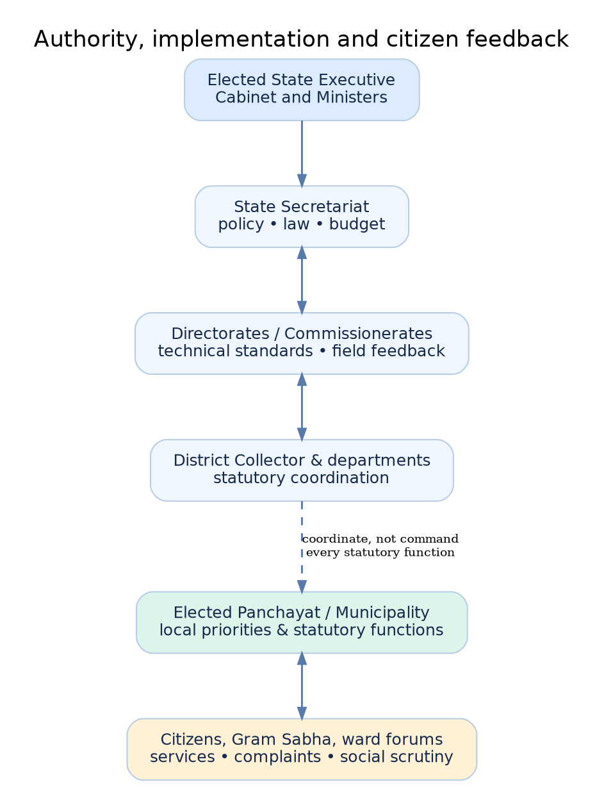
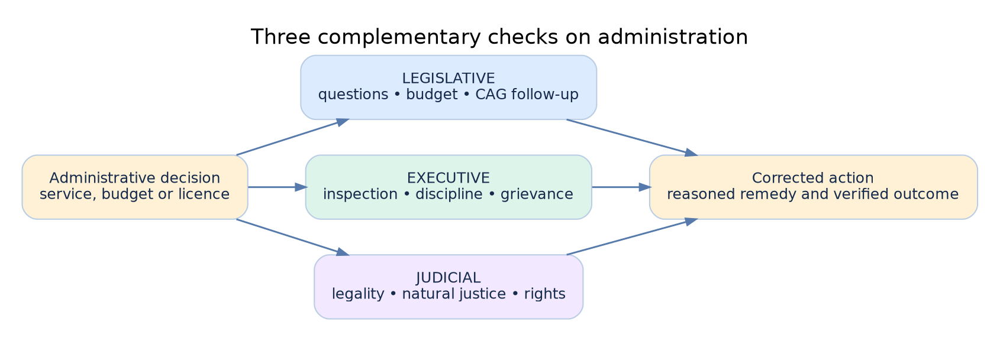

# Governance at State and District Levels: Secretariat, Directorates, Local Institutions and Administrative Controls

**TGPSC Group I | Paper III | Unit III | Topic 2 | Expanded draft | 31 October 2026**

**ACADEMIC STATUS: NOT APPROVED.** Original practice MCQs and mains answers only; no verified official PYQ claim.

**Reader's guide:** Read the syllabus map first, then the 15 detailed chapters. Use the diagrams, revision sheets, 30 explained MCQs and six structured mains answers for consolidation. Official and primary-source links appear in the evidence register.

# Syllabus map and topic summary

**TGPSC Group I | Paper III: Indian Society, Constitution and Governance | Unit III: Governance | Topic 2.**

**Notification No. 02/2024, Annexure-II — syllabus wording:**

> Governance at State and District Levels-Secretariat and Directorates and their relationships; District Administration-Role of Collector, Institutions of Rural and Urban Governance-Powers and Functions, Systems for delivery of Services; Cooperatives, State Finance Commission; Devolution of Powers and Finances-Issues and Challenges. Development Corporations for SCs, STs, B.Cs, Minorities and Disabled Welfare; Control over Administration-Legislative, Executive and Judicial Control.

**Verification status:** The wording is cross-checked against a public reproduction of the notification [S1] and the preceding project's official-syllabus checkpoint. The TGPSC-hosted original PDF was indexed but returned HTTP 403 when opened in this run; do **not** call this a fresh direct-PDF transcription. Recheck against the official notification during academic audit.

## Exact syllabus-to-chapter map

| Syllabus phrase | Detailed chapters | Examination question to answer |
|---|---|---|
| Governance at State and District Levels | 1, 4 | Who has constitutional, statutory and delegated authority? |
| Secretariat | 2 | How do policy, cabinet, budget and government orders move? |
| Directorates and their relationships | 3 | How do policy and field expertise inform one another? |
| District Administration—Role of Collector | 4 | What are the Collector's revenue, magisterial and coordination roles and limits? |
| Rural institutions—powers and functions | 5 | Gram Sabha vs Gram Panchayat vs Mandal/Zilla Praja Parishad |
| Urban institutions—powers and functions | 6 | Municipal council/corporation vs Commissioner vs planning agency |
| Systems for delivery of services | 7 | Front-end access, authoritative decision, correction, appeal |
| Cooperatives | 8 | Member autonomy, registration, audit, 1964 vs 1995 Acts |
| State Finance Commission | 9 | Articles 243I/243Y, formula, recommendations and actual release |
| Devolution—issues and challenges | 10 | Functions, funds, functionaries, equalization and democratic participation |
| SC/ST/BC/minority/disabled development corporations | 11 | Institutional mandate, beneficiary targeting, credit, outcomes |
| Legislative control | 12 | Questions, law, budget, audit and committees |
| Executive control | 13 | Internal supervision, disciplinary process and grievance correction |
| Judicial control | 14 | Natural justice, statutory appeals and writ review |
| Integrated applications | 15 | Water, waste and livelihood cases linking all institutions |

## Topic summary

State governance operates through a constitutionally responsible political executive, the State Secretariat's policy and fiscal machinery, professional directorates and district field offices. The Collector coordinates revenue, magisterial and development work under particular laws; the office does not possess unlimited authority over every independent local body or department. The 73rd and 74th Amendments establish constitutional local-government frameworks, while Telangana's Panchayat Raj Act, 2018 and Municipalities Act, 2019 determine important operational powers; GHMC has separate legislation. Service delivery succeeds only when citizen access, accurate records, reasoned decisions and remedies work together. Cooperatives organize member enterprise under differing autonomy and regulation regimes. State Finance Commissions assess local fiscal needs, but recommendations require governmental and budgetary action. Development corporations address barriers faced by SCs, STs, BCs, minorities and persons with disabilities, and should be evaluated by sustained outcomes. Legislative, executive and judicial control scrutinize democratic responsibility, management and legality respectively. The common thread is to identify the lawful decision-maker, actual money and staff, measured result and effective correction mechanism.

## Learning outcomes

1. Trace an executive proposal from Telangana Secretariat through directorate, district and local institution, identifying legal and financial approvals.
2. Distinguish Collector, District Magistrate, Tahsildar, District Panchayat Officer, Mayor, Municipal Commissioner and elected Panchayat representatives.
3. Explain why Eleventh/Twelfth Schedule listings do not automatically transfer all functions and finance.
4. Compare the Telangana Cooperative Societies Act, 1964 and Mutually Aided Cooperative Societies Act, 1995 without conflating cooperatives with welfare corporations.
5. Apply Articles 243I and 243Y to an unequal local-finance allocation problem.
6. Diagnose a denied certificate, failed water scheme or delayed livelihood loan through legislative, executive and judicial controls.

## High-value misconceptions corrected

- **Collector ≠ elected district government.** A Collector is an appointed official with powers arising under law; Zilla Praja Parishad is an elected local institution.
- **Gram Sabha ≠ Gram Panchayat.** The first is a village electoral-body forum; the second is an elected local-government institution.
- **Eleventh/Twelfth Schedule ≠ automatic functional transfer.** State law, finance and staffing orders matter.
- **State Finance Commission ≠ Union Finance Commission.** Articles 243I/243Y differ from Article 280.
- **Municipalities Act, 2019 ≠ GHMC governing statute.** GHMC is expressly outside the 2019 Act's ordinary application.
- **Prajavani ≠ statutory appeal.** A grievance filing need not preserve a limitation deadline.
- **Welfare corporation ≠ constitutional commission.** They have different purposes, authorities and remedies.
- **CAG audit paragraph ≠ criminal conviction.** Audit scrutiny can prompt further investigation, legislative review and corrective action.

# Detailed textbook-grade notes

## 1. State administration: constitutional authority, political responsibility and administrative machinery

### The state as a constitutional government

State governance is not simply the downward extension of Union administration. India’s Constitution distributes legislative and executive authority among the Union and states, while giving states primary responsibility for numerous everyday services: public health, police, agriculture, local government and much of land administration. Article 162 ordinarily connects state executive power to matters on which the state legislature can legislate, subject to the Constitution and Union executive powers expressly conferred. Article 154 vests state executive power in the Governor, but Articles 163 and 164 establish the council-of-ministers system, in which elected ministers ordinarily direct administration and remain collectively responsible to the Legislative Assembly. The Governor is not an alternative routine administrative cabinet. The distinction is critical when a controversial executive decision is challenged: identify the competent minister or statutory officer, the law that confers power and the rules governing the decision rather than treating every decision as a personal act of the Governor [S2].

A state department performs multiple functions: policy design, legislative proposals, budgeting, personnel administration, monitoring, regulation and coordination. The Secretariat normally concentrates on governmental policy and financial/legislative approvals, whereas directorates and field offices provide technical leadership and implementation. But this is an organizational distinction, not a rigid constitutional separation. Some departments directly operate schemes; some commissioners exercise statutory rule-making or licensing functions; public corporations may deliver services under their own legal framework. Cabinet decisions cannot override a statute, and a departmental circular cannot validly displace rules framed under delegated legislative authority. For a mains answer, the administrative chain must be traced through **source of authority → accountable minister → department/secretariat → head of department → district/mandal/municipal implementer → citizen remedy**.

### Institutional checks and fiscal reality

A policy promise becomes an operational programme only when funds, posts, rules, procurement, data systems and monitoring arrangements exist. Under Articles 202–207, state expenditure ordinarily passes through the budgetary and legislative process; Article 266 concerns the Consolidated Fund and Public Account. A department may announce a welfare objective but cannot automatically disburse money outside the applicable appropriation and financial rules. Legislative committees and audit institutions subsequently test whether the expenditure was authorized, economical and effective. The High Court may review illegality or constitutional violations but does not itself manage a district health programme. Political accountability, internal executive supervision and judicial review therefore work at different stages [S2, S21].

### Telangana example: one service, several authorities

Consider a village drinking-water complaint in Telangana. The elected Gram Panchayat can identify and prioritize the problem; the Panchayat Secretary maintains local records; rural water-supply engineers assess source, pipes and quality; the district administration may coordinate drought relief; the state department controls larger programme finance and technical standards. A failure could arise from inadequate source water, a broken pipeline, poor contract maintenance, lack of trained operators or a delayed fund release. The administrative answer changes with the cause. An officer who lacks sanctioning power should not be blamed for a finance-department hold; equally, a state-wide policy announcement cannot excuse failure to repair a locally maintainable pump. The Telangana Panchayat Raj and Rural Development department publicly lists its Secretariat leadership, Commissionerates and engineering heads, showing this multi-tier organization [S4].

### Competing approaches and examination test

The centralizing approach argues that common standards, consolidated procurement and specialist cadres prevent capture and uneven quality. The decentralizing approach argues that local knowledge, democratic participation and rapid correction make services more responsive. Both can fail: centralized programmes may ignore local conditions, while poorly resourced local bodies may lack expertise and be vulnerable to elite domination. The sound approach is **subsidiarity with enforceable minimum standards**: assign a function to the lowest competent level, provide funds and personnel, publish outcomes and retain independent remedies. In a case study, ask who can decide, who can pay, who must implement, who can complain and who audits the result.

## 2. The State Secretariat: policy, cabinet process, finance and legislative work

### What the Secretariat actually does

The State Secretariat is the central policy and administrative coordination machinery of the state government. It comprises departments generally headed administratively by a Secretary, Principal Secretary or Special Chief Secretary and politically by the minister allocated the portfolio. It processes cabinet memoranda, government orders, proposals for legislation, service matters, interdepartmental consultations, budgets and major administrative approvals. Under Article 166, state executive action is expressed in the Governor’s name and authenticated in the manner specified by rules; Article 166(3) provides for rules for convenient transaction of government business and allocation among ministers [S2]. This does not mean the Governor personally decides every authenticated order. A signed government order is evidence of formal executive action; its legality still depends on substantive power, compliance with rules and constitutional limits.

The Secretariat is not the same as the legislature, Chief Minister’s Office, Governor’s Secretariat or a technical directorate. A legislative department or Assembly secretariat serves the legislative institution; the government Secretariat assists the political executive. In Telangana, as in other states, Finance, General Administration, Panchayat Raj and Rural Development, Municipal Administration, Scheduled Caste Development and Tribal Welfare illustrate different policy domains. Secretaries coordinate across departments where a programme crosses portfolios. For instance, an urban drainage project may require municipal approval, planning permission, water resources data, finance sanction, disaster-management inputs and land acquisition action. Coordination is not a ceremonial meeting; it should resolve which department owns a decision, which rule applies, what evidence is missing and when escalation is justified.

### File movement and the decision record

A well-maintained government file records the initiating proposal, applicable statute or scheme, facts, competing options, finance concurrence where required, legal opinion where necessary, approval of the competent authority, final order and implementation instructions. The value of a written record is not paperwork for its own sake. It preserves reasons, prevents unauthorized commitments and makes subsequent RTI, audit and judicial review possible. Yet the same system can produce delay when every small expenditure is escalated. Good secretariat reform therefore uses delegated powers, standardized checklists, time-bound concurrence, electronic file tracking and post-decision audits. **Delegation is not abdication:** the department remains accountable for policy, oversight and unlawful instructions.

A Cabinet may approve a broad programme, but operational eligibility criteria often appear in a government order or subordinate rules. Those criteria must be consistent with the parent law, constitutional equality and budget sanction. Ministers can choose priorities within lawful discretion; civil servants must advise candidly on costs and legal risks. If a minister demands that an ineligible beneficiary be included contrary to mandatory rules, the administrative duty is to record the legal impediment and follow the lawful escalation process. Political responsiveness does not authorize selective illegality.

### Telangana illustration: welfare sanction versus beneficiary delivery

Suppose the Telangana Secretariat approves financial assistance for self-employment among a target group. The welfare department must specify eligibility, subsidy/loan composition, budget head, selection procedure, grievance route and implementing corporation. A directorate or corporation translates this into application forms, bank arrangements, district targets and verification. A district committee screens applications; the treasury or corporation releases money according to sanctioned procedure. If selected applicants remain unpaid, it matters whether the bottleneck is insufficient appropriation, delayed bank linkage, a missing caste/income verification or a flawed portal. A useful mains answer separates **policy approval, administrative sanction, financial release and final delivery**, because each has a different remedy.

### Critical appraisal

Secretariat concentration offers legal and fiscal discipline but can encourage micromanagement of routine district decisions. Conversely, excessive delegation without standardized reporting can fragment accountability. Reforms should publish a schedule of delegated financial powers, create searchable government orders, require reasoned rejection and track outcomes rather than only file-disposal speed. The exam trap is to call the Secretariat the primary field implementation agency or to confuse its administrative Secretary with the elected minister.

## 3. Directorates and the Secretariat–Directorate relationship

### Head of department versus policy department

A directorate or commissionerate is commonly the professional and operational head-of-department machinery. It interprets approved policy for field officers, develops technical standards, collects programme data, supervises subordinate offices, trains staff, manages inspections and advises the Secretariat about operational realities. A Commissioner of Panchayat Raj, Director of School Education, Commissioner of Municipal Administration or Director of Scheduled Caste Development is not automatically a ministerial policymaker; the exact statutory and delegated powers vary. The Telangana government’s departmental pages distinguish the Secretary to Government from heads of department such as the Commissioner of Panchayat Raj and the Director of Scheduled Caste Development [S4, S16]. This is a concrete example of functional differentiation, not proof that every file must pass through the same chain.

The Secretariat–Directorate relationship has two directions. In the **downward direction**, the Secretariat conveys approved policy, legal interpretations, budgets, performance expectations and delegated powers. In the **upward direction**, directorates supply field data, proposals for rule changes, audit observations, demand forecasts and warnings about impracticable deadlines. A directorate that merely transmits orders becomes a bottleneck; a Secretariat that ignores field evidence writes programmes that fail during implementation. Formal authority may be hierarchical, but successful policy design requires iterative feedback.

### Coordination, specialization and accountability

A directorate often operates through regional, district and mandal officers. For a rural sanitation programme, the Secretariat may approve financing and standards; the Commissionerate issues operational guidelines and reviews district performance; the District Panchayat Officer trains and monitors Gram Panchayats; local bodies perform everyday work. Kamareddy’s official District Panchayat Office description identifies sanitation, water supply, tax collection and capacity-building for sarpanches and Panchayat Secretaries [S5]. This illustrates why monitoring must distinguish the department’s supervisory role from the elected local body's responsibilities. A directorate cannot legitimately bypass a Gram Panchayat's statutory decision process merely for convenience, nor can a Gram Panchayat ignore mandatory environmental standards.

Directorates also contain risks. Technical officers may favor engineering outputs over social inclusion; statewide performance targets may encourage inflated reporting; fragmented data systems may create incompatible beneficiary lists. An effective performance system combines input indicators (staff and money), outputs (water connections repaired), outcomes (hours of safe supply) and distribution (whether hamlets with SC/ST residents are served). Independent sample verification and citizen complaints can challenge rosy departmental reports. Audits should test both procurement compliance and whether public purposes were achieved.

### Administrative reform: workable division of labour

A practical reform charter should specify five matters for each programme: **policy owner**, **technical standard setter**, **financial sanctioning authority**, **field implementing officer** and **appeal/audit authority**. It should also state what a district can approve without Secretariat concurrence, what evidence must be sent upward and what happens when the system misses a deadline. A dashboard without clear decision rights merely displays unresolved delays. An online grievance system should direct a complaint to the officer who can actually correct the record or service.

### Contrasting viewpoints

Administrative specialists favor strong directorates for professional continuity and standardization; decentralization advocates warn that directorates can reduce local bodies to executing agents. The balance is not an either-or choice. Local bodies should determine lawful local priorities and oversee community services, while directorates ensure technical quality, training and transparent finance. The best examination illustration is a failed school or water service: explain whether the error belongs to policy design, technical guidance, staff deployment or local execution, and then match each remedy to its proper institution.

## 4. District Collector and district administration: legal powers, coordination and limits

### Historical evolution and modern office

The District Collector originated in colonial revenue administration, but the contemporary office is a multi-role coordinating institution operating under numerous laws. In Telangana’s district websites the Collector is described as heading the district administration, functioning as District Magistrate for specified magisterial and public-order responsibilities, and dealing with elections, land/revenue, planning, disaster response and coordination [S6]. These labels must not be collapsed into unlimited personal power. As **Collector**, the officer handles functions assigned under revenue and land laws; as **District Magistrate**, the officer exercises powers conferred by applicable criminal procedure and other enactments; as **district coordinator**, the officer convenes departments but may not legally replace the independent statutory decision-maker. Election work may be performed in an expressly designated capacity under election law.

The district is subdivided into revenue divisions and mandals. A Revenue Divisional Officer or Sub-Collector performs delegated revenue and magisterial functions; the Tahsildar or Mandal Revenue Officer is a crucial citizen-facing interface for revenue records, local inquiries and certificates. District websites identify Additional Collectors, District Revenue Officers and administrative sections, but precise job titles and distribution of powers can change by government order [S6, S7]. A student should therefore learn **functions and legal basis**, not memorize a supposedly permanent list of officers. The police Superintendent, municipal commissioner, District Medical and Health Officer and other departmental heads possess their own statutory responsibilities. Coordination by the Collector does not eliminate those responsibilities.

### Land, welfare and emergencies

Land administration illustrates the importance of lawful procedure. A farmer disputing a land-record entry may need correction under the applicable record-of-rights law and appeal mechanism, not a discretionary oral instruction. Acquisition for a road invokes land-acquisition law, compensation and rehabilitation safeguards; a revenue entry is not itself conclusive proof of ownership in every civil dispute. A natural disaster requires assessment of rainfall, crop damage, shelter, drinking water, health risks, expenditure rules and relief entitlements. The Collector can convene engineers, health officials and local bodies, but transparent criteria and recorded beneficiary lists are needed to avoid arbitrary exclusion.

### Telangana case: flood-affected mandal

Imagine flooding in a Godavari-side mandal. The Tahsildar documents affected habitations; engineering officials inspect damaged roads and water schemes; health staff assess contamination; police and emergency services assist evacuation; Gram Panchayats identify vulnerable residents; district administration consolidates reports and coordinates relief. The legal and financial pathway may involve state disaster-management plans and notified relief norms. The answer should not promise every household a fixed compensation amount without checking the operative government order. A robust district dashboard would record evacuation, safe water, verified damage, pending applications, sanction and payment, disaggregated by hamlet and vulnerability.

### Democratic and judicial constraints

District Collectors are influential because they integrate vertical departments in a geographically bounded space. Yet the district is not a constitutionally elected third tier equivalent to a Panchayat or Municipality. Elected local institutions must retain powers given by law, and administrative supervision must not become substitution of an unelected officer for the local council. Judicial review, statutory appeals, RTI, legislative questions and audits can scrutinize district action. A strong answer credits the Collector's crisis-coordination capacity while criticizing over-centralization, excessive discretionary gatekeeping and lack of reasoned orders. The practical reform is to separate emergency coordination from routine municipal/Gram Panchayat decisions and publish accountable service standards.

## 5. Rural governance: Gram Sabha, Gram Panchayat, Mandal and Zilla institutions

### Constitutional foundation and Telangana law

Part IX of the Constitution, inserted by the 73rd Amendment, creates a constitutional framework for Panchayats. Article 243B contemplates Panchayats at village, intermediate and district levels, subject to constitutional exceptions; Article 243A concerns Gram Sabha powers as provided by state law. Article 243G permits state legislatures to endow Panchayats with powers for economic development and social justice, including matters in the Eleventh Schedule. That Schedule lists **29 subjects**, but listing does not automatically transfer full administrative control over all 29. Elections, reservations, five-year tenure, State Election Commission and State Finance Commission provisions seek democratic continuity and fiscal accountability [S2]. The Telangana Panchayat Raj Act, 2018 (Act 5 of 2018) provides the state's operational framework for Gram Panchayats, Mandal Praja Parishads and Zilla Praja Parishads [S3].

The **Gram Sabha** is the body of persons registered in electoral rolls relating to a village or relevant area; it is not the same as the elected Gram Panchayat. The Gram Sabha enables deliberation, local accountability and identification of priorities, subject to powers conferred by law. The **Gram Panchayat** is the elected village local government; the **Mandal Praja Parishad** is the intermediate-level institution; the **Zilla Praja Parishad** is the district-level rural institution. Their membership, functions, reservations and procedures are governed by state legislation. Officials such as Panchayat Secretaries, Mandal Panchayat Officers, Mandal Parishad Development Officers and District Panchayat Officers form the administrative interface. The Telangana PR&RD department lists its Commissionerate and engineering machinery, while district descriptions explain the monitoring and training role of the District Panchayat Office [S4, S5].

### Functions, finance and participation

Village functions commonly include sanitation, drinking water, streetlights, local infrastructure and specified taxes/fees, but legal assignments and programme guidelines matter. A Gram Sabha resolution can prioritize a drain or repair; implementation requires technical estimate, procurement compliance and a funding source. Money may arrive through own-source taxes and fees, state transfers, Finance Commission grants or tied scheme funds. **Tied grants** restrict permissible uses; **untied funds** allow wider lawful local choice. A Panchayat with nominal authority but no technical staff or predictable finance cannot realistically maintain infrastructure. Conversely, a Panchayat that collects no permissible taxes may depend excessively on higher-level transfers.

### Telangana case: village solid waste management

Suppose a Gram Panchayat establishes door-to-door collection but waste remains unprocessed. The Gram Sabha can raise health concerns and demand disclosure of expenditure; the Panchayat should assess collection routes, worker safety, segregation, vehicle costs, disposal arrangements and fees. District Panchayat Officers can inspect records and provide training. Environmental and public-health requirements continue to apply. Success is not the number of bins purchased; it is safe, reliable segregation, collection and treatment, including service to distant hamlets. Public meetings should publish decisions in accessible Telugu and disclose contracts and actual expenditure.

### Critical appraisal

Proponents argue that Panchayats improve local information, representation and ownership. Critics point to caste hierarchy, unequal participation, elite capture, weak accounting, irregular elections and dependence on state cadres. Both views require evidence: elected seats and Gram Sabha meetings alone do not prove voice for marginalized women; yet centralizing every decision can suppress local accountability. Reforms include timely elections, meaningful Gram Sabha agendas, social audits, training, transparent own-source revenue, district technical support and legally clear division of work. The examination distinction is **constitutional status versus actual devolution**: the former is established; the latter must be tested against functions, funds and functionaries.

## 6. Urban governance: municipalities, corporations, planning and service responsibility

### Constitutional architecture and legal distinctions

The 74th Constitutional Amendment inserted Part IXA to give constitutional recognition to urban local bodies. Article 243Q envisages Nagar Panchayats for transitional areas, Municipal Councils for smaller urban areas and Municipal Corporations for larger urban areas, subject to the constitutional scheme. Article 243W permits state law to endow municipalities with responsibilities, including matters in the Twelfth Schedule. That Schedule contains **18 subjects** such as urban planning, land-use regulation, roads, water supply, public health, sanitation, solid waste management and urban poverty alleviation. Again, a schedule is not a self-executing transfer of staff, money or regulatory powers [S2]. Urban functions are shared with water boards, development authorities, state departments and specialized agencies; a councillor cannot lawfully issue a building permit merely because planning appears in the Twelfth Schedule.

The Telangana Municipalities Act, 2019 (Act 11 of 2019) governs municipal councils and corporations in its specified scope but **expressly excludes the Greater Hyderabad Municipal Corporation**, which is governed under a separate law. This is a high-value Telangana exam distinction [S8]. The Act provides for elected ward members and, in its relevant provisions, ward-level consultative mechanisms. Section 17 and section 30 address ward committees; their precise composition and operative implementation must be checked against current rules and amendments rather than assumed from the constitutional text alone. A Mayor or Chairperson represents the elected political side; a Municipal Commissioner heads executive administration under applicable law. In a corporation, political oversight, technical approvals and day-to-day executive functions are not interchangeable.

### Planning, metropolitan scale and accountability

Urban governance operates at overlapping scales. A neighbourhood needs drain cleaning; a city needs a networked sewer system; a metropolitan region needs land-use, transport, watershed and growth coordination. Article 243ZD provides for District Planning Committees, and Article 243ZE provides for Metropolitan Planning Committees in the circumstances specified. These are constitutional planning frameworks, not proof that every planning committee is regularly convened or controls all urban agencies. Telangana's Hyderabad metropolitan context illustrates the friction among GHMC, development authorities, water utilities, transport institutions and state departments. Residents often face a **fragmented-accountability problem**: each agency claims the defect belongs to another. A public-facing responsibility map is therefore as important as a city master plan.

### Telangana illustration: repeated urban flooding

When a low-lying Hyderabad neighbourhood floods, the relevant tasks may include clearing storm-water drains, preventing solid-waste dumping, enforcing land-use rules, maintaining culverts and coordinating lake catchment management. A ward representative can raise the issue and scrutinize municipal priorities; the Commissioner and engineers determine lawful technical action; planning authorities address encroachments or permissions within their jurisdiction; the state may sanction major infrastructure. A proper assessment separates immediate response, drainage design capacity, unauthorized construction, maintenance budget and the wider watershed. The claim that a single road widening or desilting drive will permanently solve flooding should be tested against hydrological evidence and displacement costs.

### Competing positions and reform

State-led agencies can mobilize capital and engineering expertise for metropolitan projects, while elected municipalities provide neighbourhood accountability. Too much fragmentation weakens both; unqualified municipal autonomy without resources can also fail. Effective reform assigns service standards and named responsible agencies, improves ward deliberation, integrates land-use and infrastructure data, publishes city-level financial statements and provides independent grievance escalation. Students should distinguish **municipal service delivery**, **urban planning authority**, **regulatory permission** and **metropolitan coordination** rather than treating every urban function as solely the Mayor's responsibility.

## 7. Systems for delivery of services: citizen interface, records, remedies and inclusion

### Service delivery as a chain, not a counter

A government service has at least six stages: application, identity/eligibility verification, departmental decision, payment or certificate generation, delivery, and correction/appeal. Digitizing the application stage does not automatically digitize the legally authoritative record or remove the need for field inquiry. Telangana's **MeeSeva** provides a single interface for multiple government-to-citizen and government-to-business services, including revenue certificates and other applications; the official portal offers application-status and certificate checks [S9]. It is useful evidence of the delivery architecture, but the portal's displayed transaction counts should not be copied into notes without a timestamp and consistent definitions. Service volume measures usage, not whether poor applicants receive lawful decisions.

A good service charter identifies the competent officer, documents required, fee, processing time, rejection grounds, escalation and appeal. Section 4 of the Right to Information Act, 2005 encourages proactive disclosure; an RTI request can obtain records subject to exemptions, but it is **not** the same as an appeal against the underlying administrative order. The Digital Personal Data Protection Act, 2023 introduces a statutory privacy framework, with implementation depending on notified commencement and rules; avoid assuming every provision has the same commencement date. For an examination answer, the stable principle is to collect necessary data, protect it, allow correction and provide a human remedy for disputed decisions.

### Telangana illustration: a certificate with incorrect details

Consider an applicant whose residence certificate is rejected because a historical revenue record carries a spelling mismatch. The MeeSeva operator can help file or track an application but may not have power to amend the authoritative record. The Tahsildar or another competent officer must examine supporting evidence and follow the lawful correction procedure. The citizen needs a reasoned rejection and a clear appeal or review route. Without that, the system may report fast processing while producing arbitrary exclusion. District Prajavani mechanisms provide a grievance channel, and Telangana district portals describe scheduled grievance hearings and online submission [S10]. However, filing a grievance does not automatically suspend statutory limitation periods for appeals; candidates should never advise relying on Prajavani in place of a legal remedy.

### Measurement and operational safeguards

Useful indicators include median and 90th-percentile disposal time, rejection rate by reason, pending cases beyond the notified service standard, correction turnaround, successful appeals, assisted-channel access, language accessibility and complaint recurrence. A service dashboard should separately show applications **received, decided, delivered and substantively corrected**. False duplicates and biometric failures require alternative verification. Assisted centres should publish fees to prevent unauthorized charges. Data-sharing agreements should limit purpose and retention; contractors should not reuse citizen information for marketing. Accessibility for persons with disabilities requires more than a mobile-friendly website; it may need screen-reader compatibility, physical access, offline assistance and communication accommodations.

### Efficiency versus due process

A performance manager may prefer instant automated approvals; a rights-based administrator may demand verification and an opportunity to be heard before adverse action. The correct design is risk-based: routine low-risk transactions can be automated with audit logs, while disputed eligibility or deprivation of an entitlement needs explainable reasons and effective review. In Telangana, one-stop service centres can reduce travel costs, but back-office reforms, clean registries and lawful correction procedures determine whether convenience becomes justice. A mains answer should trace the full service chain and locate failure precisely, not conclude vaguely that e-governance is good.

## 8. Cooperatives: democratic economic organization, regulation and autonomy

### Why cooperatives are distinct institutions

A cooperative is a member-oriented enterprise organized around mutual economic or social benefit, rather than an ordinary government department or a private company maximizing outside-shareholder returns. Agricultural credit societies, dairy, fisheries, handloom, thrift and marketing cooperatives can aggregate small producers, improve bargaining power and supply services where private markets are thin. Constitutional Article 43B, a Directive Principle introduced by the 97th Amendment, encourages voluntary formation, autonomous functioning, democratic control and professional management of cooperative societies. The Supreme Court's 2021 decision in **Union of India v. Rajendra N. Shah** invalidated Part IXB's application to cooperatives operating wholly within a state for want of the required state ratification, while preserving its application to multi-state cooperatives; Article 43B remained. Thus, it is incorrect to say that every state cooperative is directly governed by Part IXB in full [S2, S22].

Telangana's Cooperation Department identifies two principal regulatory traditions: the **Telangana Cooperative Societies Act, 1964**, associated with government-supported and more closely regulated societies, and the **Telangana Mutually Aided Cooperative Societies Act, 1995**, intended to promote self-reliant, accountable and more autonomous member organizations [S11]. The state's official FAQ expressly contrasts regulation with autonomy. The Registrar and district cooperative officers perform functions such as registration, inspection, inquiries, audit and statutory dispute processes. The exact powers arise under the applicable Act and rules; a district administration cannot dissolve an autonomous society merely because its policy preferences differ.

### Governance failures and safeguards

Cooperatives can fail through insider lending, delayed elections, political interference, weak bookkeeping, fraudulent membership, poor professional management and capture by dominant producers. On the other hand, a purely hands-off state can allow depositors or small members to suffer serious losses. The answer is **proportionate regulation**: independent elections, timely audited accounts, member access to records, fit-and-proper management, risk-based inspections and prompt action against fraud, while preserving legitimate business autonomy. Where cooperatives take deposits or provide regulated banking services, sector-specific banking rules and regulators may also apply; the cooperative label does not exempt them from applicable financial law.

### Telangana case: a Primary Agricultural Cooperative Society

Suppose a Primary Agricultural Cooperative Society (PACS) in a Telangana district distributes crop credit and procures produce. Members complain that loans favor office-bearers' relatives. The first inquiry is whether lending criteria and membership registers were published, whether accounts were audited and whether statutory complaint or inquiry provisions apply. The District Cooperative Officer may inspect or order inquiries under the applicable law; elected members can demand records and fair elections. District government pages document the Registrar's functions and the role of district cooperative offices [S12]. The District Collector may coordinate concerns, but cooperative-specific legal authority should not be casually attributed to the Collector.

### Debate and practical consequences

One view favors state-backed cooperatives to provide affordable credit and stabilize agricultural markets; another favors mutual-aid autonomy to prevent bureaucratic and political capture. State capital and subsidies can expand access but create dependence and moral hazard; autonomy can improve responsiveness but leave weaker members exposed to professional-manager dominance. A balanced design links support to disclosure, member education and independent audit. For exams, contrast a **cooperative as an economic institution**, a **Registrar as statutory regulator**, and a **welfare corporation as a state development instrument**—three different organizations that sometimes share similar names.

## 9. State Finance Commission: constitutional design and local fiscal capacity

### Two finance commissions, different mandates

Article 243I requires the Governor to constitute a **State Finance Commission (SFC)** within the constitutional framework and at the prescribed five-year intervals to review Panchayat finances and recommend principles for distributing state taxes, duties, tolls and fees; assigning revenue sources; grants-in-aid and other measures. Article 243Y applies the SFC review to municipalities. The state government must place recommendations and an explanatory memorandum on action taken before the state legislature as constitutionally required. By contrast, the **Union Finance Commission under Article 280** recommends, among other things, measures to augment state consolidated funds to supplement local-body resources on the basis of SFC recommendations. The two bodies are connected but not interchangeable [S2]. Telangana Panchayat Raj Act, 2018, section 244 also provides for constitution of a Finance Commission by the Governor, with provisions on composition [S3].

A commission recommendation is not automatically a directly payable entitlement for each Gram Panchayat. Fiscal effect depends on state acceptance, legislative budgeting, statutory tax assignment, grant conditions and actual release. Nor does the constitutional requirement guarantee that an SFC is always constituted on schedule or that its report is promptly implemented. The examination should distinguish **constitution**, **recommendation**, **action-taken memorandum**, **budget provision** and **cash release**. A good answer will not invent the latest Telangana SFC's recommendation percentage without consulting the relevant report and government action-taken statement.

### The local finance problem

Local bodies face a mismatch between functions and resources. Sanitation, drainage, water supply and streetlights require recurrent spending, but their own-source tax base may be narrow, valuation outdated and collection politically difficult. State transfers may be delayed or earmarked for construction rather than maintenance. Union Finance Commission grants can help, but some are tied to particular services and compliance conditions. An urban body that receives capital funds for a treatment plant but cannot pay for operators, electricity and testing may produce a nonfunctional asset. Rural bodies face similar maintenance risks with pumps, vehicles and waste-processing sheds.

An SFC can recommend objective distribution criteria: population, area, deprivation, fiscal capacity, tax effort, service needs and special geographic disadvantages. Every criterion creates trade-offs. Population-based allocation is predictable but may disadvantage sparse tribal areas with high per-capita infrastructure costs. Rewarding tax effort can encourage collections but penalize poorer bodies with weak taxable capacity. Equalization should therefore combine need and capacity, while making the formula transparent enough to audit.

### Telangana application: two Gram Panchayats

Compare a rapidly urbanizing village near Hyderabad with a remote tribal hamlet. The first may collect substantial property tax but face large solid-waste and drainage costs; the second may have little taxable property yet face expensive dispersed water supply. Giving equal rupees per village ignores population; giving equal rupees per person ignores geography and deprivation. An SFC formula could include population, settlement dispersion, service deficit and fiscal effort. The state should disclose actual allocations and release dates so residents can distinguish insufficient funds from local underspending.

### Critical appraisal

Fiscal devolution without accounting capacity risks leakage; accounting reform without predictable funds yields only better documentation of scarcity. The reform sequence is to publish SFC reports and action-taken statements, map legally assigned functions, transfer predictable untied operating funds, train local accountants, digitize but verify accounts, and audit service outcomes. **Exam trap:** the SFC is a constitutional body constituted by the Governor, but its recommendations do not replace the state legislature's budgetary authority or confer independent taxing power beyond law.

## 10. Devolution of powers and finances: the 3Fs, unequal capacity and local democracy

### From constitutional recognition to actual authority

The 73rd and 74th Amendments created a constitutional floor for local self-government, but the actual allocation of **functions, funds and functionaries**—the '3Fs'—is shaped by state legislation, rules, staffing orders and finance. A Panchayat may be named responsible for primary healthcare while doctors remain employed and transferred by the state health department; a Municipality may be accountable to citizens for drainage while major drains are owned by another agency. Such mismatches produce **responsibility without control**. An effective devolution matrix specifies which tier plans, finances, procures, maintains, regulates and answers complaints for each service. It must also specify who owns assets and who bears long-term liabilities [S2, S3, S8].

The Eleventh and Twelfth Schedules list potential functional domains, not a guaranteed transfer of every department. The State Election Commission is a separate constitutional institution for local elections under Articles 243K and 243ZA; it is not the State Finance Commission and not the Election Commission of India. Local elected representatives cannot exercise police, judicial or land-title powers simply by passing resolutions. At the same time, state executives should not convert Panchayats into powerless agencies that only stamp predesigned schemes. Constitutional design calls for democratic participation within legally allocated competencies.

### Administrative and social obstacles

Common obstacles include insufficient own-source revenue, vacant engineering and accounting posts, delayed grants, complicated procurement, poor asset registers, multiple parallel agencies, weak data quality and limited ability to enforce local fees. Social power matters too. Women and SC/ST representatives may hold reserved offices while informal elites control contracts or meetings. Gram Sabha participation can be distorted by meeting timing, language and intimidation. Urban ward meetings may have weak attendance or no effective link to budgets. Capacity building should therefore include legal literacy, procurement, public speaking, budgeting and safeguards against coercion, not merely software training.

### Telangana example: a multi-village water network

A Gram Panchayat can identify a failed tap connection but may not control a trunk pipeline serving multiple villages. The Mandal or district may coordinate technical repairs, while the state engineering wing manages capital replacement. Without a service-level agreement, the citizen is passed from Panchayat to contractor to state department. A devolution compact would designate an accountable customer-service owner, maintenance budget, escalation timetable and technical responsibility at each level. Performance should be measured by safe water delivered, not just kilometers of pipeline installed. The same logic applies to city drainage networks crossing ward and municipal boundaries.

### Decentralization versus equalization

Local discretion can tailor services to actual demand and strengthen accountability, but excessive decentralization can widen inequalities between wealthy and poor jurisdictions. Central or state equalization can protect minimum standards but may encourage dependency and one-size-fits-all schemes. A sensible approach guarantees essential service floors, allows locally determined priorities above that floor, finances poorer jurisdictions transparently and audits results. The right question is not 'more centralization or more decentralization?' but **which decision belongs at which scale, with what money, capacity and remedy?**

### Reform agenda for mains answers

Prepare a function-by-function activity map; publish devolution orders and staffing arrangements; transfer predictable formula-based grants; strengthen property-tax and user-charge administration with protections for vulnerable households; train elected representatives and secretaries; disclose tender and payment information; hold meaningful Gram Sabha and ward meetings; and connect social audits with statutory audit and corrective action. Cite Telangana's 2018 Panchayat Raj and 2019 Municipalities laws as the operational setting, but avoid presenting an unverified numerical 'devolution percentage' as settled fact.

## 11. Development corporations for SCs, STs, Backward Classes, minorities and persons with disabilities

### Purpose and institutional form

Targeted development corporations are public or government-supported institutional vehicles intended to reduce structural barriers in credit, livelihood assets, training and economic opportunity. They differ from constitutional commissions, which may investigate safeguards or make recommendations, and from line departments, which frame policy and control budgets. A corporation may administer subsidies, loans, bank-linked self-employment, entrepreneurship training, assistive devices or rehabilitation schemes under its governing instrument and government-approved guidelines. Its power is **programme-specific**, not a general right to issue caste certificates or adjudicate discrimination. The constitutional context includes Articles 14–16, Article 46's Directive Principle regarding weaker sections, and specific equality and disability legislation. Targeted support must be designed consistently with applicable law and transparent eligibility rules [S2].

Telangana's Scheduled Caste Development Department lists the **Telangana State SC Cooperative Finance Corporation** among its heads of department and institutions [S16]. A Medak district description identifies a district SC service cooperative society implementing self-employment and economic-support schemes, with a district-level managing committee involving the Collector and Executive Director [S17]. The Tribal Welfare Department lists the **Telangana State Scheduled Tribes Co-operative Finance Corporation**, often associated with TRICOR, and other tribal institutions including ITDAs; tribal finance and tribal-area administration are related but distinct [S18]. The Backward Classes Welfare Department describes its BC service cooperative finance institution and goals of education, economic development and social integration [S19]. The Minorities Welfare Department identifies the **Telangana State Minorities Finance Corporation** under its administrative control [S20]. For persons with disabilities, the **Telangana Divyangula Co-operative Corporation** describes its role in assistive devices, rehabilitation and financial/technical assistance [S14]. These are institutionally verified examples; scheme amounts, current applications and eligibility must be checked against current official orders.

### Why ordinary credit markets may not suffice

Many eligible households lack collateral, formal income records, business networks, accessible premises or the ability to absorb early losses. Women from marginalized groups may face additional restrictions on mobility and asset ownership. A loan without training, market access or reasonable repayment scheduling can increase distress rather than create an enterprise. Conversely, unconditional asset distribution without follow-up may produce unused equipment. A credible corporation should combine fair selection, appropriate financing, skills, market linkage and post-disbursement mentoring. The proper performance indicator is **sustainable livelihood improvement**, not merely the number of sanctioned applications or the value of subsidy booked.

### Telangana example: two contrasting applicants

Imagine a young Scheduled Tribe entrepreneur in a remote mandal seeking a food-processing unit, and a person with a locomotor disability in an urban area seeking adapted work equipment. The first may need transport, electricity, producer aggregation, training and market access; the second may need accessibility assessment, assistive technology and adapted premises. A uniform cash grant could fail both. TRICOR or relevant tribal institutions may facilitate the first within their scheme mandate, while the disability welfare corporation may assist the second under applicable guidelines. District officers should disclose selection criteria and coordinate with banks, skill agencies and local bodies. A rejected applicant needs reasons and an accessible grievance mechanism. Disability rights also involve enforceable duties under the **Rights of Persons with Disabilities Act, 2016**, including reasonable accommodation in appropriate contexts; welfare assistance must not be mistaken for the whole rights framework [S15].

### Critical appraisal and safeguards

Corporations may be criticized for politicized beneficiary lists, delayed budget releases, underfunded revolving funds, poor recovery and inadequate monitoring. Some critics favor direct cash transfers or mainstream bank credit instead of multiple specialized agencies; others argue that targeted institutions understand structural disadvantage and provide indispensable handholding. A good evaluation compares cost per sustainable enterprise, repayment adjusted for borrower vulnerability, gender and district coverage, grievance outcomes and long-term income change. Publish audited accounts and disaggregated outcomes; prevent duplicate benefits without excluding legitimate applicants; provide accessible application channels. **Exam trap:** the SC/ST constitutional commissions, welfare departments, development corporations and statutory disability commissioner are different bodies with different powers.

## 12. Legislative control over state administration: law, money and public scrutiny

### The legislature's three central levers

The elected legislature controls administration principally through **law-making, financial authorization and scrutiny of the executive**. State ministers are collectively responsible to the Legislative Assembly under Article 164(2); this is the foundation of parliamentary responsibility. Legislative questions, debates, calling-attention procedures, discussions on grants and committee examination can demand explanations from ministers. Under Articles 202–207, the budget, demands for grants, appropriation and relevant financial procedures provide constitutional discipline over public expenditure. The legislature can enact or amend the law that grants administrative discretion; a department cannot lawfully replace statutory rules with an informal preference [S2].

Committees can examine accounts, audit findings, undertakings and departmental performance according to the rules of the particular House. The Public Accounts Committee and related legislative mechanisms can investigate expenditure irregularities and seek departmental replies; their precise membership and jurisdiction must be checked under Telangana Legislature rules, rather than copying Parliament's committee composition. The **Comptroller and Auditor General** audits under constitutional and statutory authority; its reports are placed before legislatures and may inform committee scrutiny. CAG findings are authoritative audit observations, not criminal convictions or automatic proof of personal corruption. Legislative oversight becomes effective when audit paragraphs receive timely action-taken replies and corrective orders.

### Evidence: local-body audit in Telangana

The CAG's Telangana **Report No. 1 of 2025 on Local Bodies**, tabled in March 2026, includes a performance audit on urban solid waste management for 2017–18 to 2021–22, as well as compliance audit material. Its overview identifies planning, capital finance, segregation, collection, transport, processing, disposal and monitoring as audit dimensions [S13]. This is a valuable, dated example of how legislative oversight can go beyond asking whether a truck or processing plant was purchased. It can ask whether municipal waste was actually segregated, transported safely and processed, and whether responsible departments corrected failures. The report's audit period must not be confused with its publication or tabling year.

### Financial scrutiny as an evidence chain

An effective committee does not merely read an audit objection aloud. It asks the department to reconstruct the decision: original budget provision, administrative sanction, tender, contract, measurement, payment, asset commissioning, beneficiary outcome and action taken after the audit. For a municipal waste project, the committee should distinguish whether money was spent without authority, a contractor failed to deliver, a completed plant lacked trained operators or collection systems never supplied segregated waste. Each failure implies a different corrective order. Ministers remain politically answerable, while officers may be required to explain the administrative record. The legislature should also examine **supplementary demands for grants** and recurring maintenance liabilities; approving capital construction without operating funds creates predictable future waste. Public reporting of accepted audit recommendations and overdue compliance can make scrutiny cumulative across budget cycles rather than episodic. These procedures are subject to the state House's rules, and should not be copied mechanically from Union Parliament.

### Strengths, limits and reform

Legislative control is democratically legitimate and can expose systemic failures, but it may be weakened by party discipline, limited sitting time, incomplete records, delayed audit follow-up and political theatrics. Question Hour can reveal a problem but may not provide a sustained implementation audit. Committee hearings can examine detail but may be under-resourced. Reforms include searchable action-taken reports, regular committee review of audit recommendations, public disclosure of departmental performance, stronger research staff and explicit follow-up deadlines. A mains answer should distinguish **ex ante authorization** (budget and law), **contemporaneous questioning** (questions/debates) and **ex post accountability** (audit and committees).

## 13. Executive control over administration: supervision, service discipline and grievance correction

### Executive control: hierarchy with safeguards

Executive control comprises ministerial direction within law, supervision by Secretaries and heads of department, inspections, performance reviews, disciplinary rules, financial concurrence, vigilance, internal audit and grievance redress. The Chief Minister and Cabinet coordinate priorities; the Chief Secretary and departmental Secretaries provide administrative leadership. At district level the Collector coordinates across agencies, while heads of departments and statutory authorities retain legally assigned functions. Internal control should detect nonperformance early: unexplained procurement delay, excessive certificate rejections, repeat complaints, stock discrepancies or diversion of welfare funds. Yet supervision cannot legitimately punish a civil servant for giving accurate legal advice or override natural justice in disciplinary proceedings.

An effective executive system differentiates **monitoring** from **investigation**, **disciplinary action** from **criminal prosecution**, and **administrative appeal** from **political petition**. An internal audit may find an unsupported payment; recovery or disciplinary action requires the relevant procedure; criminal liability requires independent legal standards. Anti-corruption investigation is governed by applicable criminal law and the competent agency's powers, not by the mere existence of an adverse audit paragraph. Telangana district Prajavani hearings illustrate public-facing executive grievance handling, but they do not themselves replace courts or statutory appellate authorities [S10].

### A practical executive-control cycle

The control cycle begins with **setting a lawful service standard**, followed by collecting reliable evidence, assigning responsibility, testing causes and requiring a dated corrective action. A revenue-certificate office with a large pending queue needs a breakdown by record mismatch, field inquiry, staffing shortage and deliberate withholding; a generic direction to 'clear pendency' may reward superficial rejection. An inspection should sample actual files and contact applicants, not rely solely on the officer's dashboard. Internal audit should compare approvals with sanction limits and vouchers; vigilance inquiry is appropriate when facts indicate misconduct rather than simple lack of capacity. Corrective orders should state what is to change, who has authority to change it, what funds are required and when outcomes will be verified.

Executive accountability also has a fairness dimension. A public servant facing a disciplinary allegation is entitled to applicable procedural safeguards; arbitrary punishment can undermine professional advice. A citizen's grievance should receive a reasoned response, not a mere portal status of 'disposed'. Escalation should be independent of the officer complained against wherever practicable. Telangana's district Prajavani channels are useful intake mechanisms, but the decisive test is whether the competent department changes an unlawful or erroneous decision and records that correction. Performance reviews should reward reduction of recurring complaints and accurate service, not just the number of files closed.

### Telangana case: repeated non-delivery of an approved welfare benefit

Suppose a district welfare office marks several selected applications as 'approved', but beneficiaries have not received payments. The district head should not simply order another awareness campaign. An executive review must reconcile sanction lists, beneficiary bank details, treasury release records, corporation disbursement registers and rejected transactions. If a bank-account mismatch is the cause, the authorized officer should establish a safe correction route; if state funds were never released, the district must escalate a documented finance issue rather than blame applicants. If funds were released but diverted, internal audit and competent vigilance processes may be necessary. The review should distinguish legitimate eligibility rejections from technical failures, provide accessible assistance to disabled applicants and publish anonymized pendency by cause. Affected persons need individual reasoned responses and an escalation path. This illustrates executive control as **fact-based correction**, not only hierarchy or punishment, and explains why citizen-facing dashboards should track successful delivery rather than administrative approval alone.

## 14. Judicial control over administration: jurisdiction, natural justice and effective remedies

### Judicial control: legality, rights and procedural fairness

High Courts exercise constitutional judicial review, notably under Article 226, and the Supreme Court under Article 32 for enforcement of fundamental rights, alongside appellate jurisdiction and other constitutional powers. Judicial control asks whether administration acted **within legal authority, fairly, reasonably and consistently with constitutional rights**. Common grounds include lack of jurisdiction, violation of natural justice, irrelevant considerations, arbitrariness, discriminatory treatment, breach of mandatory procedure and disproportionate restrictions in suitable contexts. Courts can quash an unlawful decision, order reconsideration or issue appropriate directions; they do not ordinarily substitute their preferred technical policy for a lawful decision made by the competent authority [S2].

Natural justice usually requires an unbiased decision-maker and a fair opportunity to be heard where law and context demand it. Reasoned orders allow citizens to understand adverse action and enable appellate review. Remedies differ: a statutory appeal may be the ordinary first route; writ jurisdiction is discretionary and subject to doctrines including alternative remedies and delay, with recognized exceptions. A consumer complaint, RTI request, Prajavani grievance and constitutional writ are not interchangeable procedures. Students should identify the right forum and remedy for the right legal injury.

### Telangana illustration: arbitrary denial of a local licence

Suppose a municipality rejects a small vendor's licence without stating the applicable rule or giving a hearing where required. Executive review should check whether the municipal officer applied the correct law and whether similarly situated applicants were treated consistently. A statutory appeal may permit correction. Judicial review can examine arbitrariness and due process, but the court will not necessarily grant a licence if substantive eligibility remains unproven. If the same rejection pattern affects many vendors, the legislature can ask the minister about rules and administrative practice, while audit or vigilance may examine misconduct. **One decision can trigger three forms of control, each with a different question:** was policy accountable, was administration properly managed, and was the decision lawful?

### Judicial review in practical stages

For a rejected licence, first identify the statute and whether an appeal lies to a designated authority. Obtain the written order and reasons; examine whether the decision-maker had jurisdiction, whether mandatory notice and hearing requirements were followed, whether evidence was considered and whether comparable cases were treated equally. If an appeal is available, comply with its time limit and procedure; an RTI request for records is not an appeal and ordinarily does not stop the clock. A High Court petition under Article 226 may be appropriate in recognized circumstances, including jurisdictional error or serious procedural unfairness, but the court's discretionary jurisdiction and alternative-remedy principles must be respected. Remedies may include quashing, remand for fresh consideration, mandamus to perform a legal duty or suitable interim protection. A court does not generally guarantee a particular benefit where factual eligibility remains disputed.

Judicial accountability also has institutional limits. Courts rely on the record presented, cannot continuously operate thousands of municipal services and must respect lawful administrative expertise. Excessive litigation can favor better-resourced citizens. Reasoned orders, accessible legal aid, internal appeals and time-bound compliance reporting reduce the need for repeated writ petitions. The constitutional ideal is neither judicial administration of every scheme nor immunity of bureaucracy from review; it is lawful administration with independent remedies.

### Comparative appraisal

Legislative control provides democratic accountability but can be episodic; executive control provides speed and expertise but risks self-protection; judicial control protects legality and rights but may be costly and reactive. They complement rather than replace one another. The reform priority is reasoned orders, accessible statutory appeals, transparent departmental data, independent audit, timely legislative follow-up and affordable legal assistance. In an exam answer, avoid claiming that a court manages every scheme or that a minister can ignore law because the ministry has electoral legitimacy.

## 15. Integrated governance case studies: applying the full institutional map

### Case A: a failed village water scheme

A village in an interior Telangana mandal reports irregular drinking water. Begin with **fact finding**: source failure, pipeline breakage, electricity, water quality, contractor maintenance or funding delay. The Gram Sabha raises the issue; the Gram Panchayat records local priorities and immediate complaints; the Mandal and district officers coordinate verification; the rural water-supply engineering organization supplies technical assessment; the Secretariat or directorate resolves policy and finance bottlenecks outside local powers. Identify the actual owner of each asset. If a contractor was paid without functional delivery, the department and audit machinery must examine measurement books and procurement records. If water is contaminated, public-health action cannot wait for a long capital-sanction cycle. The best outcome indicator is **reliable safe water to all hamlets**, not a completion certificate alone.

The devolution question is whether the local body has maintenance authority, staff and recurrent money. The SFC question is whether predictable funds and equalization account for remote geography. The rights question concerns non-arbitrary access and public health. Legislative oversight asks whether public money produced service; executive oversight asks who failed to act; judicial review becomes relevant if unlawful denial or serious rights violations persist. A good answer identifies one responsible officer for the next action and a published escalation deadline.

### Case B: urban waste-processing plant not operating

A municipality builds a processing facility that remains idle. The municipal council can question the project; the Commissioner and engineering staff should disclose procurement, commissioning, staffing, electricity and waste-segregation arrangements; the state municipal department may control grant conditions and technical approvals. Ward committees and resident groups can report uncollected waste, but they cannot substitute for environmental compliance. CAG's Telangana local-body audit framework illustrates why examining the whole waste chain matters [S13]. If the plant lacks segregated feedstock, merely replacing a machine may not solve the problem. If workers lack safety equipment, an efficiency-only review overlooks health risks. A corrective plan should state responsibility for collection, sorting, transport, plant operations, environmental testing and disposal of rejects.

### Case C: delayed livelihood loan for a marginalized applicant

An applicant selected under a development-corporation programme receives no disbursement for months. First establish whether selection creates an enforceable entitlement under the applicable scheme, whether budget and bank approvals exist, and whether the applicant fulfilled conditions. The district welfare officer or corporation executive may hold the case; the Secretariat may control budget release; the bank may assess credit under the programme agreement. The correct remedy is a reasoned status explanation and a documented escalation route, not simply a fresh application that erases the original queue position. Evaluate success by enterprise survival, not sanctioned loan count. Where disability is involved, the process must also satisfy accessibility and non-discrimination obligations under the RPwD Act, 2016 [S15].

### Final analytical framework

Across all three cases, use a seven-question grid: **(1) What legal duty exists? (2) Which institution decides? (3) Which institution implements? (4) Who supplies funds and staff? (5) What evidence measures outcomes? (6) Where can citizens complain or appeal? (7) Who independently scrutinizes correction?** This framework prevents generic answers and connects the Secretariat, directorates, Collector, local bodies, finance, development corporations and the three forms of administrative control. It also reveals a common failure: institutions announce responsibility collectively while no single official owns the next corrective step. The purpose of good governance is to make that chain legally and practically answerable.

# Visual learning and comparison tables

## Diagram A — Accountability chain

The arrows show normal policy and feedback flows, **not** a claim that elected Panchayats or Municipalities are subordinate branches of the Collector. Legal powers must be checked under applicable laws.

## Diagram B — Three controls over administration

Legislative control asks whether elected government is answerable and expenditure justified; executive control asks whether operations are properly supervised; judicial control asks whether decisions comply with law and rights.

## Functional responsibility matrix

| Public problem | Primary legal/decision question | Likely implementer | Accountability / remedy |
|---|---|---|---|
| Revenue certificate error | Who may correct authoritative record? | Competent Tahsildar/revenue authority | Statutory review/appeal, reasoned order |
| Gram Panchayat sanitation | Which local powers and funds exist? | GP and designated sanitation staff | Gram Sabha, DPO oversight, audit |
| City drainage | Who owns drain and planning authority? | Municipal engineers/other competent agency | Council scrutiny, grievance, audit |
| PACS loan favoritism | Which cooperative Act and bylaws apply? | Society board and authorized officers | Registrar inquiry, member oversight |
| ST livelihood loan delay | Scheme sanction, bank linkage and eligibility? | Corporation/district welfare/bank | Programme grievance, departmental review |
| SFC grant not released | Recommendation vs budget vs treasury release? | State finance and local bodies | Legislative scrutiny, public allocation data |

## Local-government constitutional comparison

| Feature | Rural local government | Urban local government |
|---|---|---|
| Constitutional part | IX | IXA |
| Functional schedule | Eleventh: 29 | Twelfth: 18 |
| Core institutions | GP, MPP, ZPP; Gram Sabha distinct | Nagar Panchayat, Municipal Council, Corporation |
| Endowment article | 243G | 243W |
| SFC review | 243I | 243Y |
| Election authority | State Election Commission, 243K | State Election Commission, 243ZA |
| Telangana core law | Panchayat Raj Act, 2018 | Municipalities Act, 2019; GHMC separate |

## Local finance decision tree

| Step | Question | Evidence to request |
|---|---|---|
| 1 | Is the function legally assigned? | State Act, rule, notification |
| 2 | Is there a staff/asset owner? | Establishment and asset registers |
| 3 | What funds are available? | Own tax, grants, scheme budget |
| 4 | Are grants tied or untied? | Sanction order and conditions |
| 5 | Was money released and spent? | Treasury release, bank statements, accounts |
| 6 | Did service quality improve? | Outcome survey, inspection, complaints |
| 7 | Who reviews failure? | Local council, audit, appeal, court |

## Corporation and regulator comparison

| Body | Main purpose | Typical instrument | Exam caution |
|---|---|---|---|
| SC/ST/BC/minority/disability development corporation | Targeted livelihood and economic support | Subsidy, loan, training, devices | Scheme-specific eligibility; not a constitutional court |
| Registrar of Cooperative Societies | Regulate societies under cooperative law | Registration, inquiry, audit | Not the same as member-elected board |
| State Finance Commission | Recommend local fiscal distribution | Report and formula | Recommendation not direct cash release |
| CAG | Independent public audit | Audit report | Observation not conviction |
| High Court | Judicial review and remedies | Writ/order | Not ordinary daily programme manager |

# Standalone quick revision — Paper III, Unit III, Topic 2

**Core memory map:** **State Cabinet/Minister → Secretariat (policy and budget) ↔ Directorate (technical standards and field feedback) → District officers/Collector (lawful coordination) ↔ Elected Panchayat or Municipality (local decision) → Citizen; Legislature, executive supervisors and courts check different failures.** Do not confuse hierarchy with statutory competence.

## Constitutional anchors

| Provision | Recall |
|---|---|
| Arts. 154, 162–166 | State executive power, aid/advice, collective responsibility, conduct of business |
| Arts. 202–207 | State budget, demands for grants, appropriation and financial procedure |
| Part IX; Art. 243A, 243B, 243G | Gram Sabha, Panchayats, endowment of rural local functions |
| Art. 243I | State Finance Commission review of Panchayat finances |
| Art. 243K | State Election Commission: Panchayat elections |
| Part IXA; Arts. 243Q, 243W | Municipal types and endowment of urban local functions |
| Art. 243Y | SFC recommendations concerning municipalities |
| Arts. 243ZD, 243ZE | District and Metropolitan Planning Committees |
| Art. 280 | Union Finance Commission; distinct from SFC |
| Art. 226 | High Court writ jurisdiction; legality review |
| Art. 43B | Directive Principle encouraging voluntary, democratic, autonomous cooperatives |

## Five comparisons worth memorizing

**Secretariat / Directorate:** policy, legislation, budget and cabinet coordination / technical guidelines, field supervision, inspections and feedback. Both require legal delegation and accountability.

**Collector / Sarpanch / Municipal Commissioner:** district statutory/coordination officer / elected Gram Panchayat political head / municipal executive official. None automatically holds every other's powers.

**Gram Sabha / Gram Panchayat:** village electorate forum for participation under law / elected village local government. Gram Sabha resolutions require lawful funding and implementation.

**Telangana cooperative laws:** 1964 Act generally supports greater government regulation of supported cooperatives; 1995 mutually aided regime emphasizes member autonomy and self-reliance. Regulatory details depend on operative amendments.

**Legislative / Executive / Judicial control:** democratic questioning and financial scrutiny / supervision, inspections, discipline and grievances / legality, natural justice and constitutional rights.

## Telangana-specific legal anchors

**Telangana Panchayat Raj Act, 2018:** Gram Panchayats, Mandal Praja Parishads, Zilla Praja Parishads; section 244 addresses SFC constitution. **Telangana Municipalities Act, 2019:** applies to specified municipal councils and corporations but not GHMC, which has separate legislation. **MeeSeva:** assisted and digital G2C/G2B interface, not the sole authority to amend underlying records. **Prajavani:** executive grievance channel, not an automatic statutory appeal. **Cooperation Department:** 1964 and 1995 cooperative-law regimes. **SC, ST, BC, minority and disability development corporations:** economic support and inclusion; verify current scheme notifications before quoting amounts.

## Answer-writing structure

**Introduction:** locate constitutional/statutory mandate. **Objectives or root causes:** explain capacity and accountability problem. **Facts/measures:** specify officers, law, 3Fs and Telangana example. **Critical appraisal:** contrast central standards versus local autonomy, speed versus due process, subsidy versus sustainability. **Conclusion:** name responsible authority, predictable funding, transparent performance and effective remedy.

## Rapid recall checks

1. Which Schedule has 29 subjects? **Eleventh** (rural); **Twelfth** has 18 (urban).
2. Who constitutes the SFC? **Governor** under constitutional/state-law framework; not the Union Finance Commission.
3. Does the Collector become the head of elected Zilla Praja Parishad by virtue of being Collector? **No.**
4. Can a MeeSeva operator necessarily correct the underlying revenue record? **No; competent statutory authority is required.**
5. Does an adverse CAG report automatically convict an officer? **No; audit and criminal adjudication are different.**
6. Does a Panchayat acquire every Eleventh Schedule function automatically? **No; state law and actual devolution matter.**
7. Is GHMC ordinarily governed by the Telangana Municipalities Act, 2019? **No; the Act excludes GHMC.**
8. Does Article 43B by itself make all state cooperatives subject to the entire Part IXB regime? **No; consider the Supreme Court's 2021 ruling.**

**Last-minute method:** for any governance failure ask **law → decision-maker → implementer → funds/staff → evidence → appeal → independent oversight**. This is more examinable than a list of slogans.

# Original practice MCQs — 30 questions with explanations

**These are newly written practice questions, NOT verified official TGPSC previous-year questions.** No PYQ status is claimed.

### Q1. Which statement most accurately describes the State Secretariat?
A. It mainly provides policy, cabinet, budget and interdepartmental coordination.  B. It is the elected state legislature.  C. It is the exclusive field-level implementing agency.  D. It replaces the Governor's constitutional office.
**Answer: A. Explanation:** Secretariat departments assist the political executive with policy and governmental decisions. Directorates and district bodies often implement, while legislatures and the Governor occupy constitutionally distinct roles.

### Q2. Under which constitutional provision are rules made for convenient transaction of a state's governmental business?
A. Article 148  B. Article 243I  C. Article 166(3)  D. Article 280.

**Answer: C. Explanation:** Article 166(3) concerns rules for transaction of state government business and allocation among ministers. Article 243I concerns SFCs and Article 280 the Union Finance Commission.

### Q3. The most defensible description of a directorate is:
A. A technical/operational head-of-department organization that provides implementation leadership and feedback.  B. A constitutional court.  C. A district legislature.  D. An institution that can override every ministerial decision.
**Answer: A. Explanation:** Directorates generally translate policy into standards, field supervision and data, subject to law and delegated powers; they are not independent of lawful government policy.

### Q4. A district Collector may simultaneously be described as Collector and District Magistrate because:
A. One title automatically grants unlimited powers.  B. The Collector is elected by Gram Sabhas.  C. Different enactments assign different revenue and magisterial functions.  D. Every police order must be issued by the Collector.
**Answer: C. Explanation:** The roles arise under distinct legal sources. The Collector coordinates but cannot absorb every power of the police, municipality or other statutory body.

### Q5. The constitutional provision most directly associated with Gram Sabha is:
A. Article 243A  B. Article 280  C. Article 324  D. Article 356.

**Answer: A. Explanation:** Article 243A concerns Gram Sabha powers under state law. It does not make the Gram Sabha identical to the elected Gram Panchayat.

### Q6. Which pair is correct?
A. Eleventh Schedule—18 subjects; Twelfth—29.  B. Both have 29.  C. Eleventh—29; Twelfth—18.  D. Neither contains functional subjects.

**Answer: C. Explanation:** The rural Eleventh Schedule lists 29 subjects and the urban Twelfth Schedule lists 18. Listing alone does not automatically transfer all powers, staff and money.

### Q7. Under the Telangana Panchayat Raj Act, 2018, the three main rural tiers are:
A. Ward, Circle, Metropolitan Council.  B. Village Court, Tahsil Court, District Court.  C. Gram Panchayat, Mandal Praja Parishad, Zilla Praja Parishad.  D. Secretariat, Directorate, High Court.
**Answer: C. Explanation:** Act 5 of 2018 provides for the rural local-government institutions at village, intermediate and district levels.

### Q8. Which statement about the Telangana Municipalities Act, 2019 is correct?
A. It ordinarily governs GHMC in the same way as every other corporation.  B. It gives ward committees all police powers.  C. It repealed Part IXA.  D. It expressly excludes GHMC from its ordinary application.
**Answer: D. Explanation:** The Act specifies municipal councils and corporations but excludes GHMC, which is governed by separate legislation.

### Q9. A Municipality's functions in the Twelfth Schedule are best understood as:
A. Powers automatically exercisable without state law.  B. Judicial functions of ward committees.  C. Exclusive Union functions.  D. Potential areas for endowment through state legislation.
**Answer: D. Explanation:** Article 243W and state legislation determine actual functional assignments. The Schedule is a constitutional guide, not a self-executing municipal statute.

### Q10. Which is the best evidence of successful municipal waste management?
A. Number of bins purchased alone.  B. Number of publicity events.  C. Verified segregation, collection, processing and safe disposal outcomes.  D. Number of files sent to Secretariat.

**Answer: C. Explanation:** Outcome measurement should cover the complete service chain. Telangana's CAG local-body performance audit examines these operational dimensions.

### Q11. A MeeSeva centre receives an application but the authoritative revenue record is wrong. The most appropriate correction route is:
A. The operator unilaterally alters the record.  B. The applicant must never appeal.  C. The MLA signs a new record without authority.  D. The competent revenue authority applies lawful correction procedure.
**Answer: D. Explanation:** MeeSeva is a service interface; substantive statutory decisions and record corrections belong to competent authorities under applicable law.

### Q12. Which statement about Prajavani is most accurate?
A. Filing a grievance necessarily suspends every statutory appeal deadline.  B. It grants every requested benefit automatically.  C. It is the High Court.  D. It is an executive grievance mechanism and may complement, not replace, a statutory appeal.
**Answer: D. Explanation:** District portals describe grievance hearings and online channels. Separate statutory appeal and limitation requirements still matter.

### Q13. The State Finance Commission is constitutionally linked to:
A. Articles 243I and 243Y.  B. Articles 148 and 151.  C. Articles 32 and 136.  D. Article 324 alone.

**Answer: A. Explanation:** Article 243I concerns Panchayat finance review; Article 243Y extends the framework to municipalities. Article 280 concerns the Union Finance Commission.

### Q14. An SFC recommendation becomes a grant actually received by a Gram Panchayat only when:
A. The commission signs the report, automatically.  B. The Gram Sabha prints the report.  C. The district court declares it.  D. It passes through applicable government acceptance, budgeting and release processes.
**Answer: D. Explanation:** Recommendations and cash transfers are distinct stages. Legislature and executive financial procedures remain necessary.

### Q15. Which is NOT part of the commonly used '3Fs' devolution framework?
A. Functions  B. Funds  C. Functionaries  D. Foreign affairs.

**Answer: D. Explanation:** Effective local government needs assigned functions, predictable finance and staff/capacity. Foreign affairs is not a local-government devolution component.

### Q16. Which pairing best describes Telangana's cooperative-law contrast?
A. 1964—ordinary company law; 1995—criminal procedure.  B. 1964—more state-regulated supported societies; 1995—greater mutual-aid autonomy.  C. Both are constitutional amendments.  D. Both exclusively govern municipal corporations.

**Answer: B. Explanation:** The Telangana Cooperation Department's official FAQ distinguishes the 1964 supported-regulation framework and the 1995 mutually aided, self-reliant framework.

### Q17. Which constitutional statement about cooperatives is correct after the Supreme Court's 2021 Rajendra N. Shah ruling?
A. Article 43B was invalidated.  B. Part IXB applies without qualification to every wholly intra-state cooperative.  C. Article 43B remains, while Part IXB's application to wholly intra-state cooperatives was invalidated.  D. All cooperative laws ceased to exist.

**Answer: C. Explanation:** The judgment preserved Article 43B and the multi-state scope of Part IXB while striking its application to cooperatives operating wholly within states.

### Q18. The statutory official generally associated with cooperative registration and regulatory inspection is the:
A. Registrar of Cooperative Societies or delegated cooperative officer.  B. Chief Justice of India.  C. Union Election Commissioner.  D. Municipal Mayor in every case.

**Answer: A. Explanation:** State cooperative statutes assign registration, inquiry, inspection and related functions to the Registrar and authorized officers.

### Q19. Which institution is most specifically oriented toward livelihood and financial support for eligible Scheduled Tribe beneficiaries in Telangana?
A. Telangana State Scheduled Tribes Co-operative Finance Corporation (TRICOR).  B. Election Commission of India.  C. High Court Registry.  D. State Public Accounts Committee.

**Answer: A. Explanation:** The Tribal Welfare Department identifies the ST cooperative finance corporation among its organizations. Scheme benefits depend on operative eligibility and funding.

### Q20. The Telangana Divyangula Co-operative Corporation primarily illustrates:
A. A constitutional appellate court.  B. An economic/rehabilitation assistance institution for persons with disabilities.  C. A parliamentary committee.  D. The office of Governor.

**Answer: B. Explanation:** Its official profile describes assistive devices, rehabilitation and financial/technical support. Disability rights also arise under the RPwD Act, 2016.

### Q21. Which statement best distinguishes a welfare corporation from a constitutional commission?
A. Both always adjudicate crimes.  B. A welfare corporation delivers defined development support; a constitutional commission has its own oversight mandate.  C. Every welfare corporation is created by the Constitution.  D. No welfare corporation may have a board.

**Answer: B. Explanation:** Institutional form and authority differ. For example, the SC development corporation does not acquire the constitutional commission's Article 338 functions.

### Q22. A state legislative committee examines a CAG finding. Which conclusion is justified?
A. The finding itself convicts an officer.  B. The committee can scrutinize expenditure and demand departmental explanations within its rules.  C. The committee becomes the criminal court.  D. The audit report automatically changes the budget law.

**Answer: B. Explanation:** Audit informs legislative accountability. Criminal guilt and recovery require separate competent processes and evidence.

### Q23. Which is an example of executive rather than judicial control?
A. A departmental inspection and disciplinary inquiry conducted under service rules.  B. A High Court writ order.  C. Supreme Court appellate judgment.  D. A judicial decree in a civil suit.

**Answer: A. Explanation:** Executive control includes supervision, internal audit, lawful disciplinary procedures and grievances. Courts review legality through judicial mechanisms.

### Q24. A municipality denies a licence without reasons despite a mandatory hearing requirement. The most direct judicial concern is:
A. Whether a minister likes the applicant.  B. Natural justice, legality and arbitrariness.  C. Whether a Panchayat has enough property tax.  D. Whether a cooperative has audited accounts.

**Answer: B. Explanation:** Judicial review examines lawful authority, fair process and constitutional limits. The court does not automatically substitute its own licensing decision.

### Q25. A village receives a water-pipeline grant, but water never reaches remote hamlets. The best first governance analysis is:
A. Announce a new scheme without diagnosis.  B. Count the length of pipeline as complete success.  C. Identify asset ownership, technical fault, maintenance finance, responsible authority and remedy.  D. Send every complaint directly to Parliament.

**Answer: C. Explanation:** This maps legal duties, functions, funds, functionaries and measured outcomes. It identifies whether the failure is technical, fiscal, contractual or administrative.

### Q26. Under Article 167, which duty is expressly assigned to the Chief Minister of a State?
A. Communicate Council of Ministers decisions on State administration and proposals for legislation to the Governor.  B. Submit every High Court judgment for approval by the Governor.  C. Personally certify all municipal election results.  D. Issue binding directions to the State Finance Commission on every grant.

**Answer: A. Explanation:** Article 167(a) requires the Chief Minister to communicate the Council of Ministers' relevant decisions and legislative proposals to the Governor. Option B confuses judicial decisions with executive communication; C concerns local elections under Article 243ZA, not the Chief Minister's Article 167 duty; D invents an instruction power over the SFC, whose constitutional functions appear in Articles 243I and 243Y. [S2, Article 167(a)].

### Q27. Article 243S(1) expressly requires Wards Committees within the area of which type of Municipality?
A. Every Gram Panchayat regardless of population.  B. A Municipality having a population of three lakhs or more.  C. Only a metropolitan area with at least ten lakh residents.  D. Every Municipality with at least fifty thousand residents.

**Answer: B. Explanation:** Article 243S(1) specifies a Municipality with population of three lakhs or more; State law determines composition and territorial areas under clause (2). A confuses rural Panchayats with municipalities; C substitutes the different metropolitan-area definition and threshold; D invents a lower threshold. Article 243S(5) permits additional committees under State law, which does not alter the clause (1) minimum requirement. [S2, Article 243S].

### Q28. Subject to earlier lawful dissolution, when does a Municipality's five-year constitutional term under Article 243U(1) begin?
A. When the election results are first announced.  B. When its first annual budget is passed.  C. On the date appointed for its first meeting.  D. On the day the next State Assembly is elected.

**Answer: C. Explanation:** Article 243U(1) measures the five years from the date appointed for the Municipality's first meeting, unless sooner dissolved under law. A, B and D substitute events not used as the constitutional starting point. The provision also requires an opportunity of being heard before dissolution under its first proviso. [S2, Article 243U(1)].

### Q29. Which proposition about municipal taxes is consistent with Article 243X?
A. A Municipality may impose any tax without statutory authorization.  B. Only Parliament may permit a Municipality to collect fees.  C. A State Finance Commission report itself creates a municipal tax.  D. A State Legislature may by law authorize municipal taxes, duties, tolls and fees subject to specified procedures and limits.

**Answer: D. Explanation:** Article 243X(a) empowers State legislation to authorize a Municipality to levy, collect and appropriate specified revenues within legal limits. A ignores the statutory framework; B assigns State-law authority exclusively to Parliament; C confuses a Finance Commission's recommendations under Article 243Y with legislation authorizing taxation. [S2, Articles 243X(a), 243Y].

### Q30. Which body has constitutional superintendence, direction and control of municipal elections under Article 243ZA(1)?
A. The Election Commission of India under Article 324.  B. The State Election Commission referred to in Article 243K.  C. The Comptroller and Auditor General under Article 148.  D. The State Finance Commission constituted under Article 243I.

**Answer: B. Explanation:** Article 243ZA(1) expressly vests municipal electoral rolls and elections in the State Election Commission referred to in Article 243K. A is the constitutional Election Commission for parliamentary/assembly elections; C audits public accounts; D reviews local finances. The roles are constitutionally distinct. [S2, Articles 243ZA(1), 243K, 324, 148, 243I].

## Answer key at a glance

| Q | 1 | 2 | 3 | 4 | 5 | 6 | 7 | 8 | 9 | 10 | 11 | 12 | 13 | 14 | 15 |
|---|---|---|---|---|---|---|---|---|---|---|---|---|---|---|---|
| Ans | A | C | A | C | A | C | C | D | D | C | D | D | A | D | D |

| Q | 16 | 17 | 18 | 19 | 20 | 21 | 22 | 23 | 24 | 25 | 26 | 27 | 28 | 29 | 30 |
|---|---|---|---|---|---|---|---|---|---|---|---|---|---|---|---|
| Ans | B | C | A | A | B | B | B | A | B | C | A | B | C | D | B |

# Mains practice questions and model answers

**All six are original practice questions, not authenticated official PYQs.** Each answer is designed for approximately 200–250 words excluding the question and section headings.

## Model Answer 1. Explain the relationship between the State Secretariat and Directorates. How can Telangana improve coordination?

### Introduction / background

The Secretariat and directorates are complementary parts of state administration. Under Article 166, the state conducts government business through rules and competent authorities. The Secretariat primarily coordinates policy, cabinet proposals, budgets and legislation, while directorates supply technical leadership, field supervision and implementation feedback.

### Objectives and institutional roles

Secretariat departments define lawful priorities, sanction resources and resolve interdepartmental disputes. Directorates translate policy into operational standards, inspect subordinate offices, train personnel and report bottlenecks. Telangana's Panchayat Raj department illustrates this relationship through its Secretary, Commissionerates and engineering heads. Neither institution should be mistaken for an elected local body.

### Facts, measures and Telangana illustration

For a village drinking-water programme, the Secretariat may approve financial rules; engineers define specifications; district officers coordinate field work; the Gram Panchayat reports service failures. A useful reform is a public responsibility matrix naming the policy owner, sanctioning authority, implementer, maintenance officer and appeal route. Shared dashboards should track safe-water availability rather than only pipeline construction.

### Critical appraisal

Strong central coordination protects technical standards and financial discipline, but excessive Secretariat approvals can delay routine repairs. Unchecked delegation can create inconsistent practices. Performance reporting must therefore be paired with lawful financial powers, independent checks and field feedback.

### Conclusion

Telangana should delegate routine decisions with clear thresholds, publish government orders, enforce response deadlines and evaluate citizen outcomes. Secretariat policy and directorate expertise work best as a two-way accountability relationship, not a one-way file-transfer chain.

## Model Answer 2. Critically examine the changing role of the District Collector in Telangana administration.

### Introduction / background

The District Collector evolved from a revenue-centered office into a multi-functional district coordinator. In Telangana, the Collector operates under different legal capacities, including revenue authority and District Magistrate, and coordinates development, elections and emergency response. These roles do not confer unlimited jurisdiction.

### Objectives and core functions

The Collector helps integrate revenue divisions, mandals, departmental officers and disaster-management work. Tahsildars maintain crucial citizen-facing functions; district health, police and municipal officials retain their own statutory duties. Effective district governance requires identifying which official may decide, spend and hear an appeal.

### Telangana example and measures

During flooding in a Godavari-side mandal, the Collector can coordinate evacuation, damage verification, drinking water and relief. The Tahsildar gathers local records; engineers assess infrastructure; health staff prevent outbreaks; Gram Panchayats identify vulnerable hamlets. Relief eligibility and payments must follow notified norms. A district dashboard should publish verified claims, pending cases, reasons for rejection and payment status.

### Critical appraisal

A strong Collectorate can act rapidly across fragmented departments, particularly during emergencies. However, routine centralization may undermine elected Panchayats and municipalities. Political pressure, heavy workload and poorly reasoned land decisions can weaken trust. Grievance meetings alone cannot replace statutory appeals or judicial remedies.

### Conclusion

The modern Collector should be a legally bounded coordinator and accountable problem-solver. Clear delegations, reliable land records, transparent relief criteria and respect for local democracy can combine administrative effectiveness with constitutional safeguards.

## Model Answer 3. Why has constitutional recognition not guaranteed effective devolution to rural and urban local bodies?

### Introduction / background

The 73rd and 74th Amendments gave constitutional status to Panchayats and municipalities. The Eleventh Schedule lists 29 rural subjects and the Twelfth 18 urban subjects. Yet Articles 243G and 243W leave substantive endowment of many functions to state law.

### Root causes

The main obstacle is incomplete transfer of functions, funds and functionaries. Local bodies may face service responsibility without engineers, predictable operating grants or control over assets. State agencies often retain water, planning and staffing powers. Weak accounting, elite capture and uneven participation further reduce autonomy.

### Facts, measures and Telangana examples

Telangana's Panchayat Raj Act, 2018 and Municipalities Act, 2019 provide operational frameworks; GHMC is governed separately. A village may report a failed tap while the trunk pipeline is managed by a state engineering wing. A municipality may answer flooding complaints while land-use authority rests elsewhere. Devolution must specify who owns infrastructure, sanctions maintenance and hears grievances.

### Critical appraisal

Central technical standards can protect quality and equalization, especially in poorer areas. However, excessive control converts elected bodies into implementation agents. Pure local autonomy may deepen inequalities where the tax base and professional capacity are weak. Both democratic voice and service standards matter.

### Conclusion

Publish activity maps for each service, transfer formula-based funds, provide skilled staff, strengthen Gram Sabha and ward scrutiny, and audit outcomes. Constitutional recognition becomes meaningful only when lawful authority, financial capacity and citizen accountability coincide.

## Model Answer 4. Assess the role of State Finance Commissions in strengthening local self-government, with Telangana examples.

### Introduction / background

State Finance Commissions are constitutionally provided under Articles 243I and 243Y. They review local-body finances and recommend principles for distributing state revenues, assigning taxes and providing grants. They are distinct from the Union Finance Commission under Article 280.

### Objectives and fiscal problem

Local bodies must maintain water, sanitation, roads and streetlights, but own-source taxes may be limited and transfers uncertain. Capital grants can build assets without financing recurrent electricity, staffing and maintenance. The SFC is intended to diagnose this vertical and horizontal fiscal imbalance.

### Telangana example and measures

Section 244 of the Telangana Panchayat Raj Act, 2018 addresses SFC constitution. Consider a prosperous peri-urban Gram Panchayat and a sparsely populated tribal village. Equal per-capita transfers overlook geographic costs, while equal grants per village ignore population. A sound formula combines service deficits, population, remoteness, fiscal capacity and reasonable tax effort. Reports, action-taken statements, allocations and release dates should be public.

### Critical appraisal

Recommendations do not automatically create spendable cash. State acceptance, legislative budgeting and treasury release remain essential. Overly tied grants can limit local priorities; fully untied transfers without audited accounts can weaken safeguards. Fiscal incentives must not punish jurisdictions with structurally poor tax bases.

### Conclusion

Effective SFCs require timely constitution, transparent evidence, legislative follow-up, predictable releases and capable local accounting. The test of fiscal devolution is whether local bodies can sustain equitable services, not merely whether a commission has submitted a report.

## Model Answer 5. Compare cooperatives with welfare development corporations in Telangana. Discuss their accountability challenges.

### Introduction / background

Cooperatives are member-oriented enterprises, whereas welfare development corporations are institutional instruments for targeted economic support. Both may carry 'cooperative' in their names, but their ownership, mandates and decision rights must be examined separately.

### Objectives and legal framework

Telangana's Cooperative Societies Act, 1964 is associated with government-supported regulation, while the Mutually Aided Cooperative Societies Act, 1995 emphasizes self-reliance and member autonomy. The Registrar supervises statutory matters. Welfare corporations for SCs, STs, BCs, minorities and persons with disabilities administer specified livelihood, credit or rehabilitation programmes under governmental guidelines.

### Telangana evidence and measures

The state lists the SC Cooperative Finance Corporation, ST cooperative finance institution (TRICOR), BC welfare finance institutions, Minorities Finance Corporation and Divyangula Co-operative Corporation. A PACS requires transparent membership, elections and audited lending. A welfare corporation requires fair beneficiary selection, accessible applications, bank coordination, training and monitoring of enterprise survival.

### Critical appraisal

Cooperatives risk insider lending and political capture; corporations risk delayed subsidy releases, opaque selection and poor follow-up. Heavy state control can undermine member autonomy, but no oversight can expose weaker members to fraud. Subsidies may address structural exclusion, yet loans without market access may increase indebtedness.

### Conclusion

Strengthen member governance and risk-based cooperative regulation, while auditing welfare corporations by sustainable livelihoods and equitable reach. Public disclosure, grievance redress and independent evaluation should follow the legal form and purpose of each institution.

## Model Answer 6. Distinguish legislative, executive and judicial control over state administration using a Telangana service-delivery case.

### Introduction / background

Democratic administration must be lawful, effective and answerable. Legislative, executive and judicial controls pursue related but different purposes: political and financial accountability, internal managerial correction, and protection of legality and rights.

### Objectives and instruments

The legislature uses questions, debates, laws, grants and committees to scrutinize ministers and expenditure. Executive control uses inspections, supervision, audits, grievance redress and lawful disciplinary procedures. Courts review jurisdiction, natural justice, arbitrariness and constitutional compliance, including through High Court writ jurisdiction under Article 226.

### Telangana example and facts

Suppose a municipality buys waste-processing equipment that remains idle. A legislative committee may examine CAG observations and demand departmental explanations. The municipal department and Commissioner should investigate procurement, staffing, waste segregation and maintenance contracts. Affected residents can pursue applicable administrative remedies; judicial intervention may be warranted for unlawful decisions or serious rights violations. Telangana's CAG local-body report tabled in 2026 examines waste-management planning, collection, processing and monitoring.

### Critical appraisal

Legislative scrutiny can be partisan or delayed; executive inquiries may protect insiders; litigation may be costly and reactive. A CAG observation is not itself a criminal conviction, and a Prajavani grievance is not necessarily a statutory appeal. Oversight fails when no authority follows up corrective action.

### Conclusion

Combine reasoned orders, time-bound internal correction, accessible appeals, public audit follow-up and judicial review. Effective checks should identify who must repair the service, who pays, who verifies results and how citizens obtain redress.

# Authoritative evidence register and academic audit ledger

**Evidence date:** 23 October 2026; additional Article 167/243S/243U/243X/243ZA text checks on 31 October 2026. **Status:** internally checked draft, **NOT academically approved**. The numbered references are part of the student-facing evidence trail; they are not claims of verified official PYQs.

| ID | Primary source and link | Specific proposition checked | Limit / caution |
|---|---|---|---|
| S1 | [TGPSC Group I Notification 02/2024 — official indexed PDF](https://websitenew.tgpsc.gov.in/preview/RElSRUNUUkVDUlVJVE1FTlROT1RJL05PVElGSUNBVElPTl9OT18wMi0yMDI0X0dyb3VwLUlfU2VydmljZXMgKDEpMjAyNDAyMjAxNDA3MzcucGRmr95v17a0y2d8i13v); [public syllabus reproduction](https://prepshark.in/tgpsc/group-1/syllabus) | Paper III Unit III Topic 2 wording | Official host returned 403 during this run; re-verify primary PDF later |
| S2 | [Legislative Department — Constitution of India in English](https://www.legislative.gov.in/document/constitution-of-india-in-english) | Arts. 154, 162–166, 202–207, 243A–243ZE, 280, 43B, 226; Schedules 11 and 12 | Verify amendments effective on exam date |
| S3 | [India Code — Telangana Panchayat Raj Act, 2018, Act 5 of 2018](https://www.indiacode.nic.in/bitstream/123456789/8492/1/Act%205%20of%202018.pdf) | GP, MPP, ZPP; section 244 SFC | Subsequent amendments and rules may modify details |
| S4 | [Telangana PR & RD Department](https://www.telangana.gov.in/departments/panchayat-raj-and-rural-development/) | Secretariat, Commissionerates, technical heads | Officeholder names change; avoid memorizing them |
| S5 | [Kamareddy District Panchayat Office](https://kamareddy.telangana.gov.in/panchayat/) | DPO sanitation, water, tax and training functions | District-specific description |
| S6 | [Jagtial District Collectorate](https://jagtial.telangana.gov.in/collectorate/) | Collector, revenue and district sections | Administrative assignments may be revised |
| S7 | [Siddipet District administrative setup](https://siddipet.telangana.gov.in/administrative-setup/) | Additional Collector (local bodies), RDO and Tahsildar | Titles vary across districts/time |
| S8 | [India Code — Telangana Municipalities Act, 2019](https://www.indiacode.nic.in/bitstream/123456789/13843/1/AAA2019tell.pdf) | Municipal law scope; GHMC exception; ward committees | Check operative amendments and GHMC's separate statute |
| S9 | [Official Telangana MeeSeva portal](https://ts.meeseva.telangana.gov.in/meeseva/home.htm) | G2C/G2B services, status tracking | Portal counters may be volatile/inconsistent |
| S10 | [Medak district Prajavani grievance page](https://medak.telangana.gov.in/service/how-to-lodge-a-grievance/) | Executive grievance mechanism | Not equivalent to a statutory appeal |
| S11 | [Telangana Cooperation Department FAQ](https://cooperation.telangana.gov.in/Faq.aspx) | 1964 supported-regulation and 1995 mutual-aid autonomy contrast | Read operative acts for legal disputes |
| S12 | [Nizamabad District Cooperation Department](https://nizamabad.telangana.gov.in/departments/district-cooperation/) | Registrar, district officer, supervision and registration | District-specific administrative structure |
| S13 | [CAG Telangana Local Bodies Report No. 1 of 2025](https://cag.gov.in/ag/telangana/en/audit-report/details/124977) | Solid-waste performance audit, period ended March 2022; tabled March 2026 | Audit period ≠ report year ≠ tabling date |
| S14 | [Telangana Divyangula Co-operative Corporation](https://tvcc.telangana.gov.in/) | Disability assistance, devices, livelihood rehabilitation | Benefits depend on current programme guidelines |
| S15 | [India Code — Rights of Persons with Disabilities Act, 2016](https://www.indiacode.nic.in/handle/123456789/13684) | Equality, employment, accessibility, commissioner | Check applicable rules and notifications |
| S16 | [Telangana Scheduled Caste Development Department](https://www.telangana.gov.in/Departments/Social-Welfare/) | SC Cooperative Finance Corporation and department functions | Site labels may retain legacy names |
| S17 | [Medak district SC Corporation](https://medak.telangana.gov.in/sc-corporation/) | District SC economic-support society, committee and schemes | Local example, not universal procedure |
| S18 | [Telangana Tribal Welfare Department](https://www.telangana.gov.in/departments/tribal-welfare/) | ST finance corporation, ITDAs, tribal institutions | Scheme status can change |
| S19 | [Telangana Backward Classes Welfare Department](https://www.telangana.gov.in/Departments/Backward-Classes-Welfare/) | BC service cooperative finance institution, policy objectives | Historical formation dates not current scheme availability |
| S20 | [Telangana Minorities Welfare Department](https://www.telangana.gov.in/departments/minorities-welfare/) | Minorities Finance Corporation and welfare mandate | Officeholders and programme availability change |
| S21 | [CAG Duties, Powers and Conditions of Service Act, 1971](https://www.cag.gov.in/en/page-duties-power-and-conditions-of-services-act) | Constitutional/statutory audit framework | Audit finding does not establish criminal guilt |
| S22 | [Supreme Court — Union of India v. Rajendra N. Shah, 20 July 2021](https://api.sci.gov.in/supremecourt/2013/21321/21321_2013_32_1501_28728_Judgement_20-Jul-2021.pdf) | Part IXB invalid as to wholly intra-state cooperatives; Article 43B survives | Read majority holding and separate opinion carefully |

## Claim-by-claim internal checks

- **Constitutional categories:** State Finance Commission (Arts. 243I/243Y) distinguished from Union Finance Commission (Art. 280); State Election Commission (243K/243ZA) distinguished from both.
- **Local-body schedules:** 29 Eleventh Schedule subjects and 18 Twelfth Schedule subjects; no assertion of automatic total devolution.
- **State-law exception:** Telangana Municipalities Act, 2019 excludes GHMC from its ordinary application.
- **District powers:** Collector/District Magistrate roles described as legally bounded; no claim of universal power over police, local councils or courts.
- **Cooperatives:** 1964/1995 regimes distinguished; Rajendra N. Shah holding considered; no false claim that Article 43B was struck down.
- **Audit:** CAG report's audit period and legislative tabling year differentiated; no audit finding treated as conviction.
- **Corporations:** Named SC/ST/BC/minority/disability institutions supported by Telangana departmental pages; no invented current subsidy amounts.
- **Service delivery:** MeeSeva front office distinguished from competent record authority; Prajavani not confused with statutory appeal.
- **Questions:** 30 original MCQs with explanations (five added 31 October 2026), six original mains model answers; zero verified official PYQs. The 25 pre-existing questions have not received a complete independent key-and-distractor audit.
- **Outstanding academic audit:** verify official notification PDF directly when accessible; review Telangana Acts for amendments through examination date; check individual citations, legal nuance, scheme status and visual accessibility with subject expert. **Approval count remains zero.**

## Cycle 118: five constitutional-text practice MCQs (author-side, not independent certification)

The [Legislative Department Constitution of India, July 2025 publication](https://www.legislative.gov.in/static/uploads/2025/07/359f70a69695affb9d72f8393102bd2e.pdf) was directly consulted for Articles 167, 243S, 243U, 243X and 243ZA on 31 October 2026. These are **original practice questions**, not official TGPSC PYQs. The checks below support the narrow constitutional propositions, not current Telangana implementation or the other 25 MCQs.

| Question | Correct option and directly checked provision | Why each of the three distractors fails |
|---|---|---|
| Q26 | A — Art. 167(a): Chief Minister communicates Council decisions and legislative proposals to Governor | B: High Court judgments are not this communication duty; C: municipal election administration is State Election Commission under 243ZA; D: no blanket CM direction to SFC in 167. |
| Q27 | B — Art. 243S(1): Wards Committees for Municipalities with population >= 3 lakh | A: rural Panchayat is not Municipality; C: 10 lakh metropolitan concept differs; D: 50,000 is not 243S(1)'s threshold. Additional committees under 243S(5) remain possible. |
| Q28 | C — Art. 243U(1): five years from appointed date of first meeting, unless lawfully dissolved earlier | A: result declaration not starting date; B: budget passage not starting date; D: State Assembly election not starting date. |
| Q29 | D — Art. 243X(a): State legislation may authorize local levy with limits | A: not unconditional municipal power; B: not exclusively Parliament; C: SFC recommendation is not a taxing enactment. |
| Q30 | B — Art. 243ZA(1): State Election Commission referred to in 243K | A: ECI Article 324 is different; C: CAG Article 148 is audit; D: SFC Article 243I is finance review. |

**Editorial-only reordering:** Nine existing B-keyed questions (Q1, Q3, Q4, Q7, Q8, Q9, Q11, Q12, Q14) had the correct option proposition moved to another letter with the same four substantive options; no legal claims were rewritten. This reduces answer-position cueing but is **not** a substitute for verifying those nine keys or all 75 original distractors. After addition the distribution is A8/B7/C8/D7.

**Open gates:** R1 official notification direct access, all 30 keys and 90 distractors independent audit, six mains claim-level audit, state-law amendment currency, accessibility, and independent named reviewer. R9 NOT_STARTED, approvals ZERO.

