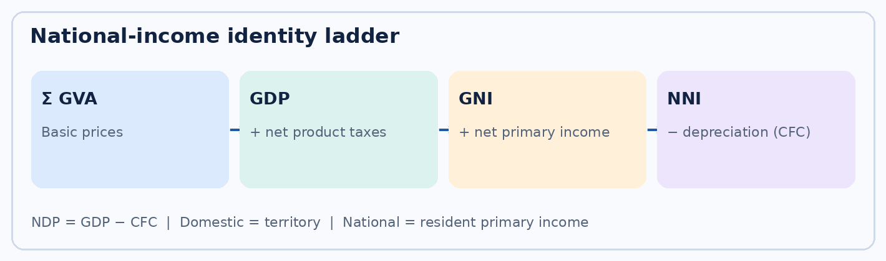
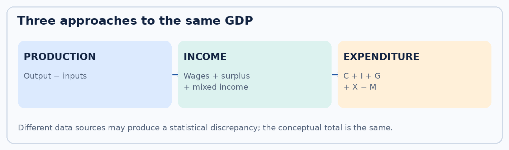
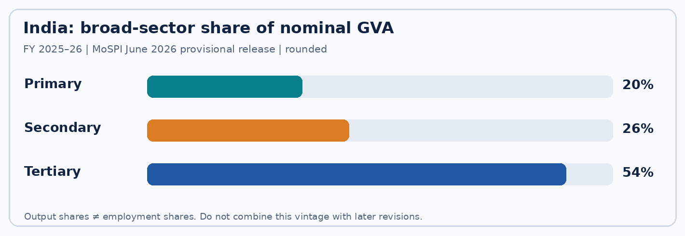

# Visual learning and exam tables

## Diagram A — National-income identity ladder

Start with basic-price GVA, add net product taxes to get market-price GDP; adjust for net primary income from abroad to get GNI; subtract CFC to get NNI. Alternatively subtract CFC directly from GDP to get NDP. Do not confuse external primary income with current transfers.

## Diagram B — Three methods, one conceptual aggregate

Production: value added. Income: factor incomes and taxes/subsidies. Expenditure: final consumption, capital formation and net exports. The three converge conceptually; observed estimates may show statistical discrepancy.

## Diagram C — Indian sectoral composition (illustrative official-release vintage)

Broad-sector percentages are rounded approximations from the **5 June 2026** MoSPI FY 2025–26 provisional release's current-price GVA graphic: primary about 20%, secondary about 26%, tertiary about 54%. This is **not** an employment distribution and is not necessarily identical to a subsequently revised release.

## Comparison table: frequently confused measures

| Measure | Key distinction | Common mistake |
|---|---|---|
| GDP vs GVA | GDP market price includes net product taxes; GVA is basic-price value added | Adding all sector sales |
| Domestic vs national | Territory vs residents' primary income | Counting every remittance as GNI |
| Gross vs net | Net subtracts consumption of fixed capital | Confusing CFC with product taxes |
| Nominal vs real | Current prices vs volume-adjusted values | Calling inflation nominal growth 'real' |
| GDP deflator vs CPI | Domestic final output vs household consumption basket | Treating them as identical |
| Sectoral share vs employment | Value added composition vs worker allocation | Claiming services employ 54% of workers |
| GSDP vs state budget | Production within state vs fiscal receipts/expenditure | Treating ₹17.82 lakh crore as budget |
| First/second advance vs provisional | Different data completeness and revision vintages | Mixing 7.6% February and 7.7% June estimates |
