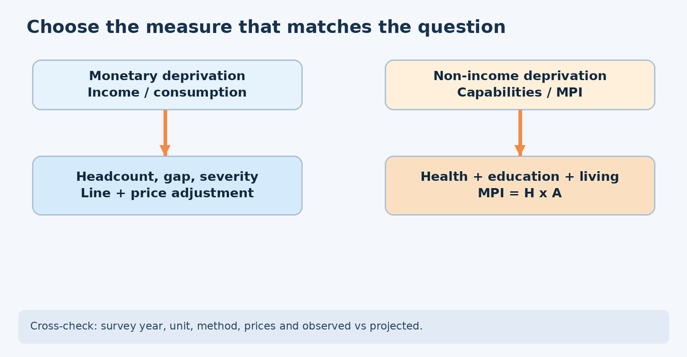
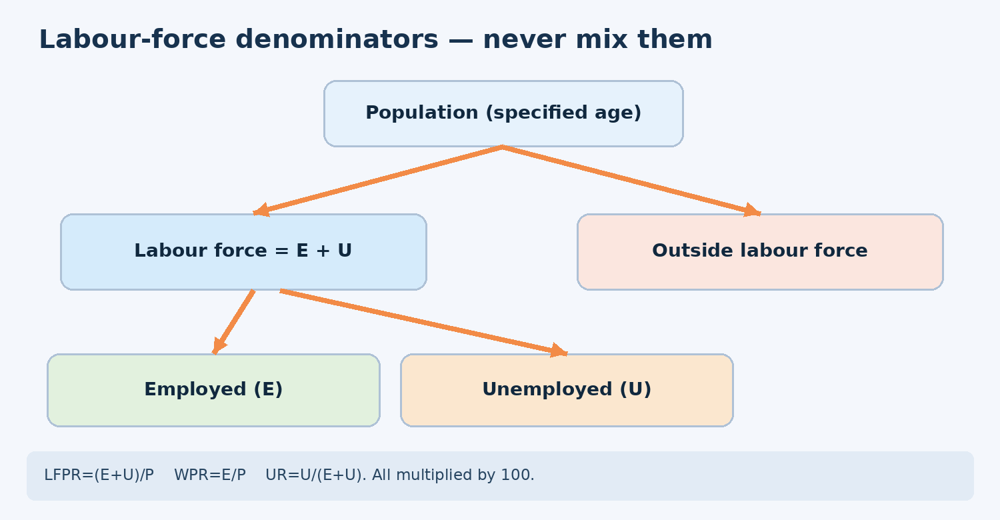
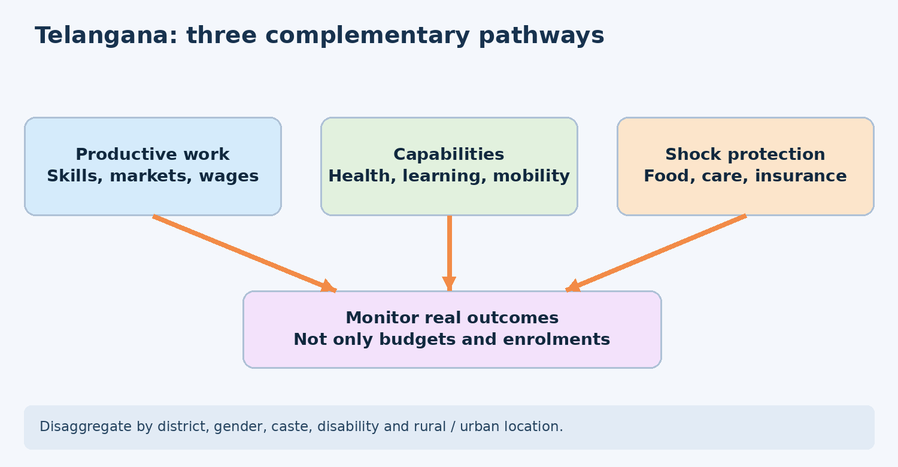

# TGPSC Group I | Paper IV | Unit I | Topic 2 — Poverty and Unemployment

**Evidence-updated draft · 27 October 2026 · NOT independently academically approved**

# Paper IV — Economy and Development | Unit I — Indian Economy and Development | Topic 2

## Exact examinable syllabus text

> Poverty and Unemployment: Concepts of Poverty - Income-based Poverty, non income Poverty- capability approach (Human Poverty Index), Measurement of Poverty and trends in Poverty; Concepts, estimates and trends of Unemployment.

**Source status (27 October 2026): R1 PRIMARY-SOURCE PASS.** Directly retrieved the Commission-hosted Notification 02/2024, Annexure-II, PDF index page 30 (printed page 31), lines 1719–1725. The exact Topic 2 wording above matches that official source, allowing for PDF line-break hyphenation. This verifies syllabus correspondence only, not academic accuracy of the chapter. [Official PDF](https://websitenew.tgpsc.gov.in/preview/RElSRUNUUkVDUlVJVE1FTlROT1RJL05PVElGSUNBVElPTl9OT18wMi0yMDI0X0dyb3VwLUlfU2VydmljZXMgKDEpMjAyNDAyMjAxNDA3MzcucGRmr95v17a0y2d8i13v).

## Topic summary

Poverty is a multidimensional economic and social condition. Monetary poverty compares household resources with a threshold; non-income poverty assesses deprivations such as poor health, education and living standards. The capability approach asks what people are genuinely free to achieve. India's poverty-estimation history illustrates the importance of measurement choices: Lakdawala, Tendulkar and Rangarajan used different baskets or methods, and their figures cannot be combined with a World Bank PPP line or NITI Aayog's MPI without qualification. HPI was an earlier UNDP deprivation index; global MPI superseded it in 2010. The National MPI is based on twelve indicators and identifies overlapping deprivations.

Unemployment is measured among the labour force, not the whole population. LFPR, WPR and UR have different denominators. PLFS distinguishes usual status from current weekly status and redesigned its sampling in 2025, making trend comparisons conditional. India's challenges include open unemployment, disguised farm employment, underemployment, educated youth job search, gender constraints and working poverty. Telangana needs an integrated strategy of productive job creation, basic capabilities and protection against shocks. All numerical claims in this chapter are date-stamped and tied to named source series.

## Syllabus-to-chapter coverage map

| Exact syllabus component | Detailed treatment | Applied / revision support |
|---|---|---|
| Concepts of poverty | Sections 1, 2 | Quick revision; MCQs 1–4; mains M1–M2 |
| Income-based poverty | Sections 2, 3 | Headcount/gap table; HCES and PPP facts |
| Non-income poverty | Sections 1, 4, 5 | Capability ladder; Telangana examples |
| Capability approach and HPI | Sections 4–5 | HPI/HDI/MPI comparison; mains M5 |
| Measurement and poverty trends | Sections 2–3, 5–6, 12 | NITI/World Bank/HCES date-stamped evidence |
| Unemployment concepts | Sections 7–9 | LFPR/WPR/UR formula; types table |
| Unemployment estimates and trends | Sections 7–10, 12 | PLFS 2025 and comparability cautions |
| Policy relevance and synthesis | Sections 10–13 | Telangana casework; mains M4/M6 |

## Learning outcomes

After completing the chapter, a candidate should be able to calculate and interpret headcount, poverty gap, MPI, LFPR, WPR and UR; identify the source and year of major India/Telangana figures; explain why survey design changes affect trends; distinguish HPI from MPI and HDI; diagnose a labour-market scenario; and write a balanced Telangana-focused mains answer with clear policy mechanisms and limitations.

# Standalone quick revision — Poverty and Unemployment

## One-minute conceptual map

**Poverty:** absolute minimum vs relative position; chronic vs transient; income/consumption vs non-income deprivation; observed poverty vs vulnerability. **Capability approach:** resources are means, functionings are achieved outcomes, capabilities are real opportunities. **HPI:** UNDP's 1997 human-deprivation measure, replaced in global reporting by MPI in 2010. **MPI:** H × A, where H = multidimensional headcount and A = intensity. **Unemployment:** UR = unemployed/labour force, not unemployed/population. **Labour force:** employed + unemployed; LFPR = labour force/population; WPR = employed/population.

## High-value verified facts

| Measure | Figure and period | Critical qualifier |
|---|---|---|
| Tendulkar monetary poverty ratio | 21.9%, India, 2011–12 | Specific national poverty methodology |
| Rangarajan monetary estimate | 29.5%, India, 2011–12 | Different normative basket; not a newer year |
| National MPI headcount | 24.85% (2015–16) → 14.96% (2019–21) | NFHS-linked observations |
| National MPI projected | 11.28%, 2022–23 | NITI discussion-paper projection |
| Telangana MPI headcount | 13.18% → 5.88%, same NFHS rounds | Observed; 7.30 percentage-point fall |
| Telangana MPI projected | 3.76%, 2022–23 | Projection, not a fresh NFHS survey |
| HCES average MPCE | ₹4,122 rural; ₹6,996 urban, 2023–24 | Averages, not poverty lines; specified free-item imputations excluded |
| PLFS 2025 usual-status LFPR, age 15+ | 59.3% | Survey redesigned January 2025 |
| PLFS 2025 usual-status WPR, age 15+ | 57.4% | Employed/population |
| PLFS 2025 usual-status UR, age 15+ | 3.1% | Unemployed/labour force |
| PLFS 2025 youth UR, age 15–29 | 9.9% | Different age base |
| PLFS 2025 urban/rural UR, age 15+ | 4.8% / 2.4% | Usual status |
| Rural employment guarantee since 1 July 2026 | 125 days under VB–G RAM G Act, 2025 | Statutory household entitlement; not realised days |

## Formula and distinction drill

| Formula / concept | Interpretation | Trap to avoid |
|---|---|---|
| Headcount = persons below line / all persons | Incidence of monetary poverty | No information about poverty depth |
| Poverty gap = average normalised shortfall | Depth below the poverty line | Different from total fiscal transfer required |
| MPI = H × A | Incidence times intensity | MPI is not a monetary poverty ratio |
| LFPR = (E+U)/P × 100 | Participation | Population denominator must be specified |
| WPR = E/P × 100 | Employment relative to population | Doesn't measure wage quality |
| UR = U/(E+U) × 100 | Joblessness among labour force | Discouraged non-seekers can be outside labour force |
| Usual status | 365-day reference | Can count low-intensity subsidiary work |
| Current weekly status | Seven-day reference | Not interchangeable with usual status |

## Twelve examination traps

1. Do not call average MPCE a poverty line. 2. Do not equate ration-card coverage with poverty headcount. 3. Do not compare a 2017-PPP $2.15 series with a 2021-PPP $3.00 series without harmonisation. 4. Do not call NITI's 2022–23 MPI projected estimate directly observed. 5. Do not mistake HPI for HDI or MPI. 6. Do not compare Telangana and India without matching years. 7. Do not call a percentage-point decline a relative percentage decline. 8. Do not treat low UR as proof of adequate hours and earnings. 9. Do not include persons outside the labour force in the UR denominator. 10. Do not ignore the January 2025 PLFS sampling redesign. 11. Do not call training enrolment a job-placement outcome. 12. Do not cite an original practice question as an official PYQ.

## Telangana answer scaffold

**Background:** NITI MPI observed improvement; rural/urban disparities remain. **Mechanisms:** income insecurity, weak services, migration, gender constraints, job quality. **Institutions:** SERP, MEPMA, district administration, health/education agencies; current national rural employment guarantee. **Evaluation:** real earnings, job retention, school learning, nutrition, service quality, beneficiary grievance data. **Conclusion:** combine productive jobs, capability investments and portable risk protection.

# Detailed textbook notes: Poverty and Unemployment

## 1. What poverty means: deprivation, distribution, vulnerability and dignity

Poverty is not simply a low salary or an empty wallet. It is an inability to command resources and opportunities required for an acceptable life. A person may earn above a statistical poverty threshold yet live without safe drinking water, reliable health care, an accessible school or secure housing. Conversely, a household with a modest cash income may receive substantial public services, own productive land or draw on community support. The examiner should therefore distinguish **economic resources**, **achieved living conditions** and **freedom to choose a life**. Each dimension changes how poverty is counted and which policy instrument is justified. The normative baseline is not uniform: a subsistence approach asks whether physical survival is possible; a basic-needs approach includes health, education, sanitation and shelter; a rights-based approach asks whether a person can claim these essentials without charity or arbitrary discretion.

**Absolute poverty** compares a person's consumption or income with a minimum threshold fixed in real purchasing-power terms. It permits assessment of deprivation over time, but the threshold embeds judgments about necessities and price variation. **Relative poverty** identifies those far below the society's typical living standard—for example, income below a specified share of median income. A relative line can remain significant even when everyone grows richer; it measures exclusion and inequality rather than a universal survival minimum. **Chronic poverty** persists across years or generations because of low assets, weak schooling, social exclusion or repeated health shocks. **Transient poverty** arises after drought, illness, loss of employment or price spikes. **Vulnerability** is the risk of becoming poor in the future, not the same as observed poverty today. A drought-prone small farmer may currently be non-poor but have little resilience.

These distinctions matter for programme design. Income transfers can close a temporary consumption gap, but they do not repair a dysfunctional public hospital or a discriminatory hiring system. Universal primary services can reduce non-income deprivation, but a landless household still needs livelihood income. Social insurance is suited to uncertain shocks; predictable old-age poverty may require pensions; child malnutrition calls for nutrition, health and maternal services rather than job placement alone. In Telangana, the problems of a landless agricultural worker in an irrigation-dependent village differ from those of a construction migrant living in a Hyderabad informal settlement. The first faces seasonal wage uncertainty, and the second may face high rent, interrupted social protection and occupational risks. A district-level poverty strategy must map these distinct mechanisms rather than distribute an identical benefit everywhere.

**Causal chain.** Unequal ownership of land and assets affects earning power; caste and gender barriers shape access to education and networks; poor health reduces productive capacity; precarious work lowers savings; a shock then pushes the household into debt. Poverty can consequently reproduce itself: a family withdraws a child from school to meet immediate costs, reducing the child's future earnings. Breaking this trap requires combining immediate protection with capability-building. Critics of expansive welfare caution about fiscal sustainability, targeting errors and incentives. Proponents respond that untreated deprivation itself suppresses productivity and equal citizenship. The policy question is not simply welfare versus growth; it is which mix of public goods, markets, insurance and redistribution most effectively raises durable opportunity.

For mains answers, state clearly whether the statistic describes **persons or households**, whether the reference is **income or consumption**, and whether the estimate is **survey-observed, modelled or projected**. A percentage decline in a poverty rate does not automatically imply an identical decline in the absolute number of poor persons when population changes. Nor does lower poverty prove that inequality has fallen. These are three different empirical questions.

## 2. Monetary poverty: income, consumption, prices and the poverty line

An income poverty measure compares money received from wages, farming, enterprise, pensions and transfers with a poverty line. Income is conceptually close to purchasing capacity but difficult to measure for seasonal farmers, informal workers and self-employed households: cash receipts vary sharply, and some production is consumed at home. India's long-running official poverty estimation tradition therefore uses **household consumption expenditure** as a proxy for material living standards. Surveyed spending is divided by household members to obtain monthly per capita consumption expenditure (MPCE). Consumption is often smoother than income because households borrow, draw on savings or receive transfers during difficult months. Yet it is not identical to permanent welfare: a family may maintain food expenditure by selling livestock, and a sick person's higher medical expenditure may make the measured consumption figure rise despite worsening well-being.

A **poverty line** is the cut-off used to classify a person as poor. A headcount ratio counts people below the line divided by total population; it is intuitive but does not show how far below the line they fall. Suppose two villages have the same 20% headcount: in the first, poor households fall only slightly short; in the second, they cannot meet even half their basic needs. The headcount treats the villages alike. The **poverty-gap index** adds the average proportional shortfall from the line, counting zero for non-poor persons; the **squared poverty gap** weights severe shortfalls more heavily and reflects inequality among poor people. These indices answer different policy questions: coverage, depth and severity. A successful cash-transfer programme could reduce the gap before it moves anyone above the line, making headcount alone an insensitive short-run evaluation metric.

Price adjustment is indispensable. A rupee in a remote village and a rupee in central Hyderabad buy different bundles of housing, transport and food. The relevant price index should match the consumption basket and the rural or urban setting. Inflation can push a household below a fixed nominal threshold even if its real purchasing capacity is unchanged. Similarly, when economists compare Indian poverty with another country, they often convert a common international poverty line using **purchasing power parity (PPP)**, not a market exchange rate. PPP is designed to compare the local purchasing power of a bundle of goods. International lines are useful for cross-country comparisons, while national lines may better reflect domestic social standards. Neither automatically defines eligibility for a specific Indian welfare programme.

The World Bank revised global international poverty lines in June 2025 using **2021 PPPs**, including a $3.00-per-person-per-day extreme-poverty line and a $4.20 lower-middle-income line. The revised numbers should not be casually spliced into an old chart based on $2.15 in 2017 PPPs. The World Bank explained that the revision simultaneously reflects new PPPs, updated thresholds and new household surveys. For India, a long-run harmonisation of the 2011–12 and 2022–23 consumption surveys also mattered. One series reports extreme poverty at about 16.2% in 2011–12 and 2.3% in 2022–23 under its harmonised methodology; these are **international monetary poverty estimates**, not the national MPI and not the old Tendulkar poverty ratio. [Source: World Bank June 2025 poverty-lines update, S05.]

The latest Household Consumption Expenditure Survey (HCES) 2023–24 estimated average monthly per capita expenditure of **₹4,122 rural** and **₹6,996 urban**, excluding imputed value of selected free welfare items. These are **averages, not poverty lines**. Treating them as cut-offs is a fundamental exam error. Averages can rise while the bottom decile stagnates, and comparisons with earlier HCES rounds must acknowledge changed collection methods and the difference between nominal and inflation-adjusted expenditure. The policy implication is to use the distribution of household expenditure and its price-adjusted levels, not one headline average, to infer deprivation. [Source: MoSPI HCES Fact Sheet 2023–24, S04.]

## 3. Indian poverty measurement: Lakdawala, Tendulkar, Rangarajan and data debates

India's measurement history is also a history of changing assumptions about the minimum acceptable standard. Early official approaches connected minimum calorie norms to household consumption expenditure and updated a base-year poverty basket for inflation. The **Lakdawala Expert Group (1993)** recommended state-specific poverty lines and used official price indices to update them. Its lineage was useful for long comparisons but drew criticism for an excessively narrow consumption basket, especially when education and health increasingly required private spending. The apparent precision of a line concealed normative choices about which needs were counted and which prices represented poor households.

The **Suresh Tendulkar Committee (2009)** moved away from a direct calorie-anchor procedure and recommended a common reference consumption basket, with revised price adjustments and recognition of private education and health expenditure. Its widely quoted 2011–12 all-India poverty ratio was **21.9%**, using separate rural and urban lines, from the Planning Commission's estimation based on the NSS consumption survey. That figure belongs to the specific Tendulkar method and year. It should not be compared directly with a newer MPI rate or a World Bank estimate under revised PPPs as though all three used identical welfare concepts. The Tendulkar approach was criticised for lines viewed as too low to capture a socially acceptable minimum, and for dependence on household consumption data that may undercount certain expenses.

The **C. Rangarajan Expert Group (2014)** proposed a different normative consumption basket and a higher set of poverty thresholds, explicitly considering food and selected non-food needs. It estimated poverty for 2011–12 at **29.5%**, higher than Tendulkar's 21.9%, not because millions suddenly became poorer but because the yardstick changed. This comparison is a classic illustration of measurement sensitivity. The Rangarajan report was an expert recommendation; it did not become a universally adopted single official poverty series for all subsequent years. Answer writers should avoid the inaccurate statement that India has one continuously updated official monetary poverty line with an annual official headcount after 2011–12.

**Household survey design** complicates trends. Older NSS surveys used differing reference periods: Uniform Reference Period (URP), Mixed Reference Period (MRP) and Modified Mixed Reference Period (MMRP) ask households to recall different purchases over different periods. Food bought yesterday may be recalled accurately; durable goods bought eleven months ago may be forgotten. Changing the recall period can change measured expenditure without any genuine change in well-being. The 2022–23 and 2023–24 HCES surveys used a redesigned questionnaire and collection method; analysts must document the harmonisation assumptions before drawing a long-term trend. Survey under-reporting at the top and exclusion of some hard-to-reach populations can also bias inequality and poverty estimates.

**Administrative targeting is not a poverty estimate.** Ration cards, household income certificates, SECC deprivation indicators and welfare beneficiary databases are built for eligibility or service delivery. Their totals cannot be treated as the number of statistically poor people without examining coverage, exclusions and programme-specific rules. A district may have many ration-card holders because eligibility is intentionally broader than an extreme-poverty threshold. Conversely, undocumented migrants, homeless persons or households with mismatched digital identity records can be excluded despite acute deprivation. The strongest poverty analysis triangulates consumption surveys, nutrition/health outcomes, administrative service coverage and qualitative local evidence.

A Telangana examiner can ask why Hyderabad's higher average income does not eliminate urban poverty. The answer requires **spatial prices and household heterogeneity**: high rents, transport costs, informal employment and weak portability of benefits can leave a working household deprived. Likewise, a rural district with improved road access may still have pockets of tribal deprivation. State-specific policy therefore needs disaggregated data, not the statewide average alone. The measurement debate is ultimately about accountability: different indices reveal different successes and failures, and no government should choose an index merely because it produces a favourable headline.

## 4. Non-income poverty and the capability approach

The **capability approach**, associated with Amartya Sen and developed further by Martha Nussbaum and others, evaluates what people are substantively free to be and do. Income is a means; the ends include being nourished, healthy, educated, mobile, secure and able to participate in community decisions. Two people with the same money may have different real freedoms. A person with a disability may require additional resources for mobility; a woman restricted by social norms may not be free to take paid work even if her household has adequate income. Public transport, accessible schools, public health and legal protection affect the conversion of money into capabilities.

The approach separates **resources**, **functionings** and **capabilities**. Resources include food, money, housing and infrastructure. Functionings are actual achievements such as literacy, good health or being employed. Capabilities are the genuine sets of possible achievements available to a person. A person fasting voluntarily and a person starving may both be observed not eating, but their freedom differs. This distinction is especially important for women, children, persons with disabilities and socially excluded groups: household income averages can conceal unequal allocation of food, care and education within the family. It also clarifies why policy cannot equate women's labour-force non-participation automatically with either deprivation or free choice without examining constraints.

**Non-income deprivation** includes child stunting, learning poverty, maternal ill-health, unsafe sanitation, polluted air, violence, lack of digital access and insecure tenure. These problems may interact: contaminated water causes illness; illness reduces school attendance; weak schooling lowers earnings; low earnings constrain housing choice. Addressing only cash income can leave the causal chain intact. India's constitutional Directive Principles—particularly Articles 38, 39, 41, 42, 45 and 47—provide a normative framework for social and economic welfare, while enforceable laws such as the Right of Children to Free and Compulsory Education Act, 2009 and National Food Security Act, 2013 translate some objectives into statutory claims. Their implementation is uneven and cannot be inferred from legislation alone.

In Telangana, residential education initiatives for disadvantaged communities, public health insurance arrangements, drinking-water infrastructure and women's self-help groups can influence capabilities through different channels. A residential school may improve learning opportunities but its outcomes require measures of attendance, learning, safety and transitions into employment. Health insurance may reduce catastrophic expenses but does not replace nearby primary care. SHG credit may finance livelihoods, yet women need control over loans and freedom from coercive debt. Policy evaluation must ask whether the beneficiary gains **agency**, not merely whether a service or subsidy was delivered.

The capability approach faces a practical objection: which capabilities should be prioritised and how should they be weighted? A long list can become unmanageable, and the meaning of a dignified life may vary across communities. Nussbaum proposes a list of central capabilities; Sen emphasises public reasoning and democratic selection. In a competitive exam, present this as a constructive debate rather than a weakness that invalidates the approach. Quantitative indices necessarily simplify; participatory local planning and qualitative evidence can complement them. The central lesson is that poverty reduction is a development process, not a one-time income classification.

## 5. Human Poverty Index, HDI and the evolution to MPI

The **Human Poverty Index (HPI)** was introduced in the UNDP Human Development Report in 1997 to summarise deprivation in basic human development rather than average achievements. The original **HPI-1**, intended for developing countries, combined the probability of not surviving to age 40, adult illiteracy and deprivation in a decent standard of living, represented through measures such as safe-water access and underweight children. **HPI-2**, used for selected industrialised countries, included survival to age 60, functional literacy, relative income poverty and long-term unemployment. This difference demonstrates that poverty is contextual: in richer countries, exclusion from normal social participation may be central even when absolute hunger is less prevalent.

Do not confuse HPI with the **Human Development Index (HDI)**. HDI is an average-achievement index for health, education and income. A high average can coexist with severe deprivation among minorities or remote districts. HPI tried to highlight deprivation, but national aggregates still concealed whether the same household suffered several disadvantages simultaneously. In 2010 the UNDP and Oxford Poverty and Human Development Initiative introduced the **Multidimensional Poverty Index (MPI)**, replacing HPI in the global Human Development Report framework. HPI remains important because the Group I syllabus explicitly names it and because it explains the conceptual shift from average outcomes to deprivation and then to overlapping household deprivations.

The **global MPI** combines health, education and living standards through ten weighted indicators. Health and education have two indicators each; living standards has six. A person is classified as multidimensionally poor when their weighted deprivation score reaches at least one-third. The index is calculated as **MPI = H × A**, where H is the proportion of people identified as poor and A is their average deprivation intensity. If H falls but A rises, the MPI outcome depends on both changes. The 2026 global MPI update, released by UNDP on 12 October 2026, reported 1.2 billion people in acute multidimensional poverty across its covered developing-country population; this is a **global** estimate, not a 2026 Indian national MPI estimate. It is inappropriate to infer a fresh Indian poverty percentage from that release. [Source: UNDP 2026 global MPI release, S09.]

India's **National MPI** developed by NITI Aayog adapts the global approach with **12 indicators** under the same three dimensions; maternal health and bank accounts are among the added indicators. Its national and district disaggregation makes it useful for targeted public action. The National MPI: A Progress Review 2023 reported India's headcount falling from **24.85% in NFHS-4 (2015–16)** to **14.96% in NFHS-5 (2019–21)**, and the MPI value from 0.117 to 0.066. Those are survey-linked observations. A separate NITI Aayog discussion paper estimated/projected a headcount of **11.28% for 2022–23**, using modelling beyond the last comparable NFHS observation. The projected figure must be labelled as such rather than passed off as a fresh full household survey. [Sources: NITI Aayog 2023 report S06; 2024 discussion paper S07.]

MPI also has limitations. Its cut-off and weights are normative choices; some indicators are binary and may overlook service quality. A household with an electricity connection may experience frequent power cuts, and school attendance does not prove learning. The index is better for identifying overlapping deprivation than for estimating the exact cash transfer needed to eliminate it. Monetary poverty and MPI are complements, not substitutes. A strong mains answer compares what each sees, how it is measured, and what it leaves out.

## 6. Telangana's poverty profile: statewide improvement and district inequalities

NITI Aayog's **National MPI: A Progress Review 2023** reported Telangana's multidimensional poverty headcount at **13.18% in 2015–16** and **5.88% in 2019–21**. The state's MPI value fell from **0.057 to 0.024** and intensity from **43.29% to 40.85%**. These are observed NFHS-based estimates, and the 7.30-percentage-point reduction should not be called a 7.30% relative decline. The separate 2024 NITI discussion paper gives a **projected 3.76% for 2022–23**; it is not a new direct NFHS measurement. Both national and Telangana values must retain their years, methods and observation-versus-projection labels. [Sources: NITI 2023 S06; NITI 2024 S07.]

State averages conceal geographic variation. Telangana's urban economy is concentrated around Hyderabad and adjoining districts, while some remote tribal and drought-prone areas face more severe educational, nutrition and infrastructure disadvantages. In the 2019–21 National MPI tables, Telangana's rural headcount was **7.51%** and urban headcount **2.73%**. That gap is informative, but a low urban MPI headcount does not prove that every informal-settlement household is secure. The indicator set may not fully capture rental insecurity, traffic pollution, workplace hazards or the price of childcare. Likewise, the rural MPI may conceal caste- and tribe-specific deprivation. For examination analysis, pair the aggregate with social-group and district evidence wherever available; do not manufacture current district rankings without a dated official table.

A village-level intervention should begin by asking *which deprivation is binding*. If adolescent girls have poor secondary-school access, residential schooling or safe transport may be more relevant than another small loan. If maternal nutrition and anaemia are major contributors, frontline health workers, food diversity, reproductive care and income security must be coordinated. In a Hyderabad construction settlement, portability of subsidised food, accessible anganwadis, safe rental housing and workplace enforcement may matter more than farm irrigation. **SERP**, **MEPMA**, district administrations, municipal bodies, women and child development agencies and health departments hold different pieces of this problem; convergence is a governance challenge, not merely a budget line.

State initiatives can be discussed without treating a scheme announcement as proof of impact. For instance, subsidised food and public health coverage can reduce vulnerability, but their real effect depends on enrolment, portability, quality, waiting times and grievance redressal. Women's self-help groups can expand savings and collective bargaining; the evidence question is whether participants acquire durable assets and independent income rather than only higher debt exposure. Irrigation and road investment may increase productivity but could bypass landless workers unless employment and market linkages are deliberately included. Strong policy appraisal distinguishes **inputs** (money sanctioned), **outputs** (services delivered), **outcomes** (deprivation reduced) and **distribution** (who benefited).

The state's Socio-Economic Outlook 2026 is available through the official Telangana Reports portal. This chapter uses verified NITI and MoSPI figures where directly checked, but it does **not** claim a fresh Telangana PLFS unemployment rate or new poverty headcount from the 2026 Outlook without direct validation of the underlying table. That restraint is essential: impressive-looking but unverified district numbers can mislead exam preparation. Telangana's central lesson is that rapid aggregate growth and declining multidimensional poverty can coexist with persistent spatial, gender and livelihood inequalities.

## 7. Unemployment: definitions, labour force and the three essential rates

In labour statistics, a person is **unemployed** when they are not working but are seeking or available for work under the relevant survey reference period. This definition excludes many people who are outside the labour force, including full-time students, some homemakers and discouraged persons who no longer seek work. It is therefore incorrect to divide unemployed persons by the entire population and call the result the unemployment rate. The denominator is the **labour force**: employed plus unemployed. Three related rates must be distinguished: **LFPR = labour force / population × 100; WPR = employed / population × 100; UR = unemployed / labour force × 100**. These identities help expose misleading interpretations of headline numbers.

Consider a working-age population of 1,000. If 600 are employed, 30 are unemployed and 370 are outside the labour force, LFPR is 63%, WPR is 60%, and UR is 30/630 = 4.76%. Suppose 40 discouraged job seekers stop looking and become classified as outside the labour force. The measured unemployment rate can fall even though no new jobs were created. Conversely, if more women enter job search, measured unemployment can rise temporarily despite improving agency and opportunity. Therefore a fall in UR is not sufficient evidence of a healthier labour market; interpret it with LFPR, WPR, hours, earnings, job security and underemployment.

The **Periodic Labour Force Survey (PLFS)**, run by the National Statistical Office under MoSPI, is the main official source for India's employment and unemployment estimates. The survey distinguishes **usual status**, based on activity over the preceding 365 days, from **current weekly status (CWS)**, based on the preceding seven days. In usual status, principal status reflects the activity occupying the relatively longest period; subsidiary status captures additional economic activity for at least 30 days. A person may be counted as employed in usual status through some agricultural work yet experience months without adequate earnings. CWS is more responsive to short-term conditions, but it is also not a direct measure of the quality of every job.

PLFS changed its sample design from **January 2025** and shifted its annual reporting period to the calendar year. Its first calendar-year Annual Report 2025 was released on **27 March 2026**. MoSPI explicitly cautioned that estimates under the revamped sample framework may not be strictly comparable with earlier annual PLFS rounds. A mains answer should not draw an unqualified trend line across this break. The 2025 usual-status estimate for persons aged 15+ was **LFPR 59.3%, WPR 57.4%, UR 3.1%**; the urban UR was 4.8% and rural UR 2.4%. The 2025 youth (15–29) usual-status UR was 9.9%. These figures refer to different population bases and should never be compared without noting age and status definitions. [Source: MoSPI/PIB 27 March 2026, S03.]

The labour market has a further conceptual divide: **employment quantity versus employment quality**. A person selling small goods for a few hours may be classified as employed but earn below a living standard. A graduate in a precarious gig job is not statistically unemployed but may be underutilising skills. An accurate state employment strategy therefore combines official survey indicators with evidence on wages, formal contracts, social security, work intensity and occupational mobility.

## 8. Types of unemployment and the Indian structural context

**Open unemployment** describes persons without work who seek or are available for it. **Frictional unemployment** occurs during normal job search and movement between positions; it need not signal a failing economy if transitions are short. **Structural unemployment** arises when the skills, locations or qualifications of workers do not match available jobs. **Cyclical unemployment** rises when aggregate demand falls and firms cut production. **Seasonal unemployment** follows predictable agricultural or tourism cycles. **Technological unemployment** arises when new production methods displace tasks faster than workers can shift to new roles. These categories overlap in practice: a young graduate may face both location mismatch and a cyclical hiring slowdown.

India's distinctive problem includes **disguised unemployment** and **underemployment**. On a small family farm, five relatives may work even though three could produce nearly the same output with the same land and technology. The marginal product of some labour is very low, yet those people are classified as employed. Removing them without creating productive alternative work would worsen household welfare. **Time-related underemployment** describes workers who want and are available for more hours. **Skills underutilisation** occurs when a trained engineer drives a taxi because suitable jobs are unavailable. These concepts explain why a low survey unemployment rate can coexist with distress and low productivity.

Agriculture's high employment share relative to its output share is a classic sign of a structural transformation challenge. Movement from low-productivity agriculture to manufacturing and modern services can raise incomes, but only if destination sectors create sufficient jobs and provide training, housing and transport. An expansion of capital-intensive industry can raise GDP without absorbing many workers. The 2025 PLFS reported agriculture's employment share at **43.0%**, down from 44.8% in 2024, while manufacturing rose from **11.6% to 12.1%**. These are employment shares among workers, not shares of national income; their interpretation must also acknowledge the survey redesign. [Source: MoSPI/PIB 2026, S03.]

In Telangana, seasonal farm work, construction, textiles, retail, logistics, IT services and public recruitment generate different employment pathways. Hyderabad's IT and pharmaceutical ecosystems require specific education and skills, whereas rural youth may face weak training-to-placement links and high migration costs. An industrial park's announced investment is not equal to jobs actually created; evaluate direct versus indirect employment, local hiring, gender access, wages and job duration. Similarly, a public works scheme may provide temporary earnings and rural infrastructure, but it is not a substitute for durable private and public productive employment. Policy needs complementary levers: reliable electricity, transport, labour-intensive enterprise clusters, apprenticeships, credit, childcare and urban housing.

There are competing interpretations. One view stresses rigidities and compliance costs that discourage formal hiring; another emphasises inadequate demand, low purchasing power, weak public services and employer concentration. A third focuses on education quality and skill mismatch. Each captures a mechanism but none alone explains all occupations and regions. A sound answer identifies which type of unemployment a proposed policy targets. Wage subsidies can encourage hiring, but may subsidise jobs that would have existed anyway. Skill courses can improve employability, but do little if firms have no vacancies. Public investment can stimulate demand and productivity, but poor project selection creates fiscal costs without sustained work.

## 9. Youth, education, women and the quality of employment

Youth unemployment has a special social cost because long job searches can erode skills, postpone family formation and undermine confidence in institutions. Educated unemployment may be higher than overall unemployment because graduates seek particular occupations and may be able to remain in job search longer than poorer workers. A worker compelled to accept any informal job is counted as employed, whereas a graduate searching for a formal role may be unemployed. This does not prove that education causes unemployment; it reveals **job aspiration, labour-market segmentation and the availability of suitable work**. The 2025 PLFS usual-status youth unemployment rate was **9.9%** for ages 15–29, compared with the overall 15+ rate of 3.1%. These figures have different age denominators and should be interpreted accordingly.

**NEET**—not in employment, education or training—captures a different form of exclusion. A young person who is neither employed nor studying nor receiving training may not meet the official unemployment definition if they are not seeking work. PLFS 2025 estimated **25.0%** NEET for ages 15–29 under its definition. This measure can illuminate disengagement but needs care: unpaid family care and disability may account for part of the group, and NEET should not be equated with idleness. Telangana policy can respond through career guidance, local apprenticeships, women's safe mobility, accessible skill centres and targeted support for persons with disabilities, with transparent placement tracking rather than counting only training enrolments.

Women's participation reflects an interaction of opportunity, norms, safety and household care responsibilities. MoSPI's 2025 usual-status female LFPR for persons aged 15+ was **40.0%**, versus **79.1%** for men. The same report recorded that **44.4%** of women outside the labour force cited childcare or personal commitments in homemaking as the main reason. This does not imply all unpaid care is involuntary; it signals the need to examine constraints. Affordable childcare, reliable transport, workplace safety, flexible but protected employment, property rights and equal access to digital services can make labour-market choices more genuine. Rising female LFPR may include unpaid family work, so participation must be assessed alongside remuneration and agency.

The quality of work matters for both poverty and unemployment. **Formal employment** typically provides clearer contracts, contributions to social security and enforceable protections; **informal employment** may occur within registered enterprises as well as in small unregistered businesses. Self-employment ranges from high-income entrepreneurship to low-earning survival activities. The PLFS 2025 reported self-employment at **56.2%** of employed persons and regular wage/salaried work at **23.6%**. These categories are not value judgments: some self-employed people earn well, while some salaried workers remain insecure. Earnings, benefits, safety and control over working conditions are the relevant tests.

A Telangana example is a trained woman who can work in a Hyderabad service centre but lacks safe evening transport and childcare. A training certificate alone will not increase employment; the binding constraint is mobility and care. Another is a rural diploma holder who seeks a government job for years while refusing low-paid local work. Policy should expand quality private-sector alternatives, transparent recruitment and career counselling without dismissing the rational search for stable employment. A third is a platform delivery worker who is employed by survey definition yet faces fluctuating income and accident risk. Social protection and portable benefits can reduce working poverty even if measured UR does not change.

## 10. Poverty–unemployment feedback loops and economic growth

Poverty and unemployment reinforce each other, but the relationship is not one-to-one. Joblessness reduces income, increases borrowing and may interrupt schooling or treatment. Poverty in turn limits mobility, access to networks, nutrition and the ability to finance job search, making unemployment longer. A household may therefore become trapped between weak employability and inadequate earnings. Yet many poor Indians are **working poor**: they are employed but their hours, wages or productivity do not yield a sufficient standard of living. This is why the goal of development policy must be productive, adequately remunerated and secure work, not simply a lower unemployment rate.

Economic growth can reduce poverty through higher labour demand, productivity and public revenue. Its effectiveness depends on the **employment elasticity of growth**—how much employment expands for a given increase in output—and on who owns the assets generating returns. Growth concentrated in highly automated, capital-intensive sectors can raise average income without proportionate job creation. Conversely, labour-intensive manufacturing, construction with safety standards, food processing, tourism and care services can absorb more workers, though their environmental and job-quality effects must be managed. A rise in productivity is desirable, but displaced workers need retraining, placement and social insurance to share the gains.

Macroeconomic stabilisation matters because inflation erodes real wages and food purchasing power. High food prices disproportionately affect low-income households, even when nominal wages rise. Interest-rate and fiscal choices influence investment and jobs, but short-term stimulus cannot repair a permanent mismatch between skills and vacancies. Infrastructure can reduce transport costs and connect villages to markets; public health and education raise long-term productivity; predictable regulation encourages firms to invest. These are complementary rather than interchangeable. Policies should be evaluated by causal evidence, not by the size of their announcement or the number of beneficiaries listed in a press release.

**Distribution** is decisive. If growth raises the top decile's income faster than the bottom's, aggregate poverty may still decline but inequality can widen. If low-income households gain from nutrition, public education and safer water, welfare may improve even before market incomes increase. Analysts should separate **poverty headcount**, **poverty gap**, **income inequality** and **social mobility**. A poverty reduction strategy must also account for shocks—floods, droughts, illness and heat waves—that can reverse gains. In Telangana, irrigation resilience, heat-safe urban work, portable food support and affordable primary care can prevent transient shocks from becoming chronic poverty.

A balanced mains conclusion is that job creation, quality public services and social protection form a three-legged strategy. Labour-market policy alone cannot cure malnutrition or discrimination; transfers alone cannot create high-productivity jobs; aggregate growth alone does not guarantee equitable access. The analytical strength of the answer lies in showing the mechanism and the limits of each intervention.

## 11. Institutions and programmes: from safety nets to productive inclusion

India's poverty response combines **constitutional principles, statutory entitlements, central schemes and state programmes**. Article 21 has been interpreted in relation to dignity and livelihood, while Directive Principles guide welfare policy. The **National Food Security Act, 2013** provides a statutory framework for subsidised foodgrains and specified nutrition entitlements. The **Right of Children to Free and Compulsory Education Act, 2009** makes elementary education a legal claim. The **National Rural Livelihoods Mission (DAY-NRLM)** supports self-help groups, financial inclusion and livelihoods; urban livelihood programmes address skills and enterprise among poorer urban residents. Pension, housing, nutrition, health and social insurance programmes address different deprivation mechanisms. The existence of a programme must not be mistaken for complete coverage or guaranteed quality.

For rural wage employment, the **Mahatma Gandhi National Rural Employment Guarantee Act, 2005** was historically a landmark rights-based instrument with a 100-day household employment guarantee. The **Viksit Bharat—Guarantee for Rozgar and Ajeevika Mission (Gramin), VB–G RAM G Act, 2025 (Act 36 of 2025)** replaced that framework on **1 July 2026**, according to the official commencement announcement. It provides a statutory guarantee of **125 days of wage employment per eligible rural household per financial year**, subject to the Act and scheme rules. The law also emphasises durable assets, water security, infrastructure and convergence; its funding pattern includes a 60:40 Centre–State sharing arrangement for most states including Telangana. These are national statutory design features, **not proof that every eligible Telangana household received 125 days**. [Sources: India Code S10; PIB 11 May and 31 July 2026 S11–S12.] For policy appraisal, ask whether work is provided on demand, wages are paid promptly, women participate, assets are durable and grievance remedies are accessible.

**Telangana's SERP** works with rural women's self-help groups and federations; **MEPMA** is relevant to urban poverty and women's livelihoods. **Stree Nidhi** is associated with community-linked credit; state housing and health arrangements address other risks. These institutions are not interchangeable: a microcredit institution can improve liquidity but cannot substitute for a functioning school, and a health insurance scheme does not guarantee the availability of a local doctor. A beneficiary's experience often crosses departments, which makes coordination and transparent grievance systems crucial. In a tribal hamlet, road connectivity, school attendance, nutrition and land rights may matter simultaneously; a single-target scheme may fail if these complements are missing.

**Targeted versus universal provision** is a recurrent debate. Targeting conserves fiscal resources for the most deprived but can generate exclusion errors, complicated documentation and stigma. Universal basic services are easier to claim and may attract political support for quality, but can cost more and subsidise better-off households. Direct benefit transfers can reduce leakage in some settings yet depend on banking access, authentication and accurate records. Community monitoring and social audits can reveal gaps that administrative dashboards miss. The best choice varies by benefit: universal vaccination has a different rationale from a means-tested cash transfer or an insurance benefit.

Policy effectiveness should be tested with **baseline and follow-up measures**, ideally credible comparison groups, not only counts of loans disbursed or certificates issued. Poverty headcount, poverty gap, school learning, nutrition, wages, job retention, women's control over assets and grievance resolution can form an outcome dashboard. Evaluations should disaggregate by gender, caste, disability, rural/urban residence and district. A well-designed programme can fail through late payments, inaccessible offices or exclusion; a modest programme can succeed when delivery is reliable and beneficiaries exercise agency.

## 12. Measurement controversies, comparability and how to write a defensible answer

Three families of figures often appear in the same public debate: **official household consumption estimates**, **international monetary poverty estimates**, and **national or global multidimensional poverty estimates**. They are not different names for the same series. The first is a survey of spending and distribution; the second applies an internationally comparable threshold with PPP and harmonisation adjustments; the third classifies households according to overlapping health, education and living-standard deprivations. A fourth family consists of **administrative beneficiary counts**, which reflect eligibility rules and delivery systems. A careful answer explicitly states the unit, year, source, methodology and whether the figure is directly observed or projected.

The **2011–12 Tendulkar poverty ratio of 21.9%**, the **2011–12 Rangarajan estimate of 29.5%**, the **2019–21 national MPI headcount of 14.96%**, the **2022–23 projected MPI of 11.28%**, and the World Bank's **2022–23 harmonised extreme monetary poverty estimate of about 2.3%** can all be meaningful without being interchangeable. The first two differ primarily in the normative consumption standard, the MPI measures non-income deprivation, and the World Bank estimate uses an international PPP poverty line and survey harmonisation. Comparing them as a single uninterrupted poverty trend is analytically wrong. Likewise, the HCES 2023–24 average MPCE is not a poverty line and cannot be used directly to compute a headcount without a threshold and distributional microdata.

For unemployment, **usual status and current weekly status** differ in their reference periods, and 2025 PLFS has a revised sample design. The overall 3.1% usual-status UR for ages 15+ is not the same as youth 9.9% or urban 4.8%. A person outside the labour force is not in the unemployment-rate denominator. An increase in LFPR can accompany a short-run increase in UR; a fall in UR can reflect exit from job search. Employment growth must be interpreted with real earnings, hours, formalisation and occupational productivity. A state figure requires a state-level official table with the same survey basis, not extrapolation from the national average.

Data disputes are not an excuse to reject evidence. They are a reason to triangulate and to describe uncertainty. Sampling errors, changes in recall period, price deflators, rural/urban classifications, household composition and missing populations should be acknowledged proportionately. An essay that spends all its words questioning data without analysing real deprivation is incomplete; an essay that reports one politically convenient number without methodology is equally weak. The objective is a defensible conclusion supported by multiple measures and grounded in policy mechanisms.

**Model analytical frame for Telangana.** Begin with observed NITI MPI improvement and its rural–urban gap; then identify possible blind spots such as rental insecurity, migration and informal employment. Add PLFS-based concepts without inventing a Telangana unemployment percentage. Discuss public services, productive jobs and portable protection as complementary interventions. Conclude with a monitoring plan: survey-based poverty and employment rates, administrative service quality, independent audits and citizen grievance data. This structure links evidence to governance and avoids both uncritical celebration and unsubstantiated pessimism.

### Worked measurement laboratory — poverty depth, multidimensional deprivation and labour-force denominators

The following are **invented teaching datasets**, not official estimates for India or Telangana. They show how the same economic situation can produce different indicators. In an examination answer, state the unit of analysis, threshold, reference period and denominator before calculating. Real sample surveys require appropriate weights and questionnaire definitions; these tiny examples are unweighted arithmetic exercises.

**Case A — Headcount versus poverty gap.** Five persons have comparable monthly consumption of ₹500, ₹900, ₹1,200, ₹1,500 and ₹1,800. Assume a hypothetical poverty line of ₹1,000 per person per month. Two persons fall below the line, so the headcount ratio **H = 2/5 = 40%**. Their proportional shortfalls are (1,000−500)/1,000 = 0.50 and (1,000−900)/1,000 = 0.10. Under the Foster–Greer–Thorbecke poverty-gap definition, include **zero for each non-poor person**: **P1 = (0.50 + 0.10 + 0 + 0 + 0)/5 = 0.12 = 12%**. The average proportional shortfall *among the two poor persons* is 0.60/2 = 30%; that is **not** the population-normalised P1. Squaring the shortfalls gives **P2 = (0.50² + 0.10²)/5 = 0.052 = 5.2%**. The three measures therefore report incidence (40%), population-normalised depth (12%) and severity (5.2%).

Imagine the two poor persons instead consume ₹950 each while the other three values stay above the line. The headcount remains **40%**, yet P1 falls to (0.05 + 0.05)/5 = **2%**. An intervention can materially reduce deprivation without immediately changing the headcount. Conversely, a person moving from ₹999 to ₹1,001 changes headcount classification while receiving only a tiny absolute improvement. Neither observation means the indicator is useless; it means headcount and gap answer different questions. These calculations do not estimate an Indian poverty rate, and the ₹1,000 threshold is entirely illustrative.

**Case B — MPI is incidence multiplied by intensity.** Suppose four fictional households have *already computed weighted deprivation scores* of 0.50, 0.40, 0.20 and 0.10 under one specified indicator system. With a poverty identification cutoff of one-third, the first two households qualify as multidimensionally poor. **H = 2/4 = 0.50**. Their mean deprivation intensity is **A = (0.50 + 0.40)/2 = 0.45**. Thus **MPI = H × A = 0.225**. It is not 22.5% of people below an income line. If one poor household's weighted score falls from 0.50 to 0.35 while still exceeding the cutoff, H stays 0.50 but A becomes (0.35 + 0.40)/2 = 0.375 and MPI becomes **0.1875**. Scores in this example are given, not derived from actual NFHS responses; real National MPI construction requires indicator-specific deprivation thresholds and weights, plus population weighting. The index cannot by itself establish a household's monetary poverty status.

**Case C — Unemployment can fall without a single additional job.** Take a hypothetical population of 1,000 persons in a clearly specified eligible age group. Suppose 540 are employed, 30 unemployed (available and seeking work under the chosen survey definition), and 430 outside the labour force. The labour force is 570. **LFPR = 570/1,000 = 57%**; **WPR = 540/1,000 = 54%**; **UR = 30/570 × 100 ≈ 5.26%**. Now suppose ten unemployed persons stop seeking and cease to satisfy the survey's labour-force criterion, with no new employment. The labour force becomes 560, unemployment becomes 20, and employment stays 540. The reported UR falls to **20/560 × 100 ≈ 3.57%**, while WPR remains **54%** and LFPR falls to **56%**. This illustrates a *possible* denominator effect, not a claim about what happened in PLFS 2025. Official PLFS estimates are survey-weighted and must be labelled by usual status or current weekly status, age group, geography and reporting period.

**How to apply this in Telangana.** For a district anti-poverty programme, combine a representative household poverty headcount with a gap measure, health and education deprivations, and evidence of job quality. For a youth-employment programme, report employment retained after six months, real earnings, hours, safety and gender barriers alongside LFPR and UR. Do not treat training enrolment, registered jobseekers or administrative beneficiary totals as representative unemployment or poverty rates. Before and after comparisons require attention to seasonality, prices, survey design and a credible counterfactual. These are design principles, not a claim that any particular district programme has achieved a measured effect.

## 13. Exam synthesis: debates, causality and a Telangana policy blueprint

An excellent Group I answer starts with a **conceptual distinction**, not a scheme catalogue. Poverty may mean inadequate command over consumption, multiple simultaneous deprivations or lack of substantive capabilities. Unemployment means lack of work under a specific search/availability definition, while underemployment means inadequate use of time or skills despite being counted as employed. These distinctions determine the denominator, evidence and policy response. Present the statistical identity where relevant, then apply the framework to a plausible Telangana case.

Consider a hypothetical district with falling MPI but persistent youth migration. Improved electricity, water and schooling may have reduced measured multidimensional deprivation, while local labour demand remains weak. It would be wrong to call the MPI decline fictitious; it would also be wrong to conclude that employment problems have disappeared. A development plan should identify high-potential sectors such as agro-processing, repair services, local logistics and care work, then link them with apprenticeships, credit and market access. At the same time, protect migrant households through portable food entitlements, school continuity and affordable health care. The plan needs targets for both **income security** and **capability improvement**.

A second hypothetical case involves an urban woman who completed vocational training but remains outside the labour force because childcare and transport are inaccessible. Another training batch is unlikely to solve the binding constraint. A community childcare centre, safe transport, employer outreach and anti-discrimination enforcement may yield better outcomes. The relevant indicators are not only the number of women trained but paid job retention, real earnings, hours and decision-making power. This illustrates why the capability approach and labour-force statistics complement one another.

A third case involves a village affected by drought. A wage-work safety net can smooth consumption and prevent distress asset sales; crop diversification, watershed management and market links address the structural source of vulnerability. The short-term intervention should be judged by payment timeliness and food security, while long-term investments should be judged by productivity and reduced repeated distress. The same policy should be examined for exclusion of tenants, women and seasonal migrants. Transparency, social audits and responsive grievance systems improve the likelihood that statutory rights become actual benefits.

**Contrasting positions.** A growth-first perspective argues that productivity and enterprise expansion create the resources to reduce poverty; a redistribution-first perspective emphasises inequality and immediate basic needs; a capability perspective insists that education, health, freedom and agency are ends in themselves. These positions are not necessarily mutually exclusive. A fiscally sustainable strategy can prioritise basic services and risk protection while enabling labour-intensive productive investment. What matters is implementation quality, local context and honest measurement.

The defensible conclusion is that poverty reduction is not proven by a single index, and employment success is not proven by a low UR alone. Telangana should assess deprivation, job quantity, job quality and social inclusion together, using disaggregated, date-stamped evidence. This is both sound economics and sound public administration.

# Visual learning and comparison charts

## Diagram 1 — Poverty measurement decision tree

Start with the question: *What kind of deprivation are we measuring?* If inadequate purchasing power, use income/consumption poverty line and headcount, gap and severity measures. If overlapping health, education and living-standard deficits, use MPI = H×A. If substantive freedom and agency, combine quantitative measures with capability analysis. For vulnerability, add shock exposure and resilience indicators. The same household may be classified differently across these branches; this is not automatically an error.

## Diagram 2 — Labour-force denominator

Population splits into labour force and outside labour force. Labour force splits into employed and unemployed. UR divides unemployed by labour force; LFPR divides labour force by population; WPR divides employed by population. The reference population and age range must always be specified.

## Diagram 3 — Telangana integrated policy model

Productive employment, basic capabilities and shock protection reinforce one another. Monitoring must measure outcomes such as earnings, learning and health, not merely budgets or enrolment.

## Comparison table — methods and blind spots

| Method | Primary unit | What it reveals | Blind spot |
|---|---|---|---|
| Monetary headcount | Persons below a line | Coverage/incidence | Depth, non-income needs |
| Poverty gap | Shortfall below a line | Depth of deprivation | Non-monetary exclusion |
| HPI (historical) | Aggregate human deprivation | Survival/literacy/basic conditions | Co-occurrence within households |
| National MPI | Household weighted deprivations | Incidence and intensity | Quality of services and cash resilience |
| LFPR/WPR/UR | Labour-force/population statuses | Participation, work and joblessness | Hours, pay, security and agency |

## Comparison table — unemployment types

| Type | Typical mechanism | Example | Appropriate policy lens |
|---|---|---|---|
| Frictional | Search between jobs | Graduate interviewing | Vacancy matching, mobility |
| Structural | Skills/location mismatch | Diploma without relevant employer | Apprenticeships, sector development |
| Cyclical | Demand contraction | Factory layoffs | Stabilisation, demand and investment |
| Seasonal | Predictable work cycles | Farm lean season | Diversification, seasonal protection |
| Disguised | Very low marginal productivity | Excess family labour on small farm | Productive non-farm jobs |
| Underemployment | Insufficient hours/skill use | Part-time work despite seeking more | Hours, job quality, earnings |

# Original practice MCQs — not official previous-year questions

**Provenance:** All 25 questions below are newly written practice items. No question is represented as an official TGPSC PYQ. Official source papers and question numbers have not been verified for this chapter.

### Q1. Which statement best distinguishes absolute from relative poverty?
A. Absolute poverty is always measured by MPI; relative poverty always by HPI
B. Absolute poverty applies only to villages
C. Relative poverty necessarily disappears with GDP growth
D. Absolute poverty uses a minimum real-resource threshold; relative poverty compares position within a society
**Answer: D.** Absolute lines aim to hold a real minimum constant, whereas relative lines move with the reference distribution; both involve normative choices.

### Q2. A poverty headcount ratio falls while the poverty-gap index remains high. What is the most defensible interpretation?
A. Income inequality must have vanished
B. The poverty line was necessarily abolished
C. The remaining poor may still be far below the threshold
D. Every poor household has become non-poor
**Answer: C.** Headcount tracks the proportion below the line, not the average shortfall or severity among those still poor.

### Q3. Monthly per capita consumption expenditure (MPCE) in HCES is best described as:
A. The annual salary of the household head
B. Average spending per person in a household over a month
C. The statutory poverty line for every Indian household
D. A measure of GDP at factor cost
**Answer: B.** MPCE is a survey consumption statistic; national average MPCE must not be treated as a poverty threshold.

### Q4. What primarily explains different Tendulkar and Rangarajan poverty ratios for 2011–12?
A. Different poverty-line baskets and methodological choices
B. A population census was conducted twice that year
C. One committee measured only unemployment
D. The rupee ceased to be legal tender
**Answer: A.** Rangarajan used a higher normative basket; the difference does not mean households suddenly changed living standards.

### Q5. The capability approach places primary emphasis on:
A. The nominal income of the highest decile
B. Only the quantity of currency in circulation
C. GDP growth regardless of distribution
D. Substantive freedoms to achieve valued functionings
**Answer: D.** Income and services are means; the approach asks what people are genuinely able to do and be.

### Q6. Which of the following was superseded by the global MPI in the UNDP framework in 2010?
A. Consumer Price Index
B. Index of Industrial Production
C. Human Poverty Index
D. Wholesale Price Index
**Answer: C.** HPI highlighted aggregate human deprivation; MPI captures overlapping household deprivations.

### Q7. For a multidimensional poverty index defined as MPI = H × A, A represents:
A. Absolute number of all households
B. Average deprivation intensity among the multidimensionally poor
C. Average income of all workers
D. Agricultural output share
**Answer: B.** H is the headcount ratio and A is the mean weighted deprivation score among those identified as poor.

### Q8. India’s National MPI differs from the standard global MPI in that it uses:
A. Twelve indicators including maternal health and bank accounts
B. Only the consumer price index
C. A single income poverty line
D. The unemployment rate as its only indicator
**Answer: A.** NITI Aayog’s national MPI adds indicators to the global ten-indicator structure while retaining health, education and living-standard dimensions.

### Q9. The Telangana MPI headcount of 3.76% for 2022–23 cited by NITI is:
A. A fresh NFHS-6 directly observed survey estimate
B. A World Bank $3 poverty rate
C. The state's unemployment rate
D. A projected estimate in a discussion paper
**Answer: D.** The directly survey-linked NFHS estimate was 5.88% in 2019–21; 3.76% for 2022–23 is projected.

### Q10. Which rate divides unemployed persons by the labour force?
A. Labour force participation rate
B. Population growth rate
C. Unemployment rate
D. Worker population ratio
**Answer: C.** UR = unemployed/(employed + unemployed) × 100; persons outside the labour force are excluded.

### Q11. If discouraged jobseekers stop seeking work while employment is unchanged, measured UR can:
A. Become the same as LFPR
B. Fall without any new jobs being created
C. Only increase
D. Equal 100% by definition
**Answer: B.** Some unemployed people may be reclassified outside the labour force, shrinking the numerator and denominator.

### Q12. Usual principal plus subsidiary status in PLFS refers mainly to:
A. Activity over the preceding 365 days with qualifying subsidiary work
B. Only the preceding seven days
C. Only registered factory employment
D. Only unemployment-insurance claims
**Answer: A.** Usual status uses a year-long reference period; subsidiary work generally requires at least 30 days of economic activity.

### Q13. Current Weekly Status (CWS) uses which reference period?
A. 365 days
B. Five years
C. One calendar quarter
D. Seven days
**Answer: D.** CWS is based on activity in the preceding seven days, unlike usual status.

### Q14. Why should 2025 PLFS annual estimates be compared cautiously with earlier rounds?
A. UR was redefined as GDP growth
B. All employment became formal in 2025
C. The sampling design and annual reporting period changed
D. India stopped collecting labour data
**Answer: C.** MoSPI states that January 2025 sample redesign and shift to calendar-year reporting affect strict comparability.

### Q15. Which was the usual-status unemployment rate for persons aged 15+ in PLFS 2025?
A. 59.3%
B. 3.1%
C. 9.9%
D. 14.96%
**Answer: B.** 3.1% is the overall 15+ usual-status UR; 9.9% refers to youth UR, 59.3% to LFPR and 14.96% to a different MPI period.

### Q16. The 2025 PLFS usual-status youth unemployment estimate of 9.9% refers to:
A. Ages 15–29
B. Only ages above 60
C. All households below the poverty line
D. Children below age 14
**Answer: A.** Age-specific denominators matter; the youth UR is not interchangeable with the 15+ overall UR.

### Q17. Which scenario best illustrates disguised unemployment?
A. A graduate actively searching without work
B. A worker voluntarily changing jobs
C. A factory worker temporarily laid off during a recession
D. Extra family workers on a farm add very little output at the margin
**Answer: D.** Disguised unemployment is low marginal productivity despite recorded employment, common in overcrowded family enterprises.

### Q18. A diploma holder doing low-skill work for fewer hours than desired illustrates:
A. A zero labour force participation rate
B. Only seasonal inflation
C. Underemployment or skills underutilisation
D. Necessarily open unemployment
**Answer: C.** The worker is employed under survey definitions but not fully using skills or available work time.

### Q19. Which indicator can include youth outside employment, education and training even if they are not seeking work?
A. Poverty gap ratio
B. NEET rate
C. Only unemployment rate
D. GDP deflator
**Answer: B.** NEET captures broader disengagement than UR, though unpaid care and disability may contribute.

### Q20. A policy increases women's LFPR but leaves real earnings unchanged. The strongest conclusion is:
A. Participation increased, but employment quality needs separate evaluation
B. All women became economically secure
C. Unemployment must have disappeared
D. MPI must have risen
**Answer: A.** LFPR measures participation, not earnings, hours, safety, agency or access to benefits.

### Q21. Which policy most directly addresses an urban woman's inability to accept work because of childcare and unsafe transport?
A. Only a new exam-preparation course
B. Only a change in GDP base year
C. Only raising a rural crop subsidy
D. Accessible childcare and safe mobility
**Answer: D.** The binding constraints are care and mobility; training alone does not remove them.

### Q22. What is the statutory rural household wage-work guarantee under the VB–G RAM G Act, 2025, effective July 2026?
A. 365 days
B. No specified guarantee
C. 125 days
D. 100 hours
**Answer: C.** India Code and the Ministry of Rural Development identify a 125-day household guarantee under the new framework.

### Q23. Which interpretation correctly identifies the HCES 2023–24 national MPCE figures of ₹4,122 (rural) and ₹6,996 (urban)?
A. They are the official monthly poverty lines for rural and urban India
B. They are average monthly consumption per person **without imputing the value of specified free welfare items**
C. They are the **with-imputation** averages, while ₹4,247 and ₹7,078 exclude imputation
D. They are median monthly earnings of employed rural and urban persons
**Answer: B.** MoSPI's HCES 2023–24 press note reports ₹4,122/₹6,996 **without** the specified free-welfare-item imputations, versus ₹4,247/₹7,078 **with** them. Both pairs are mean MPCE statistics, not official poverty lines or worker earnings. Distractor A confuses an average with a threshold; C reverses the two explicitly labelled series; D confuses household consumption with wages. [MoSPI HCES press note, 27 December 2024; S04/S16.]

### Q24. Which is the strongest reason not to compare a $2.15 (2017 PPP) poverty estimate directly with $3.00 (2021 PPP)?
A. The PPP benchmark, line and survey harmonisation changed
B. All countries have identical prices
C. PPP is the same as the market exchange rate
D. The newer line measures only unemployment
**Answer: A.** World Bank’s 2025 update changed several methodological elements, so series must be harmonised.

### Q25. Four persons have consumption of ₹50, ₹80, ₹120 and ₹150 against a hypothetical per-person poverty line of ₹100. What is the **population-normalised poverty-gap index (P1)**?
A. 50% — the headcount ratio below the line
B. 17.5% — the total proportional shortfall divided by all four persons
C. 35% — the average proportional shortfall among the two poor persons
D. 7.25% — the squared poverty-gap index (P2)
**Answer: B.** The poor persons have proportional shortfalls (100−50)/100 = 0.50 and (100−80)/100 = 0.20. P1 = (0.50 + 0.20 + 0 + 0)/4 = **0.175 = 17.5%**. A is the correct *headcount*, not P1; C is the poor-only mean gap, not population-normalised P1; D is P2 = (0.50² + 0.20²)/4 = 0.0725. This is a fabricated arithmetic exercise, not an official survey estimate. [FGT definitions; worked measurement laboratory in detailed notes.]

# Mains answer blueprints

Use a question-specific structure. Do not paste the same generic scheme list into every answer.

| Model question | Introduction | Core argument | Critical appraisal | Conclusion |
|---|---|---|---|---|
| M1 Monetary vs MPI | Define two poverty concepts | Headcount/gap, H×A, Telangana observed vs projected | Different blind spots, intra-household distribution | Triangulate deprivation and resources |
| M2 Poverty measurement evolution | Measurement is normative and empirical | Lakdawala → Tendulkar → Rangarajan; survey recall and PPP | Threshold sensitivity, no seamless annual series | Transparent methods and complementary indices |
| M3 Low UR puzzle | Define UR and labour force | LFPR/WPR/UR, CWS/usual, discouraged workers, underemployment | PLFS 2025 redesign, job quality | Multi-indicator dashboard |
| M4 Youth unemployment | Distinguish qualifications from matching | Education, vacancies, transport, childcare, Telangana clusters | Certificate ≠ placement, subsidy deadweight | Retained paid employment |
| M5 Capability and HPI | Resources vs freedoms | Functionings, HPI→MPI, National MPI | Weighting and quality blind spots | Capability plus consumption evidence |
| M6 Telangana strategy | Working poverty and resilience | Jobs, services, safety nets, institutions | Leakage, exclusion, outcomes vs outputs | Disaggregated accountability |

**Word control:** Aim for 200–250 words per complete answer. Use Introduction/Background, Causes/Objectives, Evidence/Measures, Critical Appraisal and Conclusion as appropriate to the question. Quantitative facts require their reference years. Do not add unsupported current district rankings or official PYQ labels.

# Original mains practice — structured model answers

**Provenance note:** These are original examination-style questions and answers, not claimed official TGPSC previous-year questions. Official papers and question numbers remain unverified.

## M1. Differentiate monetary poverty and multidimensional poverty. Why should Telangana use both in policy design?

**Introduction / background.** Monetary poverty measures whether household income or consumption crosses a defined real-resource threshold. Multidimensional poverty identifies overlapping shortfalls in health, education and living standards. They answer related but different questions about welfare.

**Concepts and evidence.** A monetary headcount is sensitive to the poverty line, prices and consumption survey design. A poverty-gap index additionally measures depth. India's National MPI uses twelve indicators and reports both the proportion deprived and intensity. NITI Aayog estimated Telangana's survey-linked MPI headcount falling from 13.18% in 2015–16 to 5.88% in 2019–21; its 3.76% figure for 2022–23 is a projection, not a fresh survey observation.

**Telangana application.** A rural worker may have improved sanitation and electricity yet lack reliable income during the lean season. An urban construction family may earn above a monetary threshold while facing insecure housing, unsafe water and inaccessible childcare. Monetary indicators reveal purchasing-power stress; MPI highlights service failures. District administrations should combine survey evidence with local nutrition, schooling, wage and housing data.

**Critical appraisal.** Poverty lines reflect normative baskets, while MPI weights and cut-offs simplify complex experiences. Neither automatically measures intra-household discrimination or job quality. Beneficiary counts cannot substitute for representative poverty estimates.

**Conclusion.** Telangana should monitor monetary poverty, deprivation intensity and vulnerability together, disaggregate by gender and district, and assess whether programmes improve actual capabilities rather than merely enrolment.

## M2. Explain the evolution of poverty measurement in India and its major methodological controversies.

**Introduction / background.** A poverty estimate depends on the definition of minimum living standards and the method used to measure household resources. Changing these assumptions changes the reported number of poor people without necessarily changing their actual welfare.

**Historical development.** Earlier approaches emphasised minimum calorie needs and inflation-adjusted consumption baskets. The Lakdawala Expert Group recommended state-specific lines and price updating. The Tendulkar Committee moved away from a direct calorie anchor and better recognised education and health spending. Its 2011–12 poverty ratio was 21.9%. The Rangarajan Committee proposed a higher normative basket and estimated 29.5% for the same year.

**Measurement issues.** Consumption surveys differ in recall periods, questionnaire design and treatment of in-kind benefits. Rural and urban price levels vary. World Bank international lines use purchasing-power parity, not market exchange rates. Its 2025 revisions introduced 2021 PPPs and a $3.00 extreme-poverty line, requiring harmonised comparisons. National MPI estimates measure non-income deprivation, so they must not be inserted into a monetary trend series.

**Critical appraisal.** Very low thresholds may exclude households facing substantial insecurity, while expansive thresholds require clear justification and fiscal implications. Survey averages can conceal deprivation at the bottom. Administrative ration-card totals reflect eligibility rules, not a statistical poverty headcount.

**Conclusion.** India needs transparent methods, disaggregated consumption data, price-sensitive thresholds and complementary capability indicators. In examination answers, every figure should carry its year, method and observed-or-projected status.

## M3. A low unemployment rate need not indicate a healthy labour market. Discuss using PLFS concepts.

**Introduction / background.** The unemployment rate counts people without work who are seeking or available for it, divided by the labour force. It does not count everyone without paid work, and it does not describe the quality of jobs held by employed people.

**Definitions and measures.** LFPR measures labour-force participation relative to population; WPR measures employment relative to population; UR measures unemployment relative to the labour force. PLFS usual status uses a 365-day reference period, while current weekly status uses seven days. A discouraged worker who stops job search may leave the labour force and lower UR without any new job. A self-employed worker earning very little remains employed.

**Evidence.** MoSPI's PLFS Annual Report 2025 reported usual-status UR of 3.1% for persons aged 15+, youth UR of 9.9% and LFPR of 59.3%. The survey changed sampling design in January 2025, limiting strict comparability with earlier rounds. These rates also use different age denominators.

**Critical appraisal.** Disguised farm employment, involuntary short hours, low real wages and insecure gig work are not captured by UR alone. Rising women's participation may reflect genuine opportunity or expansion of unpaid family work; remuneration and agency must also be assessed.

**Conclusion.** A defensible labour-market dashboard combines UR, LFPR, WPR, hours, earnings, job security, social protection and sectoral productivity. Telangana should monitor placement retention and wage outcomes, not merely training enrolments.

## M4. Analyse causes of educated and youth unemployment in India with Telangana-specific remedies.

**Introduction / background.** Youth unemployment is not merely a shortage of qualifications. It reflects mismatches between education, employer demand, job location, expectations and the ability to finance prolonged job search. A qualified person may remain unemployed while an underqualified worker accepts low-paid informal employment.

**Root causes.** Weak foundational learning, limited apprenticeships and poor information about vacancies create skill mismatches. Capital-intensive investment can raise output without absorbing many workers. Rural youth face migration costs; women face unsafe travel, care burdens and discrimination. A preference for secure government jobs may lengthen search when high-quality private opportunities are scarce.

**Evidence and Telangana application.** PLFS 2025 reported youth unemployment of 9.9% for ages 15–29, compared with 3.1% overall for ages 15+. Hyderabad's IT, pharmaceuticals, logistics and services require different skills from rural agro-processing and local repair enterprises. District plans should map actual vacancies, support apprenticeships, improve transport and childcare, and develop labour-intensive local value chains.

**Critical appraisal.** Counting training certificates is not evidence of employment. Wage subsidies can create deadweight costs; entrepreneurship loans may produce debt without markets. Policy must track six- and twelve-month job retention, real earnings, employer satisfaction and equitable access for women, SCs, STs and persons with disabilities.

**Conclusion.** Telangana needs demand-linked skilling, productive investment, credible recruitment and social infrastructure. The goal is not simply placing youth in any activity but enabling durable, adequately paid work with opportunities for advancement.

## M5. Assess the capability approach and Human Poverty Index in understanding poverty beyond income.

**Introduction / background.** Amartya Sen's capability approach treats income as a means to substantive freedom rather than the ultimate measure of welfare. People need genuine opportunities to be educated, healthy, secure and socially participating.

**Core ideas.** Resources are goods and services; functionings are achieved states such as literacy; capabilities are feasible sets of valued functionings. Two households with identical income may differ because of disability, unsafe transport or gender restrictions. The Human Poverty Index, introduced by UNDP in 1997, measured aggregate deprivation in longevity, knowledge and living standards. HPI-1 and HPI-2 reflected different development contexts.

**Evolution and evidence.** The global Multidimensional Poverty Index replaced HPI in 2010 and identifies overlapping deprivations at household level. India's National MPI uses twelve indicators, including maternal health and bank accounts. Its 2019–21 headcount was 14.96%, down from 24.85% in 2015–16; these are not monetary poverty rates.

**Critical appraisal.** Capabilities are difficult to select and measure, and indicator weights reflect judgments. School attendance does not ensure learning; an electricity connection does not guarantee reliable power. Income still matters for choice and resilience, so capability indicators should complement—not displace—consumption data.

**Conclusion.** Telangana should combine nutrition, learning, health, safe mobility and agency with earnings and employment indicators. A poverty strategy succeeds when people gain durable freedoms, not only when a single headline index falls.

## M6. Propose an integrated strategy to reduce poverty and working poverty in Telangana.

**Introduction / background.** Working poverty persists when people are employed but earn too little or lack secure access to services. Telangana's growth and improvements in multidimensional indicators create opportunities, yet informal work, district inequalities and shocks remain policy concerns.

**Objectives and measures.** First, expand labour-intensive local enterprises through infrastructure, reliable power, market access and apprenticeships. Second, improve basic capabilities through primary health, nutrition, schooling, safe water and accessible childcare. Third, protect households from shocks through portable food entitlements, timely social assistance, health-risk protection and effective rural wage employment guarantees. The VB–G RAM G Act, 2025 provides a national 125-day statutory household guarantee from July 2026, but implementation outcomes require independent assessment.

**Telangana institutions.** SERP and MEPMA can organise women's groups and livelihoods, while district administrations, municipalities, schools and health agencies must coordinate. A tribal village may need transport and land-rights support; an urban migrant family may need rental security and portable benefits. Programme design must reflect these distinct barriers.

**Critical appraisal.** Loans do not guarantee viable enterprises; training does not guarantee jobs; budget allocations do not guarantee services. Monitor real wages, retention, nutrition, poverty gaps, women's control over income and grievance resolution. Use credible baseline comparisons and disaggregated district evidence.

**Conclusion.** Sustainable poverty reduction requires productive employment, universal-quality basic services and reliable protection against shocks. The state should publish date-stamped outcomes and correct programmes that miss vulnerable households.

# Authoritative source register and audit notes

The links below are source identifiers used within the detailed chapter. Sources were checked for the specific statements attributed to them. Historical committee percentages and concept definitions should still undergo independent academic review. No external source is represented as a verified official PYQ.

| ID | Institution / dated source | Verified use and caution | Primary or official link |
|---|---|---|---|
| S01 | **TGPSC Notification 02/2024 original official PDF**, Annexure-II, printed p. 31 (PDF index 30), lines 1719–1725, directly retrieved 27 October 2026 | Exact Paper IV, Unit I, Topic 2 syllabus wording; R1 correspondence PASS only | https://websitenew.tgpsc.gov.in/preview/RElSRUNUUkVDUlVJVE1FTlROT1RJL05PVElGSUNBVElPTl9OT18wMi0yMDI0X0dyb3VwLUlfU2VydmljZXMgKDEpMjAyNDAyMjAxNDA3MzcucGRmr95v17a0y2d8i13v |
| S02 | TGPSC Group I scheme/syllabus listing | Official syllabus index, original annexure not directly retrieved | https://uat3.cgg.gov.in/website/SyllabusCMS |
| S03 | MoSPI / PIB, 27 March 2026, PLFS Annual Report 2025 | LFPR 59.3, WPR 57.4, UR 3.1, youth 9.9, sampling redesign | https://www.pib.gov.in/PressReleasePage.aspx?PRID=2246009&lang=1&reg=1 |
| S04 | MoSPI, HCES 2023–24 Fact Sheet | Average MPCE ₹4,122/₹6,996; not poverty lines | https://www.mospi.gov.in/sites/default/files/publication_reports/HCES%20FactSheet%202023-24.pdf |
| S05 | World Bank, 5 June 2025, Global Poverty Lines | New 2021 PPPs, $3.00 and $4.20, harmonisation and comparability | https://www.worldbank.org/en/news/factsheet/2025/06/05/june-2025-update-to-global-poverty-lines |
| S06 | NITI Aayog, National MPI Progress Review 2023 | India and Telangana 2015–16 / 2019–21 NFHS-linked observations | https://niti.gov.in/sites/default/files/2023-07/National-Multidimentional-Poverty-Index-2023-Final-17th-July.pdf |
| S07 | NITI Aayog, Multidimensional Poverty in India since 2005–06, January 2024 | 2022–23 projected MPI; Telangana 3.76 projected | https://niti.gov.in/sites/default/files/2024-01/MPI-22_NITI-Aayog20254.pdf |
| S08 | UNDP India, Global MPI 2023 | Global MPI purpose and history | https://www.undp.org/india/global-multidimensional-poverty-index-mpi-2023 |
| S09 | UNDP, 12 October 2026, Global MPI 2026 | Global 1.2 billion multidimensionally poor; not India-specific | https://www.undp.org/press-releases/global-multidimensional-poverty-rises-first-time-2010 |
| S10 | India Code, Act 36 of 2025 | VB–G RAM G Act and 125-day statutory guarantee | https://www.indiacode.nic.in/indiacode/handle/123456789/22478?view_type=browse |
| S11 | PIB, 11 May 2026, commencement notification | New rural employment framework effective 1 July 2026 | https://www.pib.gov.in/PressReleasePage.aspx?PRID=2259703&lang=1&reg=1 |
| S12 | PIB, 31 July 2026, employment guarantee implementation | Act in force; 125 days and fund-sharing provisions | https://www.pib.gov.in/PressReleaseIframePage.aspx?PRID=2292527&lang=2&reg=48 |
| S13 | Telangana government, Socio Economic Outlook reports portal | Official 2026 report location; no unverified state labour rate quoted | https://www.telangana.gov.in/reports/ |
| S14 | World Bank, 2026, reproducibility package for 2011–12 to 2023–24 | Latest methodological work; do not invent unverified 2023–24 poverty rate | https://reproducibility.worldbank.org/catalog/541 |
| S15 | MoSPI, PLFS Annual Report 2025 official PDF | Full technical sampling and definitions reference | https://www.mospi.gov.in/uploads/latestReleases/latest_release_1774607827733_3e8964a9-268b-4cc9-ad65-cfc8a9e32f08_Press_note_AR_PLFS_2025_23032025_V2.1_26032026_final.pdf |
| S16 | **MoSPI HCES 2023–24 press note, 27 December 2024** | ₹4,122/₹6,996 without specified free-welfare imputations versus ₹4,247/₹7,078 with; directly checked 27 October 2026; MCQ Q23 | https://mospi.gov.in/sites/default/files/press_release/HCES_Press_Note_2023-24_27122024_rev.pdf |

## Verification and provenance gaps

1. **Original official syllabus annexure:** PRIMARY-SOURCE R1 PASS on 27 October 2026: Commission-hosted Notification 02/2024, Annexure-II, PDF index 30 (printed page 31), lines 1719–1725 directly retrieved. This does not certify other gates.
2. **Official previous-year questions:** No original TGPSC question paper with a matching question number was validated. All MCQs and mains prompts are explicitly original practice; none is labelled a verified official PYQ.
3. **Telangana PLFS 2025 and district poverty:** No current Telangana unemployment rate or fresh district ranking is asserted without a directly checked official table. NITI's projected MPI figures are labelled projections.
4. **Committee historical ratios:** Tendulkar 21.9% and Rangarajan 29.5% are conventional 2011–12 comparisons. Direct committee-report primary PDFs and line details remain on the independent academic-audit checklist.
5. **Academic status:** Structurally checked draft only. No external subject expert has certified completeness, legal interpretation, or examination suitability.

## Cycle36 bounded MCQ and quantitative audit (27 October 2026)

- **Q23 (revised):** Source S16 confirms both MPCE series and their precise imputation distinction. All four options were examined: A is a threshold/mean category error; C reverses series; D is earnings, not consumption. Key B source-supported.
- **Q25 (replaced in place):** Original arithmetic exercise. Independently recomputed P0 = 2/4 = 50%; P1 = (0.5+0.2)/4 = 17.5%; poor-only gap = 35%; P2 = (0.25+0.04)/4 = 7.25%. Four distinct options, B uniquely correct. This checks arithmetic, not an archival source.
- **Q15 and Q16 (unchanged):** MoSPI/PIB S03 (27 March 2026) explicitly reports 15+ usual-status UR 3.1%, LFPR 59.3%, WPR 57.4% and 15–29 youth UR 9.9%. These key correspondences were rechecked; complete alternative-by-alternative audit for the inherited question bank is NOT claimed.
- **Q22 (unchanged):** India Code S10 states 125 days; PIB S11 states commencement 1 July 2026. Source correspondence checked, but legal implementation outcomes and full legislative interpretation are not certified.
- **Remaining questions:** All 25 have four options and marked answers, but most inherited distractors and claim-level explanations are not independently verified. R5 remains IN_PROGRESS; no official PYQs are claimed.
