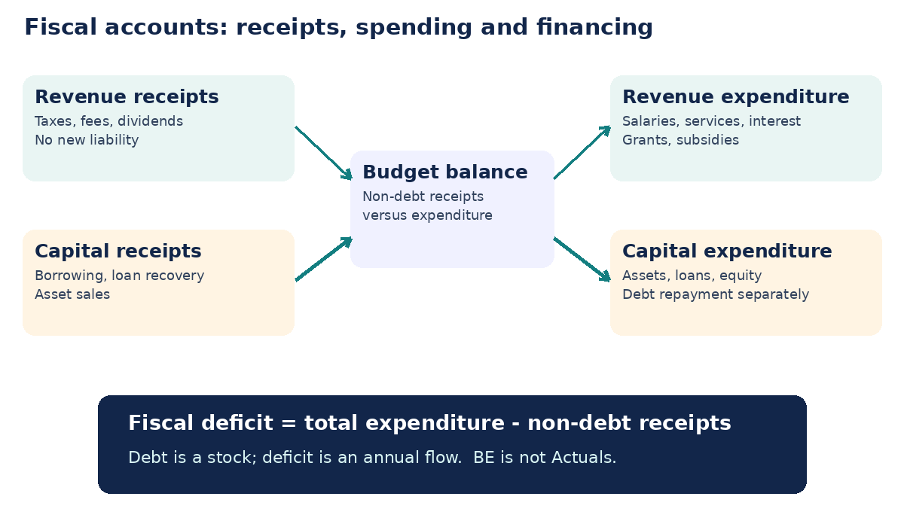
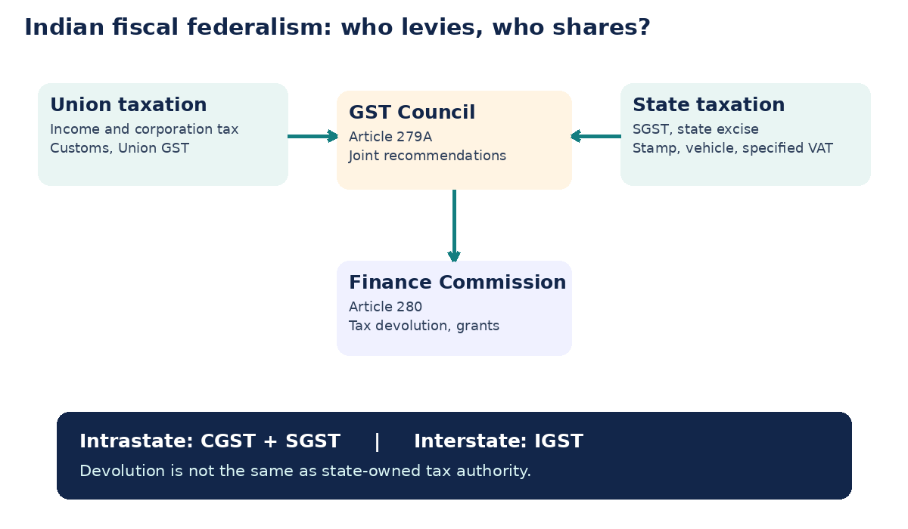
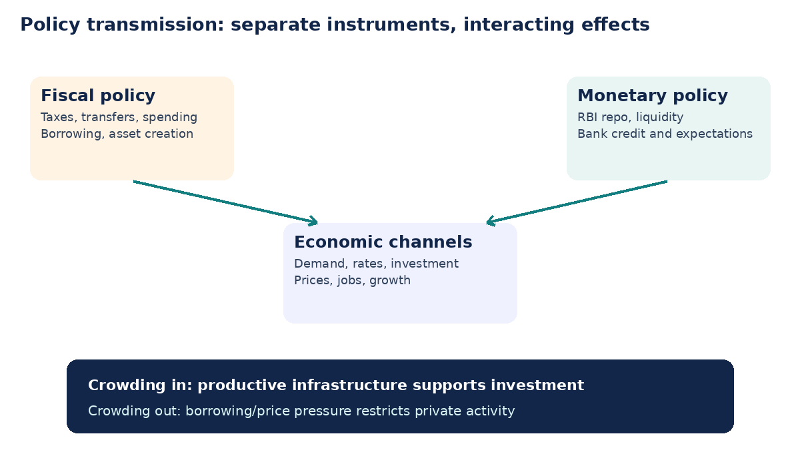

# Syllabus map, index and topic summary

**Paper IV · Unit I · Topic 4 — Public Finance**  
TGPSC Group I | Economy and Development | Expanded English study draft | 24 October 2026  
**Academic status: NOT APPROVED.** This manuscript is not a substitute for a subject-expert audit.

**R1 PRIMARY-SOURCE PASS (27 October 2026).** The Commission-hosted original Notification 02/2024, Annexure-II, printed page 31 (PDF index 30), Paper IV, Indian Economy and Development, item 4, directly states: “Public Finance: Tax structure, Central and state taxes; Government expenditure in revenue and capital account; Public debt: composition- internal and external debt; Monetary Policy, Fiscal Policy; Union Budget: Budget Analysis.” The original PDF page was visually inspected, not inferred from the secondary transcription. [S16]

| Exact syllabus element | Where studied | What to practise |
|---|---|---|
| Tax structure; central and state taxes | Sections 2–4 | Tax incidence, direct/indirect taxes, GST, constitutional assignment |
| Government expenditure in revenue and capital accounts | Sections 5–6 | Classification, worked ledger, outputs/outcomes |
| Public debt: composition; internal and external | Section 7 | Debt stock, SDLs, currency risk, guarantees |
| Monetary policy; fiscal policy | Sections 8–9 | Deficit formulas, FRBM, monetary-fiscal interaction |
| Union Budget: budget analysis | Sections 10–12 | BE/RE/Actuals, Union and Telangana 2026–27, fiscal sustainability |

**Topic summary.** Public finance explains the state's economic role through taxation, spending, borrowing and accountability. The constitutional division of tax powers creates a federal bargaining problem; GST harmonises much of the consumption-tax base but does not eliminate state tax autonomy or disputes about revenue sharing. Revenue and capital accounts describe different kinds of receipts and expenditure, yet a capital label does not guarantee a useful asset and a revenue label does not imply waste. Public debt is sustainable when institutions can service obligations and borrowed funds improve future capacity. Monetary policy influences liquidity and credit, whereas fiscal policy determines taxes, expenditure and deficits. The 2026–27 Union and Telangana budgets provide contrasting real-world examples of targets, accounting bases and fiscal constraints.

**Study sequence.** First learn the fiscal functions and tax-incidence logic. Then master Union–state powers and GST. Practise classifying receipts and expenditure before solving deficit calculations. Read debt and monetary–fiscal interaction together. Finally apply the analytical checklist to the Union and Telangana 2026–27 budgets. Read the standalone quick revision without needing the detailed chapter.

**Question provenance.** The 25 MCQs and six mains prompts here are original practice created for this library. **No item is represented as an authenticated official TGPSC PYQ.** The original question paper and question number have not been verified for any such item.

---

# Standalone quick revision — Public Finance

**Five-minute core:** Government allocates public goods, redistributes income and stabilises demand. Taxes are compulsory payments; their *economic incidence* depends on elasticities, not simply on who remits them. Direct taxes commonly target income/profits; indirect taxes commonly target consumption. Union and states have distinct constitutional powers, while GST combines CGST/SGST for intrastate and IGST for interstate supplies. The Finance Commission addresses fiscal transfers; the GST Council recommends GST coordination. State VAT continues for specified petroleum products; state excise continues for alcoholic liquor for human consumption.

**Accounts:** Revenue receipts neither normally create debt nor sell assets. Capital receipts include borrowing, loan recovery and disinvestment. Revenue expenditure includes salaries, interest, pensions, subsidies and most maintenance. Capital expenditure includes asset creation, equity and loans; debt repayment is a capital disbursement but often excluded from the headline 'expenditure excluding debt repayment'. A hospital needs capital construction **and** recurring staff/medicine. Union *effective capex* = direct capital expenditure + grants for creation of capital assets.

**Deficits:** Revenue deficit = revenue expenditure − revenue receipts. Fiscal deficit = total expenditure − non-debt receipts. Primary deficit = fiscal deficit − interest payments. Effective revenue deficit = revenue deficit − grants for creation of capital assets. Fiscal deficit is a flow; public debt is a stock. A revenue surplus and a fiscal deficit can coexist. BE ≠ RE ≠ Actuals. FRBM frameworks seek medium-term fiscal discipline but allow policy debate over shocks and flexibility.

**Debt:** Internal debt includes domestic government securities and SDLs; external debt introduces residency/foreign-source considerations and potentially currency risks. Guarantees are contingent liabilities, not automatically direct debt. Debt/GDP, interest/revenue, maturity, primary balance and growth–interest differential are more informative together than any single number. Ways and Means Advances address short-term cash mismatches.

**Policy:** Fiscal instruments are tax, spending, transfers and borrowing. RBI monetary instruments include repo/liquidity operations and reserve requirements. Fiscal stimulus can crowd in investment through infrastructure or crowd it out through borrowing costs. Inflation, spare capacity, transmission and execution quality determine outcomes.

**Union Budget 2026–27 BE:** Total expenditure ₹53,47,315 crore; direct capital expenditure ₹12,21,821 crore; effective capital expenditure ₹17,14,523 crore; fiscal deficit ₹16,95,768 crore (4.3% GDP); revenue deficit ₹5,92,344 crore (1.5% GDP); interest ₹14,03,972 crore. These are budget estimates [S02].

**Telangana 2026–27 BE:** Total expenditure including debt repayment ₹3,24,234 crore; net expenditure excluding debt repayment ₹3,01,209 crore; revenue expenditure ₹2,34,406 crore; capital outlay ₹47,267 crore; revenue surplus approximately ₹6,858 crore; fiscal deficit approximately ₹58,459 crore (3.0% GSDP). Do not mix totals with different debt-repayment treatment [S04, S11].

**Current affairs:** September 2025 GST rate rationalisation; 8 October 2026 GST Council procedural *recommendations*, not automatically operative statutes. October 2026 recommendations include easier registration, refunds and revised enforcement rules; verify later legal notifications before claiming implementation [S06, S07].

**Mains formula:** State the economic problem → explain constitutional/legal instrument → show transmission and who benefits/pays → add Union/Telangana evidence with BE/RE/Actuals label → weigh trade-offs → conclude with measurable accountability.

**Traps:** (1) A fiscal deficit is not the same as public debt. (2) GST Council recommendations are not enacted legislation. (3) Gross Union tax ≠ divisible pool ≠ net tax to Centre. (4) Higher capex does not prove completed assets. (5) State own tax ≠ devolution. (6) Borrowing is a capital receipt, not ordinary revenue. (7) A budget announcement is not a realised outcome.

---

# Detailed textbook notes: Public Finance in India and Telangana

## 1. Public finance: why the state raises, spends and borrows

### Allocation, distribution and stabilisation

Public finance studies how governments mobilise resources, allocate expenditure, distribute the tax burden and manage debt over time. Richard Musgrave's three functions provide a useful analytical framework. **Allocation** addresses public goods, externalities and coordination failures: flood protection, disease surveillance and an integrated road network cannot always be supplied efficiently through ordinary private markets. **Distribution** uses progressive taxes, targeted transfers and public services to modify unequal market outcomes. **Stabilisation** employs expenditure and taxation to influence aggregate demand, employment and inflation over the business cycle. A single policy may serve more than one function: public investment in a Telangana irrigation project can create infrastructure, support farm incomes and temporarily increase construction employment. The exam must distinguish the *intended function* from whether implementation actually achieves it.

The economic justification for intervention does not mean every government programme is efficient. Public choice analysis highlights political incentives, information asymmetry, rent-seeking and the possibility of regulatory capture. A subsidised input can help small farmers facing credit constraints yet also encourage groundwater extraction or benefit larger users disproportionately. Sound public finance therefore asks: what market failure is addressed, what is the counterfactual, who pays, who receives benefits, and how will results be measured? Cost-benefit analysis includes externalities and distributional weights rather than simply comparing expenditure with the next year's revenue. In Telangana, evaluating an urban transport corridor requires travel-time savings, air quality, displacement, maintenance costs and the opportunity cost of funds—not merely the size of the construction contract.

### The constitutional and accounting frame

India's Union and states operate separate Consolidated Funds under Articles 266 and 202/112 budget provisions, with expenditure authorised through legislative appropriation. The **Consolidated Fund** receives ordinary revenues and borrowings; the **Contingency Fund** under Article 267 allows urgent advances pending subsequent legislative authorisation; the **Public Account** holds money such as certain provident-fund deposits that government administers as a banker or trustee. These are different accounts, not three interchangeable spending pools. The Annual Financial Statement presents estimated receipts and expenditure; demands for grants, appropriation and finance legislation supply the parliamentary control machinery. A budget announcement alone does not establish a permanent legal entitlement, nor does an allocation prove that cash was released or a project completed.

A government budget is both a macroeconomic instrument and a contract of accountability. Citizens can compare Budget Estimates (BE), Revised Estimates (RE) and audited Actuals; legislatures can scrutinise whether appropriations matched outcomes; the Comptroller and Auditor General examines compliance and financial reporting. **BE is a plan, RE is an in-year reassessment, and Actuals are historical accounting results.** Telangana's 2026–27 projected revenue surplus should not be presented as a realised surplus. Similarly, the Union's fiscal deficit target is a forward-looking estimate rather than proof of future fiscal consolidation. [S01, S02, S04]

### State capacity, not only spending volume

Fiscal capacity includes the ability to identify taxpayers, collect revenue fairly, manage procurement, appraise investments and maintain assets. Digital invoices and direct transfers can improve audit trails, but they can also exclude households without reliable documents or connectivity. Local governments may be assigned sanitation and road functions without corresponding predictable funds or engineering staff. The principle of **subsidiarity** suggests delivering services at the lowest capable level, whereas equalisation grants recognise that poorer districts have weaker tax bases. These principles pull in different directions: decentralisation improves responsiveness, while pooled finance can preserve minimum national standards. The relevant question is how institutions reconcile them, not whether all centralisation or all decentralisation is inherently good.

## 2. Tax structure: principles, incidence and economic effects

### What makes a good tax?

A tax is a compulsory payment to government without an individually equivalent service in return. Adam Smith's canons—equity, certainty, convenience and economy—remain useful, but modern tax design also values neutrality, transparency, administrative feasibility and buoyancy. **Horizontal equity** asks whether similarly placed taxpayers bear similar burdens; **vertical equity** asks whether people with greater ability to pay contribute more. A progressive income tax can improve vertical equity but may create avoidance opportunities at complex thresholds. A broad consumption tax may collect efficiently but absorb a higher proportion of poor households' income unless essentials are relieved or transfers compensate them. Tax policy is thus a choice among competing objectives rather than a search for a costless ideal.

Distinguish **statutory incidence** (who must remit tax) from **economic incidence** (whose purchasing power falls after prices and wages adjust). A seller legally paying GST may pass part of the burden to buyers, while a firm facing inelastic demand may absorb some in its margin. The elasticity of supply and demand, competition and cross-border substitution determine the division. A stamp-duty increase on property transactions can reduce sellers' net proceeds, raise buyers' costs or suppress registrations. A tax on a mobile capital base can change investment location; a tax on immovable land is harder to avoid. An examination answer should explain mechanisms rather than simply claiming that all indirect taxes are passed fully to consumers.

### Direct and indirect taxes

**Direct taxes** ordinarily target income or wealth-related bases, including personal income tax and corporate income tax; **indirect taxes** target transactions or consumption, including GST, customs and excise on specified goods. The economic distinction is not perfectly identical to legal remittance. Income-tax deductions and exemptions alter effective progressivity; GST input-tax credits reduce tax cascading across business stages. A uniform rate simplifies administration but may be distributionally harsh; multiple rates protect selected goods but create classification disputes. The appropriate mix depends on revenue needs, informality, compliance capacity and the availability of targeted social transfers. Tax-to-GDP ratio, tax buoyancy (percentage tax-revenue growth divided by nominal GDP growth) and compliance gap answer different questions.

The **Laffer curve** illustrates that an extremely high tax rate can shrink the tax base, but it does not tell policymakers that a specific present rate lies beyond the revenue-maximising point. Similarly, tax concessions to attract investment should be judged against forgone revenue and additional investment actually caused by the concession. In Telangana, a state industrial incentive may support employment yet compete with education and health spending. A transparent tax-expenditure statement makes the trade-off visible. The ability to collect revenue predictably often matters more for long-term infrastructure than a headline reduction in a tax rate. [S03, S05, S06]

## 3. Constitutional division of Union and state taxation

### Legislative competence and assignment of proceeds

Article 246 and the Seventh Schedule distribute taxing powers through the Union and State Lists; the Concurrent List is not a general licence for both levels to impose every tax. Articles 268–271 and 279A govern important revenue-sharing arrangements. The Union levies income tax other than agricultural income, customs and corporation tax. States retain taxes such as state excise on alcoholic liquor for human consumption, stamp duties in their constitutionally allocated field, land revenue, taxes on vehicles and specified electricity-related taxes. State sales tax/VAT survives on petroleum products outside the GST levy, subject to applicable law. Local property taxes depend on state municipal legislation. **A state's share of centrally collected taxes is devolution, not a tax it independently levies.**

The **Finance Commission**, constituted under Article 280, recommends distribution of divisible Union tax proceeds and grants, while the GST Council under Article 279A makes recommendations concerning the shared GST system. The two institutions solve different federal problems. Finance Commission transfers respond to vertical and horizontal fiscal imbalances; GST Council bargaining addresses rates, exemptions, administration and coordination of a common market. Centrally sponsored schemes are another channel, often with matching contributions and implementation conditions. A state may receive a grant while still complaining about restricted fiscal autonomy because earmarked grants are not equivalent to untied tax revenue.

### GST and the dual system

The Constitution (101st Amendment) Act, 2016 enabled the dual GST system introduced on 1 July 2017. An intrastate taxable supply ordinarily attracts CGST plus SGST, while an interstate supply attracts IGST with settlement/apportionment mechanisms. The **destination principle** generally allocates consumption-tax revenue toward the place of consumption, unlike an origin-based system that favours producing jurisdictions. Input-tax credit aims to prevent tax-on-tax across supply chains, but blocked credits, exemptions, compliance failures and rate differences can preserve residual cascading. The GST Council's recommendations are institutionally significant; the Supreme Court in *Union of India v Mohit Minerals* (2022) clarified that Council recommendations do not automatically bind legislatures as if they were enacted statutes.

The 56th GST Council meeting in September 2025 recommended a broad two-rate structure of 5% and 18% with a special 40% rate for specified luxury/sin categories. On **8 October 2026**, the 57th meeting recommended procedural reforms including easier registration, refunds and reduced criminalisation. **Recommendations are not the same as already commenced statutory amendments**: some require legislation, rules, notifications or specified commencement dates. For instance, the Council recommended a new return-adjustment mechanism from April 2027. A current-affairs answer must distinguish the meeting date, the recommendation and actual legal effect. [S05, S06, S07]

### Telangana's own-tax room

Telangana receives SGST, state excise, stamp/registration revenue, VAT/sales tax on specified petroleum products and other state receipts. A consumption-heavy economy may raise SGST, but a weak housing market can depress stamp collections even when household incomes grow. The state's ability to vary GST rates unilaterally is limited by the shared legal architecture; it can nevertheless strengthen registration, analytics, anti-evasion administration and grievance redressal. Tax enforcement must balance legitimate revenue protection with small-enterprise compliance costs. For a district collector or finance officer, better revenue forecasting means examining taxable activity, administrative capacity and policy changes rather than extrapolating one strong collection month into a full-year trend. [S04]

## 4. Tax administration, GST reform and fiscal federalism

### From cascading taxes to invoice credit

Under a pre-GST chain, separate excise, sales and entry taxes could compound costs when credits were unavailable. Under a credit-invoice system, a registered firm offsets eligible tax on inputs against tax on outputs, so the net burden is intended to follow final consumption. Consider a manufacturer selling for ₹100 plus 18% GST and a retailer selling for ₹150 plus 18% GST. The manufacturer remits ₹18; the retailer collects ₹27 and, assuming full eligibility and compliance, credits ₹18 and remits ₹9. The chain remits ₹27 in total, not ₹45. If input credit is disallowed, the arithmetic and economic incidence change. The example illustrates the principle but does not override detailed rules on place of supply, valuation, exemptions or blocked credits.

A successful VAT/GST system depends on invoice matching, refunds, predictable rulings and functioning dispute resolution. **Inverted duty structures** occur when tax on inputs exceeds tax on outputs, potentially trapping credit and working capital. Exporters require timely refunds because exports are generally zero-rated. E-invoicing and analytics can reduce evasion but impose transition costs on smaller firms. The 57th Council's October 2026 recommendations included system-based refund processing, clearer notices and rationalised penalties; whether each becomes law must be checked in the relevant subsequent notification. For a Telangana textile exporter, a refund delayed six months is economically similar to an involuntary working-capital loan to the government. [S07]

### Cooperative versus competitive federalism

GST represents cooperative federalism because Union and state ministers jointly negotiate a common base, but cooperation is neither frictionless nor guaranteed. Producing states may worry about destination-based revenue; poorer states may seek more equalisation; high-consumption states may prefer lower rates; the Union may emphasise national uniformity. The end of the original GST compensation arrangement sharpened debates over states' revenue predictability. A Council decision may reduce compliance burdens nationally while changing the tax yield differently across states. The federal challenge is to protect the common market without erasing constitutionally recognised fiscal diversity.

Tax sharing should also be analysed together with cesses and surcharges. Under Article 270, the divisible pool excludes specified categories such as surcharges and certain cesses, so gross Union tax collections and the base shared with states are not identical. A growing share of non-divisible levies can intensify states' fiscal concerns even when headline tax devolution rates remain unchanged. For Telangana, a grant tied to a central scheme may support a service but also create an unfunded maintenance obligation. Exam responses should identify **who controls the tax base, who collects, who receives, who bears risk, and who is accountable for delivery**. [S01, S03]

## 5. Government receipts and the revenue/capital accounts

### Classification by economic substance

**Revenue receipts** ordinarily do not create a liability or reduce government assets: taxes, fees, dividends and interest receipts are typical examples. **Capital receipts** either create a liability (borrowings) or reduce financial assets (recovery of loans, disinvestment proceeds). An asset sale may improve this year's cash position without increasing recurring fiscal capacity. Likewise, borrowing raises cash but also raises liabilities and cannot be treated as tax revenue. The Consolidated Fund records both revenue and capital flows, but accounting classification helps evaluate whether current services are being funded from sustainable sources.

**Revenue expenditure** normally does not directly create a government-owned capital asset or reduce liabilities: salaries, pensions, interest, subsidies, many maintenance costs and grants belong here. **Capital expenditure** includes acquisition/construction of assets and lending or equity investment that creates a financial asset; repayment of debt is also a capital-account disbursement, although often shown separately from expenditure net of debt repayment in budget analysis. The category is not a moral ranking. A vaccination programme is often revenue expenditure yet can have extraordinary social returns; a poorly chosen building is capital expenditure yet may remain unused. Classifying a grant for construction as revenue expenditure in the granting government's books does not mean the receiving institution builds no asset. Hence the Union reports **effective capital expenditure**, adding grants for capital-asset creation to its own capital expenditure.

### Worked ledger and interpretation

Suppose a state collects ₹120 in taxes, ₹10 in fees, borrows ₹40 and sells an old financial investment for ₹5. Revenue receipts are ₹130; capital receipts are ₹45. Suppose it spends ₹100 on salaries and public services, ₹20 on interest, ₹40 constructing water assets and ₹10 lending to a utility. Revenue expenditure is ₹120; capital expenditure excluding repayment is ₹50. The revenue account has a ₹10 surplus; total non-debt expenditure is ₹170, while non-debt receipts are ₹135, so the fiscal deficit is ₹35. The new borrowing of ₹40 is not itself a fiscal-deficit receipt; financing adjustments and cash balances explain why borrowing need not equal the simple deficit in every presentation.

The fiscal significance lies in the **quality** of spending, not merely its label. A district hospital requires both a capital building and recurring doctors, drugs and maintenance. A large capital budget with inadequate revenue provision produces stranded assets; excessive recurring commitments without investment may constrain future growth. In Telangana's 2026–27 budget, revenue expenditure was estimated at ₹2,34,406 crore and capital outlay at ₹47,267 crore, while net expenditure excluding debt repayment was ₹3,01,209 crore. The remaining components include loans and advances; these figures should not be added indiscriminately as though each described the same accounting base. [S02, S04]

## 6. Public expenditure: welfare, infrastructure and evaluation

### Public goods, merit goods and externalities

A pure public good is non-rival and non-excludable, making private financing difficult because users can free-ride. National defence is a conventional example. School education and primary healthcare are not pure public goods—an individual seat or clinic visit can be rival and excludable—but they have positive externalities and distributional importance, so governments provide or subsidise them as **merit goods**. A state must choose among direct provision, conditional grants, vouchers, insurance, regulation and contracting. Each delivery model changes monitoring costs and incentives. Public spending on a rural road may increase market access, but benefits depend on connectivity to production centres and maintenance, not simply kilometres laid.

Keynesian analysis treats higher government spending or lower taxes as a possible response to deficient aggregate demand. The size of the fiscal multiplier depends on import leakage, household saving, capacity utilisation, financing conditions and monetary response. In a recession, transfers to liquidity-constrained households may raise consumption quickly; in an economy near capacity, extra demand may raise prices or interest rates. A capital project may create both immediate construction demand and future productivity, but slow procurement delays the short-run stimulus. Classical concerns emphasise crowding out, misallocation and intergenerational burdens; a balanced assessment compares conditions rather than treating one school as universally correct.

### Subsidies and targeting

Subsidies lower private costs or supplement incomes. They may correct externalities—vaccination and clean energy are examples—or meet equity objectives such as food security. However, an untargeted electricity subsidy can disproportionately benefit high-consumption households and distort groundwater pumping. Cash transfers allow recipients choice but require functioning markets and reliable identification. In-kind food distribution can protect consumption during price spikes but incurs storage and distribution costs. The practical evaluation should consider inclusion/exclusion errors, leakages, administrative expense, effects on behaviour and political sustainability. Telangana's power, farm and housing commitments must be assessed alongside public health, school quality and maintenance obligations.

### Outcome budgeting and audit

**Allocation → release → expenditure → output → outcome → impact** is a necessary chain of evidence. A ₹1,000-crore sanitation allocation is an input; toilets built are outputs; safe usage and lower disease incidence are outcomes; sustained improvements in health and productivity are impacts. Evaluation should use baselines, credible comparisons and disaggregated district data. The CAG and legislative Public Accounts Committees examine legality, financial control and value-for-money questions, but the executive remains responsible for fixing implementation. Social audits and public dashboards can complement formal audit, provided data quality and grievance remedies are credible. Telangana's district variation in irrigation, urban flooding and access to clinics means statewide spending totals alone cannot establish equal service delivery. [S02, S04]

## 7. Public debt: internal, external and contingent liabilities

### Stock, flow and the correct denominator

**Public debt is a stock of outstanding obligations at a date; the fiscal deficit is a flow of net borrowing requirement over a year.** A state can reduce its annual deficit and still see nominal debt rise. Debt sustainability is commonly evaluated using debt-to-GDP or debt-to-GSDP, interest-to-revenue, maturity profile, currency composition and the gap between economic growth and the effective interest rate. A higher debt ratio may be sustainable when borrowed funds create productive assets and nominal growth exceeds borrowing costs; it may be dangerous when repayment relies on repeated refinancing or optimistic one-time receipts. An interest bill crowds out other programmes even when a government remains solvent.

**Internal debt** is owed to creditors within the country or denominated in domestic instruments, including government securities, treasury bills and state development loans. **External debt** involves obligations to non-resident creditors or foreign sources, with currency and rollover risks varying by instrument. The two classifications are not always synonymous with rupee versus foreign-currency debt: an overseas investor may hold rupee bonds, and residency definitions matter. Union external borrowing through multilateral institutions can finance infrastructure, while state external assistance typically passes through constitutional and administrative arrangements involving the Union. An answer should avoid implying that Indian states freely issue foreign sovereign debt like independent countries.

### Instruments and debt management

The Union borrows through dated securities and treasury bills, with RBI acting as debt manager under the legal framework. States issue State Development Loans (SDLs) and may use Ways and Means Advances for temporary cash mismatches, subject to RBI arrangements. **Ways and Means Advances are short-term liquidity accommodation, not a substitute for a sustainable fiscal plan.** Maturity extension can reduce near-term rollover risk but may increase total interest depending on market rates. Debt switches and buybacks change the maturity structure without automatically extinguishing the economic burden. Cash-flow forecasting is essential because a state can have a solvent long-run balance sheet yet face a payment crunch when large repayments coincide with weak collections.

### Guarantees and off-budget risk

A government guarantee is a **contingent liability**: payment becomes due if the guaranteed borrower defaults under the guarantee's terms. A state enterprise's debt may not appear as direct state debt but can become a fiscal burden through guarantees, equity injections or unpaid subsidies. Off-budget borrowing routed through public enterprises can obscure the true fiscal position; consolidated risk assessment therefore considers direct debt, guarantees, utility arrears and public-sector enterprise exposure separately without double-counting. Telangana's 2026–27 official budget should be read with its debt and guarantee statements, not only its 3% fiscal-deficit target. A project may be socially valuable and still be financed through an opaque vehicle that undermines accountability. [S04, S08]

## 8. Fiscal deficit, revenue deficit, primary deficit and FRBM

### Definitions and numerical example

**Revenue deficit = revenue expenditure − revenue receipts. Fiscal deficit = total expenditure − non-debt receipts. Primary deficit = fiscal deficit − interest payments.** Effective revenue deficit subtracts grants for creation of capital assets from revenue deficit; effective capital expenditure adds those grants to capital expenditure. These measures answer different questions. A zero primary deficit means new borrowing broadly covers interest obligations rather than fresh primary spending, but it does not imply debt is shrinking. A revenue surplus can coexist with a fiscal deficit if the government borrows to finance capital formation. Conversely, borrowing to pay salaries while assets deteriorate raises serious intergenerational concerns.

Suppose total expenditure excluding debt repayment is ₹500, revenue receipts ₹350, recovery of loans ₹10 and disinvestment ₹20. Non-debt receipts total ₹380, giving a fiscal deficit of ₹120. If interest payments are ₹60, primary deficit is ₹60. If revenue expenditure is ₹390, revenue deficit is ₹40. If ₹15 of revenue spending consists of qualifying grants for capital-asset creation, effective revenue deficit is ₹25. The problem illustrates why fiscal deficit is not simply total expenditure minus tax revenue and why loan recoveries/disinvestment enter the calculation.

### Fiscal responsibility framework

The Fiscal Responsibility and Budget Management Act, 2003 and subsequent amendments require medium-term fiscal transparency and policy statements for the Union; states have their own fiscal responsibility legislation and borrowing frameworks. The FRBM regime has evolved through shocks, escape clauses and changing fiscal targets; a textbook answer must not freeze a historical 3% Union deficit target as if it applied mechanically every year. In the **Union Budget 2026–27**, the fiscal deficit is budgeted at **₹16,95,768 crore, or 4.3% of GDP**, while the revenue deficit is **₹5,92,344 crore, or 1.5% of GDP**. The Telangana budget targets a fiscal deficit of **₹58,459 crore, 3.0% of GSDP**, and a revenue surplus of about **₹6,858 crore**. These are BEs, not audited results. [S02, S04]

### Fiscal rules versus countercyclical flexibility

A credible fiscal rule can reduce inflationary financing pressures, protect future taxpayers and signal predictability to investors. An overly rigid rule may force expenditure cuts during recession or after natural disasters, precisely when public support is most valuable. Well-designed frameworks combine transparent targets, escape clauses, independent scrutiny and a medium-term adjustment path. India's Union and state fiscal situations differ in monetary sovereignty, borrowing access and transfer dependence; therefore identical deficit percentages do not mean identical fiscal space. A drought-hit Telangana district may need urgent expenditure, but that does not eliminate the need to disclose financing and assess debt sustainability. [S08]

## 9. Monetary policy and fiscal policy: instruments and interaction

### Monetary policy channels

Monetary policy is conducted by the RBI under the Reserve Bank of India Act, 1934 as amended, including the Monetary Policy Committee framework and the inflation-targeting architecture. Instruments include the policy repo rate, liquidity operations, reserve requirements and market operations; transmission occurs through bank funding costs, lending rates, expectations, exchange rates and asset prices. A higher policy rate may restrain credit-financed demand and inflation with a lag, but supply shocks such as crop failures are not fully controlled by interest rates. **Fiscal policy** is the government's choice of taxes, spending, borrowing and transfers. The two policies have distinct institutional decision-makers and transmission mechanisms.

Expansionary fiscal policy can raise aggregate demand and potentially interest rates, while a restrictive monetary stance can offset part of the demand impulse. Conversely, during a severe downturn, low interest rates may support a fiscal infrastructure programme if resources are underutilised. Fiscal dominance occurs when excessive financing needs pressure monetary authorities to accommodate deficits; monetary dominance refers to credible price-stability objectives constraining fiscal choices. Coordination should not erase central-bank operational independence. In India, government securities are both fiscal borrowing instruments and key assets in monetary operations, making the interface operationally important.

### Crowding out and crowding in

**Crowding out** arises when public borrowing raises financing costs or uses resources otherwise available for private investment. **Crowding in** occurs when public roads, electricity, logistics or digital infrastructure increase expected private returns and reduce costs. Which dominates depends on the project's quality, spare capacity, savings, capital mobility and monetary response. A Telangana industrial park connected to reliable power and transport may attract private manufacturing; an unused convention centre funded by high-cost debt may not. Claims that every rupee of capital expenditure generates the same multiplier ignore sector, location and execution quality.

### Inflation, debt and distribution

Unexpected inflation can reduce the real value of fixed-rate nominal debt but also raises procurement costs, harms fixed-income households and may lead to higher future interest rates. Tax brackets not indexed to inflation can cause fiscal drag; GST receipts may rise nominally even if real consumption stagnates. Monetary tightening can reduce inflation but raise debt-service costs on new borrowing. Therefore a complete budget analysis considers **nominal versus real** values, distributional consequences and the time horizon of effects. Fiscal-monetary coordination is not a command to keep rates low for government borrowing; it is an obligation to avoid contradictory macroeconomic signals. [S09, S10]

## 10. Union Budget process and reading the documents

### Constitutional sequence and parliamentary control

Article 112 requires the President to cause an Annual Financial Statement to be laid before Parliament. Charged expenditure is discussed but not submitted to vote in the same way as voted expenditure; demands for grants are voted by the Lok Sabha. The Appropriation Bill authorises withdrawal from the Consolidated Fund, while the Finance Bill gives effect to tax proposals. Article 110 defines Money Bills, and the constitutional role of the Rajya Sabha differs accordingly. A Finance Minister's speech is a policy statement; legal consequences depend on enacted legislation, notifications and appropriation. The Union Budget is ordinarily presented before the financial year, but the fiscal calendar, RE/BE tables and actual cash execution must be distinguished.

A practical reading order is **Budget at a Glance → Receipts Budget → Expenditure Profile → Demands for Grants → Finance Bill → Economic Survey and implementation data**. First identify nominal GDP assumptions, total expenditure and the fiscal deficit. Then separate gross tax revenue from tax revenue net to Centre and devolution to states. Next distinguish direct capex from effective capex, committed expenditure from discretionary programmes, and BE from RE. Finally inspect tax-law changes, borrowing maturity, grants and scheme outcomes. A large budget total can coexist with a falling real allocation to a particular service after inflation.

### A worked 2026–27 Union reading

The Union's **2026–27 Budget at a Glance** reports total expenditure **₹53,47,315 crore**, revenue receipts **₹35,33,150 crore**, capital expenditure **₹12,21,821 crore**, and effective capital expenditure **₹17,14,523 crore**. Fiscal deficit is **₹16,95,768 crore (4.3% of GDP)**; primary deficit **₹2,91,796 crore (0.7%)**. Interest payments are **₹14,03,972 crore**. These figures are internally consistent at the published accounting level; they do not mean that ₹17.15 lakh crore of effective capex is entirely Union-owned fixed assets. Effective capex includes qualifying grants that create assets outside the Union's direct books. [S02]

For comparison, the 2025–26 RE fiscal deficit was **4.4% of GDP**, and total expenditure **₹49,64,842 crore**. A fall in the deficit ratio may reflect changes in nominal GDP, receipts, spending or one-off transactions; it is not automatically evidence of stronger service delivery. The 2026–27 Budget's interest payments are a large recurring claim on fiscal space. An analytical answer should ask whether capital projects are completed on time, whether grants are released and whether the growth assumption is credible, rather than merely celebrating a higher outlay.

## 11. Telangana Budget 2026–27: interpretation and policy choices

### Reconcile the two expenditure totals

Telangana's official **Budget in Brief 2026–27** reports **total expenditure of ₹3,24,234 crore** including debt repayment and relevant capital-account transactions. The commonly cited **₹3,01,209 crore** is expenditure **excluding debt repayment**, as presented in PRS's budget analysis. Both numbers can be correct when the denominator is explained; confusing them leads to false comparisons. The state projected **revenue receipts ₹2,41,264 crore**, **revenue expenditure ₹2,34,406 crore**, **revenue surplus ₹6,858 crore**, **fiscal deficit ₹58,459 crore**, and **primary deficit ₹37,154 crore**. Its projected GSDP is **₹19,61,701 crore**. These are 2026–27 budget estimates, not audited results. [S04, S11]

### Worked 2026–27 Telangana budget reconciliation: three distinct fiscal measures

The numbers below are **2026–27 Budget Estimates (BE)**, not audited expenditure. PRS's March 2026 budget analysis reproduces the state budget tables and distinguishes the gross and net accounting perimeters [S11]; the state Budget in Brief is the underlying official budget publication [S04]. Work each calculation before drawing a policy conclusion.

| Step | Arithmetic (₹ crore) | What the result means |
|---|---:|---|
| Gross expenditure less scheduled debt-principal repayment | 3,24,234 − 23,025 = **3,01,209** | Net expenditure used in the fiscal-deficit presentation; the ₹23,025 is repayment of principal, not new development spending. |
| Net expenditure less non-borrowing receipts | 3,01,209 − 2,42,750 = **58,459** | Planned fiscal deficit (rounding to whole crore); it is not gross expenditure minus tax revenue. |
| Revenue receipts less revenue expenditure | 2,41,264 − 2,34,406 = **6,858** | Budgeted **revenue surplus**, even though the overall budget has a fiscal deficit. |
| Fiscal deficit less interest payments | 58,459 − 21,304 = **37,155** | Approximate **primary deficit** using rounded inputs; the published detailed figure is ₹37,154 crore. Do not mistake a one-crore rounding difference for an accounting contradiction. |
| Interest payments divided by revenue receipts | 21,304 ÷ 2,41,264 × 100 ≈ **8.83%** | A BE debt-service-pressure indicator; this ratio does not capture principal repayments or guarantees. |

**Why the perimeters matter.** Subtracting the ₹23,025 crore principal repayment once is necessary when comparing the PRS net-expenditure series with receipts excluding borrowings. Subtracting it again from ₹3,01,209 crore would understate spending and the deficit. Likewise, treating ₹79,984 crore of gross planned borrowing as the fiscal deficit ignores debt redemption and other financing items. A revenue surplus can coexist with a fiscal deficit because capital outlay and other capital transactions still require finance. The published ₹58,459 crore fiscal deficit is roughly **3.0%** of the projected ₹19,61,701 crore GSDP; this is a planned ratio, not evidence that the year closed at that level.

**Interpretation versus evidence.** The 2025–26 revised net-expenditure estimate was ₹2,61,211 crore, against ₹3,01,209 crore budgeted for 2026–27: an approximately **15.3% planned increase** over RE. This is not a measured increase in services delivered. A mains answer should examine execution, capital-project completion, the previous year's revenue-estimate accuracy, the difference between committed expenditure and discretionary schemes, and separately disclosed guarantees. The correct comparison requires consistent years, BE/RE/Actuals labels and debt-repayment treatment. [S04, S11]

### What the composition reveals

Capital outlay was budgeted at **₹47,267 crore**, including sizeable allocations for irrigation, welfare-related capital works and roads/bridges. The state also planned lending/advances and repayment transactions, which must not be mislabeled as new physical infrastructure. Revenue expenditure includes social transfers, salaries, pensions, interest and routine service delivery. An irrigation project illustrates the central trade-off: the dam or canal is capital expenditure, while electricity, repairs, extension services and water governance determine whether the asset raises farm productivity. A high capital-outlay percentage is insufficient without lifecycle budgeting.

### Risk and equity

The state targeted a fiscal deficit of **3.0% of GSDP**, after a 2025–26 revised estimate of **3.2%**. The 2026–27 revenue-surplus projection depends on ambitious receipts. Budget analysis should compare prior RE with BE to test forecast credibility and examine contingent liabilities of power and infrastructure enterprises. Welfare commitments can smooth household consumption and improve human capital, but poorly targeted or poorly funded schemes may crowd out essential maintenance. A fair evaluation asks which groups benefit, whether delivery is predictable and how the government will finance obligations across years.

### District-level consequences

The distribution of public finance matters within Telangana. Hyderabad's property market and service sector generate different revenue opportunities from tribal and rain-fed districts. State-level equalisation through grants, roads, health staffing and schools can narrow these gaps, but a uniform scheme may ignore local constraints. Urban flooding control in the Hyderabad metropolitan area requires drainage investment and coordination across agencies; drought mitigation in a rural mandal requires watershed management, groundwater regulation and farmer support. A district administration should connect budget lines to measurable local outcomes, procurement milestones and maintenance funding. [S04, S11]

## 12. Fiscal sustainability, transparency and contemporary reforms

### Reading debt beyond the headline

A government may report a lower deficit ratio while carrying high outstanding debt, off-budget guarantees or unpaid bills. The debt dynamics identity shows why: roughly, the change in debt ratio depends on the interest-growth differential, the primary balance and valuation or stock-flow adjustments. If nominal growth persistently exceeds effective interest costs, the debt ratio can stabilise even with a modest primary deficit; if growth slows or borrowing costs rise, the same deficit can become unsustainable. Debt-funded productive investment can improve future capacity, but a promised project return should be tested against delays, land costs and environmental risks. The state should disclose guarantees and public-enterprise exposures separately, avoiding double-counting when calculating consolidated risk.

### Transparency institutions

The CAG's audit, legislative committees, outcome budgets, procurement disclosures, finance accounts and public dashboards each perform different roles. CAG audit tests whether accounts and transactions conform to law and whether value-for-money concerns arise; the legislature holds the executive accountable; departmental management fixes control weaknesses. Publishing an allocation is not the same as publishing tender outcomes, asset quality or beneficiary experience. Open data should be machine-readable, timely and sufficiently disaggregated without exposing personal information. A Telangana citizen assessing a school-building project needs its sanctioned amount, contractor, completion status and operational staffing—not only a ceremonial inauguration photograph.

### Dated current-affairs register

**February 2026:** The Union Budget 2026–27 set a 4.3% fiscal-deficit target and ₹12,21,821 crore direct capital expenditure; read it as BE. **20 March 2026:** Telangana presented its 2026–27 budget, targeting a 3.0% GSDP fiscal deficit and a ₹6,858 crore revenue surplus. **8 October 2026:** The 57th GST Council meeting recommended compliance, refund and adjudication reforms; recommendations must be separated from enacted law and commencement. These are distinct developments at different stages of the policy cycle. They demonstrate that public finance requires careful attention to accounting bases, institutions and legal status. [S02, S04, S07]

### An integrated decision framework

When asked whether a tax cut, subsidy or capital project is justified, answer six questions: (1) what failure or inequality is being addressed? (2) what is the statutory and constitutional authority? (3) who bears the economic burden and who gains? (4) how is it financed and what happens to debt and inflation? (5) can the administration deliver it? (6) what evidence would show success? This framework does not replace facts; it organises them. For Telangana, it forces a link between the Union-state tax system, the state's own receipts, district implementation and the long-run maintenance of public assets. A sound fiscal policy is not the largest possible budget, but a credible, equitable and productive use of scarce public resources.

---

# Visual learning and high-value comparison tables

| Distinction | First term | Second term | Exam consequence |
|---|---|---|---|
| Statutory vs economic tax incidence | Legal remitter | Final burden after market adjustment | Elasticities determine burden |
| Revenue vs capital receipt | Taxes, fees, dividends | Borrowing, loan recovery, disinvestment | Borrowing is not earned recurring revenue |
| Revenue vs capital expenditure | Recurring services, interest, grants | Assets, loans, equity | Spending quality depends on results |
| Deficit vs debt | Annual borrowing requirement | Outstanding stock of obligations | Lower deficit need not reduce debt stock |
| Direct capex vs effective capex | Union's own capital account | Direct capex plus asset-creation grants | Different accounting perimeter |
| BE vs RE vs Actuals | Initial plan | Updated in-year estimate | Audited historical execution |
| Monetary vs fiscal policy | RBI credit/liquidity instruments | Government taxes/spending/borrowing | Different authorities and lags |

| Union 2026–27 BE | ₹ crore | Telangana 2026–27 BE | ₹ crore |
|---|---:|---|---:|
| Total expenditure | 53,47,315 | Total expenditure including debt repayment | 3,24,234 |
| Direct capital expenditure | 12,21,821 | Capital outlay | 47,267 |
| Effective capital expenditure | 17,14,523 | Net expenditure excluding debt repayment | 3,01,209 |
| Fiscal deficit | 16,95,768 | Fiscal deficit | 58,459 |
| Revenue deficit | 5,92,344 | Revenue surplus | 6,858 |

**Interpretation warning:** This is a comparison of selected published budget-estimate metrics, **not** a common-base ratio comparison. Union and Telangana use different economic scales, and Telangana's gross expenditure includes debt repayment whereas its net expenditure excludes it. [S02, S04]

---

# 25 original practice MCQs with explanations

**Provenance:** These are original examination-style practice questions, **not verified official TGPSC previous-year questions**. Each answer is accompanied by reasoning; do not infer a past exam year or question number.

**1.** Which is the clearest example of Musgrave's *allocation* function?  
A. Paying interest on existing debt  B. Providing flood-control infrastructure  C. Changing the income-tax exemption solely to redistribute income  D. Selling government shares  
**Answer: B.** Flood protection addresses public-good and externality problems. Income redistribution is primarily the distribution function; interest and asset sales are financial transactions.

**2.** A tax is legally remitted by a retailer, but most of its burden is borne by consumers. This illustrates:  
A. Vertical equity  B. Tax buoyancy  C. Difference between statutory and economic incidence  D. Fiscal deficit  
**Answer: C.** The legal remitter need not bear the ultimate burden. Supply/demand elasticities determine shifting.

**3.** If a government borrows ₹500 crore through bonds, the initial cash receipt is generally classified as:  
A. Tax revenue  B. Non-tax revenue  C. Capital receipt creating liability  D. Revenue surplus  
**Answer: C.** Borrowing creates a repayment obligation; it does not raise ordinary revenue.

**4.** Which pair best represents revenue expenditure?  
A. Hospital construction and equity purchase  B. Salaries and interest payments  C. Loan recovery and disinvestment  D. Repayment of principal and new loans  
**Answer: B.** Salaries and interest are revenue expenditure; the other choices mix capital transactions.

**5.** Under an eligible GST invoice-credit chain, a retailer collects ₹27 output GST and has ₹18 valid input credit. Net GST remitted by the retailer is:  
A. ₹45  B. ₹27  C. ₹18  D. ₹9  
**Answer: D.** Output tax minus eligible credit is 27 − 18 = ₹9; the supply chain as a whole remits tax on final value.

**6.** The GST Council is established under which Article?  
A. 280  B. 279A  C. 266  D. 112  
**Answer: B.** Article 279A creates the GST Council; Article 280 concerns the Finance Commission.

**7.** Which is principally a tax independently levied by a state rather than a share devolved from the Union?  
A. Share in Union income tax  B. Corporation tax  C. State excise on alcoholic liquor for human consumption  D. Customs duty  
**Answer: C.** The other items are Union taxes or shared proceeds; state excise is a retained state power.

**8.** In the dual GST framework, a taxable intrastate supply ordinarily attracts:  
A. Only IGST  B. CGST and SGST  C. Customs duty and SGST  D. Only state VAT  
**Answer: B.** Intrastate supplies ordinarily split GST into central and state components; interstate supplies attract IGST.

**9.** Which is a Finance Commission function rather than a GST Council rate recommendation?  
A. Recommending distribution of the divisible Union tax pool  B. Setting an HSN-specific GST rate  C. Registering GST dealers  D. Issuing state development loans  
**Answer: A.** Article 280 Finance Commissions recommend fiscal transfers; the GST Council coordinates GST policy.

**10.** A government records ₹900 revenue expenditure and ₹850 revenue receipts. Its revenue deficit is:  
A. ₹1,750  B. ₹50  C. ₹900  D. Zero  
**Answer: B.** Revenue deficit = 900 − 850 = ₹50. It says nothing by itself about capital expenditure.

**11.** Fiscal deficit is best defined as:  
A. Revenue expenditure minus revenue receipts  B. Outstanding public debt  C. Total expenditure minus non-debt receipts  D. Tax revenue minus interest  
**Answer: C.** It measures the year's borrowing requirement on the relevant accounting perimeter.

**12.** Fiscal deficit ₹120 crore and interest payments ₹70 crore imply primary deficit:  
A. ₹190 crore  B. ₹70 crore  C. ₹50 crore  D. ₹120 crore  
**Answer: C.** Primary deficit = fiscal deficit − interest = ₹50 crore.

**13.** A state has a revenue surplus but a fiscal deficit. Which explanation is plausible?  
A. This is arithmetically impossible  B. It borrows to finance capital outlay  C. It has no tax revenue  D. All debt is external  
**Answer: B.** The revenue account can be in surplus while non-debt resources are insufficient for capital spending.

**14.** Union 'effective capital expenditure' differs from direct capital expenditure because it also includes:  
A. All salary expenditure  B. All interest expenditure  C. Grants for creation of capital assets  D. Tax refunds  
**Answer: C.** The adjustment captures capital formation funded through qualifying grants in other entities' accounts.

**15.** Which statement about a state guarantee is correct?  
A. It is always immediately counted as direct state debt  B. It is a contingent obligation that may crystallise  C. It can never impose a fiscal cost  D. It is identical to a revenue receipt  
**Answer: B.** A guarantee creates exposure if the guaranteed borrower fails; classification and consolidation require care.

**16.** Which ratio most directly measures debt-service pressure on a government's recurring resources?  
A. Interest payments/revenue receipts  B. Rainfall/GSDP  C. Number of schemes/ministries  D. Population/area  
**Answer: A.** Interest absorbs current resources and can crowd out services even when debt/GDP is stable.

**17.** A state issues State Development Loans. These are primarily:  
A. Local property taxes  B. State borrowing instruments  C. Union GST grants  D. Foreign equity  
**Answer: B.** SDLs are state government securities used to finance borrowing requirements.

**18.** Ways and Means Advances are mainly intended for:  
A. Permanent financing of any deficit  B. Temporary cash-flow mismatches  C. Privatisation receipts  D. GST rate setting  
**Answer: B.** WMA supports short-term liquidity; it is not a durable substitute for fiscal adjustment.

**19.** A lower annual fiscal-deficit ratio necessarily means the nominal debt stock has fallen. This claim is:  
A. Always true  B. True only for states  C. False  D. True when GST is high  
**Answer: C.** The debt stock can rise while annual borrowing falls; denominator changes and stock-flow adjustments also matter.

**20.** Which institution principally sets India's policy repo rate through the statutory MPC framework?  
A. Finance Commission  B. GST Council  C. Reserve Bank monetary-policy mechanism  D. State legislature  
**Answer: C.** Monetary policy is an RBI function; taxation and appropriation are fiscal decisions.

**21.** Government infrastructure borrowing that raises private productivity is an example of potential:  
A. Crowding in  B. Tax evasion  C. Automatic debt cancellation  D. Revenue receipt  
**Answer: A.** Better logistics or electricity can raise expected private returns and investment.

**22.** Which 2026–27 Union figure is a *Budget Estimate* rather than an audited outcome?  
A. Fiscal deficit target of 4.3% of GDP  B. A verified final actual for 2026–27  C. An audited CAG closing balance for March 2027  D. An ex-post final tax collection  
**Answer: A.** The Union Budget proposed a 4.3% deficit; the financial year had not closed as of October 2026.

**23.** Telangana's 2026–27 Budget Estimates report gross expenditure of ₹3,24,234 crore and scheduled principal repayment of ₹23,025 crore. What is expenditure **excluding debt repayment**, on the PRS comparison basis?  
A. ₹3,47,259 crore  B. ₹3,24,234 crore  C. ₹23,025 crore  D. ₹3,01,209 crore  
**Answer: D.** Subtract principal repayment once: ₹3,24,234 − ₹23,025 = ₹3,01,209 crore. A adds the repayment, B leaves it included, and C reports only the repayment. This is the 2026–27 BE perimeter, not an audited actual. [S04, S11]

**24.** The GST Council's recommendations of 8 October 2026 should be treated as:  
A. Automatically enacted laws on the meeting date  B. Proposals requiring relevant legal action and commencement checks  C. A new Finance Commission award  D. RBI monetary policy  
**Answer: B.** Council recommendations are institutionally important but do not by themselves establish commencement of statutory amendments.

**25.** Telangana's 2026–27 Budget Estimates include ₹21,304 crore interest payments and ₹2,41,264 crore revenue receipts. Approximately what share of revenue receipts is absorbed by interest?  
A. 8.8%  B. 11.3%  C. 17.0%  D. 21.3%  
**Answer: A.** ₹21,304 ÷ ₹2,41,264 × 100 ≈ 8.83%. B reverses the ratio conceptually; C confuses a different year or basis; D treats the numerator's first digits as a percentage. This measures planned interest pressure, not total debt service or audited 2026–27 spending. [S11]

---

# Six mains-answer blueprints (original practice)

1. **Tax structure and equity:** Define taxation and equity → distinguish direct/indirect and legal/economic incidence → constitutional division and GST → progressive and regressive effects → Telangana illustration → balanced conclusion on compliance and redistribution.
2. **Revenue and capital accounts:** Define accounts → classify receipts/expenditure with examples → work a simple fiscal-deficit calculation → discuss effective capex and lifecycle costs → apply to Telangana → conclude with outcome evaluation.
3. **Public debt and sustainability:** Define stock versus flow → classify internal/external/contingent → discuss debt ratios, interest-growth and maturity → state SDL and guarantees → competing views → transparent management.
4. **Fiscal versus monetary policy:** Define instruments and authorities → explain transmission and lags → crowding out/in, inflation, RBI independence → Telangana project illustration → conditional coordination.
5. **Union Budget 2026–27:** Introduce BE/RE/Actuals → cite verified deficit/capex/interest figures → explain composition and fiscal space → assess outcomes and risks → conclude on transparency.
6. **Telangana Budget 2026–27:** Reconcile gross/net expenditure → present deficit, revenue balance, capex → analyse welfare, irrigation, liabilities and district outcomes → conclude with realistic financing and audit.

Each blueprint is followed by a complete model answer with question-specific subheadings in the separate mains-model-answers section. All prompts are original, not authenticated official PYQs.

---

# Six complete original mains model answers

## M1. Explain the principles of a good tax system and assess India's Union–state tax structure.

**Introduction and background.** A tax is a compulsory public contribution used to finance collective services and redistribution. Good taxation must raise predictable revenue without imposing unnecessary economic or administrative costs.

**Objectives and principles.** Horizontal equity requires similar taxpayers to be treated similarly; vertical equity expects greater capacity to bear a greater burden. Certainty, simplicity, convenience and low collection costs improve voluntary compliance. Economic incidence depends on market elasticities, so the legal taxpayer may not bear the ultimate burden.

**Institutions and measures.** The Constitution assigns income and corporation taxes primarily to the Union, while states retain specified excise, stamp and other taxes. GST combines CGST and SGST for intrastate supplies and IGST for interstate transactions. The Finance Commission recommends tax devolution; the GST Council coordinates GST. Telangana's own-tax effort includes SGST, excise and registration revenue.

**Critical appraisal.** Progressive income taxes can support equity but complex exemptions create avoidance. Broad consumption taxes improve collection yet can burden poorer households unless essentials and transfers are considered. GST invoice credits reduce cascading, although compliance costs and blocked credits remain concerns. Cesses outside the divisible pool can intensify federal tensions.

**Conclusion.** A credible system balances equity, efficiency and federal autonomy. The priorities are a broad transparent base, proportionate enforcement, predictable transfers and public reporting of the actual distributional effects of tax changes.

## M2. Distinguish revenue and capital accounts and explain why expenditure classification alone cannot measure development.

**Introduction.** Budget classification reveals the nature of government transactions but does not by itself establish whether spending improves public welfare.

**Definitions and mechanisms.** Revenue receipts include taxes and fees that ordinarily neither create debt nor dispose of assets. Capital receipts include borrowings, recovery of loans and disinvestment. Revenue expenditure includes salaries, interest, pensions, subsidies and maintenance. Capital expenditure includes construction, equipment, loans and equity. Repayment of debt is a capital-account disbursement often excluded from net expenditure comparisons.

**Fiscal implications.** Revenue deficit equals revenue expenditure minus revenue receipts. Fiscal deficit measures total expenditure less non-debt receipts. A government can report a revenue surplus while borrowing for capital formation. The Union's effective capital expenditure adds grants for creation of capital assets to its direct capital expenditure, recognising that the recipient may own the completed asset.

**Telangana illustration.** A new irrigation canal is capital outlay; pumps, water management and repairs require recurring resources. Telangana's 2026–27 budget estimates capital outlay of about ₹47,267 crore and revenue expenditure of ₹2,34,406 crore. These allocations are plans, not proof of functioning infrastructure.

**Critical appraisal.** Vaccination, teaching and preventive maintenance can yield high returns despite being revenue expenditure. An unfinished bridge remains capital expenditure despite weak social value. Outcomes require utilisation, quality and lifecycle-cost evidence.

**Conclusion.** Fiscal appraisal should combine correct accounting, audited execution and measurable service outcomes, rather than treating capital spending as automatically productive or revenue spending as automatically wasteful.

## M3. Analyse the composition and sustainability of India's public debt, with reference to state liabilities.

**Background.** Public debt is the outstanding stock of government obligations, whereas fiscal deficit is an annual flow indicating borrowing needs. Borrowing can finance useful investment or defer current costs.

**Composition.** Internal borrowing includes Union securities, treasury bills and State Development Loans. External borrowing involves non-resident or foreign sources and can create exchange-rate and refinancing exposure. Government guarantees and liabilities of public enterprises are contingent or indirect risks that require separate disclosure rather than automatic addition to direct debt.

**Sustainability indicators.** Debt-to-GDP, interest-to-revenue, primary balance, maturity distribution and the growth–interest differential must be read together. A rising nominal debt stock is not inherently alarming if income and productive capacity grow faster, but repeated borrowing for current obligations reduces future flexibility. Short maturities expose the government to rollover risk; expensive refinancing can squeeze schools and hospitals.

**Telangana relevance.** State Development Loans finance expenditure, while public utilities and infrastructure enterprises may create guarantee exposure. The state's 2026–27 fiscal-deficit target is 3% of projected GSDP, but debt analysis also needs outstanding obligations and realistic revenue forecasts. Borrowed irrigation investment must be evaluated against completion, maintenance and actual farm benefits.

**Critical appraisal.** Keynesian reasoning accepts borrowing during recessions and for high-return assets. Fiscal conservatives warn of crowding out, opacity and burdens on future taxpayers. Both concerns depend on project quality and macroeconomic conditions.

**Conclusion.** Transparent debt and guarantee statements, maturity management, realistic revenue assumptions and outcome-based capital investment are the foundation of sustainable public borrowing.

## M4. Compare fiscal and monetary policy and explain their interaction in promoting growth and price stability.

**Introduction.** Fiscal policy concerns government taxes, spending, transfers and borrowing. Monetary policy concerns the central bank's management of interest rates, liquidity and credit conditions. Both affect aggregate demand, but their authorities and lags differ.

**Mechanisms.** Fiscal stimulus can increase household purchasing power or create infrastructure. RBI repo-rate and liquidity decisions influence bank funding, credit demand, expectations and inflation. Monetary transmission is gradual and may be weakened by stressed banks or supply-side inflation. Fiscal implementation also faces procurement and project delays.

**Interaction.** When resources are underused, productive public investment may crowd in private activity by improving roads and electricity. Near full capacity, deficit-financed demand can raise prices or borrowing costs and crowd out investment. Monetary tightening may counter inflation but raise the cost of refinancing public debt. Excessive fiscal pressure on monetary authorities risks undermining price stability.

**Telangana illustration.** A well-connected industrial corridor can improve private returns and employment, but its benefits depend on land acquisition, electricity reliability and maintenance. Financing an underutilised project through costly debt can instead reduce resources available for health and education.

**Critical appraisal.** There is no fixed multiplier or universally correct policy mix. Outcomes depend on spare capacity, inflation expectations, credit transmission, tax incidence and public-sector execution quality. RBI independence should coexist with transparent fiscal planning rather than being sacrificed for cheaper borrowing.

**Conclusion.** Coordinated yet institutionally distinct policies can support stable growth when fiscal choices are credible, monetary policy protects purchasing power and public investment passes rigorous appraisal.

## M5. Critically examine the Union Budget 2026–27 using fiscal-deficit, expenditure and accountability indicators.

**Background and method.** Budget Estimates are forward-looking plans; Revised Estimates update the current year and Actuals report execution. Therefore, budget analysis must not confuse an announced allocation with a realised outcome.

**Key facts.** The Union Budget 2026–27 estimates total expenditure at ₹53,47,315 crore, direct capital expenditure at ₹12,21,821 crore and effective capital expenditure at ₹17,14,523 crore. The fiscal deficit is budgeted at ₹16,95,768 crore, or 4.3% of GDP, compared with 4.4% in 2025–26 RE. The revenue deficit is 1.5% of GDP and interest payments are ₹14,03,972 crore.

**Objectives and measures.** Higher infrastructure spending can improve logistics and crowd in private investment. Effective capital expenditure also recognises grants used to create assets outside the Union's own books. The planned deficit path signals fiscal consolidation while allowing continued public investment.

**Critical appraisal.** Interest payments constrain discretionary fiscal space. Capital allocation alone cannot establish timely completion, utilisation or equitable geographic distribution. A falling deficit ratio can reflect nominal GDP growth and receipts assumptions as well as spending restraint. Tax devolution, cesses and scheme conditions affect states' implementation capacity.

**Conclusion.** The Budget should be judged against audited spending, asset performance, social outcomes and debt sustainability. Fiscal credibility requires transparent comparisons of BE, RE and Actuals, rather than relying on a single deficit target or expenditure headline.

## M6. Assess Telangana Budget 2026–27 in terms of fiscal discipline, welfare and infrastructure priorities.

**Introduction.** Telangana's 2026–27 Budget combines welfare commitments and capital investment under revenue and borrowing constraints. Proper interpretation requires separating gross expenditure from expenditure net of debt repayment.

**Verified budget framework.** The official gross total is ₹3,24,234 crore; net expenditure excluding debt repayment is about ₹3,01,209 crore. Revenue receipts are projected at ₹2,41,264 crore and revenue expenditure at ₹2,34,406 crore, producing a budgeted revenue surplus of approximately ₹6,858 crore. The fiscal deficit target is ₹58,459 crore, or 3.0% of GSDP.

**Development priorities.** Capital outlay of ₹47,267 crore includes irrigation, welfare-related infrastructure and roads. Welfare transfers can stabilise vulnerable household consumption, while functioning transport, irrigation and schools can raise long-run productivity. Different districts require different mixes of infrastructure, staffing and maintenance.

**Critical appraisal.** The revenue surplus is a projection dependent on receipts materialising. The previous year's revised estimates show why budget optimism needs scrutiny. Interest obligations, guarantees, public-enterprise exposure and recurring subsidies can restrict future fiscal room. Large projects require lifecycle budgeting, transparent procurement and independent outcome evaluation; construction expenditure alone does not prove benefits.

**Conclusion.** Telangana can reconcile equity and fiscal responsibility through credible revenue forecasts, targeted transfers, high-return infrastructure, district-level outcome dashboards and transparent debt/guarantee disclosure. The ultimate test is realised public service quality, not the announced budget size.

---

# Authoritative source register and internal audit

**Source handling:** Source identifiers in the text refer to this register. Primary documents are prioritised for legal and budget claims. Dated budget figures are labelled BE/RE/Actuals. The Commission-hosted original Notification 02/2024 Annexure-II printed page 31 was directly visually inspected on 27 October 2026; R1 syllabus correspondence passes for this topic. This does not certify the other academic gates.

| ID | Source / scope | Link | Verification / caution |
|---|---|---|---|
| S01 | Constitution of India, Articles 110, 112, 202, 246, 266–271, 279A, 280 | https://legislative.gov.in/constitution-of-india/ | Primary constitutional framework; check current amendments |
| S02 | Union Budget 2026–27, Budget at a Glance (February 2026) | https://www.indiabudget.gov.in/doc/Budget_at_Glance/budget_at_a_glance.pdf | Primary budget figures; all 2026–27 values BE |
| S03 | Union Budget 2026–27, Receipt Budget | https://www.indiabudget.gov.in/doc/rec/allrec.pdf | Primary tax and revenue classification |
| S04 | Telangana Budget in Brief 2026–27 | https://www.telangana.gov.in/wp-content/uploads/2026/05/Budget-in-Brief.pdf | Primary state budget figures, including accounting totals |
| S05 | GST Council official portal, constitutional framework | https://gstcouncil.gov.in/ | Council and 101st Amendment context |
| S06 | 56th GST Council recommendations (September 2025) | https://gstcouncil.gov.in/sites/default/files/2025-10/newsletter_august_issue_2025_0.pdf | Distinguish recommendations and operative law |
| S07 | 57th GST Council press release (8 October 2026) | https://gstcouncil.gov.in/sites/default/files/2026-10/press_release_0.pdf | Primary dated recommendations; not blanket evidence of commencement |
| S08 | Fiscal Responsibility and Budget Management Act, 2003 and Ministry of Finance | https://dea.gov.in/ | Check amendments and rules for applicable year |
| S09 | Reserve Bank of India, monetary policy framework | https://www.rbi.org.in/ | Primary monetary-policy institutional source; no invented current repo rate |
| S10 | RBI Handbook of Statistics on Indian Economy | https://rbi.org.in/scripts/AnnualPublications.aspx?head=Handbook%20of%20Statistics%20on%20Indian%20Economy | Monetary/fiscal time-series; definitions vary |
| S11 | PRS Legislative Research, Telangana Budget Analysis 2026–27 | https://prsindia.org/budgets/states/telangana-budget-analysis-2026-27 | Secondary cross-check explaining debt-repayment treatment |
| S12 | Published transcription of TGPSC Group I Notification 02/2024 syllabus | https://keshav.ugenglish.in/2024/02/tspsc-group-1-notification-022024.html | Not original commission PDF; syllabus provenance gap remains |
| S13 | CAG of India, Union and state finance audits | https://cag.gov.in/ | Official audited actuals; audit year must match claim |
| S14 | Finance Commission, Article 280 and reports | https://fincomindia.nic.in/ | Commission recommendations vs accepted policy distinction |
| S15 | CBIC GST laws and notifications | https://cbic-gst.gov.in/ | Check actual legal commencement of GST Council proposals |
| S16 | TGPSC Notification No. 02/2024, Annexure-II, printed p. 31, Paper IV Unit I item 4 | https://websitenew.tgpsc.gov.in/preview/RElSRUNUUkVDUlVJVE1FTlROT1RJL05PVElGSUNBVElPTl9OT18wMi0yMDI0X0dyb3VwLUlfU2VydmljZXMgKDEpMjAyNDAyMjAxNDA3MzcucGRmr95v17a0y2d8i13v | **Original commission PDF page directly inspected 27 Oct 2026**; R1 PASS only |

**Internally checked:** 2026–27 Union BE total expenditure ₹53,47,315 crore, capital expenditure ₹12,21,821 crore, effective capex ₹17,14,523 crore, fiscal deficit ₹16,95,768 crore/4.3%, revenue deficit ₹5,92,344 crore/1.5%; Telangana BE fiscal deficit ₹58,458.71 crore, revenue surplus ₹6,857.76 crore, gross expenditure ₹3,24,234 crore; GST 57th meeting date 8 October 2026. Figures are rounded in narrative. [S02, S04, S07]

**Open academic checks:** Clause-level review of any 2026 GST legislative amendments and commencement; legal verification of state-specific tax changes; deeper evaluation of 2026–27 budget outcomes when Actuals become available; independent subject-expert review of all definitions, worked calculations, MCQ distractors and model answers. **Academic approval remains zero.**

**Official PYQ provenance gap:** No original TGPSC question paper and question number has been attached or authenticated for the questions in this topic. Therefore none is labelled official or verified PYQ.

**Cycle38 bounded claim checks (27 October 2026):** Official Commission Notification 02/2024 p. 31 item 4 confirms syllabus. PRS Telangana Budget Analysis 2026–27 (published March 2026) explicitly reports gross expenditure ₹3,24,234 crore, debt repayment ₹23,025 crore, net expenditure ₹3,01,209 crore, non-borrowing receipts ₹2,42,750 crore, interest payments ₹21,304 crore and revenue receipts ₹2,41,264 crore; the arithmetic in Section 11 and practice Q23/Q25 was recalculated. The Union Budget at a Glance 2026–27 reports ₹53,47,315 crore total expenditure and ₹16,95,768 crore fiscal deficit. The 57th GST Council meeting date of 8 October 2026 is listed on the Council website. These bounded source checks do **not** certify the remaining 23 MCQs or any distractor set independently; no independent academic approval.
