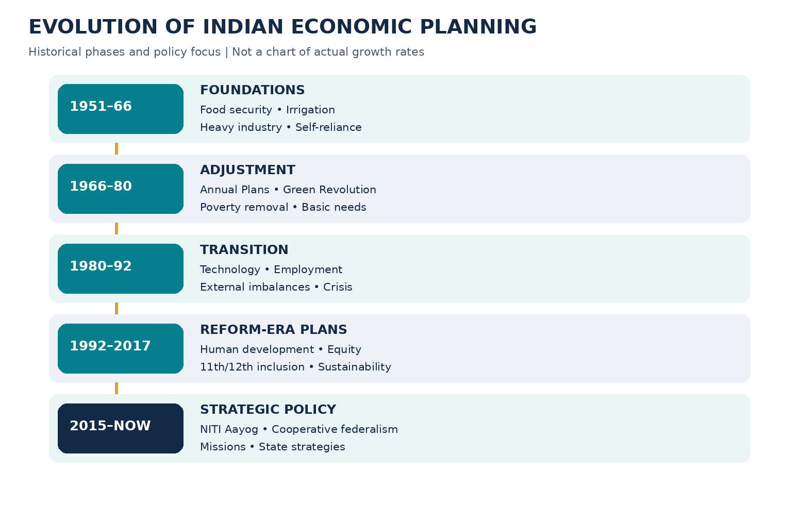
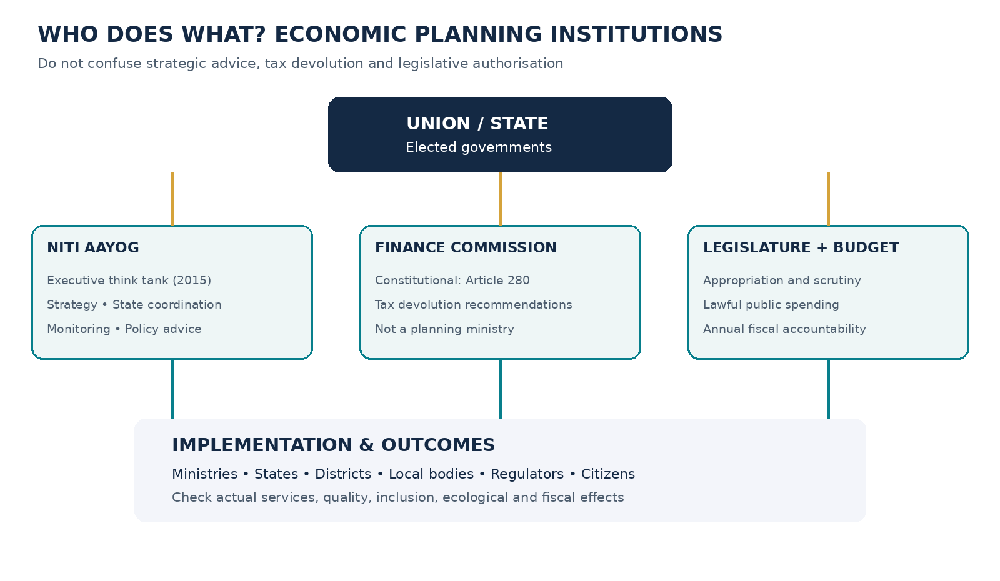
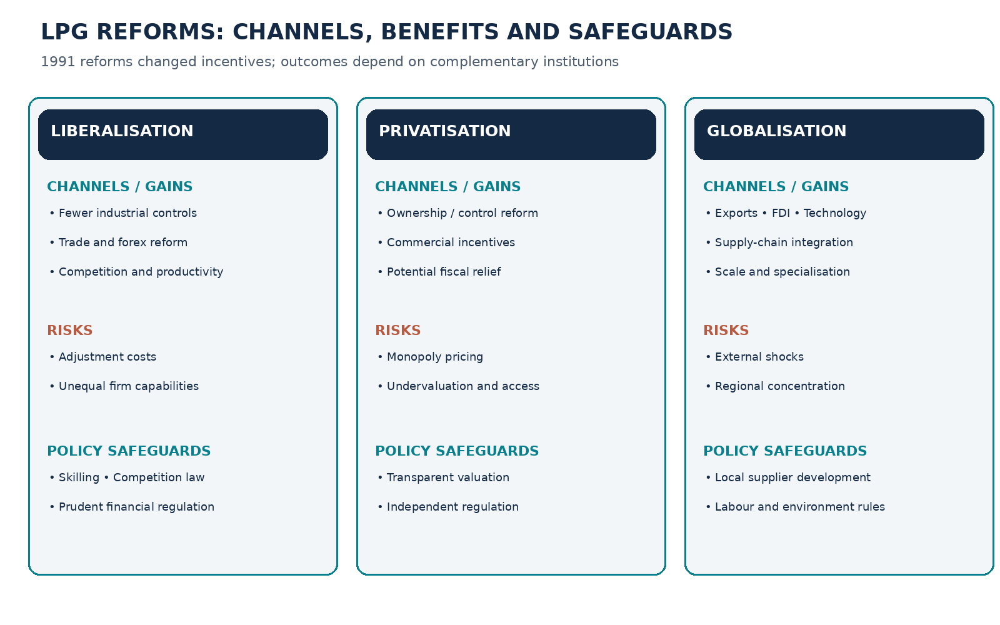

# Paper IV — Economy and Development | Unit I — Indian Economy and Development | Topic 5

**Official-syllabus wording (corroborated reproduction; original commission-hosted notification remains pending direct authentication):** “Planning in Indian economy: Objectives, Priorities, Strategies, Achievements of Five Year Plans; 12th FYP - Inclusive growth; NITI Aayog; Liberalization, Privatisation, Globalisation: Features and Implications.” This is Paper IV, Unit I, Topic 5 in the 75-topic study portal. The syllabus is associated with TGPSC Group I Notification 02/2024; no newer official revision has been authenticated in this run.

## Syllabus-to-section map

| Syllabus demand | Where to study | Examination emphasis |
|---|---|---|
| Nature, objectives and rationale of Indian planning | Sections 1–2 | Mixed economy; resource constraints; coordination versus command |
| Priorities, strategies and chronology of Five-Year Plans | Sections 3–5 | 1951–2017 sequence, plan holidays, Mahalanobis, poverty and social justice |
| Achievements and limitations of planning | Section 6 | Infrastructure, food security, industrial base, employment, equity, ecology |
| Twelfth Plan and inclusive growth | Sections 5 and 7 | 2012–17; faster, more inclusive and sustainable growth; capability approach |
| NITI Aayog | Sections 8–9 | 1 January 2015; executive resolution; Governing Council; cooperative federalism |
| Liberalisation | Section 10 | 1991 crisis, licensing, trade, forex and finance reforms |
| Privatisation | Section 11 | Disinvestment versus transfer of control; regulation; distributional consequences |
| Globalisation | Section 12 | Trade, FDI, supply chains, uneven effects and safeguards |
| Telangana application and contemporary planning | Sections 13–14 | State formation, Telangana Rising 2047, district disparity, climate and fiscal realism |

## Topic summary

Indian economic planning began as a response to low savings, food shortages, industrial backwardness and deep social inequality. The Planning Commission (1950) coordinated Five-Year Plans, beginning in 1951. The early plans prioritised agriculture, irrigation and heavy industry; subsequent plans expanded poverty alleviation, basic services, employment, modernisation and equity. The 1991 reforms changed the balance between state direction and market competition without eliminating the need for public strategy. The Twelfth Plan (2012–17), the last Five-Year Plan, framed development as faster, more inclusive and sustainable growth. NITI Aayog replaced the Planning Commission in January 2015 as an executive policy think tank promoting cooperative federalism, evidence and innovation; it is not a constitutional commission or a direct replacement for budget and Finance Commission powers. Liberalisation reduces controls and barriers, privatisation changes ownership or control, and globalisation increases international integration; their outcomes depend on competition, worker protection, skills and public institutions. Telangana's development planning illustrates the need to reconcile metropolitan growth, district inclusion, water security, fiscal feasibility and environmental sustainability.

## Answer-writing method

For a historical question, use chronology, the underlying development problem, policy mechanism, measured achievements and limitations. For an institutional comparison, distinguish legal status, composition, fiscal authority, outputs and accountability. For an LPG evaluation, distinguish economic efficiency from distributional effects and add Telangana-specific examples. For a policy recommendation, state the responsible institution and measurable outcome; avoid claims that a target has already been achieved merely because a government announced it.

# Standalone Quick Revision — Planning in the Indian Economy

## Sixty-second recall

- **Planning Commission:** Executive resolution, **15 March 1950**; chaired by Prime Minister; formulated Five-Year Plans and influenced Plan assistance. Not constitutional or statutory.
- **First Five-Year Plan:** **1951–56**, agriculture, irrigation, rehabilitation and food security.
- **Second:** **1956–61**, Mahalanobis model, heavy industry and capital goods; Industrial Policy Resolution 1956.
- **Third:** **1961–66**, self-reliance; wars and drought; followed by **three Annual Plans, 1966–69**.
- **Fourth:** **1969–74**, growth with stability and self-reliance.
- **Fifth:** **1974–79** (terminated in 1978), poverty removal and Minimum Needs Programme; Rolling Plan **1978–80**.
- **Sixth:** **1980–85**, poverty, technology, energy and employment.
- **Seventh:** **1985–90**, food, work and productivity; Annual Plans **1990–92**.
- **Eighth:** **1992–97**, post-1991 reforms and human development.
- **Ninth:** **1997–2002**, growth with social justice.
- **Tenth:** **2002–07**, monitorable social and growth targets.
- **Eleventh:** **2007–12**, faster and more inclusive growth.
- **Twelfth:** **2012–17**, *Faster, More Inclusive and Sustainable Growth*; **last** Five-Year Plan; **no Thirteenth Plan**.
- **NITI Aayog:** Executive resolution, **1 January 2015**; Prime Minister chairs; strategic advice, state coordination, monitoring and innovation; **does not distribute Finance Commission tax shares**.
- **Liberalisation:** Removing controls and barriers; **1991 Industrial Policy** and phased trade/foreign-exchange reforms.
- **Privatisation:** Transfer of ownership/control; **minority disinvestment need not be privatisation**.
- **Globalisation:** Integration through trade, FDI, technology, services and production networks; opportunities and adjustment risks.

## Concepts to keep distinct

| Pair | Correct distinction |
|---|---|
| Plan versus budget | Strategic objectives versus legally authorised annual spending |
| Growth versus inclusive growth | Aggregate output versus participation and distribution of capabilities |
| Inclusive versus sustainable growth | Social/economic access versus long-run ecological and resource viability |
| Planning Commission versus NITI Aayog | Former plan/resource role versus current advisory/cooperative-federal role |
| Finance Commission versus NITI Aayog | Constitutional tax devolution recommendations versus executive policy advice |
| Disinvestment versus privatisation | Sale of stake versus transfer of control |
| FDI equity versus total FDI inflow | Equity component versus equity plus reinvested earnings and other capital |
| Investment announcement versus realised investment | Stated intention versus deployed capital and operating activity |
| Plan target versus actual outcome | Aspiration versus verified measurement |

## Telangana case anchors

Telangana was created on **2 June 2014**. The government launched its **Telangana Rising 2047** vision on **9 December 2025**, with stated $1 trillion and $3 trillion economy aspirations for 2034 and 2047. Its CURE–PURE–RARE lens distinguishes core urban, peri-urban and rural-agriculture development. These are policy targets, not achieved facts. Test industrial corridors against land, jobs, water and logistics; irrigation against farm income and groundwater; education against learning and placement; welfare against fiscal sustainability.

## Five mains-ready arguments

1. Planning solved coordination failures but sometimes created licensing and information failures.
2. Heavy-industry strategy built capabilities yet could not substitute for food, exports and employment.
3. Twelfth Plan inclusion means capabilities, quality jobs and services, not only faster GDP growth.
4. NITI Aayog changed institutional methods, not the need for strategic public planning.
5. LPG raised efficiency and integration potential but requires competition, safety nets and regional balancing.

## Common traps

Never say NITI Aayog is a constitutional body, that it prepares a Thirteenth Five-Year Plan, that all disinvestment is privatisation, or that a government vision is proof of achieved growth. The original official Group I question papers and question numbers have not been authenticated for this chapter: the questions below are **original practice**, not verified PYQs.

# Detailed Textbook Notes — Planning in the Indian Economy

## 1. What economic planning means: rationale, institutions and the Indian mixed economy

### Planning as a choice about scarce resources
Economic planning is the deliberate selection of development objectives, policy instruments, institutional responsibilities and time horizons. It is not synonymous with public ownership or a command economy. A government may plan infrastructure, human capital, industrial corridors, climate resilience and redistribution while private firms choose output and investment in competitive markets. The central economic problem is intertemporal allocation: how much current consumption should be forgone for future productive capacity, who bears that cost, and who receives the future benefits. A credible plan therefore needs a baseline, measurable outcomes, resource constraints, implementation agencies, feedback and accountability. A wish list of schemes without financing or implementation capacity is not a plan.

India inherited severe poverty, low literacy, weak industrial infrastructure, a narrow domestic capital-goods base and the disruption of Partition. Private savings were inadequate to finance steel, power, irrigation and transport at the desired scale. Colonial patterns had left regional disparities and limited technological capabilities. These circumstances explain why post-Independence policymakers adopted a mixed-economy strategy: private enterprise coexisted with public investment, licensing, regulated finance and welfare programmes. Planning was intended to accelerate structural transformation rather than simply raise one year's gross domestic product. The Constitution does not prescribe five-year plans; economic and social planning is in the Concurrent List (Seventh Schedule, List III, Entry 20), allowing both Union and states to act within their constitutional competences.

### Planning Commission and constitutional boundaries
The Planning Commission was established by a Government of India resolution on 15 March 1950, not by a constitutional amendment or an Act of Parliament. The Prime Minister chaired it. It assessed resources, proposed priorities, helped formulate Five-Year Plans and influenced Plan assistance to states. The National Development Council, established in 1952, provided a political forum involving states, but neither body displaced Parliament's authority over taxation and appropriation. A plan's targets did not themselves authorise expenditure; the annual budget, legislative appropriations and lawful executive schemes did. This distinction matters in examination answers: a planning body could recommend an irrigation project, but departments, legislatures, regulators and courts determined how it was financed, cleared, built and scrutinised.

The rationale for central coordination was strong where investments were complementary. A steel plant requires coal, power, railways, skilled labour and demand from machinery producers; a private investor might not capture all benefits of these complementary investments. Irrigation requires watershed and command-area planning beyond an individual farmer's land. Yet information is dispersed: central agencies can underestimate local soil, water, labour and market conditions. Uniform targets can reward quantity over quality. The Indian experience therefore presents a persistent tension between national coordination and decentralised discovery. A planning system succeeds when it combines strategic direction with state-level adaptation and local feedback.

### Telangana application and analytical test
For Telangana, planning is not just allocation to Hyderabad's information-technology ecosystem. It also means linking rural irrigation decisions with groundwater sustainability, agricultural diversification, district hospitals, tribal habitations, skilling, manufacturing clusters and urban transport. Consider a proposed industrial park in a less-developed district. A meaningful plan specifies land safeguards, power supply, water availability, logistics, worker housing, environmental permissions, training institutions and job-quality indicators. A headline investment commitment alone does not establish realised employment or broad-based development. An examiner should ask: What problem is being solved? Which level of government has authority? What are the opportunity costs? What evidence will demonstrate success?

### Debate and consequences
Supporters of planning argue that long-horizon public goods, redistribution and industrial learning require deliberate coordination. Critics point to bureaucratic delays, capture by politically influential sectors, distorted administered prices and weak evaluation. Both perspectives can be correct in different domains. Public coordination is indispensable for disease control, infrastructure networks and environmental standards; direct state control over ordinary competitive production can be less effective. The practical lesson is to distinguish *planning the enabling environment* from *commanding every production decision*.

## 2. Objectives and priority-setting: growth, self-reliance, equity and sustainability

### Multiple objectives and trade-offs
Early Indian planning placed particular emphasis on growth, employment, self-reliance, modernisation and distributive justice. Growth expands the taxable and productive resource base; employment converts that expansion into livelihoods; self-reliance reduces strategic dependence in crucial capabilities; equity prevents social exclusion; sustainability protects the assets on which future growth depends. These objectives are related but not identical. A capital-intensive refinery may increase output and technological capability while creating fewer direct jobs than labour-intensive food processing. Irrigation may increase yields while reducing downstream flows or groundwater reserves. A sound plan makes these tensions explicit instead of assuming every project advances all objectives equally.

The First Plan's agriculture and irrigation focus reflected food shortages and rehabilitation needs. The Second Plan's heavy-industry emphasis sought a domestic capital-goods sector. Later plans increasingly incorporated poverty alleviation, basic needs, social services, rural employment, decentralisation and environmental constraints. From the Eleventh Plan onward, the language of inclusive growth highlighted the need to judge development by who participates in and benefits from it. The Twelfth Plan explicitly combined faster, more inclusive and sustainable growth. This evolution is a shift in emphasis, not proof that earlier plans ignored welfare or that later plans abandoned industry.

### How priorities become real choices
Priorities can be translated into a hierarchy of inputs, outputs, outcomes and impacts. An education department may allocate money for teacher recruitment (input), fill sanctioned positions (output), improve attendance and classroom learning (outcome), and ultimately increase earnings and citizenship capabilities (impact). Merely spending a budget cannot establish the impact. Similarly, construction of a canal is an output; reliable and equitable irrigation at the farm is an outcome. Evaluations should examine baseline conditions, distribution across gender and caste, counterfactual trends, maintenance expenditure and whether complementary services exist.

Financing constrains priority choices. Governments cannot indefinitely fund capital expenditure, salaries, subsidies and debt service without considering revenue, borrowing costs and inflation. Public debt can finance productive assets, but benefits should justify future fiscal obligations. The Union and state budgets allocate money annually; Finance Commission recommendations, GST arrangements, centrally sponsored schemes and state own-source revenues shape the resources available. The separation of national plans from annual budget execution explains why well-written targets often underperform in implementation.

### Equity and regional disparity in Telangana
Telangana's regional development challenge illustrates the importance of distribution. High-value services and investment cluster in the Hyderabad metropolitan region, whereas several rural and tribal areas depend more on agriculture, public services and seasonal employment. Equal per-capita allocations may be insufficient where terrain, remoteness and historical exclusion raise the cost of providing services. A needs-based formula could weigh school-learning deficits, health access, transport connectivity and deprivation, but it also needs safeguards against weak administrative absorption and unreliable data. District-level indicators must be disaggregated: average state income cannot substitute for information about marginalised communities or informal workers.

### Critical appraisal
An exclusive growth target may ignore distribution and ecology; an exclusive welfare-spending target may neglect future productivity and fiscal sustainability. The more defensible objective is capability-enhancing structural change: higher productivity, quality employment, universal basic services and resilient natural resources. In mains answers, identify the trade-off and propose measurable reconciliation—such as industrial employment linked to local skill programmes and groundwater-conscious agricultural investment—rather than writing that all goals are equally important.

## 3. First to Third Plans: agriculture, heavy industry and the limits of import substitution

### First Plan (1951–56): recovery and food security
The First Five-Year Plan emphasised agriculture, irrigation, power, community development and rehabilitation in a newly independent economy. Food availability was a macroeconomic issue: shortages could drive inflation, undermine real wages and force costly imports. Investments in multipurpose river projects were intended to supply irrigation, electricity and flood control. Community Development Programme initiatives beginning in 1952 reflected the belief that rural institutions and extension services mattered alongside physical assets. A favourable harvest and relatively stable prices contributed to the period's performance, but attributing every improvement solely to planning would be methodologically wrong; rainfall, global conditions and earlier investments also affected output.

### Second Plan (1956–61): the Mahalanobis strategy
The Second Plan adopted an industrialisation strategy associated with P. C. Mahalanobis. Its analytical premise was that building domestic capacity to produce machinery and capital goods would raise the economy's long-run investment potential. Public investment in heavy industries, steel, machine tools and power sought to overcome private capital scarcity and the high initial costs of complex industrial projects. The Industrial Policy Resolution of 1956 expanded the envisaged role of the public sector in strategic industries. The Second Plan was therefore not simply a large steel programme; it attempted to alter the structure of production so India could make more of the equipment needed for future growth.

The central criticism was a mismatch between long-gestation capital-goods investments and immediate needs for food, exports, employment and consumer goods. Heavy-industry capacity can generate positive spillovers, but a shortage of foreign exchange, spare parts and skilled management can delay those gains. Import substitution protected domestic producers from external competition, sometimes supporting learning and sometimes sheltering inefficiency. A strong exam answer explains both the infant-industry argument and the incentive problem rather than calling the model an unqualified success or failure.

### Third Plan (1961–66) and the annual-plan interruption
The Third Plan aimed at a more self-reliant, self-sustaining economy, with agriculture and basic industries as mutually reinforcing priorities. The 1962 war with China, the 1965 war with Pakistan and severe droughts disrupted resources, food production and fiscal priorities. The gap between targets and outcomes demonstrates why plans must contain risk buffers and adjustment mechanisms. Three Annual Plans followed during 1966–69, often called the plan holiday. The policy environment also saw major agricultural technology changes, including high-yielding varieties, fertilisers, irrigation and procurement arrangements that later supported the Green Revolution.

The Green Revolution is an example of successful coordination among public research, input supply, extension, irrigation, credit and price incentives. Yet its initial concentration in better-irrigated regions reinforced some spatial and farm-size inequalities. Agricultural productivity cannot be raised merely by distributing seeds; it requires complementary institutions. For present-day Telangana, a parallel lesson concerns crops with high irrigation requirements: public procurement incentives and electricity policies affect farmers' choices and groundwater stress. A planner must consider water balance, farm incomes and crop-market risks together.

### Historical assessment
The early plans helped create a diversified industrial and infrastructural base and institutions for development administration. They also left an elaborate licensing system, foreign-exchange constraints and public-enterprise performance problems. These are distinct effects: establishing strategic capacity does not prove that every protective policy was efficient. Likewise, later reforms did not erase the productive value of dams, engineering education or public scientific institutions built during this period.

## 4. Fourth to Seventh Plans: stability, poverty, technology and changing policy instruments

### Fourth Plan (1969–74): growth with stability
The Fourth Plan pursued growth with stability and greater self-reliance after the disruption of the mid-1960s. Food security, agricultural expansion and public control over strategic financial intermediation featured in the period. Nationalisation of 14 major commercial banks in 1969, before the Fourth Plan was fully under way, aimed to broaden access to institutional credit and align finance with development priorities. Bank nationalisation did not automatically ensure productive lending or repayment; priority-sector rules, branch expansion, supervision and credit appraisal remained essential. Inflationary pressures and external shocks, including the 1973 oil crisis, exposed the vulnerability of an import-dependent economy.

### Fifth Plan (1974–79): poverty removal and basic needs
The Fifth Plan was associated with poverty removal (Garibi Hatao) and self-reliance. The Minimum Needs Programme sought basic services such as primary education, health, drinking water and rural connectivity. Such investments differ from cash transfers: they change the supply of public goods and household capabilities. The Plan was terminated early in 1978 following a change in government; a Rolling Plan approach was pursued for 1978–80. A rolling plan revises targets and resources periodically rather than treating a five-year document as unalterable. Its strength is flexibility; its weakness can be reduced commitment and policy predictability if frequent revision reflects political turnover rather than new evidence.

### Sixth Plan (1980–85): poverty reduction with technology
The Sixth Plan returned to a five-year framework, emphasising poverty reduction, employment, energy, infrastructure and technological modernisation. Anti-poverty programmes increasingly combined subsidised assets, credit, employment schemes and targeted beneficiaries. Their effectiveness depended on identifying households accurately and providing viable markets and skills. An asset such as a dairy animal does not generate sustained income if veterinary care, fodder, cold chains and milk procurement are absent. This is a classic implementation failure: the programme records a distributed asset while the intended livelihood outcome does not materialise.

### Seventh Plan (1985–90): food, work and productivity
The Seventh Plan's widely recalled themes were food, work and productivity. It attempted to reconcile agricultural growth with employment and industrial efficiency. Policy attention to electronics, telecommunications and administrative modernisation grew during the 1980s, though trade and industrial controls remained substantial. The 1980s also saw rising fiscal and external imbalances. Public borrowing can support investment, but persistent deficits financed without sufficient export and productivity growth create vulnerabilities when international credit conditions tighten.

Two Annual Plans followed in 1990–92 amid political instability and the 1991 balance-of-payments crisis. The subsequent Eighth Plan began in 1992, not 1990. Examinations often test this chronology. The interruption is also analytically important: an economic plan cannot substitute for stable macroeconomic management, realistic external financing and responsive institutions.

### Practical comparison
The Fourth through Seventh Plans broadened the state's repertoire from large projects to basic needs, bank credit, rural livelihoods and productivity. This made planning more socially responsive, but also increased administrative complexity. Multiple overlapping schemes can create fragmented accountability. Telangana's modern rural development institutions face the same problem when bank credit, women's self-help groups, skilling and market access are managed in separate silos. Programme convergence is not an abstract slogan; it is the practical work of coordinating beneficiary selection, finance, training, infrastructure and outcome monitoring.

## 5. Eighth to Twelfth Plans: reform-era growth, social justice and sustainability

### Eighth Plan (1992–97): planning after liberalisation
The Eighth Plan began after the 1991 reforms and emphasised human development, employment, modernisation and economic growth in a more market-oriented setting. It did not abolish planning: rather, the state increasingly sought to create conditions for private investment while continuing to finance public goods and social programmes. In sectors such as telecommunications, the policy challenge shifted toward licensing rules, competition, infrastructure sharing and universal service rather than direct government production alone. A mixed economy can change the balance between producer, regulator, financier and welfare provider without abandoning strategic direction.

### Ninth Plan (1997–2002): growth with social justice
The Ninth Plan explicitly linked growth with social justice and equity. Decentralisation, agriculture, rural development and basic services remained important. The 73rd and 74th Constitutional Amendments had already created a constitutional framework for rural and urban local self-government, but effective devolution depended on states transferring functions, finances and functionaries. Local participation can improve information about needs; it does not automatically prevent elite capture. Social audits, public disclosure and representation of women and marginalised groups are therefore essential complements.

### Tenth Plan (2002–07): monitorable development targets
The Tenth Plan sought faster growth and greater use of measurable social indicators. It made it harder to judge progress solely by plan outlay. Indicators on poverty, schooling, gender gaps, health and access to water brought outcomes closer to the centre of debate. The difficulty is that aggregate targets can hide differences in quality: school enrolment may rise while learning remains weak; electricity connections may expand while supply is unreliable. A robust plan specifies quality, continuity and equity indicators alongside coverage.

### Eleventh Plan (2007–12): faster and more inclusive growth
The Eleventh Plan adopted the explicit theme of faster and more inclusive growth. Inclusive growth means that disadvantaged groups gain capabilities, productive opportunities and a fair share of gains, not merely that the national growth rate rises. Policy instruments included education, health, rural livelihoods, infrastructure and social protection. The 2008 global financial crisis illustrates the limits of fixed projections: external demand, investment sentiment and fiscal space can change quickly. A good plan contains monitoring and contingency measures rather than treating forecast growth as a guaranteed outcome.

### Twelfth Plan (2012–17): the final Five-Year Plan
The Twelfth Plan's official title was *Faster, More Inclusive and Sustainable Growth*. Its original headline growth ambition was around 8 per cent per year, while recognising external uncertainty, investment bottlenecks and resource constraints. Sustainability entered the title because energy security, water stress, pollution and climate-related risks were increasingly inseparable from economic strategy. Inclusive growth was operationalised through attention to health, education, skills, employment, agriculture and access to basic services. The plan was prepared by the Planning Commission; NITI Aayog was created only in 2015, during the Twelfth Plan period.

No Thirteenth Five-Year Plan followed the Twelfth. This is not the same as saying India stopped planning after 2017: policy planning continued through national strategies, sectoral missions, state plans, medium-term fiscal frameworks and annual budgets. For Telangana, formed in 2014, the later Twelfth Plan years coincided with the need to establish state institutions, assess water and power needs, and manage a changing regional economy. Statehood and the shift in national planning institutions are distinct developments, but both made state-specific planning capacity more important.

## 6. Evaluating Five-Year Plans: achievements, structural gaps and causal reasoning

### What changed over the planning era
Across the planning period India expanded electricity, transport, irrigation, higher education, research institutions, industrial capabilities and public-health infrastructure. Agricultural production grew substantially over the long run, helping reduce dependence on emergency food imports. Domestic engineering, pharmaceuticals, space and nuclear capabilities developed in ecosystems involving public investment, universities, private suppliers and regulation. Literacy, life expectancy and many social indicators improved across decades. These broad changes are consistent with a role for public planning, but a causal evaluation must separate planning from technological change, private investment, demographic transition, state-level reforms and global conditions.

### The productivity and employment problem
A central weakness was the gap between output growth and adequate productive employment. Formal manufacturing did not absorb labour at the scale implied by the country's workforce. Agricultural labour productivity remained low for many workers, while urban informal work often lacked stable earnings and social security. A factory can raise capital productivity without creating many jobs; services can expand rapidly while employing a relatively skilled minority. Hence, the success of structural transformation must be judged by movement into higher-productivity and better-paid occupations, not just by the share of industry or services in GDP.

### Licensing, state enterprises and public investment
Industrial licensing and import restrictions sometimes protected infant industries but also created shortages, rent-seeking and incentives to remain below licensing thresholds. Public-sector enterprises varied widely: some supplied strategic capabilities and infrastructure; others suffered from soft budget constraints, political interference and low returns. An analytically sound appraisal differentiates natural monopolies, strategic sectors and competitive markets. A state electricity transmission network requires coordinated regulation and investment; producing ordinary consumer goods under persistent protection has a different economic justification.

### Regional and ecological disparities
Large national projects often produced uneven geographic benefits. Better-irrigated areas adopted new agricultural technology sooner; industrial clusters attracted suppliers and skilled workers; remote regions lagged in transport and health services. Environmental costs were not always priced adequately. Dams can provide water and power while displacing communities; subsidised pumping can raise farm incomes in the short term while depleting aquifers. Telangana's irrigation and industrial policies should therefore be assessed using independent cost-benefit analysis, resettlement outcomes, groundwater monitoring and district-level human development, not solely engineering capacity or investment announcements.

### Better evaluation methods
A modern evaluator should distinguish target, allocation, expenditure, completion and impact. A school-building programme might achieve 100 per cent physical completion while failing to improve learning because teachers are absent. Difference-in-differences or matched comparisons may help estimate causal effects where appropriate, but administrative data quality and selection bias remain concerns. Qualitative fieldwork can reveal why beneficiaries cannot access entitlements despite favourable dashboards. The lesson from seven decades of planning is not that targets are useless; it is that targets need credible baselines, institutional ownership, mid-course correction and independent evaluation.

## 7. Twelfth Plan inclusive growth: distribution, capability and social-sector design

### Inclusive growth is more than poverty reduction
A society can experience rising average income alongside persistent deprivation if gains accrue mainly to owners of capital, high-skilled workers or a few urban districts. Inclusive growth concerns the *process* of growth—who can participate in productive activity—and its *outcomes*—who receives better earnings, health, education, security and voice. The capability perspective asks whether people have real freedom to achieve valuable lives, not simply whether a household crosses a money-poverty line. For example, a girl may live above the poverty threshold but lack safe transport to secondary school; a disabled worker may face exclusion despite having a formal qualification.

The Twelfth Plan connected growth with health, education, employment, agriculture and environmental protection. Human capital is both an intrinsic objective and a productivity input: better nutrition raises learning and future labour capability, while quality schooling improves the capacity to adopt new technology. Social protection reduces the damage from shocks and can allow households to undertake productive but risky investments. Yet poorly designed subsidies may crowd out maintenance of schools, hospitals and water systems. The policy question is not welfare versus growth, but which combination produces durable capabilities and fiscal sustainability.

### Gender and social inclusion
Women face barriers involving unpaid care, safety, unequal asset ownership, credit access and discriminatory norms. Self-help groups can provide collective bargaining and financial access, but loans alone do not guarantee profitable enterprise. Reliable childcare, market access, digital skills and safe transport can have greater effects on women's labour-force participation than credit availability in isolation. Scheduled Tribes in remote areas may require context-sensitive health outreach, land and forest-rights protection, and transport links. The Forest Rights Act 2006 and the Scheduled Tribes and Other Traditional Forest Dwellers (Recognition of Forest Rights) Act are the same law; do not count them as two separate Acts. Inclusion also requires accessible services for persons with disabilities under the Rights of Persons with Disabilities Act 2016.

### Sustainable growth and resource accounting
The Twelfth Plan's sustainability dimension is not an optional environmental chapter. Air pollution reduces labour productivity and raises medical expenditure; groundwater depletion threatens agriculture and drinking water; poorly planned urbanisation increases flood losses. A project appraisal should account for lifetime maintenance, emissions, ecological services and displaced livelihoods. A solar plant or urban metro can reduce some emissions but still has land and material impacts requiring assessment. Telangana's metropolitan growth creates both agglomeration benefits and congestion, housing, wastewater and heat risks. The proper metric is net social value, not simply kilometres constructed or megawatts installed.

### Operationalising inclusive planning
A practical district plan would combine school learning assessments, primary-health staffing, nutrition coverage, water security, women-owned enterprise survival and local job quality. It should publish disaggregated baselines and specify which department controls each lever. The planning cycle then becomes: diagnose deprivation, select evidence-backed interventions, cost them, assign accountability, consult affected communities, implement, measure outcomes and revise. This is more demanding than listing schemes but is closer to what inclusive growth actually requires.

## 8. NITI Aayog: origin, legal status, composition and institutional mandate

### Formation and status
The National Institution for Transforming India (NITI Aayog) was constituted through a Union Cabinet resolution dated 1 January 2015, replacing the Planning Commission. It is an executive policy institution—not a constitutional body and not a statutory regulator created by an Act. Its official mandate is to provide strategic and technical advice, facilitate cooperative federalism, encourage innovation, monitor outcomes and support long-term policy thinking. Its role is advisory and catalytic: NITI Aayog does not have the Planning Commission's former position in allocating Plan assistance to states. Finance Commissions, Union and state budgets, ministries and legislatures retain their respective financial and legal roles.

### Institutional design
The Prime Minister chairs NITI Aayog. Its Governing Council provides a forum involving Chief Ministers and relevant Union Territory leadership; Regional Councils may address particular issues. A Vice-Chairperson, full-time members, ex-officio members, a Chief Executive Officer and invited experts contribute to policy work under applicable government arrangements. The precise current membership can change and should be verified from the official site rather than memorised from outdated notes. NITI Aayog's design signals a shift from centralised target-and-outlay bargaining toward cooperative policy coordination, benchmarking and strategic advice.

### Instruments of influence
NITI Aayog uses strategy documents, policy studies, state consultations, SDG monitoring, programme evaluations and data dashboards. The SDG India Index 2023–24 was released in July 2024; the national composite score was reported as 71 for 2023–24, compared with 57 in 2018. Such indices help compare progress and identify weak dimensions, but a composite score depends on indicator definitions, availability, normalisation and weighting. A state's high overall score does not prove that all districts or communities enjoy similar outcomes. Rankings are tools for inquiry, not substitutes for field verification.

The Aspirational Districts Programme, launched in January 2018, is a distinctive application of NITI Aayog's coordination role. Official material describes 112 districts and three operating principles: convergence, collaboration and competition. The Aspirational Blocks Programme began in 2023, extending focused attention below the district level. These initiatives use indicator monitoring and intergovernmental collaboration, but causality requires careful assessment: a district's improvement may reflect both programme efforts and broader trends. The State Support Mission supports states in strengthening institutions for transformation, monitoring and evaluation and policy analysis.

### Strengths and limits
NITI Aayog can identify cross-sector bottlenecks and spread good practices without directly operating every programme. Its advisory character can improve flexibility and reduce centralised micro-management. Critics argue that limited independent fiscal powers may reduce its ability to compel implementation and that competitive rankings can encourage gaming or attention to measured indicators at the expense of unmeasured needs. Cooperative federalism also requires genuine state voice on financing and programme design, not simply consultation after central priorities have been fixed. In an answer, separate NITI Aayog's institutional promise from evidence of implementation outcomes.

## 9. Planning Commission versus NITI Aayog: continuity and rupture

### The key difference is functional, not merely a change of name
The Planning Commission combined national-plan formulation, resource assessment and a significant role in Centre–State Plan assistance. NITI Aayog functions primarily as a policy think tank and cooperative-federal platform. The older system's Five-Year Plans provided an integrated national framework with quantified targets and sectoral allocations. The newer approach relies on strategy, missions, outcome indicators, state participation and ministerial budgets. The distinction should not be exaggerated: the Planning Commission also conducted consultations and evaluations, while NITI Aayog still produces national priorities and recommendations. The difference is the institutional balance of advice, resource allocation and implementation authority.

### Finance after the transition
A common misconception is that NITI Aayog distributes central tax revenues among states. The constitutional Finance Commission recommends tax devolution and certain grants under Article 280; the Union budget and ministries administer spending according to law and appropriations. The GST Council operates under Article 279A for GST-related recommendations. NITI Aayog is neither of these institutions. The abolition of the formal Plan/non-Plan expenditure distinction in Union budget presentation from 2017–18 is another related but separate reform: it sought to improve expenditure classification and remove incentives to favour new schemes over maintenance. Revenue and capital classifications remain important.

### Cooperative and competitive federalism
Cooperative federalism is the joint design and execution of policies across Union and states; competitive federalism uses comparisons to motivate improvements. Both can be useful. Telangana may benchmark learning outcomes, logistics costs or healthcare access against other states while negotiating infrastructure financing with the Union. Yet competition based on one composite score can disadvantage poorer states starting from lower baselines or reward selective reporting. Rankings should therefore consider absolute deprivation, improvement from baseline and data quality. Interstate competition for investment also needs environmental and labour safeguards to prevent a race to the bottom.

### What replaces the five-year cycle?
India continues to plan through annual budgets, medium-term fiscal policy, sectoral programmes, infrastructure pipelines, state strategies and long-horizon national visions. The National Infrastructure Pipeline, PM Gati Shakti's integrated infrastructure-planning approach and SDG monitoring are examples of planning instruments, but they are not a Thirteenth Five-Year Plan. A state government can use spatial plans, district development plans and multi-year expenditure frameworks. The analytical challenge is coherence: different ministries may pursue conflicting incentives unless there is a shared outcome framework and public accountability.

### Telangana example
Telangana Rising 2047, publicly launched in December 2025, is a state strategic vision rather than a legally binding Five-Year Plan. The state has described long-horizon economic aspirations, differentiated urban, peri-urban and rural regions, and priorities including skills, infrastructure and sustainability. A careful examiner should distinguish an announced target from an achieved outcome and test the feasibility of the investment, human-capital and environmental assumptions. The state can use NITI Aayog consultations and national data while retaining responsibility for its own budgetary choices and implementation.

## 10. The 1991 crisis and liberalisation: why the policy regime changed

### Domestic and external pressures
By 1990–91, India faced severe balance-of-payments stress. Persistent fiscal deficits, external borrowing, import requirements, a deteriorating external environment and the Gulf crisis contributed to a shortage of usable foreign exchange. The crisis was not caused by one policy alone; it reflected accumulated vulnerabilities. Stabilisation measures addressed the immediate external financing problem, while structural reforms sought to change incentives for investment, production, trade and finance. Distinguish the two: devaluation or fiscal adjustment can ease a short-term payments constraint; industrial deregulation and trade reform aim to change the economy's medium-term productive structure.

### Liberalisation of industry and trade
The Industrial Policy Statement of July 1991 substantially reduced industrial licensing and narrowed areas reserved for the public sector. The Monopolies and Restrictive Trade Practices framework was progressively replaced by a modern competition-law approach, culminating in the Competition Act 2002 and the Competition Commission of India. Import licensing and tariffs were gradually reduced, while exchange-rate management became more market-oriented. RBI historical accounts describe a two-step exchange-rate adjustment in 1991, a dual exchange-rate system in March 1992 and a unified market-determined exchange-rate system from March 1993. The sequence matters: reforms were phased, not implemented instantaneously on a single day.

### Financial and external-sector reforms
Banking reforms sought prudential regulation, better recognition of non-performing assets, capital adequacy and greater competition. External-sector reforms included a shift from the Foreign Exchange Regulation Act 1973 to the Foreign Exchange Management Act 1999, which came into force in 2000. FERA's control-oriented framework differed from FEMA's management-oriented approach to foreign exchange transactions. Current-account convertibility and capital-account liberalisation are different concepts; India did not simply abolish all capital controls in 1991. Foreign direct investment rules have evolved through sectoral caps, automatic and government routes and continuing security and competition conditions.

### Gains and risks
Liberalisation can increase competition, product variety, technology transfer and access to global value chains. It can also expose inefficient firms and workers to adjustment costs, widen regional divergence when investment concentrates in established clusters, and create vulnerability to global demand and capital-flow shocks. The correct policy response is not to assume markets solve all problems or that protection always preserves jobs. Competition policy, portable social protection, skilling, infrastructure, trade facilitation and macroprudential regulation determine whether the benefits are broadly shared. Telangana's pharmaceutical and technology ecosystems illustrate opportunities from integration; they also reveal dependence on skills, external markets, urban infrastructure and regulatory compliance.

## 11. Privatisation, disinvestment and public-sector reform: important distinctions

### Concepts that examinations confuse
Disinvestment is the sale of a government's equity stake in an enterprise. It may be a minority sale without transferring control. Privatisation ordinarily involves transfer of ownership or managerial control to private hands, although legal and commercial structures vary. Strategic disinvestment typically involves a substantial stake sale accompanied by transfer of management control. Corporatisation means placing an activity in a corporate organisational form; it does not necessarily mean private ownership. Public-private partnerships allocate specified construction, financing, operating or demand risks under a contract; a PPP is not automatically privatisation of the underlying public asset.

### Arguments for and against
Supporters argue that private ownership and competitive markets can improve cost discipline, innovation and customer responsiveness where political interference and soft budget constraints weaken public enterprises. Sale proceeds can reduce financing needs, although a one-time receipt should not be confused with recurring revenue. Critics warn of undervaluation, concentration of market power, loss of strategic control and exclusion of low-income users when services have strong public-good or monopoly characteristics. A transfer from a public monopoly to an unregulated private monopoly does not create competition; it merely changes who receives monopoly rents.

### Design conditions
Before divestment, policymakers should classify the enterprise: competitive commercial activity, natural monopoly, strategic capability or public-service provider. Competitive sectors require transparent valuation, open bidding, antitrust scrutiny and post-sale disclosure. Network utilities need independent regulation, service-quality standards, tariff rules and mechanisms to protect vulnerable users. Workers need fair transition arrangements, retraining and enforcement of labour laws. A credible evaluation asks whether service quality, investment, competition and fiscal outcomes improved relative to a realistic counterfactual—not simply whether the sale generated a large receipt.

### Telangana-specific application
State-owned transport, electricity distribution and water systems illustrate why public-service obligations complicate ownership debates. Public transport provides congestion, pollution and accessibility benefits not fully captured by ticket revenue. Even when private operators participate, the government must define coverage, safety, fare policy and contract monitoring. Similarly, electricity distribution finances are affected by tariffs, technical losses, agricultural supply obligations and subsidy reimbursement. The analytical question is which governance model provides reliable service at sustainable cost with equitable access, not whether 'public' or 'private' is intrinsically superior.

## 12. Globalisation: trade, FDI, technology and unequal integration

### Dimensions of globalisation
Globalisation is the growing cross-border integration of goods, services, capital, information, technology and production networks. Trade liberalisation reduces barriers to imports and exports; investment liberalisation changes the conditions under which foreign investors establish or acquire enterprises; technological integration spreads standards and knowledge; labour mobility and remittances connect households to foreign economies. These channels operate differently. Exporting software services does not require the same logistics as exporting pharmaceuticals or manufactured machinery. Foreign portfolio investment can move rapidly with financial conditions, while greenfield FDI usually involves longer-lived productive assets.

### Benefits and mechanisms
Access to larger markets allows firms to exploit scale economies and specialise in activities where they are relatively productive. Imports of intermediate goods and capital equipment can raise domestic productivity. Foreign investment can bring finance, management practices, technology and links to global buyers. But spillovers are not automatic: domestic suppliers need quality standards, skills, credit and infrastructure to benefit. An export-oriented industrial park with imported inputs and few local supplier relationships may generate less broad-based development than its gross export value suggests.

### Distribution and macroeconomic risks
Trade opening can lower prices for consumers while imposing adjustment costs on workers in import-competing industries. Global supply-chain disruptions, pandemics, commodity-price spikes and geopolitical restrictions can interrupt production. Foreign investment may cluster in cities with existing skilled labour, intensifying regional inequality. Governments therefore need competition rules, environmental standards, industrial upgrading, worker transition support and prudent external financing. Tariff policy should distinguish temporary, performance-linked learning support from indefinite protection that rewards inefficiency.

### Evidence and dated sources
The Department for Promotion of Industry and Internal Trade publishes official FDI factsheets and state-wise data. Its 2025–26 fourth-quarter newsletter and data statements were published on 15 June 2026, and its publications index listed a first-quarter FY 2026–27 factsheet on 14 September 2026. These publications are appropriate for updating FDI trends; one must not compare 'FDI equity' with 'total FDI inflow' as though they are the same series, nor infer that every announced investment was realised. The correct procedure is to specify the period, coverage, unit and revision status for each number.

### Telangana example
Hyderabad's life-sciences, IT, electronics and global-capability-centre activities benefit from international markets and skills networks. Yet growth concentrated in a metropolitan cluster may not automatically create high-quality jobs in tribal or agriculture-dependent districts. A Telangana globalisation strategy can combine export competitiveness with district-level supplier development, industrial apprenticeships, research links, wastewater treatment and reliable logistics. It should also address the vulnerabilities of service exports to global business cycles and automation. Globalisation is best evaluated as an opportunity that requires complementary domestic institutions.

## 13. Telangana planning after state formation: state vision, districts and fiscal realism

### From state formation to strategic capacity
Telangana was formed on 2 June 2014 under the Andhra Pradesh Reorganisation Act 2014. The new state inherited differentiated urban and rural economies, irrigation and power challenges, public-sector institutions and significant expectations concerning regional justice. Planning after statehood involved establishing administrative systems, selecting investments and reconciling welfare commitments with infrastructure needs. The economic centre of gravity in and around Hyderabad creates strong agglomeration benefits, but also the risk that district inequalities are masked by state-level averages.

### Telangana Rising 2047 as a planning case
The Government of Telangana announced the launch of its Telangana Rising 2047 vision document on 9 December 2025. Official communications describe a $1 trillion economy aspiration for 2034 and $3 trillion by 2047, and a three-region planning lens: Core Urban Region Economy (CURE), Peri-Urban Region Economy (PURE) and Rural Agriculture Region Economy (RARE). These are stated policy ambitions, not observed economic achievements or statutory guarantees. To evaluate them, students should examine the assumed annual growth, investment rate, productivity improvement, exchange-rate effects, urban land requirements, public-service capacity and environmental costs.

CURE's urban productivity strategy requires mobility, housing, water treatment, flood resilience and affordable access to jobs. PURE's industrial and logistics ambition requires coordinated land-use planning, freight corridors, electricity and workforce housing. RARE's rural strategy requires irrigation reliability, crop diversification, storage, producer organisations, health services and educational quality. The three-region model can help prevent one-size-fits-all policy, but only if district and community data guide allocations. A region label alone does not resolve inequalities within the region.

### Project appraisal rather than announcement counting
A project announced at a summit is not the same as a signed contract; a signed memorandum of understanding is not the same as financial closure; and financial closure is not the same as construction or operating jobs. Public reporting should track these stages separately. An irrigation project requires appraisal of water availability, rehabilitation, recurring pumping costs and farm income; an industrial corridor requires credible private demand and last-mile connectivity; a skills university requires placement and wage outcomes rather than enrolment alone. Public debt, subsidy commitments and maintenance obligations must be included in medium-term fiscal projections.

### Governance and inclusion
Planning institutions should integrate state departments, district administrations, urban local bodies, panchayats, community organisations and independent evaluators. Telangana's social-development priorities include women's economic participation, tribal access, urban housing, public health and education quality. Consultation should occur before project design is locked in, particularly where land acquisition or environmental risks affect livelihoods. Transparent procurement, social impact assessment and accessible grievance mechanisms reduce implementation risk. The state's ambition can be judged credible only when annual budgets, spatial plans and monitoring indicators trace a path from aspiration to outcomes.

## 14. Planning in the 2020s: data, climate, industrial policy and democratic accountability

### Strategy without rigid command
Contemporary economic planning increasingly focuses on solving coordination problems that markets and fragmented departments cannot handle alone. Examples include national transport networks, semiconductor supply chains, digital public infrastructure, climate adaptation and public-health surveillance. Industrial policy can support technology learning where spillovers are large, but should use transparent selection criteria, performance milestones and sunset clauses. Otherwise support can be captured by incumbents. Mission-oriented planning works best when the government defines a social problem and allows competitive experimentation in how to solve it.

### Data-driven governance and its limits
Dashboards can show school attendance, health service coverage, construction progress and water-supply continuity in near real time. The Aspirational Districts and Blocks Programmes demonstrate the use of comparative indicators and convergence. Yet an indicator becomes a target susceptible to gaming: hospitals may record more consultations without improving diagnosis, and schools may maximise attendance records without improving learning. Independent surveys, audits and citizen feedback are needed to triangulate administrative data. Privacy and exclusion risks arise when digital identity or automated eligibility systems are treated as infallible.

### Climate and resilience as economic planning
Extreme heat, flooding, water stress and energy transition change investment returns. Roads built without drainage may fail repeatedly; thermal power assets can face water constraints; urban expansion into floodplains raises future disaster costs. Climate appraisal should include lifecycle costs and distributional impacts, especially on outdoor workers and low-income settlements. Telangana's Hyderabad metropolitan region offers a concrete case: integrated transport, stormwater management, wastewater reuse, urban heat mitigation and affordable housing must be planned together. Isolated capital projects cannot substitute for coordinated land and water governance.

### Institutions and accountability
The state has several tools: budgets and legislative committees, the Comptroller and Auditor General, independent regulators, procurement rules, public disclosure, RTI, social audits and judicial review. Planning decisions also require technical competence in economic appraisal, project management and statistical analysis. NITI Aayog's State Support Mission illustrates a current institutional effort to strengthen state-level strategy, monitoring and evaluation. A well-designed plan publishes baseline indicators, target values, implementing agencies, budgets, milestones, risk registers and independent evaluation schedules.

### Final synthesis
India's trajectory from Five-Year Plans to NITI Aayog is best understood as a change in the *method* of planning, not an end to purposeful economic development policy. The historical record warns against both centralised overconfidence and market fundamentalism. Public coordination is needed for human capabilities, environmental protection and complementary infrastructure; competitive markets can improve innovation and efficiency; democratic oversight protects legitimacy and distributional fairness. Telangana's development choices make this synthesis practical: the challenge is to convert a high-growth vision into fiscally viable, geographically balanced and environmentally durable outcomes.

## 15. Worked policy evaluation: distinguish a development vision, a budget, a completed facility and a durable job

### The planning problem and the evidence hierarchy

A modern development vision describes a desired future, not a completed result. The Government of Telangana's *Telangana Rising 2047* document uses the Core Urban Region Economy (CURE), Peri-Urban Region Economy (PURE), and Rural Agriculture Region Economy (RARE) as a three-region planning framework. The official vision explains their complementary roles, but publication of a vision does not establish that proposed investments, employment or ecological improvements have occurred. For examination answers, separate a **vision**, a **budget sanction**, an **actual expenditure**, an **administrative output**, and a **verified social outcome**. These five quantities answer different questions and cannot be substituted for one another.

### An original numerical illustration — entirely hypothetical

Suppose a Telangana department announces a three-year district skills programme with a **₹120 crore budget ceiling** and **20 proposed training centres**. By the end of the observation year, it has disbursed **₹96 crore**, independently recorded **₹84 crore of eligible expenditure**, completed **15 centres**, and established that only **12 are operational**. The programme registers **8,000 learners**; **6,000 finish** training; and **3,000 are verified in employment six months later**. These are fabricated classroom figures for learning arithmetic, **not Telangana government statistics**.

The completion rate is **6,000 ÷ 8,000 = 75%**. Six-month employment among completers is **3,000 ÷ 6,000 = 50%**, while employment among all entrants is **37.5%**. The operational-centre rate is **12 ÷ 20 = 60%** of the original target, not 75% merely because 15 buildings were completed. Eligible expenditure per six-month employed person is **₹84 crore ÷ 3,000 = ₹2.8 lakh**; using the budget ceiling instead would produce **₹4 lakh**, a different denominator that must be labelled. Disbursement of ₹96 crore is neither proof of ₹96 crore of eligible expenditure nor evidence of programme effectiveness.

### Why even the calculated outcome is not a causal impact

The 3,000 employed participants may have obtained work without training. A defensible impact evaluation would need a credible comparison group, baseline employment, comparable follow-up periods, dropout analysis and checks for migration or self-employment. Job *quality* matters: a brief, insecure placement is not equivalent to sustained employment with adequate wages. If some districts lack functioning centres, a state average can conceal exclusion. Sex, caste, disability and district-disaggregated reporting may reveal who did not benefit, provided privacy and small-sample protections are observed.

### Applying the framework to CURE, PURE and RARE

A planning answer can propose distinct indicators for each region without pretending that the vision is already implemented. For CURE, track commute times, affordable housing, air quality and access to skilled work; for PURE, logistics reliability, industrial safety, wastewater treatment and local supplier participation; for RARE, farm income stability, irrigation efficiency, value-addition and rural non-farm employment. Cross-region indicators should measure whether rural suppliers and workers actually connect to urban and peri-urban markets. Such indicators are **suggested evaluation measures**, not claims that the Telangana vision already publishes them as achieved results.

### Mains-answer conclusion

Planning remains relevant after the last Five-Year Plan because government must still choose priorities under scarce resources. A strong answer moves from **objective → funded instrument → verified output → measured outcome → independent impact assessment**, identifies the responsible institution, and distinguishes a policy target from an audited achievement. The Twelfth Plan's emphasis on inclusion and sustainability supports this evaluative logic; it does not justify treating every subsequent announcement as evidence of progress.

# Visual Learning — Three Original Diagrams

The figures are newly drawn for this chapter and are conceptual study aids, not statistical charts. They are included in the complete PDF and offline HTML.

## Timeline of planning and institutional change

**Interpretation:** A policy era is not a mutually exclusive category. NITI Aayog was established during the Twelfth Plan, and economic strategy continued after 2017.

## Institutional division of responsibilities

**Interpretation:** Strategic policy advice, constitutional tax-devolution recommendations and legislative spending authorisation are different functions.

## Liberalisation, privatisation and globalisation

**Interpretation:** Reforms change incentives; market institutions, skills, environmental rules and safety nets influence their distributional effects.

# Original MCQ Practice — 25 Questions with Answer Explanations

**Provenance:** Every question below is newly authored practice for this study library. None is represented as an official TGPSC, UPSC or other examination PYQ.

### Q1. The Planning Commission was established in India through which instrument?
A. Article 280 of the Constitution  
B. An executive resolution of the Government of India  
C. The Planning Commission Act 1950  
D. A constitutional amendment

**Answer: B.** The Planning Commission was created by government resolution on 15 March 1950. It was not a constitutional or statutory body; Article 280 concerns the Finance Commission.

### Q2. The First Five-Year Plan primarily emphasised:
A. Software exports and telecommunications  
B. Privatisation of public enterprises  
C. Agriculture, irrigation and rehabilitation  
D. Capital-account convertibility

**Answer: C.** Food security, rural recovery and irrigation were central concerns during 1951–56, unlike later reform-era priorities.

### Q3. Which economic thinker is particularly associated with the Second Plan's heavy-industry strategy?
A. P. C. Mahalanobis  
B. Amartya Sen  
C. Milton Friedman  
D. John Stuart Mill

**Answer: A.** The Mahalanobis model emphasised investment in capital goods to expand long-run productive capacity; this involved trade-offs with immediate consumer needs.

### Q4. The first 'plan holiday' comprised Annual Plans during:
A. 1956–59  
B. 1974–77  
C. 1985–88  
D. 1966–69

**Answer: D.** Three Annual Plans followed the disrupted Third Plan, before the Fourth Plan began in 1969.

### Q5. The Fifth Plan is especially associated with which policy priority?
A. Complete removal of state planning  
B. Poverty removal and minimum basic needs  
C. Full capital-account convertibility  
D. The Aspirational Districts Programme

**Answer: B.** Poverty reduction and the Minimum Needs Programme featured in the Fifth Plan; it was terminated early in 1978.

### Q6. Which sequence is chronologically correct?
A. Seventh Plan → Eighth Plan → Annual Plans 1990–92  
B. Eighth Plan → Seventh Plan → 1991 reforms  
C. Seventh Plan → Annual Plans 1990–92 → Eighth Plan  
D. Eleventh Plan → Tenth Plan → Twelfth Plan

**Answer: C.** The Seventh Plan ended in 1990, two Annual Plans followed, and the Eighth Plan began in 1992 after the reforms.

### Q7. Which was the final Five-Year Plan in India?
A. Twelfth (2012–17)  
B. Thirteenth (2017–22)  
C. Eleventh (2007–12)  
D. Tenth (2002–07)

**Answer: A.** The Twelfth Plan was the last; subsequent strategies and budgets are not a formal Thirteenth Five-Year Plan.

### Q8. The official theme of the Twelfth Plan was:
A. Food, Work and Productivity  
B. Growth with Stability  
C. Garibi Hatao  
D. Faster, More Inclusive and Sustainable Growth

**Answer: D.** The title combines output expansion with distributional and ecological concerns; 'food, work and productivity' relates to the Seventh Plan.

### Q9. Which statement about NITI Aayog is correct?
A. It is a constitutional body created by Article 280  
B. It was constituted through a Cabinet resolution in 2015  
C. It replaced the Reserve Bank of India  
D. It allocates all tax devolution among states

**Answer: B.** NITI Aayog was constituted on 1 January 2015 by executive resolution; the Finance Commission has a separate constitutional mandate.

### Q10. The NITI Aayog Governing Council principally strengthens:
A. Judicial review  
B. Currency issuance  
C. Cooperative federalism through state participation  
D. Election administration

**Answer: C.** It provides a platform for Union–state engagement on development priorities rather than exercising monetary or judicial powers.

### Q11. The Aspirational Districts Programme is commonly described by which three principles?
A. Convergence, Collaboration, Competition  
B. Currency, Credit, Capital  
C. Taxation, Tariffs, Transfers  
D. Licensing, Quotas, Controls

**Answer: A.** The 3Cs link schemes, actors and comparative performance; rankings alone do not establish causal impact.

### Q12. Which institution has the constitutional role of recommending tax devolution between Union and states?
A. NITI Aayog  
B. Competition Commission of India  
C. Planning Commission  
D. Finance Commission

**Answer: D.** Article 280 establishes the Finance Commission; NITI Aayog is an executive policy think tank.

### Q13. A sale of 10% government equity without transfer of control is most accurately called:
A. Full privatisation  
B. Disinvestment without necessary privatisation  
C. Nationalisation  
D. Fiscal federalism

**Answer: B.** Disinvestment concerns sale of shares; privatisation generally entails transfer of ownership or management control.

### Q14. Which is the best example of inclusive-growth evaluation?
A. Number of roads announced only  
B. Aggregate GDP growth alone  
C. District-disaggregated learning, health and quality-job outcomes  
D. Gross project outlay alone

**Answer: C.** Inclusion requires evidence of who benefits and whether capabilities improve, not only spending or aggregate production.

### Q15. The July 1991 industrial reforms are particularly associated with:
A. Reduction of industrial licensing and public-sector reservation  
B. Establishment of the First Plan  
C. Abolition of all financial regulation  
D. Creation of the Planning Commission

**Answer: A.** The 1991 policy reduced licensing and reservation; it did not eliminate prudential or competition regulation.

### Q16. RBI's historical exchange-rate timeline places the unified market-determined exchange-rate system in:
A. 1980  
B. 1991  
C. 2005  
D. March 1993

**Answer: D.** The 1991 adjustment was followed by a dual-rate system in 1992 and unification in March 1993.

### Q17. The Foreign Exchange Management Act replaced which earlier law?
A. Companies Act 1956  
B. Foreign Exchange Regulation Act 1973  
C. Competition Act 2002  
D. RBI Act 1934

**Answer: B.** FEMA 1999 replaced FERA's more control-oriented foreign-exchange framework when it came into force in 2000.

### Q18. Which of the following is a limitation of a composite development index?
A. It can never contain data  
B. It is legally binding on states  
C. It may conceal district disparities and depend on indicator weights  
D. It always measures causal impact

**Answer: C.** Aggregation can hide within-state differences; scores depend on definitions, weighting and data quality.

### Q19. In a public-private partnership, which statement is most defensible?
A. Ownership must always transfer to the private firm  
B. The state must surrender regulatory authority  
C. Every risk must be borne by taxpayers  
D. Contractual allocation of responsibilities and risks is central

**Answer: D.** A PPP is primarily a contractual governance structure; public ownership may continue and risk allocation varies.

### Q20. An announced investment at a summit should be treated as:
A. A policy or investor intention pending verification of actual deployment  
B. Proof that all proposed jobs exist  
C. Equivalent to realised FDI inflow  
D. A legally authorised budget expenditure

**Answer: A.** Announcements, MoUs, financial closure, capital spending and operational jobs are different stages and must be tracked separately.

### Q21. Under Telangana Rising 2047, which regional description is correctly matched?
A. CURE — rural-agriculture economy beyond the Regional Ring Road  
B. PURE — peri-urban economy connecting the Outer Ring Road and Regional Ring Road  
C. RARE — high-density core urban economy within the Outer Ring Road  
D. CURE — a constitutional urban-government tier created by the Seventy-Fourth Amendment

**Answer: B.** The state vision distinguishes the core urban CURE, peri-urban PURE and rural-agriculture RARE planning regions. These are policy regions, not new constitutional tiers. The vision describes aspirations; it does not establish completed projects.

### Q22. Which pair is correctly matched?
A. Second Plan — Liberalised Exchange Rate Management System  
B. Seventh Plan — Aspirational Blocks Programme  
C. Eleventh Plan — Faster and more inclusive growth  
D. Twelfth Plan — Creation of the Planning Commission

**Answer: C.** The Eleventh Plan emphasised faster, more inclusive growth; the other pairs mix unrelated eras.

### Q23. A strong evaluation of an irrigation project should include:
A. Only kilometres of canal constructed  
B. Only sanctioned budget  
C. Only the number of public speeches  
D. Water reliability, farm incomes, ecological costs and distribution

**Answer: D.** Construction is an output; socioeconomic and ecological outcomes determine public value.

### Q24. Which statement about globalisation is correct?
A. FDI, trade and technology integration have different transmission channels  
B. FDI equity and total FDI inflow are identical  
C. Globalisation removes all need for domestic regulation  
D. Every export automatically benefits every district equally

**Answer: A.** Channels differ; FDI measures must be specified and benefits depend on local institutions and distribution.

### Q25. A state publishes a 2047 growth vision after the Twelfth Five-Year Plan ended. Which inference is justified?
A. The vision itself establishes that the projected 2047 GSDP has already been achieved  
B. NITI Aayog must approve a Thirteenth Five-Year Plan before the state can prepare budgets  
C. Formal national Five-Year Plans ended, but state strategies still require financing and outcome verification  
D. The vision automatically substitutes for audited expenditure accounts and independent impact evaluation

**Answer: C.** The Twelfth Plan (2012–17) was the final formal Five-Year Plan. A later state vision is a strategic intention, not a budget appropriation, realised investment or measured outcome. A, B and D confuse different institutions and evidence levels.

# Original Mains Answer Blueprints

| Question focus | Suggested architecture | Evidence / Telangana application |
|---|---|---|
| Assess Five-Year Plans | Historical rationale → strategy phases → gains → structural gaps → balanced conclusion | 1951–2017 chronology; irrigation, industrial capacity, regional inequalities |
| Twelfth Plan inclusion | Definition → health/education/jobs/environment → implementation failures → outcome monitoring | 2012–17 plan title; district-level education, water and skill quality |
| Planning Commission versus NITI Aayog | Legal status → powers → federal role → comparative strengths → limits | 1950/2015 dates; Article 280 distinct; Telangana strategy |
| Evaluate 1991 liberalisation | Crisis → industrial/trade/forex reforms → gains → adjustment costs → safeguards | 1991 policy, RBI exchange-rate timeline, Telangana pharma/IT |
| Privatisation and public interest | Define disinvestment/control → efficiency rationale → risks → regulatory safeguards | Transport/electricity public-service obligations |
| Globalisation and Telangana | Channels → gains → vulnerabilities → district inclusion → policy package | Hyderabad exports, local supplier chains, skill, wastewater, logistics |

# Six Original Mains Model Answers — approximately 200–250 words each

## Mains 1. Critically assess the achievements and limitations of India's Five-Year Plans.

**Introduction and background.** India adopted planning after Independence to overcome food insecurity, low domestic savings, industrial backwardness and unequal access to basic services. The Planning Commission, established in 1950, coordinated Five-Year Plans from 1951 to 2017.

**Objectives and strategy.** Early plans prioritised irrigation and agriculture, followed by heavy industry under the Mahalanobis approach. Later plans added poverty reduction, employment, human development and regional equity. The Eleventh and Twelfth Plans placed inclusion and sustainability more explicitly within development strategy.

**Achievements and evidence.** Public investment helped create power, transport, engineering, scientific and educational capabilities. Agricultural research, irrigation, input supply and procurement supported long-term improvements in food production. Basic services and social indicators also improved over decades, although planning was only one contributing factor.

**Critical appraisal.** Industrial licensing sometimes protected inefficient firms and encouraged rent-seeking. Public enterprises varied in performance. Regional disparities persisted, and high output growth did not consistently produce secure, productive employment. Environmental costs and displacement were often inadequately included in project appraisal. A target or completed asset should not be confused with measured welfare impact.

A fair assessment should compare planned outputs with observed outcomes and distinguish historical correlation from causal attribution. A dam, factory or school may be an important public asset, but its benefits depend on operation, maintenance and access.

**Conclusion.** The balanced legacy is institution-building alongside coordination and incentive failures. Telangana should retain long-horizon planning for skills, irrigation, logistics and health, but combine it with fiscal realism, district-level indicators, transparent appraisal and independent evaluation.

## Mains 2. Explain inclusive growth under the Twelfth Five-Year Plan and evaluate its relevance to Telangana.

**Introduction and background.** The Twelfth Five-Year Plan (2012–17), titled *Faster, More Inclusive and Sustainable Growth*, recognised that rising average income does not automatically remove social exclusion or environmental vulnerability.

**Objectives.** Inclusive growth seeks broader participation in productive activity and more equitable access to education, healthcare, skills, infrastructure and decent employment. Sustainability requires protecting water, energy and ecological resources for future generations. The three dimensions reinforce one another but may involve short-term trade-offs.

**Measures and mechanisms.** Effective inclusion requires quality schooling, nutrition, primary healthcare, financial access, safe transport and opportunities for women and disadvantaged groups. Social protection helps households manage risk; productive public investment creates long-term capabilities. Programme success should be assessed through learning, health outcomes, job quality and access, not only money spent or facilities constructed.

**Critical appraisal and Telangana relevance.** Telangana's metropolitan growth generates high-value jobs, yet rural and tribal districts face different service and market constraints. Irrigation without groundwater accounting can undermine sustainability; credit without training and market access may not produce viable enterprises. District-disaggregated data and social audits are needed to reveal exclusion hidden by state averages.

The Plan’s published title is evidence of its stated ambition, not proof that every inclusion target was attained. Evaluation should compare districts and social groups over time and make ecological trade-offs explicit rather than using aggregate growth as the sole scorecard.

**Conclusion.** Inclusive growth is a governance standard, not a slogan. Telangana can operationalise it through outcome-based district plans, women-centred services, ecologically sound agriculture and accountable investments in human capital.

## Mains 3. Compare the Planning Commission and NITI Aayog. Has economic planning ended in India?

**Introduction and background.** The Planning Commission was created by executive resolution in March 1950; NITI Aayog replaced it through a Union Cabinet resolution on 1 January 2015. Neither institution is a constitutional commission.

**Institutional objectives.** The Planning Commission formulated Five-Year Plans, assessed resources and played an important role in Plan assistance. NITI Aayog is primarily a policy think tank providing strategic advice, monitoring and a platform for cooperative and competitive federalism.

**Measures and examples.** NITI Aayog's Governing Council engages state leadership. Its SDG monitoring, Aspirational Districts Programme and State Support Mission illustrate an emphasis on benchmarking, convergence and state policy capacity. The Finance Commission, under Article 280, remains distinct and handles constitutional tax-devolution recommendations.

**Critical appraisal.** The older system coordinated large investments but was criticised for centralised bargaining and uniform priorities. The newer model offers flexibility and data-driven collaboration, yet advisory recommendations can lack implementation leverage. Competitive rankings can be distorted by weak data or selective attention to indicators.

The Governing Council was constituted by a Cabinet Secretariat notification on 16 February 2015, separately from NITI Aayog’s formation on 1 January. The distinction matters: an advisory forum does not itself possess the Finance Commission’s tax-devolution powers.

**Conclusion.** Formal Five-Year Plans ended after the Twelfth Plan in 2017, but planning did not. Union and state budgets, sectoral missions and long-term strategies continue. Telangana Rising 2047 is an example of strategic planning whose success depends on realistic financing, local participation and independently measured outcomes.

## Mains 4. Analyse the causes, instruments and consequences of India's 1991 liberalisation.

**Introduction and background.** India's 1991 balance-of-payments crisis reflected accumulated fiscal and external imbalances, limited foreign exchange and adverse international conditions. Stabilisation addressed immediate financing stress; structural reforms aimed to improve longer-term efficiency.

**Root causes and objectives.** Industrial licensing, import controls and weak competition constrained firms' ability to respond to demand and technology. Reformers sought stronger productivity, exports, investment and financial resilience without abandoning public responsibility for social services.

**Key measures.** The July 1991 industrial policy reduced licensing and public-sector reservations. Trade barriers were lowered in stages. The Reserve Bank records exchange-rate adjustment in 1991, a dual-rate system in 1992 and a unified market-determined rate in 1993. Banking regulation evolved, while foreign-exchange management later shifted from FERA to FEMA.

**Critical appraisal.** Competition, technology access and export opportunities expanded, but gains varied across workers, firms and regions. Import-competing enterprises faced adjustment costs, and financial integration increased exposure to external shocks. Liberalisation is not identical to unrestricted capital-account convertibility or elimination of all regulation. Effective competition policy and public-service investment remained necessary to protect citizens and sustain productivity.

The sequence of exchange-rate changes illustrates why reform must be dated carefully: the 1991 adjustment, the 1992 dual-rate arrangement and the March 1993 unification were distinct policy steps, not a single overnight adoption of full convertibility.

**Conclusion.** Reform benefits depend on capable institutions. Telangana's pharmaceutical and IT industries illustrate global opportunities; district-level skills, infrastructure, labour safeguards and environmental compliance are necessary to distribute those gains more widely.

## Mains 5. Distinguish privatisation from disinvestment and evaluate the public-interest safeguards required.

**Introduction and background.** Public-enterprise reform aims to improve service quality, investment efficiency and fiscal discipline. However, selling shares, transferring control and outsourcing services are different policy choices.

**Definitions and objectives.** Disinvestment is sale of government equity; a minority sale need not change management control. Privatisation generally transfers ownership or control to private parties. Strategic disinvestment can involve a substantial stake and managerial transfer. A public-private partnership is a contractual risk-sharing arrangement, not necessarily an asset sale.

**Potential benefits.** In competitive industries, market discipline may improve productivity, innovation and customer responsiveness. Sale proceeds may ease immediate financing requirements, but are one-time receipts rather than permanent budget revenue.

**Critical appraisal and safeguards.** Poor valuation can transfer public wealth cheaply. An unregulated private monopoly can raise prices or reduce access. Transparent bidding, competition scrutiny, service standards, independent regulators and worker-transition protections are therefore essential. Electricity, water and transport involve public-service obligations that market revenue alone may not finance. The contract must specify service continuity, grievance redressal and penalties for non-performance.

Fiscal appraisal should compare the discounted stream of service obligations and contingent liabilities, not merely the one-time sale receipt. Where a natural monopoly exists, an independent regulator and enforceable service standards may matter more than the identity of the shareholder.

**Telangana example and conclusion.** State transport and electricity systems must balance affordability, reliability, environmental benefits and fiscal cost. The right question is not whether ownership is public or private, but which arrangement delivers measurable quality, access, accountability and long-term value to citizens.

## Mains 6. Examine the opportunities and challenges of globalisation for Telangana's development strategy.

**Introduction and background.** Globalisation integrates trade, investment, technology and production networks across borders. For Telangana, international links have helped develop Hyderabad's technology, pharmaceutical and advanced-service ecosystems.

**Objectives and opportunities.** Access to foreign markets enables specialisation and scale; FDI may bring finance, technology and supply-chain relationships. Export-oriented firms can create skilled jobs, raise productivity and generate demand for logistics and business services.

**Risks and contrasting views.** Benefits are uneven when investment concentrates in existing metropolitan clusters. Global demand shocks, geopolitical restrictions and supply-chain disruptions expose firms to external risk. Automation may reduce labour demand even when export revenues grow. Foreign investment announcements must be distinguished from realised capital expenditure and sustained employment.

**Policy measures.** Telangana should build district-level supplier networks, quality-testing facilities, industry-linked apprenticeships and affordable freight connections. Environmental safeguards, especially industrial wastewater treatment, must accompany manufacturing expansion. Skill and social-protection systems should support workers displaced by technological or trade changes. Official DPIIT data should be used with consistent periods and a distinction between FDI equity and total FDI inflow.

The Telangana Rising 2047 vision distinguishes CURE, PURE and RARE regional economies. This is a useful planning lens for connecting urban export hubs with peri-urban suppliers and rural producers, but its proposed investments should not be reported as realised jobs.

**Conclusion.** Globalisation is an opportunity, not a substitute for domestic institutions. Balanced Telangana development requires converting international investment into local productivity, decent employment, technological learning and ecologically sustainable growth beyond Hyderabad.

# Authoritative Sources, Dated Updates and Audit Register

The following links are primary government sources or the best accessible public reproduction for the syllabus. They support historical dates, institutional status and named programmes. A linked primary source does not automatically authenticate every claim in the manuscript; each time-sensitive statement should be rechecked when the chapter is academically reviewed.

| ID | Source and publication / event date | Verified use and caveat |
|---|---|---|
| S1 | [Planning Commission, Twelfth Five-Year Plan, Volume I](https://www.niti.gov.in/sites/default/files/2023-08/12fyp_vol1.pdf), Plan 2012–17 | Official title, approach, inclusion and sustainability; archival plan, not current policy. |
| S2 | [NITI Aayog Digital Library, Twelfth Plan](https://digitallibrary.niti.gov.in/items/286a1677-46ea-4dce-a740-0b33d256850d), published 2012/2013 | Historical primary text and bibliographic identification. |
| S3 | [NITI Aayog objectives and features](https://www.niti.gov.in/about-us/objectives-and-features), resolution 1 January 2015 | Formation, executive status and policy advisory mandate. |
| S4 | [Prime Minister's Office, formation of NITI Aayog](https://www.pmindia.gov.in/en/news_updates/government-establishes-niti-aayog-national-institution-for-transforming-india-to-replace-planning-commission/), 1 January 2015 | Government announcement and cooperative-federal objectives. |
| S5 | [NITI Aayog, Aspirational Districts Programme](https://www.niti.gov.in/aspirational-story-transformation), launched January 2018 | 112 districts and 3C framework; do not treat descriptive success stories as causal proof. |
| S6 | [NITI Aayog, Aspirational Districts and Blocks compendium](https://www.niti.gov.in/sites/default/files/2025-08/stories-of-chnage-aspirational-districts-and-blocks.pdf), 2025 | Blocks Programme began in 2023; programme description. |
| S7 | [NITI Aayog, State Support Mission](https://www.niti.gov.in/divisions/mission/state-support-mission), launched 2022 | State policy and M&E institutional capacity; ongoing scheme. |
| S8 | [NITI Aayog, SDG India Index release](https://www.niti.gov.in/node/1365), 12 July 2024 | Date of release of SDG India Index 2023–24. |
| S9 | [NITI Aayog, SDG India Index 2023–24](https://www.niti.gov.in/sites/default/files/2024-07/SDA_INDIA_Publication.pdf), July 2024 | National and state SDG indicators; check indicator definitions before numerical comparison. |
| S10 | [Reserve Bank of India, exchange-rate history](https://systemhealth.rbi.org.in/Scripts/FS_Overview5.aspx.html), historical series | 1991 adjustment, 1992 dual exchange rate, March 1993 unification. |
| S11 | [DPIIT, quarterly FDI newsletter FY 2025–26](https://www.dpiit.gov.in/documents/publications/fourth-quarterly-fdi-newsletter-fy-2025-26-january-to-march-2026-2kDO1ETMtQWa?pageTitle=QUARTERLY-FDI-NEWSLETTER-FY-2025-26-%28January-to-March-2026%29), published 15 June 2026 | Dated official FDI publications and state-wise tables; series definitions matter. |
| S12 | [DPIIT publications index](https://www.dpiit.gov.in/documents/publications), listing 14 September 2026 | FY 2026–27 Q1 factsheet listed; this chapter deliberately avoids unsourced headline values. |
| S13 | [Government of Telangana, launch of Telangana Rising 2047](https://www.telangana.gov.in/news/press-releases/2025/12/honble-cm-sri-a-revanth-reddy-launches-the-vision-document-telangana-rising-2047-at-the-telangana-rising-global-summit-2025-bharat-future-city/), 9 December 2025 | State vision launch and stated aspirations, not verified achievement. |
| S14 | [Government of Telangana, CURE–PURE–RARE planning announcement](https://www.telangana.gov.in/news/press-releases/2025/11/honble-cm-sri-a-revanth-reddy-reviewed-preparations-for-the-telangana-rising-global-summit-2025-at-the-integrated-command-control-centre/), November 2025 | Three-region planning framework and policy targets; project implementation must be checked separately. |
| S15 | [Government of Telangana, Telangana Rising vision and survey](https://www.telangana.gov.in/telanganarising/), 2025 | Public consultation framing; no assumption that consultation alone proves representativeness. |
| S16 | [TGPSC Group I syllabus public reproduction](https://iasexamportal.com/tspsc/syllabus/group-i-services-exam), accessed 24 October 2026 | Wording of Paper IV, Unit I, Topic 5 corroborated; **not** a substitute for direct authenticated Notification 02/2024 PDF. |
| S17 | [NITI Aayog Planning Commission archive](https://www.niti.gov.in/planning-commission-archive), historical documents | Plan chronology and archived documents; exact archival URL availability may vary. |
| S18 | [Government of Telangana, *Telangana Rising 2047* vision PDF](https://tgswc.telangana.gov.in/wp-content/uploads/2025/12/TelanganaRising-2047.pdf), December 2025 | Original state vision directly retrieved in Cycle 39; CURE/PURE/RARE definitions and aspirational status; not evidence of completed outcomes. |
| S19 | [Cabinet Secretariat notification on NITI Governing Council](https://www.niti.gov.in/sites/default/files/2021-09/Composition_of_Governing_Council_of_NITI_Aayog-Cab_Secretariat_Notification_dated_16-02-2015.pdf), 16 February 2015 | Primary notification distinguishes Governing Council composition date from NITI's 1 January establishment. |

## Current-affairs integration, with dates

**12 July 2024 — SDG India Index 2023–24.** NITI Aayog released the index. The national composite score was reported as 71 for 2023–24, compared with 57 in 2018. Interpret as a composite-index movement, not as proof that each state or community improved equally. [Primary source](https://www.niti.gov.in/node/1365).

**9 December 2025 — Telangana Rising 2047 vision launched.** The state described its long-horizon growth and inclusion goals. Its $3 trillion 2047 figure is an aspiration, not an observed GSDP. [Primary source](https://www.telangana.gov.in/news/press-releases/2025/12/honble-cm-sri-a-revanth-reddy-launches-the-vision-document-telangana-rising-2047-at-the-telangana-rising-global-summit-2025-bharat-future-city/).

**15 June 2026 — DPIIT FDI data publication.** DPIIT listed the fourth-quarter FY 2025–26 FDI newsletter and state-wise data, illustrating ongoing global integration monitoring. [Primary source](https://www.dpiit.gov.in/documents/publications/fourth-quarterly-fdi-newsletter-fy-2025-26-january-to-march-2026-2kDO1ETMtQWa?pageTitle=QUARTERLY-FDI-NEWSLETTER-FY-2025-26-%28January-to-March-2026%29).

**14 September 2026 — DPIIT publications index.** The index listed the first-quarter FY 2026–27 FDI factsheet. Use its dated definitions and provisional status if updating numbers. [Primary source](https://www.dpiit.gov.in/documents/publications).

## Academic audit and PYQ provenance

**Status: EXPANDED DRAFT, NOT ACADEMICALLY APPROVED.** Original commission-hosted Notification 02/2024 PDF was not directly authenticated in this run; syllabus wording is corroborated from a published reproduction. Official TGPSC or UPSC question-paper PDFs and question numbers were not supplied or verified, so **zero questions are labelled official PYQs**. All 25 MCQs and six mains questions are original practice. Historical achievements are qualitative where attribution or comparability would otherwise require a separate statistical series. Current policy announcements are clearly labelled as intentions rather than outcomes. A future academic audit should check every quantitative statement, legal reference, Plan-era target, citation link, district example and question key against original records.

## Cycle 39 bounded source and answer-length audit — 27 October 2026

Directly accessed NITI's archival Twelfth Plan Volume I and the 16 February 2015 Cabinet Secretariat Governing Council notification; also inspected the Government of Telangana's published *Telangana Rising 2047* PDF. These support the bounded institutional and policy-framework claims in new Section 15, revised practice Q21/Q25 and mains M2/M3/M6. The programme budget and outcome data in Section 15 are explicitly **hypothetical classroom values**. All six mains were lengthened in place using body-only counting, not headings. The official Commission Notification 02/2024 URL returned HTTP 403 in this cycle; R1 cannot be promoted to PASS on the basis of the third-party reproduction alone. No official PYQ has been authenticated, no external expert has approved the chapter, and no complete independent 25-key/100-distractor audit is claimed.
