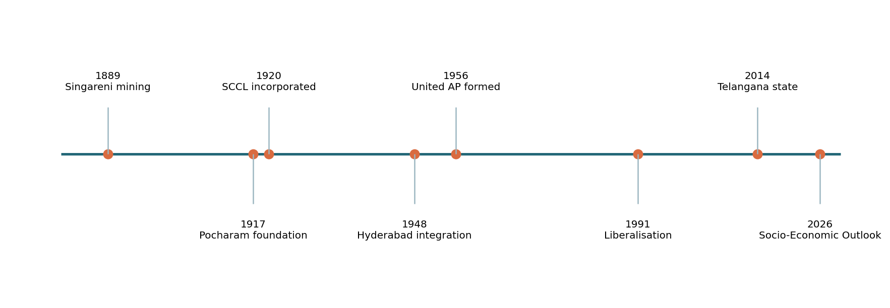
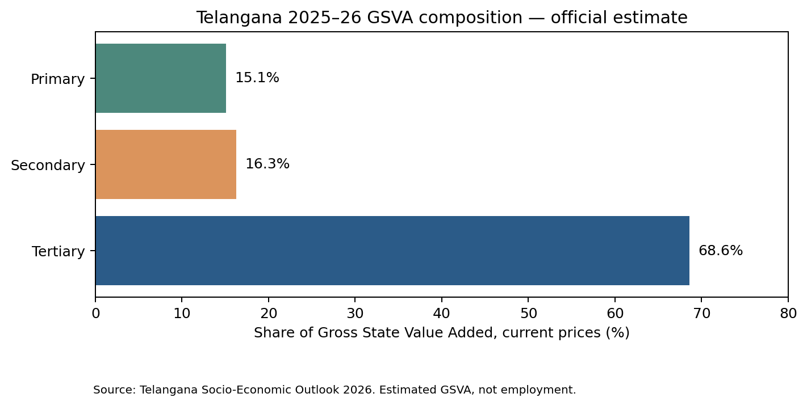
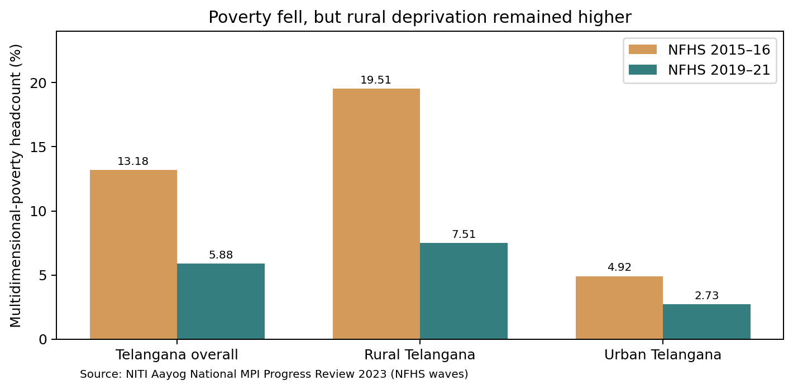

# Syllabus map and learning objectives

**Official syllabus line (Notification 02/2024, Annexure-II, Paper IV, Unit II, Topic 1; wording corroborated against public reproduction, original TGPSC PDF direct verification pending):** “Telangana economy in Hyderabad State (Agriculture, Industry and Trade); Telangana economy in United AP (1956-2014)- Deprivation and Under development; Structure and Growth of Telangana economy: Sectoral trends in GSDP ; Per capita income; Income inequalities and Poverty.”

| Examinable demand | Sections | What a strong answer demonstrates |
|---|---|---|
| Hyderabad State economy: agriculture | 1–2 | Tenure, jagirs, diwani, tanks, commercial crops, agrarian hierarchy |
| Hyderabad State economy: industry | 3 | Singareni chronology, sugar and urban industry, linkages and limits |
| Hyderabad State economy: trade | 4 | Market hierarchy, credit, transport and distribution |
| United AP 1956–2014: deprivation and underdevelopment | 5–9 | Safeguards, fiscal geography, irrigation, employment and uneven growth; competing evidence |
| Statehood and structural change | 10–12 | 2014 transition, GSDP/GSVA distinction, current/constant prices, sector shares |
| Per capita income | 13 | NSDP vs GSDP, average vs median, vintage and inflation |
| Income inequalities | 14 | Household, district and social inequalities; appropriate metrics |
| Poverty | 15–16 | Income/consumption/MPI, NFHS vintage, rural–urban comparison and policy trade-offs |

**Learning outcomes:** Explain Telangana's historical economic institutions; assess regional-deprivation arguments without invented statistics; interpret 2025–26 state accounts correctly; distinguish prosperity from inequality; construct an evidence-led mains answer.

# Topic summary

Telangana's economic history has three linked phases. In Hyderabad State, agriculture was shaped by semi-arid conditions, unequal tenure, tank irrigation and local markets, while coal mining, sugar processing and Hyderabad's urban economy created selective industrial modernisation. Between 1956 and 2014, integration into Andhra Pradesh brought investment and metropolitan growth alongside disputes over safeguards, employment, fiscal allocation and water. Since state formation on 2 June 2014, the economy has become strongly services-led, yet rural livelihoods and district disparities remain central policy concerns.

**2025–26 statistical snapshot (Telangana Socio-Economic Outlook 2026, estimates):** GSDP approximately ₹17,82,198 crore at current prices; primary, secondary and tertiary GSVA shares **15.1%, 16.3%, 68.6%**; per capita income about **₹4,18,931** at current prices. **NITI Aayog MPI (NFHS-based):** multidimensional poverty headcount **13.18% in 2015–16** and **5.88% in 2019–21**. Do not treat those poverty figures as 2026 observations.

The analytical thread is **historical institutions → allocation of public resources → structural transformation → distributional outcomes**. A strong answer compares rival interpretations, labels statistical vintages and distinguishes aggregate output from household welfare.

# Standalone quick revision — flexible last-minute sheet

## 90-second essentials

- **Hyderabad State:** Telugu-speaking Telangana was only one region of the larger Hyderabad dominion; whole-state historical totals are not Telangana-only totals.
- **Agriculture:** jagir/diwani arrangements, unequal tenancy, tank irrigation, dryland risk, cotton/sugarcane and agrarian labour relations.
- **Industry:** Singareni mining began **1889**; SCCL incorporated **1920**; Hyderabad State majority stake **1945** [S04]. Nizam Sugar Factory at Bodhan was an agro-industrial anchor [S09].
- **Irrigation example:** Pocharam foundation **1917**, completion **1922** [S08]. Irrigation *potential* differs from dependable delivered water.
- **United AP:** 1956–2014. Examine Gentlemen's Agreement, local employment, irrigation, expenditure allocation and Hyderabad's growth; do not invent a numeric 'loss'.
- **Statehood:** **2 June 2014**. Political control changed; geography, skill deficits and fiscal constraints did not disappear.
- **GSDP:** state output at market prices; **GSVA:** sectoral value added. GSDP = GSVA + net product taxes.
- **2025–26 GSVA sector shares:** primary **15.1%**, secondary **16.3%**, tertiary **68.6%**, current prices, estimate [S03]. Not employment shares.
- **2025–26 nominal GSDP:** approximately **₹17.82 lakh crore**, estimate; **PCI ₹4,18,931**, current prices [S03]. Distinguish PCI from per-capita GSDP.
- **Poverty:** Telangana MPI headcount **13.18% (2015–16) → 5.88% (2019–21)**, a **7.30-percentage-point** reduction, NITI Aayog [S07]. Not the 2026 poverty rate.
- **Equity:** metropolitan concentration can raise average PCI while rural/tribal/informal households remain disadvantaged.

## Five-minute recall drill

1. Explain why 'Hyderabad State' and 'Telangana region' are not synonyms.
2. Give one example each of historical irrigation, coal and sugar industry.
3. State two arguments **for** and two **against** the claim of complete regional underdevelopment in united AP.
4. Derive GSDP from GSVA and explain why sectoral shares cannot be called employment shares.
5. Distinguish current/constant prices and gross/net per capita measures.
6. Calculate the MPI headcount change in **percentage points**.
7. Propose two policies for productivity and two for equity without claiming they are costless.

## Comparison grid

| Pair | Essential difference |
|---|---|
| Hyderabad State / Telangana region | Larger princely state / Telugu-speaking part within it |
| Jagir / diwani | Intermediary grant administration / directly administered territory, local variations |
| Irrigation potential / actual irrigation | Engineering design / reliable seasonal water delivered |
| Nominal / real GSDP | Current prices / volume-adjusted constant prices |
| GSDP / GSVA | Market-price final output / value added before net product taxes |
| Per capita NSDP / per capita GSDP | Net of depreciation / gross of depreciation |
| Income inequality / district disparity | Distribution among households / difference between places |
| Income poverty / MPI | Monetary threshold / weighted capability deprivations |

## Common mistakes to avoid

Do not label NITI's 2019–21 MPI as current 2026 poverty. Do not present the 2026–27 budget projection as realised GSDP. Do not assume an average income is a median salary. Do not claim every Telangana district was stagnant between 1956 and 2014. Do not present a political allegation as an audited budget statistic. Do not confuse GSVA sector shares with GSDP or employment shares.

# Detailed textbook-grade notes

## 1. Historical economic framework: Hyderabad State and its Telangana districts

The economic history of Telangana cannot be understood as an isolated sequence of crops and factories. Under the Asaf Jahi rulers, Hyderabad was a princely state with territories beyond present-day Telangana; it included the Marathi-speaking Marathwada and Kannada-speaking areas as well as Telugu-speaking districts. The contemporary expression *Telangana economy in Hyderabad State* therefore means the economy of the Telugu-speaking region within that larger political unit, not the total output of Hyderabad State. This geographical distinction matters whenever an old statistic refers to the entire dominion. A total for Hyderabad cannot automatically be assigned to Telangana.

### Institutions, land rights and economic power
Hyderabad's fiscal system mixed directly administered or *diwani* areas with jagir and other intermediary arrangements. Jagirdars and related local elites exercised varying revenue and coercive powers, while many cultivators possessed insecure or unequal access to land. A village economy could have productive tanks, artisans and trading links while still imposing high extraction and labour obligations on particular social groups. Revenue claims, tenancy conditions, moneylending and social hierarchy affected how agricultural surplus was divided. In a dryland setting, a bad monsoon could simultaneously reduce harvests, weaken a tenant's bargaining power and increase indebtedness. This is why an account of 'agricultural backwardness' must discuss institutions as well as rainfall.

Hyderabad also had a substantial administrative apparatus, rail links, public works, an urban capital and certain state-supported industries. Calling the whole period economically stagnant erases the evidence of selective modernisation. Conversely, pointing to a railway, coal mine or urban college does not prove equitable development. The appropriate question is who received irrigation, education, market access, secure tenure and industrial employment, and who financed these benefits. Modernisation and exploitation could coexist.

### Telangana's spatial structure
Hyderabad–Secunderabad formed an administrative and commercial centre. The Godavari coal belt, northern cotton areas, Nizamabad's cane belt and eastern forest/tribal zones had different production structures. Rainfall and tank networks varied sharply, as did access to market towns and transport. Industrialisation in Hyderabad city could raise aggregate value added without changing the welfare of rainfed cultivators in Mahabubnagar or the land rights of tribal households in Adilabad. A student should therefore use three lenses: **production structure** (what was produced), **distribution** (who controlled the surplus) and **regional geography** (where facilities were located).

### Contrasting interpretations
One school emphasises that the Nizam's government built irrigation works, urban institutions and enterprises before integration with India. Another stresses feudal agrarian relations, bonded labour and low mass education. These are not mutually exclusive claims. The empirical task is to compare outcomes across classes, districts and time rather than choosing one sweeping adjective. The practical legacy was an economy with important urban and mineral assets but widespread agrarian vulnerability. Those starting conditions shaped post-1956 development debates and the politics of separate statehood.

## 2. Agriculture under Hyderabad State: tenure, tanks, crops and rural distress

Agriculture was the principal livelihood for much of the Telugu-speaking region of Hyderabad State. Its structure reflected a semi-arid Deccan climate: uneven rainfall, dependence on monsoon and local storage, black soils suitable for cotton in some belts, and mixed foodgrain systems including millets and pulses. Cultivation was not uniform. Well-watered pockets could produce commercial crops, while dryland villages relied on risk-spreading combinations of crops, livestock and seasonal work. Landholding and tenancy arrangements were often more decisive for welfare than the gross harvest alone.

### Revenue systems and the agrarian hierarchy
In jagir territories the relationship between cultivator and revenue claimant could be mediated by powerful intermediaries; in diwani areas state officials and village-level functionaries administered collection. Terminology and local practice changed across districts, so one should not assume a single uniform tenancy contract. Unequal control over land, credit, grazing and village authority enabled extraction through rent, debt obligations and in some locations **vetti**, or coerced unpaid labour. The economic consequence was not only low consumption: a cultivator uncertain of retaining land or harvest had weaker incentives and fewer resources to invest in wells, soil improvement or better seed. At the same time, landlords could finance some improvements where their returns were protected. This makes tenancy reform both a justice and productivity issue.

### Tanks and irrigation
The Deccan's tanks and chain-of-tanks systems stored seasonal runoff and supported local agriculture. Under the Nizam administration larger projects supplemented traditional tanks. The Government of Telangana's Kamareddy district record dates the foundation of the Pocharam project to **1917** and completion to **1922**, describing its canals and service to Nizamabad–Medak areas [S08]. Nizam Sagar, built on the Manjira, is another important historical example, though its command and later performance must be examined using project-specific data. These investments refute any claim that there was no irrigation development before 1956. They do not establish that irrigation reached most dryland cultivators: gross command area, dependable seasonal supply, and distribution across head and tail reaches are different measures.

### Commercialisation and risk
Cotton, sugarcane and oilseeds connected villages to processors, merchants and outside markets. Commercialisation can raise cash incomes but also increase exposure to price volatility, input credit and drought. Sugarcane benefits from assured procurement and irrigation but can intensify water demand; cotton may fit some black-soil belts but faces pest and market risk. Food security therefore cannot be inferred from cash-crop expansion alone. A useful comparison asks whether the household retained grain, could buy food at prevailing prices, and controlled the proceeds from sale.

### Social differentiation
Women contributed to sowing, weeding, livestock care and processing but rarely held proportionate formal land titles. Dalit labourers, tenant households and Adivasi communities faced distinct constraints, including wage dependence and land alienation. Agrarian conflict culminating in the Telangana peasant struggle of the 1940s is inseparable from this political economy. The movement cannot be reduced to a single cause; coercive relations, political mobilisation and state violence interacted. For present policy, the historical lesson is that irrigation investment without secure rights, extension, fair markets and accountable village institutions produces unequal gains.

## 3. Industry in Hyderabad State: coal, sugar, textiles and urban manufacturing

The Hyderabad State economy possessed an industrial base that complicates a simple agrarian narrative. Coal mining in the Godavari valley, sugar processing in the north and urban workshops around Hyderabad illustrate distinct forms of industrial development. These activities were shaped by geology, agricultural supply, public capital and transport access rather than by a uniform statewide industrial policy. Their local spillovers—wages, roads, supplier demand, electricity and urbanisation—could be substantial, but they were concentrated geographically.

### Singareni and extractive industrialisation
The Government of Telangana's Socio-Economic Outlook 2017 traces the predecessor of Singareni Collieries to coal mining beginning in **1889**, incorporation of Singareni Collieries Company Limited in **1920**, and acquisition of majority shares by Hyderabad State in **1945** [S04]. Coal supplied fuel to railways, power and industrial users. Mining created wage employment and supporting settlements, yet generated land disturbance, occupational risks and an uneven local benefit distribution. Public ownership did not by itself settle questions of safety, rehabilitation or environmental damage. For an examination answer, separate the dates of mining's origin, incorporation and later changes of ownership; they are not interchangeable.

### Sugar and agro-processing
Bodhan's Nizam Sugar Factory linked cane cultivation, transport, factory labour and sugar markets. The Bodhan Municipality identifies the factory as a defining industrial institution [S09]. Sugar illustrates backward and forward linkages: the factory needs farmers and irrigation, while growers need crushing capacity, payment reliability and a market for cane. It also demonstrates the risk of single-industry towns when an enterprise becomes financially weak. On **4 February 2024**, the Telangana government directed a cabinet subcommittee to examine revival of closed Nizam Sugar Factories and farmer arrears [S10]. This statement establishes that revival was being examined; it is not evidence that a closed plant had already restarted.

### Hyderabad's diversified urban base
The capital supported workshops, rail-related activity, textiles, trade, educational institutions and later manufacturing. State-supported urban modernisation helped create an agglomeration: firms benefited from labour pools, suppliers, transport and public services near one another. The same mechanism concentrated opportunity. A small town without skilled labour, reliable power or a large market could not automatically replicate Hyderabad's industrial mix. In historical comparison, 'number of factories' is an incomplete measure; employment quality, value added, technology transfer and the share of locally owned enterprises matter.

### Development appraisal
A favourable interpretation stresses the early establishment of extractive and agro-industrial anchors; a critical interpretation notes narrow industrial diversification, elite urban concentration and weak rural human capital. Both capture part of the story. Industrial development should be evaluated through **productive linkages**, **decent employment**, **spatial diffusion** and **environmental costs**. The present-day policy implication is not simply to revive every legacy factory at any cost. Governments must test market demand, technology, financial viability, labour rights and water requirements before investing public money.

## 4. Trade, transport, credit and markets in the Hyderabad economy

Trade connects agricultural and industrial production to income. Hyderabad State's capital was a commercial hub; railways, roads and market towns moved grain, cotton, sugar, coal, forest produce and manufactured goods. The economic importance of trade was not merely the volume of commodities shipped. A market link could change cropping choices, land values, access to credit and the bargaining power of a farmer facing a small number of buyers. It could also transmit price shocks from distant cities into village households.

### Market hierarchy
Village weekly markets served everyday exchange and local aggregation. Larger mandi towns offered storage, merchants and connections to rail or road networks. Hyderabad–Secunderabad linked regional goods with interregional commerce and services. This hierarchy produced a classic centre–periphery pattern: the urban centre captured wholesale margins, financial services and high-value activities, while peripheral producers supplied raw material. A good historical answer avoids asserting that every merchant exploited farmers. Merchants also provided liquidity, transport and risk-bearing services. The question is whether competition, information and alternative finance gave producers meaningful choice.

### Credit and dependence
Formal banking was less accessible to many rural households than moneylenders, traders and landlords. Credit could be tied to crop sales or tenancy. When prices fell or rainfall failed, debt could accumulate, reinforcing dependence. Cooperative credit offered a potential alternative, but its effectiveness depended on governance, membership inclusion and loan recovery. Women and landless workers faced particular obstacles because they lacked collateral or recognised titles. The underlying market failure was not the existence of lending but information asymmetry, unequal collateral and weak borrower protection.

### Transport and integration
Rail links and roads lowered transaction costs and helped coal, grain and industrial goods reach wider markets. Yet access was uneven: a village several kilometres from an all-weather road could face very different farm-gate prices from a town near a railhead. Irrigation, credit and transport therefore operated as complementary investments. A canal could increase output without increasing farm income if transport bottlenecks or monopsony buying suppressed prices. Conversely, better transport could accelerate commercial crops while exposing households to new risks.

### Modern relevance
These historical mechanisms remain visible in debates over farmer producer organisations, regulated markets, warehousing, digital price information and last-mile roads. Telangana's present-day logistics and IT growth have strengthened metropolitan connections, but a producer in a remote tribal or dryland area may still face expensive aggregation. Development policy must ask who controls market information, how prices are discovered, whether grading and storage exist, and whether the producer can delay sale. That framework is more useful than treating 'trade expansion' as automatically pro-poor.

## 5. Transition from Hyderabad State to Andhra Pradesh, 1948–1956

The interval from the integration of Hyderabad into India in **1948** to the formation of Andhra Pradesh in **1956** was a distinct institutional transition. Hyderabad's administrative systems, land arrangements and public enterprises had to be fitted into the constitutional and planning framework of the Indian Union. Telangana was not simply transferred unchanged from one economic jurisdiction to another. Political integration, land-reform debates, public employment arrangements and the future of the capital all influenced expectations about development.

### Land and administration
The abolition of jagirdari and related intermediary arrangements sought to alter the relationship between the state, landholders and cultivators. Removing a revenue intermediary is not identical to redistributing land to every landless household; tenancy rights, records, ceilings and actual possession require separate policy measures. A law may change formal ownership while old inequalities persist through informal tenancy or unequal access to irrigation. The distinction is essential when evaluating reform outcomes. Hyderabad's inherited administrative practices and Mulki-related local employment rules also became politically salient as integration proceeded.

### Linguistic reorganisation and competing considerations
The creation of Andhra Pradesh in **1956** combined Telangana with the Andhra State, which had been formed in 1953. Supporters of linguistic reorganisation saw shared Telugu language, a larger market and coordinated development as benefits. Opponents and sceptics feared that differences in revenue systems, education, irrigation development, administrative experience and political influence could disadvantage Telangana. The States Reorganisation Commission had considered such concerns. The Gentlemen's Agreement of 1956 was intended to provide safeguards concerning Telangana's interests; its interpretation and implementation became central to later disputes.

### The importance of baselines
A valid assessment must compare the starting conditions of regions before judging later divergence. For example, irrigated acreage in a delta region and rainfed cultivation on the Deccan plateau are not directly comparable without accounting for agro-climatic conditions and historical investment. At the same time, geography cannot excuse every subsequent investment choice: public policy can build lift irrigation, tanks, education and roads where natural endowments differ. A careful analysis separates inherited disadvantage, policy decisions and outcomes.

### Evidence and limitations
Many public arguments cite 'surplus revenues' or jobs 'lost' to Telangana. These are questions for official budget accounts, service records and definitions of territorial expenditure. A single headline number without a fiscal year, accounting convention or source should not be repeated as established fact. The strongest academic position recognises the historical reality of regional grievances while distinguishing documented institutional arrangements from estimates still contested by scholars and political actors. This distinction makes an answer more credible rather than less critical.

## 6. United Andhra Pradesh, 1956–2014: safeguards, public finance and regional development

Regional development under undivided Andhra Pradesh was shaped by the allocation of public expenditure, administration of safeguards, political representation and the location of productive investment. Telangana's economic grievance was not that every district remained unchanged between 1956 and 2014. Roads, schooling, irrigation projects, urban industry and the Hyderabad service economy all expanded. The grievance concerned the **distribution, pace and opportunity cost** of that growth relative to Telangana's population, needs, revenues and legitimate expectations.

### Safeguards and implementation
The 1956 arrangements and later institutions were designed to protect regional interests in public employment, education and development. Disputes over their implementation fed the 1969 Telangana agitation and subsequent political movements. Employment rules such as the Presidential Order of 1975 and later administrative reviews, including the Girglani inquiry, entered the debate over local cadres and recruitment. Their existence is evidence of a recognised governance problem, but evaluating actual violations requires department-wise, year-wise records. One must not infer a precise count of illegal appointments merely from the existence of a review committee.

### Fiscal equity and measurement
Claims about 'Telangana's share' require specifying the denominator: population, geographical area, tax contribution, development need or historical backlog. Each answers a different normative question. Spending in Hyderabad on a statewide institution may benefit residents of multiple regions; conversely, booking expenditure at a capital-city address does not prove equal geographic access to its services. A robust regional budget analysis distinguishes **where money was booked**, **where the asset was built**, and **who received the benefit**. Revenue receipts also need to be separated from public expenditure and debt financing.

### Capital city and regional imbalance
Hyderabad developed as a common capital, attracting universities, hospitals, research establishments, industry, IT firms and property investment. This generated jobs and tax capacity but also produced concentration. A metropolitan boom can coexist with stagnant or volatile rural incomes. Even within Telangana, Hyderabad's prosperity did not automatically reach tribal hamlets or dryland mandals. A student should avoid treating Hyderabad's GDP as a proxy for every Telangana household's welfare.

### Contrasting assessments
The regional-deprivation argument stresses unmet safeguards, uneven irrigation investment and limited local control over decisions. A counter-argument points to economic expansion, shared state-level institutions, and investments in Hyderabad that benefited many Telangana residents. Neither position settles the issue without comparable district data. The correct method uses constant-price output, human-development indicators, irrigation reliability, public employment records and distributional evidence across multiple decades. The practical lesson is institutional: transparent regional accounts and enforceable safeguards matter when a political unit combines regions with different histories.

## 7. Irrigation and water allocation as a development controversy

Irrigation became one of the most visible economic issues in the Telangana movement because water affects agricultural productivity, rural employment, land values and drought resilience. The region's plateau topography and dispersed settlements differ from low-lying canal-command areas. Gravity irrigation can be cheaper in a delta, while pumping water to elevated land requires energy and capital. This physical distinction matters, but it does not eliminate questions about allocation decisions or the long-term maintenance of tanks and canals.

### Project design versus delivered water
The construction of a dam is not the same as assured irrigation to farmers. Assess at least four stages: water entitlement and availability, storage or diversion, conveyance infrastructure, and reliable delivery at the farm. A large project may have impressive design capacity yet limited utilisation because of incomplete canals, power shortages, sedimentation or delayed land acquisition. Tail-end farmers may receive less dependable water than head-reach farmers. A water-policy essay should therefore distinguish **created potential**, **utilised potential** and **actual seasonal irrigation**.

### River basins and institutions
The Krishna and Godavari systems cross state boundaries. Water sharing involves tribunal awards, inter-state agreements, basin hydrology, Central Water Commission inputs and constitutional mechanisms for inter-state river disputes. Post-2014 allocations also involve the Andhra Pradesh Reorganisation Act and river management boards. These institutions govern different questions: a tribunal adjudicates allocations, a project authority operates infrastructure, and a state agriculture department influences crop choices. Mixing them produces inaccurate answers.

### Telangana examples
Historical tanks and Pocharam demonstrate local storage traditions [S08]. Modern large irrigation projects and lift schemes illustrate an alternative strategy for plateau agriculture. Their appraisal should include energy consumption per unit of water, capital cost, maintenance, environmental impacts, rehabilitation and crop returns. A scheme that brings water to drought-prone land can be socially valuable while still imposing fiscal and ecological costs. Neither 'all lift irrigation is wasteful' nor 'every irrigation project is transformative' is a defensible universal proposition.

### Equity and future strategy
Improved water governance combines tank restoration, groundwater monitoring, micro-irrigation where appropriate, crop diversification, transparent canal schedules and credible hydrological accounting. In drought-prone areas, reliable drinking water and watershed management may produce higher social returns than water-intensive crop expansion. The policy objective is not maximum water use but **maximum durable welfare per unit of scarce water**, with attention to farmers at the tail end, landless labourers and downstream ecosystems.

## 8. Employment, education, public institutions and uneven human development

The quality of economic development depends on the opportunities people can access, not only on physical output. Under undivided Andhra Pradesh, Telangana's claims about public employment and education reflected both distributional concerns and the desire for meaningful local participation in state institutions. Public employment was important because government jobs offered stable wages, pensions and social mobility, particularly for first-generation educated families. The allocation of educational institutions affected the supply of candidates able to compete for those jobs.

### Local employment and institutional credibility
Rules designed to protect local recruitment must be evaluated by the cadre, zone, domicile definition, vacancy, reservation category and relevant date. Administrative labels changed over time, so a modern district boundary cannot simply be projected backwards. The economic mechanism is clear: if an eligible local graduate perceives recruitment as inaccessible, education's expected return falls and trust in government weakens. But an argument about particular recruitment violations needs documentary evidence rather than anecdote. Policy credibility requires transparent vacancy rosters, public recruitment data and effective grievance remedies.

### Education and health as productive capital
School access, female literacy, technical education, health and nutrition influence labour productivity and the ability to move from low-productivity agriculture to industry or services. An industrial corridor cannot attract inclusive employment if nearby youth lack foundational skills or mobility. Conversely, expanding universities in Hyderabad may create a knowledge cluster without resolving school dropout or healthcare access in remote districts. A serious regional assessment therefore combines institution counts with learning outcomes, distance to facilities, gender gaps and household expenditure burdens.

### Social and spatial exclusion
Scheduled Tribes in forest and agency areas, Scheduled Castes in agrarian labour markets, women with unpaid care responsibilities and informal urban workers experience different constraints. Even when a district's average income rises, these groups may not benefit equally. For women, transport safety, childcare and ownership of productive assets can be as important as training programmes. For Adivasi communities, secure land and forest rights affect whether mineral and infrastructure investments become development or displacement.

### Policy appraisal
The challenge is to convert public institutions into capabilities. A credible programme specifies the target population, a measurable service standard, the budget, grievance redressal and independent outcome evaluation. For Telangana, the transition from inherited regional grievances to contemporary statehood does not eliminate internal inequality. It shifts the question: how can a state with a powerful capital-city economy ensure comparable life chances across districts and social groups?

## 9. Economic transformation, 1991–2014: Hyderabad services and rural Telangana

The liberalisation era altered Telangana's economy through telecommunications, software exports, pharmaceuticals, education, construction, finance and real estate. Hyderabad's growing technology ecosystem benefited from engineering talent, institutions, public infrastructure and private investment. Agglomeration effects attracted more firms and workers, reinforcing the city's advantage. This transition was not simply a result of one reform or one political administration; it combined earlier industrial and educational investments with national market changes and successive state policies.

### Growth mechanisms
Software and business services can generate high value added with relatively low physical material inputs. Pharmaceuticals and biotechnology depend on skilled labour, research, regulation and manufacturing clusters. Real estate and construction respond to migration and business expansion. The gains can spread through transport, retail and household services, but wage dispersion is large: an engineer and an informal construction worker may both contribute to the same urban boom while receiving very different incomes and protections.

### Unequal sectoral transition
Economic transformation often raises the services share of state output faster than its share of employment. This is a productivity arithmetic, not a contradiction. If 100 high-skilled workers produce as much value as several thousand low-productivity agricultural workers, the service sector can dominate GSDP while agriculture still supports many households. Thus, 'services-led growth' should never be translated into 'most workers have good service jobs'. The distinction is central to Telangana's present economic structure.

### Rural continuities
Many rural districts remained exposed to monsoon variation, indebtedness, fragmented holdings and migration. Irrigation investments and agricultural markets changed unevenly. Rural households increasingly combined farming with non-farm work, remittances and seasonal migration. This diversification can be resilience or distress: the interpretation depends on wages, security, choice and household outcomes. Higher urban output can coexist with low female labour-force participation or persistent agrarian vulnerability.

### Debates about the common capital
Hyderabad's expansion during the united-state period complicates any claim that the entire Telangana region was economically neglected in an absolute sense. Yet aggregate metropolitan gains do not resolve claims about rural water, local recruitment or regional political voice. Both statements can be true. A high-quality mains answer compares **metropolitan growth**, **district convergence** and **household distribution**, rather than using the success or failure of a single sector as a verdict on 58 years of policy.

## 10. State formation in 2014 and the meaning of economic self-government

Telangana became a separate state on **2 June 2014** under the Andhra Pradesh Reorganisation Act, 2014. The new state inherited a powerful urban economic base and major rural development challenges. Statehood changed who made budget, administrative and policy decisions; it did not immediately change geography, water availability or household skills. The relevant economic question is whether greater political accountability and region-specific policy design can improve the allocation and delivery of resources.

### Opportunities after bifurcation
A state government with a defined territory can prepare district-specific investment strategies, prioritise tanks or irrigation where justified, strengthen local recruitment rules and focus on social protection. It can coordinate state taxes and expenditure within constitutional limits. Hyderabad's tax base and service economy provide fiscal capacity. But the ability to announce a scheme is not the same as having sustainable financing, reliable procurement or effective field implementation. A government must weigh welfare transfers, infrastructure investment, debt service and recurrent expenditure.

### Constraints
Inter-state river water, power arrangements, institutional division, public assets and liabilities require coordination beyond state borders. Central tax devolution, Finance Commission recommendations, national macroeconomic conditions and private investment cycles affect Telangana regardless of statehood. A severe drought or global IT slowdown can reduce growth even under competent local policy. Causal claims about statehood should therefore compare observed outcomes with a plausible counterfactual, not merely contrast pre- and post-2014 nominal figures.

### Growth versus development
A rise in GSDP is valuable because it expands potential income and tax capacity. But a policy assessment should also track real household consumption, learning, health, employment quality, inequality and environmental sustainability. Large capital projects can create useful public assets but may crowd out other services if debt and maintenance costs are ignored. Direct transfers can protect consumption but may not raise productivity unless combined with education, infrastructure and functioning markets.

### Analytical conclusion
Statehood creates an opportunity for regionally responsive institutions; its success is measured by outcomes and transparency. Telangana's next development challenge is not simply to enlarge Hyderabad's output but to diffuse productivity, reliable public services and social mobility across rural districts, small towns and excluded communities. That requires credible data, accountable local institutions and realistic fiscal choices.

## 11. Understanding GSDP, GSVA, sectoral shares and price bases

**Gross State Domestic Product (GSDP)** is the value of final goods and services produced within a state over a period, measured using national-accounts concepts. At the production level, **Gross State Value Added (GSVA)** sums the value added by producing sectors; GSDP at market prices adds net product taxes (product taxes less product subsidies) to total GSVA. Hence a sector's share of GSVA should not be casually described as its share of GSDP. Sector shares normally add to approximately 100% of GSVA, subject to rounding; the product-tax adjustment explains the difference between aggregate GSVA and market-price GSDP.

### Current and constant prices
At **current prices**, output values change when either quantities or prices change. At **constant prices**, the aim is to isolate volume growth by holding prices to a reference basis. Nominal growth is therefore not the same as real growth. If nominal GSDP rises by 10% while the relevant price index rises by about 4%, real growth is lower. A state can have impressive nominal income growth partly because of inflation. Always state the price basis and fiscal year before comparing figures.

### Estimation revisions
State accounts are released as advance, provisional, first revised and later estimates. New data from tax systems, surveys and national-account revisions can change previously published values. The 2025–26 figure should not be juxtaposed with an earlier-year figure from an older statistical vintage without noting possible revision. Similarly, India's national-accounts base-year changes require caution in interpreting growth across different releases. A disciplined chart labels **year, price basis, release vintage and source**.

### Sector classification
Primary activities include agriculture, livestock, forestry, fishing and mining. Secondary activities include manufacturing, construction, electricity and other utilities. Tertiary activities cover trade, hotels, transport, communications, finance, real estate, public administration and professional services. Some tables use 'agriculture', 'manufacturing' and 'services' rather than the full primary–secondary–tertiary grouping. These classifications are not interchangeable: construction and mining can materially alter shares.

### Telangana application
Telangana's service economy is especially large because Hyderabad and surrounding districts host IT, financial, professional, real-estate and related activities. This raises state-level average productivity but does not automatically reveal employment structure or district welfare. For exam questions, distinguish **share in output**, **growth rate of output**, **employment share** and **per-worker productivity**. A sector can have a declining share while still growing in absolute value if other sectors expand faster.

## 12. Telangana sectoral structure and growth: the 2025–26 evidence

The Government of Telangana's **Socio-Economic Outlook 2026**, listed on the official reports portal, provides a recent statistical snapshot [S02–S03]. Its indexed 2025–26 estimates place **primary activities at 15.1%, secondary at 16.3%, and tertiary at 68.6% of GSVA at current prices**. The shares sum to 100% and describe *the composition of value added*, not employment and not the percentage of the population living in each sector. They are from the 2025–26 provisional/advance estimate vintage and should not be merged mechanically with a 2024–25 series.

### Output level and growth
The 2026 report and contemporary state budget discussion place Telangana's **2025–26 GSDP at approximately ₹17,82,198 crore at current prices**, with nominal growth around **10.7%** in that reporting vintage [S02–S03]. These are **estimates**, not audited final accounts. The 2026–27 Budget projected GSDP of ₹19,61,701 crore at current prices [S06], a future budget assumption rather than an observed outcome. Both figures must be labelled. A comparison with 2014–15 can illustrate the scale of transformation, but should use consistent price bases and explain statistical revisions.

### Primary sector
The primary sector remains essential for rural livelihoods even though its output share is modest. The 2026 Outlook's indexed extract reports primary GSVA of approximately **₹2,49,691 crore in 2025–26**, up about **1.4% at current prices** from its earlier estimate [S03]. Livestock and crops are important components; mining also belongs to the broad primary classification. Agricultural volatility arises from rainfall, input costs, market prices and water access. Its relatively slow growth can widen the urban–rural productivity gap even when the sector's nominal output rises.

### Secondary sector
Manufacturing includes pharmaceuticals, food processing, textiles, engineering and other products; construction is a separate major component of the secondary sector. Urban infrastructure and industrial estates create demand for construction, while manufacturing depends on logistics, power, regulation, technology and workforce skills. The indexed 2026 Outlook reports about **9.4% nominal growth** for the secondary sector [S03]. One should not equate this with real industrial growth without a sector deflator.

### Tertiary sector
Services contributed the largest share—**68.6% of GSVA**—in the 2025–26 estimate. Hyderabad's IT and professional-service clusters are significant, but tertiary activities also include ordinary retail, transport, hospitality, government services and informal work. The indexed report shows tertiary nominal growth around **13.5%** [S03]. The coexistence of highly paid software employment and low-paid urban services is a reminder that sectoral value added is not a distributional statistic.

### Critical interpretation
A high services share can signal specialisation and productivity, but it raises policy questions about export concentration, urban congestion, land prices and the skill gap. The development objective should be balanced linkages: rural food processing and logistics, viable small-town industry, improved farm productivity and accessible training. The figures are useful for exam answers only when accompanied by their definition, date and estimation status.

## 13. Per capita income: meaning, comparisons and limitations

**Per capita income (PCI)** usually refers to per capita **Net State Domestic Product (NSDP)** at current prices in state statistical publications. It is an average: NSDP divided by population. **Per capita GSDP**, by contrast, divides gross output by population and is conceptually different because gross includes depreciation. Confusing these measures can produce apparently contradictory numbers for the same year. A comparison should specify whether the numerator is gross or net and whether prices are current or constant.

### Recent Telangana estimate
The Telangana Socio-Economic Outlook 2026 reports **per capita income of ₹4,18,931 for 2025–26 at current prices**, compared with an India-wide per capita income estimate of approximately **₹2,19,575** in that release [S03]. This implies Telangana's reported PCI is about **1.91 times** the national figure. The comparison is informative about average income but not a claim that every Telangana resident earns that amount. It is also not an estimate of the median wage, a household's disposable income or a monthly salary.

### Price and revision effects
The official FRBM statement for the previous statistical vintage placed Telangana's **2024–25 PCI at ₹3,79,751** [S05]. A newer report may revise prior-year numbers. Do not construct an exact growth rate from numbers that use different statistical vintages without checking the underlying time series. For a genuine living-standard comparison, use real per capita income and supplement it with consumption, health, education and poverty indicators. A rise in nominal PCI may reflect higher prices or a booming high-value sector that employs a limited workforce.

### Why high averages can mislead
Suppose nine households earn ₹1 lakh each while one earns ₹21 lakh. The mean is ₹3 lakh, but nine households earn far below that figure. The example is hypothetical; it shows why an average cannot reveal inequality. Hyderabad's large high-value sectors raise state averages while many rural and informal workers have much lower incomes. Migration and commuting further complicate the location of production versus residence: income generated in one district may accrue to residents elsewhere.

### District comparisons
District per capita income statistics require careful attention to year, boundary and method. Corporate value added concentrated in an industrial or IT district can create extremely high estimated PCI even where local households do not receive proportionate income. Use district figures to identify economic concentration, not to rank every household's welfare. A policy response should examine district employment quality, school outcomes, road access, healthcare, housing costs and rural non-farm enterprise opportunities. The core examination insight is that **average prosperity is necessary but not sufficient evidence of inclusive development**.

## 14. Income inequality, district disparity and the distribution of growth

**Income inequality** describes how unequally income is distributed among persons or households. **Regional disparity** compares places; **sectoral disparity** compares activities; and **social inequality** examines differences by caste, tribe, gender or other group. They overlap but are not identical. A rich district can contain deep household poverty, and a poor district can contain wealthy households. Therefore, district PCI is not a direct measure of the Gini coefficient or the poverty headcount.

### Mechanisms behind Telangana's inequality
Hyderabad and its neighbouring industrial and IT districts attract skilled workers, private capital and infrastructure. Firms cluster because of shared suppliers, labour pools and knowledge spillovers. High-value service wages, corporate profits and property appreciation can lift aggregate income. Remote dryland areas may face weaker transport, less reliable water, lower education outcomes and fewer non-farm jobs. Unequal land ownership and access to finance compound the gap. Economic growth can therefore increase both average income and absolute income differences, even if poverty falls.

### Measuring inequality properly
The **Gini coefficient** summarises inequality across a distribution, but its value depends on whether the data are income, consumption or wealth. Household consumption surveys capture a different concept from national accounts; they often miss the full upper tail of income and cannot simply be divided into GSDP. The **Palma ratio** compares top-decile and bottom-40% income shares; percentile ratios and district maps offer complementary perspectives. The choice of metric matters because policy priorities differ for extreme wealth concentration and widespread low earnings.

### Intra-state geography
Industrial corridors in Rangareddy, Medchal–Malkajgiri and Sangareddy benefit from metropolitan demand and infrastructure, while districts with high agricultural dependence often face greater seasonal risk. The 2026 Socio-Economic Outlook highlights substantial district differences [S03]. When comparing them, avoid mixing administrative boundaries across years or treating estimated district output as household earnings. A district's high PCI may reflect headquarters, corporate profits or a large commuting workforce.

### Distributional policy
A credible strategy combines school quality, health, nutrition, secure land access, irrigation where viable, small-town industry, women's mobility and competitive markets. Cash transfers can reduce immediate hardship but are not a complete productivity strategy. Industrial incentives may create employment but require monitoring of local hiring, environmental compliance and fiscal cost. The objective is **convergence of opportunities and basic outcomes**, not necessarily identical sectoral structures in every district. Evaluate whether the lowest-income groups gain in real terms and whether gaps in capabilities narrow.

## 15. Poverty in Telangana: income, consumption and multidimensional deprivation

Poverty is not equivalent to low state GSDP. An economy can have high per capita income yet contain households lacking adequate nutrition, schooling, housing, sanitation or secure work. **Income poverty** measures whether monetary resources fall below a specified threshold. **Consumption poverty** uses household spending, often preferred when income is seasonal or underreported. **Multidimensional poverty** assesses simultaneous deprivations in capabilities and living conditions. These are different indicators and must not be presented as if they measure the same thing.

### Telangana's official MPI evidence
NITI Aayog's **National Multidimensional Poverty Index: A Progress Review 2023** reports Telangana's multidimensional-poverty headcount falling from **13.18% in 2015–16** to **5.88% in 2019–21** [S07]. The reduction is **7.30 percentage points**, not '7.30%' in the relative sense. The report estimates rural headcount falling from **19.51% to 7.51%**, and urban from **4.92% to 2.73%**. The corresponding MPI index values are **0.057** and **0.024**. These are NFHS-based historical estimates; they are not observations for 2026. Claiming that 5.88% is the current poverty rate would be inaccurate.

### How MPI works
The index combines the **headcount ratio H**—the proportion of people classified as multidimensionally poor—with **intensity A**, the average share of weighted deprivations among the poor. MPI = H × A, with H and A expressed as proportions. A decline can result from fewer people being poor, lower deprivation intensity among those still poor, or both. Indicators span health, education and living standards, including nutrition, school attendance, housing, drinking water and sanitation. The MPI threshold and indicator weights are methodological choices; they should be stated in rigorous comparison.

### Rural and social vulnerabilities
Rainfed cultivators, landless agricultural labourers, migrant households, women with unpaid care responsibilities and some Adivasi communities face distinct risks. A household may be above an income threshold in a good harvest year but fall below it after drought or illness. Food security also depends on market prices and public distribution. Urban poverty includes insecure informal work, high rents and limited sanitation despite proximity to high-income industries. Hence poverty policy must combine income support with accessible public services and shock protection.

### Appraisal of progress
The observed fall in MPI headcount is significant evidence of improved deprivation outcomes in the NFHS comparison period. It does not identify which particular scheme caused the entire improvement; causal attribution needs stronger evaluation. Nor does it imply that inequality has disappeared. A useful Telangana policy scorecard includes real consumption, district-level MPI, learning and nutrition, women's employment, affordable housing, and resilience to drought or illness. The central lesson is to read **growth, inequality and poverty together**, without collapsing them into a single headline number.

## 16. Integrated policy appraisal and a practical examination framework

Telangana's economic trajectory is best understood as a movement from a largely agrarian region with selective urban and industrial modernisation, through a politically contested period within united Andhra Pradesh, to a services-dominated state economy with strong aggregate growth and persistent distributional challenges. Each phase left assets and constraints. Hyderabad State supplied institutions, tanks, coal mining and industrial anchors but also unequal agrarian relations. The united-state period brought economic expansion and metropolitan transformation while sustaining controversies over safeguards, irrigation and regional representation. Statehood gave Telangana greater control over many policy choices, but not immunity from macroeconomic shocks, climate risk or social inequality.

### An evidence-based policy sequence
First, diagnose the constraint rather than prescribing a favourite scheme. In a drought-prone mandal, reliable water, soil management and market access may matter more than an urban-style industrial park. In a growing small town, serviced industrial land, skilling and logistics may raise employment. In an IT corridor, housing affordability, public transport and air quality can become binding constraints. Second, define the beneficiary and the counterfactual. A project that creates output but displaces livelihoods requires rehabilitation and transparent social accounting. Third, publish costs, completion milestones, service quality and district distribution. Fourth, evaluate results after implementation and revise ineffective schemes.

### Balancing three objectives
A strong strategy must simultaneously pursue **productivity**, **equity** and **sustainability**. Productivity raises the resource base; equity ensures that women, rural districts and disadvantaged communities participate; sustainability protects water, land and fiscal capacity. These goals sometimes conflict in the short term. For example, subsidising energy-intensive irrigation may support current farm income but strain public finances and groundwater. A good answer identifies the trade-off and proposes measurable mitigation rather than claiming costless solutions.

### How to write a mains answer
Use a four-part structure: (1) historical baseline and definitions, (2) mechanisms and evidence with dates, (3) competing interpretations and limitations, and (4) a focused policy conclusion. When using data, specify whether they are GSDP or GSVA, gross or net per capita, current or constant prices, estimate or actual. Use the **2025–26 GSVA shares 15.1:16.3:68.6** and **NITI MPI 13.18% to 5.88%** only with their correct time periods and sources. Never infer household equality from state PCI. For a regional-deprivation question, avoid inventing precise historical financial losses: state the institutional issues and the evidence needed to test them.

### Final judgement
The central development challenge is to translate Telangana's metropolitan productive strength into durable district-level capabilities and decent work. That requires an empirically grounded combination of education, health, water governance, rural enterprise, infrastructure, transparent public finance and environmental stewardship. An answer that can distinguish **historical grievance from measured outcomes**, and **aggregate growth from inclusion**, will be stronger than a one-sided narrative.

## 17. Worked evidence laboratory: Telangana multidimensional poverty and interpretation

**Concept.** The National Multidimensional Poverty Index (MPI) measures overlapping deprivations in health, education and living standards, not income poverty alone. The headcount ratio H is the proportion of people classified as multidimensionally poor; intensity A is their average weighted deprivation. MPI = H × A, with both factors expressed as proportions. Headcount measures incidence, while intensity measures severity among those classified as poor.

**Period-specific source.** NITI Aayog's *National MPI: A Progress Review 2023* reports Telangana's headcount at 13.18% in NFHS-4 (2015–16) and 5.88% in NFHS-5 (2019–21). Corresponding intensities are 43.29% and 40.85%. Multiplying gives 0.1318 × 0.4329 ≈ 0.0571 and 0.0588 × 0.4085 ≈ 0.0240, consistent with published MPI values after rounding. The survey dates matter: neither is an October 2026 poverty measurement.

**Percentage points and relative percentages.** Subtracting 5.88 from 13.18 yields **7.30 percentage points**. Dividing 7.30 by 13.18 and multiplying by 100 yields approximately **55.39% relative decline**. These are different quantities. Writing only “poverty fell 7.30%” is ambiguous and risks mistaking a percentage-point difference for a relative change.

**Illustrative district, not a factual estimate.** In an imaginary district with 10,000 residents in both periods, applying the statewide rates would imply 1,318 and 588 classified as poor, a difference of 730. This is an arithmetic teaching example, not a district survey finding. Actual district populations, migration, sampling variation and deprivation profiles differ. Applying a statewide average to a particular district without evidence commits an ecological inference error.

**Policy meaning.** An improved statewide MPI does not establish that all rural, tribal, urban-informal or other social groups improved equally. Headcount alone cannot show whether deprivation intensity, household income inequality or vulnerability to illness and drought also improved. Income poverty, consumption poverty, MPI headcount, intensity and vulnerability require distinct indicators. To evaluate programmes, examine indicator-specific deprivation, district disaggregation, service quality and repeated observations with consistent definitions.

**Mains blueprint.** Define H, A and MPI; state the two NFHS periods; calculate 7.30 percentage points and 55.39% relative change; distinguish incidence from intensity; identify the limits of geographic inference; recommend district-level monitoring of nutrition, schooling, sanitation, health and livelihoods. Evidence: NITI Aayog, *National MPI: A Progress Review 2023*, Telangana state table (S07). This source check does not independently authenticate all inherited chapter claims.

# Visual learning and comparison tables

**Interpretation:** Industrial and irrigation initiatives predate 1956, while economic reorganisation and statehood changed institutions and political control. Dates denote distinct events, not uniform statewide progress.

**Interpretation:** These are current-price **GSVA** shares, not workforce percentages. Services' large value-added share does not establish that most workers are in high-paying services.

**Interpretation:** NITI Aayog compares NFHS 2015–16 with NFHS 2019–21; these are historical estimates, not a 2026 poverty rate.

## Period-by-period matrix

| Period | Productive base | Institutions / tensions | Examination judgement |
|---|---|---|---|
| Hyderabad State | Dryland farming, tanks, coal, sugar, urban trade | Jagir/diwani, unequal land and credit | Selective modernisation plus agrarian hierarchy |
| United AP 1956–2014 | Irrigation projects, Hyderabad services, industry, agriculture | Regional safeguards, jobs, fiscal and water disputes | Growth occurred, but regional distribution remained contested |
| Telangana after 2014 | Services-led GSDP, diversified industry, large rural livelihoods | State policy autonomy, inter-state constraints, fiscal trade-offs | Test inclusive outcomes, not merely headline GSDP |

## Statistics and provenance matrix

| Statistic | Figure | Period | Definition / warning |
|---|---|---|---|
| Telangana nominal GSDP | Approx. ₹17,82,198 crore | 2025–26 estimate | Current-price output; provisional/advance vintage [S03] |
| GSVA sector shares | 15.1 / 16.3 / 68.6% | 2025–26 estimate | Primary / secondary / tertiary, **GSVA** [S03] |
| Per capita income | ₹4,18,931 | 2025–26 estimate | Current-price PCI; not median salary [S03] |
| Telangana MPI headcount | 13.18% → 5.88% | NFHS 2015–16 → 2019–21 | 7.30 percentage-point fall, not 2026 poverty [S07] |
| 2026–27 projected GSDP | ₹19,61,701 crore | 2026–27 budget | **Projection**, not actual [S06] |

# Original practice MCQs — not official PYQs

**Provenance:** All questions below are newly written for practice. No official previous-year paper, question number or answer key is claimed.

### Q1. Which is the most defensible unit of analysis for “Telangana economy in Hyderabad State”?

A. The entire Hyderabad princely state  
B. The Telugu-speaking districts within the larger Hyderabad State  
C. Only Hyderabad city  
D. Only the Godavari coal belt

**Answer: B. Explanation:** Hyderabad State also included Marathi- and Kannada-speaking regions; its whole-state totals cannot automatically be assigned to Telangana.

### Q2. The principal economic problem with insecure tenancy is that it can:

A. Guarantee low inflation  
B. Reduce cultivators’ incentives and ability to invest  
C. Eliminate rural credit needs  
D. Make rainfall irrelevant

**Answer: B. Explanation:** Tenure insecurity can weaken investment incentives and access to finance, even where land remains productive.

### Q3. The Pocharam irrigation project foundation was laid in:

A. 1889  
B. 1917  
C. 1956  
D. 2014

**Answer: B. Explanation:** The Telangana government district record dates the foundation to 1917 and completion to 1922.

### Q4. Coal mining associated with Singareni began in:

A. 1889  
B. 1920  
C. 1945  
D. 1956

**Answer: A. Explanation:** Mining started in 1889; 1920 is the SCCL incorporation year.

### Q5. SCCL was incorporated in:

A. 1889  
B. 1917  
C. 1920  
D. 1948

**Answer: C. Explanation:** The company was incorporated on 23 December 1920, distinct from mining commencement.

### Q6. Hyderabad State acquired majority shares in SCCL in:

A. 1920  
B. 1930  
C. 1945  
D. 1956

**Answer: C. Explanation:** The Telangana 2017 Outlook gives 1945 for majority acquisition.

### Q7. Nizam Sugar Factory at Bodhan best illustrates:

A. A software export cluster  
B. An agro-industrial linkage between cane cultivation and processing  
C. A mining-only industrial town  
D. A national capital market

**Answer: B. Explanation:** Sugar mills link farmers, transport, processing, labour and payments.

### Q8. A claim that the 2024 government had already reopened Nizam Sugar Factory is unsupported because:

A. The state had no sugarcane  
B. The release directed a committee to study revival  
C. Bodhan was outside Telangana  
D. The factory never existed

**Answer: B. Explanation:** The 4 February 2024 statement concerned revival proposals and arrears, not confirmed reopening.

### Q9. Andhra Pradesh was formed by merger involving Telangana in:

A. 1948  
B. 1953  
C. 1956  
D. 1975

**Answer: C. Explanation:** The united Andhra Pradesh arrangement began in 1956.

### Q10. Which statement about the Gentlemen’s Agreement is most accurate?

A. It abolished all taxes  
B. It was intended to safeguard Telangana interests around merger  
C. It created Telangana in 2014  
D. It established the RBI

**Answer: B. Explanation:** The 1956 political arrangements addressed regional safeguards and became contested in implementation.

### Q11. For regional fiscal equity, expenditure booked at a capital-city office is:

A. Automatically a local benefit only  
B. Automatically distributed equally  
C. Not necessarily identical to the geography of benefits  
D. Always foreign aid

**Answer: C. Explanation:** Administrative booking location differs from the ultimate location and beneficiaries of public services.

### Q12. The distinction between irrigation potential and actual irrigation is:

A. There is no difference  
B. Engineering design versus dependable water reaching farms  
C. Only canal length  
D. Only monsoon forecasts

**Answer: B. Explanation:** Utilisation and farm-level delivery may differ from project design capacity.

### Q13. Which is a plausible reason for plateau irrigation costs being higher?

A. Gravity always flows uphill  
B. Lift irrigation may require pumping energy  
C. Rainfall is identical everywhere  
D. Tanks are prohibited

**Answer: B. Explanation:** Topography can necessitate energy-intensive lifts; cost-benefit analysis remains project-specific.

### Q14. Telangana state was formed on:

A. 1 November 1956  
B. 2 June 2014  
C. 15 August 1947  
D. 1 January 2015

**Answer: B. Explanation:** The state came into existence on 2 June 2014.

### Q15. GSDP at market prices is approximately:

A. GSVA minus depreciation only  
B. GSVA plus net product taxes  
C. Household income divided by population  
D. Exports plus imports

**Answer: B. Explanation:** GSDP at market prices equals aggregate GSVA plus product taxes less product subsidies.

### Q16. The estimated current-price GSVA shares are primary 15.1%, secondary 16.3%, and tertiary 68.6%. By how many percentage points does tertiary exceed primary and secondary combined?

A. 53.5 percentage points  
B. 31.4 percentage points  
C. 37.2 percentage points  
D. 68.6 percentage points  

**Answer: C. Explanation:** 68.6 − (15.1 + 16.3) = 37.2 percentage points. A subtracts only primary, B repeats the non-tertiary share, and D repeats the tertiary share. These are GSVA, not employment, shares.

### Q17. Which sector has the largest estimated 2025–26 GSVA share in Telangana?

A. Primary  
B. Secondary  
C. Tertiary  
D. All equal

**Answer: C. Explanation:** Tertiary activities account for approximately 68.6% of current-price GSVA.

### Q18. A 2026–27 budget GSDP figure is best described as:

A. A final audited 2026–27 actual  
B. A projection made for budget planning  
C. A 2014 census total  
D. A household median

**Answer: B. Explanation:** Budget-year output figures are projections, not completed fiscal-year actuals.

### Q19. Nominal GSDP growth differs from real growth because nominal growth:

A. Adjusts perfectly for inflation  
B. Includes changes in prices and volumes  
C. Counts only exports  
D. Excludes services

**Answer: B. Explanation:** Current-price output reflects both price and quantity changes.

### Q20. Per capita NSDP differs from per capita GSDP because:

A. NSDP is net of depreciation  
B. NSDP counts only agriculture  
C. GSDP excludes industry  
D. They always have the same value

**Answer: A. Explanation:** Net domestic product deducts consumption of fixed capital.

### Q21. A hypothetical state has NSDP of ₹16 lakh crore and population of 4 crore in the same year. What is per-capita NSDP?

A. ₹40,000  
B. ₹4,00,000  
C. ₹16,00,000  
D. ₹1,60,000  

**Answer: B. Explanation:** ₹16 lakh crore divided by 4 crore people = ₹4 lakh per person. A is ten times too small, C confuses aggregate and individual income, and D uses a wrong divisor. This is hypothetical, not Telangana's actual NSDP.

### Q22. Which measure directly summarises household income inequality?

A. District GSDP total  
B. Gini coefficient from household income distribution  
C. State rainfall  
D. Number of districts

**Answer: B. Explanation:** A Gini from household income is a distributional metric; district output is not.

### Q23. NITI Aayog’s 2023 MPI report gives Telangana’s 2019–21 headcount as:

A. 5.88%  
B. 13.18%  
C. 68.6%  
D. 15.1%

**Answer: A. Explanation:** 5.88% is the NFHS 2019–21 multidimensional-poverty headcount, not a 2026 figure.

### Q24. Telangana's MPI headcount fell from 13.18% in NFHS-4 (2015–16) to 5.88% in NFHS-5 (2019–21). Which is correct?

A. 7.30% relative fall and 55.39 percentage-point fall  
B. 55.39 percentage-point fall and 7.30% relative fall  
C. 13.18 percentage-point fall and 5.88% relative fall  
D. 7.30 percentage-point fall and approximately 55.39% relative fall  

**Answer: D. Explanation:** The difference is 7.30 percentage points; 7.30 ÷ 13.18 × 100 ≈ 55.39% relative decline. A and B reverse units; C confuses endpoints with changes. These are historical survey periods.

### Q25. MPI is calculated conceptually as:

A. GSDP / population  
B. Headcount ratio × intensity of deprivation  
C. Income tax / GDP  
D. Exports − imports

**Answer: B. Explanation:** NITI MPI combines the share of multidimensionally poor with their average weighted deprivation intensity.

### Q26. Which statement is most defensible about Hyderabad-led growth?

A. It guarantees equal income in all districts  
B. It can raise state averages while district and household inequalities persist  
C. It proves no rural investment occurred  
D. It eliminates poverty automatically

**Answer: B. Explanation:** Spatial agglomeration raises value added but does not guarantee inclusive distribution.

### Q27. An analyst attributes all irrigation expenditure recorded in Hyderabad to benefits received by Hyderabad district. What evidence best tests this claim?

A. Colour of expenditure ledger  
B. Only statewide GSDP  
C. Only the party announcing the project  
D. Project locations, actual delivered water, beneficiary districts and comparable time periods  

**Answer: D. Explanation:** Accounting location is not necessarily the place of water delivery or beneficiary incidence. Geocoded project and delivery records are needed; the other alternatives cannot establish regional benefits.

# Mains answer blueprints — original practice

**These are original examination-style prompts, not verified TGPSC official PYQs.** Each model answer uses question-specific subheadings rather than one uninterrupted paragraph.

| Practice question | Opening proposition | Evidence and analysis | Critical balance | Conclusion |
|---|---|---|---|---|
| Hyderabad State agriculture | Semi-arid economy plus unequal tenure | Jagir/diwani, tanks, Pocharam, commercial crops | Selective irrigation gains versus coercion and insecurity | Rights plus water and market access |
| Industrial and trade legacy | Industrial anchors existed before 1956 | Singareni chronology, Bodhan sugar, market towns | Urban concentration and environmental costs | Productive linkages and equitable jobs |
| Deprivation under united AP | Grievances must be tested empirically | 1956 safeguards, water, jobs, fiscal geography | Hyderabad grew; district experiences varied | Transparent regional accounts |
| Telangana sectoral transformation | Distinguish GSVA and GSDP | 2025–26 shares, nominal versus real, labour productivity | Services share ≠ decent jobs for all | Rural–urban linkages and skills |
| PCI and inequality | Average income is not distribution | NSDP/GSDP distinction, district gaps, Gini | No unsupported household claims | Opportunity convergence |
| Poverty and inclusive growth | Monetary and multidimensional lenses | NITI 2015–16 vs 2019–21 MPI, rural/urban | Cannot attribute all change to one scheme | Capabilities and resilience |

# Mains model answers — original practice (not official PYQs)

## Model answer 1. Assess the agricultural economy of Telangana under Hyderabad State with reference to land tenure and irrigation.

**Evidence test.** Compare delivered irrigation, tenancy security, crop returns and village indebtedness before inferring welfare from project inauguration. Construction, potential and actual water distribution are different measurements.

**Introduction and historical background.** Agriculture was the main livelihood in the Telugu-speaking districts of Hyderabad State. Semi-arid conditions made rainfall, tank storage and land rights central determinants of rural welfare. The region was not agriculturally uniform: cotton and sugarcane belts coexisted with vulnerable millet-growing drylands.

**Tenure and root causes.** Jagir and diwani arrangements operated with local variation. Powerful intermediaries, insecure tenancy, debt and coercive labour practices in some areas reduced cultivators’ bargaining power. Inequality affected both distribution of surplus and incentives to invest. Women, landless workers and tribal communities faced additional constraints.

**Irrigation and production measures.** Traditional tanks stored seasonal runoff. The Nizam administration also developed larger works: Pocharam’s foundation was laid in 1917 and the project was completed in 1922. Irrigation supported commercial crops and food production, but the benefits depended on dependable supply, land access and market conditions.

**Critical appraisal.** It is inaccurate to say no modernisation occurred; equally, isolated projects cannot establish broad agrarian prosperity. Canal command, actual utilisation, tail-end delivery and household security are different indicators. Commercialisation could increase income while intensifying price and credit risks.

**Conclusion.** Hyderabad Telangana’s agrarian legacy combined productive assets with deep structural inequality. Sustainable development required land rights, reliable water, accessible credit and fair markets—not irrigation construction alone.

## Model answer 2. Explain the contribution and limitations of industry and trade in the Hyderabad State economy.

**Evidence test.** Separate direct jobs from supplier purchases, farm payments, transport costs and workplace safety. Incorporation dates and revival announcements cannot prove continuous profitability or broad spillovers.

**Background.** Hyderabad State contained selective industrial and commercial modernisation before 1956. The Telugu-speaking region benefited from coal, sugar, transport networks and the Hyderabad urban market, although opportunities were unevenly distributed.

**Industrial contribution.** Singareni coal mining began in 1889; SCCL was incorporated in 1920, and Hyderabad State acquired majority shares in 1945. Coal supplied industrial fuel and supported mining settlements. Bodhan’s Nizam Sugar Factory linked cane growers, factory labour and transport, illustrating agro-industrial multiplier effects.

**Trade and market mechanisms.** Weekly markets, commercial towns, railways and roads connected grain, cotton, coal and processed goods with regional demand. Merchants provided aggregation, finance and logistics. Hyderabad–Secunderabad became a major administrative and trading centre, strengthening urban services and industry.

**Critical appraisal.** Industrial anchors were concentrated in particular locations and could not automatically raise incomes across dryland villages. Tied credit, limited competition and insecure rural livelihoods reduced producer bargaining power. Coal extraction created environmental and occupational costs, while sugar processing depended on irrigation, reliable procurement and enterprise viability.

**Contemporary implication.** The Telangana government’s February 2024 examination of closed sugar-factory revival demonstrates that legacy industrial assets require careful financial and farmer-interest appraisal, not nostalgia alone.

**Conclusion.** Hyderabad’s industry and trade established important foundations, but inclusive transformation required diversification, rural linkages, safe employment and wider access to markets.

## Model answer 3. Critically evaluate the argument that Telangana experienced deprivation during the period of united Andhra Pradesh, 1956–2014.

**Introduction.** The Telangana movement’s economic argument concerned relative development, safeguards and control over public resources. It did not require the claim that no growth occurred in the region between 1956 and 2014.

**Historical objectives and safeguards.** The 1956 merger combined regions with different administrative and irrigation histories. The Gentlemen’s Agreement and later local-employment arrangements sought to protect Telangana interests. Disputes about their implementation contributed to regional political mobilisation.

**Areas of contention.** Irrigation allocation, public recruitment, educational access and budget expenditure were recurrent concerns. A proper fiscal test must distinguish where money was booked from where an asset was built and who benefited. Similarly, designed irrigation potential cannot be equated with dependable water reaching farmers.

**Critical appraisal and contrasting view.** Hyderabad developed major industrial, educational and IT assets during the united-state period. That growth benefited Telangana residents and complicates any claim of absolute stagnation. However, metropolitan output cannot stand in for the welfare of drought-prone districts, landless labourers or tribal communities. Historical estimates of a single regional financial 'loss' require audited definitions and comparable records.

**Policy lessons.** Transparent regional accounts, enforceable recruitment rules, district indicators and credible water data are more useful than slogans. They enable legitimate grievances to be evaluated without erasing genuine development.

**Conclusion.** Telangana’s experience is best understood as growth accompanied by contested regional distribution and institutional trust, not as either total neglect or uniform prosperity.

## Model answer 4. Discuss the structure and recent growth of Telangana’s economy, distinguishing GSDP, GSVA and employment.

**Introduction.** Telangana is a services-led state economy with a large metropolitan growth engine and substantial rural livelihoods. Interpreting its performance requires correct national-account definitions and careful separation of output from employment.

**Measurement framework.** Gross State Value Added measures value created by sectors. GSDP at market prices equals aggregate GSVA plus net product taxes. Current-price figures combine inflation and volume change; constant-price figures are used to assess real growth. Estimates are revised, so the release vintage matters.

**Recent sectoral evidence.** The Telangana Socio-Economic Outlook 2026 estimates current-price GSVA shares for 2025–26 at **15.1% primary**, **16.3% secondary** and **68.6% tertiary**. Nominal GSDP is estimated near ₹17.82 lakh crore. These are estimates, not audited final outcomes or employment shares.

**Growth mechanisms.** IT, finance, trade, professional services and real estate underpin Hyderabad’s tertiary concentration. Manufacturing, construction and food processing support the secondary sector. Farming, livestock and mining remain important to livelihoods even with a smaller output share.

**Critical appraisal.** A large services share may reflect high productivity among a relatively limited workforce. It does not imply that most workers hold secure, well-paid service jobs. Urban concentration creates congestion and regional disparity; agricultural volatility creates rural income risk.

**Conclusion.** Telangana needs productivity-enhancing rural–urban linkages, skilling, viable manufacturing and better public services. Exam answers must label the year, price basis and measure before drawing conclusions from sectoral statistics.

## Model answer 5. Why can high per capita income coexist with income inequality in Telangana? Suggest remedies.

**Background.** Per capita income is an average, not the income of a typical household. Telangana’s high-value service economy raises aggregate output and income, but the gains may be uneven across districts, occupations and social groups.

**Conceptual distinction.** State per capita income is generally based on net state domestic product divided by population. Per capita GSDP uses gross output and is not identical. The 2025–26 Telangana Socio-Economic Outlook estimates current-price PCI at about ₹4,18,931; this is not a median wage or household disposable income.

**Root causes.** Hyderabad-area IT, finance, industry and property markets attract skilled labour and capital. Dryland districts face greater agricultural volatility and fewer high-productivity non-farm jobs. Unequal education, land, credit and women's mobility reinforce these differences. High corporate value added in a district can inflate estimated district PCI without equal gains to residents.

**Critical appraisal.** District income gaps are not the same as household Gini inequality. Reliable assessment needs household income or consumption distributions, labour earnings, district indicators and price adjustments. Growth can reduce absolute poverty even while some income gaps widen.

**Policy measures.** Improve school learning and health, expand small-town industry, provide market and logistics access, support women's paid employment, strengthen social protection and evaluate industrial incentives against actual job creation.

**Conclusion.** The objective is not identical industries in every district but convergence in capabilities and real opportunities. Average prosperity becomes inclusive development only when the lowest-income households share durable gains.

## Model answer 6. Analyse Telangana’s poverty trends using multidimensional poverty evidence and explain the policy implications.

**Measurement caution.** The 13.18% and 5.88% headcounts belong to NFHS-4 and NFHS-5 periods. Their difference is 7.30 percentage points, or about 55.39% relative to the initial rate. Headcount does not reveal whether all districts or deprivation intensity improved equally.

**Introduction.** Poverty is broader than insufficient money. Telangana’s development assessment must consider income and consumption poverty alongside deprivation in nutrition, education, housing, sanitation and other basic capabilities.

**Measurement framework.** Monetary poverty compares income or consumption with a threshold. NITI Aayog’s Multidimensional Poverty Index instead combines the proportion of people deprived (**headcount H**) with the average weighted deprivation among them (**intensity A**), so MPI = H × A.

**Evidence and trends.** NITI Aayog’s 2023 progress review reports Telangana’s MPI headcount declining from **13.18% in 2015–16** to **5.88% in 2019–21**, a fall of **7.30 percentage points**. Rural headcount fell from **19.51% to 7.51%**; urban headcount from **4.92% to 2.73%**. These are historical NFHS-based estimates, not 2026 poverty measurements.

**Critical appraisal.** The decline is evidence of improved deprivation outcomes, but cannot be attributed entirely to a single scheme without causal evaluation. Rural deprivation remained higher than urban deprivation. High state PCI does not eliminate vulnerability among landless workers, migrants or households facing illness and drought.

**Policy priorities.** Combine nutrition and school quality with primary healthcare, reliable water, decent employment, housing and shock-responsive protection. Publish district-disaggregated outcomes and monitor whether improvements reach marginalised communities.

**Conclusion.** Telangana’s progress should be recognised without confusing poverty reduction with the end of inequality. Durable inclusion requires both rising productivity and accessible basic capabilities.

# Authoritative-source register and audit

**Scope:** Research checked on 24 October 2026. Sources are linked below; the government 2026 Outlook PDF was identified on the official portal but its full 24.6-MB contents could not be retrieved within this environment. Values from indexed extracts require later complete-PDF verification.

**Official PYQ provenance:** No original TGPSC question paper and numbered question were independently authenticated for this chapter. Official-PYQ count is therefore zero; all questions in this chapter are labelled original practice.

**Statistical guardrails:** 2025–26 values are estimates, 2026–27 is a budget projection, 2015–16/2019–21 MPI is historical, and sector shares refer to GSVA. Older series must not be joined without reconciling revision vintages.

- **[S01] TGPSC Group I Notification 02/2024 Annexure II (syllabus reproduced; original commission PDF direct authentication outstanding).** https://keshav.ugenglish.in/2024/02/tspsc-group-1-notification-022024.html  
  Used for: Syllabus mapping, historical period and categories. Audit note: Public transcription; not treated as independent official authentication.

- **[S02] Government of Telangana, Socio-Economic Outlook 2026, reports portal.** https://www.telangana.gov.in/reports/  
  Used for: 2025–26 state accounts and social indicators. Audit note: Primary publisher; 24.6-MB PDF link identified; full download inaccessible in runtime.

- **[S03] Government of Telangana, Socio-Economic Outlook 2026 PDF.** https://www.telangana.gov.in/wp-content/uploads/2026/08/Socio-Economic-Outlook-2026.pdf  
  Used for: 2025–26 GSVA sector shares and economic estimates. Audit note: Government PDF URL confirmed via portal; numerical excerpts corroborated by indexed extract, independent complete PDF audit pending.

- **[S04] Government of Telangana, Socio-Economic Outlook 2017.** https://ecostat.telangana.gov.in/PDF/PUBLICATIONS/Socio_Economic_Outlook_2017.pdf  
  Used for: Singareni history, sectoral transformation. Audit note: Primary retrospective; year-specific evidence, not current estimate.

- **[S05] Government of Telangana, FRBM Fiscal Policy Statement 2025–26.** https://www.telangana.gov.in/wp-content/uploads/2026/03/FRBM-Fiscal-Policy-Statement-2025-26.pdf  
  Used for: GSDP and PCI older series. Audit note: Primary budget document; do not mix 2024–25 estimates with revised 2026 SEO without vintages.

- **[S06] Telangana Budget 2026–27, PRS legislative analysis dated 31 March 2026.** https://prsindia.org/budgets/states/telangana-budget-analysis-2026-27  
  Used for: 2026–27 budget assumptions and 2024–25 sector comparisons. Audit note: Secondary analytical synthesis of government budget; clearly labelled.

- **[S07] NITI Aayog, National Multidimensional Poverty Index: A Progress Review 2023.** https://www.niti.gov.in/sites/default/files/2023-07/National-Multidimentional-Poverty-Index-2023-Final-17th-July.pdf  
  Used for: Telangana MPI headcount 2015–16 and 2019–21. Audit note: Primary official index based on NFHS waves; not 2026 poverty estimate.

- **[S08] Government of Telangana, Kamareddy district, Pocharam irrigation project.** https://kamareddy.telangana.gov.in/tourist-place/pocharam-project/  
  Used for: Hyderabad State irrigation infrastructure example. Audit note: Primary district record; 1917 foundation, 1922 completion.

- **[S09] Government of Telangana, Bodhan Municipality, About Bodhan.** https://bodhanmunicipality.telangana.gov.in/pages/about-us  
  Used for: Nizam Sugar Factory and industrial geography. Audit note: Primary municipal record; historical factory existence.

- **[S10] Government of Telangana, Chief Minister press release, 4 February 2024.** https://www.telangana.gov.in/news/press-releases/2024/02/submit-a-comprehensive-report-on-the-revival-of-the-closed-nizam-sugar-factories-cm/  
  Used for: Industrial revival challenges and cane-grower issues. Audit note: Primary government statement; committee recommendation request is not proof of revival.

- **[S11] Government of Telangana, Hyderabad District Economy.** https://hyderabad.telangana.gov.in/economy/  
  Used for: Hyderabad urban industrial geography and service cluster. Audit note: District profile; some descriptions historically dated.

- **[S12] Government of Telangana, Socio-Economic Outlook 2025.** https://www.telangana.gov.in/reports/  
  Used for: Economic comparison and publication lineage. Audit note: Primary portal; consult archived tables for consistent time series.

- **[S13] Telangana state official budget in brief 2026–27.** https://www.telangana.gov.in/wp-content/uploads/2026/05/Budget-in-Brief.pdf  
  Used for: State fiscal choices, budget allocations. Audit note: Primary budget; forward estimates not actuals.

- **[S14] NITI Aayog, India MPI Baseline Report.** https://www.niti.gov.in/node/359  
  Used for: Historical poverty comparison methodology. Audit note: Different NFHS vintage and index release; avoid mixing non-comparable numbers.

- **[S15] Government of India, Andhra Pradesh Reorganisation Act 2014.** https://www.indiacode.nic.in/bitstream/123456789/2123/1/A2014-6E.pdf  
  Used for: State formation legal framework. Audit note: Official legislation URL; detailed sections to be rechecked during independent legal audit.

## Cycle 41 bounded evidence and arithmetic review — 27 October 2026

- NITI Aayog, *National MPI: A Progress Review 2023*, Telangana NFHS-4/NFHS-5 state table: H 13.18%/5.88%, intensity 43.29%/40.85%, MPI approximately 0.057/0.024. Calculated difference 7.30 percentage points, relative decline approximately 55.39%. Official source: https://www.niti.gov.in/hi/node/868 . Bounded to new concept 17 and Q24, not all inherited claims.
- Telangana Socio-Economic Outlook 2026 full official PCI year-specific table not directly authenticated; R4/R6 incomplete. Official portal: https://www.telangana.gov.in/reports/ .
- Commission-hosted Notification 02/2024 returned 403 in prior direct retrieval; R1 remains IN_PROGRESS.
- Original practice Q16, Q21, Q24, Q27 rewritten, Q21 explicitly hypothetical. All 27 keys and 108 distractors still need complete independent review. Mains 1/2/6 expanded; all six mains, three diagrams and browser accessibility remain unaudited. No expert approval.
