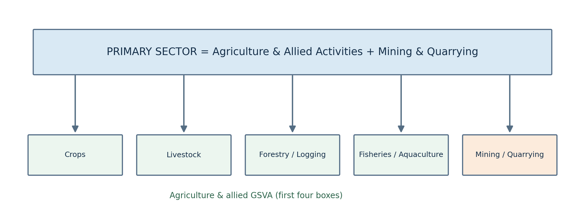
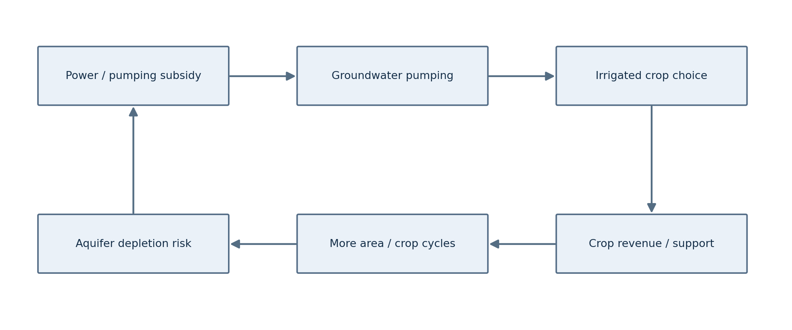
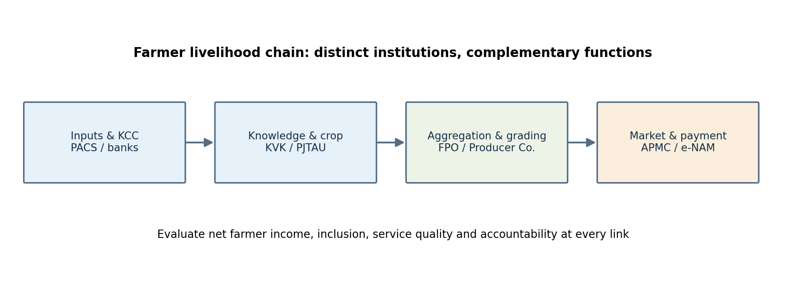

# Paper IV — Economy and Development | Unit II — Telangana Economy | Topic 4

**Agriculture and Allied Sectors: GSVA, Landholdings, Irrigation, Drylands, Crops, Credit, Extension, Marketing and Producer Institutions**

**Production status:** Complete expanded draft with full PDF, offline HTML and editable Markdown. **NOT academically approved.**

**Exact official syllabus wording (Notification 02/2024):** “Agriculture and Allied sectors: Trends in share of crop and allied sectors in GSDP; Distribution of land holdings; Trends in Irrigation ; Problems of dry land Agriculture; Dependence on Agriculture; Cropping pattern Trends ; Trends in productivity; Agricultural Credit, Extension and Marketing; Cooperatives and Producer Companies.”

## Syllabus-to-chapter map

| Official examinable component | Detailed sections | Essential analytical distinction |
|---|---|---|
| Sectoral shares and trends | 1–2 | GSVA vs GSDP; crop vs allied vs primary sector |
| Distribution of landholdings | 3–4 | Operational vs ownership holdings; tenants and women |
| Trends in irrigation | 4–6 | Net/gross area; tanks, canals, wells, groundwater |
| Problems of dryland agriculture | 7 | Rainfall timing, soil, risk, contingency plans |
| Dependence on agriculture | 8 | Employment, livelihoods, tenant and labourer distress |
| Cropping pattern trends | 9, 11 | Vaanakalam/Yasangi; procurement incentives |
| Trends in productivity | 10 | Yield vs net profit vs TFP |
| Agricultural credit | 12–13 | KCC, cooperatives, risk instruments |
| Agricultural extension | 14 | PJTAU, CRIDA, KVK, Rythu Nestham |
| Agricultural marketing | 15 | APMC, e-NAM, warehousing, price discovery |
| Cooperatives and producer companies | 16 | PACS vs FPO vs Companies Act XXIA |
| Integrated assessment | 17 | Sustainability, equity and outcomes |

## Topic summary

Agriculture and allied activities in Telangana combine crop production, livestock, forestry and fisheries with land, water, labour, credit and markets. Their share in state value added is much smaller than the share of rural livelihoods dependent on them, creating a central structural-transformation problem. Small operational holdings and informal tenancy constrain investment and access to benefits. Irrigation from canals, tanks and wells raises cropping intensity but can shift costs to groundwater, energy and downstream users. Dryland agriculture needs soil-water conservation, crop contingency plans and insurance rather than simply copying irrigated packages. Paddy, cotton, maize, pulses, oilseeds and horticulture respond to both agro-climatic suitability and policy-created price incentives. Productivity must be assessed by net real returns, risk and resource use—not yield alone. KCC, banks, PACS, NABARD, APMCs, e-NAM, cooperatives, FPOs and producer companies can improve access to finance, knowledge and buyers, but governance and tenant inclusion are essential. The 2026–27 Telangana budget's Rythu Bharosa allocation is an estimate, not proof of actual disbursement. Policy success requires integrated measurement of incomes, equity, resilience, water sustainability and market power.

## Study sequence

Start with the standalone quick revision; read all 17 detailed sections; inspect three diagrams and comparison table; attempt 30 original MCQs; then write six mains answers using the blueprints. No practice item is labelled an official PYQ.

---

# Standalone Quick Revision — Telangana Agriculture and Allied Sectors

## Core distinctions to memorise

| Concept | Correct definition | Frequent error |
|---|---|---|
| Agriculture & allied GSVA | Crops, livestock, forestry/logging, fishing/aquaculture | Equating with entire primary sector, which also includes mining |
| Net sown area | Distinct cultivated land counted once in year | Treating as gross cropped area |
| Gross cropped area | Total cropped hectares over all seasons | Treating repeat cropping as new land |
| Cropping intensity | Gross cropped area / net sown area × 100 | Confusing with yield |
| Yield | Output per harvested area | Treating yield growth as net-income growth |
| Operational holding | Area operated as one production unit | Assuming identical to ownership holding |
| Irrigation potential created | Designed/constructed capacity | Assuming reliable water delivered |
| MSP | Announced support price for notified crops | Assuming universal automatic procurement |
| PACS | Primary agricultural credit cooperative | Assuming it is a producer company |
| FPO | Organisational category for producer aggregation | Assuming a single mandatory legal form |

## Dated high-value Telangana facts

- **2023–24 (government July 2024 budget speech):** agriculture and allied activities contributed approximately **15.8% of Telangana GSVA**; the same speech used a **47.3% dependence** figure. Both are historical and have different denominators.
- **Agriculture Census 2021–22 (reported in SEO 2024):** average operational holding **0.89 hectare**, compared with **1.00 hectare in 2015–16**.
- **Vaanakalam 2022–23 (SEO 2024):** paddy **44.30%** and cotton **34.08%** of season's gross sown area; **Yasangi** paddy **76.66%**. Do not present as 2026 shares.
- **Mission Kakatiya (2014 enumeration):** approximately **46,531 minor irrigation sources** identified for phased restoration; objective, not completed count.
- **May 2026 Telangana groundwater dashboard:** statewide scenario **9.29 m below ground level**, compared with **10.04 m in May 2025**; not an all-district claim.
- **2026–27 Budget Estimates:** **₹18,000 crore** for Rythu Bharosa and **₹3,500 crore** for agricultural-produce bonus in official Budget-in-Brief; budgeted, not necessarily spent.
- **Rythu Bharosa scheme description:** ₹6,000 per acre per season according to Telangana Agriculture and Farmers Welfare Commission; confirm eligibility and disbursement separately.
- **December 2025 Telangana Rising 2047:** agri-tech clusters, modernised market yards and irrigation expansion are *targets*, not achievements.

## Six high-scoring comparisons

1. **Irrigation:** tanks store local runoff and support recharge; canals distribute basin water; borewells offer flexible access but cause common-pool depletion; lifts require substantial energy.
2. **Dryland vs irrigated:** dryland plans optimise rainfall timing, soil moisture and survival; irrigated plans must also manage water allocation, drainage and energy.
3. **Crop diversification vs allied diversification:** changing crop mix does not automatically add dairy, fisheries or processing income.
4. **Income support vs insurance vs MSP:** cash input assistance, specified loss compensation, and price/procurement support address different risks.
5. **Credit vs waiver:** KCC supplies repayable finance; a waiver relieves defined debts but cannot fix structural market or climate risks.
6. **PACS vs producer company:** cooperative credit and local services versus producer-owned corporate aggregation under Companies Act Chapter XXIA.

## Mains answer strategy

Define the measure and statistical year; explain causal mechanism; give a named Telangana example and institution; compare benefits with costs; finish with a measurable reform. Do not repeat the same generic 'awareness and infrastructure' paragraph for every question.

## Five self-test prompts

1. Why can agricultural GSVA rise while farmers' real incomes fall?
2. Compute cropping intensity if gross cropped area is 15,000 ha and net sown area is 10,000 ha.
3. Why is micro-irrigation not necessarily equal to basin-wide water saving?
4. How do tenant farmers fall between land-record and credit systems?
5. How do PACS, FPOs and producer companies differ legally and economically?

---

# Detailed Textbook Notes — Agriculture and Allied Sectors in Telangana

## 1. Agriculture in Telangana: a production system and a livelihood system

Agriculture is simultaneously an economic sector, an ecological system and a social institution. As an economic sector it produces crops, livestock products, forest products and fish, and it purchases machinery, fertiliser, transport, storage and financial services. As an ecological system it converts sunlight, soil nutrients and water into biomass while affecting groundwater, biodiversity and carbon stocks. As a social institution it distributes land, work, income, risk and bargaining power among owners, tenants, agricultural labourers, women and producer groups. A policy that measures only tonnes of paddy can therefore overlook whether cultivators earn a living, whether aquifers are depleted, and whether landless households share the gains.

The examination requires a strict distinction between **gross state domestic product (GSDP)**, the total value added plus relevant net product taxes, and **gross state value added (GSVA)**, the sector-wise value of output less intermediate consumption. Agriculture and allied GSVA includes crops, livestock, forestry/logging, and fishing/aquaculture. The *primary sector* also includes mining and quarrying, so a primary-sector percentage cannot automatically be reported as the agriculture-and-allied percentage. Nominal growth reflects both prices and quantities; constant-price growth is a better indicator of production volume. A drought may reduce physical output while higher crop prices partly support nominal GSVA. Conversely, a bumper harvest may coexist with falling farm-gate prices.

The Government of Telangana's July 2024 budget statement reported agriculture and allied activities at about **15.8% of GSVA in 2023–24** and said **47.3% of the population** depended on the sector; these are dated government claims with distinct definitions and must not be presented as a single current-year productivity ratio. The 2026 Socio-Economic Outlook is publicly listed by the state and describes a more recent sectoral composition, but its full PDF was too large for complete direct text audit in this run. A reliable answer states the statistical year, whether the measure is GSVA or GSDP, and whether workforce, rural workforce, or population is being counted.

Telangana's Deccan Plateau climate, rain-fed uplands, Godavari–Krishna basin systems, black-cotton soils and historic tank networks produce sharply different agrarian conditions. Irrigated paddy in a canal command differs from rain-fed cotton in a drought-prone mandal; sheep-rearing and dairy offer different seasonal cash flows from crops. Even within one village, the owner of a borewell and a tenant paying cash rent face different risks. Policies must therefore distinguish water access, tenancy, crop choice and market location rather than prescribing one statewide crop package.

**Analytical consequence:** the core development question is not merely whether agricultural output rises but whether *real net farm income, risk-adjusted livelihood security and natural-resource sustainability* rise together. A complete answer links production statistics to land distribution, irrigation, input costs, credit, prices, labour and ecological limits.

## 2. Sectoral GSVA: crops, livestock, fisheries and forestry

Agricultural diversification can occur **within crops** (from paddy to pulses or vegetables), **between agriculture and allied activities** (adding dairy, poultry, fisheries or sheep), or **along the value chain** (grading, chilling, processing, packaging). These are distinct pathways. A crop-switching farmer remains exposed to weather and prices, whereas a household combining a small rain-fed field with goats and seasonal wage employment spreads income sources. Livestock can be a store of wealth and provide more frequent cash flow than seasonal crop harvests, but feed, veterinary access and disease control are major constraints.

The Telangana Socio-Economic Outlook 2024 recorded a movement in the relative composition of agricultural GSVA from 2022–23 to 2023–24: the share of crops declined while livestock's share increased. The document's dated sector accounting shows why aggregate agriculture growth should never be interpreted as crop growth alone. For 2025–26, a publicly indexed reproduction of the 2026 Outlook reports agriculture-and-allied GSVA of roughly ₹2.14 lakh crore, with livestock about 48% and crops about 45% of the agricultural-and-allied total. **These particular 2026 sub-sector amounts are secondary-extraction leads, not independently audited figures**; they are excluded from the definitive quick-revision fact sheet until verified against the full official PDF.

Telangana's dairy economy depends on cattle and buffalo productivity, fodder, chilling centres, veterinary services, cooperative procurement and reliable milk testing. A higher milk price can improve income, but farmers also need protection from adulterated inputs and unpredictable feed costs. Sheep and goat rearing are important in dry tracts and to households with little land; grazing commons and animal-health services matter as much as breed improvement. Poultry is commercially concentrated and vulnerable to feed-price and disease shocks. Inland fisheries can benefit from tanks and reservoirs, but require stocking, fishing rights, cold chains and conflict-sensitive allocation of access to fishing communities.

Forestry and logging appear in sector accounts, but forestry income should not be conflated with unrestricted access to forest resources. Forest conservation, community forest rights and minor forest produce livelihoods are governed by separate legal regimes. The Forest Rights Act, 2006 concerns recognition of eligible individual and community rights; it does not permit unregulated deforestation. In tribal areas, the design of producer institutions must respect customary access, Scheduled Area protections and ecological carrying capacity.

A frequent policy error is to treat livestock as a simple add-on without calculating feed, water, disease and marketing requirements. A district strategy should map comparative advantage: dairy clusters near cooling infrastructure, sheep/goat systems in suitable drylands, fishery development in functioning tanks, and crop–livestock integration where manure and crop residues circulate. **Balanced appraisal:** allied sectors can reduce dependence on monsoon crops, but only when disease risk, common-property resources and market concentration are addressed.

## 3. Distribution of operational holdings, ownership and tenancy

An **operational holding** is land used as a technical-economic unit for agricultural production, irrespective of whether it is owned, leased or otherwise possessed. An **ownership holding** records title and may not match the land actually cultivated. A household may own several scattered plots but operate them as one unit; a tenant may cultivate land without owning it. This distinction is crucial when interpreting Agricultural Census statistics, eligibility for benefits and access to institutional credit.

The 2024 Telangana Socio-Economic Outlook cites the 2021–22 Agriculture Census average operational holding at **0.89 hectare**, down from **1.00 hectare in 2015–16**. Fragmentation may arise through inheritance and partition, but average size alone does not show inequality: the distribution across marginal (below 1 ha), small (1–2 ha), semi-medium (2–4 ha), medium (4–10 ha) and large (10 ha and above) classes is also needed. The same village may have many tiny holdings and a small number of large irrigated farms. The value of a hectare depends on soil quality, irrigation, road access and crop possibilities.

Small farms can be productive per hectare through intensive family labour, intercropping and careful supervision, but they face high unit costs for machinery, transport, storage and formal paperwork. Fragmented parcels complicate irrigation channels and mechanisation. Joint machinery hiring, custom-hiring centres, FPO aggregation and cooperative marketing can provide scale economies without compulsory consolidation of ownership. Land pooling or leasing arrangements may also help, but require safeguards against unequal bargaining and loss of possession.

Informal tenancy is a central examination issue. Many landowners avoid written leases because of fears about legal disputes; tenants then have difficulty demonstrating cultivation for loans, crop insurance or compensation. An owner-based transfer may not reach the actual cultivator, while a tenant may pay rent regardless of crop failure. The **Telangana Bhu Bharati (Record of Rights in Land) Act, 2025** concerns land-record administration and remedies; updating records is not by itself a complete solution to unrecorded cultivation arrangements. Policy choices include cultivator identification, consent-based lease records, tenant credit groups and separate entitlement criteria for input support versus ownership rights.

Gender is another missing dimension: women perform transplanting, weeding, harvest and livestock work but may lack recorded ownership and decision-making power. Joint titling, inheritance enforcement, access to Kisan Credit Cards and women-led producer groups can change both bargaining and investment. Scheduled Tribe holdings in Scheduled Areas require additional attention to land-transfer restrictions and community rights. **Policy consequence:** an apparently neutral per-acre subsidy often disproportionately benefits recorded landowners unless complemented by tenant, labourer and women-focused instruments.

## 4. Land-use accounting, cropping intensity and agricultural geography

A proper land-use analysis begins with the Directorate of Economics and Statistics' **nine-fold land classification**: forest; barren and unculturable land; land put to non-agricultural uses; permanent pastures; miscellaneous tree crops; culturable waste; other fallows; current fallows; and net area sown. These categories are not interchangeable. Forest area is not the same as measured tree cover; fallow land is not necessarily permanently unusable; and expansion of non-agricultural land can reduce future cultivation potential even when GSDP rises.

**Net sown area (NSA)** counts a field once during an agricultural year. **Gross cropped area (GCA)** counts it each time it is cultivated. Thus, a one-hectare field bearing paddy in kharif and pulses in rabi contributes one hectare to NSA but two hectares to GCA. **Cropping intensity = GCA ÷ NSA × 100**; it is an index of repeated land use, not a measure of yield. **Gross irrigated area** similarly counts multiple irrigated crops on the same land, while **net irrigated area** counts the irrigated land once. A rise in gross irrigated area can reflect more cropping seasons rather than expansion of distinct irrigated hectares.

Land-use changes must be interpreted geographically. Northern and eastern districts with Godavari tributaries and canal/tank systems have different opportunities from dry southern uplands. Black soils retain moisture and suit cotton but may be vulnerable to waterlogging and cracking; red soils often have lower moisture retention and need organic matter, contour measures and timely rain. Floodplain cultivation can be productive but flood-prone. The **agro-climatic** approach therefore groups areas by rainfall, soil, temperature and crop potential, rather than assuming that administrative districts are agronomically homogeneous.

Land-use statistics have measurement problems: crop-cutting surveys, seasonal village records, remote sensing and administrative entries may differ; rapid land conversion can outpace records. The Telangana DES is the State Agricultural Statistical Authority and collects crop-area, yield and land-use data through a combination of enumeration and sample systems. A good policy evaluation triangulates these with irrigation releases, groundwater monitoring and market arrivals. If an official portal displays an old ten-district profile or historical rainfall series, it must not be cited as a current 33-district total.

For an examination numerical illustration, suppose a mandal has 12,000 ha net sown area and 18,600 ha gross cropped area. Its cropping intensity is **155%**. If 7,000 ha are irrigated at least once and 10,500 ha are irrigated over all seasons, irrigation intensity is **150%**, but the share of net sown area with irrigation is only **58.3%**. These three numbers answer different questions. **Practical implication:** raising intensity is desirable only if soil health, aquifer recharge, energy cost and market demand can sustain the additional season.

## 5. Irrigation: tanks, canals, wells and the command-area problem

Irrigation shifts agriculture from dependence on uncertain rainfall toward managed water supply, but each source has different economic and environmental properties. **Canals** can serve broad command areas but require head-to-tail allocation, drainage and maintenance. **Tanks** capture local runoff, recharge shallow aquifers, support fisheries and livestock, and depend on catchment protection. **Dug wells and borewells** offer flexible on-demand supply but can overextract groundwater when many farmers pump the same aquifer. **Lift irrigation** moves water to higher elevations using pumps and therefore has substantial energy, operating and maintenance requirements.

Telangana's tank heritage includes Kakatiya-era systems and later reservoirs and anicuts. The state describes **Mission Kakatiya**, launched in 2015, as a programme to restore approximately 46,531 minor irrigation sources identified in its 2014 enumeration. Works include desilting, repairing sluices, restoring bunds and feeder channels, and community maintenance. These are stated programme objectives and planned coverage, not evidence that every tank was restored or is functioning. Tank rehabilitation can increase water storage and reduce groundwater pumping, but outcomes depend on silt disposal, upstream encroachment, rainfall, downstream access and maintenance after construction.

Canal command development requires more than a dam. Farmers need field channels, predictable water turns, drainage, land levelling and crop advice. Waterlogging and salinisation can occur when irrigation is excessive and drainage inadequate. A large lift scheme may create potential command area on paper, but **irrigation potential created**, **potential utilised** and **actual seasonal irrigated area** differ. An examination answer should explicitly separate these measures and avoid equating capital expenditure with reliable delivery.

Telangana's Krishna–Godavari geography creates inter-state allocation and seasonal availability issues. The State Irrigation and CAD Department identifies both basins and discusses water entitlements and disputes; a contested allocation claim must be attributed as a state's position, not as a finally settled universal fact. The opportunity cost of irrigation water also includes urban drinking supply, industrial use and ecological flows. Free or subsidised electricity can help cash-constrained farmers but may encourage excessive groundwater extraction if unaccompanied by metering, crop advice or recharge measures.

A balanced irrigation strategy combines basin-level planning, canal scheduling, tank maintenance, micro-irrigation, water-user participation and groundwater accounting. In a tail-end village, equity may require transparent water turns and grievance mechanisms rather than only new infrastructure. In a drought-prone village, restoring a chain of tanks and recharge structures may yield higher resilience than adding private borewells. **Practical consequence:** evaluate cost per *reliably irrigated hectare*, energy intensity and distributional access, not simply megawatts of pumps or kilometres of canals.

## 6. Groundwater, micro-irrigation and the water–energy–crop nexus

Groundwater is a common-pool resource: one farmer's pumping lowers the water table available to neighbours. This creates a collective-action problem because the private benefit of an extra hour of pumping may exceed its private cost while the aquifer-wide social cost is shared. Groundwater recharge depends on geology, rainfall, tank seepage and land cover; a shallow weathered-rock aquifer in the Deccan behaves differently from a deep alluvial aquifer. The same irrigation recommendation cannot be transferred mechanically between them.

Telangana's Ground Water Department provides monitored depth-to-water readings and resource assessments. Its website showed a **May 2026 state scenario of 9.29 metres below ground level**, compared with **10.04 metres in May 2025**; this is a dated monitoring snapshot, not proof that every mandal improved or that the aquifer is sustainably exploited. Water-level depth differs from total available groundwater and from extraction stage. Spatial maps and seasonal readings matter: post-monsoon recovery can conceal pre-monsoon stress. The 2023–24 groundwater assessment is a distinct annual resource estimate.

**Drip irrigation** applies water near roots and can improve water-use efficiency in orchards and row crops; **sprinklers** suit particular field crops and soil conditions. But saving water per kilogram of crop does not automatically save basin-wide water. Farmers may expand irrigated acreage or switch to water-intensive high-value crops, a *rebound effect*. Real savings require monitoring consumptive use, crop choice and aquifer extraction, not only subsidising equipment. Drip systems also need filtration, pressure, maintenance, farmer training and affordable repair services.

Consider two paddy farmers. Farmer A receives canal water on fixed turns and has little control over timing. Farmer B pumps groundwater with subsidised electricity. A water-efficient seed variety may help both, but the governance lever differs: A needs reliable scheduling and distribution equity; B needs aquifer management and crop diversification incentives. A community tank can help recharge B's well, yet only if the catchment remains intact. This illustrates why irrigation, energy subsidy, agricultural pricing and land-use policies must be analysed together.

Public interventions include the Pradhan Mantri Krishi Sinchayee Yojana's water-use-efficiency components, state micro-irrigation schemes, watershed treatment, rainwater harvesting and farmer training. Programme names and funding patterns should be checked for the particular year. **Policy trade-off:** maximising short-run irrigated paddy area can increase output and procurement receipts, while jeopardising long-run groundwater security. The better metric is sustainable real income per unit of consumptive water, adjusted for equity and food-security needs.

## 7. Dryland agriculture: rainfall risk, soil moisture and climate resilience

**Rain-fed agriculture** relies primarily on precipitation; **dryland farming** commonly refers to cultivation under low or erratic rainfall and high evapotranspiration, often without assured irrigation. It is not merely irrigated agriculture with less water. Crop calendars, soil conservation, seed choice, livestock integration and risk management must be redesigned around uncertain onset, long dry spells and intense rain events. Telangana's rain-fed cotton, red gram, millets and oilseeds illustrate this system.

Rainfall totals can mislead. A season with near-normal aggregate rainfall may still destroy crops if sowing rains arrive late, a twenty-day dry spell occurs during flowering, or extreme rainfall washes away topsoil. Agronomic vulnerability is therefore a function of **rainfall timing, soil water-holding capacity, crop stage and household liquidity**. Early sowing after false onset can force expensive re-sowing. Farmers with debt and no savings may choose a high-return but risky cash crop because tenancy rent or loan repayments are fixed, not because they misunderstand climate risk.

Technical strategies include contour bunds, graded bunds where suitable, farm ponds with realistic catchment accounting, mulching, residue retention, minimum tillage where appropriate, mixed cropping, intercropping, drought-tolerant seed, short-duration varieties and timely weather advisories. Intercropping red gram with cotton or millets with pulses can distribute risk, but combinations must match local agronomy and machinery needs. Soil organic matter improves infiltration and moisture retention, though its effects develop over time and cannot compensate for prolonged drought without additional measures.

Institutions matter as much as technology. The ICAR–Central Research Institute for Dryland Agriculture (CRIDA), based in Hyderabad, develops dryland agronomy and contingency plans. Krishi Vigyan Kendras, Professor Jayashankar Telangana Agricultural University, district agriculture officers and local farmer groups can translate research into sowing advice. A contingency plan should specify what to plant if rains are delayed by two, four or six weeks, not merely urge farmers to 'adapt'. Extension messages must reach tenants, women and small farmers in accessible language and at the time of decision.

A robust dryland policy combines watershed development, soil testing, seed banks, weather-index or yield insurance where operational, accessible credit and local fodder reserves. Compensation after failure is necessary but not a substitute for prevention. **Critical appraisal:** farm ponds can help in some micro-watersheds but can also concentrate scarce runoff upstream; water harvesting should be assessed at catchment scale. Dryland development is ultimately about reducing the probability that a climatic shock becomes an irreversible debt, migration or nutrition shock.

## 8. Dependence on agriculture: labour, tenancy, gender and distress

Agricultural dependence has several meanings. A household may earn most income from farming, spend most working days on farms, own agricultural land but earn wages elsewhere, or rely on agricultural labour without owning land. The Census classification of cultivators and agricultural labourers differs from PLFS employment status and from a budget speech's broad 'dependent population'. A rigorous mains answer names the denominator and the survey year. The mismatch between agriculture's employment share and its output share suggests low average labour productivity, but it is not proof that individual farmers are inefficient; it reflects structural conditions and limited alternative jobs.

Telangana's rural households commonly combine farming with dairy, wage work, construction, transport, seasonal migration and government transfers. Such diversification is a rational response to seasonality. Agricultural labourers are exposed to changes in mechanisation, crop mix and minimum-wage enforcement. A shift from labour-intensive vegetables to mechanised paddy may increase farm output but reduce local wage days. Conversely, irrigation can create a second crop and more employment. The net effect depends on the technology, the crop and the gender division of tasks.

Tenants and sharecroppers face especially acute risks. Land rent may be paid before harvest, while crop failure and price collapse occur later. Formal credit is harder without cultivation records; informal lenders may bundle loans with input purchases and output sales. Women's unpaid family work is often undercounted and can expand when male household members migrate. Landless families cannot benefit directly from per-acre investment support; they need wage employment, livestock services, producer collectives, social protection and access to markets.

Agrarian distress should be analysed as a chain rather than a single cause: climate shock or pest attack → output loss → low farm-gate price or high input costs → inability to service debt → distress sale of assets or migration. A household may face several shocks simultaneously. Suicide statistics require cautious interpretation and verified official categories; neither a single crop price nor a particular scheme can be asserted as a universal cause. Early warning systems, debt counselling, reliable crop-loss assessment and accessible mental-health services have distinct roles.

The policy choice is not 'keep everyone in farming' versus 'force people into cities'. Productive agriculture needs better infrastructure, while voluntary mobility needs quality rural education, skills, small-town enterprises and safe migrant employment. **Consequence:** agricultural welfare should be measured by household consumption, real wages, income volatility and dignity of work, alongside crop output and GSDP.

## 9. Cropping patterns: kharif, rabi and market incentives

A **cropping pattern** is the distribution of cropped area among crops over a specified season or year; it is not the same as productivity. Telangana commonly uses the terms **Vaanakalam** (monsoon/kharif) and **Yasangi** (post-monsoon/rabi). Paddy, cotton, maize, pulses, oilseeds, chilli and horticultural crops respond differently to soil, water, temperature, procurement and prices. Paddy may dominate irrigated tracts because assured water, mechanisation, procurement arrangements and household knowledge reinforce each other. Cotton suits some black soils and commercial markets but is sensitive to pest management and global prices.

The 2024 Telangana Socio-Economic Outlook reported that in the **2022–23 Vaanakalam** season paddy occupied **44.30%** of gross sown area and cotton **34.08%**; in **Yasangi**, paddy dominated at **76.66%**. These are historical season-specific shares, not the current 2026 cropping pattern. Combining Vaanakalam and Yasangi percentages without area weights produces a false annual estimate. Crop area must also be separated from production: a crop can occupy fewer hectares yet produce more tonnes if yield increases.

Farmers respond to relative profitability, not only soil suitability. Minimum Support Price announcements, actual procurement access, milling capacity, transport cost, input subsidies, tenancy rent and market volatility influence decisions. An MSP is a policy-announced price for designated crops; it is not an automatic purchase guarantee for every farmer, every quantity and every market. Procurement operations, quality specifications and timing determine effective protection. The ₹500-per-quintal incentive for selected fine-rice varieties described in the July 2024 state budget was a stated policy measure; a student should not infer that it covers every rice variety indefinitely.

Diversification toward pulses, oilseeds, millets and horticulture can improve rotations, nutrition and resilience, but only if the entire value chain works. A farmer switching from paddy to vegetables may face higher perishability and daily price volatility. Oil palm offers a long production cycle and import-substitution rationale, but creates gestation-period income gaps, processing-mill dependence and ecological questions about water suitability. Pulses can enrich rotations but need quality seed and reliable market demand. Horticulture needs cold storage and grading.

A district crop plan should use **agro-ecological suitability + water budget + market access + household risk capacity**. Mandal-level demonstrations, buyer contracts with safeguards and storage investment are more credible than blanket bans on paddy. **Balanced viewpoint:** procurement-supported cereals have supported food security and incomes, yet excessive monoculture can raise fiscal, groundwater and ecological costs; diversification requires viable alternatives, not merely administrative targets.

## 10. Productivity: yields, total factor productivity and farm profitability

**Yield** usually means output per harvested area, such as tonnes of paddy per hectare. **Land productivity** can mean the value of all output per hectare; **labour productivity** means value added per worker or work-hour; **total factor productivity (TFP)** assesses output relative to combined inputs. These measures answer different questions. A farmer may increase paddy yield by applying more fertiliser and pumping more water while net profit falls. Higher yields do not necessarily imply higher welfare.

Productivity is shaped by genetic potential, seed quality, sowing date, soil fertility, pest pressure, water timing, farm size, extension and post-harvest loss. In cotton, resistance management and integrated pest management matter. In paddy, seedling age, planting density, balanced fertilisation and water scheduling influence output. In pulses, pollination, seed treatment and moisture during flowering can be decisive. Soil testing is valuable only if recommendations are locally adapted and farmers can access the right inputs at the right time.

A useful numerical example separates gross revenue and net income. Suppose paddy yield rises from 5 to 5.5 tonnes per hectare while the realised price remains ₹2,200 per quintal. Revenue increases from ₹110,000 to ₹121,000, a gain of ₹11,000. If the new practice adds ₹14,000 in fertiliser, pumping and labour costs, net returns **fall by ₹3,000**. Yield rises 10%, but profitability worsens. If instead improved water management reduces pumping costs, the same yield gain can raise profit and conserve water. Thus, policy evaluation must report cost of cultivation, net returns, risk and resource use.

Agricultural research and extension can raise productivity through improved varieties, soil-health practices, pest forecasting, mechanisation and storage. But technological adoption depends on farm liquidity, risk tolerance and credible demonstrations. A tenant with one season of insecure tenure may not invest in land levelling or long-gestation orchards. Women without control over cash may not purchase recommended inputs even when they provide most field labour. FPOs can organise machinery hire, input testing and marketing, reducing transaction costs.

Post-harvest productivity also matters. Drying, grading and storage can increase the saleable share of harvest without increasing biological yield. Food-processing units can reduce loss and create non-farm jobs, though they need quality standards and steady throughput. **Exam conclusion:** sustainable agricultural productivity is the ability to obtain higher real value and reliable livelihoods from a given combination of land, labour, capital, water and environmental services—not a single headline yield statistic.

## 11. Diversification, horticulture and integrated farming

Diversification is a response to ecological and market concentration risk. **Horizontal diversification** introduces more crops or enterprises; **vertical diversification** adds processing, grading, storage, branding and direct sales. **Integrated farming systems** connect crops, trees, livestock, poultry, fishery and composting so that residues become fodder, manure supports soil fertility, and multiple products create staggered income. This is not an argument that every small farm should simultaneously undertake every enterprise; coordination costs and household skills matter.

Telangana's horticulture opportunities include mango, vegetables, flowers, chilli and oil palm in suitable locations. The Nagarkurnool district administration identifies horticulture as a focus sector and documents oil-palm and horticulture programmes, micro-irrigation, nurseries, sericulture and technical support. The National Mission on Edible Oils–Oil Palm seeks to expand domestic oil production; eligibility, subsidy design and crop suitability must be checked for the specific year. Oil palm is perennial, depends on nearby processing and may be poorly suited to water-stressed locations despite attractive price projections.

High-value horticulture can increase gross income per hectare but often increases exposure to perishability, labour peaks and price collapses. Tomato growers can experience severe price volatility because supply responds with a lag and storage is limited. Contract farming may offer assured buyers and technical inputs, yet quality rejection, payment delays and buyer concentration can shift risk onto growers. A credible contract specifies grading, transparent weighing, dispute resolution and prompt payment. Producer organisations can negotiate better terms but need working capital and professional management.

Integrated crop–livestock systems are particularly relevant in dryland areas. Red gram residues and fodder crops feed animals; manure improves soils; small ruminants can provide emergency liquidity. However, open grazing may conflict with forest regeneration, and concentrated livestock operations can pollute water. Veterinary surveillance, fodder banks, breed choice and women's control of income determine whether diversification genuinely improves resilience. Fishery development in restored tanks can provide livelihoods but requires transparent rights for fishing communities and monitoring of water quality.

The strongest diversification strategy is phased. First secure household food needs and a risk-bearing reserve; then test a new crop on a small area, verify local buyers and input access, and scale only after evidence. **Critical appraisal:** replacing a paddy monoculture with an oil-palm monoculture merely exchanges one concentration risk for another. A resilient system combines agronomic diversity, viable markets, water budgeting and household choice.

## 12. Agricultural credit: institutional architecture and access gaps

Agricultural credit finances seasonal working capital, long-term investment and consumption smoothing. **Short-term crop credit** pays for seed, fertiliser, hired labour and harvesting; **term credit** finances tractors, wells, dairy units, orchards or storage. A Kisan Credit Card (KCC) is a revolving credit mechanism whose limit can incorporate crop finance, post-harvest needs and farm-asset maintenance according to RBI guidance. It is not a cash grant. Interest subvention is a policy concession subject to applicable terms and dates, not a universal permanent rate for all agricultural borrowing.

The institutional network includes scheduled commercial banks, regional rural banks, cooperative credit institutions, NABARD and self-help/joint-liability groups. The short-term cooperative structure typically involves Primary Agricultural Credit Societies (PACS), District Central Cooperative Banks (DCCBs) and a State Cooperative Apex Bank. In Telangana, TSCAB and district cooperative banks are relevant institutions; PACS can also procure produce and provide inputs or storage. NABARD supports refinancing, infrastructure, capacity building and FPO development. RBI's priority-sector lending rules direct bank attention to agriculture, but lending targets alone do not guarantee appropriate loan timing or affordable access.

Credit exclusion can arise from unclear land records, informal tenancy, missing collateral, distant branches, low financial literacy and risk-based rejection. A tenant may use informal credit at higher effective cost because banks rely on owner records. Joint Liability Groups and cultivator verification can improve access without granting ownership. Credit appraisal must assess realistic crop cash flows; repayment scheduled before harvest or after a failed monsoon can trigger unnecessary distress. Digital lending can reduce transaction costs but raises concerns about opaque scoring, consent and aggressive recovery.

Debt relief and fresh credit have different purposes. A loan waiver may provide immediate balance-sheet relief to eligible borrowers, yet it can exclude informal debt and tenants, and may weaken future credit discipline if repeated without structural reforms. Better crop insurance, market access and weather resilience address recurring causes of debt. Warehouse receipt finance allows a farmer to avoid immediate post-harvest distress sale, but requires trustworthy grading, insured storage and manageable fees.

The policy objective should be **timely, adequate and appropriately priced credit**, not merely high disbursement totals. Monitor actual borrower coverage, share of small/tenant farmers, loan use, repayment distress and post-harvest liquidity. A high district credit-deposit ratio does not prove that the poorest cultivators are served. **Telangana implication:** connect land-record accuracy, tenant inclusion, PACS viability, bank outreach and market-risk management instead of treating a waiver as a complete agricultural policy.

## 13. Income support, insurance, procurement and agricultural risk

Agricultural risk has several layers: weather and pests affect yield; market shocks affect price; illness or livestock disease affects household capacity; and policy or logistics changes affect access to buyers. Each requires a different instrument. **Income support** transfers cash before or during cultivation; **crop insurance** pools specified production risks; **price support/procurement** reduces some market-price risks; **disaster relief** addresses exceptional losses; **social insurance** protects households from non-crop shocks. Treating them as interchangeable leads to poor scheme design.

Telangana's **Rythu Bharosa** is an investment-support programme. The official Telangana Agriculture and Farmers Welfare Commission describes support of **₹6,000 per acre per season** under the state scheme. The **2026–27 Telangana Budget-in-Brief** lists **₹18,000 crore** as the budget provision for Rythu Bharosa and **₹3,500 crore** for a bonus to agricultural produce. A budget allocation is not the same as verified actual disbursement; recipient counts, eligibility and payment dates require separate administrative evidence. The central **PM-KISAN** scheme is different, with its own eligible-beneficiary conditions and annual income-support design.

**PMFBY** is an insurance mechanism for notified crops and areas, with premium, yield estimation and claim procedures governed by operational guidelines. The official PMFBY portal provides enrolment, claim-status and grievance channels. Insurance cannot prevent a drought; its value depends on accurate yield assessment, timely claims, farmer awareness and the alignment of coverage with the cultivator actually bearing the loss. Tenant inclusion and crop-cutting quality are frequent weaknesses. Weather-index products can settle faster but may create **basis risk** when the station reading differs from a farmer's actual loss.

**MSP and procurement** require careful distinctions. The Commission for Agricultural Costs and Prices advises on MSP; the Union government announces MSPs for specified commodities. Actual procurement is implemented through agencies and state arrangements, subject to quality and operational conditions. An announced MSP is not identical to a legally enforceable purchase of all marketed output. Telangana's paddy procurement and fine-rice incentive policies illustrate how state procurement decisions interact with national food-stock and fiscal considerations. Public procurement can stabilise prices but may encourage water-intensive crops and create storage burdens.

A well-designed safety net combines prevention, protection and adaptation: reliable weather advisories and seed quality; credit and insurance; transparent loss assessment; and market access. **Critical appraisal:** per-acre support can be predictable and administratively simple, but may exclude tenants and landless labourers; price bonuses can raise returns but may reinforce monoculture. Targeting and fiscal sustainability must be evaluated alongside farmer income.

## 14. Agricultural extension, research and digital public infrastructure

**Agricultural extension** is the organised process of helping farmers learn, test and adopt knowledge relevant to production and marketing. It differs from research: a laboratory may identify a promising variety, but extension must determine whether it works under local soil, rainfall, labour and market conditions. Effective extension is a two-way system: farmers report problems and experiments, while scientists and officers provide evidence, demonstrations and follow-up. A one-time lecture is less effective than season-long decision support.

Telangana's institutions include the Department of Agriculture, Professor Jayashankar Telangana Agricultural University, ICAR–CRIDA in Hyderabad, Krishi Vigyan Kendras, district agricultural officers and the Telangana Agriculture and Farmers Welfare Commission. The state described **Rythu Nestham** in its July 2024 budget statement as an initiative to connect farmers with scientists and progressive farmers. The Telangana Rising 2047 vision discusses digital extension and agri-technology clusters as future goals; such 2047 figures are **targets**, not achieved coverage.

The extension chain should begin with a diagnosis: soil testing, rainfall outlook, pest surveillance, farm economics and market conditions. Demonstration plots then compare a proposed practice with farmers' existing methods. Training should include input quantities, safety precautions, expected costs and conditions under which the practice is unsuitable. Monitoring must capture adoption and net returns rather than counting training attendance. For example, a new cotton pesticide may appear effective in one season but create resistance when overused; integrated pest management uses monitoring thresholds, biological control and rotation of active ingredients.

Digital tools—weather messages, remote sensing, crop advisories, electronic market prices and drone services—can lower information costs. But digital exclusion, language barriers, patchy connectivity and unreliable data can harm smallholders. AI-based diagnosis is not a substitute for local agronomic validation; images can misclassify nutrient deficiency as disease. Privacy and consent are essential when farmer land, financial and location data are shared with vendors. Extension should offer offline channels and public accountability, not only apps.

Extension institutions face incentive problems: staff may be evaluated by the number of demonstrations rather than changes in farmers' profits, and private input sellers may have conflicts of interest. Independent field trials, farmer feedback and transparent procurement of advisory services improve credibility. **Practical consequence:** the best agricultural knowledge system joins research, local demonstration, credit, input quality, market signals and feedback loops; it does not merely distribute a technology brochure.

## 15. Agricultural marketing: APMCs, e-NAM, storage and price discovery

Marketing begins before the crop is sold. Farmers need market intelligence, harvesting labour, drying, cleaning, grading, weighing, transport, storage, financing and trustworthy settlement. The **farm-gate price** differs from the consumer price because of transport, processing, storage, spoilage, taxes or fees, risk and margins. Not every price spread is exploitation, but opaque grading, collusion, delayed payments and high transaction costs can suppress producer returns. A policy that simply eliminates intermediaries may remove valuable aggregation services unless replacements exist.

State agricultural marketing laws regulate notified produce and market yards through market committees; the exact applicable Telangana law and current amendments must be checked in the legal register. The **electronic National Agriculture Market (e-NAM)**, led by the Small Farmers' Agribusiness Consortium (SFAC), networks participating APMC mandis for electronic bidding and price discovery. Its official description emphasises unified licensing, a single-point market fee and e-trading provisions. e-NAM does **not** mean that every farm sale in Telangana is online or that electronic bids automatically solve logistics, grading or payment problems.

A mandi can improve transparency through standardised assaying, electronic weighing, published auction results, time-bound payments and grievance resolution. But a distant farmer may still face transport costs that exceed the apparent price advantage. FPOs can aggregate small lots into marketable volumes and negotiate freight. Warehouses and electronic negotiable warehouse receipts can allow delayed sale, provided quality and financing systems are trustworthy. Perishable vegetables need cold chains and rapid distribution rather than long-term grain storage.

Telangana's rice marketing highlights the link between state procurement, millers, storage and national food stocks. Cotton marketing involves ginners, quality grades and national/global price movements; chilli and turmeric markets have different volatility and grading requirements. A single uniform marketing reform cannot serve all crops. Regulated markets protect farmers from some abuses, while excessive restrictions may reduce competition. Direct marketing can lower costs but also expose small farmers to powerful buyers unless contracts and payment enforcement are credible.

The Telangana Rising 2047 vision proposes modernised market yards, logistics hubs and FPO-led aggregation. These are **policy ambitions** with a future horizon, not current verified outcomes. **Evaluation standard:** compare net realised farmer price after all marketing costs, payment delays, buyer diversity, quality transparency and dispute resolution—not just number of e-NAM registrations or tonnes arriving at a market yard.

## 16. Cooperatives, PACS, FPOs and producer companies

A **cooperative** is a member-governed enterprise formed to meet common economic needs through shared ownership and democratic control, subject to its governing statute and bye-laws. A **PACS** is a primary-level agricultural credit cooperative that can also support inputs, procurement, storage or common services. A **Farmer Producer Organisation (FPO)** is an organisational category, not one legal form: it may be registered as a producer company, cooperative or another eligible structure. A **Producer Company** is a specific company-law vehicle governed by **Chapter XXIA of the Companies Act, 2013**, inserted through the Companies (Amendment) Act, 2020. Section 378B lists activities such as procurement, grading, pooling, marketing, processing, member services and resource conservation; Section 378C sets formation requirements.

The economic logic is to aggregate scale while retaining individual farms. Ten farmers buying seed separately may pay higher prices than a producer organisation negotiating bulk purchases. An FPO can hire agronomists, maintain a warehouse, obtain a grading machine and bargain with processors. But scale creates governance risks: leaders may capture benefits, books may be opaque, women may be excluded from decisions, and professional managers may be underpaid or insufficiently supervised. A producer company is not automatically successful merely because it is registered.

Telangana's cooperative credit structure connects PACS with District Central Cooperative Banks and TSCAB. The Wanaparthy district cooperative office describes PACS procurement of paddy, maize and pulses, links to the central 10,000-FPO scheme, and a grain-storage initiative. Its district-specific numbers should not be extrapolated statewide. State cooperative law includes the Telangana Cooperative Societies Act, 1964 and the Mutually Aided Cooperative Societies Act, 1995; registration, audit, elections and government oversight differ by legal form. A producer company instead has company-law reporting and governance obligations.

The central scheme for forming and promoting 10,000 FPOs uses cluster-based business organisations and implementing agencies; NABARD and SFAC are important actors. Grants and guarantees are conditional and do not replace business revenue. A financially viable FPO needs member patronage, working capital, a realistic product strategy, audited accounts, trained directors and professional operations. An FPO that aggregates a highly perishable crop without cold storage can lose money faster than individual farmers.

**Comparison:** PACS traditionally centres on local cooperative credit and member services; an FPO can focus on commercial aggregation and value addition; a producer company provides a corporate legal vehicle with producer ownership. They can complement one another. **Practical consequence:** policy should evaluate farmer price improvement, reduced input cost, member participation, repayment quality and long-run operating surplus—not merely the number of registered organisations.

## 17. Integrated reform agenda: productivity, resilience, equity and accountability

Agricultural reform is best understood as a linked system. Land records affect tenant credit; credit affects seed and irrigation investment; irrigation affects crop choice; crop choice affects water demand and procurement; market access affects realised prices; prices and losses affect debt and migration. Treating each department's scheme as a separate success story misses these causal connections. An integrated district plan must connect agriculture, irrigation, groundwater, animal husbandry, cooperatives, rural development, banking and market agencies.

A useful **four-pillar framework** is: (1) **productivity** through quality inputs, extension and infrastructure; (2) **resilience** through soil-water conservation, diversification and insurance; (3) **equity** through tenant inclusion, women's land and financial rights, wage opportunities and tribal safeguards; and (4) **market power** through grading, storage, transparent auctions and producer organisations. Each pillar needs measurable outcomes. Productivity: real net return per hectare and per worker. Resilience: income volatility and groundwater stress. Equity: actual cultivator coverage and women's control over income. Market power: farmer share of realised value after costs.

Implementation should begin with reliable baseline data. The Telangana DES, agriculture and irrigation departments, groundwater monitors, bank records and market committees each measure different parts of the system. The state should publish reconciled district dashboards that identify the statistical year and method. Budget allocations, scheme announcements and project targets must be kept distinct from actual expenditure, physical outputs and welfare outcomes. Independent audits and grievance channels are essential when digital records determine eligibility.

Policy trade-offs cannot be avoided. A paddy procurement bonus may protect farmer incomes but reinforce water-intensive cultivation. Free electricity reduces immediate cultivation cost but can increase pumping. Crop insurance protects against some shocks but cannot replace drought-resilient infrastructure. FPOs increase bargaining power but require genuine governance. Large irrigation investments can expand potential but entail recurring energy and maintenance costs. An informed answer should acknowledge both the benefit and the opportunity cost, then propose design improvements rather than slogans.

For Telangana, a credible strategy combines repair of tank systems and canals, aquifer management, dryland contingency plans, locally suitable crop diversification, livestock health services, secure tenant credit, women's producer participation, competitive marketing and transparent fiscal accounting. In the short run, strengthen loss assessment, seasonal credit and market payments. In the medium run, build storage, extension capacity and water-efficient cropping systems. In the long run, improve rural education, non-farm employment and climate resilience so that agricultural dependence becomes a choice rather than a trap. **Conclusion:** success is not the largest crop area or the highest budget headline, but a durable increase in risk-adjusted rural wellbeing within ecological limits.

---

# Visual Learning and Comparison Tables

## Figure 1 — Agriculture, allied activities and primary-sector accounting

Agriculture-and-allied is a component of the primary sector, but mining is outside the agriculture-and-allied aggregate. Value-added shares and livelihood shares have different denominators.

## Figure 2 — The water–energy–crop feedback loop

A technology can improve water use per hectare while total aquifer withdrawal rises through area expansion. Policy evaluation must distinguish field efficiency from basin conservation.

## Figure 3 — Farmer-to-market institution map

Credit, extension, collective aggregation and price discovery operate at different points. Registration of an FPO or market account does not guarantee net farmer income.

## Comparison: instruments and risks

| Instrument | Primary benefit | Common blind spot | Best outcome measure |
|---|---|---|---|
| Tank restoration | Local storage, recharge and fishery | Catchment and maintenance failure | Reliable seasonal irrigation and aquifer recharge |
| Lift irrigation | Access for upland commands | Power and operating cost | Cost per reliably irrigated hectare |
| Drip/sprinkler | Higher field-level efficiency | Rebound through area expansion | Basin consumptive use and net returns |
| KCC | Timely repayable working capital | Oral tenants and documentation | Real cultivator coverage and distress reduction |
| PMFBY | Insurance for notified risks | Claim delays and basis risk | Settlement timeliness and adequacy |
| MSP/procurement | Some output-price stability | Monoculture and uneven access | Net realised price and fiscal/ecological cost |
| PACS | Cooperative credit and local services | Governance and audit weakness | Member service and repayment quality |
| FPO / producer company | Scale in procurement and marketing | Working capital and managerial capture | Member net price, audited surplus, participation |

---

# Original MCQs with Explanations — NOT Official PYQs

All 30 questions below are original practice. No examination year, official question number or official answer key is claimed.

**Q1. Which component belongs to agriculture-and-allied GSVA but is often excluded from a narrow crops-only discussion?**

A. Mining

B. Livestock

C. Construction

D. Transport

**Answer: B.** Livestock is an allied agricultural activity; mining is part of the broader primary sector but not agriculture-and-allied GSVA.

**Q2. The primary sector differs from agriculture-and-allied GSVA because the primary sector also includes:**

A. Manufacturing

B. Mining and quarrying

C. Banking

D. Public administration

**Answer: B.** Mining and quarrying belongs to the primary sector, whereas agriculture-and-allied is a narrower aggregate.

**Q3. Gross cropped area exceeds net sown area when:**

A. Land prices rise

B. Land is cultivated more than once in a year

C. Irrigation canals are widened

D. Agricultural labour declines

**Answer: B.** Repeated seasonal cultivation is counted multiple times in gross cropped area but once in net sown area.

**Q4. A mandal has GCA 18,000 ha and NSA 12,000 ha. Cropping intensity equals:**

A. 66.7%

B. 100%

C. 150%

D. 180%

**Answer: C.** Cropping intensity = 18,000/12,000 × 100 = 150%.

**Q5. Which holding measure is most relevant to who actually cultivates land?**

A. Ownership holding only

B. Operational holding

C. Urban property tax assessment

D. Forest-cover estimate

**Answer: B.** An operational holding is the land operated as one production unit, regardless of formal ownership.

**Q6. According to Telangana SEO 2024, the average operational holding for 2021–22 was approximately:**

A. 0.89 ha

B. 1.89 ha

C. 2.89 ha

D. 4.89 ha

**Answer: A.** The report gives 0.89 ha for 2021–22 and 1.00 ha for 2015–16; these are historical estimates.

**Q7. Which pair correctly distinguishes net and gross irrigated area?**

A. Net counts seasons; gross counts land once

B. Net counts land once; gross counts irrigated crops across seasons

C. Both count canals only

D. Both are identical to irrigation potential

**Answer: B.** Gross irrigated area can include repeated irrigation of the same field; net irrigated area counts land once.

**Q8. Mission Kakatiya principally concerns:**

A. Rehabilitation of minor irrigation tanks

B. Ocean fishing quotas

C. Urban metro rail

D. Coal mining

**Answer: A.** The state programme targets restoration of minor irrigation sources, including desilting, bunds and channels.

**Q9. The reported 46,531 Mission Kakatiya water bodies represent:**

A. All works independently completed

B. An enumerated/targeted minor-irrigation source count

C. All current borewells

D. Total canals in India

**Answer: B.** The number is associated with a 2014 enumeration and restoration plan; it is not a verified completion count.

**Q10. A major risk of unrestricted groundwater pumping is:**

A. Automatic soil nitrogen fixation

B. Common-pool aquifer depletion

C. Guaranteed higher rainfall

D. Elimination of all droughts

**Answer: B.** Individual pumping decisions impose costs on neighbouring users and future seasons.

**Q11. Which measure is most appropriate for judging water sustainability?**

A. Drip installations alone

B. Annual aquifer balance and consumptive water use

C. Number of borewell motors alone

D. Subsidy claims alone

**Answer: B.** Device counts do not reveal rebound effects or aquifer extraction; water accounting is needed.

**Q12. Rainfall totals can appear normal yet rain-fed crops fail mainly because:**

A. Rain always arrives evenly

B. Dry spells occur at sensitive crop stages

C. Soils cannot absorb any rain

D. Kharif crops never need rain

**Answer: B.** Timing, distribution and intensity of rainfall matter as much as seasonal totals.

**Q13. ICAR–CRIDA in Hyderabad is especially associated with:**

A. Marine shipbuilding

B. Dryland agricultural research

C. Urban metro finance

D. Foreign-exchange reserves

**Answer: B.** The Central Research Institute for Dryland Agriculture develops rain-fed farming and contingency research.

**Q14. In Telangana the terms Vaanakalam and Yasangi generally correspond to:**

A. Winter and summer holidays

B. Monsoon and post-monsoon agricultural seasons

C. Two types of soil

D. Two bank loan schemes

**Answer: B.** Vaanakalam is the monsoon/kharif season; Yasangi is the post-monsoon/rabi season.

**Q15. A higher crop yield can coincide with lower profit if:**

A. Input costs increase more than additional revenue

B. Farm-gate prices never change

C. Farmers stop paying wages

D. Harvested area is zero

**Answer: A.** Net profit equals revenue minus all costs; yield alone is insufficient.

**Q16. Which is a valid reason to diversify from paddy into pulses?**

A. Pulses never face pests

B. Potentially lower water demand and improved rotation

C. All pulses have assured procurement

D. Pulse prices are always constant

**Answer: B.** Crop diversification can improve water use and rotation, but pests, prices and procurement remain risks.

**Q17. Which statement about MSP is correct?**

A. It guarantees purchase of every crop at any place

B. It is an announced support price; procurement depends on operations and eligibility

C. It is the same as crop insurance

D. It applies only to milk

**Answer: B.** MSP announcement must be distinguished from actual procurement access, quality and quantity.

**Q18. A Kisan Credit Card is best understood as:**

A. A non-repayable universal cash grant

B. A credit facility for eligible agricultural needs

C. A legal land title

D. A crop price index

**Answer: B.** KCC provides revolving credit under banking rules; it is not a subsidy cheque or ownership document.

**Q19. A common barrier for an oral tenant seeking formal agricultural credit is:**

A. Excessively large recorded land ownership

B. Lack of verifiable cultivation documentation

C. Automatic access to bank collateral

D. Guaranteed crop insurance

**Answer: B.** Informal leases often leave tenants without the records used in credit and scheme verification.

**Q20. PACS are most directly associated with:**

A. Primary agricultural cooperative credit and services

B. Foreign exchange trading

C. National defence

D. Airport regulation

**Answer: A.** PACS are local cooperative credit institutions and may also provide procurement, storage and other services.

**Q21. The lead agency for e-NAM implementation is:**

A. SFAC

B. Election Commission

C. SEBI

D. ISRO

**Answer: A.** The Small Farmers Agribusiness Consortium is the lead implementing agency of e-NAM.

**Q22. Electronic agricultural trading by itself does NOT guarantee:**

A. Online bidding options

B. Uniform crop quality and physical logistics

C. Price information

D. A platform for registered participants

**Answer: B.** Assaying, warehousing, transport and payments remain essential outside the software platform.

**Q23. Producer Companies are specifically regulated under:**

A. Companies Act 2013 Chapter XXIA

B. Representation of the People Act

C. Motor Vehicles Act

D. Income Tax Rules alone

**Answer: A.** Chapter XXIA contains producer-company provisions including Sections 378B and 378C.

**Q24. Which description of an FPO is most accurate?**

A. Always a government department

B. An organisation of producers that may use different legal forms

C. Always a bank

D. A crop variety

**Answer: B.** FPO is an organisational category; producer companies and cooperatives are possible legal vehicles.

**Q25. A 2026–27 budget allocation for Rythu Bharosa proves:**

A. Every eligible farmer has already been paid

B. An amount has been budgeted, not necessarily spent

C. All tenants own land

D. The scheme is identical to PM-KISAN

**Answer: B.** Budget Estimates are planned provisions; disbursement must be verified separately.

**Q26. Which pair addresses different risks correctly?**

A. Insurance—yield loss; MSP/procurement—some price risk

B. Insurance—land title; MSP—rainfall

C. KCC—crop insurance; PACS—weather forecast

D. FPO—guaranteed rainfall; drip—guaranteed profit

**Answer: A.** Insurance and price support address different risks and have different operational conditions.

**Q27. A policy target in Telangana Rising 2047 should be reported as:**

A. Already achieved output

B. A future aspiration until evidence confirms implementation

C. A judicial decree

D. A 2024 Census fact

**Answer: B.** Vision targets are proposals, not audited achievements.

**Q28. Which measure best captures a farmer-oriented marketing outcome?**

A. Number of portals alone

B. Net realised price after marketing costs and payment delays

C. Number of posters printed

D. Total websites launched

**Answer: B.** Farmer welfare depends on realised returns and transaction costs, not registration counts.

**Q29. A rebound effect of subsidised drip irrigation can occur when:**

A. Farmers expand irrigated acreage using water saved per hectare

B. Every farmer reduces cropped area

C. All groundwater extraction stops

D. Markets cease operating

**Answer: A.** Efficiency gains may induce expanded cultivation, limiting basin-wide savings.

**Q30. The strongest integrated evaluation of Telangana agriculture combines:**

A. Crop tonnes alone

B. Real net incomes, risk, equity and resource sustainability

C. Subsidy announcements alone

D. Only the number of canals

**Answer: B.** Output without household welfare, distribution and ecological measures is an incomplete development assessment.

## Cycle 130 — Bounded primary-source option audit (31 October 2026)

**Scope and method:** The following ten *existing* practice questions (Q1–Q5, Q8–Q9, Q13, Q21, Q23) were reviewed against named primary-issuer material or directly reproduced arithmetic. Each proposed key and each of the three distractors has an explicit rationale. This is an **author-side, bounded check**, not independent academic certification. No new question was inserted and no original question/answer was replaced. Q6–Q7, Q10–Q12, Q14–Q20, Q22, Q24–Q30 (20 questions, 80 options) still require full option-level audits. Source labels C130-01–C130-07 are resolved in the source register.

### Audit Q1 — agriculture-and-allied GSVA; key B
- **A (Mining), reject:** Mining and quarrying is separately classified by MoSPI, not an agriculture-and-allied component [C130-01].
- **B (Livestock), accept:** Livestock production belongs to agriculture and allied activity, distinct from crops alone [C130-01].
- **C (Construction), reject:** Construction is a separate production industry; agricultural buildings do not turn the entire construction industry into allied agriculture [C130-01].
- **D (Transport), reject:** Transport is a separate service industry even when it carries farm produce [C130-01].
**Boundary:** This is a national-accounts classification check, not a new Telangana GSVA estimate.

### Audit Q2 — primary sector versus allied agriculture; key B
- **A (Manufacturing), reject:** Manufacturing transforms materials and is classified separately from the primary industries [C130-01].
- **B (Mining and quarrying), accept:** The primary-sector grouping includes mining alongside agriculture/forestry/fishing, whereas agriculture-and-allied GSVA excludes mining [C130-01].
- **C (Banking), reject:** Financial services are not a primary-sector activity [C130-01].
- **D (Public administration), reject:** Public administration and defence form a separate service-industry category [C130-01].
**Boundary:** A primary-sector total must not be relabelled an agriculture-only total.

### Audit Q3 — gross versus net cropped area; key B
- **A (Land prices rise), reject:** Price appreciation does not create additional counted crop sowings [C130-02].
- **B (Land cultivated more than once), accept:** Gross cropped area counts each sowing; net area sown counts a parcel once within the agricultural year [C130-02].
- **C (Canals widened), reject:** Canal expansion may enable multiple cropping but does not *by itself* prove repeated sowing [C130-02].
- **D (Agricultural labour declines), reject:** Labour supply is not the definitional difference between gross and net area [C130-02].
**Boundary:** This is an area-accounting definition, not a causal claim about irrigation.

### Audit Q4 — cropping-intensity arithmetic; key C
- **A (66.7%), reject:** This approximately reverses the ratio, 12,000/18,000 × 100 [C130-02].
- **B (100%), reject:** This would require equal gross cropped and net sown areas [C130-02].
- **C (150%), accept:** 18,000/12,000 × 100 = 150% [C130-02].
- **D (180%), reject:** It is inconsistent with the supplied numerator and denominator [C130-02].
**Boundary:** The example is hypothetical; it is not a mandal-level Telangana statistic.

### Audit Q5 — operational holding; key B
- **A (Ownership holding only), reject:** The Agriculture Census definition explicitly disregards title and legal form [C130-03].
- **B (Operational holding), accept:** Land operated as one technical unit, by one person alone or with others, is the relevant cultivation measure [C130-03].
- **C (Urban property-tax assessment), reject:** Municipal tax valuation does not measure the area operated for agricultural production [C130-03].
- **D (Forest-cover estimate), reject:** Forest cover is not the unit of agricultural management [C130-03].
**Boundary:** Operational status alone does not authenticate an individual's tenancy or benefit eligibility.

### Audit Q8 — Mission Kakatiya's purpose; key A
- **A (Minor irrigation tank rehabilitation), accept:** Telangana's programme describes desilting, feeder-channel and bund/sluice repairs [C130-04].
- **B (Ocean fishing quotas), reject:** The programme concerns inland minor irrigation sources, not marine fisheries [C130-04].
- **C (Urban metro rail), reject:** Rail infrastructure is outside the stated tank-restoration objectives [C130-04].
- **D (Coal mining), reject:** Mining is not a stated Mission Kakatiya intervention [C130-04].
**Boundary:** A programme objective does not prove every planned tank was restored.

### Audit Q9 — interpretation of 46,531; key B
- **A (All works completed), reject:** The Telangana portal identifies 46,531 as an enumerated 2014 stock and restoration plan, not a completion count [C130-04].
- **B (Enumerated/targeted sources), accept:** The government records a July 2014 enumeration of 46,531 minor-irrigation sources [C130-04].
- **C (All borewells), reject:** The enumerated sources include tanks, kuntas, anicuts and check dams, not every groundwater borewell [C130-04].
- **D (Total canals in India), reject:** The count is Telangana's enumerated minor-irrigation sources, not India's canals [C130-04].
**Boundary:** The official page is a historical programme description; no present-day completion total is inferred.

### Audit Q13 — ICAR–CRIDA; key B
- **A (Marine shipbuilding), reject:** Shipbuilding is outside CRIDA's published research mandate [C130-05].
- **B (Dryland agricultural research), accept:** ICAR identifies its Hyderabad institute as the Central Research Institute for Dryland Agriculture and its mandate covers rainfed agriculture [C130-05].
- **C (Metro finance), reject:** Urban transport financing is outside the mandate [C130-05].
- **D (Foreign-exchange reserves), reject:** Reserve management is outside agricultural research [C130-05].
**Boundary:** Institutional mandate, not a claim that CRIDA runs every Telangana farm scheme.

### Audit Q21 — e-NAM implementing agency; key A
- **A (SFAC), accept:** The e-NAM portal explicitly identifies the Small Farmers' Agribusiness Consortium as lead implementing agency [C130-06].
- **B (Election Commission), reject:** Election administration is not e-NAM implementation [C130-06].
- **C (SEBI), reject:** Securities-market regulation is not e-NAM implementation [C130-06].
- **D (ISRO), reject:** Space research is not the designated e-NAM implementation function [C130-06].
**Boundary:** Lead agency is distinct from the ministry's oversight and a platform technology partner.

### Audit Q23 — producer-company statute; key A
- **A (Companies Act 2013, Chapter XXIA), accept:** India Code prints Chapter XXIA, Producer Companies, including Sections 378A–378C [C130-07].
- **B (Representation of the People Act), reject:** Election law is not the producer-company corporate framework [C130-07].
- **C (Motor Vehicles Act), reject:** Vehicle regulation is unrelated to producer-company incorporation [C130-07].
- **D (Income Tax Rules alone), reject:** Tax obligations may apply, but they do not replace the Companies Act's producer-company provisions [C130-07].
**Boundary:** A producer company is a legal form; not every FPO is incorporated as one.

**Unresolved:** 20 other keys and 60 distractors, six mains claim-by-claim audits, 2026 state data, diagram accuracy, browser/accessibility testing, named independent academic review. R5 remains IN_PROGRESS, not PASS. R9 NOT_STARTED; approvals ZERO.

---

# Mains Answer Blueprints — Agriculture and Allied Sectors

**M1: Explain why the share of agriculture in Telangana GSVA is an incomplete measure of rural welfare.**

- Start with the exact concept and denominator or law.
- Explain 2–3 causal mechanisms relevant to the question.
- Use the named Telangana institution and dated evidence from the model.
- Provide a contrasting viewpoint or unintended consequence.
- Conclude with an outcome metric and feasible administrative measure.

**M2: Assess the role of tanks, canals and groundwater in Telangana irrigation, with emphasis on sustainability.**

- Start with the exact concept and denominator or law.
- Explain 2–3 causal mechanisms relevant to the question.
- Use the named Telangana institution and dated evidence from the model.
- Provide a contrasting viewpoint or unintended consequence.
- Conclude with an outcome metric and feasible administrative measure.

**M3: Discuss the causes of dryland agricultural vulnerability and propose a district-level resilience strategy.**

- Start with the exact concept and denominator or law.
- Explain 2–3 causal mechanisms relevant to the question.
- Use the named Telangana institution and dated evidence from the model.
- Provide a contrasting viewpoint or unintended consequence.
- Conclude with an outcome metric and feasible administrative measure.

**M4: Analyse the drivers of cropping-pattern change in Telangana and the trade-offs of diversification.**

- Start with the exact concept and denominator or law.
- Explain 2–3 causal mechanisms relevant to the question.
- Use the named Telangana institution and dated evidence from the model.
- Provide a contrasting viewpoint or unintended consequence.
- Conclude with an outcome metric and feasible administrative measure.

**M5: Evaluate agricultural credit and risk-management institutions for small and tenant farmers in Telangana.**

- Start with the exact concept and denominator or law.
- Explain 2–3 causal mechanisms relevant to the question.
- Use the named Telangana institution and dated evidence from the model.
- Provide a contrasting viewpoint or unintended consequence.
- Conclude with an outcome metric and feasible administrative measure.

**M6: Compare PACS, FPOs and producer companies as instruments of agricultural marketing reform.**

- Start with the exact concept and denominator or law.
- Explain 2–3 causal mechanisms relevant to the question.
- Use the named Telangana institution and dated evidence from the model.
- Provide a contrasting viewpoint or unintended consequence.
- Conclude with an outcome metric and feasible administrative measure.

---

# Six Original Mains Questions, Blueprints and Complete Model Answers

These are original exam-style practice questions; no official PYQ provenance is claimed.

## M1. Explain why the share of agriculture in Telangana GSVA is an incomplete measure of rural welfare.

**Answer blueprint:** Define the key distinction → identify Telangana mechanisms and named institutions → evaluate benefits and trade-offs → propose measurable remedies.

**Introduction / background.** Agriculture and allied activities produce crops, livestock, forestry and fisheries, but their sectoral value added is only one part of the rural economy. Telangana’s July 2024 budget statement put their 2023–24 GSVA share near 15.8%, while reporting much broader livelihood dependence.

**Objectives and analytical framework.** A meaningful assessment distinguishes nominal from real GSVA, crops from allied sectors, and output from household income. Farmers receive revenue after paying for seed, fertiliser, rent, pumping, hired labour and marketing. Landless labourers receive wages rather than farm profits.

**Evidence and Telangana mechanisms.** Livestock may contribute frequent cash flow even when crop growth weakens. An irrigated paddy farm can raise output through greater pumping yet face falling net returns. A tenant may carry harvest risk without being the recorded beneficiary of per-acre assistance. District differences in soil, tank access and buyers further weaken statewide averages.

**Critical appraisal.** High agricultural employment relative to GSVA suggests a structural productivity challenge, but does not establish individual inefficiency. Better output statistics cannot replace data on real wages, tenant inclusion, women’s work, debt and groundwater. Counting a budget allocation as a farmer-income outcome is also invalid.

**Conclusion.** Telangana should assess agriculture through risk-adjusted net farm income, labour earnings, distributional access, allied diversification and ecological sustainability, alongside correctly dated GSVA series.

*Model-answer body length: 202 words (subheadings excluded).*

## M2. Assess the role of tanks, canals and groundwater in Telangana irrigation, with emphasis on sustainability.

**Answer blueprint:** Define the key distinction → identify Telangana mechanisms and named institutions → evaluate benefits and trade-offs → propose measurable remedies.

**Introduction / background.** Telangana’s Deccan terrain and variable monsoon made tanks, canals and wells central to agricultural development. Irrigation reduces rainfall risk but creates allocation, energy and ecological obligations.

**Objectives and institutional mechanisms.** Canals distribute river water across command areas; tanks store local runoff and support recharge; borewells give flexible private access. Lift irrigation extends water to uplands but requires recurring electricity and maintenance. Mission Kakatiya was designed to restore minor irrigation sources through desilting and repairs.

**Telangana evidence and measures.** The state’s 2014 enumeration identified roughly 46,531 minor irrigation sources for phased restoration; this is not a completion count. Canal potential differs from actual seasonal delivery. Groundwater dashboard readings for May 2026 were 9.29 metres below ground level at the state scenario scale, not a guarantee of local aquifer safety.

**Critical appraisal.** Large schemes can improve irrigation equity but impose high capital and energy costs. Private borewells can favour wealthier owners and deplete common aquifers. Drip adoption may reduce water per crop while acreage expansion offsets basin savings. Tail-end delivery, tank catchments and drainage are frequently neglected.

**Conclusion.** Prioritise reliable irrigated hectares, water-user accountability, tank maintenance, aquifer budgeting, micro-irrigation and suitable cropping patterns rather than infrastructure counts alone.

**Implementation / accountability.** A transparent district water balance should report reservoir inflow, tank storage, canal deliveries, electricity used for lifting and measured aquifer changes. These indicators reveal whether public spending creates dependable irrigation rather than only design capacity.

*Model-answer body length: 224 words (subheadings excluded).*

## M3. Discuss the causes of dryland agricultural vulnerability and propose a district-level resilience strategy.

**Answer blueprint:** Define the key distinction → identify Telangana mechanisms and named institutions → evaluate benefits and trade-offs → propose measurable remedies.

**Introduction / background.** Dryland agriculture in Telangana depends on uncertain rainfall and soil moisture rather than assured irrigation. Cotton, pulses, oilseeds and millets in rain-fed tracts face production and income risk.

**Root causes.** A late monsoon onset, false sowing rains, long dry spells during flowering and intense erosion events can damage crops despite normal seasonal rainfall. Thin soils, low organic matter, insecure tenancy, input debt and weak market access multiply exposure.

**Measures and institutions.** Use contour bunds, residue retention, locally tested intercropping, drought-tolerant seed, village seed banks and weather-based contingency calendars. ICAR–CRIDA, KVKs and PJTAU should provide sowing-window advice and field demonstrations. Watershed projects require catchment planning; farmer credit and insurance must align with actual cultivation.

**Critical appraisal.** Farm ponds are not universally beneficial: upstream capture can reduce downstream flows. Crop insurance compensates defined losses but cannot replace soil conservation. High-value crops can increase returns yet expose farmers to greater price and perishability risks. Tenant farmers and women require deliberate inclusion.

**Conclusion.** A district plan should combine soil-water resilience, timely advisory, diversified livelihoods, credible risk protection and transparent outcomes measured through income volatility and distress migration.

**Implementation / accountability.** An effective district dashboard should record late sowing, crop failure, soil moisture, credit defaults and household migration, while separating outcomes for owner-cultivators, tenants and agricultural labourers. This helps direct assistance before irreversible losses.

*Model-answer body length: 208 words (subheadings excluded).*

## M4. Analyse the drivers of cropping-pattern change in Telangana and the trade-offs of diversification.

**Answer blueprint:** Define the key distinction → identify Telangana mechanisms and named institutions → evaluate benefits and trade-offs → propose measurable remedies.

**Introduction / background.** Cropping pattern describes seasonal distribution of land among crops, not yield. Telangana’s Vaanakalam and Yasangi choices reflect monsoon, irrigation, soils and market institutions.

**Drivers and evidence.** The 2024 Socio-Economic Outlook reported 2022–23 Vaanakalam shares of 44.30% paddy and 34.08% cotton, with paddy occupying 76.66% of Yasangi gross sown area. These are historical seasonal estimates. Procurement access, milling capacity, subsidies, relative prices and risk tolerance can favour paddy.

**Diversification measures.** Pulses, oilseeds, millets, vegetables, orchards and integrated livestock can spread climatic and market risk. Provide soil and water suitability maps, demonstration plots, quality seed, cold chains, storage and buyer linkages. FPOs can aggregate produce and reduce transport costs.

**Critical appraisal.** Paddy procurement supports food security and farmer incomes but can raise groundwater and fiscal pressures. Oil palm may improve edible-oil supply but entails gestation, processing dependence and water suitability concerns. A switch to vegetables without cold storage can increase price volatility. Blanket crop bans ignore household risk.

**Conclusion.** Diversification should be voluntary, locally tested and backed by viable markets, water accounting and transition finance—not measured solely by reduced paddy acreage.

**Implementation / accountability.** State crop plans should publish mandal-specific water requirements, realistic buyer demand and transition costs. Farmers need demonstrable alternatives to procurement-backed paddy before administrative acreage targets can be considered equitable or durable.

*Model-answer body length: 207 words (subheadings excluded).*

## M5. Evaluate agricultural credit and risk-management institutions for small and tenant farmers in Telangana.

**Answer blueprint:** Define the key distinction → identify Telangana mechanisms and named institutions → evaluate benefits and trade-offs → propose measurable remedies.

**Introduction / background.** Seasonal farming needs working capital before harvest, while drought, prices and disease make repayment uncertain. Institutional credit aims to replace costly informal finance and support productive investment.

**Objectives and mechanisms.** Kisan Credit Cards provide repayable revolving finance; commercial banks, RRBs, PACS and cooperative banks extend credit. NABARD supports rural finance and producer institutions. PMFBY covers specified crop risks, while Rythu Bharosa offers investment support under separate eligibility rules.

**Telangana-specific problems.** Operational cultivators may lack formal title or lease documents, excluding tenants from bank loans or owner-based transfers. A cash-rent tenant pays regardless of crop failure. Women’s labour and land rights are often poorly reflected in credit records. Warehouse finance can reduce distress sale if grading and storage are credible.

**Critical appraisal.** A loan waiver relieves eligible formal debt but may bypass informal lenders and tenants; repeated waivers cannot solve crop failure or weak prices. Insurance depends on accurate yield assessment and timely claims. Digital scoring can exclude vulnerable borrowers if consent and appeal mechanisms are absent.

**Conclusion.** Link cultivator verification, JLG credit, transparent KCC processes, timely insurance, financial literacy and competitive marketing. Measure real borrower inclusion and distress reduction, not loan-disbursement totals alone.

**Implementation / accountability.** Credit programmes should report tenant coverage, interest burden and claims settlement times separately from aggregate lending. A well-designed grievance mechanism is needed when digitised land records incorrectly exclude actual cultivators.

*Model-answer body length: 216 words (subheadings excluded).*

## M6. Compare PACS, FPOs and producer companies as instruments of agricultural marketing reform.

**Answer blueprint:** Define the key distinction → identify Telangana mechanisms and named institutions → evaluate benefits and trade-offs → propose measurable remedies.

**Introduction / background.** Small Telangana holdings face high transaction costs for inputs, machinery, grading and sales. Collective organisations can create scale without transferring ownership of every member’s farm.

**Institutional distinctions.** PACS are primary agricultural credit cooperatives that may also supply inputs and procure produce. An FPO is a producer-aggregation category that can adopt different legal forms. A producer company is governed by Companies Act 2013 Chapter XXIA; Section 378B covers procurement, marketing, processing and member services.

**Telangana examples and measures.** Wanaparthy’s district cooperative office describes PACS procurement and local FPO development. A functioning organisation can bulk-buy seed, organise custom machinery hire, grade chilli or pulses, and negotiate transport. e-NAM can widen bidding opportunities where assaying, logistics and payments operate.

**Critical appraisal.** Registration alone does not prove success. Weak working capital, political capture, low women’s participation, delayed audits and buyer concentration can destroy member trust. Producer companies face governance and compliance costs; PACS face their own cooperative regulatory challenges. Online auctions cannot replace physical warehousing.

**Conclusion.** Evaluate member net price, reduced input cost, participation, audited surplus and timely settlement. Support professional management and transparent elections while preserving farmer control.

**Implementation / accountability.** Producer institutions should publish member-wise patronage, audited accounts and timely payment records. Professional management must remain answerable to elected farmer directors, including women and tenant representatives where the governing law permits.

*Model-answer body length: 210 words (subheadings excluded).*

---

# Authoritative Sources, Dated Updates and Internal Audit

**Syllabus provenance:** Notification 02/2024, Annexure II, Paper IV, Unit II, Topic 4. The official TGPSC-hosted PDF is accessible through indexed primary source and its exact topic wording has been checked.

**Interpretation rule:** Sources marked historical are not current statistics; targets are not outcomes; Budget Estimates are not expenditure. The 2026 Socio-Economic Outlook full official PDF is publicly listed but its 24.6 MB body could not be directly text-audited in this run. No 2026 crop-subsector amounts from secondary reproductions are promoted to verified exam facts.

- **S01 — TGPSC Group I Notification 02/2024 (19 February 2024), Annexure II.** https://websitenew.tgpsc.gov.in/preview/RElSRUNUUkVDUlVJVE1FTlROT1RJL05PVElGSUNBVElPTl9OT18wMi0yMDI0X0dyb3VwLUlfU2VydmljZXMgKDEpMjAyNDAyMjAxNDA3MzcucGRmr95v17a0y2d8i13v — Official primary syllabus PDF, directly indexed; wording checked.
- **S02 — Government of Telangana Socio Economic Outlook 2024.** https://ecostat.telangana.gov.in/PDF/PUBLICATIONS/Socio_Economic_Outlook_2024.pdf — Primary historical statistics, 2021-22 holding and 2022-23 cropping.
- **S03 — Government of Telangana Reports: Socio Economic Outlook 2026.** https://www.telangana.gov.in/reports/ — Official publication listing; 2026 full PDF direct-text audit pending (large file).
- **S04 — Telangana Budget-in-Brief 2026-27.** https://www.telangana.gov.in/wp-content/uploads/2026/05/Budget-in-Brief.pdf — Primary state budget provisions, not actual expenditure.
- **S05 — Telangana Government Budget Speech 2024-25 (July 2024).** https://www.telangana.gov.in/news/press-releases/2024/07/deputy-cm-presents-budget-for-the-year-2024-25/ — Primary dated employment/GSVA claims and Rythu Nestham.
- **S06 — Directorate of Economics and Statistics Telangana, Agriculture Statistics.** https://ecostat.telangana.gov.in/functional_area_des.html — Primary statistical definitions and collection systems.
- **S07 — Government of Telangana Agriculture and Cooperation Department.** https://www.telangana.gov.in/departments/agriculture-and-co-operation/ — Institutional functions; portal profile has old data, not used as current figures.
- **S08 — Government of Telangana Irrigation and CAD Department.** https://www.telangana.gov.in/departments/irrigation-and-cad/ — Irrigation institutions, basins and project objectives.
- **S09 — Government of Telangana Mission Kakatiya.** https://www.telangana.gov.in/mission-kakatiya/ — Historic programme objectives and tank enumeration.
- **S10 — Telangana Ground Water Department, dashboard 2026.** https://gwd.telangana.gov.in/ — Dated monitoring snapshot, not district-universal inference.
- **S11 — RBI Master Circular: Kisan Credit Card.** https://www.rbi.org.in/scripts/FS_Notification.aspx?Id=11325 — Eligibility, working capital and credit-limit principles.
- **S12 — RBI Priority Sector Lending 2025 Directions.** https://rbi.org.in/Scripts/NotificationUser.aspx/NotificationUser.aspx?Id=12799 — Categories of agriculture credit.
- **S13 — e-NAM / Small Farmers Agribusiness Consortium.** https://enam.gov.in/ — Marketing architecture and electronic price discovery.
- **S14 — e-NAM APMC stakeholder information.** https://enam.gov.in/stakeholders-Involved/Apmcs — Market reform requirements and implementation distinctions.
- **S15 — India Code: Companies Act 2013, Chapter XXIA.** https://www.indiacode.nic.in/bitstream/123456789/2114/5/A2013-18.pdf — Sections 378B and 378C producer companies.
- **S16 — Wanaparthy District Cooperative Office.** https://wanaparthy.telangana.gov.in/district-co-operative-office/ — District-specific PACS and FPO evidence.
- **S17 — Nagarkurnool District Horticulture and Sericulture.** https://nagarkurnool.telangana.gov.in/horticulture-sericulture/ — District-specific diversification and oil-palm evidence.
- **S18 — Telangana Agriculture and Farmers Welfare Commission.** https://farmerswelfarecommission.telangana.gov.in/ — Rythu Bharosa description; site updates not independently treated as verified disbursements.
- **S19 — Pradhan Mantri Fasal Bima Yojana official portal.** https://www.pmfby.gov.in/ — Insurance processes and grievance mechanisms.
- **S20 — Telangana Rising 2047 Vision (December 2025).** https://tgswc.telangana.gov.in/wp-content/uploads/2025/12/TelanganaRising-2047.pdf — Policy targets only; no achieved-outcome inference.
- **S21 — NABARD Farmer Producer Organisations status as of 31 May 2025.** https://www.nabard.org/contentsearch.aspx?AID=95&Key=CROP — Producer-organisation support context.
- **S22 — PRS Telangana Budget Analysis 2026-27 (20 March 2026).** https://prsindia.org/budgets/states/telangana-budget-analysis-2026-27 — Independent budget arithmetic check, not replacement for state primary budget.
- **S23 — Telangana Statistical Year Book portal.** https://destsyb.telangana.gov.in/statistical_year_book.jsp — Official time-series source; individual tables need direct review.

## Dated current affairs and verification limits

- **19 February 2024:** TGPSC Notification 02/2024 supplies the syllabus; verified official source [S01].
- **July 2024:** Telangana budget speech discusses agricultural GSVA, farmer dependence, Rythu Nestham and crop policy [S05]. These are dated statements, not current 2026 estimates.
- **December 2025:** Telangana Rising 2047 identifies future agri-tech, irrigation and market infrastructure targets [S20]. No target is treated as already delivered.
- **20 March 2026:** Telangana 2026–27 budget presented; official Budget-in-Brief provides Rythu Bharosa and bonus provisions [S04]; PRS independently cross-checks sectoral expenditure [S22].
- **May 2026:** Groundwater department dashboard reported state scenario of 9.29 m below ground level [S10]; not a uniform district outcome.
- **October 2026 audit cutoff:** No unverified 2026 crop area, disbursement, yield or FPO success counts have been inserted as established facts.

## Internal quality audit and outstanding source gaps

1. Official notification syllabus wording checked; current state publication listing and primary budget verified through accessible official text.
2. Primary 2026 Socio-Economic Outlook full PDF (24.6 MB) could not be extracted end-to-end; specific latest crop/livestock value-added figures therefore require future primary-text confirmation.
3. Agriculture Census 2021–22 landholding figures are drawn from Telangana SEO 2024; detailed district distribution tables remain for further audit.
4. 2026–27 scheme eligibility, disbursement totals and any amended state marketing/cooperative rules require transaction-level or gazette review before high-stakes reliance.
5. Historical 2022–23 cropping percentages are explicitly dated and cannot be presented as 2026 shares.
6. All MCQs and mains questions are original practice. No official PYQ question has been verified against original paper plus question number.
7. This is a **production-expanded draft, not an independent academic approval**. Subject-expert verification of all facts, citations and pedagogical completeness remains pending.

## Cycle 130 primary-issuer evidence register (31 October 2026)

| ID | Primary source actually inspected | Narrow proposition supported | Limits |
|---|---|---|---|
| C130-01 | MoSPI National Metadata Repository, https://nmds.mospi.gov.in/ | Separate national-accounts industry classifications for agriculture/forestry/fishing, mining, construction, finance, public administration | Not a Telangana-year GSVA number |
| C130-02 | Directorate of Economics & Statistics, Land Use Statistics at a Glance 2023–24, https://desagri.gov.in/wp-content/uploads/2025/10/Revised-Final-LUS-publication-2023-24-to-be-uploaded-printed_compressed.pdf | Gross cropped versus net sown counting; repeated sowing; cropping-intensity calculation also independently recomputed | Definitions, not district estimates |
| C130-03 | Agriculture Census 2021–22 Phase II Instructions, Annexure II, https://agcensus.gov.in/AgriCensus/media/UM_II_English.pdf | Operational holding is one technical unit irrespective of legal title | Not a tenancy-rights determination |
| C130-04 | Telangana Government Mission Kakatiya programme page, https://www.telangana.gov.in/mission-kakatiya/ | Tank restoration scope and 2014 enumeration of 46,531 sources | Historical plan; not completed-work count |
| C130-05 | ICAR institutions list https://icar.gov.in/en/institutions and CRIDA institute mandate https://icar-crida.res.in/institute.html | CRIDA is Hyderabad-based dryland/rainfed agricultural research institute | Does not validate other institutional claims |
| C130-06 | National Agriculture Market portal, https://enam.gov.in/ and official revised guidelines https://enam.gov.in/web/assest/download/Revised-Operational-Guidelines-of-e-NAM.pdf | SFAC is lead e-NAM implementation agency | Not proof of outcomes for particular mandis |
| C130-07 | India Code consolidated Companies Act 2013, https://www.indiacode.nic.in/bitstream/123456789/2114/5/A2013-18.pdf | Chapter XXIA covers Producer Companies | Does not certify individual FPO legal registration |

**Source interpretation:** These are bounded direct textual correspondences and arithmetic, not independent expert verification. Do not treat indexed source discovery, inaccessible reports, or a policy announcement as an audited implementation outcome. Ten of 30 original MCQ keys and their 30 distractors received option-level author-side review in this cycle; 20 keys/60 distractors remain. All six mains claims and the three diagrams require independent checking.
