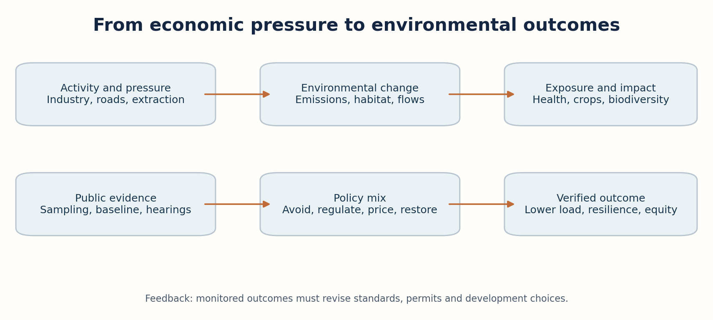
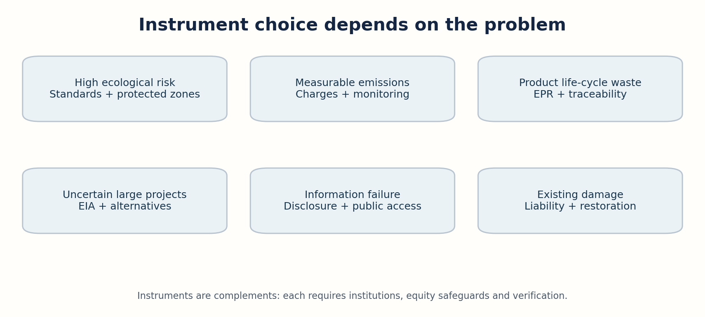
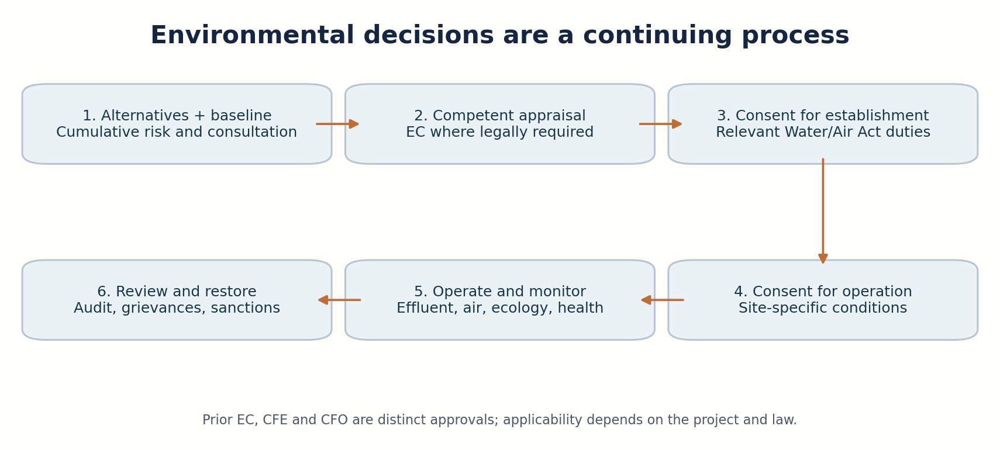
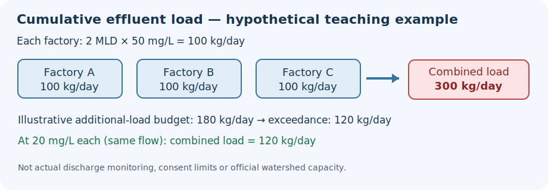

# Visual Learning

**Diagram 1:** Development pressure -> environmental change -> exposure -> human/ecological impact -> instruments -> monitored outcome.

**Diagram 2:** Choose standards, price incentives, disclosure, participation and restoration based on ecological risk and institutional capacity.

**Diagram 3:** Alternatives and impact appraisal precede the decision; consent, operation and monitoring are distinct ongoing obligations.

**Cycle44 original teaching diagram — cumulative effluent load (hypothetical only):**

