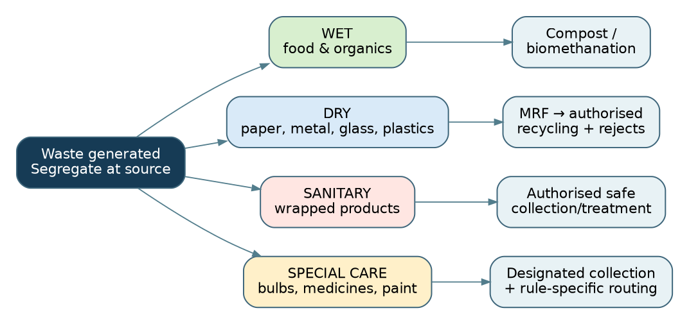
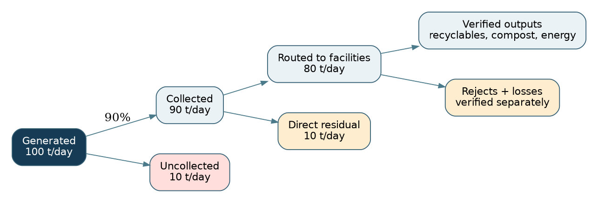
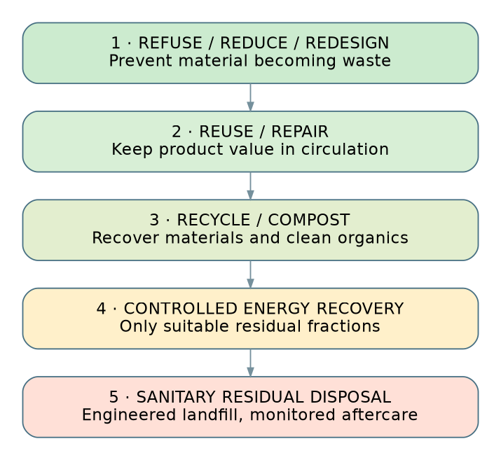

# Environmental Pollution and Solid Waste Management: Generation, Impacts, Recycling and Reuse

**TGPSC Group I · Paper IV · Unit III · Topic 4 · English · Published learning draft / NOT academically approved**

# Syllabus map and learning objectives

**Exact TGPSC Notification 02/2024 line:** “4. Environment pollution and solid waste management, types of solid waste, factors affecting solid waste generation, impact of solid waste, recycling and reuse.”

| Official syllabus component | Main coverage | Exam-ready competence |
|---|---|---|
| Environmental pollution | Sections 1–2, 12–13 | Trace pollutants, exposure pathways, indicators and controls |
| Solid waste management | Sections 3, 5–11, 13–18 | Explain legal duties and end-to-end waste systems |
| Types of solid waste | Section 3, 7, 13 | Separate 2026 four streams from special statutory categories |
| Factors affecting generation | Sections 4–5 | Explain drivers, denominators, sampling and mass balances |
| Impact of solid waste | Sections 1–2, 11–12, 14 | Evaluate health, ecological, drainage and climate effects |
| Recycling and reuse | Sections 6, 8, 15–16 | Compare hierarchy, recovery technologies, circular economy and EPR |

**Learning objectives:** Explain pollution mechanisms rather than list slogans; distinguish municipal and separately regulated wastes; compute collection versus diversion; analyse technology trade-offs; apply current law and Telangana cases; prepare structured mains answers with verifiable evidence.

**Provenance notice:** The 30 MCQs and six mains prompts are original practice. They are not claimed as official TGPSC PYQs. Academic approval remains pending independent audit.

---

# Executive summary

Environmental pollution results when harmful agents or physical changes reach people and ecosystems through exposure pathways. Municipal solid-waste management is a complete chain from prevention and segregation through collection, material recovery, biological treatment, residual disposal and monitoring. Waste generation varies with population, income, urbanisation, consumption, land use, seasons and measurement methods. Collection rates cannot be substituted for recycling or safe-disposal rates.

The Solid Waste Management Rules, 2026 were notified on 27 January and came into force on 1 April 2026. They require four-stream segregation—wet, dry, sanitary and special-care—and strengthen bulk-generator accountability, digital reporting, environmental compensation and legacy-waste management. E-waste, biomedical waste, batteries, hazardous industrial waste and construction debris have distinct legal channels. Telangana's Jawaharnagar challenge shows why capacity, actual throughput, environmental exposure and local participation must be evaluated separately.

Recycling and reuse conserve material value when products and streams are genuinely recovered. Composting, biomethanation, MRF sorting, RDF, WtE and sanitary landfills have different feedstock requirements, residues and risks. Sound governance relies on credible mass balances, worker safety, inclusive waste-picker integration, transparent contracts and independent monitoring. This is a detailed learning draft, not an academically approved master.

---

---

# Standalone quick revision — Pollution and Solid Waste Management

**One-minute chain:** Prevent → segregate at source → collect without re-mixing → treat organics → recover clean recyclables → route special streams to authorised facilities → safely dispose of genuine rejects → audit the mass balance. Collection ≠ processing ≠ recycling ≠ safe disposal. A plant's installed capacity is not its measured throughput.

**Official syllabus anchors:** Environmental pollution; types of solid waste; factors influencing generation; impacts; recycling and reuse. Air, water, soil, noise and thermal pollution differ in pathways. Hazard × exposure informs risk. BOD measures oxygen demand; DO measures dissolved oxygen. Leachate is contaminated liquid, landfill gas may contain methane; both require management.

**2026 rule alert:** Solid Waste Management Rules, 2026 notified 27 January 2026, effective **1 April 2026**, superseding the 2016 framework for covered waste. **Four streams: wet, dry, sanitary, special-care.** Bulk generator qualifies by any one: ≥20,000 sq.m floor area, ≥40,000 L/day water, or ≥100 kg/day waste. Extended Bulk Waste Generator Responsibility is not the same as product-specific EPR. Rules apply to urban and rural bodies; biomedical, e-waste, batteries, C&D and hazardous industrial waste have distinct channels.

**Generation drivers:** Population × per-capita waste, income, urbanisation, consumption, packaging, tourism, markets, institutions, seasonality, collection coverage and sampling methodology. Rain increases wet weight; informal recovery changes composition at a collection point. Always give the data year and denominator.

**Technology distinctions:** Composting = aerobic organic stabilisation; biomethanation = anaerobic biogas + digestate; MRF = sorting dry materials; RDF = processed combustible residual fraction; WtE = energy recovery with emissions/ash obligations; sanitary landfill = engineered residual disposal; biomining = excavation/screening of legacy waste; bioremediation = biological contaminant treatment. Recycling is not automatically safe, and energy recovery is not a substitute for reducing waste.

**Telangana anchors:** GHMC, Telangana Pollution Control Board, Jawaharnagar legacy and processing challenges, peri-urban siting, smaller ULBs and Gram Panchayats. Telangana government press release 6 January 2024 discussed additional sites; it is a proposal, not proof of commissioning. CAG Telangana local-bodies report tabled 30 March 2026 audited solid-waste management in ULBs for 2017–18 to 2021–22. Never represent its audit period as current 2026 operations.

**Mains structure:** definition and legal baseline → causal mechanism → Telangana illustration → trade-offs/equity → administrative actions with measurable indicators → balanced conclusion. Use mass balance and distinguish observed outcomes from plans. Never label these original practice questions as official PYQs.

**Exam traps:** Four streams, not simply wet/dry. 2026 commencement ≠ 2026 notification. 100% collected ≠ 100% treated. High BOD ≠ specific heavy-metal pollution. An MRF creates rejects. Waste-to-energy creates ash. Biodegradable ≠ safe to dump. 'Zero waste' is an ambition. Avoid mixing 2022–23, 2024 and 2026 waste tonnages as if simultaneous.

---

# Detailed textbook notes — Environmental Pollution and Solid Waste Management

## 1. Pollution as an economic, ecological and public-health problem

Environmental pollution is the introduction of substances, organisms, energy or physical changes into air, water, land or ecosystems at concentrations or rates that cause adverse effects. A pollutant may be a chemical such as lead, a biological agent such as pathogenic organisms, a physical agent such as noise or heat, or a complex mixture such as landfill leachate. The same substance may be harmless at one dose and hazardous at another; exposure route, duration, age and susceptibility matter. A source is not identical to exposure: a dumpsite can emit contaminants, but health risk depends on pathways through air, water, food or direct contact and on the vulnerability of people exposed.

Pollution is often described as an externality because a producer or consumer may avoid paying the full cost of damage imposed on others. A household that burns mixed waste saves a collection fee but transfers smoke and toxic exposure to neighbours. A poorly operated landfill can reduce land values and impose groundwater-treatment costs outside the operator's accounts. The resulting private cost is below the social cost, causing excessive pollution relative to the socially desirable level. Yet the objective is not mechanically 'zero pollution' regardless of costs: policy seeks prevention of avoidable harm, compliance with health and ecological standards, and fair allocation of residual risks. For carcinogenic or persistent pollutants, precaution may justify exceptionally stringent controls.

Air, water, soil and noise pollution interact. Open burning of waste releases fine particles and gases; the remaining ash can contaminate soil and drainage. Plastics entering a stormwater channel obstruct flow, increasing local flooding, while contaminated runoff transports microorganisms and chemicals into lakes. Anaerobic decomposition of food waste in unmanaged heaps produces methane, an important greenhouse gas; landfill gas can also contain odorous compounds. A municipal official must therefore map the entire pathway from generation to final residue rather than assume that removing waste from a visible street has solved the problem.

The environmental justice dimension is fundamental. Informal settlements, sanitation workers and waste pickers may live or work close to waste facilities and face disproportionate exposure, while better-off generators externalise disposal costs. Gendered labour, caste-linked occupational vulnerability, inadequate personal protective equipment and insecure contracts compound the burden. A Telangana answer should connect pollution to municipal governance, health services, water protection and livelihoods rather than treat the issue solely as an engineering question. Jawaharnagar near Hyderabad illustrates why siting, odour, leachate, traffic and neighbourhood participation require joint assessment.

**Exam distinction:** A pollutant is the harmful agent; a pollution source emits it; exposure is contact with the agent; hazard is inherent potential for harm; risk combines hazard with likelihood and magnitude of exposure. A legal emission limit is not automatically a safe exposure level at every receptor.

## 2. Types of environmental pollution and their causal mechanisms

Air pollution includes particulate matter, sulphur and nitrogen oxides, carbon monoxide, ozone formed through atmospheric reactions, volatile organic compounds and toxic metals. Waste burning is an avoidable local source, but it is not the sole explanation for a city's air quality: road dust, traffic, industry, construction and regional transport also matter. Primary pollutants are emitted directly; secondary pollutants form in the atmosphere. Open burning of chlorinated materials under unsuitable conditions can generate hazardous organic compounds. A credible policy response combines emission prevention, segregated collection, monitoring and enforcement instead of attributing all particulate matter to municipal waste.

Water pollution may arise from untreated sewage, industrial effluents, agricultural runoff, landfill leachate or indiscriminate dumping. Oxygen-demanding organic matter increases biochemical oxygen demand (BOD), and microbial degradation can reduce dissolved oxygen, harming fish and other aquatic life. Nutrient inputs promote eutrophication. Pathogens create disease risk, while some dissolved metals and persistent chemicals can accumulate in sediments and organisms. A black or odorous lake does not by itself establish a specific chemical concentration; sampling design, seasonal conditions, laboratory methods and upstream-downstream comparison are necessary.

Soil pollution involves contamination by metals, petroleum compounds, persistent organic pollutants, excess salts, pesticides or improperly handled waste. Pollutants may be adsorbed to soil particles, move with groundwater, volatilise, or enter crops depending on pH, redox conditions and chemical form. A clean-looking surface can hide subsurface contamination. Thermal pollution changes receiving-water temperatures, potentially lowering oxygen solubility and altering species composition. Noise pollution from traffic, machinery and processing plants affects sleep and wellbeing; lighting and odour can also degrade environmental quality even when they do not fit the usual chemical-pollutant model.

Pollution indicators must be interpreted correctly. PM2.5 is a particle-size category, not a single chemical; BOD is a measure of oxygen demand under specified conditions, not a direct pathogen count; chemical oxygen demand (COD) includes oxidisable substances and need not equal BOD. The Air (Prevention and Control of Pollution) Act, 1981 and Water (Prevention and Control of Pollution) Act, 1974 support pollution-control institutions, while the Environment (Protection) Act, 1986 provides an umbrella basis for waste-specific rules. Regulatory standards are updated, so students should verify the applicable notification before quoting a threshold.

**Telangana application:** A Hyderabad lake receiving sewage and litter requires interception of sewage, solid-waste control, catchment management and monitored restoration. Aeration alone cannot permanently correct continued nutrient loading. An industrial cluster requires consent compliance, effluent treatment and independent monitoring; a village may prioritise safe sanitation and prevention of waste burning.

## 3. What is solid waste? Classification by source, material and regulatory regime

Solid waste is unwanted or discarded material arising from households, shops, institutions, streets, markets and many productive activities. The word 'solid' does not mean dry: food residues, wet sludge-like materials and contaminated packaging can enter the municipal stream. Classification is useful only when it changes handling requirements. By source, one may distinguish residential, commercial, institutional, street-sweeping, horticultural, agricultural, construction and industrial waste. By composition, one may distinguish biodegradable organic matter, recyclables, inert fractions and materials requiring special precautions. By risk, waste may be ordinary municipal, hazardous, infectious, toxic, reactive or otherwise regulated.

The Solid Waste Management Rules, 2026 prescribe four-stream segregation at source: wet, dry, sanitary and special-care waste. Wet waste includes kitchen scraps and other biodegradable organics; dry waste includes paper, metals, glass and many plastics; sanitary waste includes used diapers and sanitary products requiring secure wrapping; special-care waste includes selected domestic hazardous items such as paint containers, bulbs, expired medicines and mercury thermometers. The 2026 rules took effect on 1 April 2026, replacing the 2016 solid-waste framework for covered streams. Students must not repeat the older two-bin simplification as the complete current national requirement.

Special-care collection does not erase other legal regimes. Biomedical waste from healthcare facilities, hazardous industrial waste, e-waste, batteries, construction-and-demolition waste and radioactive waste have distinct applicable rules or regulatory arrangements. A household's expired medicine may be directed into a special-care stream, while a hospital's contaminated sharps must follow biomedical-waste requirements. An old mobile phone should enter authorised e-waste channels, not be mixed into wet waste. A broken lithium-ion battery may pose fire risk and must not be crushed with ordinary recyclables. Source-based and material-based labels can overlap; the governing rule and authorised downstream pathway determine safe management.

A material's value changes with separation. Clean paper may be recyclable, but paper saturated with food or mixed with hazardous residue can lose recycling value. A plastic item may be technically recyclable yet uneconomic to collect because it is small, contaminated or composed of multiple layers. 'Biodegradable' does not guarantee safe disposal in a roadside heap: degradation conditions, contaminants and the final use of compost matter. Likewise, 'inert' describes relatively low reactivity under relevant conditions; it is not a licence to dump material into a water body.

| Classification lens | Examples | Management implication |
|---|---|---|
| Source | Home, hotel, market, hospital, construction site | Determines responsibility and likely contamination |
| 2026 municipal stream | Wet, dry, sanitary, special care | Requires four-stream source segregation |
| Material property | Organic, paper, metal, glass, polymer, inert | Guides composting, recycling or residual treatment |
| Separate statutory stream | E-waste, biomedical, batteries, C&D, hazardous industrial | Requires authorised rule-specific channel |

## 4. Factors determining the quantity and composition of waste

Waste generation depends on population, urbanisation, household size, income, consumption patterns, packaging design, tourism, institutional activity, industrial structure and seasonal festivals. Total municipal waste may rise as a city grows even if per-capita waste remains constant. Conversely, a wealthy commercial district may generate more packaging and disposable goods per person than a low-income settlement, while markets generate a larger organic fraction. Waste composition is not a fixed national constant; the wet-to-dry ratio changes with diet, climate, housing type, collection practices and what informal recyclers remove before official measurement.

Urban form affects both generation and collection cost. Dense apartment blocks can support economical door-to-door collection and on-site wet-waste treatment, but poorly designed storage rooms and uncoordinated contractors may produce mixed waste. Sprawling peri-urban colonies require longer vehicle routes and face ambiguous jurisdiction. Villages may generate less packaged consumer waste but still need management of plastics, sanitary waste and special-care items. Festivals, marriage halls, weekly markets and pilgrim gatherings produce short-lived peaks that overwhelm systems sized only for average daily loads.

Technological and policy factors can change measured waste independently of actual behaviour. When a city installs weighbridges, reported tonnage may increase because measurement improves. When informal collectors remove valuable recyclables upstream, the waste reaching a municipal transfer station has a different composition. During rainfall, uncovered waste can absorb water and weigh more. A change from loose-volume estimates to calibrated weight measurements can produce an apparent trend break. Consequently, longitudinal comparisons must specify the point of measurement, sampling method, coverage and denominator.

A simple accounting identity is **total waste generated = population × average generation per person**, provided the same period and population coverage are used. But an operational mass balance is more informative: generated = separately recovered + formally collected + unmanaged or unrecorded, after adjusting for double counting and stock changes. At a treatment plant, incoming mass = saleable recyclables + compost/biogas-related outputs + emissions and moisture losses + residues, subject to process-specific measurement. Do not equate 'collected' with 'processed' or 'processed' with 'safely disposed'.

Telangana's fast-growing Hyderabad metropolitan region illustrates the effects of apartment growth, food-delivery packaging, construction, migration and commercial expansion. A district town may have a larger seasonal market fraction and lower collection density. Policy should use ward-wise waste characterisation surveys rather than one uniform state-wide composition assumption.

## 5. Waste characterisation, material flow and reliable statistics

Waste characterisation measures how much waste exists, what it contains and where it moves. A defensible study defines sampling units, covers weekdays and weekends, represents income and land-use categories, records seasonal variation and separates generated waste from the quantity delivered to processing facilities. Manual sorting studies should use protective equipment, safe sampling protocols and laboratory analysis where hazardous contamination is suspected. A one-day sample from a central market cannot represent an entire city's annual waste stream.

The most useful indicators answer distinct questions: generation per capita (kg/person/day); collection coverage (% of eligible households or tonnes); source-segregation compliance (% independently verified); diversion from disposal (% of generated mass with documented reuse/recycling/biological processing); reject rate at material recovery facilities; plant utilisation (actual throughput relative to capacity); and sanitary landfill compliance. An announced plant capacity is a design figure, not proof of operational performance. A reported 100% collection rate may coexist with poor source segregation and uncontrolled residual dumping.

Mass-balance verification is essential because double counting can inflate recycling claims. Material sent from a transfer station to an MRF and then to a recycler should be counted once as a recovered stream, not three times as 'processed'. Compost that fails quality standards and is stockpiled cannot automatically be counted as beneficial utilisation. RDF produced but not used by a compliant facility remains a stock, not completed energy recovery. Reporting should include moisture losses, contamination rejects, final outlets, landfill residue and legacy-waste inventories.

Suppose a municipality generates 100 tonnes/day, collects 90, sends 45 to composting, 25 to sorting, 10 to energy recovery and 10 to a landfill. This routing alone cannot establish 80% successful processing: each facility may produce rejects, compost may be unsaleable and recyclables may be stockpiled. A complete audit tracks outputs and disposal residues. Exam questions often test the distinction between waste *generated*, *collected*, *processed*, *recycled*, *recovered* and *landfilled*. Use a flow diagram and label every numerator.

**Current-data caution:** A 2024 state press report and a 2022–23 pollution-control report give different Telangana tonnages and scopes. These should not be merged into a single '2026 current' number. The chapter therefore uses dated examples and prioritises official, consistently defined reporting over apparent precision.

## 6. Waste-management hierarchy and prevention at source

The waste hierarchy orders actions broadly as refuse and reduce, redesign, reuse and repair, recycle or compost, recover energy where environmentally justified, and safely dispose of unavoidable residuals. Its logic is to avoid material extraction, manufacturing emissions and disposal burdens before investing in end-of-pipe treatment. Prevention can involve durable goods, refill systems, food-waste avoidance, reusable transport packaging, public procurement standards and product design for repair. A city that doubles recycling but also doubles waste generation has not necessarily reduced its total environmental footprint.

Reuse preserves a product's functional value without converting it back into raw material. Refillable bottles, reusable containers and refurbished electronics may displace new production if they are actually used enough times and cleaned efficiently. Repair extends product life, but a highly inefficient or unsafe device may warrant replacement after life-cycle assessment. Recycling recovers material through collection, sorting and reprocessing; downcycling yields lower-value material, whereas closed-loop recycling may preserve quality. Biological processing of uncontaminated organics is distinct from recycling metals or polymers.

The hierarchy is not a rigid ranking for every context. Food scraps that cannot be prevented may be suitable for animal feed where legally and hygienically permitted, composting or anaerobic digestion. Energy recovery can reduce landfill demand for suitable non-recyclable residues, but burning recyclable material destroys recoverable resources and may create emission-control burdens. Life-cycle assessment compares environmental impacts from raw-material extraction to end-of-life, including transport, water, energy and emissions. Local health constraints and legal requirements remain decisive even when a technology appears to perform well in a simplified carbon model.

A practical municipal programme starts upstream: regulate litter and single-use products under applicable rules, promote source segregation, align collection schedules, procure durable public goods, support repair markets, and pay service providers for verified outcomes rather than mere tonnage transported. The 'polluter pays' principle can finance environmental harm prevention, but user charges must be designed so low-income households are not excluded from essential collection services. Behaviour change succeeds when convenient infrastructure and credible enforcement accompany awareness campaigns.

## 7. Segregation, storage and door-to-door collection under the 2026 framework

Source segregation is the critical boundary between recoverable material and mixed waste. When food waste contaminates paper, plastics and sanitary waste, the dry stream loses value and sorting workers face greater exposure. The 2026 four-stream framework requires separate wet, dry, sanitary and special-care categories. Sanitary products should be securely wrapped, and special-care items need authorised collection or designated deposition points. Colour conventions used by local bodies are aids to communication, but the legally defined waste streams and local instructions matter more than assuming one universal bin colour in every location.

Collection design should match the waste stream. Wet waste generally requires frequent removal to control odour, pests and decomposition; dry recyclables can often be stored longer in clean, protected conditions. Sanitary and special-care materials require safe handling, labelling and traceable routing. Households need reliable schedules, street vendors need suitable containers, and large commercial or residential premises need space and trained personnel. Separate compartments or vehicles prevent re-mixing. A contractor who visibly collects four bins and dumps them into one unpartitioned vehicle defeats the purpose of segregation.

The 2026 rules define bulk waste generators using alternative thresholds: floor area at least 20,000 square metres, water consumption at least 40,000 litres per day, or solid-waste generation at least 100 kg/day. Such entities have enhanced responsibility for environmentally sound handling, including wet-waste processing on site where feasible or compliance through the specified certificate mechanism. Do not present all apartments as bulk generators; classification depends on the rule's criteria and the relevant entity. Institutions should maintain quantity records, collection contracts, processing evidence and grievance channels.

The centralised online portal envisaged under the 2026 rules can improve reporting on generation, transport, processing, disposal and legacy waste, but digital records are not substitutes for field verification. GPS location proves a vehicle visited a site, not that it collected a particular quantity of correctly segregated material. Weighbridge calibration, random audits, route reconciliation and resident complaints strengthen accountability. Telangana municipalities should publish understandable ward-level performance data and protect personal information collected through service applications.

## 8. Material Recovery Facilities and recycling economics

A Material Recovery Facility (MRF) receives and sorts dry waste into marketable streams: different grades of paper, cardboard, PET, HDPE, metals, glass and residual material. Sorting may be manual, mechanical or combined. A high-quality MRF needs clean inputs, worker protection, fire prevention, safe electrical systems, storage discipline, weighbridges and buyers with documented downstream recycling. Mixed municipal waste can be mechanically separated, but the resulting recyclables are often dirtier and less valuable than source-segregated material. MRF capacity and actual saleable recovery are different metrics.

Recycling economics depend on material purity, transport distance, market prices, scale, contamination, energy use and producer-responsibility finance. Aluminium has high recoverable value; low-density multilayer plastic films may be costly to collect and process. A recycling rate can decline when commodity prices collapse even if households maintain segregation. Municipal contracts should therefore balance stable service payments with verified material recovery rather than expose essential collection to volatile scrap markets alone. Traceability should follow material from generator through aggregator to authorised recycler.

Informal waste pickers are not an obstacle to modernisation; they often recover valuable material before formal collection. Excluding them can destroy livelihoods and reduce recycling. Integration can include identification, protective equipment, cooperatives, training, formal contracts, access to MRFs and social protection. The NAMASTE initiative expanded to waste pickers in June 2024, with a national enumeration and support effort documented in 2025. Integration must avoid tokenistic registration that does not change income, safety or bargaining power.

Recycling itself can pollute when poorly managed. Uncontrolled burning of cables to recover copper, acid leaching of circuit boards, or washing contaminated plastics without wastewater treatment shifts damage rather than preventing it. Extended Producer Responsibility (EPR) aims to make producers finance or organise specified end-of-life obligations under relevant product-specific rules. An EPR certificate should correspond to traceable, legitimate processing; paper compliance without physical recovery undermines the system.

## 9. Biological treatment: composting, biomethanation and quality control

Wet organic waste can be treated aerobically by composting or anaerobically through biomethanation. Composting uses oxygen-dependent microorganisms to stabilise organics, producing compost, water vapour, carbon dioxide and heat. Effective operation requires suitable carbon-to-nitrogen balance, moisture, aeration, particle size, temperature and curing. Too much moisture creates anaerobic pockets and odour; insufficient moisture slows decomposition. Mature compost should be stable and meet applicable quality requirements before agricultural or horticultural use. Mixing batteries, glass shards or contaminated plastics into feedstock can make the final product unsafe.

Anaerobic digestion operates without oxygen and produces biogas containing methane and carbon dioxide, alongside digestate. Biogas can provide heat, electricity or upgraded fuel, subject to treatment and safety systems. Digestate still needs safe handling and quality assessment. Digester performance depends on feedstock, loading rate, pH, temperature, retention time and inhibition by contaminants. A facility may claim design biogas capacity yet operate far below it because segregation is poor or feedstock supply is unreliable. Neither composting nor digestion makes hazardous substances disappear.

Decentralised composting can reduce transport and improve local accountability in markets, campuses and residential communities, but requires trained operators, odour management, leachate control and adequate space. Centralised plants may achieve economies of scale and technical oversight, yet long transport distances and mixed inputs can offset benefits. A sound comparison considers collection kilometres, nuisance, process emissions, product demand, operational resilience and who bears costs. Telangana's vegetable markets and large institutions are logical candidates for separate organic-waste assessments, not automatic approvals of one technology.

Organic-waste treatment can reduce methane relative to uncontrolled disposal when facilities are correctly operated and outputs are used. However, poorly aerated composting may emit methane or nitrous oxide; digesters can leak methane. Life-cycle claims should specify the counterfactual, leakage, electricity mix and product substitution. Exam answers should distinguish *biodegradation* from *stabilisation*, and *biogas production* from *net climate benefit*.

## 10. Refuse-derived fuel, waste-to-energy and the limits of incineration

Refuse-derived fuel (RDF) is a processed combustible fraction made from suitable high-calorific-value waste, often after recyclable and wet fractions are removed. Waste-to-energy (WtE) plants may use controlled combustion or other technologies to generate heat or electricity. The technical justification is strongest for residual fractions that cannot be economically and safely reused or recycled. Moisture-rich mixed waste has low effective calorific value and can impair combustion. Plants need reliable feedstock characterisation, air-pollution control, ash management, emission monitoring and transparent operating data.

The 2026 SWM framework describes a phased increase in RDF substitution by certain solid-fuel-using industrial facilities, with the official PIB explanation referring to a rise from 5% to 15% over six years. That policy does not mean every type of plastic should be burned, nor that a power-generation claim proves environmental compliance. Stack emissions, dioxins/furans where relevant, particulate capture, wastewater and ash disposal require independent oversight. Bottom ash and fly ash have different contamination profiles and should not be presumed harmless.

Supporters argue that WtE can reduce residual landfill volume, provide dispatchable energy and manage hard-to-recycle fractions. Critics point to capital costs, minimum-feedstock contracts that can discourage waste reduction, toxic emissions, ash residues and poor performance with wet mixed waste. Both arguments are conditional. An evidence-based decision compares alternatives for a measured local waste stream, verifies emission-control capability and avoids long-term take-or-pay arrangements that punish successful segregation.

Hyderabad's Jawaharnagar waste infrastructure includes processing and WtE facilities, but the presence of a plant does not establish that the whole city's waste is sustainably managed. Neighbourhood odour, groundwater, traffic, legacy dumps and residual disposal remain separate performance questions. Project announcements, planned capacity and commissioned operation must be distinguished in current-affairs notes.

## 11. Sanitary landfills, leachate, landfill gas and legacy waste

A sanitary landfill is an engineered facility for carefully selected residual waste, with liners, leachate collection, controlled placement, cover systems, gas management, drainage and monitoring. An open dump lacks these controls. The 2026 rules restrict landfilling primarily to non-recyclable, non-energy-recoverable and inert residuals and prescribe disincentives for sending unsegregated waste to landfill. This is a policy design to make recovery preferable, not a claim that every existing dump has already been upgraded. Proper landfill siting requires hydrogeology, flood risk, ecological sensitivity, habitation distance and long-term post-closure planning.

Leachate forms when liquid percolates through waste and dissolves or carries contaminants. Its chemistry varies with waste age, rainfall, composition and biological processes. Uncontrolled leachate can threaten surface and groundwater; treatment may require physical, chemical and biological stages. Landfill gas is produced by anaerobic degradation, particularly of organic waste, and may contain methane and carbon dioxide. Gas collection can reduce fire, explosion and climate risks, but collection efficiency is rarely perfect. Odour may originate from multiple compounds and cannot be measured solely by methane concentration.

Legacy waste is old accumulated material in dumpsites. Biomining uses excavation, screening and separation to recover usable fractions and reduce waste stockpiles; bioremediation relies on biological processes to transform contaminants or organic matter under controlled conditions. The words are not interchangeable. Excavated material may contain soil-like fractions, recyclables, combustibles and hazardous rejects. Soil-like output must meet appropriate standards before reuse; otherwise moving it to a new site merely relocates contamination. Remediation success requires environmental testing, safe residue disposal and post-remediation land-use controls.

The Jawaharnagar case demonstrates why a 'waste removed' headline is inadequate. The relevant questions are whether capped areas remain protected, leachate and groundwater are monitored, fresh waste is routed only to permitted facilities, and legacy material is actually remediated. In November 2025, news reporting described National Green Tribunal enforcement concerning dumping restrictions; this is a dated reported event, not a substitute for the authenticated tribunal order. For mains answers, propose independent hydrogeological monitoring and public disclosure rather than claim unverified health outcomes.

## 12. Solid-waste impacts on health, ecosystems, infrastructure and climate

Uncollected waste can attract rodents, insects and scavenging animals, create physical injuries and obstruct drainage. Mixed waste exposes workers to sharps, pathogens and chemical irritants. Open burning adds particulate and toxic exposure; contaminated food and water pathways can cause disease. Causation must be demonstrated carefully: a higher disease rate near a dumpsite may reflect several confounders, and a single complaint cannot prove a specific pollutant caused illness. Public-health investigation combines exposure assessment, clinical evidence, environmental sampling and epidemiology.

Ecosystem damage extends beyond visible litter. Plastic fragments may be ingested by animals; entanglement harms wildlife; leachate can change aquatic chemistry; organic loading may deplete oxygen. Waste entering tanks and storm drains transports contaminants downstream. Fragmented plastics can form microplastics, but risk assessment depends on polymer, additives, particle size, exposure and endpoint; one should not claim every microplastic exposure has a proven identical human health effect. Fire at dumpsites can damage nearby vegetation and generate persistent contamination.

Urban infrastructure suffers when plastics and debris clog drains, worsen local flooding, block culverts and increase maintenance costs. Waste collection vehicles create traffic and road wear, while poorly sited facilities may depress neighbouring land values. Social impacts include stigma, displacement pressures and loss of informal recycling livelihoods when systems are mechanised without transition plans. These burdens can be distributed unequally among neighbourhoods; public consultation and transparent grievance resolution are therefore substantive elements of environmental governance.

Climate impacts arise from methane released during anaerobic organic-waste decay, fossil-derived emissions from collection and processing, and avoided emissions when recycling displaces virgin production. The direction and size of net benefit depend on local electricity mix, transport, landfill-gas capture and whether recovered materials actually substitute for new production. A climate strategy should prioritise food-waste prevention, source segregation and well-operated organics processing before relying on carbon-credit claims. Carbon accounting should not hide local air or water harms.

## 13. Legal framework and allocation of responsibilities in India

The Environment (Protection) Act, 1986 is the principal enabling statute for several waste-management rules. The 2026 SWM Rules, notified on 27 January 2026 and effective 1 April 2026, superseded the 2016 rules for covered solid-waste streams. They require four-stream segregation, strengthen bulk-generator duties, envisage a centralised digital portal and address audits, environmental compensation, RDF, residual landfilling and legacy waste. They apply to urban and rural local bodies and many institutional settings, while excluding waste categories governed by separate specific rules. A candidate should distinguish notification date from commencement date and distinguish a rule's obligation from an implementation outcome.

Local bodies organise collection, transport, processing and safe disposal, enact relevant by-laws and may levy user charges. Gram Panchayats have rural responsibilities; urban municipal bodies administer urban systems. State Pollution Control Boards regulate authorised facilities and enforce applicable environmental conditions, while CPCB develops central guidance and information systems. State departments, district administrations, facility operators, waste generators and producer-responsibility organisations have complementary roles. Delegating collection to a contractor does not remove the local body's duty to oversee service quality and environmental compliance.

Other major rules address plastic waste (including packaging EPR), e-waste (2022 framework), battery waste (2022), biomedical waste (2016 framework) and construction-and-demolition waste (2025 rules effective 1 April 2026). Do not treat these as annexures of the 2026 municipal SWM Rules. For example, e-waste producer targets operate through a separate CPCB EPR system, and biomedical waste requires healthcare-specific segregation and authorised treatment. A legal answer should first classify the waste, then identify the governing instrument, regulator and authorised destination.

The polluter-pays principle supports assigning prevention and remediation costs to responsible parties; precaution supports intervention where serious harm is plausible despite incomplete certainty; intergenerational equity protects future resources. The National Green Tribunal provides a specialised forum for environmental disputes within its statutory jurisdiction. Judicial decisions may impose case-specific directions that are not universal statutory rules. The correct hierarchy is current legislation and notifications, authoritative court orders, valid regulatory consent conditions and local by-laws, with dated interpretation.

## 14. Telangana governance: Hyderabad, smaller towns and rural areas

Telangana's waste challenge is not confined to the Greater Hyderabad Municipal Corporation. Hyderabad's dense commercial and residential growth generates large, heterogeneous flows, whereas smaller municipalities may struggle with staff, vehicle maintenance, market access for recyclables and stable treatment-facility operation. Gram Panchayats face different settlement patterns and may rely on village-level collection centres and decentralised organic treatment. A single metropolitan technology contract is therefore not a universal state solution. Planning should use district- and ward-level characterisation and differentiate high-density corridors, markets, peri-urban settlements and villages.

The Telangana Pollution Control Board has roles in consent, authorisation and compliance oversight. GHMC and other urban local bodies organise collection and processing under applicable law. State environmental and municipal departments coordinate policy and infrastructure; district officials help address siting, enforcement and grievance issues. The State Government's 6 January 2024 press release recorded consideration of additional facilities to reduce dependence on Jawaharnagar. That statement is evidence of an official proposal at the time, not proof that every proposed facility was built or commissioned.

Jawaharnagar is a useful case study of centralised processing, legacy waste, nearby communities and the difficulty of integrating new capacity with environmental safeguards. In 2025, local reporting discussed additional processing proposals, including Pyaranagar, and opposition related to siting and aviation concerns. These claims must be dated and distinguished from official operating records. A robust case-study answer proposes independent impact assessment, verified processing capacity, safe transfer routes, community consultation, leachate monitoring, health surveillance and a publicly accessible grievance dashboard.

For Telangana's smaller municipalities, priorities include reliable four-stream collection, segregated market waste, basic MRFs, local compost demand, protected worker conditions, realistic user-fee collection and safe residual disposal. State-wide procurement may lower equipment costs but can fail if local maintenance and trained staff are neglected. The success criterion is not 'number of plants inaugurated'; it is verified reduction in unmanaged waste, compliant treatment, lower exposure and stable material recovery.

## 15. Recycling and reuse: technologies, market failures and circular economy

A circular economy seeks to preserve the value of products, components and materials while reducing virgin-resource extraction and environmental harm. It differs from a narrow recycling target because the greatest savings may come from designing out waste, longer product life, sharing, repair and reuse. For municipal plastics, design-for-recyclability requires compatible polymers, removable labels and reduced problematic additives. For electronics, repairability and access to spare parts can delay disposal. For food, preventing edible food waste is generally preferable to collecting it for compost after the resource inputs have already been spent.

Recycling processes have different limits. Metals can often be remelted with high recovery, though sorting and energy use matter. Paper fibres shorten after repeated recycling, limiting cycles. Glass can be remelted but colour separation and transport weight affect economics. Plastics differ by resin, additives and contamination; mechanical recycling may degrade properties, while chemical recycling can be energy-intensive and should be assessed on actual yields and emissions. Construction debris can be processed into aggregates where technical standards permit, but contaminated or mixed debris needs additional safeguards.

Producer-responsibility rules address a common market failure: manufacturers benefit from sales while municipalities and communities bear disposal costs. EPR can create demand for authorised recycling and finance collection, but its integrity depends on credible mass balance, traceable certificates and enforcement against fictitious transactions. Informal collectors need fair integration because their knowledge and networks often supply valuable recovered materials. Circularity cannot be inferred from a recycling label on packaging; the collection system and actual end market must exist.

Reuse has health and safety boundaries. Refillable food containers need hygienic cleaning; salvaged construction materials need structural verification; refurbished batteries need electrical testing; contaminated packaging cannot be reused for food merely because it is durable. Public procurement can stimulate markets for certified recycled products while avoiding false environmental claims. Telangana can support repair clusters, material exchanges, C&D recycling and source-segregated compost markets, but each should be evaluated for quality, employment and real substitution of virgin inputs.

## 16. Policy design: incentives, enforcement and financing

Solid-waste systems are public services with environmental externalities and network effects. They require predictable collection funding, capital investment, monitoring and accountability. Financing instruments include general municipal revenue, user fees, producer-responsibility payments, tipping fees, state grants, outcome-linked contracts and appropriate carbon revenues. Each instrument creates incentives. A payment solely per tonne delivered to a disposal site may reward more dumping; a contract rewarding verified diversion and compliant residue management better aligns with prevention. However, poorly designed diversion incentives may encourage illegal dumping or inflated reports, so independent audits are indispensable.

The 2026 rules' environmental compensation mechanism follows polluter-pays logic for specified violations. Penalties are useful only if detection is credible and due process is followed. Awareness without collection infrastructure shifts responsibility unfairly to households; infrastructure without enforcement allows persistent mixing and littering. The policy mix should combine convenient services, clear communication, reasonable fees, targeted inspection, transparent data and proportionate sanctions. Affordability protections may be needed for low-income households, while large commercial generators can be required to document compliance.

Public-private partnerships can mobilise technology and management capacity but require measurable service levels, open performance data, risk allocation and remedies for failure. Contracts should define input-quality responsibilities, output testing, pollution monitoring, worker safety, downtime, disposal of rejects and asset handover. Overly long minimum-tonnage guarantees can conflict with successful waste reduction. Smaller towns may benefit from regional facilities for residuals while keeping organics treatment local. Intermunicipal arrangements need clear cost-sharing and transport responsibilities.

A credible five-year municipal plan establishes a baseline, sets measurable milestones, assigns accountable agencies and budgets operating expenditure, not just construction. Indicators include four-stream compliance, uncollected waste, verified material recovery, wet-waste treatment quality, landfill rejects, environmental monitoring, worker injuries and complaint resolution. Targets should be disaggregated by ward and socioeconomic vulnerability to prevent improvements in affluent areas from concealing persistent neglect elsewhere.

## 17. Practical municipal action plan and administrative case study

Consider a Telangana town with 60,000 residents, a weekly market, a hospital, two colleges and several new apartment complexes. The first step is a statistically defensible waste audit: sample different settlement types and seasons, map collection routes and document disposal points. Hospital biomedical waste and e-waste must be identified as separate regulatory streams. The town should calculate its wet, dry, sanitary and special-care quantities before buying equipment. Population-based estimates are useful for preliminary planning but cannot replace field measurements.

The next step is to pilot four-stream door-to-door collection in representative wards, with training for sanitation workers, household guidance and covered transport. Wet market waste can be assessed for local composting or biomethanation; clean dry waste goes to an MRF; sanitary and special-care waste follow authorised pathways; residuals go to compliant disposal. Contracts should include weighbridge records, downstream receipts, rejects, safety equipment and monthly disclosure. Schools and resident associations can participate, but responsibility remains with competent public authorities and authorised operators.

Monitoring should test whether segregation persists after collection. Random route inspections, photographic evidence, GPS traces, independent weighing and facility output audits provide complementary checks. Environmental safeguards require odour and leachate management, fire prevention, occupational health and groundwater testing where relevant. A complaint system should give case numbers, response deadlines and escalation. Public meetings should include waste pickers, informal settlements, women, market traders and communities near proposed facilities.

Suppose the town achieves 95% household collection but only 30% true source segregation. Calling the programme a success would hide a major weakness. The next intervention should focus on re-mixing points, bin design, collection-worker incentives and bulk-generator enforcement rather than buying another expensive mixed-waste processing machine. A strong mains answer moves from baseline to mechanism, finance, equity, measurable outcomes and independent verification.

## 18. Evaluation, contrasting viewpoints and future challenges

Centralised versus decentralised treatment is a contextual choice, not an ideological contest. Centralised facilities can deliver economies of scale, advanced emissions control and professional management, but may create long haulage distances, local opposition and system-wide vulnerability if a single plant fails. Decentralised facilities can shorten routes and encourage community oversight, yet may lack technical capacity or space. A hybrid system often works best: neighbourhood organics where feasible, regional sorting and specialised facilities for hazardous or difficult streams, and carefully engineered residual disposal.

Technology optimism must be tested against material realities. 'Waste-to-energy' does not erase waste; it converts some chemical energy while generating emissions and ash. 'Zero waste' is an aspirational management approach, not a literal claim that no residues exist. '100% recycling' can be misleading if the numerator includes rejected or stockpiled material. 'Biomining completed' is inadequate unless contaminants and residuals are managed and the land is environmentally safe. Digital monitoring can reduce fraud, but it may also amplify inaccurate data if no physical verification exists.

Climate change will alter waste systems through heat, heavy rainfall, flooding and wildfire risks. Extreme rain can overwhelm leachate controls and transport routes; high temperatures increase odour and fire risk. Growing e-commerce and electronics consumption change dry-waste composition, while batteries and solar panels introduce new recovery and safety challenges. Extended Producer Responsibility, circular design and resilient infrastructure must evolve together. Future policy should invest in product redesign, credible measurement and occupational safety rather than rely solely on larger landfills.

The central examination conclusion is that solid-waste management is a governance chain. Source prevention reduces the burden; segregation protects material value; safe collection and treatment control exposure; transparent financing supports continuity; and audited residual disposal prevents hidden damage. For Telangana, sustainable outcomes require collaboration among generators, municipalities, pollution-control regulators, formal and informal workers, industry and affected communities. Development should be measured by healthier neighbourhoods and reduced environmental burdens, not simply the number of vehicles, plants or megawatts announced.

---

# Visual learning — three original explanatory diagrams

**Diagram 1:** The four 2026 municipal streams have different safe routes. Biomedical waste and e-waste from their regulated sources remain subject to separate regimes.

**Diagram 2:** Waste collected is not automatically waste recycled. Each treatment step has outputs and rejects that must be verified.

**Diagram 3:** Prevention and reuse generally preserve more value than treatment of discarded material; residual landfill is the last resort, subject to local legal and environmental constraints.

---

# Thirty original explained MCQs — not official previous-year questions

## MCQ 1. A municipality collects 90 tonnes of 100 tonnes generated daily. Which statement is justified?
A. Its recycling rate is 90%
B. Its collection rate by mass is 90%
C. Its landfill diversion rate is 90%
D. Its treatment efficiency is 90%

**Answer: B.** Collection is the mass gathered divided by generated mass. It says nothing about downstream treatment, recovery or landfill rejects; those require separate output evidence.

## MCQ 2. Under the national Solid Waste Management Rules effective 1 April 2026, source segregation requires which four streams?
A. Organic, paper, metal, glass
B. Wet, dry, sanitary, special-care
C. Biodegradable, combustible, inert, industrial
D. Household, industrial, agricultural, hospital

**Answer: B.** The 2026 SWM framework specifies wet, dry, sanitary and special-care categories. Other streams such as healthcare biomedical waste follow their own regulations.

## MCQ 3. A residential complex has a floor area of 21,000 square metres but produces only 60 kg/day of waste. Under the 2026 bulk-generator criteria it is:
A. Excluded because 100 kg/day is mandatory
B. Included because the floor-area threshold alone is met
C. Excluded because it is residential
D. Included only if it uses 40,000 litres/day of water

**Answer: B.** The criteria are alternatives, not cumulative: at least 20,000 square metres, or 40,000 litres/day water, or 100 kg/day solid waste. A qualifying residential entity can be covered.

## MCQ 4. Which action prevents waste most directly rather than treating it after generation?
A. Installing a larger landfill
B. Incinerating all dry waste
C. Replacing disposable packaging with a verified refill system
D. Increasing mixed-waste transport

**Answer: C.** A refill system can avoid production and disposal of single-use material. Landfilling, incineration and transportation act after waste has arisen.

## MCQ 5. Why does mixed food waste reduce paper recycling?
A. It raises paper fibre length
B. Moisture and contamination reduce recoverable quality
C. It converts paper into glass
D. It automatically makes paper hazardous waste

**Answer: B.** Wet organic contamination degrades paper quality and can introduce odour and pathogens. It does not automatically transform all paper into a legally hazardous stream.

## MCQ 6. What is the correct distinction between BOD and dissolved oxygen?
A. BOD measures oxygen already dissolved
B. BOD estimates oxygen demand; DO is oxygen present
C. They are identical chemical measurements
D. High BOD always proves a heavy-metal spill

**Answer: B.** BOD measures oxygen required for biological oxidation under specified conditions; DO measures oxygen present in water. High BOD can contribute to oxygen depletion but does not identify a specific contaminant.

## MCQ 7. Which description best fits a material recovery facility?
A. An open dump for all wastes
B. A facility sorting and preparing dry materials for downstream recovery
C. A plant exclusively for hospital sharps
D. A site where every input becomes saleable material

**Answer: B.** MRFs sort recoverable dry fractions and create rejects. Their effectiveness depends on input segregation, worker safety and verified recycler destinations.

## MCQ 8. Which is the clearest example of downcycling?
A. Reusing a refillable glass bottle
B. Turning high-grade polymer into a lower-grade composite with reduced recyclability
C. Preventing food waste
D. Repairing a phone

**Answer: B.** Downcycling recovers material into a lower-quality or lower-value application. Reuse and repair preserve products without necessarily remanufacturing raw material.

## MCQ 9. An anaerobic digester differs from aerobic composting primarily because it:
A. Requires atmospheric oxygen throughout
B. Uses oxygen-free microbial conversion and may generate methane-rich biogas
C. Always produces no residues
D. Is suitable for mixed batteries and organics

**Answer: B.** Anaerobic digestion occurs without oxygen and yields biogas and digestate. Digestate quality, feedstock contamination and methane leakage still require management.

## MCQ 10. Which condition commonly creates odour in a compost pile?
A. Adequate aeration
B. Excess moisture and oxygen-starved pockets
C. Mature stable compost
D. Correct moisture and structure

**Answer: B.** Excess moisture fills air spaces, promoting anaerobic processes and odorous compounds. Aeration, structure and controlled moisture are central to good composting.

## MCQ 11. A city's WtE plant has capacity for 2,000 tonnes/day but receives 900 tonnes/day. What follows?
A. It necessarily generates 2,000 tonnes/day of useful output
B. Design capacity exceeds current throughput
C. It has 100% environmental compliance
D. It has eliminated landfill requirements

**Answer: B.** Capacity is a design parameter and throughput is measured input. Emissions compliance, energy output and residue disposal need independent evidence.

## MCQ 12. What is a principal technical difficulty of burning untreated mixed municipal waste?
A. High and constant calorific value
B. High moisture and heterogeneous fuel characteristics
C. Absence of any ash
D. Automatic removal of toxic compounds

**Answer: B.** Wet mixed waste varies in composition and calorific value, complicating stable combustion. Ash and emissions controls remain necessary.

## MCQ 13. Which statement about landfill leachate is accurate?
A. It is always clean rainwater
B. It is liquid that has contacted waste and may carry dissolved or suspended contaminants
C. It is synonymous with landfill methane
D. It cannot affect groundwater

**Answer: B.** Leachate can transport organic and inorganic contaminants depending on waste and site conditions. Liner, drainage, treatment and monitoring systems control its pathway.

## MCQ 14. Biomining of legacy waste primarily refers to:
A. Excavating and separating old dumpsite material for recovery and safe residual management
B. Building a new open dump
C. Burying unsorted waste without monitoring
D. Replacing all environmental testing with a drone survey

**Answer: A.** Biomining excavates and screens legacy waste to separate fractions. Environmental testing and safe handling of rejects are essential; removal alone is not remediation.

## MCQ 15. Why can open dumping increase urban flooding?
A. Waste always increases infiltration
B. Plastics and debris can block drains and culverts
C. All solid waste evaporates before rain
D. Only groundwater extraction affects flooding

**Answer: B.** Litter obstructs stormwater drainage and can worsen waterlogging during intense rainfall. Flooding also depends on catchment and drainage design.

## MCQ 16. Which measure best tests whether reported recycling is genuine?
A. Counting transfer-station movements repeatedly
B. Tracking mass from MRF output to authorised recycler with receipts and reject accounting
C. Reporting installed plant capacity
D. Using only public-relations photographs

**Answer: B.** Chain-of-custody and mass balance avoid double counting. A tonne transferred through several facilities should not be recorded as multiple tonnes recycled.

## MCQ 17. A waste picker cooperative receives PPE and a paid contract to operate an MRF. The principal policy gain is:
A. Automatic elimination of all informal employment
B. Inclusion of existing recovery expertise with safer and more secure livelihoods
C. Proof that the city produces no waste
D. Removal of all regulatory obligations

**Answer: B.** Inclusive formalisation can improve material recovery, income stability and worker safety. It still requires training, fair payment and oversight.

## MCQ 18. Which category generally requires a separate legal management channel rather than routine municipal wet waste?
A. Vegetable peels
B. Clean garden leaves
C. Contaminated biomedical sharps from a clinic
D. Uncontaminated fruit skins

**Answer: C.** Healthcare sharps fall under biomedical-waste management arrangements. Mixing them with organics exposes workers and violates safe segregation principles.

## MCQ 19. Extended Producer Responsibility primarily addresses which market failure?
A. Waste costs borne only by product producers already
B. Downstream collection and treatment costs externalised from product decisions
C. Municipalities having no legal role
D. Recycling being physically impossible

**Answer: B.** EPR assigns defined end-of-life obligations to producers and can support design and collection incentives. It requires genuine recycling and verifiable certificates.

## MCQ 20. Which is a sound criterion for choosing between decentralised and centralised composting?
A. One technology must fit all locations
B. Compare feedstock quality, land, haulage, odour controls, skills and markets
C. Choose only by inauguration cost
D. Ignore local residents

**Answer: B.** The optimum scale depends on waste composition, operational capacity, transport and community impacts. Both approaches can succeed or fail.

## MCQ 21. What does 'polluter pays' mean in waste governance?
A. Pollution becomes legal if a fee is paid
B. Responsible parties should bear appropriate prevention and remediation costs
C. Only low-income households must pay
D. All waste fees are forbidden

**Answer: B.** The principle internalises environmental costs and supports compensation for specified violations. Payment does not authorise illegal pollution.

## MCQ 22. A composting plant sells contaminated compost without quality testing. Which assertion is justified?
A. Sale alone proves safe beneficial recycling
B. Output quality and contamination remain unverified
C. Every compost product is hazardous
D. Biological treatment destroys metals

**Answer: B.** Markets and claimed sales do not establish compliance or agronomic safety. Metals and some contaminants are not eliminated by biodegradation.

## MCQ 23. A city reports 100% collection but continues uncontrolled dumping. The most accurate conclusion is:
A. Collection success alone is insufficient to show safe disposal
B. Waste governance is complete
C. The data prove no pollution
D. All generators have reduced waste

**Answer: A.** Collection measures removal from generators, not environmentally sound processing or disposal. End-to-end tracking is required.

## MCQ 24. Which statement about landfill gas is correct?
A. It consists solely of oxygen
B. It can include methane from anaerobic decomposition
C. It cannot pose fire risk
D. It is identical to leachate

**Answer: B.** Anaerobic degradation can produce methane-rich gas, creating climate and safety risks. Gas capture and monitoring are needed where appropriate.

## MCQ 25. Why is a single-day waste sample from one market unsuitable as a city-wide annual estimate?
A. It is necessarily too expensive
B. It fails to represent neighbourhood, seasonal and source variation
C. Waste composition never changes
D. Markets produce no organics

**Answer: B.** Sampling must cover relevant land uses, income groups and temporal variation. Extrapolation from a non-representative sample can misdirect facility design.

## MCQ 26. Which statement is correct about the 2026 SWM Rules and C&D waste?
A. C&D waste is always mixed into household wet bins
B. C&D waste has a distinct 2025 regulatory framework effective in 2026
C. No regulations apply to demolition debris
D. All rubble must be incinerated

**Answer: B.** The Environment (Construction and Demolition) Waste Management Rules, 2025 entered into force on 1 April 2026. The ordinary municipal four-stream system does not replace its specific obligations.

## MCQ 27. A contract pays an operator only for tonnes delivered to a dump. What perverse incentive may arise?
A. Incentive to prevent all waste
B. Incentive to maximise delivered tonnage rather than recovery
C. Guaranteed source segregation
D. Guaranteed groundwater protection

**Answer: B.** Volume-linked payments without environmental outcomes may reward disposal rather than prevention. Contracts should include verified recovery, safe rejects and pollution performance.

## MCQ 28. Which practice is most consistent with environmental justice?
A. Siting facilities without hearing nearby communities
B. Publishing exposure monitoring, integrating workers and offering accessible grievance redress
C. Moving all impacts to low-income wards
D. Assuming no health effects without measurement

**Answer: B.** Environmental justice requires fair distribution of burdens, meaningful participation and accountable protection of vulnerable groups. It complements engineering controls.

## MCQ 29. What is the main limitation of claiming carbon neutrality from a WtE plant's electricity generation?
A. Energy production is never measurable
B. Net impacts also depend on feedstock, fossil carbon, avoided disposal, emissions and ash
C. All waste is renewable
D. The plant has no transport emissions

**Answer: B.** A life-cycle comparison must define a credible baseline and include upstream, process and residual impacts. Generating electricity alone does not establish net-zero emissions.

## MCQ 30. What is the strongest outcome indicator for a five-year municipal waste reform programme?
A. Number of ribbon-cuttings
B. Verified reduction in unmanaged waste and exposure with compliant recovery and residual disposal
C. Only the number of trucks purchased
D. Only the number of posters distributed

**Answer: B.** Outcome metrics connect service delivery to environmental and health performance. Asset counts are inputs and cannot substitute for verified results.

---

# Mains answer blueprints

| Question | Opening / context | Analytical core | Telangana anchor | Balanced conclusion |
|---|---|---|---|---|
| 1. Generation and impacts | Define municipal waste and growth drivers | Population, consumption, segregation, exposure | Hyderabad and smaller ULBs | Verified diversion and equity |
| 2. 2026 rules | Notification and commencement dates | Four streams, BWG, regulators, monitoring | GHMC and Gram Panchayats | Compliance versus implementation |
| 3. Technologies | Waste hierarchy | Compost, digestion, MRF, WtE trade-offs | Markets and Jawaharnagar | Technology follows feedstock |
| 4. Legacy waste | Define old dumpsites | Leachate, gas, biomining, monitoring | Jawaharnagar | Environmental closure evidence |
| 5. Circular economy | Design out waste | Reuse, repair, recycling, EPR | Telangana repair/recovery clusters | Traceable actual substitution |
| 6. Town strategy | Measured baseline | Four-stream collection, contracts, audits | Medium-sized Telangana municipality | Outcome-based governance |

**Recommended structure for every 200–250-word answer:** Introduction; 2–4 analytical subheadings; named local case; administrative actions; measured conclusion. Avoid unsupported present-year numerical claims.

---

# Six complete mains model answers — original practice, not verified official PYQs

## Mains 1. Explain the causes and consequences of increasing municipal solid waste in Telangana and suggest an integrated response.

**Introduction.** Municipal solid waste is a growing governance challenge because population growth, urban consumption and expanding commercial activity increase both the quantity and complexity of discarded materials. Hyderabad and smaller Telangana towns face different operational pressures.

**Causes.** Urban expansion increases packaging, food-service residues, construction-related activity and collection distances. Income and lifestyle changes raise the share of disposable products, while festivals and markets create seasonal peaks. Poor source segregation contaminates recoverable materials. In peri-urban areas, jurisdictional gaps and inadequate transfer infrastructure encourage dumping. Recorded tonnage can also change when weighbridge coverage improves, so trends require consistent measurement.

**Consequences.** Unmanaged waste obstructs drains, attracts pests, generates odour and exposes sanitation workers to injuries and infection. Burning adds air pollution; leachate may threaten water resources. Anaerobic organics generate methane, while mixed waste reduces recycling value. Communities near disposal facilities may bear disproportionate health and livelihood burdens.

**Response.** Implement four-stream segregation under the 2026 SWM Rules, reliable collection, clean MRFs, composting or biomethanation for uncontaminated organics, authorised channels for special waste and engineered disposal for unavoidable rejects. Use ward-level mass balances, independent environmental monitoring and transparent contracts. Include waste pickers through paid, safe formal arrangements. A decentralised–centralised hybrid should reflect local land, skills and feedstock.

**Conclusion.** Success must be judged by verified reduction in unmanaged waste and exposure, not the number of plants announced or tonnes merely collected.

## Mains 2. Examine the Solid Waste Management Rules, 2026 and their implications for urban and rural local governance.

**Background.** The Ministry of Environment, Forest and Climate Change notified the Solid Waste Management Rules, 2026 on 27 January 2026; they commenced on 1 April 2026 and superseded the 2016 framework for covered municipal solid waste.

**Major provisions.** The rules require segregation into wet, dry, sanitary and special-care streams. They clarify bulk-waste-generator thresholds, strengthen responsibility for environmentally sound processing and envisage a centralised portal for tracking generation, collection, processing and disposal. They address audits, environmental compensation, residual landfilling, RDF use and legacy-waste remediation. Separate regimes continue for biomedical, e-waste, batteries and other excluded categories.

**Governance implications.** Municipalities must organise dependable separate collection, develop infrastructure, monitor contractors and report performance. Gram Panchayats require rural collection and local treatment arrangements. State Pollution Control Boards oversee relevant authorisations and compliance; CPCB supplies national systems and guidance. Digital reporting improves visibility only when reconciled with weighbridge and facility-output evidence.

**Implementation challenges.** Inadequate household space, weak collection logistics, scarce trained operators, mixed transport, unstable recycling markets and unequal user-fee capacity may undermine compliance. Bulk generators need practical technical options rather than paper certificates alone. Waste pickers need safe integration, not exclusion.

**Way forward.** Fund operating costs, publish ward-level indicators, independently audit recovery and rejects, enforce proportional penalties and protect vulnerable communities.

**Conclusion.** The rules can shift governance from waste transportation to verified environmental outcomes, but legal notification must not be mistaken for universal implementation.

## Mains 3. Compare composting, biomethanation, material recovery and waste-to-energy as municipal waste-management options.

**Introduction.** Waste treatment should follow the composition and contamination of the stream, not a single technology preference. Prevention and source segregation come before treatment selection.

**Composting.** Aerobic composting stabilises clean organic waste and can supply soil amendments. It requires moisture control, aeration, curing and product-quality testing. Poor operation causes odour and unsafe compost.

**Biomethanation.** Anaerobic digestion converts suitable wet organics into methane-rich biogas and digestate. It can recover energy but needs stable feedstock, process control, leakage prevention and safe digestate use.

**Material recovery.** MRFs sort clean dry paper, plastic, glass and metals for downstream recycling. Their performance depends on source separation, worker safety, market demand and documented recycler receipts. MRFs generate rejects; they are not zero-residue systems.

**Waste-to-energy.** Controlled combustion or RDF use can treat appropriate non-recyclable combustible residuals and generate energy. However, high moisture reduces performance, and emissions, ash, capital costs and long-term feedstock contracts create risks. Burning recoverable material can undermine recycling.

**Comparative assessment.** Decentralised organics treatment reduces transport but needs local skills; regional facilities may offer scale and stronger technical oversight. The optimum system is often hybrid. Compare full life-cycle costs, pollution controls, actual throughput, product demand and final residues, not only design capacity.

**Conclusion.** No technology substitutes for preventing waste, segregating it correctly and independently verifying where every material fraction ultimately goes.

## Mains 4. Why are legacy dumpsites a serious environmental problem? Discuss remediation priorities with reference to Jawaharnagar.

**Introduction.** Legacy dumpsites contain accumulated waste deposited over many years, frequently without the engineering controls expected of sanitary landfills. Their risks persist even after fresh dumping is reduced.

**Environmental pathways.** Rainwater passing through waste produces leachate that may carry organic and inorganic contaminants. Anaerobic decay generates methane and odour. Dumpsite fires add smoke and toxic exposure. Loose debris blocks drains and attracts pests. Groundwater impacts depend on site geology, rainfall, liners and contaminant migration; proximity alone cannot prove a particular health outcome.

**Jawaharnagar context.** Hyderabad's Jawaharnagar waste complex illustrates pressure from metropolitan waste flows, legacy stockpiles and surrounding settlements. Reported tribunal restrictions and processing proposals are dated developments that require checking against authenticated orders and operating records. An announced facility or reclaimed acreage is not itself proof of environmental safety.

**Remediation priorities.** First map waste volumes, hydrogeology and exposure pathways. Stop unauthorised fresh dumping in protected zones. Control stormwater and leachate, collect landfill gas where feasible, prevent fires and protect workers. Biomining should segregate recovered fractions and test soil-like material; hazardous rejects require authorised treatment. Monitor groundwater and air before, during and after works.

**Accountability.** Publish baseline results, contracts, disposal receipts and complaints. Involve affected communities in monitoring and land-use decisions.

**Conclusion.** Remediation is complete only when residual contamination and future exposure are demonstrably controlled, not merely when a dump appears visually smaller.

## Mains 5. Explain the role of recycling, reuse and Extended Producer Responsibility in building a circular economy.

**Introduction.** A circular economy aims to retain product and material value while reducing extraction, pollution and waste. Recycling is one instrument; prevention, durable design, repair and reuse are often more resource-efficient.

**Reuse and repair.** Refillable containers, refurbished equipment and repairable products extend useful life and avoid some new production. They need safety, hygiene and genuine repeated use. Repair markets can support local employment and reduce disposal demand.

**Recycling.** Source-segregated dry material enters sorting and authorised processing. Metals, paper, glass and polymers require different technologies and have different recovery limits. Contamination, transport and unstable scrap prices affect viability. Processing that releases untreated effluent or burns toxic material simply transfers pollution.

**EPR.** Product-specific rules place defined end-of-life obligations on producers, helping finance collection and recycling. Traceable certificates and material balances are necessary to prevent fictitious compliance. The 2022 e-waste and battery frameworks and plastic packaging rules should not be confused with ordinary municipal SWM duties.

**Social dimension.** Waste pickers already recover valuable material. Formal contracts, protective equipment, cooperatives and social security can improve both recovery and livelihoods. Exclusion may destroy efficient collection networks.

**Policy direction.** Telangana can promote repair clusters, reusable procurement, certified recycling markets and audited material flows. Evaluate actual substitution of virgin materials, not slogans or logos.

**Conclusion.** Circularity requires design, incentives, inclusive labour arrangements and measurable recovery; it cannot be achieved by a recycling plant alone.

## Mains 6. Design an accountable solid-waste-management strategy for a medium-sized Telangana municipality.

**Objective.** A municipality should aim to reduce unmanaged waste, environmental exposure and disposal dependence while ensuring affordable service and safe livelihoods.

**Baseline.** Conduct representative seasonal waste-characterisation studies covering households, markets, institutions and peri-urban wards. Measure generation, collection, four-stream segregation, contamination, treatment outputs and residual disposal. Keep biomedical, e-waste, batteries and construction debris in their appropriate regulatory channels.

**Service design.** Provide reliable door-to-door collection with separate handling of wet, dry, sanitary and special-care waste. Assess decentralised organics treatment for markets and large institutions; route clean dry waste through an MRF and authorised recyclers. Use compliant residual disposal and safe management of legacy sites. Ensure accessible services for low-income settlements.

**Finance and institutions.** Combine municipal funds, fair user charges, grants and applicable producer-responsibility finance. Contracts should reward verified recovery and environmental compliance, not only tonnes moved. Clarify responsibilities of the municipality, Gram Panchayats where relevant, the State Pollution Control Board, operators and bulk generators.

**Accountability.** Reconcile GPS, weighbridge, plant-output and recycler records. Publish ward dashboards, environmental sampling and complaint outcomes. Independently audit contracts, worker safety, leachate, emissions and rejects. Integrate waste pickers with paid roles, training and social protection.

**Conclusion.** Review indicators quarterly and adapt technology to measured waste composition. Administrative success means a cleaner, safer city with documented end-to-end material management, not merely new vehicles or ceremonial facility openings.

---

# Dated primary-source developments and source audit

**Evidence protocol:** Syllabus scope checked against the commission-hosted Notification 02/2024 (19 February 2024). National rules and commencement dates checked against official gazette/PIB sources. Telangana claims are dated. Where a document's full tables have not been audited, this chapter avoids presenting an unverified 2026 tonnage. No student-facing source page numbers or invented official PYQs.

## Current affairs integrated into concepts

- **19 February 2024:** TGPSC Notification 02/2024 specifies Paper IV Unit III Topic 4: “Environment pollution and solid waste management, types of solid waste, factors affecting solid waste generation, impact of solid waste, recycling and reuse.” This is the chapter's binding syllabus scope.
- **6 January 2024:** Telangana Government recorded a proposal to consider additional Hyderabad-area waste facilities because of dependence on Jawaharnagar. A proposal is not proof of construction or operation.
- **2 April 2025:** MoEFCC notified Environment (Construction and Demolition) Waste Management Rules, 2025; commencement **1 April 2026**. C&D waste is not ordinary municipal wet waste.
- **27 January 2026 (PIB release 28 January):** MoEFCC notified Solid Waste Management Rules, 2026; effective **1 April 2026**. Four-stream segregation, bulk-generator responsibility, environmental compensation and online tracking are statutory-policy changes, not evidence of full compliance.
- **23 March 2026:** MoEFCC parliamentary response documented several EPR regimes and recycling certificates. Reported national totals should not be confused with Telangana municipal recycling rates.
- **30 March 2026:** CAG Report No. 1 of 2025 on Telangana local bodies was tabled; its performance audit covers ULB solid waste during **2017–18 to 2021–22**. Publication date and audited period are different.
- **9 September 2026:** PIB briefing reiterated four-stream segregation, digital monitoring and bulk-generator accountability; implementation requires field checks.

## Primary-source register and limits

| ID | Publisher | Date | Evidence | Official URL | Audit note |
|---|---|---|---|---|---|
| S01 | TGPSC | 19 Feb 2024 | Group I Notification 02/2024, Annexure-II syllabus | https://websitenew.tgpsc.gov.in/preview/RElSRUNUUkVDUlVJVE1FTlROT1RJL05PVElGSUNBVElPTl9OT18wMi0yMDI0X0dyb3VwLUlfU2VydmljZXMgKDEpMjAyNDAyMjAxNDA3MzcucGRmr95v17a0y2d8i13v | Exact Topic 4 line verified |
| S02 | Government of India eGazette | 28 Jan 2026 | S.O.388(E), Solid Waste Management Rules, 2026 | https://egazette.gov.in/WriteReadData/2026/269620.pdf | Primary legal text; check amendments |
| S03 | MoEFCC | 2026 | Ministry-hosted SWM 2026 gazette | https://moef.gov.in/uploads/pdf-uploads/pdf_69a16e3b04c107.91022257.pdf | Statutory provisions, separate stream exclusions |
| S04 | PIB / MoEFCC | 28 Jan 2026 | Four-stream segregation, BWG, digital portal | https://www.pib.gov.in/PressReleasePage.aspx?PRID=2219676 | Ministry explanation, not implementation audit |
| S05 | PIB / MoEFCC | 30 Mar 2026 | Parliamentary response on 2026 SWM commencement | https://www.pib.gov.in/PressReleasePage.aspx?PRID=2246814 | Confirms dates and coverage |
| S06 | PIB / MoEFCC | 23 Mar 2026 | EPR regimes and circular economy | https://www.pib.gov.in/PressReleasePage.aspx?PRID=2244104 | National data; not state recycling rate |
| S07 | PIB / MoEFCC | 23 Jul 2026 | Solid waste in tourist sites and tracking | https://www.pib.gov.in/PressReleasePage.aspx?PRID=2288317 | Illustrates local-body responsibility |
| S08 | PIB Dehradun | 9 Sep 2026 | Four-stream compliance and monitoring briefing | https://www.pib.gov.in/PressReleasePage.aspx?PRID=2308453 | Briefing, not nationwide audit |
| S09 | CPCB | 2026 portal | Centralised solid-waste portal | https://uatswm.cpcb.gov.in/ | Portal may be pilot/test environment |
| S10 | CPCB | Rules catalogue | Waste-specific regulatory links | https://cpcb.nic.in/rules-7/ | Check category and current amendments |
| S11 | MoEFCC | 2 Apr 2025 | Construction and demolition waste rules | https://moef.gov.in/uploads/pdf-uploads/Nitin_Rev_4.pdf | Annual report summary; check gazette for exact duties |
| S12 | MoEFCC | 2 Nov 2022 | E-Waste (Management) Rules, 2022 | https://moef.gov.in/uploads/2022/11/E-Waste-Management-Rules-2022.pdf | Separate waste category |
| S13 | CPCB | 2026 portal | E-waste EPR registration and obligations | https://eprewaste.cpcb.gov.in/ | Dynamic portal notices; not municipal collection data |
| S14 | Telangana State Portal | 6 Jan 2024 | Additional Hyderabad dump-yard proposal | https://www.telangana.gov.in/news/press-releases/2024/01/more-dump-yards-in-hyderabad/ | Proposal only; no commissioning inference |
| S15 | GHMC | Accessed 24 Oct 2026 | Municipal authority and service context | https://ghmc.gov.in/ | Home page; service details may change |
| S16 | Telangana district administration | Accessed 24 Oct 2026 | TGPCB statutory functions | https://sangareddy.telangana.gov.in/pollution-control-board/ | Institutional description |
| S17 | CAG India | Tabled 30 Mar 2026 | Telangana Local Bodies Report No. 1 of 2025 | https://www.cag.gov.in/ag/telangana/en/audit-report/details/124977 | Audit period 2017–18 to 2021–22 |
| S18 | CPCB | 2021–22 report | Annual Solid Waste Management Report | https://cpcb.nic.in/uploads/MSW/MSW_AnnualReport_2021-22.pdf | Historical baseline; not latest 2026 |
| S19 | Swachh Bharat Mission Urban | Portal accessed 24 Oct 2026 | Urban sanitation programme | https://swachhbharaturban.gov.in/ | Dashboard fields require timestamp verification |
| S20 | MoEFCC | Annual report 2025–26 | National environmental rules and waste context | https://moef.gov.in/uploads/pdf-uploads/Nitin_Rev_4.pdf | Not independently audited for all statistics |
| S21 | Telangana eGazette | Accessed 24 Oct 2026 | Official state gazette repository | https://www.telangana.gov.in/gazette/ | Legal source discovery; not a specific notification |

## Limitations requiring independent academic audit

1. Confirm any post-24 October 2026 amendments before future examination use. The 2026 rule text is a dated legal baseline.
2. The full CAG report's numerical findings have not been extracted and verified here; only its official metadata, tabled date, audit period and audit scope are used.
3. Jawaharnagar allegations and court orders require certified case-document verification before asserting liability or quantified health effects.
4. District-specific Telangana 2026 waste tonnages and recycling rates are intentionally omitted pending a comparable official audited dataset.
5. Questions below are original practice, **not official PYQs**. Academic approval remains zero until independent subject-expert review.

---

# Verified official PYQ status

No TGPSC Group I question is labelled an official previous-year question in this chapter. The original commission paper and exact question number have not been authenticated for this topic. The 30 MCQs and six mains questions in the learning materials are explicitly original practice questions. Do not present them as verified PYQs.

---

# Topic summary and answer-writing checklist

Environmental pollution must be analysed through source, pathway, receptor and control. Waste generation depends on socioeconomic, demographic, land-use and seasonal drivers; reported quantities also depend on measurement. The 2026 SWM Rules require four municipal segregation streams and place enhanced duties on qualifying bulk generators. Waste hierarchy prioritises prevention and reuse, followed by clean recovery, suitable treatment and safe residual disposal. Telangana illustrates the governance tension between centralised infrastructure and neighbourhood exposure. Use dated official sources, state the denominator, and never infer safe processing from collection or plant capacity alone.

**Checklist:** Define terms; explain cause and mechanism; cite current rule accurately; distinguish stream-specific regulations; include a Telangana case; evaluate counterarguments; propose indicators; conclude with environmental and social outcomes.
