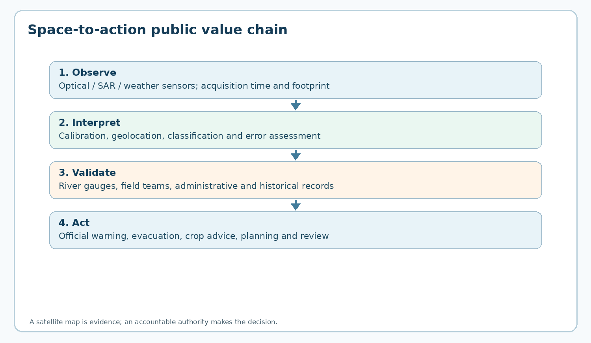
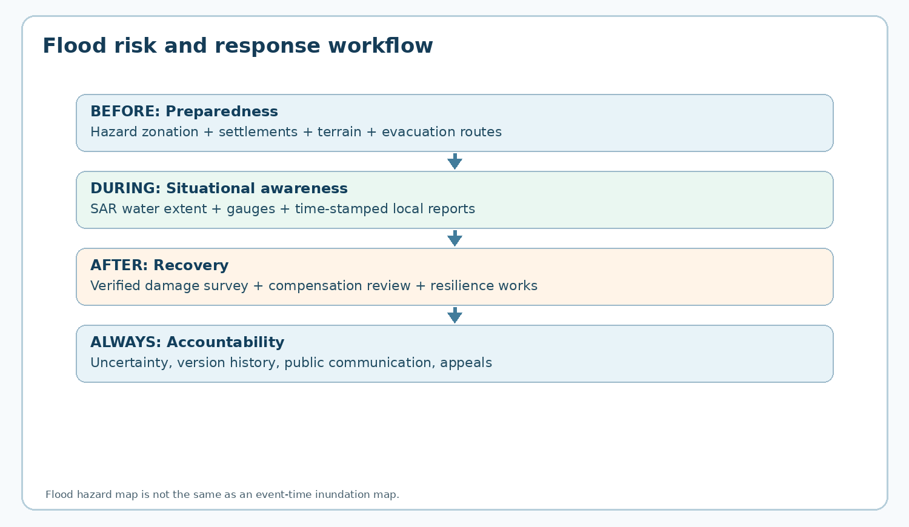
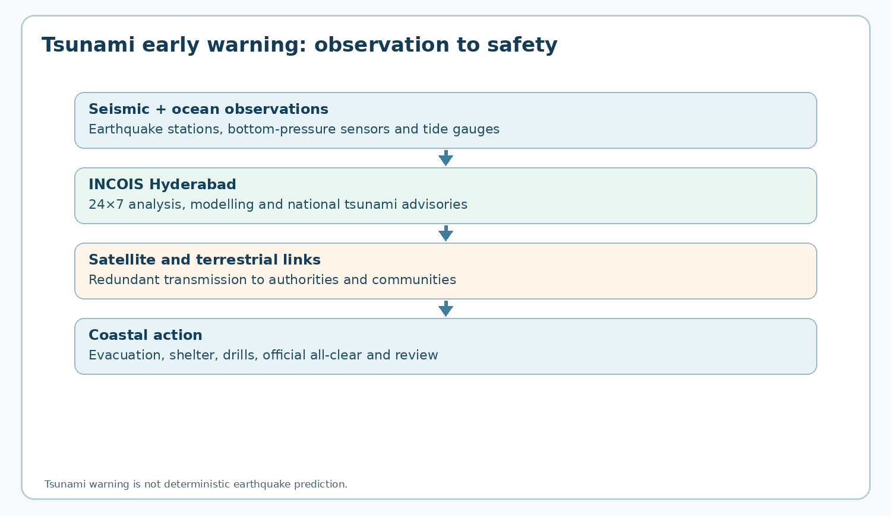

## Visual learning

**Diagram 1:** Measurement, interpretation, validation and public action form separate stages.

**Diagram 2:** Preparedness, response and recovery require different information products.

**Diagram 3:** Seismic/ocean sensors, INCOIS advisories and last-mile action are distinct responsibilities.

