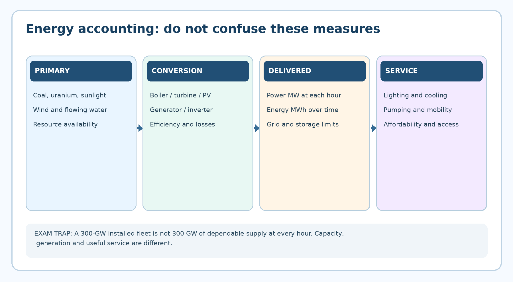
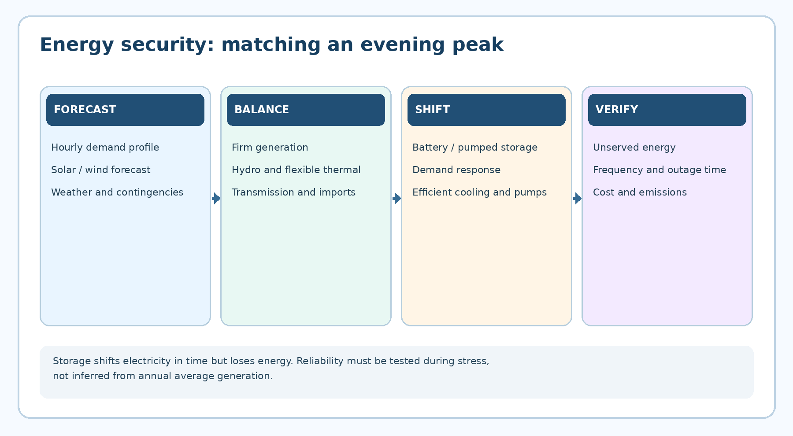
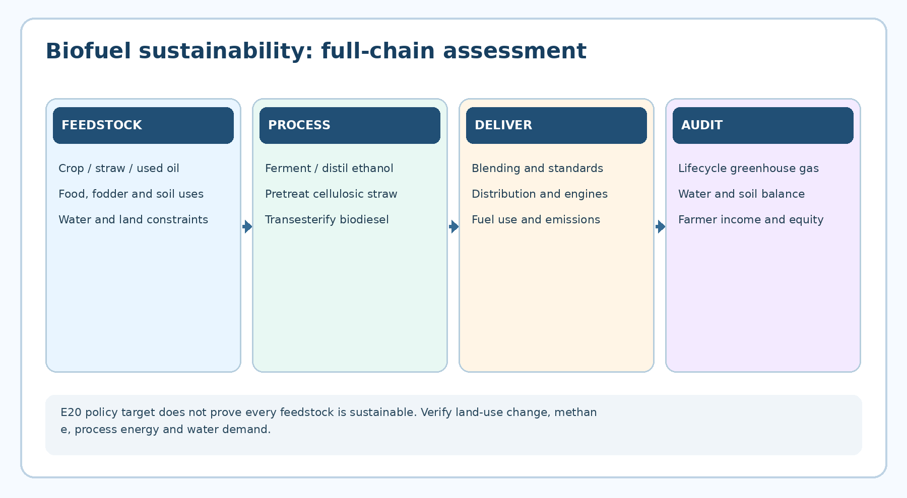

# Energy Resources: Indian Demand, Conventional and Renewable Sources, Energy Security and Biofuels

**TGPSC Group I · Paper V · Unit I · Topic 5 · English · 24 October 2026 · Published learning draft / NOT academically approved**

## Official syllabus and examination map

The original Telangana Public Service Commission Notification No. 02/2024, Annexure II, Paper V, Unit I, Item 5 specifies: **“Energy Resources: Energy demands, Indian energy scenario- hydel, thermal and nuclear. Importance of renewable resources - Solar, Wind, small/Mini/Micro hydel, Biomass, waste based, geothermal, tidal & fuel cells. Energy security - Role of Science & Technology, Bio-fuel cultivation and extraction.”** [S01] The wording has been authenticated from the commission-hosted document, not reconstructed from an informal coaching outline.

| Syllabus phrase | Sections | Essential exam distinction |
|---|---|---|
| Energy demands | 1, 13, 14 | Power (MW) versus energy (MWh), final services, peak and annual demand |
| Indian hydel, thermal and nuclear scenario | 2–5 | Dispatchability, emissions, reservoir constraints and nuclear safety |
| Solar and wind | 6–7 | Irradiance versus irradiation, resource versus delivered generation |
| Small/mini/micro hydel | 8 | Site-specific head/flow and MNRE's ≤25-MW small-hydro convention |
| Biomass and waste-based energy | 9–10 | Feedstock lifecycle, segregation and circular-economy hierarchy |
| Geothermal and tidal | 11 | Technical potential versus commissioned capacity |
| Fuel cells | 12 | Hydrogen carrier versus electricity generator versus battery |
| Energy security and S&T | 13–14, 16 | Resilience, affordability, grid integration and efficiency |
| Biofuel cultivation and extraction | 15 | Feedstocks, conversion, E20 policy, food-water-soil trade-offs |

**Question provenance:** The 30 MCQs and six mains questions below are original practice, not official TGPSC previous-year questions. No official PYQ is claimed without an original question paper and question number. Source keys refer to a dated primary-source register; no source page-number citations are inserted into student-facing text.

## Executive summary

India's energy system must supply services reliably while reducing pollution, import vulnerability and greenhouse-gas emissions. Thermal stations provide dispatchable electricity but have emissions and fuel costs; hydro offers flexible generation yet competes with water and ecological needs; nuclear provides firm low-operational-carbon electricity but requires strict safety and waste governance. Solar and wind are expanding rapidly, though nameplate capacity is not guaranteed evening supply. Small hydel, biomass, waste-to-energy, geothermal, tidal and fuel cells have distinct site, feedstock or conversion constraints. Energy security rests on diversified generation, flexible grids, storage, efficiency, affordable access and supply-chain resilience. Telangana's 2025 Clean and Green Energy Policy creates a ten-year framework, but policy targets must not be confused with commissioned plants. Biofuels can reduce petroleum dependence if land, water, food security and lifecycle emissions are governed carefully.

## Standalone quick revision: 32 examinable distinctions

1. Energy service means lighting, mobility, pumping or heat; kWh is one possible input.
2. 1 MW is a power rate; 1 MWh is energy produced by 1 MW for one hour.
3. 1 BU = 1 billion kWh = 1 TWh.
4. Capacity factor = actual generation / theoretical full-capacity generation.
5. Installed non-fossil capacity is not the same as non-fossil electricity generated.
6. MNRE reported 300.50 GW non-fossil capacity on 31 July 2026, not 300.50 GW of annual output.
7. Solar 164.59 GW, wind 58.14 GW, hydro 57.24 GW, bio-power 11.75 GW, nuclear 8.78 GW: dated July 2026 capacities.
8. Coal steam plants use the Rankine cycle; supercritical conditions improve efficiency.
9. Flexible thermal operation aids variable renewable integration but causes cycling costs.
10. Hydropower P ≈ ρgQHη; head and flow are both necessary.
11. Pumped storage consumes more pumping electricity than it later recovers.
12. Reservoir hydro has ecological, sediment, displacement and irrigation trade-offs.
13. Fission is a controlled nuclear chain reaction; uranium is not renewable.
14. AERB regulates radiological safety; NPCIL operates civilian nuclear power reactors.
15. PV cells produce DC; grid inverters supply conditioned AC.
16. Irradiance (W/m²) differs from irradiation (kWh/m² over time).
17. Ordinary grid-tied rooftop PV does not necessarily run during a blackout.
18. Wind-resource kinetic power is proportional to speed cubed; real turbine curves have limits.
19. The Betz ideal rotor limit is approximately 59.3%.
20. MNRE generally treats ≤25-MW hydropower as small hydro; mini/micro thresholds vary by context.
21. Biomass is not inherently carbon neutral when land, transport and methane are considered.
22. Wet organic wastes are candidates for anaerobic digestion; dry residues for combustion/gasification.
23. Waste prevention and recycling precede justified energy recovery.
24. Geothermal electricity needs a viable subsurface heat and flow resource; heat pumps differ.
25. Tidal energy requires marine tidal movement, not merely a nearby river.
26. Hydrogen is an energy carrier; a fuel cell needs continuing external fuel.
27. Electrolysis plus hydrogen storage plus fuel cell has round-trip losses.
28. Batteries and pumped storage shift energy; neither creates energy.
29. Energy security includes reliability, affordability, access, resilience and sustainability.
30. India's E20 target was advanced to ESY 2025–26 by the 2022 biofuel-policy amendment.
31. Telangana Clean and Green Energy Policy: G.O.Ms.No.2, 11 January 2025, ten-year operation.
32. All 2026 capacity and policy statistics must be accompanied by their observation or notification dates.

## High-value technology comparison

| Technology | Primary conversion | Main advantage | Binding limitation or risk | Typical Telangana relevance |
|---|---|---|---|---|
| Coal thermal | Combustion → steam turbine | Dispatchable bulk power | CO₂, ash, pollution, water and fuel | Coal-linked supply and transition planning |
| Reservoir hydro | Water head/flow → turbine | Flexible peaking and storage | River ecology, water competition | Krishna-basin operations |
| Nuclear | Fission heat → turbine | Firm low-operational-carbon power | Safety, cost, waste and schedule | National grid supply, not presumed local plant |
| Solar PV | Photons → DC → AC | Modular, scalable daytime supply | Nighttime, land, network and storage | Rooftop, institutional and utility sites |
| Wind | Air kinetic energy → rotor | Low operational emissions | Site resource, variability and transmission | Site-specific wind potential |
| Small hydel | Stream/canal head → turbine | Decentralised local power | Seasonal flow, ecological diversion | Canal-drop feasibility studies |
| Biomass | Organic carbon → heat/gas | Residue valorisation and rural jobs | Logistics, soil impacts, lifecycle emissions | Rice, dairy and agro-processing clusters |
| Waste-to-energy | Segregated waste → gas/heat | Residual waste management | Mixed-waste quality, air emissions | Urban and institutional organic waste |
| Geothermal | Earth heat → thermal cycle | Potential steady generation | Drilling and reservoir uncertainty | Exploratory Godavari-basin prospects |
| Tidal | Sea-level/current movement | Predictable resource timing | Marine cost and ecological impact | National option, not local tidal generation |
| Fuel cell | Hydrogen + oxygen → electricity | Modular electrochemical conversion | Hydrogen supply and full-chain losses | Industrial pilots and clean-tech manufacture |

## Detailed textbook notes

### Section 1. Understanding energy demand: services, units, sectors and development

Energy is not demanded for its own sake. Households need illumination, cooling, cooking and mobility; farmers need pumping and machinery; factories require process heat, motive power and uninterrupted control systems. Economists therefore distinguish **final energy services** from the electricity, fuels and infrastructure used to deliver them. A village with efficient pumps may irrigate the same area using fewer kilowatt-hours. An urban building with passive ventilation may achieve thermal comfort without proportionately higher electricity use. Treating demand as a fixed quantity that can only be met by constructing more generation capacity conceals these choices. The examiner expects both supply-side expansion and demand-side efficiency.

Primary energy is energy embodied in resources before conversion, such as coal, crude oil, sunlight and uranium. Secondary energy includes electricity and refined petroleum products. Final energy is delivered to consumers; useful energy is what actually reaches a task after losses. A coal plant loses substantial primary heat during conversion; an electric motor loses comparatively little final electricity when turning a pump. Thus primary-energy shares, electricity-generation shares and installed-power-capacity shares are different statistics. A grid may have a majority of non-fossil installed capacity while coal still supplies most annual electrical energy because technologies operate at different capacity factors and dispatch schedules. India’s July 2026 non-fossil installed capacity of 300.50 GW is a dated capacity measure, not a claim that 54% of electricity consumed that month came from non-fossil sources [S02].

Power is a rate: 1 kilowatt (kW) = 1,000 joules per second; energy is power multiplied by time. A 1-kW appliance used for five hours consumes 5 kWh, commonly called five units of electricity. A megawatt (MW) equals 1,000 kW; a gigawatt (GW) equals 1,000 MW. One billion units (BU) is one billion kWh, or one terawatt-hour (TWh). Capacity factor is actual energy generated over a period divided by the energy that would be generated at continuous rated output. It differs from plant availability: a wind turbine can be mechanically available while wind is insufficient. A 100-MW solar plant at 20% annual capacity factor produces approximately 175.2 million kWh, not 876 million kWh. These conversions matter in both data interpretation and policy appraisal.

Demand changes hourly and seasonally. Air conditioning raises afternoon and evening peaks; irrigation schedules, festivals, monsoon cloud cover and industrial shifts modify load shapes. **Peak demand (MW)** tests instantaneous adequacy, while **annual requirement (BU)** tests total energy supply. A 24-hour average hides an evening shortfall. Distribution losses include technical resistance losses and commercial losses such as metering errors and non-payment; both affect financial sustainability, but they require different remedies. India must therefore coordinate generation, transmission, distribution, storage, efficiency and affordable access rather than celebrate nameplate capacity alone. In Telangana, free or subsidised farm electricity can support livelihoods but also weakens the price signal for efficient pumps and groundwater conservation unless accompanied by feeder monitoring, reliable supply and water governance. [S03][S04]

### Section 2. India's energy scenario: hydel, thermal and nuclear in one system

India’s energy transition starts from a mixed infrastructure base. Coal-fired stations provide dispatchable bulk power and industrial employment; hydroelectric stations offer low-operational-carbon energy and, where reservoirs permit, rapid ramping; nuclear plants provide high-capacity-factor low-operational-carbon output; solar and wind are expanding quickly but depend on weather and time of day. The electricity system is a portfolio, not a contest in which one technology replaces every other. Coal dependence raises local air pollution, ash disposal, water stress and greenhouse-gas emissions. Abrupt closure without alternative firm capacity, transmission and worker transition can create shortages. Conversely, postponing clean investment locks in fuel and health costs. A credible policy sequence addresses both reliability and decarbonisation.

The Central Electricity Authority (CEA) maintains monthly installed-capacity reports and long-term generation plans; Grid-India operates system-level grid coordination; the Ministry of Power sets national policy; the Ministry of New and Renewable Energy (MNRE) supports renewables; the Department of Atomic Energy oversees the nuclear sector. Electricity is largely a concurrent constitutional subject, so central statutes coexist with state regulatory and distribution responsibilities. Telangana's TGGENCO develops state generation; TGTRANSCO operates state transmission functions; distribution licensees serve consumers under the state regulator's oversight. The precise organisational names and jurisdictions should be checked against current government records before a mains answer asserts a new restructuring.

A dated snapshot illustrates the transformation: the 9 August 2026 government release reports that on 31 July 2026 India had **164.59 GW solar, 58.14 GW wind, 57.24 GW large and small hydro, 11.75 GW bio-power and 8.78 GW nuclear**, totalling 300.50 GW non-fossil installed capacity [S02]. The release says total installed capacity was around 552 GW. These rounded figures do not describe annual output, and different official dashboards may have different cut-off dates or classification conventions. The 500-GW non-fossil 2030 goal is a target, not an achieved milestone. The July 2026 snapshot can be quoted only with its date.

Three evaluation questions prevent superficial comparisons. First, how much dependable power is available during a stressed evening? Second, what is the lifetime system cost, including transmission, fuel, storage, land, water, decommissioning and environmental mitigation? Third, who bears transition costs and receives benefits? Hydropower may displace thermal generation but alter river ecology; nuclear may provide firm low-carbon output but needs rigorous safety governance; solar can be rapidly deployed yet may require land and network upgrades. Public administration must weigh these consequences explicitly. [S03][S05]

### Section 3. Thermal electricity: Rankine cycle, fuels, pollution and flexibility

A conventional coal-fired thermal station converts chemical energy into heat, uses a boiler to produce high-pressure steam, expands the steam through a turbine, turns an alternator and condenses the exhaust steam for recirculation. The basic Rankine cycle contains boiler, turbine, condenser and feed-water pump. Supercritical and ultra-supercritical designs operate at higher steam conditions to improve thermal efficiency, although their benefits depend on fuel quality, maintenance and operating pattern. India also operates gas-fired generation using gas turbines and combined-cycle plants. A combined cycle captures hot gas-turbine exhaust in a heat-recovery steam generator, improving efficiency relative to an open-cycle gas turbine.

Fuel characteristics matter. Indian coal often has high ash content; mining, transport and combustion generate particulates, sulphur dioxide, nitrogen oxides and ash-handling challenges. Electrostatic precipitators remove particulates; flue-gas desulphurisation targets SO₂; low-NOx burners and other measures reduce nitrogen oxides. Fly ash can be used in cement, bricks and construction subject to quality controls, but reuse is not permission to contaminate soil or water. Cooling systems withdraw and consume water, while thermal discharge may affect aquatic ecology. Emissions standards, continuous monitoring and enforcement matter as much as the existence of pollution-control equipment. Carbon dioxide from fossil combustion remains a climate problem even if local particulate emissions are controlled.

Thermal stations increasingly face **flexible operation** as daytime solar output grows. A plant designed for steady baseload may be asked to ramp down at noon and ramp up after sunset. Cycling increases wear, auxiliary consumption and maintenance costs; minimum stable load, ramp rate and reserve requirements constrain dispatch. A thermal plant that can ramp faster has system value even if it produces fewer annual units. Grid planners should evaluate reliability contribution rather than equate high annual plant-load factor with efficiency in every circumstance. Carbon capture, utilisation and storage is technically possible but adds cost and energy penalties and should not be presented as universal commercial deployment.

Telangana illustrates the institutional tension. The Yadadri Thermal Power Station at Damaracherla and Singareni-linked coal infrastructure connect electricity security to local jobs, land, ash and water issues. Coal-mining communities need occupational safeguards and eventual economic diversification; households need affordable, dependable power. An exam answer should avoid inventing an up-to-date commissioning percentage for Yadadri without a dated TGGENCO or CEA source. A balanced proposal would improve plant efficiency and emissions monitoring, modernise dispatch, protect workers and progressively add flexible clean supply. [S03][S06]

### Section 4. Hydropower: conversion, river systems and social choices

Hydropower converts gravitational potential energy of water into turbine shaft power and then electricity. The approximate equation is **P = ρgQHη**, where ρ is water density, g gravitational acceleration, Q flow in cubic metres per second, H net head in metres and η overall efficiency. A project with 20 m³/s flow, 50 m net head and 90% efficiency produces about 8.83 MW. A reservoir project can store water and dispatch electricity when needed; a run-of-river project typically has less seasonal storage and more direct dependence on flow. Turbine selection depends on head and discharge: Pelton suits high head, Francis intermediate ranges and Kaplan lower head/high flow, with overlap in real engineering designs.

Hydro is renewable in the water-cycle sense, but its impacts are not negligible. Reservoirs inundate land, alter sediment transport and fish migration, change downstream flow timing and can displace settlements. Drought reduces generation, while extreme inflows increase dam-safety demands. Environmental-flow requirements, catchment treatment, cumulative-basin impact assessment, rehabilitation and reservoir operating rules are therefore core parts of project appraisal. Climate change affects rainfall intensity and seasonal predictability; a historical inflow record may not fully describe future risk. Small hydel avoids some very large reservoir effects but can still fragment streams when many projects occur in one basin.

**Pumped-storage hydropower (PSH)** is primarily an energy-storage system, not a net producer of energy. It pumps water uphill when electricity is abundant or cheap and releases it through turbines later. Round-trip efficiency is below 100%, so more electricity is consumed in pumping than recovered. Nevertheless, PSH provides valuable evening peak supply, reserves and grid flexibility. Its economics depend on daily price differences, site geology, reservoir availability and transmission access. Closed-loop designs can reduce direct river interactions but still require land, water and environmental assessment.

Telangana has existing hydropower associated with Krishna-basin infrastructure, but the legal and operational context is shared with interstate river management and irrigation. Water stored for electricity may also be required for drinking, crops and ecological flows; the opportunity cost of releasing water today can be high during a dry spell. Decision-makers must coordinate irrigation departments, dam operators and power dispatchers. The Telangana Clean and Green Energy Policy 2025 includes energy storage and renewable integration; this is a policy framework, not evidence that every announced pumped-storage site is operating. [S07][S08]

### Section 5. Nuclear energy: fission, safety, fuel cycle and governance

Nuclear fission releases energy when a heavy nucleus such as uranium-235 absorbs a neutron and splits, releasing heat, fission products and further neutrons. A controlled chain reaction requires a reactor core, coolant, neutron moderation or appropriate fast-spectrum design, control rods and multiple containment barriers. Heat ultimately drives a turbine-generator, but the reactor is not a chemical combustion boiler. Pressurised heavy-water reactors (PHWRs) use heavy water as moderator and coolant in a design suitable for natural uranium fuel; other reactor types include light-water and fast-breeder designs. India’s three-stage nuclear programme envisages uranium-based reactors, plutonium-based fast breeders and eventual greater thorium utilisation, but future-stage aspirations must not be described as fully realised commercial supply.

Nuclear electricity has low direct operating carbon emissions and can provide firm output independent of sunshine or wind. It also entails high upfront capital, long construction schedules, strict quality assurance, spent-fuel management, decommissioning obligations and rare but potentially severe accident consequences. Radiation protection uses time, distance, shielding, containment and monitoring; safety culture is not merely a checklist. Site selection must address seismicity, flooding, cooling water, emergency planning and population exposure. The Atomic Energy Regulatory Board (AERB) is the key safety regulator, while the Nuclear Power Corporation of India Limited (NPCIL) operates many civilian nuclear stations. International Atomic Energy Agency standards are influential, but Indian statutory duties and licence conditions govern Indian installations.

A nuclear plant's capacity factor can be high, yet outages for refuelling or maintenance still occur. Nuclear should not be described as completely 'renewable': uranium is a finite mineral, even though fission produces low-carbon electricity. Nor should radioactive waste be conflated with routine coal ash. Spent fuel remains hazardous and requires shielding, cooling, accounting and long-term management; the risks and pathways differ. Comparative lifecycle analysis should include mining, plant construction and decommissioning, not just stack emissions.

Telangana students should know that the state's energy security can include electricity from national and interstate sources without assuming a nuclear reactor exists in Telangana. A balanced mains answer weighs firm low-carbon supply against financing, safety, waste and public consultation. The July 2026 national figure of 8.78 GW nuclear installed capacity [S02] is a dated capacity statistic, not a promise of nuclear expansion. [S09][S10]

### Section 6. Solar energy: photovoltaics, solar thermal and deployment design

Photovoltaic (PV) cells convert light directly to electrical energy using a semiconductor junction. Photons with sufficient energy generate electron-hole pairs; the cell's internal electric field separates charge, producing direct current. Inverters convert DC to grid-compatible alternating current, and maximum-power-point tracking adjusts operating conditions to extract available output. Irradiance, cell temperature, shading, soiling, module degradation and inverter performance determine actual generation. Solar **irradiance** is instantaneous power per unit area (W/m²); **insolation** or irradiation is accumulated energy per unit area over time (kWh/m²/day). A sunny location does not automatically guarantee high output if panels are poorly oriented, shaded or unmaintained.

A PV module's nameplate watt-peak rating is measured under standard test conditions, not the power it will deliver every hour. The performance ratio accounts for system losses; capacity factor additionally reflects the solar resource and annual operating time. Solar thermal collectors, by contrast, capture heat for water or process heating. Concentrated solar power uses mirrors and a thermal cycle and may incorporate thermal storage, but its cost and site needs differ from rooftop PV. Rooftop solar can reduce distribution losses near demand and use existing built space; utility-scale parks benefit from scale but require land, grid evacuation and environmental assessment.

Net metering, gross metering and behind-the-meter self-consumption have different financial effects. A net-metered household offsets imports according to regulator rules; a gross-metered system sells generation separately; a battery-backed system can shift energy into evening hours but adds capital cost and conversion losses. The tariff, sanctioned load, transformer capacity, safety isolation, fire risk, roof condition and consumer class must be examined. Distribution utilities face revenue and cross-subsidy issues if high-paying consumers reduce grid purchases while still depending on network backup. Policy should make tariffs transparent and protect low-income consumers.

Telangana's 2025 policy identifies rooftop, floating and distributed solar opportunities [S07]. Floating solar may reduce direct land occupation but must address reservoir operations, aquatic ecology, anchoring, wind and maintenance. A government-school rooftop project is useful only if the roof is structurally sound, the installation is safely connected and teachers know how to report faults. Telangana's abundant sunshine is an advantage, but demand peaks, grid congestion and storage economics determine the value of each additional megawatt. [S11]

### Section 7. Wind energy: resource assessment, turbines and system integration

Wind turbines extract part of the kinetic energy in moving air. The available power passing through a rotor is proportional to **½ρAv³**, where ρ is air density, A rotor swept area and v wind speed. Actual captured power is lower because the rotor cannot extract all kinetic energy; the Betz limit sets a theoretical upper bound of about 59.3% for an ideal actuator disc. The cubic dependence on wind speed explains why a small change in site wind conditions can radically change energy output. Turbine hub height, turbulence, air density, wake interactions and seasonal monsoon patterns therefore matter more than simply measuring average wind speed near the ground.

A modern turbine includes blades, hub, drivetrain or direct drive, generator, yaw system, pitch control and power electronics. It begins producing at cut-in speed, reaches rated output at higher speeds and shuts down above cut-out speed to protect equipment. Wind farms require wind-resource measurements over representative periods, micrositing to reduce wake losses, grid connection and maintenance access. Onshore and offshore wind have different foundations, costs and environmental effects. Hybrid wind-solar projects can smooth some variability because their seasonal or daily generation patterns may differ, but they do not guarantee constant supply.

Wind projects can affect birds and bats, landscape views, noise perception and land access; impacts depend on siting and mitigation rather than the mere presence of turbines. Local communities may receive leases and jobs but also face land-use restrictions. A project appraisal should disclose who receives rents, whether common grazing access changes and how biodiversity monitoring will be conducted. Transmission may be the binding constraint even when the wind resource is excellent. Curtailment means available generation is reduced for grid, market or system reasons; it is not identical to poor wind conditions.

Telangana's policy documents identify significant technical wind potential at specified hub heights, but **resource potential is not installed generation**. A windy site may still be uneconomic if it is far from transmission, environmentally sensitive or affected by complex terrain. The practical exam conclusion is that site-specific measurements, community consultation and dispatch planning convert theoretical potential into useful electricity. [S07][S12]

### Section 8. Small, mini and micro hydel: decentralised electricity and constraints

The Indian MNRE convention generally classifies hydro projects of **25 MW or below** as small hydro; subdivisions called mini and micro are used in educational and programme contexts but their precise thresholds may differ by scheme. Never apply an arbitrary universal micro-hydro cut-off to every Indian regulation. Small hydro may use canals, run-of-river drops, existing dams or village streams. A diversion weir channels part of the flow through an intake and penstock to a turbine before returning water downstream. Canal-drop projects may exploit infrastructure already built for irrigation, potentially lowering incremental civil works, but they still require reliable head and flow.

The engineering equation remains P = ρgQHη. For a village stream with net head 12 m, flow 0.5 m³/s and 65% total efficiency, theoretical electrical output is about 38 kW. That can serve essential community loads if flows are dependable; it is not proof that the stream can support the same output in the dry season. Hydrological flow-duration curves are crucial. Design discharge chosen from monsoon peaks may produce an oversized turbine that sits idle in summer. Sediment, debris, fish passage, access roads and maintenance skills must be budgeted.

Decentralised hydro can be useful where grid extension is expensive or unreliable. A mini-grid still needs protection relays, frequency regulation, metering, safe distribution and a governance arrangement for collecting maintenance funds. Productive uses—rice milling, cold storage, workshops—can improve economic viability by creating daytime demand. Conversely, a hydro plant serving only evening lighting may have poor utilisation. Hybrid systems with solar, batteries or backup generation can improve reliability, but add operational complexity. In India, grid-connected small hydro also competes with other renewable sources on cost and speed of deployment.

Telangana's semi-arid and seasonal hydrology limits assumptions about perennial streams. Canal-drop opportunities must be assessed jointly with irrigation authorities because altering flows for power may conflict with crop water schedules. A district project report should compare annual dependable generation, dry-season flows, ecological impact, tariff and alternative solar-plus-storage options. The proper answer is neither 'all small hydro is environmentally harmless' nor 'small hydro has no role'; it is conditional, site-specific evaluation. [S13]

### Section 9. Biomass: photosynthesis, feedstock logistics and conversion routes

Biomass stores solar energy through photosynthesis in plant material and associated organic residues. Feedstocks include crop straw, bagasse, animal dung, forestry residues and segregated organic wastes. Energy can be obtained through direct combustion, gasification, anaerobic digestion, fermentation or transesterification depending on moisture, composition and intended fuel. Biomass is **not automatically carbon neutral**. Its lifecycle emissions depend on land-use change, fertiliser, collection, drying, transport, methane leakage and whether regrowth or residue replacement occurs. Removing too much crop residue can damage soil organic matter and increase erosion.

Direct combustion burns dry biomass to produce heat or steam. Cogeneration, or combined heat and power, uses the same fuel for industrial process heat and electricity, often improving total useful-energy efficiency. Bagasse cogeneration in sugar mills is a classic example. Gasification converts solid feedstock under limited oxygen into combustible producer gas, which needs cleaning before engine or thermal use. Torrefaction and pelletisation improve handling and energy density but consume energy and capital. Feedstock heterogeneity, seasonal supply and ash chemistry make biomass operations more complex than simply installing a boiler.

Anaerobic digestion uses microorganisms to break down wet organic matter without oxygen, producing biogas rich in methane and carbon dioxide. Purification can yield compressed biogas (CBG/Bio-CNG). Digestate may be a fertiliser if contaminants and pathogens are controlled. Biogas leaks undermine climate benefits because methane is a powerful greenhouse gas. For Telangana, cattle dung, poultry litter, municipal market waste and agro-processing residues can be candidate feedstocks, but a district plant needs an audited supply contract, segregation, water balance, odour control and off-take agreement. A proposed rice-straw plant should not assume every farmer will surrender residues for free.

MNRE's National Bioenergy Programme Phase I ran from FY 2021–22 to FY 2025–26, and its BioUrja portal specifies application windows and budget constraints [S14][S15]. As of October 2026, one should not state that Phase I subsidies remain open merely because an old scheme page is online. Evaluate viability using delivered feedstock cost, plant uptime, product quality, collection radius and waste-disposal benefits. This is a technology, logistics and governance problem simultaneously.

### Section 10. Waste-to-energy: segregation, emissions and circular economy

Waste-to-energy (WtE) covers several distinct processes: anaerobic digestion of wet biodegradable waste, combustion of suitable dry fractions, refuse-derived fuel, gasification and certain pyrolysis applications. A city should first reduce waste generation, promote reuse, segregate materials and recover recyclables; energy recovery is not a substitute for the waste hierarchy. Mixing wet food waste with plastics and inert material lowers calorific value and raises processing problems. High moisture can make mass-burn incineration inefficient without auxiliary fuel. Source segregation is therefore a technical precondition as well as a civic obligation.

A biomethanation facility uses organic material to produce biogas and digestate; it requires removal of plastics, metals and other contaminants. An incinerator combusts waste and can recover heat as steam and electricity, but must control particulates, acid gases, dioxins and heavy metals. Bottom ash and fly ash require appropriate handling and disposal. Gasification and pyrolysis produce intermediate gases or oils under different oxygen and temperature conditions; calling them 'zero-emission' is scientifically false. Waste composition, continuous emissions monitoring, contractual risk and ash disposal must be specified in public tenders.

**Energy recovered** and **waste diverted from landfill** are separate performance indicators. A plant may report megawatt-hours while still sending significant rejects to disposal. Contracts that guarantee a minimum tonnage of waste can perversely discourage upstream waste reduction. Public procurement should avoid such incentives or include explicit recycling protections. Waste-picker livelihoods matter: informal workers often recover high-value materials, and exclusion from formal systems can reduce recycling rates while creating social harm. Integrated city plans should support safe working conditions and recognised material-recovery roles.

MNRE's WtE programme supports specified biogas, BioCNG, power and syngas projects from urban, industrial and agricultural residues, but detailed eligibility and assistance vary by technology and scheme phase [S15]. Telangana urban local bodies must separately comply with applicable solid-waste rules and pollution-board consents. No blanket claim should be made that every municipal incineration project receives MNRE subsidy. The exam conclusion is a hierarchy: prevent, segregate, recover materials, biologically treat suitable organics, recover energy from justified residual streams, and safely dispose of unavoidable rejects.

### Section 11. Geothermal, tidal and other emerging resources

Geothermal energy exploits heat stored in the Earth's interior. At favourable sites, hot water or steam can directly drive a turbine; lower-temperature resources may use an organic Rankine-cycle binary plant with a secondary working fluid. Ground-source heat pumps use relatively stable shallow ground temperatures for heating and cooling but should not be confused with electricity-producing geothermal fields. Resource evaluation requires temperature gradients, permeability, sustainable reservoir recharge, drilling cost and reinjection design. Geothermal can provide relatively steady output where geology is favourable, but exploration risk and induced seismicity or fluid chemistry can be significant.

India has identified geothermal prospects, including the Godavari basin, yet **prospective resource is not commissioned electrical capacity**. Telangana-related discussions of Singareni or regional geothermal potential should be framed as exploration or proposals unless a dated official commissioning document is available. Geothermal brines may contain dissolved minerals and gases; corrosion, scaling and groundwater protection require attention. The economic bottleneck is often expensive drilling before resource productivity is confirmed. Demonstration projects are useful for learning but cannot be extrapolated into assured gigawatts without field data.

Tidal power uses the predictable rise and fall of sea level or tidal currents; tidal-range schemes may employ barrages or lagoons, while tidal-stream turbines resemble underwater wind machines. Wave energy, a separate resource, extracts energy from surface-wave motion. Tidal timing is predictable, but marine construction, corrosion, sedimentation, navigation, fisheries and ecological changes raise costs. Coastal sites such as the Gulf of Khambhat and Gulf of Kutch are discussed for potential, not proof of widespread operating commercial plants. Landlocked Telangana cannot directly host tidal generation, although national grid purchases and manufacturing supply chains could connect it economically to marine energy.

Emerging resources should be compared using technology-readiness level, reliable energy yield, lifetime cost, grid value, ecological impact and local industrial capacity. A resource map shows physical potential; a pilot demonstrates technical feasibility; a bankable project requires finance and regulatory approvals; commercial deployment requires repeatable performance. These stages should not be collapsed into a single 'available capacity' figure. For a mains answer, geothermal and tidal are useful diversification options but are not near-term substitutes for the established solar, wind, hydro, nuclear and thermal fleet. [S16]

### Section 12. Fuel cells and hydrogen: conversion, storage and realistic uses

A fuel cell is an electrochemical device that converts the chemical energy of a continuously supplied fuel and oxidant into electricity. In a proton-exchange-membrane (PEM) hydrogen fuel cell, hydrogen at the anode is split into protons and electrons; electrons flow through an external circuit, while protons cross the membrane and react with oxygen at the cathode to form water. Unlike a battery, a fuel cell is not a fixed inventory of stored electrochemical reactants; it requires external fuel supply. Unlike an internal-combustion engine, it need not burn hydrogen in a flame. The complete system includes hydrogen storage, pressure regulation, air handling, cooling, power electronics and safety controls.

Hydrogen is an **energy carrier**, not a freely available primary source. 'Green hydrogen' generally refers to hydrogen produced by electrolysis using renewable electricity; grey hydrogen is typically made from fossil feedstock without carbon capture, and blue hydrogen adds carbon capture with variable effectiveness. Electrolysis, compression, transport and fuel-cell conversion each lose energy. Consequently, using renewable electricity directly in a grid or battery-electric vehicle is often more efficient than converting it into hydrogen and back. Hydrogen may nevertheless be valuable in hard-to-electrify industrial processes, fertiliser, certain transport applications and seasonal storage where direct electrification is difficult.

Fuel-cell advantages include modularity, potentially low local emissions and rapid refuelling for some applications. Challenges include platinum-group catalysts in some designs, membrane durability, hydrogen leakage, high-pressure storage, infrastructure cost and overall round-trip efficiency. Hydrogen combustion can also produce nitrogen oxides depending on conditions; a fuel cell's electrochemical operation differs. Safety planning addresses ventilation, leak detection, ignition sources and appropriate standards. A 'water-only exhaust' claim is incomplete if upstream hydrogen production relies on fossil fuels.

India's National Green Hydrogen Mission, approved in 2023, seeks to support a domestic ecosystem, with an aspiration of at least five million metric tonnes of green hydrogen annually by 2030 [S17]. Telangana's policy and investment material identifies green hydrogen, ammonia, methanol and clean-tech manufacturing as opportunities [S07][S18]. These are policy targets and project pipelines, not verified operating production. An exam answer should distinguish hydrogen manufacture, electricity storage, industrial feedstock and fuel-cell end use, and evaluate each on full-system economics and emissions.

### Section 13. Energy security: availability, affordability, resilience and sustainability

Energy security means more than possessing domestic fuel. It requires **availability**, **affordability**, **access**, **reliability**, **resilience** and **environmental sustainability** across fuels and electricity. A country may have abundant coal reserves but suffer transport bottlenecks; it may install large solar capacity but lack evening storage; it may have adequate generation but financially distressed distribution companies that cannot maintain supply. Dependence on imported crude oil exposes India to international price and geopolitical shocks, while dependence on imported solar modules, critical minerals or battery cells creates different supply-chain risks. Diversification reduces some risks but cannot eliminate all of them.

The electricity grid requires second-by-second balancing of supply and demand. Frequency deviates when generation and load differ; system operators use reserves, scheduling, ancillary services and automatic controls to maintain stability. Variable renewable output is forecast rather than assumed constant. Flexible thermal and hydro generation, interregional transmission, demand response, pumped storage and batteries provide complementary flexibility. Grid-scale batteries can respond quickly and shift energy over hours; they do not create energy. Long-duration storage may require pumped hydro, thermal storage, hydrogen or other technologies depending on costs and geography. Distributed solar plus storage can strengthen critical facilities but islanding requires safe controls.

Energy security also has a social dimension. Cooking-fuel access affects indoor air quality; farm electricity affects irrigation and groundwater; electricity tariffs influence small-industry competitiveness. Subsidies can advance equity but may be poorly targeted or fiscally unsustainable. An effective reform separates social assistance from inefficient technical operations, improves metering and loss reduction, and protects vulnerable consumers during tariff transitions. Local participation and transparent land compensation reduce conflict around energy infrastructure.

For Telangana, an integrated plan would test a severe evening heatwave scenario: cooling demand peaks, solar output declines after sunset, hydro releases are constrained by water needs and a transmission line fails. Planners should quantify available reserves, feeder priority, storage duration and restoration procedures. Energy security should be measured by unserved energy, outage duration, affordability and exposure to fuel shocks—not only by megawatts installed. This risk-based view links energy policy to disaster management and public finance. [S03][S05][S19]

### Section 14. Science and technology as the engine of energy transition

Science and technology contribute at three levels: **discovery** (materials, electrochemistry, geoscience), **engineering** (efficient turbines, modules, inverters, reactors and batteries) and **systems integration** (forecasting, markets, grid controls and maintenance). Materials research can improve PV conversion efficiency or battery cycle life, but laboratory efficiency does not directly translate into utility-scale project economics. Manufacturing quality, supply chains, standards, skilled technicians and field testing determine deployment. An energy transition therefore needs research institutions, industrial policy and training as well as subsidies.

Smart grids use sensors, communications and control software to measure conditions and coordinate distributed resources. Advanced metering infrastructure can support accurate billing, outage detection and time-of-use tariffs; it also raises privacy, cybersecurity and consumer-dispute issues. SCADA systems supervise substations and generation plants, while energy management systems estimate network state and dispatch. Forecasting combines meteorological data, load history and machine learning; a forecast must be tested against independent observations and updated during unusual weather. Artificial intelligence may improve predictive maintenance but cannot replace electrical protection logic or engineering accountability.

Demand-side technologies can be as important as new supply. Efficient irrigation pumps, variable-speed drives, LEDs, building envelopes, industrial waste-heat recovery and efficient cooling reduce energy required per unit of service. A rebound effect may occur if cheaper energy services encourage greater use, so measured savings must compare like-for-like outcomes. Standards, appliance labels and the Bureau of Energy Efficiency (BEE) help institutionalise efficiency. Life-cycle assessment compares resource extraction, manufacturing, operation and end-of-life impacts; it guards against shifting emissions from the power plant to battery manufacture or mining.

Policy instruments include research grants, demonstration procurement, performance standards, renewable consumption obligations, competitive auctions, concessional finance and targeted viability-gap support. Each has failure modes: subsidies can reward installed equipment that never operates; auctions can produce unrealistic bids; local-content requirements can raise costs if supply chains are immature. Public agencies should monitor delivered electricity, avoided outages, verified emissions and maintenance performance. Telangana's TGREDCO can connect national programmes to rooftop solar, energy efficiency and local capacity building, but technology adoption needs transparent project-level results. [S20][S21]

### Section 15. Biofuels: cultivation, conversion, blending and land-use ethics

Biofuels are liquid or gaseous transport fuels made from biological feedstocks. First-generation ethanol commonly comes from sugar- or starch-rich crops through fermentation and distillation; biodiesel can be produced by transesterifying vegetable oils or used cooking oils. Second-generation or advanced biofuels use lignocellulosic residues, wastes or other non-food feedstocks through pretreatment, enzymatic hydrolysis, fermentation, thermochemical conversion or upgrading. The phrase 'second-generation' does not guarantee low emissions: process energy, chemical inputs, feedstock transport and land-use effects must still be counted.

Ethanol production from sugarcane involves crushing, extraction of fermentable sugars or molasses, yeast fermentation and distillation/dehydration to fuel-grade ethanol. Grain-based ethanol requires milling, starch hydrolysis, fermentation and purification. Lignocellulosic residues contain cellulose, hemicellulose and lignin; pretreatment opens the structure, enzymes release sugars, and fermentation converts sugars into alcohol. Lignin may be used for process heat, but residues also have competing uses as soil cover, fodder and biomass fuel. Biodiesel production commonly reacts triglyceride oils with an alcohol in the presence of a catalyst, yielding fatty-acid esters and glycerol; feedstock quality and fuel standards matter.

The National Policy on Biofuels 2018, amended in 2022, advanced India's 20% ethanol-in-petrol blending target to the ethanol supply year 2025–26 [S22]. A January 2026 official background document reported average blending of 19.05% as of 31 July 2025 and 19.93% for July 2025; these are dated progress measures, not a claim that every petrol pump always supplied exactly E20 [S23]. Ethanol blending can reduce some petroleum imports and support farm-linked industries, but it can increase pressure on land and water if incentives drive water-intensive feedstocks in unsuitable regions. Blending also has engine-compatibility, distribution and fuel-economy implications.

Cultivation must be assessed through food-versus-fuel, feed-versus-fuel and water-versus-fuel trade-offs. Sweet sorghum, agricultural residues, used cooking oil and non-edible oilseeds may diversify feedstocks, but none is universally impact-free. Telangana's semi-arid districts need special attention to groundwater depletion and rain-fed crop resilience. A public procurement contract should reward verified lifecycle emissions savings, responsible sourcing and water efficiency, not simply litres produced. Farmers need stable prices, transparent quality tests and safeguards against monoculture. The strongest exam answer recognises biofuels as one instrument within transport electrification, efficiency and modal-shift strategies—not a universal substitute for petroleum. [S22][S23]

### Section 16. Telangana energy planning: cases, trade-offs and an integrated roadmap

Telangana faces a three-sided energy challenge: sustain reliable supply for cities, industry and agriculture; manage the fiscal and ecological consequences of subsidies and fossil generation; and invest in cleaner sources without sacrificing affordability. The **Telangana Clean and Green Energy Policy, 2025**, approved by G.O.Ms.No.2 dated 11 January 2025, establishes a ten-year policy framework [S07]. It supports renewable and storage development and identifies opportunities in distributed solar, wind, green hydrogen, energy storage and clean-tech manufacturing. Policy targets are aspirations; project announcements, tenders, construction and actual electricity delivered are distinct stages of implementation.

**Case A—rooftop solar at a government school.** The energy audit should record annual demand, daytime load, roof condition and local feeder voltage. A correctly sized PV system can reduce daytime purchases and serve as a teaching resource. Yet a grid-tied inverter usually shuts down during a grid outage unless designed with safe islanding and backup. Therefore, claims that ordinary rooftop PV automatically powers an emergency shelter during blackouts are false. Procurement should specify monitoring, insurance, roof repair responsibilities, inverter warranty and technician response times.

**Case B—agricultural pump efficiency.** A feeder supplying thousands of inefficient pumps may see substantial energy savings from correct pump sizing, improved motors, power-factor correction and efficient irrigation scheduling. But if water is free at the margin, improved pumping efficiency may encourage farmers to pump more groundwater. Energy savings and aquifer recovery are separate outcomes. Joint planning between electricity, agriculture and groundwater agencies should measure delivered water, crop productivity and aquifer levels. Subsidy design must protect smallholders while discouraging resource depletion.

**Case C—industrial reliability.** A pharmaceutical or data-centre facility needs high power quality and backup arrangements. Solar-plus-storage may reduce daytime energy cost, but critical loads require reliability studies, fault protection, redundant feeds and tested backup. Time-of-use tariffs and demand response can shift noncritical processes; waste-heat recovery may save more energy than a highly publicised rooftop project. Local employment opportunities arise in installation, O&M, inverter servicing, battery safety and power electronics, not only module manufacturing.

**Case D—Singareni and a just transition.** Coal-linked employment and state revenue cannot be ignored. Worker retraining, mine-land restoration, diversified industrial clusters and health monitoring should be designed before demand for coal employment contracts sharply. Conversely, protecting livelihoods cannot justify unlimited air pollution or uncosted long-lived fossil assets. A transparent transition plan tracks employment quality, energy affordability, environmental compliance and fiscal exposure. The policy debate is not 'coal workers versus climate' but how to allocate transition costs fairly.

**Integrated district decision framework.** Start with a five-year demand forecast by sector and hour; audit technical and commercial losses; map solar rooftops, wind resources, biomass residues and feasible storage; evaluate water, land and biodiversity constraints; assess financial and social impacts; then procure a portfolio through competitive and accountable processes. Publish project-level performance against promises and provide grievance channels. This framework converts a syllabus list of energy technologies into a practical Telangana governance answer. [S07][S18][S24]

## Five worked applications and decision exercises

### Application 1. Capacity factor and annual solar energy

A 75-MW photovoltaic facility operates for a 365-day year at an assumed 21% capacity factor. Maximum theoretical energy is 75 × 8,760 = 657,000 MWh. Expected energy is 657,000 × 0.21 = **137,970 MWh**, or **137.97 million units**. If the state's annual demand is 80,000 million units, the facility supplies roughly 0.172% of that annual energy, ignoring losses beyond those embedded in the capacity factor. This example illustrates why announcing 75 MW is not equivalent to promising 75 MW at the evening peak. An investment note should state whether the 21% assumption comes from a validated resource assessment, how degradation is modelled, and what curtailment or inverter losses are included. When comparing two solar sites, compare net metered annual output and grid value, not only module ratings.

### Application 2. Micro-hydel site assessment

A canal drop offers 8 m net head, 0.8 m³/s dependable design flow and 70% overall efficiency. Estimated power is 1,000 × 9.81 × 0.8 × 8 × 0.70 ≈ **43,949 W**, or **44 kW**. If the irrigation department supplies that flow only 2,000 hours per year, annual output is at most about 88,000 kWh before outages. The project may still serve a nearby pump or public facility, but the seasonal duty cycle makes a large capital investment difficult to justify. Feasibility should include the flow-duration curve, sediment load, canal safety, ownership, grid connection and competing water uses. A designer who multiplies 44 kW by 8,760 hours would overstate annual generation nearly fourfold in this case.

### Application 3. Comparing battery and pumped-storage options

Suppose a district requires 40 MW of additional evening supply for four hours: **160 MWh delivered**. A battery system with an assumed 85% round-trip efficiency requires about 188.2 MWh of charging electricity; a pumped-storage scheme at 75% requires about 213.3 MWh. These numbers are illustrative engineering assumptions, not verified project specifications. Pumped storage may have longer asset life and large-scale capacity but requires appropriate reservoirs, head and approvals. Batteries are modular and fast-responding but have degradation, thermal-management and end-of-life obligations. A fair comparison includes land, network losses, water, cycling, financing, reliability and the cost of electricity used for charging. Neither device should be counted as a primary generation source.

### Application 4. Biomass procurement and soil safeguards

A proposed rural biomass plant needs 100 tonnes of dry residues per day for 300 days: **30,000 tonnes annually**. District crop statistics might show 60,000 tonnes of theoretical residue, but not all is collectable: some remains as soil cover, some feeds animals, and some is unavailable during rain. If sustainable recoverability is only 35%, the supply is 21,000 tonnes—**9,000 tonnes short**. The developer should resize the plant, diversify feedstocks or reject the project rather than assume free residues. Contracts should specify moisture, contamination, seasonal prices and payment to farmers. A lifecycle assessment must also count collection transport and the fertiliser needed if residues are removed. The exercise shows why nominal feedstock potential is not bankable supply.

### Application 5. Heatwave reliability in Telangana

Imagine a hot evening when demand reaches 18 GW, solar output falls to 1 GW, dispatchable supply is 15.5 GW and contracted imports provide 0.8 GW. The immediate gap is **0.7 GW**, or 700 MW, before reserves and demand response. A 700-MW battery with one hour of usable energy covers only one hour, not a four-hour deficit. Four hours would require 2.8 GWh of delivered energy, plus charging losses. The state might combine flexible generation, pre-cooled buildings, industrial demand response, storage and network imports. Officials should distinguish technical capacity, contractual availability, actual state-level power flows and consumer-level service. The numbers are hypothetical; they are not claimed to describe Telangana's observed October 2026 demand.

## Answer-writing blueprints for mains

**Blueprint A — energy transition:** Define demand and installed capacity; contrast generation and dependable output; discuss thermal, hydro, nuclear and renewable trade-offs; apply a Telangana peak-load scenario; finish with reliability, affordability and emissions metrics.

**Blueprint B — conventional mix:** State physical conversion mechanisms; compare dispatchability, water, emissions, safety, fuel and cost; discuss worker transition and river rights; recommend an integrated portfolio.

**Blueprint C — renewable assessment:** Explain PV, wind and small-hydro resource equations; identify grid/storage constraints and ecological costs; propose site-based transparent evaluation with local participation.

**Blueprint D — bioenergy:** Start with feedstock types and conversion routes; apply waste hierarchy; analyse methane, ash, soil and collection economics; propose lifecycle accounting and livelihood safeguards.

**Blueprint E — energy security:** Define availability, affordability, access and resilience; diagnose import, grid and demand risks; integrate S&T, efficiency, storage and regulatory reforms; test a heatwave scenario.

**Blueprint F — biofuels:** Explain cultivation and feedstocks, fermentation and transesterification; state 2018/2022 policy chronology; weigh oil security against food, water and soil; conclude with regionally appropriate sourcing.

## Visual learning: three original diagrams

The diagrams are schematic explanations rather than measured plant layouts or operational grid maps.

**Diagram 1.** Distinguish energy resource, conversion, delivered electricity and useful service.

**Diagram 2.** Forecast, balance, shift and verify: an evening-peak decision chain.

**Diagram 3.** A biofuel claim must pass full-chain land, water, energy and emissions tests.

## 30 original explained MCQs — not official previous-year questions

### MCQ 1. Which comparison correctly distinguishes electricity power and energy?

A. MW measures annual consumption and MWh measures instantaneous load  
B. MW measures rate of transfer and MWh measures energy over time  
C. Both measure only fossil electricity  
D. MWh is independent of operating hours  

**Answer: B.** **Explanation:** Power is the instantaneous rate at which electricity is generated or consumed. Energy accumulates that rate over time: a 2-MW load running for three hours uses 6 MWh. Peak adequacy is a MW question; annual supply is an MWh or BU question.

### MCQ 2. A 50-MW plant generates 219,000 MWh in a 365-day year. Its capacity factor is closest to

A. 25%  
B. 40%  
C. 50%  
D. 80%  

**Answer: C.** **Explanation:** Maximum possible annual energy is 50 × 8,760 = 438,000 MWh. The ratio 219,000/438,000 is 0.50, or 50%. This is not the same as mechanical availability; dispatch and resource availability also influence the ratio.

### MCQ 3. The July 2026 300.50-GW non-fossil figure measures

A. Actual electricity generated during July  
B. Total non-fossil installed power capacity at a dated cut-off  
C. Guaranteed 24-hour non-fossil supply  
D. Total primary energy demand  

**Answer: B.** **Explanation:** The 9 August 2026 MNRE/PIB release states installed capacity as of 31 July 2026. Capacity is a nameplate stock, not annual output. Coal may still supply a larger share of electricity generation than its share of installed capacity.

### MCQ 4. Which technology converts coal heat to shaft work in a conventional steam station?

A. Rankine steam cycle  
B. Photovoltaic junction  
C. Electrolyser  
D. Tidal barrage  

**Answer: A.** **Explanation:** A boiler heats water to steam; steam expands through a turbine, is condensed and pumped back. A photovoltaic cell directly converts photons into electricity, whereas an electrolyser consumes electricity to produce hydrogen.

### MCQ 5. A thermal plant's flexible operation primarily helps the grid by

A. Increasing coal ash content  
B. Adjusting output as variable renewable generation changes  
C. Eliminating all carbon emissions  
D. Avoiding all maintenance  

**Answer: B.** **Explanation:** Solar output rises and falls over the day, so dispatchable stations may need to ramp. Flexible operation has costs in cycling, wear and efficiency; it is not a free improvement or a substitute for emissions controls.

### MCQ 6. The hydropower relation P ≈ ρgQHη shows that output rises with

A. Only reservoir surface area  
B. Flow, effective head and conversion efficiency  
C. Only water colour  
D. Only turbine rotational speed  

**Answer: B.** **Explanation:** Water power depends on the rate of water flow and vertical energy drop. A large lake with insufficient head or release flow cannot be assigned a large MW value merely from its area.

### MCQ 7. A pumped-storage project is best described as

A. A perpetual generator with no energy input  
B. A storage system that pumps uphill and later generates, with losses  
C. A tidal power station  
D. A fuel-cell station  

**Answer: B.** **Explanation:** Pumping consumes electricity to raise water. Generation later recovers less energy than was used because pumps, turbines and waterways have losses. Its value is shifting supply to periods of greater system need.

### MCQ 8. The principal concern when planning multiple small hydel schemes in one river basin is

A. They always have no environmental impact  
B. Cumulative changes to flow, sediment, ecology and local water use  
C. They necessarily require uranium  
D. They cannot operate without tidal currents  

**Answer: B.** **Explanation:** Even individually small diversion projects can collectively alter river continuity and dry-season ecological flows. Site-level and cumulative basin assessment are therefore needed before declaring a scheme harmless.

### MCQ 9. Which statement about India's nuclear programme is defensible?

A. Commercial thorium reactors already supply all Indian power  
B. Nuclear electricity is low operational carbon but needs safety and waste management  
C. Nuclear electricity is renewable because uranium regrows  
D. Nuclear plants require no cooling  

**Answer: B.** **Explanation:** Fission emits little CO₂ during operation but the fuel cycle, waste, construction, safety and decommissioning matter. India's thorium-oriented three-stage plan includes future aspirations, not universal current deployment.

### MCQ 10. What does a PV inverter mainly do in a grid-connected solar installation?

A. Convert DC electricity into grid-compatible AC  
B. Convert sunlight into coal  
C. Store all power for months  
D. Generate wind  

**Answer: A.** **Explanation:** Solar cells deliver direct current. An inverter conditions and converts that output for the grid, while protective controls prevent unsafe islanding. The inverter does not create additional energy.

### MCQ 11. Which is the best distinction between solar irradiance and irradiation?

A. Irradiance is instantaneous W/m²; irradiation is accumulated energy per area  
B. They are synonyms for battery charge  
C. Irradiation is always a temperature  
D. Irradiance is annual coal consumption  

**Answer: A.** **Explanation:** Irradiance is a power density measured at a moment, whereas irradiation/insolation integrates that power over a specified period, such as kWh/m²/day. Confusing the two produces faulty solar-yield calculations.

### MCQ 12. Why is a turbine's annual wind yield highly sensitive to wind speed?

A. Wind power is proportional to speed cubed in the ideal resource equation  
B. Wind speed has no effect  
C. Wind power falls with swept area  
D. All turbines operate at rated power continuously  

**Answer: A.** **Explanation:** The kinetic power flux is ½ρAv³. Real turbines have cut-in, rated and cut-out limits, so the cubic relation is not valid for the complete operational power curve; nevertheless it explains the importance of accurate resource measurement.

### MCQ 13. The Betz limit is associated with

A. Theoretical maximum extraction of kinetic energy from wind by an ideal rotor  
B. Hydro reservoir evaporation  
C. Maximum nuclear enrichment  
D. Ethanol blending rate  

**Answer: A.** **Explanation:** An ideal rotor cannot capture all the energy of flowing air without stopping its passage. The theoretical limit is about 59.3% of upstream kinetic power, before real mechanical and electrical losses.

### MCQ 14. Under the common MNRE Indian convention, small hydro means projects of

A. 25 MW or less  
B. Exactly 500 MW  
C. More than 1,000 MW only  
D. Any nuclear station  

**Answer: A.** **Explanation:** MNRE commonly classifies hydro plants up to 25 MW as small hydro. Micro and mini subdivisions depend on the scheme or educational context, so do not impose an unverified single threshold across all regulations.

### MCQ 15. A biomass project is NOT automatically carbon neutral because

A. Photosynthesis is impossible  
B. Land-use change, transport, fertiliser and methane leakage affect lifecycle emissions  
C. Biomass contains no carbon  
D. Combustion produces only oxygen  

**Answer: B.** **Explanation:** Biomass carbon accounting must include the full supply chain and alternative land uses. Removing crop residues can also reduce soil organic matter, and leaking methane from biogas systems can offset expected climate benefits.

### MCQ 16. Anaerobic digestion of wet organic waste produces mainly

A. Biogas containing methane and carbon dioxide  
B. Pure hydrogen without treatment  
C. Only solid coal  
D. Nuclear steam  

**Answer: A.** **Explanation:** Microbes degrade biodegradable matter in oxygen-free conditions. The resulting gas can be used for heat or electricity and upgraded to Bio-CNG; contamination, odour, digestate quality and methane leakage still need controls.

### MCQ 17. Which municipal-waste approach best follows the waste hierarchy?

A. Burn all mixed waste before segregation  
B. Prevent and segregate waste, recover materials, treat organics, then manage residuals  
C. Landfill every recyclable item  
D. Guarantee unlimited waste feedstock to every incinerator  

**Answer: B.** **Explanation:** Waste prevention and material recovery usually precede energy recovery. Mixed wet waste undermines thermal efficiency, while poorly designed feedstock guarantees can discourage recycling and exclude waste-picker livelihoods.

### MCQ 18. Which statement about the MNRE National Bioenergy Programme Phase I is accurate?

A. It was designated for FY 2021–22 through FY 2025–26  
B. It has no eligibility or application rules  
C. Every municipal incinerator is automatically subsidised  
D. It is a nuclear fuel scheme  

**Answer: A.** **Explanation:** MNRE specifies the Phase I validity period and differentiated programme components. An old webpage is not evidence that applications are open in October 2026; applicants must check the current portal and funding notices.

### MCQ 19. A geothermal electricity project most critically requires

A. A usable subsurface heat resource with sufficient flow/permeability  
B. A coastline with large tides  
C. Continuous direct sunshine  
D. High-wind hub height  

**Answer: A.** **Explanation:** Geothermal economics depend on temperature, flow, drilling risk, reinjection and chemistry. Ground-source heat pumps can use shallow ground temperatures for heating and cooling but are not automatically electricity generators.

### MCQ 20. Why is tidal energy not a direct generation option within landlocked Telangana?

A. Tides are driven only by desert winds  
B. Tidal-range or tidal-stream conversion requires suitable marine water movements  
C. Telangana has no demand for electricity  
D. Electricity cannot cross state boundaries  

**Answer: B.** **Explanation:** Tidal conversion depends on coastal sea-level variation or tidal currents. Telangana may participate through manufacturing or interstate electricity purchases, but physical marine generation must be located at suitable coastal sites.

### MCQ 21. The essential difference between a hydrogen fuel cell and a rechargeable battery is that

A. Fuel cells use externally supplied reactants during operation  
B. Fuel cells never need fuel  
C. Batteries are always nuclear  
D. Fuel cells store electricity without conversion losses  

**Answer: A.** **Explanation:** A fuel cell generates electricity as hydrogen and oxygen are supplied. A battery stores electrochemical energy in its electrodes/electrolyte and is recharged. Both have conversion and balance-of-system losses.

### MCQ 22. Why is hydrogen usually called an energy carrier rather than a primary energy source?

A. It must generally be produced using another energy input  
B. It is always mined as liquid hydrogen  
C. It is a form of coal  
D. It contains no chemical energy  

**Answer: A.** **Explanation:** Electrolysis uses electricity, and reforming uses fossil feedstocks. The upstream production route determines much of hydrogen's lifecycle emissions; using renewable electricity directly is often more efficient than a hydrogen round trip.

### MCQ 23. Which scenario most directly tests electricity-system energy security?

A. Only the total number of solar panels ordered  
B. Evening peak with low solar output, hydro constraints and a transmission outage  
C. The number of policy press releases  
D. Only annual rainfall  

**Answer: B.** **Explanation:** Adequacy depends on dependable supply at the moment of demand and resilience to contingencies. Storage duration, reserves, network constraints and restoration procedures matter alongside total installed capacity.

### MCQ 24. What is a key risk of subsidised agricultural electricity without water governance?

A. Farmers can no longer irrigate  
B. Efficient pumps may still enable more groundwater extraction  
C. Power systems become lossless  
D. Solar output becomes constant  

**Answer: B.** **Explanation:** Lower electricity costs can encourage pumping even after motor efficiency improves. Groundwater outcomes must be tracked separately through water-use and aquifer measurements; energy efficiency alone does not guarantee water conservation.

### MCQ 25. A smart meter and SCADA system are best described as

A. Identical systems that eliminate all grid faults  
B. Customer-side measurement and system-level supervisory control respectively  
C. Fuel cells  
D. Types of coal ash  

**Answer: B.** **Explanation:** Smart meters record consumer usage and can aid billing and demand response. SCADA supervises network and plant equipment. Both require cybersecurity and reliable data, but they operate at different layers.

### MCQ 26. Which is the most appropriate test of a government rooftop-solar project?

A. Count modules purchased only  
B. Verify metered energy, uptime, safety, lifecycle cost and actual bill effects  
C. Assume blackouts are impossible  
D. Ignore inverter replacement  

**Answer: B.** **Explanation:** Installed capacity is an input, not the outcome. Metered production, maintenance and outage behaviour reveal performance; ordinary grid-tied solar does not automatically supply power during an outage without suitable backup/islanding design.

### MCQ 27. The 2022 amendment to India's National Policy on Biofuels advanced the E20 target to

A. Ethanol Supply Year 2025–26  
B. Year 2050 only  
C. The year 2000  
D. No target at all  

**Answer: A.** **Explanation:** The amended 2018 policy advanced the 20% ethanol-blending target from 2030 to ESY 2025–26. A target and a dated achieved blending percentage must be kept distinct, as must national averages and individual retail fuel composition.

### MCQ 28. Which feedstock is an example of a lignocellulosic second-generation ethanol pathway?

A. Rice straw after suitable pretreatment  
B. Pure petrol  
C. Uranium ore  
D. Refined diesel  

**Answer: A.** **Explanation:** Cellulose and hemicellulose in straw must be pretreated and hydrolysed before fermentation. Residue removal has competing soil and fodder uses, so an advanced feedstock is not automatically free of environmental impacts.

### MCQ 29. Telangana's Clean and Green Energy Policy 2025 was approved by

A. G.O.Ms.No.2 dated 11 January 2025  
B. A 1991 nuclear treaty  
C. The 2003 Forest Rights Act  
D. An unpublished draft in 2035  

**Answer: A.** **Explanation:** The state Energy Department's G.O.Ms.No.2 dated 11 January 2025 approved the policy for a ten-year period. Policy approval does not certify that every announced storage, wind or hydrogen project is commissioned.

### MCQ 30. Which indicator best distinguishes energy security from a mere capacity headline?

A. Only GW of announced projects  
B. Unserved energy, outage duration, fuel exposure and affordability  
C. Number of promotional posters  
D. Only nominal wind potential  

**Answer: B.** **Explanation:** Energy security requires dependable, accessible and affordable service. Unserved demand and outage duration measure delivered reliability, while fuel-price exposure and consumer costs show economic resilience. Nameplate capacity alone misses these outcomes.

## Six complete structured mains model answers — original practice

### Mains 1. Explain why India's energy transition must distinguish installed capacity from dependable electricity supply. (250-word limit)

**Introduction.** India's electricity transition has accelerated as solar and wind capacity expand. However, installed capacity measures the rated size of equipment, not the electricity delivered at the hour consumers need it. An adequate energy policy must therefore combine decarbonisation with reliability and affordability.

**Capacity versus generation.** A 100-MW solar farm cannot produce 100 MW at night. Its annual energy depends on irradiance, losses and capacity factor. Conversely, a dispatchable station may produce less annual energy yet provide valuable evening reserves. India's government-reported 300.50-GW non-fossil installed capacity on 31 July 2026 should not be mistaken for an equivalent share of actual generation.

**System requirements.** Reliable supply requires forecasting, transmission, frequency control, flexible generation, pumped storage, batteries and demand response. Transmission congestion can force renewable curtailment even when consumers elsewhere face shortages. Storage shifts energy across hours but loses some during conversion. Efficient appliances and time-of-use tariffs can reduce expensive peaks.

**Telangana application.** Telangana should combine rooftop and utility solar with feeder upgrades, industrial demand management, irrigation-pump efficiency and dependable evening resources. Investment decisions must account for water use, coal-community livelihoods, land and consumer tariffs. A grid-tied school rooftop system also needs suitable backup to operate during outages.

**Conclusion.** The decisive metric is affordable electricity actually served, with acceptable emissions and risk—not megawatts announced. Planning should publish both capacity and delivered-energy indicators, reserve adequacy and outage performance.

### Mains 2. Compare thermal, hydel and nuclear electricity in India's development strategy. (250-word limit)

**Background.** India's existing electricity system relies on several technologies because industrial and household demand varies by season and hour. Thermal, hydel and nuclear generation have distinct physical principles, costs and environmental consequences.

**Thermal power.** Coal stations burn fuel to produce steam and drive turbines. They can provide dispatchable power and support mining-linked employment, but create carbon emissions, ash, local pollution and water demand. Flexible operation helps integrate solar but increases cycling and maintenance challenges. Pollution controls cannot eliminate combustion carbon dioxide.

**Hydropower.** Flowing water drives turbines according to available head and discharge. Reservoir projects may provide fast ramping and irrigation benefits; however, submergence, altered river ecology, sediment and displacement require assessment. Drought can reduce generation. Pumped storage provides valuable flexibility but consumes more pumping energy than it later returns.

**Nuclear power.** Controlled uranium fission supplies high-density heat and firm low-operational-carbon electricity. Its constraints include capital intensity, long construction, safety governance, cooling and spent-fuel management. India's thorium-oriented long-term programme should not be described as already supplying nationwide commercial power.

**Telangana and policy choice.** Telangana's coal-linked infrastructure, hydrological limits and rising industrial demand require a portfolio rather than exclusive reliance on one source. Worker protection, environmental safeguards and transparent project costs must accompany new investments.

**Conclusion.** Compare technologies by dependable output, lifetime system cost, social impacts and carbon performance. A resilient transition combines efficient existing assets with renewables, storage and responsible governance.

### Mains 3. Evaluate the opportunities and limitations of solar, wind and small hydel for Telangana. (250-word limit)

**Introduction.** Solar, wind and small hydel can diversify Telangana's electricity portfolio, but their technical potential differs from dependable generation. Resource quality, grid integration and local ecological conditions determine their real contribution.

**Solar opportunity.** Strong sunshine favours rooftop, institutional, floating and utility-scale photovoltaic systems. Rooftop installations can use existing surfaces and reduce daytime purchases. Their output falls after sunset, while dust, heat, shading and inverter faults reduce performance. Floating solar must be reconciled with reservoir operations and aquatic ecology.

**Wind opportunity.** Wind power depends strongly on wind speed and turbine hub height. A resource-potential map cannot replace measured wind profiles, transmission access or community consultation. Hybrid wind-solar arrangements may smooth output but cannot guarantee round-the-clock supply without complementary resources.

**Small hydel opportunity.** Canal drops and suitable streams may provide local generation. The output depends on head, discharge and efficiency; Telangana's seasonal flows require careful dry-season analysis. Cumulative river diversion can affect fish, ecological flows and irrigation. A small project is not automatically environmentally harmless.

**Governance and economics.** Telangana's 2025 Clean and Green Energy Policy provides an enabling framework, not proof that all proposed projects are operating. Appraisal should compare levelised cost with system integration costs, including storage, land, water and network upgrades. Community benefits and grievance mechanisms matter.

**Conclusion.** Telangana should select projects through site-specific resource studies, independent environmental review and transparent performance monitoring. The goal is reliable and equitable clean energy, not the largest announced capacity.

### Mains 4. Discuss biomass and municipal waste-to-energy with reference to environmental safeguards and rural livelihoods. (250-word limit)

**Context.** Agricultural residues, dung and segregated urban organics can produce useful heat, electricity or gaseous fuels. Yet biomass energy and waste-to-energy are not automatically carbon neutral or socially benign.

**Technology routes.** Dry biomass can be combusted or gasified; cogeneration supplies process heat and electricity. Wet organic material undergoes anaerobic digestion to produce biogas, which may be upgraded to compressed biogas. Municipal residuals may support selected thermal recovery routes, but mixed wet waste often has low calorific value and difficult emissions control.

**Environmental conditions.** Feedstock removal can deplete soil organic matter, while long-distance transport increases emissions. Methane leaks, odour, contaminated digestate, ash and flue-gas pollutants require monitoring. Waste reduction, segregation and material recycling should precede energy recovery. Procurement contracts should not reward cities for generating more mixed waste.

**Rural and urban livelihoods.** Farmer cooperatives can supply residues under fair contracts; dairy and poultry clusters can recover energy from organic waste. However, crop residues also serve as fodder and soil cover. Informal waste pickers should be included in formal recycling systems rather than displaced by incineration contracts.

**Telangana application.** Districts can map actual seasonal residue supply, water availability, collection radius and off-take before sanctioning projects. MNRE's National Bioenergy Programme Phase I covered FY 2021–22 to FY 2025–26; current subsidy availability requires fresh verification.

**Conclusion.** Successful bioenergy policy measures verified energy, emissions, waste diversion and livelihoods together. Technology choice must follow feedstock quality and circular-economy principles.

### Mains 5. Explain energy security and the role of science and technology in achieving it. (250-word limit)

**Definition.** Energy security is the sustained availability of affordable, accessible, reliable and environmentally acceptable energy. It cannot be measured solely by domestic reserves or installed megawatts.

**Risks.** India faces imported petroleum-price volatility, coal-transport bottlenecks, critical-mineral supply chains, weather-dependent renewable output, grid congestion and distribution-company financial stress. A system can have enough annual generation but suffer shortages during evening peaks or extreme weather.

**Technology response.** Solar and wind forecasting improves scheduling. Battery and pumped-hydro storage shift energy to high-demand periods; flexible generation and interregional transmission provide reserves. Smart meters, SCADA, automated protection and predictive maintenance improve observability, although cybersecurity and data protection are necessary. Efficient motors, irrigation pumps, cooling systems and buildings reduce energy needed for the same service.

**Institutional response.** The Electricity Act, regulatory tariffs, energy-efficiency standards, renewable obligations and competitive procurement shape investment incentives. Public agencies must evaluate delivered outcomes rather than equipment purchases. Subsidies can protect vulnerable households but should be designed to avoid groundwater over-extraction or chronic utility losses.

**Telangana scenario.** During a heatwave, solar output may decline at sunset while cooling demand stays high. The state needs reserves, storage duration, feeder prioritisation, contingency transmission routes and emergency restoration procedures. Coal-linked communities also need credible transition planning.

**Conclusion.** Energy security results from diversified supply, efficient demand, robust networks and accountable institutions. Science and technology are essential, but only integrated planning converts innovation into dependable public service.

### Mains 6. Critically examine biofuel cultivation and extraction in India with Telangana examples. (250-word limit)

**Introduction.** Biofuels can reduce dependence on petroleum and create value from agricultural material. Their contribution depends on feedstock, conversion efficiency, land and water use, and verified lifecycle emissions.

**Production pathways.** Sugarcane molasses and starch crops yield first-generation ethanol through fermentation and distillation. Lignocellulosic straw requires pretreatment, enzymatic hydrolysis and fermentation. Biodiesel can be produced by transesterifying suitable oils, while used cooking oil and organic wastes provide alternative feedstocks. Each route has different costs and contamination risks.

**Policy framework.** India's National Policy on Biofuels 2018, amended in 2022, advanced the E20 petrol-blending target to ethanol supply year 2025–26. Government-reported blending progress is a dated national average, not proof of identical composition at every fuel outlet.

**Benefits and risks.** Ethanol may diversify farm incomes, support rural processing and reduce some oil imports. Yet expanding water-intensive feedstocks in dry regions can undermine groundwater and food security. Crop residues are not free waste: they also protect soil and feed livestock. Conversion plants consume energy and water, and transport affects emissions.

**Telangana priorities.** Encourage regionally suitable feedstocks, agricultural-waste mapping, efficient processing and farmer contracts that disclose quality and price. Avoid incentives that promote groundwater-intensive monocultures. Use lifecycle accounting, water audits and independent verification before declaring a fuel 'green'.

**Conclusion.** Biofuels are a selective complement to efficiency, public transport and electrification. Responsible sourcing and transparent emissions accounting determine whether they advance sustainable energy security.

## Dated primary-source register and verification audit

The links below point to government or statutory-institution materials consulted for the indicated claims. A source may be authoritative for its own publication date without establishing a later outcome. This register is not a blanket endorsement of every projection in a policy document.

| Key | Primary source and date | What it supports; limitation | Link |
|---|---|---|---|
| S01 | TGPSC, Notification No. 02/2024, Annexure II, issued 19 Feb 2024 | Exact Paper V Unit I Item 5 syllabus wording; not an official PYQ source | https://websitenew.tgpsc.gov.in/preview/RElSRUNUUkVDUlVJVE1FTlROT1RJL05PVElGSUNBVElPTl9OT18wMi0yMDI0X0dyb3VwLUlfU2VydmljZXMgKDEpMjAyNDAyMjAxNDA3MzcucGRmr95v17a0y2d8i13v |
| S02 | MNRE/PIB, 9 Aug 2026, capacity as of 31 Jul 2026 | Solar 164.59, wind 58.14, hydro 57.24, bio 11.75, nuclear 8.78, total non-fossil 300.50 GW; installed capacity, not generation | https://www.pib.gov.in/PressReleasePage.aspx?PRID=2296782&lang=1&reg=1 |
| S03 | Central Electricity Authority, monthly installed capacity dashboard, viewed 24 Oct 2026 | Source for time-series capacity reports; report dates and categories require matching before comparison | https://cea.nic.in/reports/dashboardView?headingId=107&lang=en&subHeadingId=1003&subSubHeadingId=10014&title=Installed+Capacity |
| S04 | Ministry of Power, What's New, viewed 24 Oct 2026 | Regulatory changes and draft/issued rule notices; drafts must not be treated as enacted law | https://www.powermin.gov.in/whats-new |
| S05 | CEA official portal, viewed 24 Oct 2026 | Grid planning, demand and generation reporting context; no unsupported September figures imported | https://cea.nic.in/ |
| S06 | Ministry of Power/PIB, parliamentary reply, 2026, 31 Jan snapshot | Earlier fossil/non-fossil mix with category detail; distinct from July 2026 snapshot | https://www.pib.gov.in/PressReleasePage.aspx?PRID=2238921&lang=2&reg=48 |
| S07 | Telangana Energy Department, G.O.Ms.No.2, 11 Jan 2025, Clean and Green Energy Policy | Ten-year policy, solar/wind/storage/hydrogen framework; targets are not operating capacity | https://tgredco.telangana.gov.in/Updates_2025/Telangana_Clean_and_Green_Energy_Policy_2025.pdf |
| S08 | TGREDCO, Downloads, accessed 24 Oct 2026 | Official state policy repository, electricity and conservation references | https://www.tgredco.telangana.gov.in/downloads.aspx |
| S09 | NPCIL, About NPCIL, accessed 24 Oct 2026 | Civilian reactor operator, current installed capacity 8,780 MW on its page; live content may change | https://npcil.nic.in/content/328_1_AboutNPCIL.aspx |
| S10 | Atomic Energy Regulatory Board, About AERB, accessed 24 Oct 2026 | Statutory regulatory and safety remit; not a plant-performance audit | https://aerb.gov.in/index.php/english/about-us |
| S11 | MNRE, PM-KUSUM national portal, accessed 24 Oct 2026 | Solar pumps and feeder solarisation components; actual Telangana implementation requires state data | https://pmkusum.mnre.gov.in/ |
| S12 | Telangana Clean and Green Energy Policy 2025, government annexure | Wind resource-potential and clean-energy provisions; resource potential is not commissioned MW | https://tgredco.telangana.gov.in/Updates_2025/Telangana_Clean_and_Green_Energy_Policy_2025.pdf |
| S13 | MNRE, Small Hydro Power scheme FAQ, accessed 24 Oct 2026 | Scheme uses 1–25 MW category; mini/micro labels are context-dependent | https://nrep.mnre.gov.in/faq |
| S14 | MNRE, National Bioenergy Programme overview, accessed 24 Oct 2026 | Scheme family and implementation; not proof that Phase I applications remain open | https://mnre.gov.in/en/bio-energy-/ |
| S15 | MNRE BioUrja, About the Programme, accessed 24 Oct 2026 | Phase I 2021–22 to 2025–26 and eligibility/application warnings; later funding uncertain | https://biourja.mnre.gov.in/about-the-programme |
| S16 | MNRE, RE Research and Technology Development programme continuation notice, 20 Jul 2026 | Technology research support, not commissioned geothermal or tidal capacity | https://mnre.gov.in/en/notice/administrative-approval-for-continuation-of-renewable-energy-research-and-technology-development-programme-re-rtd-in-the-16th-finance-cycle-fc-period-from-2026-27-to-2030-31/ |
| S17 | MNRE, National Green Hydrogen Mission progress, 16 Dec 2025 | 5-MMT annual 2030 aspiration and awarded capacities; awards are not commissioned production | https://nghm.mnre.gov.in/admin/uploads/176793951021907Press%20Release_%20NGHM%20Progress.pdf |
| S18 | Invest Telangana, Energy and Clean Tech, accessed 24 Oct 2026 | State industrial opportunities and stated targets; promotional material not verified outcome data | https://invest.telangana.gov.in/sectors/energy-and-cleantech/ |
| S19 | Bureau of Energy Efficiency, official portal, accessed 24 Oct 2026 | Energy efficiency and appliance/building programmes; programme status requires dated notice | https://beeindia.gov.in/ |
| S20 | MNRE, Waste to Energy Programme, scheme FY 2021–22 to FY 2025–26 | Different technologies and eligibility; no universal incineration subsidy inferred | https://mnre.gov.in/En/Waste-to-Energy/ |
| S21 | Ministry of Power, parliamentary reply, 21 Dec 2023 | Renewable obligations and power-market instruments; not a current 2026 tariff claim | https://powermin.gov.in/sites/default/files/uploads/LS21122023_Eng.pdf |
| S22 | Ministry of Petroleum and Natural Gas/CHT, National Policy on Biofuels 2018 | Policy provenance, with 2022 amendment described in later official documents | https://www.cht.gov.in/national-policy-biofuel-2018 |
| S23 | PIB official explainer, Jan 2026 | E20 target advanced to ESY 2025–26; 19.05% average blending as of 31 Jul 2025; not October 2026 achievement | https://static.pib.gov.in/WriteReadData/specificdocs/documents/2026/jan/doc2026127771801.pdf |
| S24 | MNRE, Biogas Programme, accessed 24 Oct 2026 | Anaerobic digestion programme scope and 2022 notification; not universal plant feasibility | https://biogas.mnre.gov.in/about-the-programmes |

### Evidence-status and unresolved checks

**Directly verified syllabus:** The exact Item 5 text appears in the commission-hosted Group I Notification No. 02/2024 indexed document [S01]. The chapter follows that item rather than importing adjacent data-interpretation topics.

**Date-locked facts:** The 31 July 2026 capacity mix [S02], the 11 January 2025 Telangana policy [S07] and the January 2026 biofuel explainer [S23] are quoted with dates. None is described as a live October 2026 generation or blending reading.

**Not verified:** Current plant-wise Telangana commissioning status; district-wise geothermal drilling outcomes; current tariff orders and subsidy disbursements; individual pumped-storage site approvals; current Telangana electricity demand by hour; independent environmental performance of particular WtE projects. Do not fill these gaps with projections or press claims.

**Question audit:** All 30 MCQs and six mains questions are original and do not reproduce official previous-year questions. Official-PYQ count is zero until original commission papers and question numbers are obtained. No academic reviewer has approved the chapter.

**Methodological caution:** The chapter includes illustrative calculations, clearly marked as hypothetical. Numerical examples should not be confused with Telangana's measured 2026 demand, resource potential, power-plant efficiency or contract price.

