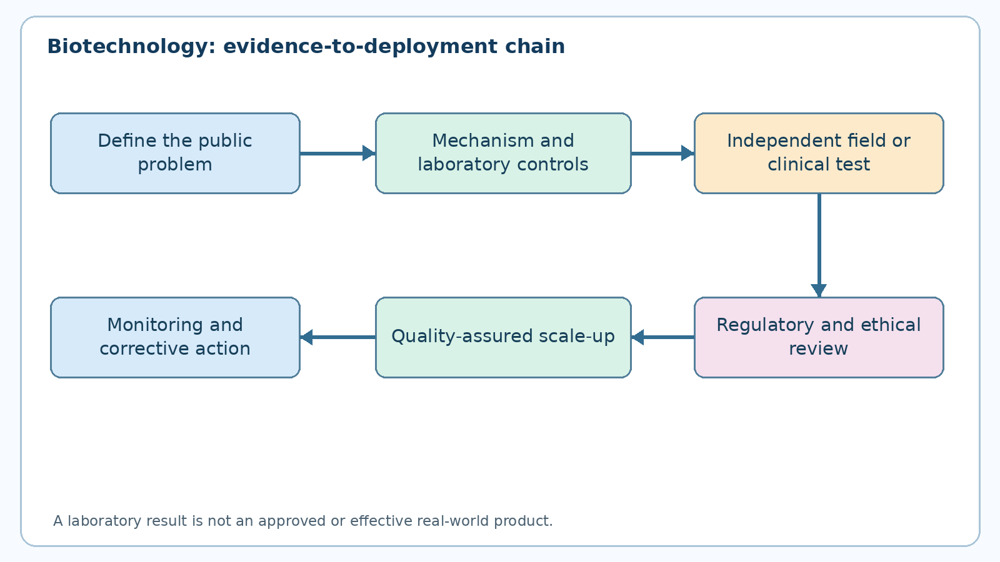
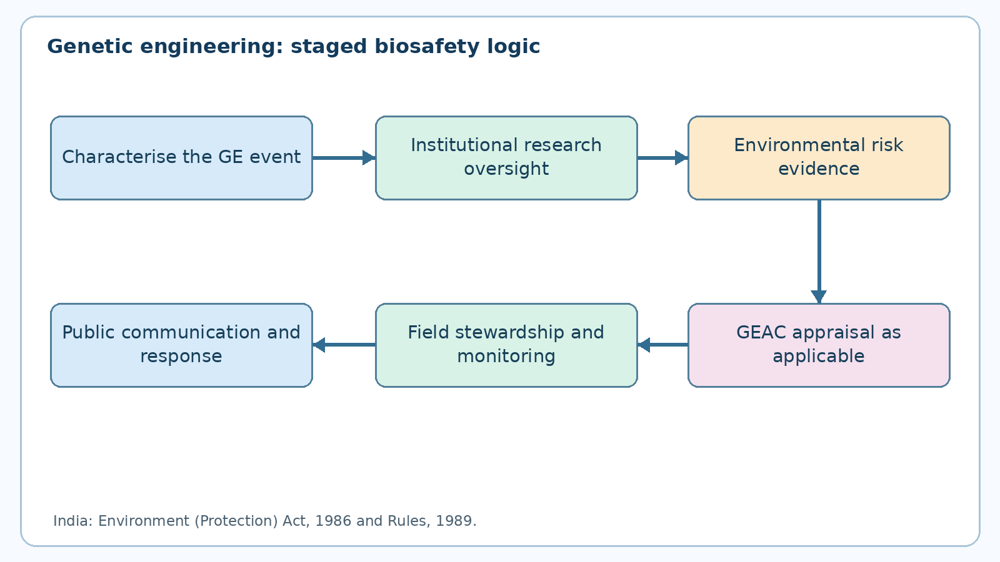
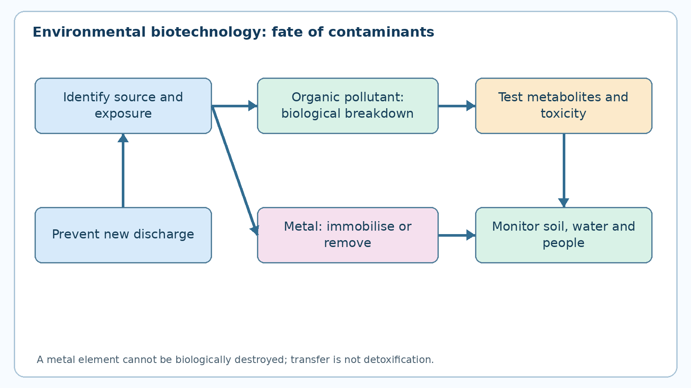

# Biotechnology, Genetic Engineering, Stem Cell Research and Agricultural and Environmental Applications

**TGPSC Group I · Paper V · Unit II · Topic 2 · 24 October 2026 · English learning draft · NOT academically approved**

## Official syllabus and coverage map

The commission-hosted Notification No. 02/2024 dated 19 February 2024, Paper V, Unit II, item 2 reads: **“Concept of Biotechnology and application of genetic engineering and Stem Cell Research. Biotechnology in Agriculture (bio-fertilizers, bio - pesticides, bio- fuels, tissue culture, cloning) and Environment (Biotechnology in Environmental cleanup process)”** [S01]. The source is the original commission PDF, independently retrieved on 24 October 2026. The syllabus does not demand laboratory operating instructions; the emphasis here is scientific reasoning, societal application, biosafety, regulation and Telangana examples.

| Official syllabus element | Detailed coverage | Examination focus |
|---|---|---|
| Concept of biotechnology | Sections 1–3 | Living systems, biotechnology vs conventional breeding, process stages |
| Genetic engineering | Sections 4–6 | Recombinant DNA, gene editing, benefits, uncertainty and biosafety |
| Stem cell research | Sections 7–8 | Potency, sources, legitimate uses, ethics and clinical evidence |
| Biofertilizers | Section 9 | Biological nitrogen fixation, nutrient mobilization, field constraints |
| Biopesticides | Section 10 | Bt, fungi, viruses, pest resistance, integrated pest management |
| Biofuels | Section 11 | Fermentation, feedstock competition, life-cycle emissions |
| Tissue culture | Section 12 | Micropropagation, sanitation, hardening, quality |
| Cloning | Section 13 | Plant clones, molecular clones, reproductive cloning distinctions |
| Environmental cleanup | Sections 14–15 | Bioremediation, wastewater, contaminated soil, monitoring |
| Telangana and governance | Sections 6, 8, 16–17 | Genome Valley, state policy, farmer and public-health safeguards |

**Provenance warning:** All 30 MCQs and six mains questions below are original practice. None is represented as a commission PYQ. Source keys identify primary documents in the audit register; they are not page-number references.

## Executive summary

Biotechnology is the controlled use of organisms, cells, enzymes and biological information to develop products or services. Traditional fermentation and selective breeding are biotechnological, but modern molecular tools make changes more targeted and testable. Genetic engineering changes hereditary material; gene editing can alter an existing sequence without necessarily adding foreign DNA. Stem cells are defined by self-renewal and differentiation, yet a laboratory result is not automatically a safe clinical treatment. Agriculture uses microbial inoculants, biological pest controls, tissue-cultured planting material and biofuel production; environmental biotechnology uses microorganisms and plants to transform or remove contaminants. Every application requires an evidence chain from laboratory efficacy through real-world performance to safety, affordability and governance. In Telangana, biotechnology connects rain-fed farming and residue management with Hyderabad's life-sciences cluster, but industrial announcements must be distinguished from measured outcomes.

## Section 1. Meaning, historical roots and boundaries of biotechnology

Biotechnology is an activity rather than a single machine or discipline. The central idea is that biological processes can be harnessed for a chosen outcome: a microbe produces a metabolite, a cell line synthesises a protein, a plant is multiplied with disease testing, or a microbial community transforms a pollutant. Fermentation of curd and bread predates modern genetics; selective breeding of plants and animals changed populations over generations. The discovery of DNA structure, restriction enzymes, polymerase chain reaction, sequencing and recombinant DNA expanded what can be observed and altered. These stages differ in the degree of molecular precision, not in the basic dependence on living systems.

A practical classification distinguishes **red biotechnology** (healthcare, diagnostics, vaccines, cell therapies), **green biotechnology** (agriculture and crops), **white biotechnology** (industrial enzymes and biomanufacturing), **grey biotechnology** (environmental remediation), and **blue biotechnology** (marine resources). These colours are informal teaching categories, not separate regulatory laws. A microbial enzyme used to make detergent belongs to industrial biotechnology even if its gene was originally identified in a marine organism. A vaccine produced in cultured cells is a biological product, not an agricultural application merely because it uses a bioreactor.

The production chain is discovery → biological design or selection → laboratory verification → process development → safety and quality assessment → permitted scale-up → deployment → post-release monitoring. Each arrow contains a potential failure. A bacterium that dissolves phosphorus in a petri dish may fail in saline or hot field soil; a therapeutic protein made in a flask may acquire different quality attributes in a large fermenter; a pollutant-degrading culture may perform poorly where oxygen or nutrients are limiting. This is why scientific validity, manufacturing reproducibility and field efficacy are separate questions.

Biotechnology also involves institutions: research universities generate evidence, standards agencies evaluate quality, regulators assess risks, firms manufacture, and farmers or patients bear consequences. For public administration, the issue is not whether a technology is modern but whether benefits are demonstrated for a defined population, at an acceptable cost and risk. The best exam answer therefore states a mechanism, a use, a limitation and the relevant institution rather than simply calling biotechnology a solution to every problem.

## Section 2. Biological foundations: cells, genes, proteins and variation

The cell is the functional unit of life. Its membrane controls exchange; cytoplasm hosts reactions; ribosomes assemble proteins; and, in eukaryotes, a nucleus contains most chromosomal DNA. A **gene** is a DNA sequence whose information contributes to a functional product, often a protein or regulatory RNA. The familiar flow DNA → RNA → protein describes expression, but regulation, alternative splicing and post-translational modification complicate the simple diagram. Protein abundance also depends on environmental conditions. DNA sequence alone cannot predict a crop's yield or a patient's outcome.

An allele is a variant of a genetic sequence; a genotype is the genetic constitution at relevant loci; a phenotype is an observable trait produced by genotype interacting with environment. Heritability is population- and environment-specific, not the percentage of an individual's trait fixed by genes. Many traits of agricultural value, including drought tolerance, are polygenic and depend on soil, management and climate. A transgenic event with an insecticidal protein cannot be assumed to confer resistance to every pest species or to remain effective indefinitely.

Microbes contribute because they reproduce rapidly, perform diverse chemical reactions and can be grown under controlled conditions. Enzymes lower activation energy without being consumed as ordinary reactants; their activity is affected by pH, temperature, substrate concentration and inhibitors. In soil, microbes interact in communities and compete for resources. Nitrogen-fixing symbiosis in legume nodules is biologically different from phosphate solubilisation by free-living organisms. In wastewater, bacteria may consume organic carbon, while other groups transform ammonium and nitrate; these reactions require different environmental conditions.

The difference between a **marker** and a **causal variant** is crucial. A molecular marker can be associated with a desired trait without directly producing it. Marker-assisted selection may accelerate conventional breeding, while genome editing directly changes a chosen site. Whole-genome sequencing identifies variation but does not by itself create a product. Laboratory tests should have controls, reproducibility and a clear outcome measure. In policy questions, distinguish scientific capability from evidence that the intervention actually improves yield, health or pollution levels in a particular district.

## Section 3. Tools and evidence: from detection to commercial production

Molecular biotechnology uses complementary tools. PCR amplifies a selected DNA segment, enabling detection when the assay's primers and controls are appropriate. Sequencing determines the order of nucleotides and can identify variants, contamination or species identity. Electrophoresis separates nucleic acids or proteins by physical properties. Cell culture supports propagation of cells under controlled conditions; microbial fermentation produces biomass or metabolites. Bioinformatics integrates sequence, expression and phenotype data. These techniques answer different questions: a positive PCR signal establishes that a target sequence was detected, not that an organism is viable or that a clinical disease is present.

A credible experiment compares treated and untreated groups, uses biological replication, controls confounders and reports uncertainty. A soil inoculant tested on one crop under one irrigation regime cannot be extrapolated to all Telangana agro-climatic zones. A tissue-cultured plant may look uniform in a nursery yet develop off-types or latent infections; molecular identity and phytosanitary testing are relevant. For environmental cleanup, a decrease in the parent pollutant may reflect transfer to another medium or formation of an intermediate rather than complete detoxification.

Scale-up is a separate engineering challenge. A laboratory bioreactor may have uniform mixing and oxygen transfer; an industrial vessel may experience gradients of dissolved oxygen, pH and temperature. Downstream purification, sterility, batch documentation and cold-chain requirements can dominate costs. Quality-by-design means identifying critical attributes and controlling the process so each batch meets specifications. Biological products often require stricter handling than simple chemicals because viability or protein structure affects performance.

**Worked interpretation:** A vendor reports that a biofertilizer increased yield by 18% in a single demonstration plot. The responsible agricultural officer asks: What was the control? Were both plots equally irrigated and fertilised? How many seasons and farms were tested? Was the inoculant viable at application? What were input costs and net returns? If the increase disappears in a replicated trial, the original claim was insufficiently established, not necessarily fraudulent. Evidence strength rises from mechanism and laboratory test to replicated field trial, multi-location validation and post-market surveillance.

## Section 4. Recombinant DNA technology and genetic engineering

Genetic engineering deliberately modifies an organism's hereditary material using molecular methods. In classical recombinant DNA work, a DNA fragment is combined with a suitable vector and introduced into a host; the intended construct is then characterised and its expression assessed. This conceptual description is sufficient for a civil-services examination. It should not be confused with conventional hybridisation, in which parental genomes recombine through reproduction. The resulting **genetically engineered event** is a specific insertion or alteration in a defined genetic background, not merely the broad crop name.

A **transgenic** organism contains genetic material introduced from another organism by engineering; a **cisgenic** modification uses genetic material from a sexually compatible source under certain definitions. Gene editing uses programmable molecular systems to change sequences at chosen locations. CRISPR-associated nucleases are well-known examples, but editing can create unintended changes and desired edits still require phenotypic testing. Some edited products may lack inserted foreign DNA; regulatory treatment depends on the product and applicable national guidance. It is wrong to say every edited plant is automatically equivalent to a conventionally bred plant or that every GM product is necessarily unsafe.

Applications include producing recombinant insulin, enzymes and vaccine antigens; introducing pest-resistance traits into crops; generating model organisms; and developing diagnostic assays. The central design problem is selecting a trait with clear biological relevance and measuring unintended consequences. An insecticidal trait is not a substitute for weed management, water conservation or crop diversity. A genetically modified organism that survives in a laboratory may be uncompetitive outdoors, whereas a crop intended for cultivation requires evaluation of gene flow, non-target organisms, resistance evolution and agronomic performance.

Genetic engineering raises distributive issues as well as scientific ones. Patents, seed pricing, farmer access, public research capacity and stewardship responsibilities affect whether a technology is socially useful. Open discussion must separate **hazard** (a possible source of harm) from **risk** (probability and severity under exposure conditions). A risk assessment is product-, trait- and context-specific. Evidence of one approved event does not automatically establish safety of a different construct, and the absence of demonstrated harm in one setting does not prove universal safety. [S04–S07]

## Section 5. Genome editing, molecular breeding and the limits of precision

Plant improvement combines conventional breeding, marker-assisted selection, genomic selection and genome editing. Marker-assisted selection tracks DNA markers linked to known traits while recombination still occurs through breeding. Genomic selection estimates breeding value from genome-wide data, useful for complex traits but dependent on training populations. Editing directly changes a target sequence; it does not eliminate environmental variation or the need for agronomic evaluation. The appropriate method depends on the trait architecture, available genetic diversity, regulation, cost and public purpose.

Precision should be defined at several levels. **Molecular precision** concerns where a sequence change occurs. **Trait precision** concerns whether the change produces the intended phenotype without unacceptable side effects. **Ecological precision** concerns whether performance holds across locations and interactions. A highly precise edit at the DNA level may still have unexpected metabolic effects, and a conventional variety may outperform it under local rain-fed conditions. Scientific assessment must include both intended traits and plausible unintended consequences, using comparative controls and a transparent data package.

Genome editing has potential in disease resistance, nutritional quality and tolerance to abiotic stress. Yet drought tolerance cannot be inferred from survival of seedlings under a short laboratory stress test; yield stability across rainfall regimes and farmer management matters. Similarly, a biofortified trait should be evaluated for nutrient bioavailability, diet contribution and acceptability, not merely concentration in harvested grain. Public breeding programmes must avoid narrowing genetic diversity or creating dependence on a single resistance mechanism.

**Telangana example:** A proposed edited sorghum line is claimed to withstand intermittent dry spells. A sound pilot includes multi-location trials in relevant agro-climatic zones, checks grain and fodder traits, compares existing locally adapted varieties, measures yield variability rather than only peak yield, and records farmer preferences. Where regulations require approval, confined evaluation precedes release. The policy choice may be to invest in breeding plus watershed management rather than selecting a single technological intervention. Technology and agronomy are complements, not automatic substitutes.

## Section 6. Biosafety institutions, legal architecture and public accountability

India's Environment (Protection) Act, 1986 and the **Rules, 1989** establish a regulatory framework for hazardous microorganisms and genetically engineered organisms or cells. The Department of Biotechnology and Ministry of Environment, Forest and Climate Change have distinct roles. Institutional Biosafety Committees supervise specified research within institutions; the Review Committee on Genetic Manipulation has responsibilities in the research and development system; the **Genetic Engineering Appraisal Committee (GEAC)**, situated in MoEFCC, appraises environmental release proposals and certain large-scale uses. State Biotechnology Coordination Committees and District Level Committees also form part of the framework. Regulatory stages and the exact applicable requirements should be checked for each product and activity. [S04–S07]

The logic of staged oversight is to prevent a laboratory finding from becoming an uncontrolled environmental exposure. The applicant must characterise the organism and trait, identify plausible exposure pathways, consider non-target effects and gene flow, and supply relevant data. GEAC's environmental risk-assessment guidance discusses problem formulation, comparator choice, quality of evidence and post-release monitoring. Food-safety review, seed certification and pesticide or fertiliser regulation may involve different authorities; one permission should never be described as approval for every possible use. [S06]

Biosafety is not the same as **biosecurity**. Biosafety reduces accidental exposure and environmental or occupational harm. Biosecurity seeks to prevent misuse, theft or unauthorised access to biological materials. Both require training, inventory, facility design, incident reporting and institutional responsibility. A district administration may also need transparent farmer communication, grievance handling and reliable product traceability. Where the evidence is contested, decision-makers should identify the precise claim, the authority competent to decide it and the evidence still missing.

The public debate has at least three legitimate dimensions: potential yield or environmental gains, uncertain ecological effects, and distribution of economic power. Advocates point to reduced pest losses and innovation; critics highlight resistance, corporate concentration and long-term monitoring. Neither view substitutes for case-specific evidence. A defensible public-policy answer supports transparent independent assessment, proportionate regulation, public-sector research, access to data and adaptive post-release monitoring. It does not claim that all genetically engineered organisms are uniformly safe or uniformly harmful.

## Section 7. Stem cells: potency, self-renewal and research uses

A **stem cell** is defined by two capacities: self-renewal over time and differentiation into specialised cell types under suitable conditions. **Totipotent** early embryonic cells can contribute to embryonic and extra-embryonic lineages; **pluripotent** cells can generate many body cell types but do not alone form an entire viable organism; **multipotent** adult stem cells generate a more restricted set of lineages. This hierarchy is about developmental potential, not a ranking of clinical usefulness. Haematopoietic stem cells replenish blood-cell lineages, while neural progenitors and mesenchymal stromal cell preparations differ in origin, identity and demonstrated functions.

Embryonic stem-cell lines originate from early developmental stages and raise ethical questions about embryo use. **Induced pluripotent stem cells (iPSCs)** are differentiated cells reprogrammed into a pluripotent-like state. They enable disease modelling, drug screening and studies of development without requiring an embryo for each line. Reprogramming does not guarantee genetic stability or safety for transplantation. A cell line may carry mutations, differentiate incompletely or behave differently after prolonged culture. Good research characterises identity, potency, purity, sterility and genomic integrity.

Clinical applications must be separated by evidence. Established haematopoietic stem-cell transplantation for specified blood and immune disorders is not equivalent to advertised stem-cell injections for every degenerative disease. Experimental cell-based products may cause infection, immune reactions, ectopic tissue formation or tumours; route of administration and manufacturing quality matter. The ICMR–DBT National Guidelines for Stem Cell Research (2017) caution against premature commercialisation of unproven interventions. ICMR's evidence-based disease reviews emphasise that many proposed uses remain experimental and require appropriately approved clinical trials. [S08–S10]

**Worked patient-information test:** A clinic advertises a universal stem-cell cure for spinal injury, diabetes and arthritis. Ask for the precise cell product, approved indication, clinical-trial registration, ethics and regulatory authorisations, published controlled outcomes and adverse-event monitoring. The presence of a laboratory certificate or a celebrity testimonial is not proof of efficacy. In mains answers, use the phrase *research potential is substantial; routine clinical use requires indication-specific evidence and regulatory clearance* rather than presenting all regenerative therapies as already established.

## Section 8. Stem-cell ethics, consent, clinical translation and Telangana

Stem-cell research involves donation, consent, privacy, ownership and equitable access. A donor must understand the intended collection and foreseeable research uses of biological material. De-identification reduces but does not eliminate privacy risks when genomic information is involved. Where embryos are involved, additional ethical concerns arise about creation, use and destruction. Where induced pluripotent cells are generated, issues include consent for long-term storage, possible genetic analysis and use in future projects. Oversight must address both the donor's autonomy and the recipient's safety.

Translation follows a long chain: a reproducible mechanism, preclinical evidence, a consistently manufactured cell product, justified clinical trial, monitoring for adverse events, and evidence that benefits exceed harms for a specific condition. Stem-cell identity and dose alone do not establish effectiveness. A trial should predefine outcomes and comparator groups; long-term follow-up can be necessary because cells may persist. Manufacturing under appropriate quality systems and the distinction between compassionate access, trials and standard care are central to patient protection.

Telangana's Hyderabad–Genome Valley ecosystem includes institutions and firms involved in biologics, diagnostics and advanced therapeutics, but the presence of a facility does not prove that a particular stem-cell treatment is approved. The Telangana government's **Next-Gen Life Sciences Policy 2026–30**, unveiled on 21 January 2026, identifies advanced biomanufacturing and cell-and-gene-therapy-related ambitions. These are policy priorities and investment goals, not evidence that clinical outcomes have already been achieved. [S18–S20]

**Patient-protection decision example (illustrative).** Suppose a clinic advertises one cell injection for spinal injury, diabetes and arthritis. Those are three distinct indications, not one proven treatment. An administrator should request the exact product identity, trial registration and competent approvals for each indication, compare claims with ICMR's disease-specific evidence statements, and explain standard-care alternatives. The absence of an identified comparator or documented adverse-event follow-up is a reason to demand evidence, not proof that every stem-cell approach is ineffective. Informed consent cannot substitute for regulatory permission or clinical efficacy. [S08–S10]

A state-level approach combines skilled workforce development, institutional ethics committees, access to accredited testing, transparent procurement and patient-facing safeguards. Unproven interventions can drain family savings and delay standard treatment. Administrators should distinguish research institutes, hospitals, clinical-trial sites, product manufacturers and advertising intermediaries; each has different accountability. In a 200–250-word answer, begin with stem-cell potential, describe the evidence ladder, identify ethical risks and conclude with patient protection and responsible innovation.

## Section 9. Biofertilisers: microbial nutrition and soil health

A **biofertiliser** is a formulation containing beneficial living microorganisms that improve nutrient availability or plant growth when used appropriately. It is not simply compost, a chemical fertiliser labelled green, or an automatic replacement for every nutrient input. **Rhizobium** establishes nitrogen-fixing symbiosis with compatible legumes, whereas **Azotobacter** and **Azospirillum** are associated with different free-living or associative nitrogen-fixation systems. Phosphate-solubilising bacteria can release organic acids or enzymes that increase availability of some insoluble phosphorus compounds. Other microbes mobilise potassium or zinc, produce plant-growth-promoting compounds or support root uptake. [S11–S13]

Biological nitrogen fixation converts atmospheric nitrogen into biologically usable forms through enzyme systems that require energy and suitable conditions. A legume nodule's effectiveness depends on host–microbe compatibility, oxygen regulation, moisture, soil acidity and nutrients. A phosphate-solubilising culture that performs well in a laboratory may be less effective in alkaline or dry field soils. Microbial inoculants are living products: viability, contamination, storage temperature, shelf life and application method affect their usefulness. They should be integrated with soil tests, organic matter management and balanced fertilisation.

ICAR describes formulations combining nitrogen-fixing, phosphate-solubilising and potassium-mobilising microorganisms; this is evidence of a technological approach, not a guarantee that every farmer can reduce fertiliser by a fixed percentage. A June 2026 ICAR–NBAIM outreach programme demonstrated Bio-NPK and emphasised soil testing and integrated nutrient management. The event documents extension activity, not a state-wide impact evaluation. [S11–S14] In a Telangana paddy–cotton–pulse system, demonstration plots should compare yield, input costs, soil biological indicators and residual nutrient effects across seasons.

**Worked economic example:** A farmer saves ₹900 on purchased fertiliser but pays ₹250 for inoculant and ₹200 for extra application, with unchanged crop revenue. Net saving is ₹450, not ₹900. If poor storage destroys viability, the result may be zero or negative. This example is illustrative, not a measured programme outcome. Public procurement should specify viable-cell counts, identity, contamination limits and traceability; agricultural extension should avoid selling biofertilisers as a magic substitute for soil health management.

## Section 10. Biopesticides and integrated pest management

A **biopesticide** controls pests through a biological organism or a naturally derived active substance, subject to applicable product definitions and regulations. **Bacillus thuringiensis (Bt)** produces insecticidal proteins with activity against particular susceptible insects; different proteins have different spectra. Certain fungi, including **Trichoderma**, antagonise plant pathogens; entomopathogenic fungi can infect susceptible insects; baculoviruses may target particular insect pests. Botanical products and pheromone-based interventions are often grouped with biological control strategies, but their mode of action differs from that of living microbial formulations. [S15–S17]

Biological does not mean harmless to all organisms or automatically effective. Product identity, target species, environmental conditions, application timing and formulation quality are critical. Sunlight, humidity, temperature and rain can affect field persistence. Pest populations evolve: repeated exposure to one control mechanism can select resistant individuals. This is particularly important for Bt cotton, where refuge strategy, pest surveillance and integrated control matter. An ICAR announcement on 16 July 2026 reported licensing a promising novel Bt toxin gene intended to address pink bollworm resistance; the announcement described a technology-development and commercialisation pathway, not a claim that a new hybrid was already widely available. [S16]

**Integrated pest management (IPM)** begins with monitoring and economic thresholds, then combines crop rotation, resistant varieties, sanitation, natural enemies, mechanical control and judicious use of permitted pesticides. Biological agents are components of IPM, not reasons to abandon scouting. A farmer seeing leaf damage must first identify the pest; an insect-specific Bt preparation will not treat a fungal wilt. Likewise, a Trichoderma soil formulation does not replace management of a virus spread by insects. Extension officers should verify diagnostic evidence before recommending a product.

In Telangana cotton areas, pink bollworm management must consider crop residue, ginning waste, crop duration, field monitoring and insecticide stewardship. A field programme should measure pest incidence, marketable yield, non-target effects, farmer costs and changes in resistance over time. Government's role is to prevent counterfeit or poorly stored inputs, strengthen laboratories and support transparent performance trials. The key exam contrast is **biopesticide = agent or product; biological control = ecological strategy; IPM = decision framework combining methods**.

## Section 11. Biofuels: feedstocks, fermentation and sustainability

**Biofuels** are energy carriers derived from recently living biomass. First-generation ethanol is produced from sugar- or starch-rich feedstocks; biodiesel may be made from vegetable oils or used cooking oils through chemical conversion; biogas forms when microbial communities digest organic matter without oxygen. Second-generation or advanced biofuels may use lignocellulosic residues, agricultural waste or other non-food feedstocks. Feedstock identity and conversion technology matter more than a simple label such as renewable. Fermentation, pretreatment, hydrolysis, separation and upgrading have different energy, water and cost requirements.

In fermentation, microorganisms convert suitable substrates into products such as ethanol. Lignocellulosic crop residues contain cellulose, hemicellulose and lignin; pretreatment makes carbohydrates more accessible but can generate inhibitors and add cost. Biogas systems rely on linked microbial stages, including hydrolysis, acid formation and methanogenesis; unstable feed composition or poor process control reduces gas yield. Biogas can be cleaned and upgraded to biomethane, but collection, leakage and utilisation determine its environmental performance.

A serious sustainability assessment asks whether land, water, fertiliser and food markets are affected. Growing an energy crop on fertile irrigated land may compete with food or feed production. Using crop residues can reduce open burning but removing too much biomass can deprive soil of organic carbon. Life-cycle greenhouse-gas accounting includes cultivation, transport, processing, energy inputs and land-use change. An apparently low-emission fuel at the vehicle tailpipe may have a large upstream footprint. Waste-based pathways can avoid some feedstock competition but face collection and contamination problems.

**Telangana decision case:** A district proposes a bio-CNG plant using cattle dung and market waste. The feasibility study should quantify dependable feedstock by season, segregated collection, water availability, digestate quality, odour control, methane leakage, offtake contracts and farmer participation. A plant announced in a press release is not a commissioned, continuously operating facility. A scientifically sound policy promotes residues where viable, protects soil fertility and food security, and evaluates net emissions and local livelihoods rather than maximising nominal production capacity.

## Section 12. Plant tissue culture, micropropagation and disease-free planting material

**Plant tissue culture** grows plant cells, tissues or organs in controlled nutrient media under suitable environmental conditions. **Totipotency** is the developmental capacity of a plant cell, under appropriate conditions, to regenerate a whole plant; not every cell in every species readily demonstrates it. **Micropropagation** multiplies plants from selected explants and can generate large numbers of relatively uniform planting materials. Typical conceptual stages include mother-plant selection, initiation, multiplication, rooting and hardening. This is a description of the production system, not a laboratory protocol.

The main benefits are rapid multiplication of valuable genotypes, availability of planting material independent of some seasonal constraints, conservation of germplasm and, where appropriate procedures are used, production of pathogen-tested plants. However, **tissue-cultured does not automatically mean virus-free**. A contaminated mother plant, poor laboratory hygiene or inadequate indexing can transmit pathogens. Somaclonal variation may create off-types, especially with prolonged culture or callus phases. Plantlets transferred from controlled humidity to open fields can suffer transplant shock unless hardened and managed correctly.

In crops such as banana, micropropagation can support supply of planting material from selected lines. An ICAR announcement on 12 December 2023 reported licensing a banana variety for multiplication through a tissue-culture company; that documents technology transfer, not universal field suitability. [S17] A district horticulture scheme must compare certified tissue-cultured plants with reliable conventional planting material on cost, survival, disease incidence and farmer outcomes. A label is not a substitute for mother-stock traceability and nursery inspection.

**Worked procurement test:** A supplier offers 100,000 banana plantlets at a discount. Officials should inspect source identity, pathogen-screening records, off-type tolerances, hardening success, transport conditions, complaint mechanisms and after-sales agronomic support. If 20% die before establishment, the effective cost per surviving plant increases by 25% even before replacement labour. This arithmetic is illustrative. Tissue culture is valuable where it solves a real propagation bottleneck; it should not be portrayed as inherently superior for every crop or every agro-climatic zone.

## Section 13. Cloning: genes, cells, plants and organisms

**Cloning** means producing genetically identical or highly similar copies of a biological unit, but the term has several meanings. **Molecular cloning** amplifies or maintains a DNA fragment in a biological system. **Cell cloning** derives a population from one ancestral cell. **Vegetative cloning** reproduces plants from cuttings, tubers or cultured tissues without sexual recombination. **Reproductive cloning** attempts to produce an organism genetically related to a nuclear donor, and **therapeutic cloning** has been used to describe research aimed at obtaining cells for study rather than producing a child. These categories are not interchangeable.

Vegetative propagation is common in horticulture and predates molecular biotechnology. A clone retains much of the donor's genotype, but environment, epigenetic effects, pathogens and mutations can still cause phenotypic variation. A nursery should therefore verify both genetic identity and plant health. Uniformity can benefit processing and harvest schedules, yet it can increase shared vulnerability to a new disease when large areas depend on one genotype. Genetic conservation requires maintaining diversity in addition to multiplying elite material.

Animal reproductive cloning involves substantial welfare, efficiency and developmental concerns; it should not be conflated with artificial insemination, embryo transfer or selective breeding. Stem-cell research also does not automatically entail reproductive cloning. In public discourse, sensational claims often merge these distinct procedures. An examiner may ask whether tissue culture and cloning are identical: micropropagation frequently produces clonal plants, but tissue culture can also be used for regeneration, conservation or research, and cloning can occur without tissue culture through ordinary vegetative propagation.

Policy implications include germplasm ownership, breeders' and farmers' rights, animal welfare, biodiversity and equitable access. A district programme distributing one clonal planting line should document disease risks and encourage suitable varietal diversity. In a balanced mains answer, define the exact cloning type first, give one useful application, explain one biological limitation and one ethical or economic issue, then identify the required oversight. Precision of terminology prevents false claims about either miracle applications or inevitable harms.

## Section 14. Environmental biotechnology: bioremediation mechanisms

**Bioremediation** uses organisms or their biological activities to reduce pollutant concentration, mobility or toxicity. Microorganisms may metabolise some organic pollutants as sources of carbon or energy; plants may absorb or stabilise certain contaminants; enzymes can transform specific compounds. **Biodegradation** is chemical breakdown, **mineralisation** is more complete conversion to simple inorganic products, **biosorption** is binding to biomass, and **bioaccumulation** is uptake into organisms. A contaminant moved from water into sludge has not necessarily been destroyed.

**In situ** treatment occurs at the contaminated location; **ex situ** treatment involves removing material for treatment elsewhere. **Biostimulation** adjusts environmental conditions to encourage existing degraders, while **bioaugmentation** introduces selected organisms. The choice depends on contaminant chemistry, temperature, oxygen, pH, permeability, toxicity and local ecology. Aerobic pathways need oxygen, whereas some reductive transformations occur under anaerobic conditions. Heavy metals cannot be biologically destroyed because elements are conserved; treatment may immobilise, concentrate, remove or change their chemical form. This is a frequent examination trap.

A cleanup project must first define the source, contaminants, receptors and exposure routes. Sampling should establish a baseline and background levels; analytical methods need quality assurance. Monitoring must include parent compounds, relevant breakdown products, toxicity and the receiving ecosystem. A decline in a single laboratory concentration is not sufficient if contaminants migrate to groundwater or become more toxic intermediates. The cleanup endpoint should correspond to applicable standards and intended land or water use.

**Worked contamination case:** A workshop site has petroleum-affected soil. Before recommending microbial treatment, authorities map the spill, determine depth and groundwater proximity, test whether the contamination is biodegradable under site conditions and assess vapour or fire hazards. They then select containment and treatment with monitoring. For mixed chemical waste or unknown industrial effluent, biological treatment alone may be unsuitable. The administrative objective is demonstrable reduction in exposure and ecological harm, not merely installation of a technology branded eco-friendly.

## Section 15. Wastewater treatment, microbial consortia and limitations

Biological wastewater treatment uses microbial communities to remove biodegradable organic matter and, in suitable systems, transform nutrients. In **activated sludge**, aeration supports microbial flocs that consume organic substances; solids are separated and some biomass is returned to maintain the process. **Biofilm reactors** retain organisms on surfaces, which can improve resilience under certain conditions. Anaerobic digesters convert part of the organic load into biogas and stabilised residues, particularly where wastewater is sufficiently concentrated. None of these systems is a universal solution to all industrial chemicals.

**Biochemical oxygen demand (BOD)** estimates oxygen required for biological oxidation under specified test conditions, whereas **chemical oxygen demand (COD)** estimates chemically oxidisable matter. A falling BOD can show improved organic-matter removal but says little about persistent metals, certain solvents or pathogens. Nitrification converts ammonium to oxidised nitrogen under aerobic conditions; denitrification converts nitrate to gaseous nitrogen under suitable low-oxygen conditions with available electron donors. Phosphorus may be removed biologically under specialised operating regimes or chemically. Disinfection addresses microbial pathogens after treatment as needed.

For Telangana urban lakes, untreated sewage, stormwater connections, industrial discharges and sediment-bound pollutants may interact. Installing a sewage treatment plant is not enough: sewer connectivity, bypass prevention, power supply, sludge handling, influent quality and verified outlet testing determine whether water quality improves. A lake receiving untreated inflows through other drains may remain polluted despite an operational treatment unit. The administrative response needs catchment mapping, enforcement and public reporting of measurements, not a single infrastructure photo.

A treatment proposal should compare biological, physical and chemical stages, as well as disposal of concentrated residues. **Phytoremediation** can stabilise or extract selected contaminants but may be slow, seasonal and constrained by plant biomass disposal. Constructed wetlands can polish appropriate wastewater streams but require land and maintenance. Environmental biotechnology works best within integrated pollution prevention and monitoring; preventing release of toxic material at source is usually more reliable than expecting microorganisms to neutralise every pollutant downstream.

## Section 16. Telangana biotechnology: industry, agriculture and inclusive development

Telangana connects biotechnology to three distinct economies. Hyderabad and Genome Valley support pharmaceutical research, vaccines, diagnostics and biologics. Agricultural universities, ICAR institutions and extension networks address seed, pest and soil challenges across rain-fed and irrigated zones. Municipal and industrial regulators face sewage, chemical waste and land-contamination issues. A single biotechnology policy cannot serve all three without differentiated standards and institutions. The presence of sophisticated medical manufacturing does not establish that a particular village's biofertiliser is effective.

The Government of Telangana unveiled its **Next-Gen Life Sciences Policy 2026–30** on **21 January 2026**. Its stated priorities include advanced biomanufacturing, precision medicine, biologics, workforce development and expansion of the life-sciences cluster. The government describes investment and job targets, which must be treated as targets rather than completed achievements. Its investment portal describes planned bio-innovation and biomanufacturing infrastructure linked to Genome Valley. [S18–S20] A 17 February 2026 state investment announcement reported proposed life-sciences investments at BioAsia; proposed projects are not equivalent to operational capacity or verified jobs. [S21]

For farming, the highest public value may come from low-cost, evidence-tested microbial inputs, pest surveillance, quality planting material and waste conversion. District administrations should prioritise multi-location trials and farmers' net income rather than vendor claims. For environmental cleanup, projects should be judged by pollutant measurements and health risk reduction. For healthcare, claims about cell therapies need indication-specific evidence and patient protections. These three evaluation systems are not interchangeable even though all are called biotechnology.

**Contrasting perspectives:** Industrial clusters can create specialised jobs and knowledge spillovers but may concentrate benefits near Hyderabad; farmers and smaller municipalities need affordable access and extension capacity. Proprietary biological products may reward innovation but create pricing and traceability concerns. A practical inclusive agenda funds public laboratories, regional training, open performance datasets, product-quality enforcement and transparent procurement. Telangana's comparative advantage is valuable only when research translates into independently verified public outcomes beyond announcements and construction milestones.

## Section 17. Decision frameworks, comparative evaluation and future directions

A useful administrative framework is **Define → Compare → Test → Regulate → Monitor → Correct**. First define the problem in measurable terms: pest loss, low soil phosphorus availability, contaminated groundwater or unmet clinical need. Compare biological interventions with conventional and preventive alternatives. Test efficacy under conditions representative of intended users. Apply the correct legal and ethical approvals. Monitor real-world outcomes and unintended effects. Correct or withdraw an intervention if results do not justify its risks or costs. This framework prevents technology-first procurement.

| Application | Mechanism | Outcome measure | Main uncertainty | Safeguard |
|---|---|---|---|---|
| Biofertiliser | Nutrient fixation/mobilisation | Yield, nutrient-use efficiency, net return | Soil compatibility and viability | Soil tests and multi-location trials |
| Biopesticide | Pest/pathogen suppression | Target pest damage and yield | Timing and resistance | IPM and resistance surveillance |
| Tissue culture | Controlled multiplication | Survival, true-to-type rate, disease status | Off-types and contamination | Mother-stock testing and hardening |
| Biofuel | Biomass conversion | Net energy, life-cycle emissions | Feedstock and land competition | Sustainability and leakage accounting |
| Bioremediation | Transformation or immobilisation | Exposure and toxicity reduction | Toxic intermediates and migration | Independent monitoring |
| Stem-cell product | Cell-based biological effect | Indication-specific clinical outcome | Tumour, infection, immune and efficacy risk | Ethics, trials and regulation |

The future includes precision fermentation, microbial consortia, computational protein design, advanced sequencing, cell-based models and engineered biological production systems. None eliminates the need for physical infrastructure, skilled personnel, environmental safeguards and equitable access. BioE3, approved by the Union Cabinet on 24 August 2024, promotes high-performance biomanufacturing across economy, environment and employment; its goals should be assessed through independently reported outputs, not treated as achieved merely because a policy exists. [S22]

A strong conclusion to any mains question is conditional rather than celebratory: biotechnology can improve productivity, health and environmental quality **when** product identity is known, benefits are measured, risks are assessed, regulatory responsibilities are clear and gains reach intended communities. For Telangana, this means connecting laboratory innovation to verified outcomes in farmer fields, hospitals and polluted catchments, while protecting biodiversity, patient rights and public funds.

## Six applied case studies and administrative decision exercises

### Case 1: A. Biofertiliser procurement for a Telangana pulse cluster

A cluster of farmers wants to reduce input cost in pigeonpea and green gram. The baseline is not simply the amount of urea bought: record soil-test values, crop rotation, irrigation access, existing nodulation, input cost and yields. Compare compatible Rhizobium inoculation plus recommended balanced nutrients against the farmer's current practice on replicated plots. Verify product identity and viability at delivery; observe storage and timing. Track nodulation, yield, net margin and next-season residual soil effects. If one village shows a positive response and another does not, investigate soil conditions before averaging results into a single promotional claim. Extension should explain that an inoculant assists nutrient acquisition rather than generating phosphorus or potassium from nothing. The procurement contract should require batch traceability and a replacement mechanism for failed quality tests. This case illustrates why adoption metrics and agronomic outcomes must be separated.

### Case 2: B. Cotton pest resistance and biotechnology stewardship

A cotton-growing mandal reports rising pink bollworm damage despite farmers purchasing pest-resistant hybrids. First verify pest identification, crop stage, refuge compliance and actual field exposure. Resistance evolution is a plausible explanation but cannot be assumed without monitoring; delayed sowing, extended crop duration and neighbouring residues can also affect pressure. Compare IPM packages that include pheromone monitoring, sanitation, appropriate crop calendars, biological controls where suitable and permitted insecticides applied against thresholds. The July 2026 ICAR report of a new Bt toxin licensing pathway should not be presented as an already available solution. Policy should fund resistance surveillance and public advice while preventing counterfeit seeds. Farmers need transparent information on what a trait controls and what it does not. A technology can remain valuable while stewardship fails; conversely, good stewardship cannot rescue an ineffective or poorly suited event.

### Case 3: C. Tissue-cultured banana planting material in a horticulture scheme

A district intends to subsidise uniform banana plantlets. Before approving bulk orders, the horticulture office should assess local water availability, market demand and whether the selected cultivar is suitable for the zone. Request mother-plant records, pathogen-screening evidence, batch identity, acclimatisation history and nursery survival data. A plantlet that looks healthy at dispatch may fail after transport if hardening was inadequate. Establish a comparison group using reputable conventional planting material; monitor survival after one and three months, time to harvest, disease incidence and actual returns. Avoid reporting plantlets distributed as hectares successfully established. If clonal uniformity increases susceptibility to a local disease, promote diversified material and surveillance. The case demonstrates that tissue culture is a multiplication technology, not a substitute for sound horticulture planning.

### Case 4: D. Stem-cell advertisement and patient protection

A private clinic advertises cell injections for multiple unrelated diseases. A district health officer should not decide legitimacy from promotional videos or the phrase advanced regenerative medicine. Identify the cell source and product, indication, manufacturing quality system, registered clinical study if claimed, ethics approval and the competent regulatory permissions. Explain to patients that established haematopoietic transplantation for certain indications cannot be generalised to unrelated injections. Encourage consultation with qualified specialists, transparent informed consent and reporting of adverse outcomes. Public information should distinguish a trial from routine treatment and clarify financial charges. The aim is not to block legitimate research; it is to prevent premature commercialisation of interventions whose benefit–risk balance is unproven. This protects both patients and credible researchers.

### Case 5: E. Contaminated industrial land near a peri-urban settlement

A site investigation finds petroleum residues and elevated concentrations of a metal in different soil layers. A single microbial solution is scientifically inappropriate. Map each contaminant and groundwater flow, establish receptor exposure and separate biodegradable organics from elemental contaminants. Controlled microbial degradation may reduce suitable organic compounds if oxygen, nutrients and bioavailability permit. Metal treatment instead may involve stabilisation, extraction, containment or safe removal; organisms cannot destroy a chemical element. Specify performance endpoints for soil, water and toxicity, and monitor degradation products. Prevent fresh leakage at the source. Residents should receive understandable risk communication and independent sampling results. A site can show reduced surface concentrations while remaining unsafe if contamination migrates deeper; verification must follow exposure pathways.

### Case 6: F. Biofuel plant based on crop residues and urban organics

A district-level project proposes ethanol from straw and biogas from segregated market waste. The first question is reliable feedstock availability across seasons. Some crop residue must remain for soil cover and carbon cycling, while market waste requires segregation and timely collection. For ethanol, evaluate pretreatment costs, enzyme performance, water and energy consumption and fermentation inhibitors. For biogas, assess digester stability, odour, gas leakage and safe digestate use. Compare transport distances and alternative uses of residues. Calculate life-cycle emissions, not merely fossil fuel displacement at the point of use. A feasibility report must include farmer compensation, collection contracts, offtake agreements and contingency plans for feedstock shortages. A policy announcement or land allotment does not establish economic or climate performance.

## Standalone quick revision: examination memory sheet

**Core idea:** Biotechnology uses biological systems; genetic engineering modifies hereditary material; stem-cell research studies self-renewing, differentiating cells; agricultural and environmental biotechnology apply biology under field constraints.

**Concept pairs that must not be confused:**

1. **Genotype vs phenotype:** inherited sequence information versus expressed outcome in an environment.
2. **Molecular marker vs causal gene:** association used for selection versus sequence that contributes directly to mechanism.
3. **Conventional hybrid vs GE event:** sexual recombination versus defined molecular modification.
4. **Genome editing vs guaranteed precision:** targeted sequence alteration still needs phenotype and ecological checks.
5. **Stem-cell potency vs proven therapy:** developmental capacity does not establish clinical benefit.
6. **Biofertiliser vs chemical fertiliser:** living nutrient-mobilising inoculant versus mineral nutrient supply.
7. **Biopesticide vs IPM:** one pest-management tool versus an integrated decision system.
8. **Tissue culture vs virus-free:** multiplication does not guarantee sanitation without testing.
9. **Cloning vs genetic engineering:** copying a genotype is not necessarily changing its DNA.
10. **Biodegradation vs mineralisation:** partial transformation versus more complete breakdown.
11. **Heavy-metal removal vs destruction:** chemical elements cannot be biologically annihilated.
12. **BOD vs COD:** different oxygen-demand indicators, neither proves complete wastewater safety.
13. **Policy target vs verified outcome:** an announced investment or job goal is not achieved output.
14. **Lab efficacy vs field efficacy:** local soil, weather, pest pressure and management change results.
15. **Bioremediation vs pollution prevention:** treatment complements, but cannot replace, source control.

**Institutions to remember:** DBT—national biotechnology promotion; ICMR—biomedical guidance and evidence; GEAC under MoEFCC—specified environmental appraisal under Rules, 1989; ICAR—agricultural research and extension; Telangana Industries and Commerce and Telangana Life Sciences Foundation—state life-sciences policy implementation roles. Check the competent authority for the particular product rather than assuming a single regulator governs all biotechnology.

**Five-step mains writing formula:** define the biological mechanism → identify the intended beneficiary → give a Telangana/Indian application → evaluate risks and evidence → conclude with regulation and measurable outcomes. For a case question, state what data are missing before recommending public expenditure.

## Mains question blueprints: structure before writing

| Question | Introduction | Analytical body | Balanced conclusion |
|---|---|---|---|
| Biotechnology vs engineering | Broad definition | Conventional breeding, markers, editing, applications | Fit-for-purpose evaluation |
| GE crops and biosafety | Trait and event | Agronomic benefit, resistance, gene flow, Rules 1989 | Transparent trials and monitoring |
| Stem-cell research | Self-renewal and potency | Sources, legitimate use, risks, consent, ICMR | Patient protection |
| Biological agricultural inputs | Nutrient vs pest mechanism | Biofertilisers, biopesticides, local performance, IPM | Integrated extension |
| Tissue culture and cloning | Precise terms | Micropropagation, hardening, pathogen testing, diversity | Quality certification |
| Environmental cleanup | Biological treatment | Organic vs metal pollutants, monitoring, wastewater | Prevention plus remediation |

**Answer-writing discipline:** Use subheadings such as *Background*, *Mechanism*, *Benefits*, *Limitations*, *Telangana application*, *Way forward*, and *Conclusion*. Avoid unsupported statistics or treating an investment announcement as an operating project.

## 30 original explained multiple-choice practice questions

**Original practice only — not official TGPSC PYQs.**

### MCQ 1. Which statement most accurately defines biotechnology?

A. Only genetic engineering of crops
B. Controlled use of biological systems to make useful products or services
C. Exclusive use of synthetic chemicals
D. Only treatment of human disease

**Answer: B.** Traditional fermentation and modern cell-based production both use biological systems; genetic engineering is a subset.

### MCQ 2. Which distinguishes a gene marker from a causal variant?

A. Markers always cause the trait
B. Causal variants have no molecular effect
C. Markers can track an associated region without themselves producing the phenotype
D. Markers are restricted to microbes

**Answer: C.** Association enables selection but does not establish a direct biological mechanism.

### MCQ 3. A positive PCR test most directly establishes what?

A. The target nucleic-acid sequence was detected under assay conditions
B. The organism is necessarily alive
C. The patient necessarily has severe disease
D. A crop is resistant in the field

**Answer: A.** PCR detection requires interpretation with controls, sample context and clinical or field evidence.

### MCQ 4. The best first step before buying a microbial inoculant for saline soil is to:

A. Assume all microbes grow in saline soils
B. Evaluate viability and field performance under local soil conditions
C. Replace every fertiliser immediately
D. Ignore storage temperature

**Answer: B.** Microbial activity is environment-dependent and requires evidence under representative conditions.

### MCQ 5. Which describes a genetically engineered event?

A. Every variety of one crop species
B. A defined molecular modification in a particular genetic background
C. Any plant obtained by grafting
D. Any seed selected for yield

**Answer: B.** Event identity matters for characterisation, environmental review and traceability.

### MCQ 6. Which claim about CRISPR editing is defensible?

A. It guarantees no unintended effects
B. It necessarily inserts a foreign gene
C. It can make targeted changes but still requires phenotypic and safety evaluation
D. It eliminates agronomic field trials

**Answer: C.** Molecular targeting does not automatically guarantee trait or ecological outcomes.

### MCQ 7. What is the role of GEAC in India?

A. Grant all hospital licences
B. Appraise specified environmental release and large-scale GE proposals
C. Conduct every village soil test
D. Register every traditional crop

**Answer: B.** GEAC operates under the Rules, 1989, with defined environmental appraisal responsibilities.

### MCQ 8. Which pair is correctly matched?

A. IBSC—routine city sewage billing
B. GEAC—environmental appraisal of GE organisms
C. ICMR—registration of all fertilisers
D. RCGM—municipal solid-waste tax

**Answer: B.** The legal architecture assigns different functions to different authorities.

### MCQ 9. Which is a principal property of stem cells?

A. Guaranteed cure of all diseases
B. Self-renewal and differentiation capacity
C. Inability to divide
D. Presence only in embryos

**Answer: B.** Stem cells have defined biological capacities, but clinical utility is indication-specific.

### MCQ 10. Which best describes induced pluripotent stem cells?

A. A microbial fertiliser
B. Reprogrammed differentiated cells with pluripotent-like properties
C. Any donated blood plasma
D. A conventional crop hybrid

**Answer: B.** iPSCs are generated by reprogramming and require careful characterisation.

### MCQ 11. Which stem-cell claim is most appropriate for public information?

A. All advertised injections are proven
B. Laboratory potential automatically means approved therapy
C. Many applications remain experimental and require approved trials
D. Ethics review is irrelevant

**Answer: C.** ICMR guidance warns against premature commercialisation of unproven interventions.

### MCQ 12. Which microbial process is most associated with Rhizobium in legumes?

A. Fixation of atmospheric nitrogen in symbiosis
B. Production of tidal energy
C. Extraction of uranium
D. Viral infection of leaves

**Answer: A.** Compatible legume nodules host biological nitrogen fixation.

### MCQ 13. A phosphate-solubilising inoculant primarily aims to:

A. Create phosphorus atoms
B. Improve availability of some insoluble phosphorus forms
C. Replace rainfall
D. Prevent every insect pest

**Answer: B.** Microbial acids and enzymes can increase plant-accessible phosphorus in suitable soils.

### MCQ 14. Why is biofertiliser viability important?

A. Because the product consists of living microorganisms
B. Because nitrogen is a metal
C. Because soil pH never changes
D. Because storage cannot affect outcomes

**Answer: A.** Poor storage and contamination can reduce or eliminate viable inoculant activity.

### MCQ 15. Which statement correctly distinguishes biopesticide from IPM?

A. They are identical
B. IPM is an integrated decision strategy; a biopesticide is one possible tool
C. IPM uses only synthetic pesticides
D. Biopesticides control every pest

**Answer: B.** Monitoring, thresholds and multiple tactics characterise IPM.

### MCQ 16. Repeated use of one Bt insecticidal mechanism can:

A. Guarantee permanent efficacy
B. Select for resistant pest populations
C. Eliminate the need for surveillance
D. Prevent all fungal diseases

**Answer: B.** Resistance management and refuge or complementary strategies are important.

### MCQ 17. The July 2026 ICAR Bt cotton announcement should be interpreted as:

A. Proof all farmers already use the new hybrid
B. A licensing and development milestone, not confirmed nationwide commercial adoption
C. A ban on all cotton
D. A clinical stem-cell approval

**Answer: B.** Technology licensing and field-scale adoption are different milestones.

### MCQ 18. Which is a valid sustainability concern for crop-residue biofuels?

A. Residues have no soil function
B. Excessive residue removal can reduce soil organic inputs
C. All feedstocks have identical emissions
D. Transport is always emission-free

**Answer: B.** Life-cycle analysis must include soil carbon, logistics and conversion energy.

### MCQ 19. Which stage is essential after in-vitro multiplication of plantlets?

A. Hardening/acclimatisation
B. Immediate planting without adjustment
C. Ignoring disease screening
D. Removing all roots

**Answer: A.** Plantlets grown under controlled humidity need gradual adaptation and quality checks.

### MCQ 20. Why is “tissue cultured” not synonymous with “virus free”?

A. Viruses cannot infect plants
B. Mother stock or process can transmit pathogens without appropriate testing
C. Tissue culture always adds pesticides
D. Only seed-borne diseases exist

**Answer: B.** Sanitation and indexing are necessary for pathogen-tested material.

### MCQ 21. Which is an example of vegetative cloning?

A. Plant propagation by cuttings
B. Sexual crossing of two unrelated parents
C. Sequencing of a genome
D. Chemical neutralisation of acid

**Answer: A.** A cutting can produce a genetically similar plant without sexual recombination.

### MCQ 22. What can microorganisms NOT do to a heavy-metal element?

A. Change its chemical form
B. Immobilise it
C. Destroy the element itself
D. Concentrate it in biomass

**Answer: C.** Elements are conserved; treatment can change mobility or remove material, not annihilate an element.

### MCQ 23. A decline in a parent pollutant after bioremediation:

A. Proves complete detoxification
B. Requires checks for metabolites, migration and toxicity
C. Means groundwater is always safe
D. Eliminates the need for sampling

**Answer: B.** Partial degradation can create persistent or more toxic intermediates.

### MCQ 24. Which best distinguishes BOD from COD?

A. BOD concerns biological oxygen demand; COD measures chemically oxidisable load
B. They always equal one another
C. COD counts only bacteria
D. BOD measures heavy-metal mass

**Answer: A.** They are different indicators and neither alone proves absence of all pollutants.

### MCQ 25. A sewage-treatment plant without sewer connectivity may:

A. Still solve every lake pollution problem
B. Fail to intercept important pollution inflows
C. Remove every toxic metal automatically
D. Eliminate sludge generation

**Answer: B.** Catchment connectivity and bypass prevention determine actual water-quality outcomes.

### MCQ 26. The BioE3 policy approved in August 2024 primarily concerns:

A. High-performance biomanufacturing
B. Only irrigation dam construction
C. Reproductive cloning of humans
D. Replacement of all farming

**Answer: A.** The national policy links biotechnology with economy, environment and employment.

### MCQ 27. Telangana’s January 2026 life-sciences policy targets should be described as:

A. All completed achievements
B. Policy ambitions requiring later outcome verification
C. Evidence that every therapy is approved
D. Measurements of farm biofertiliser yield

**Answer: B.** A target or announcement is not a verified investment, job or clinical result.

### MCQ 28. Which is the strongest evaluation of a biofertiliser programme?

A. One vendor testimonial
B. Multi-location replicated trials plus farmer net returns and product-quality data
C. Number of posters printed
D. Total number of meetings alone

**Answer: B.** Real-world performance and economic impact require independent comparisons.

### MCQ 29. What is the correct sequence for public-sector technology adoption?

A. Buy first, define problem later
B. Define problem, compare options, test, regulate, monitor
C. Ignore unintended effects
D. Rely only on the brand name

**Answer: B.** Problem-led evaluation reduces ineffective procurement and unmanaged risks.

### MCQ 30. Which policy distinction is most important for clinical cell therapy?

A. Research promise equals routine standard care
B. Clinical use requires product- and indication-specific evidence and applicable approvals
C. All cells are equivalent medicines
D. Consent is unnecessary

**Answer: B.** Cell identity, quality, ethics, trials and long-term safety are central to clinical translation.

## Six complete mains model answers (original practice)

**The answers below are original models, not transcriptions of commission questions.**

### Mains 1. Define biotechnology and examine how it differs from conventional breeding and genetic engineering.

**Background and definition.** Biotechnology is the deliberate use of organisms, cells, enzymes or biological information to create products and services. Fermentation and selective breeding are traditional forms; molecular biology has added sequencing, recombinant DNA and programmable editing. The distinction is not that older practices were non-scientific, but that modern tools can characterise and modify biological processes at finer resolution.

**Evidence comparison.** For a drought-tolerant crop, compare replicated yield under water stress, not merely whether an edited gene is present. For a microbial enzyme, verify batch activity and contamination controls; neither outcome follows automatically from the label biotechnology.

**Mechanisms and applications.** Conventional breeding recombines genetic variation through reproduction and selection. Marker-assisted breeding follows DNA regions associated with useful traits without necessarily changing them directly. Genetic engineering deliberately changes hereditary material; gene editing may modify an existing sequence without inserting foreign DNA. Microbial biotechnology can also manufacture enzymes, vaccines, biofertilisers and fuels without producing a modified crop.

**Limits and public relevance.** Molecular precision does not guarantee yield, clinical efficacy or environmental safety. Traits interact with soil, climate and management; biological manufacturing requires reliable quality control. A genetically engineered event must be evaluated for its particular trait and exposure, while an inoculant needs local field trials. Patent access, costs and farmer choice affect equitable outcomes.

**Conclusion.** Administrators should select technologies by measurable public need, comparative evidence, biosafety and affordability. Biotechnology is a broad toolkit; genetic engineering is one subset, not its definition.

### Mains 2. Discuss the potential and limitations of genetic engineering in Indian agriculture, with biosafety safeguards.

**Introduction.** Genetic engineering can introduce or modify traits more directly than many conventional breeding methods. Its potential includes pest resistance, nutritional improvement and certain stress-response traits. The policy question is whether a particular engineered event provides a verified net benefit in a defined agricultural environment.

**Benefits and examples.** Bt cotton illustrates the value of insecticidal traits against susceptible pests, but does not confer resistance to every pest or disease. Marker-assisted selection and genome editing offer other routes to improvement. In rain-fed Telangana, a promising drought-related trait must be assessed for yield stability, fodder quality and performance across soils and seasons, not only survival under laboratory stress.

**Risks and regulation.** Resistance evolution, gene flow, effects on non-target organisms and seed access deserve attention. Under India's Environment (Protection) Act and Rules, 1989, institutions including IBSC, RCGM and GEAC have specified responsibilities. GEAC appraises relevant environmental releases, using event-specific data and environmental risk assessment. Food and seed requirements may involve other competent bodies.

**Decision standard.** Approval of a research trial is not proof of commercial suitability. A public recommendation must distinguish the exact event, target pest, ecological exposure, agronomic results and the conditions imposed by the competent regulator.

**Way forward.** Use transparent trials, independent data, stewardship, pest surveillance, farmer participation and post-release monitoring. Public breeding should preserve genetic diversity and compare non-GM alternatives such as crop rotation and water management.

**Conclusion.** Neither blanket enthusiasm nor blanket rejection replaces case-specific scientific assessment and fair access.

### Mains 3. Explain stem-cell categories and critically assess clinical and ethical challenges in India.

**Concept.** Stem cells combine self-renewal with the ability to differentiate. Totipotent cells have the broadest early developmental potential; pluripotent cells form many body cell types; multipotent adult cells generate more restricted lineages. Embryonic stem cells and induced pluripotent stem cells differ in origin, while haematopoietic stem cells have established roles in specified transplantation settings.

**Research promise.** Cell models help study disease mechanisms, test medicines and investigate tissue regeneration. iPSCs can be derived by reprogramming differentiated cells, expanding research opportunities. Yet a cell's ability to differentiate in a dish is not proof that transplanting it will safely restore an organ's function.

**Risks and ethics.** Important concerns include tumour formation, infection, immune incompatibility, genetic instability and uncertain long-term outcomes. Donor consent, embryo-related questions, privacy of genomic data and fair access also matter. ICMR–DBT guidelines caution against premature commercialisation of unproven stem-cell interventions. Claims of universal cures should be tested against approved trials, defined indications and independent evidence.

**Patient-safety test.** A patient should receive the trial identifier, independent ethics oversight details, indication-specific evidence and an explanation of established alternatives. An advertised stem-cell procedure must not be presumed effective merely because it is offered in a modern hospital.

**Governance and conclusion.** India needs institutional ethics oversight, validated manufacturing, trial registration, adverse-event follow-up and public information. Telangana's growing life-sciences sector can support responsible research, but policy announcements do not convert experimental procedures into approved treatment. Patient protection, public communication and transparent evidence must remain the benchmark.

### Mains 4. Evaluate biofertilisers and biopesticides as instruments of sustainable agriculture.

**Background.** Sustainable agriculture seeks productive farming with lower avoidable environmental damage and resilient farmer income. Biofertilisers use beneficial microorganisms to improve nutrient availability; biopesticides use biological agents or substances to suppress particular pests. Their mechanisms differ, so the two should not be treated as interchangeable inputs.

**Biofertiliser contribution.** Rhizobium fixes nitrogen in compatible legume symbioses, while other organisms can solubilise phosphorus or mobilise nutrients. Benefits depend on soil conditions, inoculant viability, crop identity and balanced nutrient management. A product that succeeds in a laboratory may fail under heat, salinity or poor storage. ICAR's microbial consortia show practical innovation but not guaranteed yield gains in every district.

**Biopesticide contribution.** Bt preparations target susceptible insects; Trichoderma may suppress selected soil-borne pathogens. Biological control works best within integrated pest management involving surveillance, thresholds, crop sanitation and resistance management. Repeated reliance on a single toxin can select resistant pest populations, as cotton experience demonstrates.

**Field evaluation.** Extension officers should compare treated and control plots across seasons and record storage failures, pest identification and farmer expenditure. Reduced chemical use is beneficial only when crop protection and environmental outcomes are demonstrated together.

**Administrative priorities.** Telangana extension services should conduct replicated local trials, test product quality, track farmer net returns and prevent misleading labels. Smallholders need timely advice, not only subsidised purchases.

**Conclusion.** Biological inputs can reduce unnecessary chemical dependence when integrated with soil health and IPM, but they cannot substitute for diagnosis, monitoring and sound agronomy.

### Mains 5. Describe tissue culture and cloning in agriculture, identifying advantages and limitations.

**Definitions.** Plant tissue culture maintains cells or organs in controlled media, exploiting developmental capacity to regenerate plants under suitable conditions. Micropropagation can multiply selected planting material rapidly. Cloning means producing genetically similar copies, but molecular, cellular, vegetative and reproductive cloning refer to different processes. Ordinary plant cuttings are a form of vegetative cloning without laboratory tissue culture.

**Applications.** Tissue culture can accelerate multiplication of bananas and ornamental plants, support conservation and enable pathogen-tested stock when proper sanitation and indexing are used. Uniform planting material can simplify harvesting and processing. The approach is useful where conventional propagation is slow or where high-quality source material is scarce.

**Limitations.** Culture does not automatically eliminate viruses. Contaminated mother plants, somaclonal variation, off-types and inadequate hardening can cause substantial losses. Clonal uniformity may also increase vulnerability to a new pest. High nursery costs and weak traceability can make inexpensive conventional material more suitable for some farmers.

**Policy safeguards.** Public horticulture procurement should verify mother-stock identity, disease-screening records, acclimatisation success, transport conditions and complaint mechanisms. Farmer trials should compare survival, yield and net income rather than merely counting plantlets distributed.

**Conclusion.** Tissue culture and cloning are valuable propagation tools, not universal guarantees of health or productivity. Genetic diversity, independent quality certification and local adaptation remain essential.

### Mains 6. Assess the scope and constraints of environmental biotechnology in pollution control.

**Introduction.** Environmental biotechnology uses microorganisms, plants and enzymes to reduce pollutant exposure or transform waste. It includes biological wastewater treatment, bioremediation of contaminated soil, anaerobic digestion and selected plant-based cleanup approaches. Its appeal is the possibility of using biological processes under comparatively moderate conditions.

**Mechanisms.** Microbes may degrade organic pollutants, convert nutrients or generate biogas from suitable organic waste. Activated sludge removes biodegradable organic matter; specialised conditions permit nitrification and denitrification. Biostimulation supports native degraders, while bioaugmentation introduces selected organisms. Phytoremediation can stabilise or accumulate certain contaminants. Heavy-metal elements cannot be destroyed biologically, although their mobility or location can change.

**Limitations.** Oxygen, temperature, pH, toxic shocks and contaminant bioavailability determine performance. Partial degradation can produce harmful intermediates; transferring pollutants into sludge does not equal detoxification. BOD reduction alone does not establish removal of metals or pathogens. Urban lakes may remain polluted if sewer bypasses continue despite a treatment plant.

**Verification test.** A reduction in inlet-to-outlet BOD is not proof that metals or pathogens were removed. Sample both water and generated sludge, and monitor downstream exposure so that pollution is not merely shifted between media.

**Way forward.** Telangana should combine source prevention, catchment mapping, effluent standards, appropriate physical and chemical stages, independent sampling and public reporting. Projects need baseline data, realistic endpoints and long-term maintenance budgets.

**Conclusion.** Biotechnology can strengthen pollution control, but measurable exposure reduction—not installation of branded equipment—is the test of success.

## Integrative summary and exam strategy

Biotechnology is best understood as a chain of biological mechanism, product development, field or clinical evidence, and governance. Genetic engineering and gene editing can modify hereditary information, but biological context determines performance. Stem cells offer research potential and selected established treatments; unproven commercial injections require special scrutiny. Biofertilisers and biopesticides can strengthen sustainable farming only when product quality, local conditions and integrated management are addressed. Tissue culture supports propagation, while cloning is a broader concept that does not imply genetic modification. Biofuels require life-cycle and land-use evaluation. Environmental biotechnology can transform some pollutants, but cannot destroy heavy-metal elements or compensate for unchecked pollution sources. Telangana's life-sciences policy and Genome Valley create opportunities that must be measured through actual jobs, safe products, farmer outcomes and cleaner environments. An excellent mains answer uses exact definitions, mechanism, application, limitation, regulator and balanced conclusion rather than a list of slogans.

## Dated primary-source register and audit

| Key | Issuing authority | Date / status | Verified use | Original official source |
|---|---|---|---|---|
| S01 | TGPSC | Notification 02/2024, 19 February 2024 | Exact Paper V Unit II Item 2 syllabus | https://websitenew.tgpsc.gov.in/preview/RElSRUNUUkVDUlVJVE1FTlROT1RJL05PVElGSUNBVElPTl9OT18wMi0yMDI0X0dyb3VwLUlfU2VydmljZXMgKDEpMjAyNDAyMjAxNDA3MzcucGRmr95v17a0y2d8i13v |
| S02 | Department of Biotechnology | Official department portal, accessed 24 October 2026 | Indian biotechnology programmes and institutional role | https://dbtindia.gov.in/ |
| S03 | DBT | BioE3 policy document, August 2024 | Policy rationale and biomanufacturing priorities | https://bmi.dbtindia.gov.in/pdf/folder.pdf |
| S04 | GEAC / MoEFCC | About GEAC, accessed 24 October 2026 | Environmental appraisal remit and composition | https://geacindia.gov.in/about-geac-india.aspx |
| S05 | GEAC / MoEFCC | Acts and Rules listing, accessed 24 October 2026 | Environment Protection Act and Rules 1989 | https://geacindia.gov.in/acts-and-rules.aspx |
| S06 | GEAC / MoEFCC | Guidelines for environmental risk assessment of GE plants, 2016 | Risk assessment, non-target effects, monitoring | https://www.geacindia.gov.in/resource-documents/biosafety-regulations/guidelines-and-protocols/GuidelinesfortheERAofGEplants.pdf |
| S07 | GEAC / MoEFCC | Functions, accessed 24 October 2026 | Specified GEAC appraisal functions | https://geacindia.gov.in/functions.aspx |
| S08 | ICMR and DBT | National Guidelines for Stem Cell Research, 2017 | Research ethics and unproven interventions | https://www.icmr.gov.in/icmrobject/custom_data/pdf/resource-guidelines/Guidelines_for_stem_cell_research_2017.pdf |
| S09 | ICMR | Evidence-based status of stem cell therapy, 2021 | Clinical evidence and patient safeguards | https://www.icmr.gov.in/icmrobject/uploads/Guidelines/1745229591_evidence_based_status_of_stem_cell_therapy_for_human_diseases_v1.pdf |
| S10 | ICMR | Guidelines index, accessed 24 October 2026 | Current public listing of stem-cell guidelines | https://www.icmr.gov.in/guidelines?q=stem+cell+research |
| S11 | ICAR | Biofertilisers technology portal, accessed 24 October 2026 | Microbial consortia and Pusa Decomposer | https://www.icar.gov.in/en/crop-science/biofertilizers |
| S12 | ICAR | KASHI AZOBC microbial consortium note, accessed 24 October 2026 | NPK nutrient mobilisation mechanisms | https://icar.gov.in/en/kashi-azobc-npk-microbial-consortium-biofertilizer-soil-plant-health |
| S13 | ICAR | Liquid biofertiliser commercialisation report | Viable inoculants and technology transfer | https://icar.gov.in/en/node/2072 |
| S14 | ICAR-NBAIM | Field extension event, 23 June 2026 | Bio-NPK demonstration, not impact evaluation | https://www.icar.gov.in/en/icar-nbaim-mau-promotes-microbial-biofertilizers-sustainable-soil-health-under-khet-bachao-abhiyan |
| S15 | ICAR | Tricholime formulation report, accessed 24 October 2026 | Trichoderma biocontrol and soil context | https://icar.gov.in/en/tricholime-new-granular-lime-based-trichoderma-formulation |
| S16 | ICAR-SBI | Novel Bt toxin licensing announcement, 16 July 2026 | Resistance and technology-development status | https://icar.gov.in/en/icar-sbi-coimbatore-licenses-novel-crystal-toxin-overcome-pink-bollworm-resistance-cotton |
| S17 | ICAR-NRCB | Banana variety licensing, 12 December 2023 | Tissue culture multiplication and varietal transfer | https://www.icar.gov.in/en/icar-nrcb-licensed-banana-variety-kaveri-kalki-tissue-culture-company |
| S18 | Government of Telangana | Life Sciences Policy announcement, 21 January 2026 | Policy priorities, targets not realised results | https://www.telangana.gov.in/news/press-releases/2026/01/%E0%B0%A6%E0%B0%BE%E0%B0%B5%E0%B1%8B%E0%B0%B8%E0%B1%8D-%E0%B0%B5%E0%B1%87%E0%B0%A6%E0%B0%BF%E0%B0%95%E0%B0%97%E0%B0%BE-%E0%B0%A4%E0%B1%86%E0%B0%B2%E0%B0%82%E0%B0%97%E0%B0%BE%E0%B0%A3-%E0%B0%AA/ |
| S19 | Invest Telangana | Next-Gen Life Sciences Policy 2026–2030, accessed 24 October 2026 | Genome Valley and biomanufacturing plans | https://invest.telangana.gov.in/policy-life-sciences/ |
| S20 | Invest Telangana | Life Sciences sector portal, accessed 24 October 2026 | Cluster and research institutions | https://invest.telangana.gov.in/sectors/life-sciences/ |
| S21 | Invest Telangana | BioAsia investment announcement, 17 February 2026 | Announced projects versus operational outcomes | https://invest.telangana.gov.in/bioasia-2026-opella-healthcare-vaksindo-animal-health-tredence-and-rxpropellant-announce-hyderabad-investments/ |
| S22 | DBT | DBT programme booklet, 2025 | BioE3 Cabinet approval dated 24 August 2024 | https://dbtindia.gov.in/sites/default/files/DBT_Booklet_2025_2_compressed_0.pdf |
| S23 | GEAC | Biosafety data approved GM crops, accessed 24 October 2026 | Event-specific safety dossiers | https://geacindia.gov.in/biosafety-data-approved-GM-crops.aspx |
| S24 | GEAC | India Biosafety Clearing House, accessed 24 October 2026 | Cartagena Protocol information sharing | https://geacindia.gov.in/india-bch.aspx |

**Source audit limitations:** Source entries support specific institutional, policy and research-context statements. This register does not certify that every scientific proposition has undergone independent subject-expert review. The syllabus wording is checked against the commission PDF. The 2026 ICAR and Telangana announcements are treated as announcements or extension reports, not evidence of nationwide adoption or achieved investment targets. Some general mechanisms are textbook-level biology rather than direct quotations from the linked documents. No original TGPSC question paper with question number was retrieved for this topic, so there are **zero verified official PYQs** in this draft.

# Cycle 143 — bounded ten-question four-option source audit (1 November 2026)

**Scope:** Original practice MCQs Q1, Q2, Q3, Q6, Q9, Q10, Q12, Q19, Q22 and Q24. These are author-side source-correlated reviews, not authenticated TGPSC PYQs or independent examiner approvals. All original stems, four options and keys remain unchanged. For each question the keyed answer and all three distractors were evaluated. Sources were accessed on 1 November 2026; publication dates of older documents are not current-event dates.

#### Q1 — proposed key B (C1)

- **A:** A narrows biotechnology incorrectly to engineered crops; fermentation and bioprocesses also qualify.
- **B:** B matches CBD Article 2: technological use of biological systems or their derivatives to make or modify products or processes.
- **C:** C wrongly excludes biological systems and living organisms.
- **D:** D wrongly restricts biotechnology to medical treatment; agriculture and industrial processing qualify.
- **Editorial caveat:** Distractors A/C/D are obviously unrelated; replace with plausible boundary cases in a future content revision.

#### Q2 — proposed key C (C2)

- **A:** A confuses association with causation; a marker can be linked without being causal.
- **B:** B reverses the definition; causal variants can alter biological function or phenotype.
- **C:** C is correct: linked DNA markers can track a region without themselves producing the trait.
- **D:** D is false; markers are used in plants, animals, humans and microbes.
- **Editorial caveat:** Distractors B/D are weak; the source establishes the marker concept, not a particular crop trait.

#### Q3 — proposed key A (C3)

- **A:** A is correct: amplification/detection indicates the target sequence under the assay's controls and limits.
- **B:** B is not implied; molecular material can persist after loss of viability.
- **C:** C overclaims clinical severity, which cannot be inferred from detection alone.
- **D:** D changes the domain from a molecular test to field resistance, which needs phenotype trials.
- **Editorial caveat:** The cited NHGRI fact sheet explains PCR detection, not a validated viability assay; a live/dead distinction requires separate evidence.

#### Q6 — proposed key C (C4)

- **A:** A is false because off-target and unintended outcomes remain possible.
- **B:** B is false: edits can involve deletions or substitutions without insertion of a foreign gene.
- **C:** C is correct: targeting is possible but edited organisms still require characterisation and relevant safety/phenotype assessment.
- **D:** D is false: molecular editing does not replace agronomic field validation.
- **Editorial caveat:** The source documents technical limitations; crop-specific regulatory trial requirements were not independently checked here.

#### Q9 — proposed key B (C5)

- **A:** A promises a universal cure, unsupported by stem-cell science.
- **B:** B is correct: stem cells can self-renew and have context-dependent differentiation potential.
- **C:** C denies cell division, contrary to self-renewal.
- **D:** D falsely restricts stem cells to embryos; adult stem cells and iPSCs exist.
- **Editorial caveat:** The generic stem-cell definition does not certify any particular therapy.

#### Q10 — proposed key B (C6)

- **A:** A is a microbial/agricultural product, not a pluripotent cell.
- **B:** B is correct: differentiated cells can be reprogrammed into induced pluripotent stem cells.
- **C:** C is blood plasma, not a reprogrammed cell lineage.
- **D:** D is a crop breeding product, not an induced pluripotent cell.
- **Editorial caveat:** The NIH source supports reprogramming, not equivalence of all iPSC lines or clinical approval.

#### Q12 — proposed key A (C7)

- **A:** A is correct: compatible rhizobia in legume nodules fix atmospheric nitrogen biologically.
- **B:** B describes an energy technology, unrelated to rhizobial symbiosis.
- **C:** C describes mineral extraction, unrelated to nitrogen fixation.
- **D:** D describes viral disease, not the primary symbiotic function.
- **Editorial caveat:** Nitrogen fixation rates depend on host, rhizobial strain and environment; it does not guarantee net soil nitrogen gain.

#### Q19 — proposed key A (C8)

- **A:** A is correct: rooted micropropagated plantlets require acclimatisation before ordinary field conditions.
- **B:** B omits acclimatisation and risks transplant shock.
- **C:** C omits pathogen screening and therefore cannot establish clean planting stock.
- **D:** D damages plant establishment; root removal is not a required post-multiplication step.
- **Editorial caveat:** The cited USDA case describes acclimatisation in a specific species; exact protocols vary by plant.

#### Q22 — proposed key C (C9)

- **A:** A can occur through microbial redox transformations that change chemical species.
- **B:** B can occur through precipitation or binding that reduces mobility.
- **C:** C is correct: ordinary bioremediation cannot destroy a metal atom; elemental identity is conserved.
- **D:** D can occur through biosorption or bioaccumulation in biomass.
- **Editorial caveat:** EPA's source distinguishes transformation/sequestration from destruction of the metal atom; do not confuse removal from water with disappearance of the element.

#### Q24 — proposed key A (C10, C11)

- **A:** A is correct in substance: BOD reflects microbial oxygen uptake, COD measures oxidisable material by chemical oxidant.
- **B:** B is false: methods measure different fractions and are not universally equal.
- **C:** C is false: COD is not a bacterial count.
- **D:** D is false: BOD does not directly quantify heavy-metal mass.
- **Editorial caveat:** Specify test conditions and COD method in higher-difficulty questions; neither metric alone establishes potability.

## Cycle 143 source register — directly consulted public source pages

| ID | Issuer / source | URL | Scope limitation |
|---|---|---|---|
| C1 | CBD, Convention Article 2 | https://www.cbd.int/convention/articles?a=cbd-02 | Supports the specific cited concept; not an independent examination-key certification. |
| C2 | NHGRI, Genetic Marker glossary | https://www.genome.gov/genetics-glossary/Genetic-Marker | Supports the specific cited concept; not an independent examination-key certification. |
| C3 | NHGRI, PCR fact sheet | https://www.genome.gov/about-genomics/fact-sheets/Polymerase-Chain-Reaction-Fact-Sheet | Supports the specific cited concept; not an independent examination-key certification. |
| C4 | NHGRI, Genome Editing technical limitations | https://www.genome.gov/dna-day/15-ways/genome-editing | Supports the specific cited concept; not an independent examination-key certification. |
| C5 | NIH, Stem Cell Basics | https://stemcells.nih.gov/info/basics/stc-basics | Supports the specific cited concept; not an independent examination-key certification. |
| C6 | NHLBI/NIH, iPSC Core | https://www.nhlbi.nih.gov/science/ipsc-core | Supports the specific cited concept; not an independent examination-key certification. |
| C7 | FAO, Biological nitrogen fixation technical paper | https://www.fao.org/4/x5546e/x5546e05.htm | Supports the specific cited concept; not an independent examination-key certification. |
| C8 | USDA Forest Service, micropropagation paper (2007) | https://research.fs.usda.gov/treesearch/28922 | Supports the specific cited concept; not an independent examination-key certification. |
| C9 | US EPA, bioaccumulation issue paper | https://www.epa.gov/sites/production/files/2014-11/documents/bio_final.pdf | Supports the specific cited concept; not an independent examination-key certification. |
| C10 | US EPA, biochemical oxygen demand registry | https://cdxapps.epa.gov/oms-substance-registry-services/substance-details/1640606 | Supports the specific cited concept; not an independent examination-key certification. |
| C11 | US EPA, chemical oxygen demand registry | https://cdxapps.epa.gov/oms-substance-registry-services/substance-details/1641638 | Supports the specific cited concept; not an independent examination-key certification. |

**Residual:** 20/30 original MCQs have not received this full four-option review; 60 corresponding distractors remain. Earlier five limited correct-key correspondences Q7/Q11/Q17/Q26/Q27 are not counted as full four-option reviews. Six mains answers, three diagrams, direct syllabus reauthentication, browser accessibility and named expert review remain open. No R1–R8 full PASS; R9 NOT_STARTED; independent approvals ZERO.
