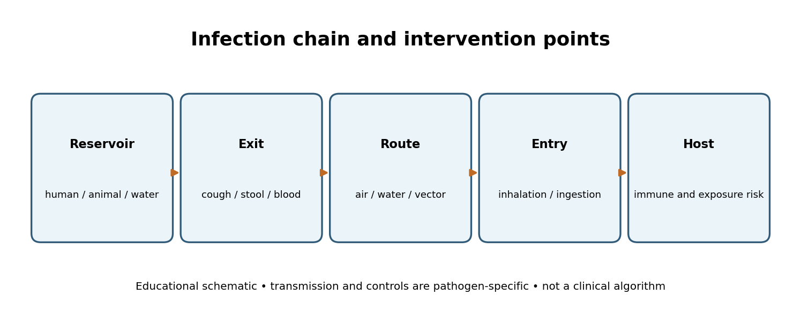
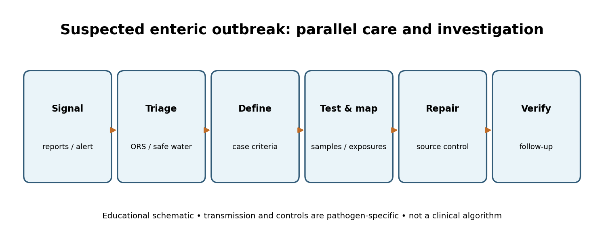
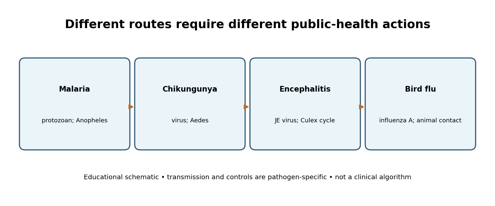

# Microbial Infections: Pathogens, Disease Patterns and Outbreak Prevention

**TGPSC Group I · Paper V · Unit II · Topic 4 · 24 October 2026 · Original English study draft · NOT academically approved**

## Official syllabus, source verification and scope

The original Telangana State Public Service Commission Notification 02/2024 (19 February 2024), Paper V, Unit II, item 4, specifies: **“Microbial infections; Introduction to bacterial, viral, protozoal and fungal infections. Basic knowledge of infections caused by different groups of micro organisms—diarrhoea, dysentery, cholera, tuberculosis, malaria, viral infections like HIV, encephalitis, chikungunya, bird flu—preventive measures during outbreaks.”** [S01]. This text was directly checked against the commission-hosted PDF on 24 October 2026. This chapter covers all named agents, clinical syndromes and public-health controls; it is educational, not a clinical diagnosis or a substitute for official treatment guidelines. Practice questions below are original, **not verified official PYQs**. No independent academic reviewer has approved the material.

| Syllabus demand | Detailed sections | What an examiner can test |
|---|---|---|
| Infection concepts and four microbial groups | 1–4 | Cell biology, reproduction, reservoirs, immunity and diagnostics |
| Diarrhoea, dysentery, cholera | 5–7 | Faecal–oral chain, dehydration, WASH, outbreak action |
| Tuberculosis and malaria | 8–9 | Airborne versus mosquito transmission; programmes |
| HIV, encephalitis, chikungunya, bird flu | 10–13 | Transmission, stigma, vectors, One Health |
| Fungal and opportunistic disease | 4, 14 | Host risk, diagnostic distinctions, stewardship |
| Prevention during outbreaks | 15–18 | IDSP, rapid response, ethics, Telangana scenarios |

**Learning goals.** Explain infection versus disease and colonisation; identify pathogen class and route; distinguish waterborne, airborne, bloodborne, vector-borne and zoonotic infection; connect disease to appropriate tests and prevention; explain district surveillance; and write structured mains answers that acknowledge uncertainty, rights and implementation capacity.

## 1. Foundations: microorganisms, infection and the chain of transmission

A microorganism is an organism or biological agent too small to be seen unaided. Bacteria are cellular prokaryotes; fungi are eukaryotes; protozoa are single-celled eukaryotic parasites; viruses are acellular infectious agents that require living cells for replication. Not every microbe is harmful. Intestinal and skin microbiota contribute to normal physiology, environmental microorganisms recycle nutrients, and fermentation organisms produce food. The label pathogen describes the capacity to cause disease in a susceptible host, not the entire microbial kingdom. An infectious disease arises from the interaction of agent, host and environment, with clinical severity influenced by dose, site of entry, immune status and coexisting conditions.

**Infection** means invasion or multiplication of an infectious agent in the host; **colonisation** means organisms are present without necessarily causing damage; **contamination** refers to organisms on surfaces, food, water or specimens. **Incubation period** is the interval from infection to symptoms, whereas **infectious period** describes when transmission may occur. A person can transmit infection before symptoms, after symptoms or without ever developing symptoms, depending on the disease. The distinction explains why symptom-only screening cannot control every outbreak. A positive laboratory test may reflect active disease, carriage, residual nucleic acid or a false result; interpretation requires clinical and epidemiological context.

The transmission chain contains a reservoir, exit route, mode of spread, entry route and susceptible host. Reservoirs include humans, animals, soil and water. Droplets and aerosols carry respiratory pathogens; faecal contamination transmits many enteric infections; blood and sexual fluids carry HIV; mosquitoes transmit malaria and chikungunya; contact with infected birds can expose people to avian influenza. A control intervention breaks a specific link: sanitation blocks faecal contamination, ventilation reduces inhalation exposure, mosquito-source reduction interrupts vector breeding, and safe needles prevent bloodborne exposure. General advice to 'maintain cleanliness' is too vague unless matched to a pathway.

A public-health officer asks six questions before selecting a measure: What syndrome is occurring? Who is affected? Where and when did illness begin? What exposure is shared? Which tests are reliable at this stage? What immediate action prevents severe outcomes while confirmation proceeds? These questions prevent two opposite errors: delaying lifesaving measures for laboratory certainty and declaring an epidemic on the basis of rumours.

## 2. Bacterial infections: structure, toxins, resistance and diagnostic logic

Bacteria possess a cell membrane, cytoplasm, ribosomes and genetic material without a membrane-bound nucleus. Gram-positive and Gram-negative groups differ in cell-wall architecture and often in antibiotic susceptibility, but Gram stain alone does not identify every species or determine therapy. Bacteria multiply by cell division, can acquire resistance genes and may persist in environmental reservoirs. Some cause disease through tissue invasion, others through toxins, and several combine both mechanisms. *Vibrio cholerae* produces cholera toxin that drives fluid secretion; *Mycobacterium tuberculosis* establishes a slow-growing infection often involving the lungs; *Shigella* may cause inflammatory bloody diarrhoea. These illnesses cannot be managed as one undifferentiated 'bacterial fever'.

**Antibiotics act against bacterial targets**, such as cell-wall synthesis, protein synthesis or nucleic-acid processes; they do not directly treat HIV, chikungunya or influenza. Prescribing antibiotics for every fever creates adverse effects and selects resistant organisms. Antimicrobial resistance (AMR) emerges through selection pressure, transmission and weak infection prevention. It is not that the human body becomes antibiotic-resistant; microbial populations evolve or acquire mechanisms that reduce drug effectiveness. A patient can be infected with resistant bacteria without ever having personally taken an antibiotic because resistant organisms spread between hosts.

Laboratory methods include microscopy, culture and susceptibility testing, antigen tests and nucleic-acid amplification. Culture may be affected by prior treatment and transport conditions; molecular tests may detect DNA even when organisms are not viable. In a district outbreak, a properly collected stool or respiratory specimen with accurate patient and exposure metadata is more useful than a large batch of unlabelled samples. Clinical urgency and public-health action must continue while tests are pending.

Telangana applications include sanitation of drinking-water networks, rational antimicrobial use in hospitals and veterinary settings, safe management of healthcare waste and referral networks between primary facilities and district laboratories. The trade-off is practical: advanced molecular tests improve detection but require sample logistics, trained personnel, quality assurance and equitable access. Surveillance should monitor both organisms and the health-system factors that permit spread.

## 3. Viral infections: replication, immunity and prevention

Viruses contain DNA or RNA enclosed in protein structures, sometimes surrounded by a lipid envelope. They depend on host cells for replication. An envelope often makes a virus susceptible to certain detergents and disinfectants, but it does not establish how the virus spreads or whether an infection is mild. HIV targets immune cells, chikungunya virus is transmitted mainly by *Aedes* mosquitoes, and avian influenza A viruses circulate primarily in birds. Viral diversity makes the blanket claim 'viral infection has no treatment' inaccurate: antiretroviral therapy controls HIV and specific antivirals can be used for selected influenza infections, while chikungunya care is mainly supportive.

Immune responses include innate barriers and inflammation, followed by antigen-specific B-cell antibodies and T-cell responses. Protection may depend on preventing infection, limiting severity or reducing transmission; these are distinct endpoints. Vaccines prime immune responses against selected pathogens but do not prevent every infectious disease. The next syllabus topic treats vaccines in detail; here the focus is on placing immunisation alongside surveillance, water safety, vector control and infection-prevention practices.

Diagnosis is timing-sensitive. PCR or other nucleic-acid tests may detect viral material early, while antibody tests often become informative later. A negative test collected too early or using the wrong specimen does not automatically exclude infection. Clinical syndromes overlap: fever and rash may result from chikungunya, dengue, measles or other causes. Public messaging should explain why a clinician may initially investigate several diagnoses rather than confidently label a disease from symptoms alone.

Viral outbreaks demonstrate the importance of truthful risk communication. Exaggerated claims can provoke stigma or unnecessary panic; minimising uncertainty can destroy trust when evidence changes. Public authorities should communicate what is known, what remains uncertain, who faces the greatest exposure and which protective steps are feasible. This is particularly important for HIV, where casual contact does not transmit infection, and for bird flu, where occupational exposure differs markedly from ordinary community risk.

## 4. Protozoa and fungi: organisms, hosts and overlooked syndromes

Protozoa are single-celled eukaryotes with diverse life cycles. *Plasmodium* parasites cause malaria after transmission by infected female *Anopheles* mosquitoes. *Entamoeba histolytica* can cause amoebic dysentery, while *Giardia duodenalis* causes intestinal illness associated with contaminated water. *Cryptosporidium* is another cause of diarrhoeal disease, particularly important among people with impaired immunity. Their life cycles differ: malaria involves human and mosquito hosts, whereas many intestinal protozoa spread through ingestion of infectious stages from contaminated food or water. This distinction determines whether a district prioritises mosquito ecology or drinking-water protection.

Fungi are eukaryotes that include yeasts and moulds. *Candida* may exist as part of normal flora but can cause mucosal or invasive disease under favourable conditions. Dermatophytes infect keratinised skin, hair or nails. *Aspergillus* can cause severe pulmonary disease in susceptible hosts, and *Cryptococcus* can cause meningitis especially in advanced immunosuppression. Fungal infections are not necessarily contagious between people: some arise from environmental exposure or overgrowth of organisms already present. Risk factors include immunosuppressive therapy, diabetes, invasive devices and prolonged hospitalisation.

A microscope, culture, antigen test or molecular assay may assist diagnosis, but specimens must match the suspected site. A fungal organism isolated from a non-sterile surface may represent contamination or colonisation rather than invasive disease. Misinterpretation leads to unnecessary treatment. Antifungal agents differ from antibiotics and have toxicity, interaction and resistance considerations. Unsupervised use of topical steroid-antifungal combinations can obscure skin infections and complicate management.

For examination purposes, compare malaria and amoebiasis rather than treating all protozoa as mosquito-borne; compare superficial ringworm and invasive fungal disease rather than treating all fungi as minor skin problems. Telangana's hot seasons, crowded accommodation and variable healthcare access can shape exposure, but local incidence claims require district surveillance data. A policy response should combine affordable diagnostics, water safety, targeted vector control and rational drug use rather than prescribe one intervention for every parasite or fungus.

## 5. Diarrhoea: syndrome, dehydration and the public-health response

Diarrhoea is a clinical syndrome, commonly defined as three or more loose or liquid stools in a day or more than normal for the individual. It is not itself the name of one pathogen. Causes include viruses such as rotavirus and norovirus, bacteria such as pathogenic *E. coli* and *Shigella*, protozoa such as *Giardia*, non-infectious medication effects and inflammatory disease. The syndrome may be acute watery, bloody or persistent. This classification is clinically useful because the likely causes, risk of dehydration and need for investigation differ. A waterborne outbreak can affect many households at once, but a few isolated cases do not prove that the municipal supply is contaminated.

The central immediate danger, especially for young children, is loss of water and electrolytes. Oral rehydration solution (ORS) uses intestinal glucose–sodium cotransport to promote absorption of salt and water even during many secretory diarrhoeas. It does not kill pathogens; it prevents and treats dehydration. Severe dehydration, shock, inability to drink or altered consciousness requires urgent professional assessment and may require intravenous fluids. Continuing age-appropriate feeding and breastfeeding is important. Zinc supplementation is recommended in paediatric diarrhoeal management under appropriate clinical guidance. Routine antibiotics are not indicated for every episode and may be harmful in some conditions.

Prevention addresses source-to-mouth contamination: safe water at collection and storage, functioning sanitation, handwashing with soap, food hygiene and rotavirus vaccination where recommended. A household may receive treated water but contaminate it while drawing from an open vessel. Thus 'safe source' and 'safe point of use' are separate controls. In a suspected cluster, authorities should compare illness onset, water distribution zones, sewage leaks, recent rainfall, food events and laboratory results. Water chlorination must be verified through appropriate residual monitoring and system inspection, not merely announced.

The World Health Organization's 7 March 2024 diarrhoeal-disease fact sheet highlights the preventability and treatability of this syndrome [S02]. For Telangana, consider a peri-urban settlement where a damaged water pipe runs near a sewer after heavy rain. Immediate measures include safe alternative water, medical triage, ORS access, repair and disinfection, targeted sampling, household communication and follow-up. A single 'health camp' without correcting the source permits recurrence.

## 6. Dysentery: inflammatory diarrhoea and aetiological distinction

Dysentery generally denotes diarrhoea with visible blood, often with mucus, abdominal cramps or urgency. **Bacillary dysentery** commonly refers to *Shigella* infection; **amoebic dysentery** is associated with invasive *Entamoeba histolytica*. Both can present with bloody stool but differ in organism, pathogenesis, diagnostic tests and appropriate treatment. Other bacteria can also cause bloody diarrhoea, so symptoms alone cannot establish the cause. A well-written answer avoids saying that every case of dysentery is caused by amoeba or that any stool microscopy result automatically proves invasive amoebiasis.

*Shigella* spreads efficiently through faecal–oral contact and contaminated food or water, particularly where sanitation and hand hygiene are inadequate. The organism invades intestinal mucosa, provoking inflammation. *E. histolytica* is acquired by ingesting cysts; trophozoites may invade the colon and occasionally spread beyond it. Distinguishing pathogenic *E. histolytica* from morphologically similar non-pathogenic organisms may require specific antigen or molecular methods. Clinical severity, dehydration and vulnerable age groups determine urgency.

The response has two levels. At the bedside, assess dehydration and warning signs, obtain appropriate diagnostic advice and avoid unprescribed antimicrobials. At community level, identify shared exposures, ensure water and sanitation, improve safe food handling and monitor new cases. Contact tracing in a household or institution can clarify person-to-person spread; a common water source may explain a broader geographic cluster. Schools and childcare settings require accessible handwashing, safe toilets and policies that avoid punitive stigma toward sick children.

For mains answers, contrast dysentery with cholera: dysentery often involves inflammatory injury and blood, whereas classic cholera causes profuse watery fluid loss without requiring mucosal invasion. Both can spread through contaminated food or water, but case management, diagnostic priorities and outbreak interpretation differ. The exam rewards mechanism-based distinctions rather than rote symptom lists.

**District investigation example (hypothetical):** Suppose 18 children at a hostel develop bloody stools over three days, but only some used a shared water dispenser. The response should first arrange clinical assessment and safe drinking water, then construct an onset timeline and compare exposures among ill and unaffected residents. A positive stool test in one child does not prove that the dispenser was the source; concordant exposure patterns, appropriate microbiology and environmental findings are needed. WHO describes dysentery as bloody diarrhoea, not as a diagnosis restricted to one organism [S21]. This distinction is important when framing suspected versus confirmed cases in a mains answer.

## 7. Cholera: secretory physiology, epidemic potential and WASH

Cholera is an acute intestinal infection caused by toxigenic *Vibrio cholerae*, principally epidemic serogroups O1 and O139. The organism is acquired through contaminated water or food. Cholera toxin alters intestinal signalling and causes massive secretion of electrolytes and water into the lumen; severe cases may develop rapid dehydration and shock. The classic 'rice-water stool' description is memorable but is not necessary for diagnosis and should not be used as the sole case definition. Many infections are mild or asymptomatic, while a smaller proportion cause life-threatening dehydration.

Rapid rehydration is the foundation of cholera care; the choice of oral versus intravenous route depends on severity and clinical assessment. Selected severe cases may benefit from appropriate antibiotics under current guidance, but antibiotics do not replace fluids. Confirmatory testing, reporting and environmental investigation help establish an outbreak. Oral cholera vaccines can complement control in specified settings, yet vaccination does not substitute for reliable drinking water and sanitation. Overreliance on a short vaccination campaign without repairing contamination pathways is a predictable policy failure.

In a city, water and sewerage infrastructure can become linked during pressure loss, pipe breaks, flooding or illegal connections. Investigators should map cases by onset date and locality, examine water quality and distribution networks, verify chlorine residuals and collect appropriate specimens. A 'spot map' alone cannot establish the source; comparison of exposed and unexposed groups and laboratory/environmental evidence strengthens inference. A sharp rise in watery diarrhoea warrants early response even before a cholera pathogen is confirmed, while public statements should distinguish suspected from laboratory-confirmed cases.

Cholera demonstrates how infectious disease is simultaneously a microbiology, infrastructure and governance issue. Water supply, municipal sanitation, clinical services, laboratories and public communication must act together. For Telangana examples, use hypothetical flood-affected neighbourhoods unless a particular outbreak is documented in a dated official bulletin. Do not attach an invented case count to a named district. Equity matters: temporary settlements, migrant workers and people without household taps may face higher exposure and need practical safe-water access.

## 8. Tuberculosis: airborne transmission, latency, diagnosis and programme design

Tuberculosis is caused by the *Mycobacterium tuberculosis* complex and commonly affects the lungs, though extrapulmonary disease occurs. It spreads mainly when infectious pulmonary or laryngeal TB patients release airborne particles that are inhaled by others. It is not principally spread by sharing plates or by mosquito bites. Crowded, poorly ventilated indoor spaces and prolonged exposure raise risk; effective ventilation and respiratory protection can reduce transmission. Infection without active disease is possible. **TB infection** and **active TB disease** must be separated because symptoms, infectiousness and treatment approaches differ.

Common pulmonary symptoms include persistent cough, fever, night sweats and weight loss, but none is specific enough to diagnose TB. Molecular tests can identify *M. tuberculosis* and some drug-resistance markers; microscopy and culture have complementary roles. Chest radiography can support assessment but cannot alone prove bacterial infection. Drug-resistant TB is a major programme challenge because incomplete or inappropriate treatment can select resistance and transmission of resistant strains can occur independently of individual adherence history. Patients need reliable access to full regimens, monitoring and counselling without blame.

India's National Tuberculosis Elimination Programme coordinates diagnosis, treatment, notification, prevention and patient support. District implementation depends on private-provider engagement, laboratory transport, nutrition support, household contact investigation and reducing financial barriers. WHO's Global Tuberculosis Report 2025, released 12 November 2025, provides the latest annual global analytical baseline in this source register [S03]. Its estimates should not be casually compared with outdated estimates from another methodology. WHO's 24 March 2026 fact sheet reports an estimated 10.7 million people developed TB globally in 2024 [S04]; that is an estimate for 2024, not a 2026 case count.

A Telangana district strategy should combine targeted screening in high-risk settings, timely molecular diagnosis, treatment continuity for mobile workers, respiratory infection prevention in health facilities and protection against stigma. Digital adherence tools can assist but cannot compensate for absent medicines, transport costs or poor counselling. An effective mains answer discusses biology, service delivery, poverty and rights together. TB elimination is a population-level ambition requiring sustained investment, not proof that the disease has already disappeared.

## 9. Malaria: Plasmodium life cycle and vector ecology

Malaria is caused by protozoan parasites of the genus *Plasmodium* and transmitted mainly by infected female *Anopheles* mosquitoes. *P. falciparum* can cause severe disease; *P. vivax* may form dormant liver stages that contribute to relapse. Mosquitoes ingest sexual stages from an infected human, support parasite development and later inoculate infectious sporozoites into another person. Parasites first multiply in the liver and subsequently infect red blood cells, producing febrile illness and potentially anaemia or severe organ complications. The human–mosquito cycle explains why malaria is not ordinarily spread by sharing food or casual contact.

Diagnosis uses microscopy or quality-assured rapid diagnostic tests interpreted with symptoms, travel, local epidemiology and clinical urgency. Not every fever in a malaria-prone region is malaria; dengue, chikungunya, bacterial infections and other causes overlap. Severe malaria is a medical emergency requiring prompt professional care. Treatment depends on parasite species, severity, local resistance and national guidelines; unprescribed drug combinations risk treatment failure and resistance. Public-health messaging should avoid publishing a single fixed drug recipe in general examination notes because recommendations can change.

Vector control is ecological. *Anopheles* breeding habitats and biting patterns differ from those of *Aedes*. Interventions include insecticide-treated nets in suitable settings, indoor residual spraying where indicated, environmental management, surveillance and rapid case detection. Insecticide resistance and human behaviour influence results. Counting only sprayed houses is a weak success measure; programmes should also monitor confirmed cases, test positivity, vector indices, coverage quality and timely treatment.

In Telangana, forest-fringe settlements, mobile populations, irrigation works and seasonal water bodies may produce heterogeneous malaria risk; local mapping is preferable to declaring every district equally endemic. A tribal habitation far from a laboratory needs specimen transport and timely treatment, not just a district-level awareness poster. WHO's World Malaria Report 2025 [S05] emphasises the threat of antimalarial resistance. A good mains answer links parasite biology, diagnostics, vector ecology, health access and resistance surveillance.

## 10. HIV: transmission, antiretroviral therapy, rights and stigma

Human immunodeficiency virus attacks immune-system cells, particularly CD4 T lymphocytes. Untreated infection can progressively weaken immunity and lead to acquired immunodeficiency syndrome (AIDS), an advanced clinical stage; HIV infection and AIDS are not synonyms. HIV spreads through particular body fluids, including blood, semen, vaginal fluids and breast milk, and may pass from parent to child during pregnancy, birth or breastfeeding. It is **not transmitted** by ordinary handshakes, shared meals, hugs or mosquito bites. These distinctions are essential to counter discrimination and to target prevention rationally.

Prevention combines safe blood services, sterile injection equipment, condoms, evidence-based pre-exposure and post-exposure prophylaxis where appropriate, testing and effective antiretroviral therapy (ART). Suppression of viral load with sustained effective ART dramatically improves health and prevents sexual transmission when viral suppression is maintained (the U=U principle). A positive HIV test requires validated diagnostic algorithms, counselling, confidentiality and linkage to care. False rumours and coercive disclosure can deter testing and undermine control. Treatment access, retention and respect for people living with HIV are central programme outcomes.

India's National AIDS Control Programme and the National AIDS Control Organisation coordinate HIV prevention, testing and treatment services. The HIV and AIDS (Prevention and Control) Act, 2017 establishes important protections against discrimination and for confidentiality subject to legal provisions. Public health cannot be reduced to a list of prohibited behaviours; it must address gender power, stigma, occupational exposure, access to harm-reduction services and continuity of treatment for mobile populations. HIV–TB co-infection requires coordinated screening and care because immunosuppression increases TB risk.

WHO's HIV fact sheet dated 27 July 2026 reports an estimated 41.0 million people living with HIV worldwide at the end of 2025 [S06]. That is a global estimate and should not be misrepresented as India's prevalence. For a Telangana district, a credible intervention improves confidential testing and linkage, reduces missed ART visits and monitors viral suppression without exposing individual identities. Ethical practice is not optional decoration: confidentiality improves trust and therefore programme effectiveness.

## 11. Encephalitis: syndrome, causes and urgency

Encephalitis means inflammation of brain tissue, often presenting with fever, altered mental status, seizures, behavioural change or focal neurological signs. It is a **syndrome**, not one pathogen. Causes include viruses such as Japanese encephalitis virus and herpes simplex virus, other infections and autoimmune mechanisms. Meningitis involves inflammation of the meninges; encephalitis involves brain parenchyma, although the two may overlap clinically. A fever with headache alone does not establish encephalitis. New confusion, seizures or reduced consciousness require urgent medical evaluation rather than home observation.

Japanese encephalitis virus is maintained in a mosquito–animal cycle involving *Culex* mosquitoes and amplifying hosts such as pigs and water birds; humans are generally dead-end hosts. Rural wetland and rice-field ecology can affect vector exposure. This biology differs from direct person-to-person respiratory infections and from *Aedes*-borne chikungunya. Other encephalitis causes have different transmission routes, and a diagnostic label 'acute encephalitis syndrome' (AES) may be used before a cause is established. Surveillance should separate AES notifications from laboratory-confirmed Japanese encephalitis; equating the two inflates disease-specific claims.

Evaluation may involve neurological examination, blood and cerebrospinal-fluid investigations, neuroimaging and pathogen-specific tests, chosen by clinicians according to safety and likely diagnosis. Management includes stabilisation, seizure control, supportive care and pathogen-specific therapy where indicated. A single antibiotic or antiviral cannot treat every encephalitis cause. Preventive strategies include vaccination where indicated, vector management, livestock-related risk communication and early referral; the balance depends on local epidemiology.

Telangana's examination relevance lies in district emergency preparedness: primary facilities must recognise danger signs, arrange safe referral and coordinate with surveillance teams. A cluster of neurological illness warrants careful differential diagnosis and sample logistics before attributing it to a named virus. The correct public message avoids panic while emphasising that neurological symptoms are medical emergencies. Public health and clinical medicine intersect most sharply when delays can cause lasting disability.

## 12. Chikungunya: Aedes mosquitoes and prolonged joint disease

Chikungunya is caused by an alphavirus transmitted principally by infected *Aedes aegypti* and *Aedes albopictus* mosquitoes. These mosquitoes commonly breed in small containers with stagnant water and often bite during daylight. Chikungunya typically causes abrupt fever and prominent joint pain; pain can persist for weeks or months and disrupt work and daily living. Rash, fatigue and muscle pain may occur. The syndrome overlaps with dengue and other febrile illnesses, so laboratory tests and clinical assessment may be necessary, particularly during co-circulation.

The most important examination distinction is that **chikungunya is viral, not protozoal**, despite mosquito transmission; malaria is protozoal and commonly transmitted by *Anopheles*. Chikungunya does not ordinarily spread directly from one person to another through casual contact. An infected person can, however, infect mosquitoes during viraemia, contributing to local transmission. This is why bite prevention during the early illness period matters for community control as well as personal protection.

There is no universally used specific antiviral treatment for chikungunya; clinical care is supportive. WHO's 14 April 2025 fact sheet [S07] notes severe joint pain and recommends avoiding non-steroidal anti-inflammatory drugs until dengue is excluded because of bleeding risk. This is a general public-health explanation, not a prescription. Vaccine availability and recommendations differ across countries and can change; a claim that every Telangana resident should receive a chikungunya vaccine would be unsupported.

Municipal prevention needs weekly inspection and removal of breeding containers, reliable waste management, covered water storage, household participation and entomological surveillance. Fogging alone is insufficient if breeding habitats remain. A school cluster should prompt fever surveillance, referral for danger signs, mosquito source reduction and clear information about the difference between dengue and chikungunya. A useful evaluation measures vector breeding, case trends and timely access to care rather than merely counting public announcements.

**Transmission window and diagnostic timing:** WHO's chikungunya guidance distinguishes early direct detection of viral material from later antibody testing; specimen timing therefore matters when interpreting a negative result [S07]. A resident with fever and joint pain should not be counted as a laboratory-confirmed chikungunya case merely because *Aedes* breeding was found nearby. In an illustrative ward audit, record containers inspected, containers positive for larvae, fever-onset dates and the number of tests performed; these are different denominators. A decline in positive containers is evidence of reduced breeding in sampled locations, not proof that all community infections have ended.

## 13. Bird flu: avian influenza, occupational exposure and One Health

Bird flu is an informal name for avian influenza, caused by influenza A viruses adapted primarily to birds. Highly pathogenic avian influenza refers to severe disease in poultry under veterinary classification; it does not mean every human exposure causes severe illness. Human infections with certain avian influenza subtypes, including A(H5N1), have occurred, usually after close contact with infected birds, animals or contaminated environments. Sustained human-to-human transmission of the currently circulating avian A(H5) viruses has not been established in the WHO source used here. A virus can evolve, so surveillance remains necessary without exaggerating present risk.

This is a **One Health** problem because animal health, human health, food systems and environmental monitoring interact. Veterinary authorities detect unusual poultry mortality, laboratories identify viral subtype, human health teams monitor exposed workers and public communications explain safe practices. Farmers and poultry workers need feasible personal protective equipment and reporting channels. Unprotected handling of sick or dead birds should be avoided. Food safety advice emphasises hygienic handling and thorough cooking; WHO's 16 May 2024 Q&A [S08] advises against raw milk in relevant exposure settings and supports pasteurisation.

Diagnosis of suspected human infection uses appropriate influenza molecular testing and specialist public-health referral. Routine seasonal influenza vaccination does not specifically protect against avian H5 infection, though seasonal vaccination may be recommended for other reasons. Antiviral treatment for suspected or confirmed severe influenza is a clinical decision under current guidelines. An outbreak response should avoid indiscriminate culling claims without veterinary authority, compensation arrangements and evidence; otherwise concealment of sick birds becomes more likely.

WHO's 5 December 2025 report on an A(H5N5) human infection [S09] illustrates how surveillance can detect a rare subtype and how a single case does not prove sustained community spread. A Telangana district scenario might involve poultry mortality near a market. The proper sequence is veterinary notification, safe specimen collection by trained teams, worker exposure assessment, laboratory coordination and transparent communication—not immediate claims of a human epidemic.

## 14. Fungal infections, immune vulnerability and healthcare-associated spread

Fungal disease ranges from superficial infection to invasive disease. Dermatophytes cause ringworm and other skin infections; *Candida* may cause thrush or bloodstream infection; *Aspergillus* can cause serious lung disease in people with particular immune or structural lung conditions; *Cryptococcus* may cause meningitis. The same genus can colonise or infect depending on site and host. Clinical interpretation therefore requires specimen quality, immune history and signs of tissue invasion. Public claims that every positive fungal swab proves systemic infection are unsound.

Diabetes, immunosuppressive medicines, organ transplantation, advanced HIV disease, prolonged intensive-care exposure and invasive devices can increase vulnerability. Hospital prevention includes hand hygiene, device care, environmental maintenance, rational antimicrobial use and laboratory capacity. Some fungal pathogens acquire resistance; empirical use of topical steroid combinations for presumed ringworm can mask disease and contribute to poor outcomes. Antifungal medicines are not interchangeable and may have important toxicity or interactions, so public study material should not provide self-treatment regimens.

The outbreak dimension differs from cholera or influenza. A cluster of invasive fungal infections in a hospital may reflect contaminated equipment, construction dust, a product or failures in infection prevention rather than straightforward person-to-person spread. Investigators compare patient exposures, procedure dates, locations and laboratory isolates. A cluster of superficial fungal infection in a hostel may instead relate to close contact and shared personal items. The mode of spread, not the general word 'fungus', determines intervention.

For Telangana, an equitable programme would train primary-care staff to recognise warning signs and refer high-risk patients, while strengthening diagnostic mycology in referral centres. It would also address overcrowding, water damage and hygiene in institutions without portraying ordinary environmental fungi as universally dangerous. A complete answer connects microbial biology to host vulnerability and service quality rather than describing only symptoms.

**Hospital infection-control distinction:** Ordinary *Candida* species may live on skin or mucosa without invasive disease, whereas *Candida auris* can colonise patients and spread through healthcare environments. The US CDC specifically warns that colonised *C. auris* patients can contaminate surfaces even without symptoms [S22]. This creates two separate questions for a hospital: who requires clinical evaluation for invasive disease, and what contact precautions and environmental cleaning are needed to prevent transmission? CDC also identifies central venous catheters, prolonged ICU exposure and certain immunosuppressive treatments as invasive-candidiasis risk factors [S23]. These are risk factors, not proof of infection in an individual.

## 15. Outbreak investigation: surveillance, epidemiology and laboratory confirmation

An **outbreak** is an occurrence of disease cases above what is normally expected for a defined population, place and time; the baseline and case definition matter. A **cluster** is an aggregation of cases that may or may not exceed expectation. Surveillance detects unusual signals, investigation determines whether they represent a true outbreak, and response reduces harm. Under India's Integrated Disease Surveillance Programme (IDSP), reporting combines suspected syndromic (S), presumptive (P) and laboratory-confirmed (L) streams. These categories should not be added as though they were mutually exclusive unique individuals without checking reporting definitions [S10].

A district Rapid Response Team typically verifies the signal, defines a case, searches actively for additional cases, describes cases by person/place/time, develops hypotheses, obtains appropriate specimens, analyses exposures and implements controls. An epidemic curve plots cases by onset time and can suggest a point-source or propagated pattern, but does not prove the agent. An attack rate uses cases among a defined exposed population; the denominator must be explicit. If 24 of 120 attendees at a function become ill, the observed attack proportion is 20%, not 24% and not the proportion of all district residents. Comparisons with unexposed groups can strengthen causal inference.

Specimen timing, transport and chain of custody are critical. Testing after antibiotics or collecting from the wrong anatomical site can reduce yield. A negative environmental sample taken after disinfection does not establish that the original water supply was safe. Conversely, a positive pathogen test in one patient does not prove that all cases share the same cause. Triangulate clinical findings, time–place patterns, exposure history and laboratory evidence. Use provisional terms when evidence remains incomplete.

The NCDC IDSP programme page [S10], accessed 24 October 2026, reports 2,285 outbreaks in 2025 and describes continued 2026 surveillance. These are reported programme figures with stated reporting coverage, not a census of every infection. District administrators must interpret missing reports and delays. Transparent communication of uncertainties improves trust, while premature attribution can damage livelihoods and encourage concealment.

## 16. Prevention during outbreaks: matched interventions, not one-size-fits-all

The first step is to match the intervention to the route. For **faecal–oral outbreaks**, prioritise safe drinking water, sanitation, handwashing, food safety and rapid rehydration access. For **airborne TB**, prioritise early diagnosis, appropriate treatment, ventilation, respiratory infection prevention and contact services. For **Aedes-borne chikungunya**, remove breeding containers, prevent bites and conduct entomological surveillance. For **malaria**, combine species-appropriate diagnosis, treatment and *Anopheles*-focused vector control. For **HIV**, prioritise confidential testing, prevention and ART continuity rather than household quarantine. For **avian influenza**, coordinate animal and human surveillance and protect exposed workers.

Outbreak measures must also be proportional. Isolation, movement restrictions or closure decisions should rest on the pathogen's transmission, risk and current law, not public anxiety. Overly broad coercion can harm livelihoods and discourage reporting. Risk communication should be accessible in local languages, specify actions that households can perform and correct misinformation without blaming affected communities. Communication that merely says 'be alert' fails to tell people what to do. For severe illness, referral pathways and clinical supplies may matter more immediately than public posters.

Infection prevention in healthcare includes hand hygiene, appropriate personal protective equipment, safe sharps disposal, environmental cleaning, respiratory precautions where indicated and correct waste segregation. Antibiotic stewardship and laboratory quality protect future treatment effectiveness. Immunisation is highly effective for selected vaccine-preventable diseases but does not replace water safety, vector control or HIV prevention. Surveillance needs continuous feedback to field workers so reporting produces action, not just forms.

A robust district response uses a command structure: public health leads case surveillance, municipal bodies address water and waste, hospitals provide triage and care, laboratories confirm diagnoses, veterinary services manage animal events, and district administration resolves resource bottlenecks. Metrics include time from alert to verification, specimen turnaround, case fatality among confirmed cases, water quality restoration, vector indices and equitable coverage. Success is sustained reduction in transmission and severe outcomes—not the number of meetings held.

## 17. Telangana case applications: water, urban vectors, TB and animal exposure

**Case A: Monsoon-associated acute diarrhoea.** In a hypothetical Telangana municipality, several families report watery stools after heavy rainfall. The response begins with triage for dehydration and distribution of safe water, while mapping cases by household, onset and water distribution zone. Teams inspect sewage–water cross-connections, residual chlorine and food exposures. Only after appropriate testing should authorities label the event cholera. If the municipal repair is completed but unsafe household storage persists, a second transmission pathway remains. The policy lesson is to treat infrastructure, clinical care and behaviour as complementary, not substitutes.

**Case B: Chikungunya near a construction site.** A peri-urban neighbourhood reports fever and severe joint pain. Mosquito breeding may occur in containers, discarded tyres and construction water. Local staff should inspect and eliminate habitats, communicate daytime bite prevention, arrange clinical assessment to distinguish dengue and other illnesses and monitor confirmed cases. Fogging without source reduction provides limited durability. Construction employers and residents share responsibility, while municipal services must remove waste reliably. An exam answer should not assume every fever in the cluster is laboratory-confirmed chikungunya.

**Case C: TB treatment interruption among migrant workers.** A worker changes districts while receiving TB treatment. The primary risk is loss of continuity, not simply ignorance about cough etiquette. Digital case records and referral can help, but accessible medicine, respectful counselling, transport and protection from lost wages may determine completion. A programme judged only by registrations can hide interrupted care. Linking social protection and public-health services improves both equity and transmission control.

**Case D: Unusual poultry mortality.** Veterinary teams report deaths near a poultry market. The district should prevent unprotected contact, secure veterinary testing, identify occupationally exposed people and communicate that animal infection is not proof of widespread human transmission. Laboratory coordination and fair compensation incentives can improve timely reporting. These cases are analytical teaching scenarios, not claims that these events occurred in specific Telangana districts in 2026.

## 18. Institutions, ethics, evaluation and competing policy choices

India's response involves the Ministry of Health and Family Welfare, National Centre for Disease Control, IDSP, National Health Mission, National Tuberculosis Elimination Programme, National AIDS Control Organisation, state health departments, local bodies, laboratories and veterinary agencies. Their mandates overlap but are not identical. District public health units coordinate investigation; clinical services treat patients; water boards correct contamination; municipal bodies manage waste; animal-health authorities investigate poultry events. Public trust depends on explaining who is responsible for which action and how information will be shared.

Three tensions recur. **Centralised expertise versus local action:** reference laboratories and national guidelines support quality, but field teams need autonomy and resources for immediate measures. **Speed versus certainty:** early ORS distribution or safe-water provision can be justified before pathogen confirmation, whereas public accusation against a particular supplier demands stronger evidence. **Individual rights versus population protection:** confidentiality, informed communication and proportional interventions improve cooperation; indiscriminate naming or punishment may drive infections underground. These are not reasons for inaction but criteria for better-designed action.

A practical evaluation framework follows inputs, processes, outputs and outcomes. Inputs include trained staff, laboratories and medicines; processes include reporting and investigation; outputs include tests completed and water sources repaired; outcomes include lower incidence, reduced deaths and sustained trust. An apparent rise in notified cases may initially reflect better detection rather than worsening transmission. Conversely, a fall in reports after staff shortages may be a surveillance failure. Always examine testing volume, reporting completeness and denominators before declaring success.

The central conclusion is that microbes differ in biology, routes and control. Disease names must be linked to agents, mechanisms, diagnostics and context. A scientifically defensible answer combines prevention of exposure, early recognition of severe disease, reliable laboratory surveillance, timely care and accountable local institutions. Telangana's urban, rural, tribal and peri-urban settings require adapted delivery without abandoning common public-health principles.

## Visual learning and diagrams

**Diagram 1 — infection chain and intervention points.** Reservoir → exit → route → entry → susceptible host, with sanitation, ventilation, vector control and infection prevention mapped to distinct links. It illustrates why different pathogens demand different interventions.

**Diagram 2 — enteric outbreak response.** Signal → triage and safe water → case definition → epidemiological mapping and samples → source repair → follow-up. The key principle is parallel immediate action and evidence collection.

**Diagram 3 — vector and zoonotic comparison.** Malaria (*Anopheles*, protozoan), chikungunya (*Aedes*, virus), Japanese encephalitis (*Culex*, virus, animal cycle) and avian influenza (animal exposure, influenza virus). Do not mistake a shared symptom for a shared route.

## Standalone quick revision: pathogen–route–control matrix

| Condition or class | Agent / category | Principal route | Essential prevention distinction |
|---|---|---|---|
| Cholera | Toxigenic *V. cholerae*, bacterium | Contaminated water/food | WASH and rapid rehydration; outbreak laboratory confirmation |
| Bacillary dysentery | *Shigella*, bacterium | Faecal–oral | Sanitation, handwashing and appropriate clinical assessment |
| Amoebic dysentery | *E. histolytica*, protozoan | Ingested cysts | Safe water, diagnosis distinguishes non-pathogenic lookalikes |
| TB | *M. tuberculosis*, bacterium | Airborne inhalation | Ventilation, prompt diagnosis and complete treatment |
| Malaria | *Plasmodium*, protozoan | Female *Anopheles* | Parasite testing and species-appropriate vector control |
| HIV | Human immunodeficiency virus | Particular blood/sexual/perinatal exposures | Confidential testing, ART, condoms and safe needles |
| Encephalitis | Multiple infectious and non-infectious causes | Depends on cause | Emergency referral; do not equate AES with JE |
| Chikungunya | Alphavirus | *Aedes* mosquitoes | Container source reduction, daytime bite prevention |
| Bird flu | Avian influenza A virus | Animal/occupational exposure | One Health and safe poultry handling; avoid false human-epidemic claims |
| Dermatophytosis | Dermatophyte fungi | Contact/shared items | Accurate diagnosis; avoid unsupervised steroid mixtures |

### Ten distinctions examiners reward

1. Infection is not necessarily symptomatic disease; colonisation is not necessarily infection.
2. Diarrhoea is a syndrome with multiple causes; cholera is one specific bacterial cause.
3. Bloody dysentery and profuse watery cholera have different common mechanisms.
4. TB is airborne; cholera is faecal–oral; HIV is not transmitted by casual touch.
5. Malaria is protozoal and *Anopheles*-borne; chikungunya is viral and *Aedes*-borne.
6. Encephalitis is a syndrome; Japanese encephalitis is one aetiology.
7. Human H5 infection after animal exposure is not proof of sustained person-to-person spread.
8. Antimicrobials must match organisms; antibiotics do not treat ordinary viral infections.
9. A positive screening test and a confirmed outbreak are different evidence levels.
10. Surveillance counts depend on definitions, denominators and reporting completeness.

### Three-minute examination framework

Start with the agent and biological mechanism; identify reservoir and transmission route; explain clinical danger and diagnostics; give route-specific prevention; name an Indian programme and a Telangana implementation example; finish with an ethical, measurable outcome. For outbreak questions, add case definition, epidemic curve, laboratory sampling, immediate protective measures and feedback to the community. For disease comparisons, use a table rather than disconnected symptom lists.

## Answer blueprints and examination writing guidance

**Blueprint 1 — classify pathogens:** Introduction: infection versus disease. Body: four-column table for bacteria, viruses, protozoa and fungi; one named example each; diagnostic and antimicrobial differences. Telangana application: surveillance and treatment access. Conclusion: route-specific public health.

**Blueprint 2 — diarrhoeal outbreak:** Begin with syndrome definitions; then dehydration triage, ORS and referral; source investigation with epidemic curve, water sampling and sewer inspection; sanitation and communication; measurable follow-up. Distinguish suspected cholera from laboratory confirmation.

**Blueprint 3 — tuberculosis:** Describe airborne biology, latent infection versus active disease and molecular testing; add NTEP, treatment continuity, resistance, poverty and stigma; evaluate diagnosis-to-treatment delay and patient costs.

**Blueprint 4 — malaria versus chikungunya:** Use a comparative table: protozoan/viral, *Anopheles*/*Aedes*, liver/blood cycle versus arthralgia, tests, vector ecology and clinical management. Recommend locally mapped integrated vector management.

**Blueprint 5 — HIV:** Define HIV and AIDS separately; state real and false routes; ART, testing, prevention and U=U; confidentiality under Indian law; linkage-to-care metrics and rights-based conclusion.

**Blueprint 6 — bird flu and outbreak control:** Use a One Health flow: unusual animal event → verification → human exposure assessment → specimens → proportional control → transparent updates → evaluation. Do not equate poultry mortality with proven human epidemic.

**Presentation standard:** For 200–250 words, use five or six substantive subheadings and a specific conclusion. Avoid one uninterrupted paragraph. Explain cause and consequence; give a grounded Telangana example without inventing local statistics. Do not cite unverified previous-year questions as official.

## 30 original explained multiple-choice questions
**These are original practice MCQs, not authenticated TGPSC previous-year questions.**

**Q1. Which pair correctly matches a pathogen with its biological category?**
A. *Candida*—virus
B. *Plasmodium*—protozoan
C. HIV—bacterium
D. *Vibrio cholerae*—fungus

**Answer: B.** *Plasmodium* is a protozoan parasite. The three distractor organisms are misclassified: *Candida* is a fungus (not a virus), HIV is a virus (not a bacterium), and *Vibrio cholerae* is a bacterium (not a fungus).

**Q2. Which best describes colonisation?**
A. A compulsory symptom of viral disease
B. A mosquito transmission stage
C. Presence of microbes without necessarily causing tissue damage
D. A proven bloodstream infection

**Answer: C.** Colonisation need not cause clinical disease; host and site determine interpretation.

**Q3. A district receives 18 cases of watery diarrhoea from one street. The sound first response is to:**
A. Declare laboratory-confirmed cholera immediately
B. Wait for culture before any action
C. Give antibiotics to every resident
D. Provide safe water and clinical triage while investigating

**Answer: D.** Immediate low-regret measures can proceed before aetiology is confirmed.

**Q4. The major immediate danger in severe watery diarrhoea is:**
A. Fluid and electrolyte depletion
B. Bone fracture
C. Permanent viral latency
D. Mosquito resistance

**Answer: A.** Severe dehydration and shock can develop rapidly, requiring prompt rehydration.

**Q5. ORS is effective in many diarrhoeal illnesses because it:**
A. Prevents all future infection
B. Uses glucose–sodium cotransport to support fluid absorption
C. Sterilises contaminated drinking water
D. Directly kills *V. cholerae*

**Answer: B.** ORS replaces water and salts; it does not disinfect or cure every cause.

**Q6. A defining feature that commonly differentiates dysentery from uncomplicated watery diarrhoea is:**
A. Joint pain after a mosquito bite
B. Loss of smell
C. Visible blood in stool
D. A cough lasting two weeks

**Answer: C.** Dysentery denotes inflammatory, often bloody diarrhoea; multiple organisms may cause it.

**Q7. Which statement about amoebic dysentery is correct?**
A. It is always transmitted by *Aedes*
B. It is a viral disease
C. Every amoeba seen in stool is invasive
D. It can be caused by *Entamoeba histolytica*

**Answer: D.** *E. histolytica* is pathogenic, but microscopy may not distinguish lookalike organisms.

**Q8. Cholera toxin primarily causes:**
A. Intestinal secretion of water and electrolytes
B. Destruction of lung alveoli
C. Malaria relapse in the liver
D. Skin dermatophytosis

**Answer: A.** Secretory signalling produces profuse watery stools and dehydration.

**Q9. The principal transmission route of pulmonary tuberculosis is:**
A. Exposure to chlorinated tap water
B. Inhalation of airborne infectious particles
C. Contaminated mosquito bites
D. Sharing cooked food

**Answer: B.** Infectious pulmonary TB spreads through the air, especially in poorly ventilated settings.

**Q10. Which statement distinguishes TB infection from active TB disease?**
A. Every infected person is immediately infectious
B. Active TB is always confined to skin
C. Infection may exist without active symptoms or infectious disease
D. All infected persons have a positive sputum culture

**Answer: C.** Latent/inactive infection is biologically different from active disease.

**Q11. An important consequence of stopping TB treatment without clinical guidance is:**
A. Immediate immunity to reinfection
B. Guaranteed eradication of bacteria
C. Elimination of all adverse effects
D. Risk of treatment failure and drug resistance

**Answer: D.** Interrupted or inappropriate treatment can contribute to failure and resistance.

**Q12. Malaria is usually transmitted by:**
A. Infected female *Anopheles* mosquitoes
B. *Aedes* eggs in food
C. Direct handshake with patients
D. Contaminated municipal chlorine

**Answer: A.** The parasite is transmitted by female *Anopheles*; malaria is not a viral infection.

**Q13. Which organism can have dormant liver stages associated with malaria relapse?**
A. *Shigella dysenteriae*
B. *Plasmodium vivax*
C. HIV
D. *Vibrio cholerae*

**Answer: B.** *P. vivax* hypnozoites can reactivate after the initial infection.

**Q14. Why is routine antibiotic treatment inappropriate for uncomplicated chikungunya?**
A. The disease is always fungal
B. Every fever indicates cholera
C. Chikungunya is viral and antibiotics target bacteria
D. Antibiotics kill all mosquitoes

**Answer: C.** Antibiotics do not directly treat the chikungunya virus.

**Q15. Which mosquito is a common chikungunya vector?**
A. *Anopheles stephensi* exclusively
B. Housefly
C. Tsetse fly
D. *Aedes aegypti*

**Answer: D.** *Aedes* mosquitoes, often breeding in containers, transmit chikungunya.

**Q16. A municipal programme fogs streets but leaves water-filled containers. Its main weakness is:**
A. Larval breeding sites persist
B. Fogging changes HIV transmission
C. Malaria becomes a fungus
D. Cholera cannot occur after rain

**Answer: A.** Source reduction is central to sustained *Aedes* control.

**Q17. HIV is NOT transmitted through:**
A. Perinatal transmission
B. Ordinary shared meals and handshakes
C. Unsafe blood transfusion
D. Unprotected sexual exposure

**Answer: B.** Casual social contact does not transmit HIV; stigma based on this belief is harmful.

**Q18. What is the role of effective ART for HIV?**
A. Treat cholera toxin directly
B. Replace all testing
C. Suppress viral replication and improve health
D. Permanently cure every HIV infection

**Answer: C.** Sustained ART suppresses HIV; it is not a universal sterilising cure.

**Q19. A patient with fever, confusion and seizures should be evaluated urgently for:**
A. Uncomplicated ringworm alone
B. A mosquito egg allergy
C. A normal incubation period
D. Encephalitis or other serious neurological illness

**Answer: D.** Altered mental status and seizures are emergency warning signs.

**Q20. Why must AES reports not be labelled automatically as Japanese encephalitis?**
A. AES is a syndrome with several causes
B. JE is caused by *Vibrio*
C. AES never involves the brain
D. All encephalitis is fungal

**Answer: A.** Syndromic notification is broader than laboratory-confirmed JE.

**Q21. Which statement about bird flu is most defensible?**
A. Seasonal influenza vaccine always prevents H5 infection
B. Most avian A(H5) human cases relate to animal exposure, requiring One Health surveillance
C. Every poultry outbreak means sustained human spread
D. Bird flu is protozoal

**Answer: B.** Animal-to-human exposure warrants monitoring but does not establish community transmission.

**Q22. Which body is especially relevant for Indian epidemic-prone disease surveillance?**
A. Central Board of Film Certification
B. Income Tax Appellate Tribunal
C. IDSP under the NCDC/MoHFW public-health system
D. Election Commission

**Answer: C.** IDSP coordinates syndromic, presumptive and laboratory surveillance and response.

**Q23. The S, P and L streams in IDSP refer broadly to:**
A. Solar, petroleum and lignite
B. School, police and legislature
C. Serology only, pathology only and logistics only
D. Suspected, presumptive and laboratory-confirmed reporting

**Answer: D.** These streams reflect different reporting levels; their counts are not automatically distinct persons.

**Q24. A 24-case outbreak among 120 exposed event attendees has an observed attack proportion of:**
A. 20%
B. 5%
C. 24%
D. 120%

**Answer: A.** 24 divided by 120 equals 0.20; the denominator is the exposed event population.

**Q25. Which measure is most directly matched to an airborne TB exposure?**
A. Closing all poultry markets indefinitely
B. Ventilation and timely diagnosis
C. Removing *Aedes* breeding containers alone
D. Chlorinating only an outdoor pond

**Answer: B.** Interventions should target the agent-specific transmission pathway.

**Q26. Which statement about fungal disease is correct?**
A. Every fungal infection spreads through mosquitoes
B. Antibiotics always cure invasive fungi
C. Fungal isolation may represent colonisation rather than invasive disease
D. All fungi are bacteria

**Answer: C.** Site, host and tissue invasion determine whether a fungal isolate is clinically significant.

**Q27. Which result alone is insufficient to establish an outbreak source?**
A. A coherent exposure history
B. Time-place analysis
C. Appropriate patient testing
D. One negative water sample taken after disinfection

**Answer: D.** Post-intervention sampling may miss earlier contamination; causal inference needs triangulation.

**Q28. Which public-health action protects rights and improves HIV programme trust?**
A. Confidential testing and linkage to care
B. Publicly naming positive individuals
C. Banning casual social contact
D. Forcing unrelated household quarantine

**Answer: A.** Confidentiality and non-discrimination improve willingness to seek services.

**Q29. An apparent rise in reported cases after new laboratories open may reflect:**
A. A change from bacteria to fungi
B. Improved case detection as well as possible transmission change
C. Guaranteed worsening incidence
D. Guaranteed eradication

**Answer: B.** Interpret surveillance trends with testing volume and reporting completeness.

**Q30. The strongest district outbreak response plan combines:**
A. Only mass antibiotics
B. Only one press conference
C. Case surveillance, route-specific controls, clinical care, laboratories and communication
D. Only posters

**Answer: C.** Integrated, measurable response addresses exposure, severe outcomes and uncertainty.

## Six original structured mains model answers

### M1. Explain the biological differences between bacterial, viral, protozoal and fungal infections, with public-health implications.

**Introduction:** Microorganisms differ in cell organisation, replication and dependence on hosts; these differences shape diagnosis and control.

**Scientific classification:** Bacteria are prokaryotic cells; viruses need host cells to replicate; protozoa are eukaryotic parasites; fungi include yeasts and moulds. *Vibrio cholerae* causes bacterial secretory diarrhoea, HIV is a virus, *Plasmodium* causes protozoal malaria and dermatophytes cause fungal skin disease.

**Transmission and diagnosis:** Cholera spreads through faecally contaminated water, TB through airborne particles, malaria through female *Anopheles* and chikungunya through *Aedes*. Laboratory tests must be selected for specimen, timing and organism; a positive result can require interpretation of colonisation versus disease.

**Prevention and treatment:** Antibiotics target bacteria rather than ordinary viral infections. Antivirals, antiprotozoals and antifungals have distinct indications. Safe water, ventilation, mosquito control, immunisation and infection prevention should be matched to route.

**Telangana relevance:** Municipal water integrity, crowded clinics, peri-urban container breeding and rural diagnostic access demand different district plans.

**Analytical caution:** Laboratory categories cannot be used as shortcuts for judging severity. An asymptomatic carrier may spread some infections, whereas an immune-compromised patient can become severely ill from a usually harmless organism. Public-health decisions therefore require both microbial identification and host assessment.

**Programme design test:** A district laboratory plan should report specimen turnaround time, valid test results and referrals completed separately. Faster testing is valuable only when patients receive timely care and exposure controls actually change.

**Conclusion:** Mechanism-based classification prevents inappropriate prescriptions and makes outbreak control more effective, equitable and measurable.

*Body-only word count requires a fresh recount; historical total included headings.*

### M2. Discuss the prevention and management of diarrhoea, dysentery and cholera in a Telangana municipality.

**Background:** Acute diarrhoea is a syndrome with viral, bacterial and protozoal causes; dysentery commonly involves bloody inflammatory stools, while cholera can cause rapidly severe watery fluid loss.

**Immediate priorities:** Triage dehydration, provide oral rehydration solution, refer severe cases and ensure safe alternative drinking water. ORS replaces water and electrolytes but does not disinfect the supply. Clinical teams should investigate warning signs and avoid indiscriminate antibiotics.

**Source investigation:** A district Rapid Response Team maps cases by onset, locality and exposure. Water distribution zones, sewage leakage, household storage and common food events should be examined. Appropriate patient and water specimens support confirmation, but source-control measures need not wait.

**Long-term measures:** Repair pipes, maintain verified chlorination, protect sewage infrastructure, ensure toilets and handwashing, train vendors and monitor water at point of use. Vaccination against selected pathogens can complement but not replace water and sanitation.

**Equity and communication:** Temporary settlements and low-income households need affordable safe water. Officials should distinguish suspected cholera from laboratory confirmation to avoid panic and blame.

**Implementation test:** A municipal commissioner should publish a repair-and-monitoring log showing when contaminated lines were isolated, when residual disinfectant and microbiological samples became satisfactory, and which households received interim water. Without verification after repair, an apparent response may not remove the original exposure.

**Conclusion:** Sustained control requires clinical care plus functioning municipal infrastructure, transparent surveillance and accountable follow-up.

*Model answer word count: 224.*

### M3. Analyse tuberculosis as a biological and socio-economic challenge for Indian public health.

**Introduction:** Tuberculosis is an airborne bacterial disease caused by the *Mycobacterium tuberculosis* complex. Infection can exist without active disease; active pulmonary disease may transmit infectious particles.

**Biology and diagnosis:** Inhaled organisms can persist and reactivate. Persistent cough, fever and weight loss warrant assessment, but symptoms alone do not confirm TB. Molecular testing, culture and radiography have complementary roles; resistance testing guides appropriate regimens.

**Programme response:** The National Tuberculosis Elimination Programme requires early diagnosis, reliable treatment, notification, contact services and patient support. Interruptions may contribute to failure and resistance, while transmission of already resistant strains is also possible.

**Social determinants:** Crowding, poor ventilation, undernutrition, diabetes, income loss and migrant mobility can delay diagnosis and disrupt treatment. Stigma discourages disclosure and follow-up; respectful counselling improves adherence.

**Telangana application:** Urban workplaces need ventilation and accessible screening; remote habitations need specimen transport and referral; mobile workers need continuity across districts.

**Balanced assessment:** Digital monitoring and targets help only when medicines, staff and financial support exist. Rising notifications may reflect better detection.

**Outcome measures:** Beyond treatment enrolment, track bacteriological confirmation, treatment completion, drug-resistance results, time to diagnosis, household contact services and patient-incurred costs. These indicators reveal whether a high notification count reflects effective access or continuing preventable transmission.

**Conclusion:** TB control requires laboratory science, uninterrupted person-centred care and structural improvements rather than punitive patient blame.

*Model answer word count: 220.*

### M4. Compare malaria and chikungunya and recommend an integrated vector-control strategy.

**Introduction:** Malaria and chikungunya are mosquito-borne diseases, but malaria is protozoal and chikungunya is viral; their vectors and clinical management differ.

**Malaria:** *Plasmodium* parasites are transmitted mainly by female *Anopheles*. They infect liver and blood cells; *P. vivax* may relapse through dormant liver stages. Species identification and appropriate testing guide treatment. Severe malaria requires urgent professional care.

**Chikungunya:** An alphavirus spread by *Aedes* mosquitoes causes fever and often disabling joint pain. These mosquitoes commonly breed in containers and bite by day. There is no generally used specific antiviral; supportive care and assessment for dengue are important.

**Vector strategy:** Survey local breeding ecology, eliminate stagnant container water, use appropriate nets or bite protection, target insecticide measures according to vector biology and monitor resistance. Fogging alone is not sustainable.

**District operations:** Municipal waste teams, schools, construction sites and primary clinics should coordinate. Surveillance must distinguish suspected fever from confirmed infection and monitor case trends, vector indices and care access.

**Trade-offs:** Broad insecticide use can create resistance and environmental harm; source reduction requires sustained community cooperation.

**Practical distinction:** Anopheles and Aedes control cannot rely on identical breeding-site assumptions. Map larval habitats and human biting patterns locally; monitor the quality of source reduction, net coverage, insecticide resistance and confirmed illness rather than relying solely on the number of fogging rounds.

**Conclusion:** Integrated control is not one chemical intervention but a locally adapted combination of diagnostics, ecological management and public participation.

*Model answer word count: 236.*

### M5. Explain HIV transmission and prevention while addressing stigma and rights.

**Background:** HIV attacks immune cells; untreated infection can progress to AIDS, but the terms are not synonymous. Effective antiretroviral therapy allows many people to live long, healthy lives.

**Transmission:** HIV can spread through certain blood, sexual and perinatal exposures. It does not spread through shared meals, handshakes, casual touch or mosquito bites. Public education must correct these myths without moralising.

**Prevention:** Safe blood, sterile needles, condoms, evidence-based prophylaxis, voluntary testing and ART are complementary. Sustained viral suppression prevents sexual transmission under the U=U principle. Prevention of parent-to-child transmission requires accessible maternal care.

**Health-system design:** National AIDS Control Programme services should connect testing with counselling, treatment and retention. HIV–TB collaboration matters because immunosuppression raises TB risk.

**Legal and ethical framework:** India’s HIV and AIDS (Prevention and Control) Act, 2017 protects against discrimination and establishes confidentiality safeguards. Coercive disclosure or exclusion from employment undermines trust and testing.

**Telangana application:** District clinics should ensure private counselling spaces, reliable medicines, mobile-worker follow-up and non-judgmental referral.

**Governance:** Confidential records should be accessible only to authorised care teams, with safeguards against unnecessary disclosure in schools and workplaces. Programme evaluation must consider sustained viral suppression and continuity of care rather than simply the number of one-time tests performed.

**Conclusion:** Respect for rights is a practical prevention instrument: when people trust services, diagnosis and sustained treatment improve.

*Model answer word count: 222.*

### M6. Design a district outbreak response for a cluster of febrile illness and suspected avian influenza exposure.

**Situation:** A Telangana district reports unusual poultry deaths and several workers with fever. A common source is possible, but neither avian influenza nor person-to-person spread is established by this signal alone.

**Verification:** Notify animal-health and public-health authorities, develop human and animal case definitions, map onset and exposures, and arrange safe specimen collection through approved laboratories. Monitor occupational contacts and identify alternative diagnoses.

**Immediate protection:** Prevent unprotected handling of sick or dead birds, provide appropriate protective equipment, reinforce hygiene and ensure clinical referral for severe illness. Veterinary teams should direct animal control under applicable rules.

**One Health coordination:** District administration connects veterinary services, NCDC/IDSP surveillance, laboratories, hospitals, market managers and communication teams. Compensation and practical reporting channels reduce incentives to conceal animal deaths.

**Risk communication:** State what is confirmed and uncertain. A poultry outbreak does not automatically mean a human epidemic. Explain exposure-specific precautions and discourage rumours, stigma and unnecessary market panic.

**Evaluation:** Track time to specimen confirmation, worker follow-up, exposure protection and verified containment; review both animal and human findings.

**Public accountability:** The district should issue dated updates distinguishing confirmed human cases, suspected illness and animal laboratory findings. Review whether workers received protective equipment, whether compensation encouraged early veterinary reporting, and whether referral hospitals could safely collect and transport specimens.

**Conclusion:** Early proportionate action combined with laboratory evidence protects health while avoiding unsupported claims about sustained human transmission.

*Model answer word count: 229.*

## Verified official previous-year questions: provenance gate

No question is labelled a TGPSC official previous-year question in this draft. The original commission paper, examination date and question number have not been authenticated for this syllabus item. The 30 MCQs and six mains answers here are clearly identified as original practice. This prevents false provenance and preserves an audit trail for later addition of genuine PYQs.

## Primary-source register and verification audit

- **[S01] Telangana State Public Service Commission, Notification 02/2024, Group-I Services, Paper V Unit II Item 4** — 19 February 2024. https://websitenew.tgpsc.gov.in/preview/RElSRUNUUkVDUlVJVE1FTlROT1RJL05PVElGSUNBVElPTl9OT18wMi0yMDI0X0dyb3VwLUlfU2VydmljZXMgKDEpMjAyNDAyMjAxNDA3MzcucGRmr95v17a0y2d8i13v  
  Audit: Exact official syllabus wording; directly opened 24 October 2026.
- **[S02] WHO, Diarrhoeal disease fact sheet** — 7 March 2024. https://www.who.int/news-room/fact-sheets/detail/Diarrhoeal-disease  
  Audit: Syndrome, dehydration, ORS, WASH.
- **[S03] WHO, Global Tuberculosis Report 2025** — 12 November 2025. https://www.who.int/teams/global-programme-on-tuberculosis-and-lung-health/tb-reports/global-tuberculosis-report-2025  
  Audit: Annual TB burden and trend interpretation.
- **[S04] WHO, Tuberculosis fact sheet** — 24 March 2026. https://www.who.int/news-room/fact-sheets/detail/tuberculosis  
  Audit: TB transmission, tests and treatment.
- **[S05] WHO, World Malaria Report 2025** — 2025. https://www.who.int/publications/b/81992  
  Audit: Malaria trends and drug-resistance caution.
- **[S06] WHO, HIV and AIDS fact sheet** — 27 July 2026. https://www.who.int/news-room/fact-sheets/detail/hiv-aids  
  Audit: HIV transmission, ART, 2025 estimates.
- **[S07] WHO, Chikungunya fact sheet** — 14 April 2025. https://www.who.int/news-room/fact-sheets/detail/chikungunya  
  Audit: Aedes transmission, symptoms, vector control.
- **[S08] WHO, Influenza A(H5N1) Q&A** — 16 May 2024. https://www.who.int/news-room/questions-and-answers/item/influenza-h5n1  
  Audit: Avian influenza and food-safety guidance.
- **[S09] WHO, Avian Influenza A(H5N5) disease outbreak news** — 5 December 2025. https://www.who.int/emergencies/disease-outbreak-news/item/2025-DON590  
  Audit: Rare human infection and exposure-based risk.
- **[S10] National Centre for Disease Control, Integrated Disease Surveillance Programme overview** — 2026 update; accessed 24 October 2026. https://ncdc.mohfw.gov.in/includes/About/CentresAndDivision/IDSP.php  
  Audit: S/P/L reporting, outbreak counts, RRTs.
- **[S11] NCDC, Weekly outbreak reports index** — 2026; accessed 24 October 2026. https://ncdc.mohfw.gov.in/includes/WeeklyOutbreaks.php  
  Audit: Official weekly outbreak source; case definitions and geography need inspection.
- **[S12] WHO, Cholera fact sheet** — 29 September 2026. https://www.who.int/news-room/fact-sheets/detail/cholera  
  Audit: Updated WASH, treatment and surveillance.
- **[S13] WHO, Malaria fact sheet** — 4 December 2025. https://www.who.int/news-room/fact-sheets/detail/malaria  
  Audit: Anopheles, parasites and treatment principles.
- **[S14] WHO, Antimicrobial resistance fact sheet** — 16 July 2026. https://www.who.int/news-room/fact-sheets/detail/antimicrobial-resistance  
  Audit: Resistance, stewardship and 2023 surveillance.
- **[S15] WHO, Japanese encephalitis fact sheet** — 6 August 2024. https://www.who.int/news-room/fact-sheets/detail/japanese-encephalitis  
  Audit: Culex, pig/water-bird cycle, vaccination.
- **[S16] WHO, Avian influenza at human-animal interface summary** — 23 January–31 March 2026. https://cdn.who.int/media/docs/default-source/influenza/human-animal-interface-risk-assessments/influenza-at-the-human-animal-interface-summary-and-assessment--from-23-january-to-31-march-2026.pdf  
  Audit: Dated H5 exposure and surveillance evidence.
- **[S17] Integrated Disease Surveillance Programme, IDSP national programme homepage** — Updated June 2026. https://idsp.mohfw.gov.in/  
  Audit: Programme mission and decentralised response.
- **[S18] WHO, Global TB data and country profiles** — 2025 dataset. https://www.who.int/teams/global-tuberculosis-programme/data  
  Audit: Country data; caution about comparison across estimates.
- **[S19] WHO, Avian influenza zoonotic fact sheet** — 2026. https://www.who.int/en/news-room/fact-sheets/detail/influenza-%28avian-and-other-zoonotic%29  
  Audit: Human–animal interface and viral diversity.
- **[S20] WHO, Global antibiotic resistance surveillance report news** — 13 October 2025. https://www.who.int/news/item/13-10-2025-who-warns-of-widespread-resistance-to-common-antibiotics-worldwide  
  Audit: Resistance surveillance and testing limits.

- **[S21] WHO Eastern Mediterranean Regional Office, Dysentery topic page** — accessed 28 October 2026. https://www.emro.who.int/health-topics/dysentery/dysentery.html
  Audit scope: supports the syndromic definition of bloody diarrhoea; does not establish a specific hostel outbreak source.
- **[S22] US CDC, Preventing the Spread of *Candida auris*** — 1 October 2026; accessed 28 October 2026. https://www.cdc.gov/candida-auris/prevention/index.html
  Audit scope: supports colonisation and environmental spread in healthcare settings; not a claim about local Telangana prevalence.
- **[S23] US CDC, Risk Factors for Candidiasis** — 19 October 2026; accessed 28 October 2026. https://www.cdc.gov/candidiasis/risk-factors/
  Audit scope: supports invasive-candidiasis risk factors, not individual diagnosis.

### Academic and source audit

1. Original commission PDF opened and its Paper V Unit II item 4 directly matched on 24 October 2026. Syllabus text is quoted for navigation, not used as a claim of commission endorsement.
2. WHO and NCDC pages above were reviewed as primary sources during the original drafting run; this cycle independently checked only the bounded [S21]–[S23] propositions and selected WHO fact-sheet correspondences. Dated statistics retain their reference periods. No disease count is attributed to Telangana without an official district-level source.
3. The IDSP 2026 web page is updated dynamically; figures in this draft use the 2025 completed year where explicitly stated. Recheck live figures before examination use.
4. All 30 MCQs and six mains models are original practice. **Verified official PYQs: none included** because an original paper and question number were not authenticated.
5. Case studies are clearly labelled hypothetical. No clinical dosing or self-treatment protocol is supplied.
6. Independent microbiology, epidemiology and Telangana public-health review is pending. Academic approval is **zero**.

## Chapter synthesis

Microbial disease cannot be managed through a single generic 'infection' policy. The four major agent groups differ in biology, tests and medicines. Diarrhoea and dysentery are syndromes; cholera is a specific bacterial cause; tuberculosis is airborne; malaria is protozoal and *Anopheles*-borne; HIV is blood/sexual/perinatal rather than casual-contact spread; encephalitis is a syndrome with multiple causes; chikungunya is an *Aedes*-borne virus; and bird flu demands One Health vigilance without unsupported claims of sustained human transmission. District success depends on prompt care, route-specific prevention, surveillance quality, safe water, laboratory networks, social protection and public trust. The strongest examination answers connect mechanism, institution, Telangana context, competing priorities and measurable outcomes.

