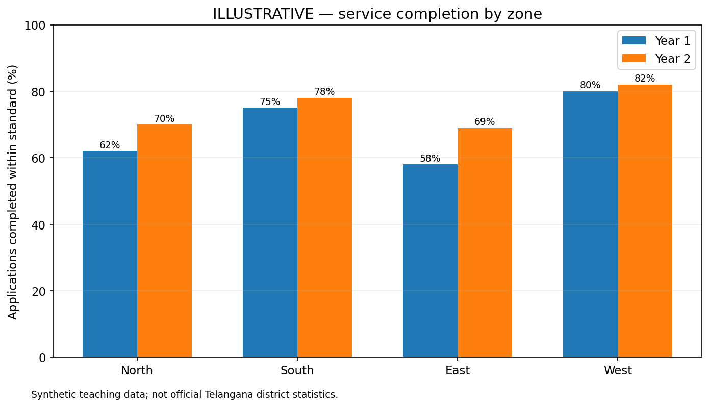
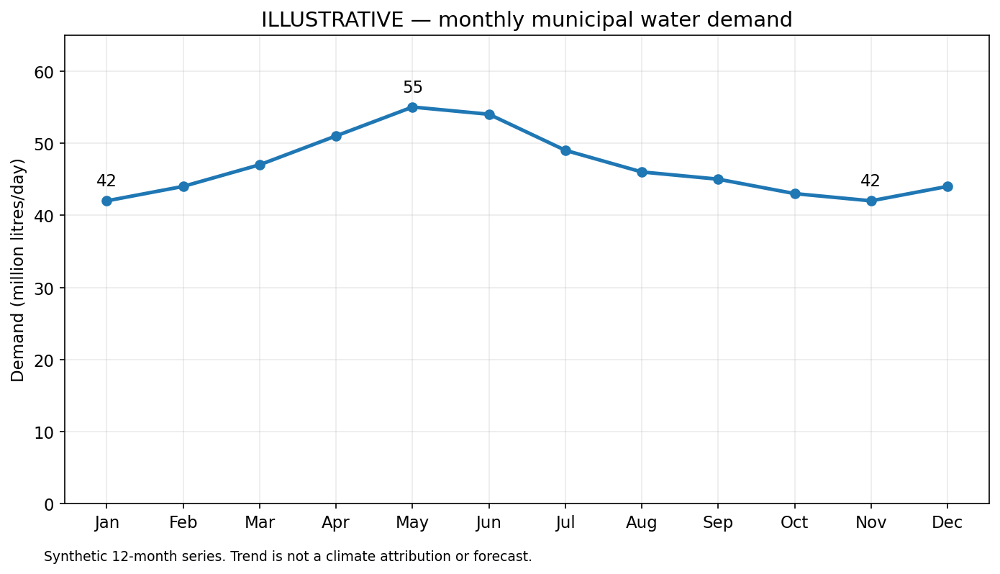
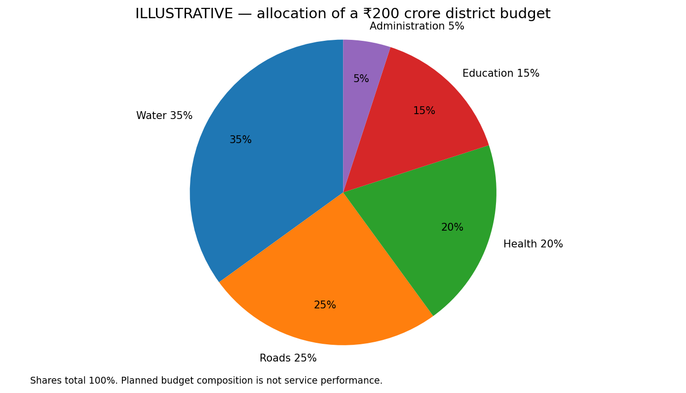

## Three original visual learning diagrams

### Diagram 1 — Grouped bar chart of service-completion rates

Four illustrative zones (North, South, East, West) show two years of percentages. The zero baseline preserves relative magnitude. East has the greatest absolute gain, +11 percentage points, while West has the highest latest rate, 82%. Percentages do not establish the number of completed applications without denominators.

### Diagram 2 — Line graph of illustrative seasonal municipal water demand

Twelve observations are ordered January–December. May is the peak at 55 million litres/day, and January and November are minima at 42. This is a synthetic seasonal teaching series; the line does not establish causation or predict a future year.

### Diagram 3 — Pie chart of a hypothetical district service budget

The five mutually exclusive shares total 100%: water 35%, roads 25%, health 20%, education 15%, administration 5%. For an illustrative ₹200 crore total, water equals ₹70 crore and education ₹30 crore. A pie compares shares of one total, not outcomes or spending efficiency.
