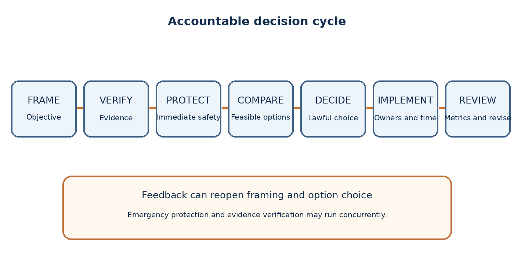
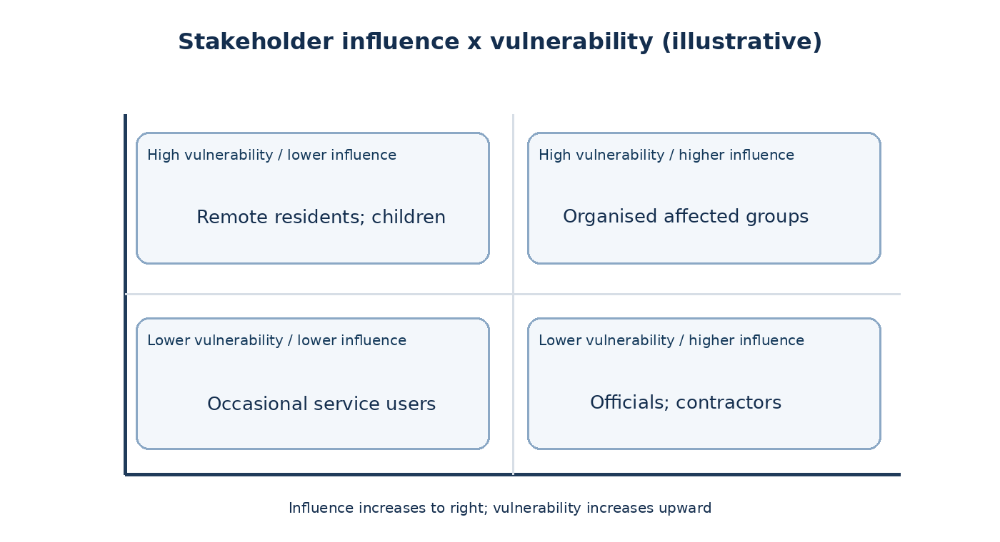
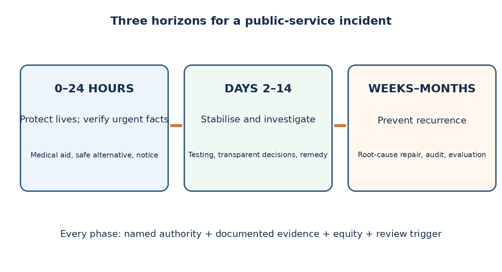

# Decision Making and Problem Solving: Structured Administrative Situations

**TGPSC Group I | Paper V | Unit III | Topic 5 | 25 October 2026**

**Official syllabus:** “Decision Making and Problem Solving: A duly structured situation will be presented to the candidates and they will be asked to analyze and suggest their own solution to the problem arising out of situations.”

**Status:** Independent English study draft, not academically approved. Twelve administrative cases, 30 explained MCQs and six mains model answers below are **original practice, not verified official PYQs**. All described local incidents and numerical details are illustrative unless explicitly sourced.

**Navigation:** [Study portal](../../../../index.html) · [Complete PDF](../complete-notes.pdf) · [Quick revision](quick-revision.md) · [Answer blueprints](answer-blueprints.md)

## 1. Syllabus map, boundaries and learning outcomes

The official Group I Paper V, Unit III, item 5 asks the candidate to analyse a structured situation and suggest an original solution. It does not prescribe one universally correct managerial algorithm. A sound answer identifies the actual problem, distinguishes verified facts from assumptions, weighs options, chooses an implementable course and explains how outcomes will be monitored. This chapter therefore teaches a method for solving unfamiliar administrative cases rather than a memorised list of virtues. The examples are constructed teaching cases set in plausible Telangana administrative environments, not reports of actual events.

**Syllabus-to-skill map.** “Structured situation” requires reading a fact pattern carefully and constructing a chronology; “analyse” requires stakeholder, causal, legal, ethical, financial and operational examination; “suggest own solution” requires a defended choice, immediate actions, medium-term prevention, named responsibilities, evidence and measurable review. A candidate who merely repeats the case or lists every possible measure without priority has not solved it. A candidate who chooses a dramatic response without jurisdiction, funds or procedural fairness has also not solved it.

**Expected outputs.** By the end, the learner should be able to prepare a 60-second issue tree, distinguish urgent containment from long-term reform, compare at least three feasible alternatives, use an uncertainty register, explain who may lawfully act, write a 200–250-word mains response with subheadings, and defend why a rejected option is inferior. This is a practical skill: success depends on constraints, trade-offs, sequence and feedback, not on jargon.

## 2. Problem framing: symptoms, root causes and objectives

A complaint is a signal, not yet a diagnosis. If villagers report “water supply failure”, the observable symptom might be empty taps; possible causes include an electricity interruption, source depletion, pipe leakage, unequal distribution, contaminated water requiring shutdown, or a faulty meter. Each cause implies a different remedy. Starting with an expensive new borewell before testing leakage and water quality may waste funds and worsen groundwater stress. The first task is to state a falsifiable problem: who is affected, how badly, since when, at which locations, and by what evidence?

A useful framing sentence is: “In four of twelve wards, scheduled potable-water delivery fell below the notified service window for seven days; the immediate risk is unsafe substitution by households, while the causal mechanism remains unverified.” The numbers are illustrative. This framing separates the measured service gap from untested explanations. It also points to urgent risk control: safe temporary water and public advisories. Do not conflate the goal (safe, reliable supply) with a preferred instrument (new pumps). Instruments can change; goals should be clear.

Construct an issue tree with non-overlapping branches: supply availability, network conveyance, distribution governance, household access and water quality. Within each branch identify observable indicators and responsible data holders. An issue tree is not a decorative diagram; it tells the administrator what to investigate first. Beware false precision: a dashboard displaying three decimal places may still contain incomplete household coverage. Frame both efficiency and equity objectives; a district average can conceal hamlets with zero access.

**Decision rule.** Define success before selecting a solution. Set a time-bound minimum safety standard, a medium-term reliability target and an equity safeguard for remote settlements. If these conflict, explain the priority order explicitly.

**Illustrative denominator and causal test.** Suppose a town records 240 missed water deliveries out of 1,200 scheduled deliveries in one week: the observed failure rate is 20%, not a percentage of households without water. If 180 failures are concentrated in two wards, a town average conceals the distribution. Deduplicate repeated complaints, then compare pressure readings, electricity outages, reservoir levels and household confirmation. If outages explain only 40 failures, buying electrical equipment cannot explain the other 200. This example separates an outcome, its denominator and a causal hypothesis. Arrange safe temporary supply while testing competing causes; do not commit to an expensive borewell before diagnosis.

## 3. Facts, assumptions, uncertainty and evidence discipline

Structured cases frequently contain incomplete or contradictory statements. Separate four categories: directly observed facts, administrative records, witness assertions and inferences. An engineer's inspection log is not the same as a resident's allegation, but either can be wrong. A responsible officer triangulates rather than dismisses. Mark each major claim with its source, date, coverage and confidence. Ask what missing information could reverse the decision; those are the facts worth collecting immediately.

For a reported school-meal illness, confirmed hospital admissions and food samples are higher-priority evidence than viral social-media posts. Yet officials must not wait for laboratory confirmation before arranging treatment, safe water, medical surveillance and temporary food-safety precautions. This is the distinction between action under uncertainty and unjustified certainty. An interim protective decision can be reversible while the final attribution awaits investigation. Record what is known, what is unknown, and when the next update will be released.

Beware selection bias: complaints may come mainly from smartphone users; silent hamlets can have worse service. Beware base-rate neglect: a single unusual event does not prove a statewide trend. Beware confirmation bias: once a contractor is suspected, officials may ignore contrary measurements. Use independent samples, transparent logs, stratified spot checks and written reasons. When a decision involves personal data, minimise disclosure, restrict access and seek the current applicable legal guidance. Avoid inventing statistics or attributing a fabricated district figure to an official report.

**Practical uncertainty register:** question; best current evidence; confidence; cost of delay; reversible action; owner; deadline. This simple table converts vague caution into disciplined progress.

## 4. Stakeholders, power, vulnerability and procedural fairness

An administrator serves the public, not just the loudest complainant or the most visible office. List directly affected people, indirectly affected people, implementing agencies, oversight institutions, elected representatives, contractors, frontline staff and groups with limited voice. A decision to relocate street vendors affects pedestrian safety, vendor livelihoods, commuters, nearby shops, sanitation workers and persons with disabilities. A plan that counts only traffic flow and ignores livelihoods is incomplete; a plan that preserves every existing encroachment and ignores emergency access is equally incomplete.

Stakeholder mapping should distinguish interest from authority. A contractor may have a strong interest but no power to decide eligibility; an elected representative may voice legitimate local concerns without displacing statutory powers of the competent authority. Children, women, older persons, migrant labourers, persons with disabilities and remote tribal habitations may face disproportionate harm. Ask who bears the costs, who receives the benefits, who can appeal and who has been excluded from consultation.

Procedural fairness requires notice when feasible, intelligible reasons, consistent criteria, opportunity to be heard, records and review. Emergencies may justify immediate protective action, but they do not justify arbitrary punishment or indefinite secrecy. Document a post-action hearing and grievance route where appropriate. Do not treat equality as identical treatment in unequal circumstances: a physically accessible relief centre and language-appropriate communication may be necessary for substantive equal access.

A stakeholder matrix can rank influence and vulnerability, but numerical scores should never substitute for rights. A minority's fundamental protection is not outweighed merely because the majority scores higher on a popularity poll.

## 5. Legal authority, hierarchy and jurisdiction

A workable answer asks who is legally authorised to do what. A district officer cannot assume that a policy preference overrides a statute, a court order, a procurement rule or an individual right. Begin with the Constitution, applicable central and Telangana statutes, subordinate rules, delegated financial powers, binding directions and the agency's mandate. Identify whether the case requires a municipal commissioner, district collector, police authority, public-health official, school-management authority, line department or an interdepartmental task force. Avoid presenting a general recommendation as a binding legal conclusion without checking current law.

The Disaster Management Act, 2005 establishes a statutory architecture for preparedness and response; the Right to Information Act, 2005 creates transparency duties subject to lawful exemptions; the Telangana Municipalities Act, 2019 defines important municipal functions; procurement decisions must be checked against the applicable rules and delegation. The Union Department of Expenditure's General Financial Rules 2017, including amendments compiled through 31 January 2026, provide an important central-government reference, but should not be asserted automatically to govern every Telangana local-body transaction without identifying adoption or corresponding state rules.

Separate authority to **inspect**, **issue a warning**, **spend**, **seize**, **close**, **prosecute**, **discipline** and **compensate**. These are distinct powers. A health officer may recommend closure of a hazardous facility, while the statutory decision and appeal route may lie elsewhere. The decision record should name the competent authority, provision or order relied upon, procedural requirements, funding source and review mechanism.

When legal facts are uncertain, the safe answer is not to invent a section number. State that the competent legal cell must verify the enabling provision before coercive action, while immediately taking lawful non-coercive protective steps.

**Illustrative legal decision record.** A complaint alleges construction obstructs a storm-water drain. Inspection, demolition, penalty, entry, recovery of costs and emergency cordoning are legally distinct actions; authority over one does not imply authority over all. For each coercive proposal record the applicable law and amendments, the delegated decision-maker, evidentiary preconditions, notice or hearing, written reasons and appeal. Emergency protective steps require their own lawful basis and proportionality. Where the exact Telangana provision has not been checked, seek a written legal opinion rather than inventing a section number. This is an analytical template, not a declaration of any particular officer's powers.

## 6. Ethical conflicts: values that pull in different directions

Administrative ethics is difficult precisely because good values can conflict. Transparency supports public trust, yet disclosing names of vulnerable beneficiaries may create stigma or harm. Speed can save lives, yet hurried procurement can invite waste. Equal treatment promotes consistency, yet equal distribution of scarce relief without considering severity can perpetuate inequality. A useful answer names the conflict instead of pretending all objectives are simultaneously maximised.

Analyse the decision through at least three lenses. **Consequences:** Which option reduces expected harm, including indirect and long-term effects? **Duties and rights:** Which options respect lawful procedure, non-discrimination, privacy and dignity regardless of convenience? **Institutional character:** Would a reasonable citizen see integrity, empathy, courage and accountability in the conduct? These are complementary tests, not substitutes for law. A beneficial result cannot legitimise bribery or deliberate falsification of records.

Consider a proposal to publish names of households receiving emergency food assistance. Public disclosure may deter duplicates, but it may expose health conditions or domestic vulnerabilities. A better design may publish anonymised totals and eligibility rules, maintain auditable protected records, and offer an independent grievance mechanism. Transparency should be designed, not reduced to “publish everything”.

Conflicts of interest require disclosure and recusal where appropriate. If a procurement committee member has a financial relationship with a bidder, the response must protect the integrity of the process, not simply promise to be unbiased. Ethical reasoning is visible when a candidate explains both the moral principle and the operational safeguard.

## 7. Urgency, triage and reversible decisions

Not every problem can await an exhaustive committee report. Triage separates imminent threats to life and safety, statutory deadlines, irreversible losses and routine improvements. In a flash-flood warning, evacuation routes, shelter accessibility, medical coordination and reliable alerts take precedence over an elaborate permanent drainage plan. In a routine property-tax complaint, however, a fair notice-and-review process may be more important than instant coercive recovery.

Classify each action as immediate (hours), stabilisation (days), structural (weeks or months) and review (ongoing). The sequence should protect people before assets, while preserving evidence and accountability. If the cause is uncertain, prefer reversible protective measures where they are effective: temporarily suspend suspect food distribution while arranging a safe substitute, rather than permanently blacklisting a supplier before investigation. Reversibility does not mean indecision; it is a rational way to act under uncertainty.

Use a two-axis priority grid: harm severity and time sensitivity. High-harm/high-urgency events need an incident command, clear public communication and a named decision-maker. High-harm/low-urgency risks need planned preventive investment. Low-harm/high-urgency administrative deadlines need rapid routine handling. Low-harm/low-urgency issues can enter the normal service queue. An exceptional case should not indefinitely divert staff from essential routine services.

A well-designed escalation trigger is observable: for example, if two independent samples fail a water-quality standard, shift from monitoring to emergency safe-supply protocols. Avoid an untestable trigger such as “when the situation worsens”.

## 8. Generating options rather than defending the first idea

Good problem solving creates options that differ in mechanism, not merely in rhetoric. For a district health-facility staffing gap, options might include redeploying existing personnel for a defined period, contracting a lawful temporary service with oversight, redesigning patient triage and referral, or proposing long-term recruitment through the competent channel. “Improve staffing”, “increase personnel” and “strengthen manpower” are not three distinct alternatives. Each option must identify capacity, cost, timeline, legality, likely failure modes and equity effects.

A baseline or “do nothing” option should be considered only as a comparator, not as a default endorsement. It reveals the cost of inaction. A pilot option can limit risk where uncertainty is high; a universal rollout may be justified only when evidence and implementation capacity support it. Beware false dilemmas: a hybrid approach can combine immediate protection with structural repair, but it must still be sequenced and funded.

Evaluate options with a decision matrix that has **hard constraints** (lawfulness, minimum safety, fundamental rights) and **soft criteria** (cost, speed, public acceptance, administrative simplicity). Never allow a high score on convenience to offset failure of a hard legal constraint. If two lawful options are close, use sensitivity analysis: would modest changes in the assumed costs or benefits reverse the ranking? If yes, gather more evidence or choose a reversible pilot.

Finally, state why alternatives were rejected. A conclusion that simply names Option B, without a comparison, reads as an unsupported preference rather than a decision.

## 9. Causal reasoning, feedback loops and unintended effects

Administrative systems react to interventions. Installing CCTV near an illegal-dumping hotspot may shift dumping to an unmonitored lane; punitive absenteeism targets may encourage falsified attendance; publishing school rankings without context may incentivise exclusion of weak students. A cause-and-effect analysis asks not only “what will this measure change?” but “how will people adapt?”. Identify incentives, bottlenecks, displacement effects and feedback loops.

Use a short causal chain: intervention → immediate behaviour → intermediate service effect → final public outcome. For a complaint-tracking portal, software deployment is an output; faster resolution is an intermediate outcome; improved access and trust are final outcomes. A rising number of registered complaints can initially indicate better access rather than deteriorating services. Conversely, fewer complaints can mean either improvement or fear of retaliation. Pair indicators rather than interpreting a single count.

A useful counterfactual is “what would have happened without the intervention?” In real administration, randomised trials are not always ethical or feasible; phased implementation, matched comparison areas and before/after analysis with seasonal adjustment may help. Do not present correlation as proof. If a new drain was built and flooding declined during a low-rainfall year, the project may not be the cause.

Unintended effects should be assigned owners and mitigations before implementation. If digital-only applications exclude people without smartphones, retain assisted access; if a cash benefit risks intermediary capture, provide accessible verification and grievance channels.

## 10. Risk assessment and scenario planning

Risk is not identical to the worst imaginable event. A decision-maker examines likelihood, severity, exposure, vulnerability and ability to respond. In a heatwave case, an elderly person living alone with limited water access may face greater harm than a healthy office worker, even at the same recorded temperature. Risk assessment should therefore be geographically and socially disaggregated. Use a simple severity–likelihood matrix only as a screening tool; the score is an aid, not a scientific probability.

Prepare a best-case, central-case and worst-plausible-case scenario. Identify early warning indicators, contingency resources and thresholds for escalation. For a delayed bridge repair, consider ordinary traffic, emergency ambulance movement, monsoon rainfall and alternative-route capacity. An option that works only in the central case is fragile. For low-probability catastrophic hazards, precautionary safeguards may be justified even if expected monetary loss is uncertain.

Risk ownership matters: “the department will monitor” is weak. “The executive engineer will submit daily structural-safety logs; the district control room will activate diversion if measured movement crosses the engineer-approved threshold” is operational. Threshold values must come from qualified technical assessment, not be invented in an exam answer.

Do not confuse hazard communication with panic. Messages should say what is known, what action citizens should take, where help is available, and when updates will follow. If evidence changes, correct earlier statements openly. Acknowledging uncertainty is more credible than false assurance.

**Hypothetical risk comparison.** Option A supplies tested emergency water for four lakh rupees while technicians investigate; Option B replaces pipes immediately for 35 lakh rupees. Assume a provisional 20% probability that the pipes caused the problem. A simplistic expected unnecessary replacement cost is 0.80 × 35 = 28 lakh rupees. This is not a decision rule: public-health harm, statutory duties, delay costs, the reliability of the probability and adequacy of temporary supply matter. Repeat at 60% probability to test sensitivity. Reversible protection can be urgent while irreversible investment awaits evidence. Expected-value arithmetic cannot justify violating minimum safety duties.

## 11. Resource allocation, public finance and procurement integrity

Public money is scarce, and emergency need does not erase accountability. The decision-maker must identify available staff, stock, equipment, transport, budget head, delegation and lawful procurement route. A quick “purchase everything immediately” answer ignores supply-chain limits and potential misuse. Equally, insisting on ordinary timelines while people lack safe drinking water may be unacceptable. The correct route depends on applicable emergency provisions and documented approvals, not on an assumed blanket exemption.

Distinguish capital cost from lifecycle cost. A new filtration plant may have low initial price but expensive membranes, electricity, operator training and waste disposal. A decentralised alternative may be cheaper in remote habitations but harder to monitor. Compare service reliability, maintenance, replacement parts and affordability. Public value includes health, time saved, dignity and environmental effects, not merely the lowest invoice.

Procurement safeguards include documented specifications, conflict declarations, competitive process where required, bid evaluation records, inspection, payment milestones, third-party quality checks and post-award audit. A public dashboard can show aggregate contracts and progress without exposing sensitive personal data. In a disaster, retrospective documentation of an authorised emergency purchase is not the same as retroactively inventing approval.

The Department of Expenditure's updated GFR compilation dated 4 September 2026 is a current reference for Union financial practice; Telangana-specific applicability must be checked. In a mains answer, name the rule family and verification requirement rather than citing an unverified rule number.

## 12. Interdepartmental coordination and accountability

Most district problems cross organisational boundaries. A suspected industrial effluent leak can involve the Pollution Control Board, local body, health department, water-supply agency, police, district administration and affected communities. Without a clear lead, each may wait for another. A practical solution specifies a lead agency, incident commander, technical advisers, field teams, escalation chain and shared reporting cadence. Responsibility cannot be replaced by a vague call for “coordination”.

Use a RACI-like division: who is responsible for the action, who is accountable for final sign-off, who must be consulted and who needs information. The exact acronym is less important than avoiding two people both assuming the other will act. Record decisions in a common log with timestamps and evidence links. If a direction is contested, escalate through the proper hierarchy while continuing lawful safety measures.

Coordination also includes external actors: community health workers, school committees, local NGOs, technical universities and professional associations can help communicate, collect observations and reach vulnerable groups. But volunteers should not be assigned coercive or technical statutory functions without authority and training. Maintain data protection and child-safeguarding standards in collaborative work.

After action, run a no-blame operational review for process learning while preserving separate channels for investigating negligence or misconduct. The objective is to improve systems without hiding individual accountability.

## 13. Communication, misinformation and grievance redress

A technically sound decision can fail when citizens do not understand it. Communication should specify the problem, action, service alternative, eligibility or safety rule, helpline, grievance channel and next update. For a contaminated water source, a message that merely says “do not panic” is inadequate; residents need to know which source to avoid, where verified safe water is available and how vulnerable households will receive supplies. Translation and accessible formats are not optional afterthoughts in multilingual communities.

Do not assume that publishing a press release equals reaching the public. Combine village meetings, local-language announcements, SMS where feasible, frontline health workers, ward offices and accessible printed notices. Track whether the message reached those without phones or internet. Counter rumours with verifiable evidence and calm corrections; do not criminalise ordinary criticism. If a claim is still under investigation, state that status explicitly.

Grievance systems need acknowledgement, categorisation, escalation, resolution and appeal. “All complaints closed” is a poor performance indicator if closure means the officer clicked a button. Track independent confirmation, repeat complaints, average resolution time and distribution across localities. A grievance route must be safe for people reporting harassment or corruption. Publishing complainants' names can deter reporting.

An answer gains credibility when it includes a two-way feedback mechanism: not only what government tells citizens, but how citizen evidence changes the operational plan.

## 14. Monitoring, evaluation and stopping rules

A decision is a hypothesis about how to improve a public outcome. Monitoring tests that hypothesis. Distinguish inputs (funds, staff), activities (inspections, visits), outputs (pipes repaired, kits delivered), outcomes (hours of safe supply, treatment completion) and impacts (reduced illness, better wellbeing). Inputs and outputs are easier to count but can mislead. A department may distribute thousands of leaflets while actual behaviour remains unchanged.

Set a baseline, target, measurement method, owner and review date for each indicator. Disaggregate by geography, gender, disability or other relevant dimensions where lawful and necessary. Audit sample quality: if data are entered by the same contractor whose payment depends on results, use independent spot checks. Record adverse effects such as travel time, exclusion or environmental damage. Define what evidence will trigger course correction.

Stopping rules are particularly important for pilots. A temporary cashless ration trial should not expand automatically because the software works; it should expand only if eligible people can actually receive food without exclusion. If grievance rates rise or remote access deteriorates, pause and redesign. Similarly, a safety measure that is no longer necessary should be reviewed rather than becoming permanent by inertia.

A concise review calendar might include daily safety metrics during crisis, weekly operational dashboards and quarterly independent service evaluation. The exact cadence should match the hazard and institutional capacity, not an arbitrary template.

**Hypothetical evaluation design.** Assisted grievance filing raises seven-day closure from 55% to 80% in five villages. This does not prove better service: case complexity, changed closure definitions, seasonal workloads and unrecorded failed applications may affect the numbers. Include all eligible complaints, reopened cases and appeals in the denominator. Track independently confirmed restoration, not just a closure button. Compare similar villages without the pilot where feasible and disclose baseline differences. Disaggregate by distance and smartphone access. Predeclare a review trigger, such as pausing expansion if verified false closures exceed a chosen threshold for two periods. This is a proposed pilot rule, not an official Telangana standard.

## 15. Decision writing: a six-part mains answer architecture

A 200–250-word answer is too short for a complete policy report but long enough for disciplined reasoning. Use six compact parts: **Context and objective** (2–3 sentences); **stakeholders and constraints**; **diagnosis and missing evidence**; **options and trade-offs**; **recommended phased action**; **monitoring and conclusion**. A high-scoring answer states the decision in plain language and gives operational details. Headings make the structure visible to an examiner and prevent one undifferentiated paragraph.

Allocate space roughly as follows: 30 words to context, 35 to stakeholder/legal constraints, 35 to diagnosis, 35 to alternatives, 75 to action, 25 to monitoring. These are guides, not rigid quotas. Use a conditional statement where facts are unknown: “Pending sample confirmation, suspend use of the suspect source and arrange verified safe water; attribution and liability will follow investigation.” That is stronger than asserting the source is contaminated without evidence.

Avoid three common weak patterns. First, a virtue-only answer (“show empathy, transparency and integrity”) lacks mechanism. Second, an enforcement-only answer (“arrest everyone and cancel licences”) ignores due process and authority. Third, a technology-only answer (“build an app”) ignores digital exclusion, maintenance and human accountability. A strong answer combines law, people, operations and measurement.

Before submitting, ask: What happens in the first 24 hours? Who has authority? Who might be harmed by the solution? What alternative was rejected? How will success be checked? If the answer cannot address these, it is still a proposal, not a decision.

## 16. Common cognitive traps in administrative decisions

**Anchoring** occurs when the first estimate dominates later reasoning; a contractor's initial cost quote can shape a budget even after better evidence emerges. **Availability bias** occurs when a dramatic recent incident receives more attention than a chronic, less visible problem. **Sunk-cost fallacy** occurs when officials continue an ineffective scheme because substantial money has already been spent. **Status-quo bias** treats existing procedures as inherently safer. **Groupthink** discourages dissent in a committee, particularly when a senior officer has announced a preference.

**Outcome bias** judges a decision only by its result. A reasonable evacuation based on credible warnings can be defensible even if the cyclone changes course; a reckless decision may appear successful through luck. Evaluate both the quality of the decision process and the eventual result. **False consensus** assumes one vocal meeting represents all affected citizens. **Goodhart's law** warns that when a metric becomes a target, actors may manipulate it: a target of “zero pending complaints” can produce premature closures.

Mitigations are procedural. Request one independent alternative, assign a devil's advocate to identify failure modes, document assumptions before results arrive, check subgroup impacts, invite frontline staff to challenge estimates and revisit decisions when evidence changes. Use pre-mortems: imagine the plan failed in six months and list plausible reasons. These steps are inexpensive compared with the social cost of institutional overconfidence.

A balanced candidate does not portray bias as a flaw of only corrupt officers. Well-intentioned teams under time pressure also make predictable errors. Good systems make error detection routine.

## 17. Decision quality in Telangana-specific settings

Telangana offers distinctive settings for case analysis: dense Hyderabad urban corridors, fast-growing peri-urban settlements, drought-sensitive agricultural areas, tribal habitations, industrial clusters and districts facing variable monsoon impacts. These are context categories, not assertions about a particular district's current condition. In a Hyderabad traffic and vendor case, consider pedestrian safety, accessibility, municipal jurisdiction, vendor livelihood and alternative spaces. In a rural irrigation case, consider upstream/downstream distribution, power availability, groundwater, tail-end farmers and seasonal crop needs.

In a school-attendance case, do not assume that absences mean parental negligence. Transport, sanitation, disability access, seasonal migration, safety and teacher availability may all matter. In a tribal-habitation service case, language access, terrain, community institutions and relevant legal safeguards require attention. In a health-outbreak case, ensure clinical care and epidemiological investigation are not delayed by arguments over departmental blame.

Use named institutions accurately: Telangana municipal bodies and district administrations for local service delivery; Telangana State Pollution Control Board for relevant pollution oversight; state health and education departments for sector decisions; Disaster Management Act structures for disaster coordination; statutory authorities for enforcement. Do not assign powers simply because an institution appears geographically close to the problem.

For each Telangana case, add three questions: Which statutory tier acts first? Which group has the least voice? Which local condition could invalidate a generic national solution? These questions turn regional knowledge into better reasoning rather than decorative place names.

## 18. Integrated synthesis and examination checklist

The most reliable decision process is **frame → verify → protect → compare → decide → implement → review**. Frame the actual service or safety gap; verify facts without delaying necessary protection; identify law, rights and jurisdiction; compare feasible options; choose a phased course with responsible officials; and monitor outcomes with a correction rule. This sequence is not mechanical: in emergencies, protection begins while verification continues. In routine disputes, due process may precede coercive action.

An excellent case response explains the relationship between the immediate and structural solutions. Temporary tanker supply cannot replace long-term network repair, but network repair cannot substitute for safe water tonight. Similarly, a grievance portal cannot replace a functioning officer, and punishment alone cannot fix perverse incentives. Consider prevention, not merely response. Consider affected non-users, not merely registered beneficiaries.

**Final checklist:** one-sentence problem statement; verified versus uncertain facts; vulnerable stakeholders; applicable authority; urgent protective measure; at least two genuine alternatives; reasons for selection; budget and capacity; public communication; grievance route; measurable indicators; review trigger; acknowledgement of limitations. A case answer should be understandable to an actual district team, not just to an examiner.

**Summary.** Decision making is accountable judgement under constraints. Its quality rests on clear objectives, evidence discipline, lawful authority, proportionality, distributive fairness, practical sequencing and willingness to correct course. Memorise the questions to ask, not the answer to every imagined scenario.

# Twelve original applied case studies

## Case 1. Urban drinking-water contamination alert

**Scenario (constructed):** A municipal helpline receives complaints of foul-smelling tap water in three adjoining wards after road excavation. A local message claims a major sewage leak, while the water utility's central dashboard reports normal residual chlorine. Hospitals have not confirmed an unusual illness cluster. A ward councillor demands immediate public identification of the contractor. Some households can buy bottled water; daily-wage households cannot. All ward and numeric details are hypothetical.

**Diagnosis and constraints:** The urgent problem is potential exposure, not yet proven contractor negligence. Separate samples at the treatment plant, distribution nodes and household taps; review excavation permits, pressure logs, repair records and complaint locations. Central dashboard averages cannot rule out local contamination. Map schools, hospitals and households with limited purchasing power. Municipal water engineers, public-health officials and the competent municipal authority have distinct roles.

**Recommended phased response:** Issue a geographically precise precautionary advisory if risk assessment supports it; arrange tested alternative supply and doorstep assistance for vulnerable households. Isolate suspect segments if technically indicated. Collect chain-of-custody samples, commission independent testing and publish update times. Repair verified defects, document expenditure and permit conditions, and pursue liability only after evidence and due process. Convene a joint daily technical review.

**Alternatives and trade-offs:** Blanket shutdown protects against contamination but may deprive unaffected areas of water; narrow isolation needs reliable hydraulic evidence. Premature public blame could prejudice inquiry; silence could expose citizens. Choose transparent risk communication without premature attribution.

**Review and correction trigger:** Track laboratory compliance, time to safe alternative supply, complaints by locality, household coverage and recurrence after repair. Stop emergency supply only after verified normal service and accessible notice.

## Case 2. Heatwave school attendance and child safety

**Scenario (constructed):** A district experiences a forecast heatwave during examinations. Some parents ask for closure; others fear lost teaching time and childcare disruption. Schools differ in shade, drinking-water availability and travel distance. An online poll favours normal classes but largely excludes rural households. There is no single verified classroom temperature measurement.

**Diagnosis and constraints:** The real objective is preventing heat illness while preserving educational continuity where safely possible. Obtain meteorological warnings, health advisories, facility inspections and school transport data. Identify children with disabilities, long commutes or medical vulnerabilities. Verify who can authorise altered timings or temporary closure under the applicable education and disaster protocols.

**Recommended phased response:** Immediately ensure safe drinking water, shade, first aid and symptom referral; communicate heat precautions in local languages. Apply risk-based timing changes or closure through the competent authority, with alternative learning and exam rescheduling where needed. Prioritise poorly equipped schools for water and cooling measures. Review weather and on-site conditions daily.

**Alternatives and trade-offs:** Uniform closure is simple but may disrupt essential exams and vulnerable households; uniform opening ignores facility differences. A differentiated, publicly explained decision can be fairer if inspections are credible and families have a clear grievance route.

**Review and correction trigger:** Measure heat-related incidents, school water availability, transport safety and missed learning time; adjust thresholds only on qualified public-health advice.

## Case 3. Procurement conflict during flood relief

**Scenario (constructed):** A district needs tarpaulins before predicted heavy rainfall. The fastest supplier is related to a member of the purchase committee; another bidder offers a lower price but uncertain delivery. Social media alleges favouritism before any award. Stocks at neighbouring districts may be transferable. The precise emergency procurement provisions have not yet been verified.

**Diagnosis and constraints:** Protect relief recipients first, but do not invent authority for an unrecorded purchase. Check available stocks, interdistrict transfer, approved rate contracts and current delegated emergency procedures. Require conflict disclosure and recusal, objective specifications and time-stamped bids or quotations as legally required. Compare quality and delivery certainty, not merely headline price.

**Recommended phased response:** Use available lawful stock for immediate needs; ask the competent financial authority to authorise a documented compliant emergency purchase if necessary. Separate conflicted persons from evaluation. Inspect goods on arrival, publish non-sensitive award details and arrange post-event audit. Maintain an emergency distribution register with vulnerability criteria and appeal.

**Alternatives and trade-offs:** Delaying everything for a routine tender may create avoidable exposure; bypassing safeguards invites waste and distrust. A narrowly documented emergency route is preferable to either extreme when legally available.

**Review and correction trigger:** Check delivery against specification, distribution reach, per-unit cost, complaints and post-event stock reconciliation. Investigate allegations impartially rather than dismissing or presuming them.

## Case 4. Industrial discharge and village livelihoods

**Scenario (constructed):** Residents near an industrial cluster report coloured water in an irrigation channel. Factory workers fear a closure will cost jobs; farmers say crops are affected. A preliminary field test is inconclusive, and one company offers to finance a private survey. The channel also receives runoff from other sources.

**Diagnosis and constraints:** Distinguish observed discoloration from confirmed toxic discharge and legal culpability. Map sampling points upstream and downstream, recent rainfall, industrial permits and possible agricultural runoff. Seek technically valid testing under the competent pollution-control and water authorities. Treat the factory's proposed survey as additional evidence, not an independent adjudication.

**Recommended phased response:** Where credible immediate health risk exists, issue lawful interim safety directions and alternative water arrangements. Commission independent sampling, preserve records and require legally authorised corrective measures. Engage farmers and workers separately; design remediation and livelihood support within applicable law. Publicly release interpretable test findings and appeal routes.

**Alternatives and trade-offs:** Automatic permanent closure without evidence threatens livelihoods and procedural fairness; continued unrestricted use of suspect water risks harm. Time-limited, reviewable safeguards with independent testing balance the risks.

**Review and correction trigger:** Monitor water quality, exposure reports, compliance inspections, crop impact and employment transition where relevant; reassess interim restrictions against results.

## Case 5. Digital welfare exclusion at a remote service centre

**Scenario (constructed):** A district digitises benefit renewals. Average processing time improves, but remote applicants report biometric failures and long travel to kiosks. The dashboard shows fewer pending files because rejected applications are not counted. Staff believe the project is successful; village organisations disagree.

**Diagnosis and constraints:** The objective is successful eligible receipt, not just fast software processing. Audit the full funnel: applications started, failed authentication, rejected, appealed, approved and paid. Compare remote and urban populations and disability-access needs. Verify alternative authentication and assisted service channels under applicable scheme rules. Protect identity data and avoid public beneficiary lists.

**Recommended phased response:** Suspend exclusionary automation rules where authorised, create assisted offline or alternative verification, provide mobile outreach and grievance hearings, and correct dashboard definitions. Train staff to distinguish technical failure from ineligibility. Conduct independent sampling of households who stopped applying. Update the system only after documenting inclusion outcomes.

**Alternatives and trade-offs:** A digital-only design is cheaper to administer but can transfer cost to the poorest applicants. A hybrid channel costs more initially but may prevent wrongful exclusion and reduce repeated visits.

**Review and correction trigger:** Track successful benefit receipt, false rejection, appeal turnaround, travel burden and subgroup coverage, not merely portal uptime.

## Case 6. School-meal illness and premature blame

**Scenario (constructed):** Several children develop vomiting after lunch at a government school. A video accuses the cook of negligence. The menu included milk, and a nearby water tank was recently cleaned. A politician calls for instant dismissal. Hospital treatment is underway; laboratory results are pending.

**Diagnosis and constraints:** Immediate clinical care and food-safety control are distinct from disciplinary findings. Establish exposure timelines, symptom onset, sample preservation, water tests and medical reporting. Review storage, procurement, temperature controls and staff training. The cook is entitled to fair investigation; parents are entitled to prompt protective information. Prevent the case from becoming a trial by social media.

**Recommended phased response:** Arrange treatment and observation, suspend suspect items while providing a safe alternative meal, preserve samples, notify competent food-safety and education authorities, and communicate factual updates. Conduct independent inquiry and implement verified sanitation or supply-chain corrections. Initiate proportionate disciplinary or legal action only through applicable procedure and evidence.

**Alternatives and trade-offs:** Immediate dismissal might satisfy public anger but undermine due process and obscure the true source; doing nothing while awaiting samples would expose more children. Interim protection plus evidence-based accountability is superior.

**Review and correction trigger:** Measure new illness cases, laboratory results, kitchen compliance, meal continuity and parent grievance resolution; publish corrective actions without identifying children.

## Case 7. Flood evacuation of a mixed-access settlement

**Scenario (constructed):** Forecast heavy rain threatens a low-lying settlement containing older persons, wheelchair users, livestock and temporary migrant workers. A shelter exists uphill but lacks accessible toilets. Some families refuse to move because they fear theft or separation from animals. A forecast may change.

**Diagnosis and constraints:** Evacuation is not simply an order; it is a feasible movement and protection plan. Map flood-risk zones, road access, transport, shelter capacity, medical needs, livestock arrangements and security. Use authoritative warnings and field observations. Distinguish legally authorised mandatory measures from voluntary assistance. Ensure migrant residents receive messages in comprehensible languages.

**Recommended phased response:** Activate a graded warning, accessible transport, medical support, designated family registration and safe livestock arrangements where feasible. Improve shelter accessibility immediately; secure homes through lawful patrols and community liaison. Assign a single incident coordinator and clear update times. Maintain a reunification and grievance desk. Reassess evacuation boundaries as forecasts evolve.

**Alternatives and trade-offs:** A blanket evacuation may be overbroad and costly, but waiting for visible floodwater may make rescue impossible. Targeted precaution with transparent thresholds and accessible alternatives addresses both risks.

**Review and correction trigger:** Monitor evacuation coverage of vulnerable groups, transport time, shelter conditions, injuries and safe return after verified hazard reduction.

## Case 8. Urban street vendors and emergency access

**Scenario (constructed):** An ambulance is delayed near a crowded market. Shop owners demand immediate eviction of all vendors, while vendors say relocation would destroy livelihoods. Photographs show both illegal parking and temporary stalls. There is no measured emergency-vehicle travel-time study.

**Diagnosis and constraints:** Identify the actual bottleneck using traffic observations, parking enforcement records, pedestrian accessibility and ambulance routes. Differentiate lawful vending rights, encroachments and municipal responsibilities under applicable law. Include women vendors, disabled pedestrians, shopkeepers, emergency services and public transport users in consultation. Do not assume vendors alone caused the delay.

**Recommended phased response:** Introduce immediate emergency-lane marking and enforcement against obstructive vehicles; provide clear safe pedestrian paths. Map alternative vending spaces through competent municipal processes and consult affected groups. Pilot timed loading, waste collection and designated stalls before permanent redesign. Issue notice and appeal routes for coercive measures.

**Alternatives and trade-offs:** Total eviction can shift congestion and harm livelihoods; unrestricted status quo can endanger patients. A spatially planned, enforceable compromise should be tested against measured emergency access.

**Review and correction trigger:** Track ambulance travel times, pedestrian incidents, vendor earnings proxies and compliance; redesign if displacement worsens nearby lanes.

## Case 9. Teacher vacancy and remote school learning

**Scenario (constructed):** Two rural schools report teacher shortages. One has higher enrolment; the other serves a remote tribal habitation with long travel to alternatives. A transfer request would solve the first school's timetable but leave the second with no mathematics teacher. District budgets are constrained.

**Diagnosis and constraints:** Do not allocate only by raw enrolment. Map subject-wise teaching hours, student travel, attendance, learning levels, teacher qualifications and statutory staffing norms. Verify transfer and recruitment authority. Assess whether temporary timetable sharing, digital support with onsite facilitation, or lawful deputation can bridge the gap without creating another severe deprivation.

**Recommended phased response:** Deploy an authorised interim shared teaching schedule and targeted transport or remote learning support, with safeguarding and language-access measures. Request permanent subject-wise staffing through the competent department. Publish criteria, protect teachers from arbitrary reassignment and consult school management committees. Provide remedial learning where teaching was interrupted.

**Alternatives and trade-offs:** Concentrating staff in the larger school improves aggregate coverage but may abandon an isolated community; equal teacher counts can also ignore subject need. Use minimum service guarantees before efficiency optimisation.

**Review and correction trigger:** Track subject teaching hours, attendance, learning assessments, travel time and teacher workload in both schools, not just transfer completion.

## Case 10. Public grievance backlog and manipulated metrics

**Scenario (constructed):** A department announces 95% complaint closure, but citizens continue reopening the same issues. Frontline staff say performance bonuses reward closure within three days, even when the actual repair requires two weeks. The portal allows a “resolved” status without citizen confirmation.

**Diagnosis and constraints:** The measurement system has created a perverse incentive. Audit a stratified sample of closed complaints, identify repeat reports and distinguish acknowledgement, action initiated, service restored and citizen-confirmed resolution. Compare grievance rates across localities and channels; a low complaint count may reflect poor access. Determine whether staff lack resources or are gaming the metric.

**Recommended phased response:** Replace the single closure target with a balanced dashboard: verified resolution, time to remedy, repeat rate and accessibility. Require evidence for closure, enable appeal and independent audit, and adjust incentives. Provide technical resources for recurring faults. Communicate the change so staff do not fear honest reporting of pending cases.

**Alternatives and trade-offs:** Tighter documentation can initially slow closure figures, but improves truthful performance. Punishing staff alone may hide structural shortages and drive further manipulation.

**Review and correction trigger:** Measure independently verified closure, repeat complaints, service uptime, appeal outcomes and distribution across vulnerable wards.

## Case 11. Drought water allocation between competing users

**Scenario (constructed):** A reservoir has lower-than-expected inflow. Farmers, a nearby town and small industries request allocations. Downstream farmers claim they are repeatedly disadvantaged; a rumour says the town is receiving a secret quota. Forecast rainfall is uncertain and distribution losses are not measured.

**Diagnosis and constraints:** Verify storage, inflow, legal allocation priorities, drinking-water requirements, existing commitments, conveyance losses and demand estimates. Distinguish immediate human consumption and health needs from discretionary uses, subject to the governing framework. Consult tail-end users and publish intelligible aggregate allocation data. Avoid asserting an absolute allocation hierarchy without checking the applicable rules and orders.

**Recommended phased response:** Implement verified emergency drinking-water safeguards and leakage control; convene the competent basin and district authorities to approve transparent, time-bound schedules. Use metered or independently observed releases, equitable rotational supply where authorised and drought-advisory support for farmers. Establish a rapid grievance mechanism and periodic reassessment with new rainfall data.

**Alternatives and trade-offs:** Uniform percentage cuts may appear neutral but can impose severe hardship on already water-insecure communities; unannounced discretionary allocations erode trust. Transparent, need-sensitive rules are preferable.

**Review and correction trigger:** Track delivered water rather than releases alone, tail-end coverage, losses, crop impacts and compliance with public advisories.

## Case 12. Public hospital oxygen and maintenance alarm

**Scenario (constructed):** A district hospital receives repeated alarms from an oxygen system. Engineers suspect a faulty sensor; clinicians report occasional pressure drops. Management fears a public alarm will damage confidence. Backup cylinders are available but not yet counted. A procurement contract for repairs is under dispute.

**Diagnosis and constraints:** Treat potential patient harm as the first priority while verifying the technical cause. Audit pressure logs, sensor calibration, maintenance history, demand, backup inventory and clinical incident reports. The engineering and clinical teams must agree on immediate operating limits. The disputed contract is relevant but cannot delay safety measures.

**Recommended phased response:** Activate a clinically approved backup and patient-transfer contingency, arrange independent engineering inspection and continuous monitoring, and escalate to the competent hospital and health authorities. Document procurement and maintenance decisions, communicate accurate operational precautions and avoid publishing identifiable patient information. Resolve contract liability separately from immediate repair.

**Alternatives and trade-offs:** Continuing normal operation on an unverified “sensor error” risks patient harm; unnecessary blanket shutdown can also harm patients. A controlled, monitored backup with specialist oversight is more proportionate.

**Review and correction trigger:** Monitor oxygen pressure, backup capacity, adverse events, repair validation and recurrence; return to normal service only after technical sign-off.

# Visual learning

**Reading guide:** The decision cycle is iterative; the map prevents high-influence voices from crowding out vulnerable groups; the timeline separates immediate safety, stabilisation and structural prevention. All diagrams are original conceptual teaching illustrations, not official government graphics.

# Standalone quick revision — Paper V / Unit III / Topic 5

**Core demand:** Analyse a structured situation and suggest your own implementable solution; the examination does not ask for a memorised policy slogan.

**Seven verbs:** Frame → Verify → Protect → Compare → Decide → Implement → Review. In emergencies, protection and verification happen concurrently.

**First 60 seconds:** Underline the harm, affected groups, timing, uncertain claims, decision-maker and non-negotiable legal or rights constraints. Write the objective in one sentence before naming a remedy.

**Facts versus assumptions:** Mark directly observed facts, records, allegations and inference. Ask which missing fact could reverse the preferred option.

**Stakeholders:** Include silent or excluded groups; differentiate influence from vulnerability; protect rights even if a numerical majority disagrees.

**Three options:** status quo comparator, targeted reversible intervention, structural solution. Compare legal authority, speed, cost, equity, feasibility, risk and likely unintended effects.

**Decision quality:** A sound process can have an unlucky result; a reckless process can have a lucky result. Review both process and outcomes.

**Authority check:** Who may inspect, spend, order, close, prosecute, discipline and hear appeal? These powers are not interchangeable.

**Monitoring:** baseline → target → owner → date → independent verification → correction trigger. Separate inputs, outputs and citizen outcomes.

**High-yield case categories:** water contamination, health emergency, heatwave school operations, flood evacuation, welfare exclusion, procurement conflict, pollution, vendor livelihoods, teacher allocation, grievance metrics, drought allocation and hospital equipment safety.

**Exam answer headings:** Context/objective; stakeholders and constraints; diagnosis; options and trade-offs; phased recommendation; indicators and conclusion.

**Avoid:** immediate punishment without evidence, blind reliance on dashboards, app-only solutions, unnamed authorities, invented legal sections, unrealistic funding, and treating original practice cases as official PYQs.

# Mains answer blueprints (original practice; not official PYQs)

1. **Municipal water alert:** identify exposure and uncertainty; stakeholders and authority; upstream/downstream samples; immediate safe alternative; limited isolation; transparent notices; post-investigation liability; daily water-quality and coverage metrics.
2. **Flood relief procurement:** urgency and conflict declaration; existing stocks; lawful delegated procurement; documented evaluation; vulnerable-household distribution; third-party inspection; post-event audit and grievance route.
3. **Digital welfare exclusion:** full funnel and denominator; digital divide; lawful alternate verification; mobile assistance; privacy safeguards; corrected metrics; independent sampling and appeal time.
4. **Vendor–ambulance dispute:** measured bottleneck; vending rights and municipal procedure; emergency corridor and parking enforcement; consultative site design; travel-time and livelihood monitoring.
5. **Drought allocation:** verify inflow and storage; lawful priorities; tail-end access; transparent releases; leak reduction; conservation and farmer support; delivered-water monitoring.
6. **Hospital oxygen alarm:** clinical safety; technical uncertainty; backup and referral; independent inspection; separation of maintenance dispute from patient care; sign-off and recurrence indicators.

**Scoring checklist for every answer:** objective (2), stakeholders (2), evidence (2), law and ethics (2), comparative alternatives (2), phased implementation (4), named owners and metrics (3), concise conclusion (1). The numbers are a practice rubric, not a commission marking scheme.

# Thirty original MCQs with worked explanations — not official PYQs

### MCQ 1. A village reports dry taps. Which is the strongest initial problem statement?

A. Build a new borewell immediately
B. A water-delivery gap affects specified habitations; cause and severity require verification
C. The contractor is corrupt
D. The water board must be privatised

**Answer: B.** The second statement describes an observable gap without presuming cause or remedy. A borewell is one possible instrument, not the defined objective.

### MCQ 2. An illness cluster is suspected but samples are pending. What is the most defensible response?

A. Wait for final attribution before acting
B. Publicly name the suspected cook
C. Provide treatment and safe alternatives while preserving evidence
D. Destroy suspect samples to avoid panic

**Answer: C.** Protective action under uncertainty is compatible with later evidence-based attribution. Delay or premature punishment creates avoidable risk.

### MCQ 3. A decision matrix gives a legally prohibited option the highest weighted score. What should happen?

A. Choose it because its score is highest
B. Increase the weight on popularity
C. Treat legality as a hard constraint and remove it
D. Hide the prohibition from the report

**Answer: C.** Legal authority and rights are threshold conditions, not negotiable soft preferences.

### MCQ 4. Which is the clearest outcome indicator for a grievance portal?

A. Number of buttons added
B. Total server storage
C. Percentage of complaints independently verified as resolved
D. Number of press releases

**Answer: C.** A functioning portal is an input or tool. Verified service restoration is closer to the public outcome.

### MCQ 5. The average water supply improves but a remote hamlet receives none. What is the analytical error?

A. Use of a baseline
B. Failure to disaggregate outcomes
C. Use of an issue tree
D. Considering equity

**Answer: B.** Aggregate improvement can conceal severe exclusion. Geographic and vulnerability disaggregation changes the decision.

### MCQ 6. A committee member has a financial link to a bidder. Best immediate safeguard?

A. Verbal assurance of impartiality
B. Disclosure and appropriate recusal under applicable rules
C. Allow private negotiation
D. Destroy the bid evaluation record

**Answer: B.** Institutional safeguards address perceived and actual conflicts more reliably than promises.

### MCQ 7. A cyclone changes course after an evacuation was ordered on credible evidence. How judge the decision?

A. Only by whether the cyclone struck
B. By whether the decision used credible warnings, proportionate measures and lawful authority
C. As necessarily incompetent
D. By social-media popularity

**Answer: B.** Outcome bias confuses luck with decision quality. Review evidence and process as well as eventual effects.

### MCQ 8. A welfare dashboard excludes rejected applications from pending counts. What is the first analytical correction?

A. Remove all rejected cases
B. Audit the complete application funnel including failed and appealed cases
C. Reward rapid rejection
D. Stop measuring service access

**Answer: B.** A truncated denominator falsely inflates performance and hides exclusion.

### MCQ 9. Which pair best separates output from outcome?

A. New pipes installed / hours of safe water received
B. Citizens satisfied / citizens protected
C. Illness reduced / health improved
D. Rainfall / humidity

**Answer: A.** Infrastructure completion is an output; reliable safe service is an outcome experienced by citizens.

### MCQ 10. A hospital alarm might be a faulty sensor or real pressure drop. Best immediate approach?

A. Assume a sensor fault
B. Shut all services without a clinical plan
C. Activate a safe backup and independent technical check
D. Wait until a patient is harmed

**Answer: C.** A reversible safety contingency protects patients while uncertainty is resolved.

### MCQ 11. A district can immediately redeploy two trained staff within existing powers, or seek approval for permanent recruitment over several months. What comparison is most defensible?

A. Both options are identical because both increase staffing
B. Permanent recruitment is automatically lawful and immediately available
C. Redeployment has no effect on services losing those staff
D. Compare authority, immediate coverage, displaced workload and long-term need before selecting a phased option

**Answer: D.** Alternatives differ in timing, authorisation and opportunity cost. Temporary coverage and long-term recruitment require separate justification.

### MCQ 12. What does a pre-mortem exercise ask?

A. Who is to blame after failure?
B. If this plan failed in six months, what plausible causes explain it?
C. How can the original plan be defended?
D. Which outcome should be hidden?

**Answer: B.** Imagining failure before implementation surfaces weak assumptions and mitigations.

### MCQ 13. Which is an example of selection bias?

A. Consulting a stratified village sample
B. Relying only on smartphone poll respondents to infer rural opinion
C. Recording response dates
D. Comparing complaints across wards

**Answer: B.** Digital respondents may differ systematically from the excluded population.

### MCQ 14. A contractor proposes funding the only pollution test. What is best?

A. Treat it as conclusive proof
B. Ignore all data forever
C. Use independent competent testing and assess contractor data as supplementary
D. Publish guilt immediately

**Answer: C.** Independence and chain of custody are vital where evidence and interests intersect.

### MCQ 15. What is a defensible emergency procurement principle?

A. All procurement rules cease automatically
B. Use a documented legally authorised route and audit the result
C. Always choose a relative of a committee member
D. Never purchase anything urgently

**Answer: B.** Urgency changes the practical route only where law permits; accountability remains.

### MCQ 16. Why might a falling complaint count be ambiguous?

A. Complaints never matter
B. It can mean improved service or reduced access to complaint channels
C. It always means success
D. It proves corruption

**Answer: B.** Complaint counts require access and resolution context to interpret.

### MCQ 17. Which is a hard constraint in a vendor-relocation case?

A. Maximum popularity
B. Minimum legal and rights compliance
C. Best newspaper coverage
D. Cheapest political slogan

**Answer: B.** Rights and statutory procedure constrain the set of permissible options.

### MCQ 18. What does a stopping rule do?

A. Prevents evaluation
B. Defines evidence for pausing, correcting or ending an intervention
C. Guarantees success
D. Avoids stakeholder consultation

**Answer: B.** Explicit triggers prevent ineffective pilots from becoming permanent by inertia.

### MCQ 19. In a flood shelter plan, which group should be checked for access barriers?

A. Only residents with cars
B. Only elected representatives
C. People with disabilities, older persons and those without transport
D. Only social-media users

**Answer: C.** Risk depends on vulnerability and ability to act on warnings, not only exposure.

### MCQ 20. School X has 150 pupils and two mathematics teachers. Remote School Y has 18 pupils, none and no reachable alternative. What is the strongest allocation test?

A. Enrolment alone, ignoring existing access
B. Minimum subject access and remoteness first, then workload, travel and authorised staffing options
C. Automatically assign a teacher to Y without checking timetable or authority
D. Split the teacher's time equally without considering travel

**Answer: B.** Equity requires a service floor as well as efficient workload allocation; assess feasibility and lawful authority.

### MCQ 21. Which action best preserves due process after an allegation?

A. Punish first, investigate later
B. Separate immediate protective steps from evidence-based liability determination
C. Delete records
D. Suppress all grievances

**Answer: B.** Protective action can be urgent; blame and sanction require lawful evidence and procedure.

### MCQ 22. What is a useful causal chain for a new complaint portal?

A. App → app → app
B. Software deployed → resolution workflow improves → service reliability and trust improve
C. Budget spent → success proven
D. Publicity → automatic compliance

**Answer: B.** Distinguishing input, intermediate mechanisms and final outcomes prevents metric substitution.

### MCQ 23. A senior officer states a preference before deliberation. Which safeguard reduces groupthink?

A. Ban dissent
B. Record an independent alternative and a devil’s-advocate review
C. Accept the first suggestion
D. Use anonymous rumours

**Answer: B.** Structured challenge protects decision quality without undermining accountability.

### MCQ 24. Which is the most precise accountability assignment?

A. The government should monitor
B. Someone should coordinate
C. Named engineer submits daily logs; designated authority decides on escalation
D. Everyone is equally responsible for everything

**Answer: C.** A named owner, evidence and escalation authority make monitoring operational.

### MCQ 25. Why is a reversible pilot useful?

A. It makes evidence unnecessary
B. It limits exposure while testing uncertain assumptions
C. It removes legal duties
D. It guarantees no cost

**Answer: B.** A pilot can generate evidence at controlled scale but still needs rights and safety safeguards.

### MCQ 26. What is the strongest public notice during suspected contamination?

A. Do not panic
B. The contractor is guilty
C. Specify affected areas, precautions, safe alternatives, helpline and next update
D. No comment indefinitely

**Answer: C.** Actionable, geographically precise information supports safe behaviour without premature attribution.

### MCQ 27. A bridge repair is followed by less flooding during a dry year. What cannot be concluded?

A. Rainfall matters
B. Flooding declined
C. The repair necessarily caused all of the decline
D. A comparison is needed

**Answer: C.** A before-after change without weather adjustment does not establish causation.

### MCQ 28. Which option best addresses a welfare authentication failure?

A. Reject all failed cases permanently
B. Provide lawful alternative verification and assisted access with audit
C. Hide failures from the dashboard
D. Require every person to own a smartphone

**Answer: B.** Service design should not confuse a technical failure with legal ineligibility.

### MCQ 29. When stakeholder scores favour a majority, what still limits the decision?

A. No limits
B. Fundamental rights, statutory duties and minimum safeguards
C. Only the media cycle
D. Only cost savings

**Answer: B.** A numerical preference score cannot authorise rights violations.

### MCQ 30. A benefits portal reports 95% seven-day disposal but excludes authentication failures before submission and counts automatic rejections as disposed. What should be done before claiming improved service?

A. Audit the full attempted-application funnel and independently verify eligible benefit receipt
B. Treat 95% disposal as proof that almost all eligible residents received benefits
C. Remove assisted filing to improve processing speed
D. Treat authentication failure as final legal ineligibility

**Answer: A.** Disposal is not receipt, and an incomplete denominator conceals exclusion. Include failed attempts, appeals and verified outcomes.

# Six complete structured mains model answers — original practice

## Model answer 1. Suspected contaminated water in a municipal ward

**Background and objective.** Residents report foul-smelling water after road excavation, but the central dashboard shows normal quality. My first objective is to prevent exposure while establishing the cause without prejudging responsibility.

**Stakeholders and constraints.** Households, schools, hospitals, the water utility, contractors and municipal officials are affected. Daily-wage families may be unable to purchase alternatives. Sampling, shutdown and enforcement must follow competent authority and public-health guidance.

**Diagnosis.** I would map complaints, check pressure and repair logs, and collect independent samples at upstream, network and household points. The dashboard average cannot exclude local contamination. Laboratory uncertainty must be recorded openly.

**Options and decision.** Waiting for final tests risks exposure; shutting the entire town may unnecessarily deny safe supply. I would choose geographically targeted precautions where technical evidence permits, with tested tankers or other safe supplies for affected households.

**Implementation.** A joint water-health team would inspect excavation records, isolate suspect segments when justified, preserve evidence, repair verified defects and issue local-language advisories with helplines and update times. Liability would follow a documented investigation and due process, not viral accusations.

**Monitoring and conclusion.** Daily sample compliance, vulnerable-household coverage, time to restore safe service and repeat complaints would determine whether to maintain precautions. This phased approach combines urgency, fairness, technical evidence and public trust.

## Model answer 2. Emergency flood procurement and a conflict of interest

**Context.** Heavy rainfall is forecast and tarpaulins are urgently needed. The fastest supplier is related to a purchase-committee member. The task is to deliver safe shelter materials without sacrificing procurement integrity.

**Immediate assessment.** I would verify forecast severity, stock on hand, interdistrict transfer possibilities, specifications, delivery lead times and the applicable emergency financial powers. The relationship must be disclosed in writing and the conflicted member appropriately recused.

**Options.** A routine tender may be too slow if lives are at risk. An undocumented direct purchase would invite arbitrariness and possible overpricing. A lawful emergency procurement route, supported by contemporaneous records, is preferable if existing stock cannot bridge the gap.

**Action plan.** The competent authority would approve the route and budget, document objective supplier comparison and delivery constraints, and arrange inspection of received goods. Distribution would prioritise exposure and vulnerability using clear criteria, not political affiliation. Aggregate award and distribution information would be published without revealing sensitive personal details. An independent post-event audit would examine quality, rates, conflicts and unused stock.

**Safeguards.** Complaints about favouritism would be registered and investigated impartially; allegation alone would not establish guilt. The committee would maintain a decision log and an appeal channel for excluded households.

**Conclusion.** Urgency changes sequencing, not the duty of accountability. Transparent lawful procurement plus rapid, equitable distribution protects both lives and institutional legitimacy.

## Model answer 3. Digital benefit renewal excludes remote applicants

**Problem.** A digitised renewal portal shows faster processing, yet remote residents report authentication failures and long travel. The dashboard excludes rejected applications from its pending count. The objective is actual benefit receipt by eligible people, not merely software speed.

**Evidence and stakeholders.** I would audit the full application funnel, including failed starts, biometric errors, rejections, appeals and payments. Sample remote hamlets, older persons and applicants with disabilities. Scheme rules and data-protection obligations must guide alternatives.

**Options.** Keeping the digital-only channel saves staff time but risks exclusion. Abandoning the portal wastes useful efficiency gains. A hybrid model with assisted and legally valid alternative verification is the strongest option.

**Implementation.** The competent department should correct dashboard denominators, deploy mobile assistance, train frontline staff, create a documented escalation route for failed authentication and publish accessible appeal information. Technical failure must not automatically be treated as ineligibility. Data access should be restricted and individual beneficiary details protected.

**Accountability.** District teams should conduct independent household checks, record the reasons for rejection and review repeat visits. System changes should be piloted in hard-to-reach locations before statewide expansion.

**Measurement and conclusion.** Track successful eligible receipt, false rejection, appeal time, travel burden and subgroup coverage alongside processing speed. A digital service succeeds only when technology improves equitable access to a lawful entitlement.

## Model answer 4. Balancing street vending livelihoods and ambulance access

**Context.** An ambulance is delayed near a crowded market. Shop owners demand eviction of vendors; vendors fear loss of livelihood. The administration must secure emergency access without arbitrary displacement.

**Diagnosis.** I would measure ambulance travel time, road width, illegal parking, stall placement, pedestrian movement and peak-hour loading. Photographs alone do not prove that vendors caused the delay. Municipal powers and applicable vending protections must be checked before coercive measures.

**Stakeholders.** Patients, vendors, shopkeepers, persons with disabilities, pedestrians, transport operators and emergency responders have legitimate interests. Women vendors and informal workers may face disproportionate income loss.

**Options and decision.** Immediate blanket eviction may simply relocate congestion and violate procedure. Maintaining the status quo risks preventable medical delay. I recommend an enforceable emergency corridor, parking control and a consultative, spatially planned vending arrangement.

**Phased implementation.** Mark ambulance access, remove demonstrable obstructions through lawful procedure, provide notice and hearing where required, and pilot designated stalls and loading hours. The municipal body should identify viable alternative sites with sanitation and customer access, not merely move vendors to an empty remote plot.

**Review.** Publish measured ambulance times, pedestrian-safety incidents, compliance and livelihood effects. Use a grievance and appeal mechanism and adjust the design if congestion shifts to neighbouring streets.

**Conclusion.** The solution must protect both the right to livelihood and the public need for rapid emergency care through evidence, proportionality and accountable urban design.

## Model answer 5. Drought allocation among drinking water, farms and industry

**Background.** Reservoir inflow is lower than expected. Town residents, tail-end farmers and industries seek water; rumours allege secret allocations. The aim is to minimise harm while respecting the governing allocation framework.

**Fact-finding.** I would verify storage, inflow, losses, water-quality constraints, legal commitments, demand estimates and weather uncertainty. Actual delivered quantities matter more than releases recorded at the headworks. Tail-end farmers and vulnerable households need direct representation.

**Options.** Equal percentage cuts appear neutral but can disproportionately harm people with no alternative drinking source. Unpublished discretionary releases invite distrust. A transparent, time-bound, need-sensitive schedule, approved by competent authorities, is preferable.

**Immediate actions.** Protect verified essential drinking-water and public-health needs according to applicable law; repair critical leaks and issue clear conservation advisories. Publish aggregate storage and allocation information, establish field monitoring of releases and delivery, and arrange an accessible complaint channel. Provide farmers with technically sound crop and irrigation advisories without pretending rainfall forecasts are certain.

**Medium term.** Improve metering, groundwater monitoring, maintenance and demand planning. Consider reuse and efficiency measures after technical and environmental assessment. No officer should invent an allocation priority or promise water beyond verified capacity.

**Monitoring.** Review tail-end delivery, household supply, reservoir trends, crop impacts and complaints weekly or as risk requires. Revise schedules openly when evidence changes.

**Conclusion.** Scarcity demands lawful priorities, transparent trade-offs and equitable implementation, not merely an announcement of cuts.

## Model answer 6. Public hospital oxygen alarm under technical uncertainty

**Context and objective.** Repeated oxygen-system alarms may reflect faulty sensors or genuine pressure drops. Patient safety cannot wait for the maintenance-contract dispute to end, but an uncontrolled shutdown could also cause harm.

**Evidence.** I would assemble clinicians, biomedical engineers and hospital management to examine pressure logs, sensor calibration, maintenance records, patient demand and backup capacity. The competing explanations must remain open until independently tested.

**Immediate decision.** Activate a clinically approved backup and transfer contingency, verify cylinder inventory and continuous monitoring, and escalate to the competent health authority. Clinical teams should identify patients at greatest risk. Any service restriction must be planned with safe referral and ambulance coordination.

**Alternative assessment.** Assuming every alarm is false is reckless. Evacuating all patients without a clinical risk assessment could create new dangers. A controlled, reversible safety plan with specialist oversight is preferable while tests proceed.

**Implementation and accountability.** Commission independent technical inspection, preserve fault logs, document approvals and resolve the supplier dispute separately through the proper process. Communicate factual operational precautions without revealing identifiable patient information. Staff must have a clear escalation contact and incident log.

**Review.** Track actual pressure stability, alarm recurrence, backup readiness, patient incidents and independent repair certification. Resume ordinary operation only after technical and clinical sign-off.

**Conclusion.** The best decision is neither panic nor complacency: it is precautionary protection, evidence-based diagnosis and auditable responsibility under uncertainty.

# Final chapter summary

A structured administrative situation should be solved by defining the public objective, testing evidence, protecting against urgent harm, identifying authority and vulnerable groups, comparing lawful options, selecting a proportionate sequence and monitoring real outcomes. The twelve cases illustrate why simple slogans and punitive shortcuts fail. A strong mains answer makes a defensible choice, names the responsible institution and shows how the decision will be corrected if assumptions prove wrong.

# Primary-source register and verification audit

**Audit date:** 25 October 2026. Sources below are primary government or government-hosted material unless specifically described as an archival government report. Source dates refer to enactment, issue or displayed update dates, not the date this chapter was written. The legal examples are illustrative; applicability, delegated authority, amendments and commencement must be verified in the real case. No fabricated current statistics are presented.

1. **TGPSC Notification 02/2024, dated 19 February 2024** (2024-02-19). Official Paper V Unit III item 5 syllabus wording, independently opened 2026-10-25. URL: https://websitenew.tgpsc.gov.in/preview/RElSRUNUUkVDUlVJVE1FTlROT1RJL05PVElGSUNBVElPTl9OT18wMi0yMDI0X0dyb3VwLUlfU2VydmljZXMgKDEpMjAyNDAyMjAxNDA3MzcucGRmr95v17a0y2d8i13v
2. **Second Administrative Reforms Commission, Fourth Report: Ethics in Governance** (2007-01). Public-service integrity, accountability and institutional reform; historical framework, not current binding law. URL: https://ndl.iitkgp.ac.in/pa_document/mopp_p/mopp_p_darpg/report_04
3. **Second Administrative Reforms Commission, Third Report: Crisis Management** (2006-09). Emergency coordination, relief, vulnerable groups and recovery planning. URL: https://darpg.gov.in/sites/default/files/crisis_management3.pdf
4. **Second Administrative Reforms Commission, Twelfth Report: Citizen Centric Administration** (2009). Citizen-facing services, grievance processes and service orientation. URL: https://darpg.gov.in/sites/default/files/ccadmin12.pdf
5. **Department of Expenditure, General Financial Rules 2017 compilation updated through 31 January 2026** (2026-09-04). Updated central financial rule reference; applicability to Telangana agencies requires specific verification. URL: https://doe.gov.in/bi-annual-compilationupdation-general-financial-rules-2017-upto-31012026general-financial-rules
6. **Department of Expenditure, Manual for Procurement of Goods** (2017). Procurement hierarchy, competition and documentation. URL: https://doe.gov.in/files/circulars_document/Manual_for_Procurement_of_Goods_2017.pdf
7. **Telangana Municipalities Act, 2019, Telangana Gazette** (2019-10-09). Municipal functions relevant to water, roads, sanitation and service delivery. URL: https://tgbpass.telangana.gov.in/html/docs/go_s_and_act/44_Municipaliteis_Act_English.pdf
8. **India Code, Right to Information Act, 2005** (2005-06-15). Transparency duties and lawful disclosure boundaries. URL: https://www.indiacode.nic.in/bitstream/123456789/2065/1/aA2005-22.pdf
9. **India Code, Digital Personal Data Protection Act, 2023** (2023-08-11). Personal data processing framework; check provision-wise commencement and current rules. URL: https://www.indiacode.nic.in/bitstream/123456789/22037/2/a2023-22.pdf
10. **NDMA SACHET National Disaster Alert Portal** (2026-10-15). Government early-warning communications; site displays last-updated date 15 October 2026. URL: https://sachet.ndma.gov.in/ScreenReader

## Provenance controls

- **Official syllabus:** Original commission-hosted Notification 02/2024 PDF was opened and the Paper V Unit III item 5 line inspected; it asks for an original solution to a structured situation.
- **Previous-year questions:** No question in this chapter is represented as an official TGPSC PYQ. All 30 MCQs, six mains prompts and twelve case scenarios were newly authored as practice.
- **Constructed examples:** No district case, survey, cost, complaint, water reading, illness event or allocation figure in this chapter is represented as an actual event.
- **Current update:** Department of Expenditure's September 2026 posting of the GFR compilation through January 2026 and NDMA SACHET's 15 October 2026 site update were checked. The GFR document concerns Union practice and is not automatically Telangana municipal law.
- **Limitations:** This is a study draft, not an independent academic or legal audit. No legal rule number is asserted for an unverified jurisdiction. Do not infer the DPDP Act's full commencement from its enactment date.
