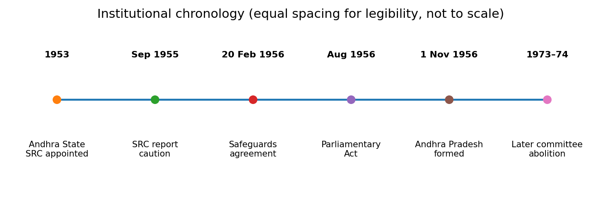
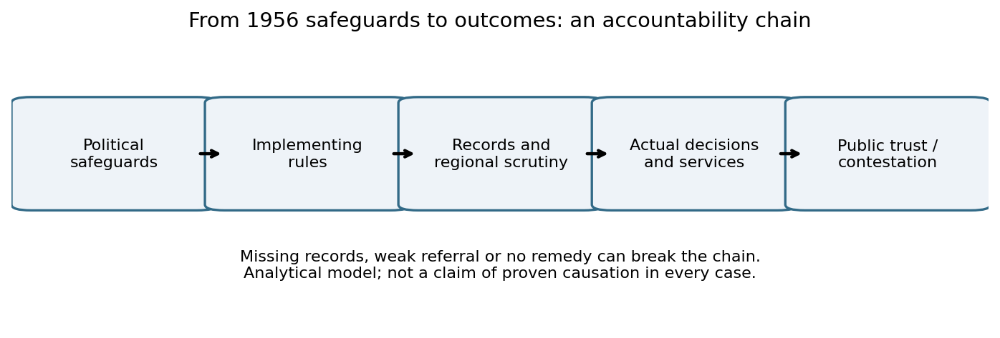
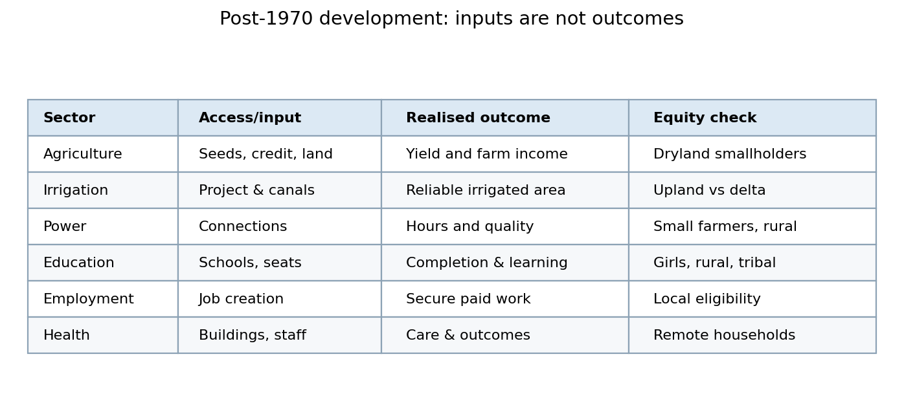

# Paper VI · Unit I · Topic 3 — Formation of Andhra Pradesh, 1956: Safeguards, Regional Committee and Development

**Academic status: NOT APPROVED.** This is an original educational draft. All 30 multiple-choice questions and all six mains answers are original practice, **not verified official TGPSC previous-year questions**. Source access and uncertainties are recorded in the source register.

**Syllabus wording:** Formation of Andhra Pradesh, 1956: Gentlemen’s Agreement - its Provisions and Recommendations; Telangana Regional Committee, Composition and Functions Violation of Safeguards-Migration from Coastal Andhra Region and its Consequences; Post-1970 Development Scenario in Telangana- Agriculture, Irrigation, Power, Education, Employment, Medical and Health etc.

**Verification note (25 October 2026):** The exact item is reproduced in a publicly indexed copy of Notification 02/2024 and agrees with the previous commission syllabus; direct access to the commission-hosted original returned HTTP 502 during this run. The primary source remains the original commission notification; direct reinspection is still required before academic approval.

## Syllabus-to-chapter map

| Exact syllabus component | Treatment |
|---|---|
| Formation of Andhra Pradesh, 1956 | §§1–3, timeline and legal distinction |
| Gentlemen's Agreement, provisions and recommendations | §§4–9 and cases A–C |
| Telangana Regional Committee: composition and functions | §§10–11 and case C |
| Violations of safeguards | §12 and cases A, B and D |
| Migration from Coastal Andhra and consequences | §§13–14 and case F |
| Post-1970 agriculture and irrigation | §§15–17 and case E |
| Power, education, employment, medical and health | §§18–21 and cases G–H |
| Competing interpretations, evidence and conclusions | §§22–24, six mains models |

## Chapter summary

The 1956 creation of Andhra Pradesh brought together regions with a common major language but different administrative histories and material conditions. The Gentlemen's Agreement was a political assurance intended to protect Telangana's resources, educational access, employment opportunities, land and regional voice. Its implementation depended on rules and institutions, especially the Telangana Regional Committee. The later debate over safeguards cannot be reduced to either the claim that all promises were honoured or the claim that every economic disparity proved a breach. Migration and development brought both benefits and distributive tensions. The post-1970 record must be assessed sector by sector with attention to reliable historical evidence, unequal starting conditions, changed district boundaries and policy implementation.

## Learning objectives

After studying this topic, a candidate should be able to distinguish the 1955 SRC recommendation from the 1956 political settlement; identify the key terms of the Gentlemen's Agreement; explain the committee's remit and limits; evaluate claims of safeguard violations using an evidence standard; analyse migration without stereotyping; and compare development in agriculture, irrigation, electricity, education, employment and health using valid indicators.

## High-value conceptual distinctions

| Distinction | Why it matters |
|---|---|
| Political agreement vs parliamentary law | Negotiated safeguards and the legal boundary change were not the same instrument. |
| Regional Council proposal vs Regional Committee implementation | Wording, powers and membership depend on the relevant document and date. |
| Regional surplus vs gross revenue | Shared administration must be allocated before claiming a balance. |
| Migrant identity vs illegal appointment | Legality depends on the applicable rule and evidence, not birthplace alone. |
| Command area designed vs actually irrigated | Proposed coverage is not reliable delivered water. |
| Development level vs regional disparity | Absolute improvement and relative inequality can coexist. |
| 1956 arrangements vs 1973–74 reforms | Later Article 371-D and abolition of the committee must not be backdated. |

## 1. Why the 1956 settlement was a constitutional bargain

The formation of Andhra Pradesh on 1 November 1956 was not a straightforward reunion of people who spoke Telugu. It joined Andhra State, formed in 1953 out of the former Madras State, with Telugu-speaking territories of the multilingual Hyderabad State. Andhra and Telangana had experienced different administrative systems, land tenures, educational languages, revenue arrangements and patterns of recruitment. Linguistic affinity provided an argument for a common state, but it did not eliminate concerns about who would control the new state's budget, public employment, institutions and water. The central historical question is therefore not simply whether merger occurred. It is whether a political bargain could reconcile common-language aspirations with the protection of a region whose institutions and economic conditions differed.

The 1955 States Reorganisation Commission did not recommend immediate merger as the only reasonable choice. Its discussion of Telangana's financial, administrative and political concerns recognised arguments for keeping the Hyderabad/Telangana region separate for the time being, with a later possibility of union under conditions of consent. The political decision to merge in 1956 thus needs to be distinguished from the commission's preferred timing. The Gentlemen's Agreement attempted to bridge the gap through promised safeguards. That agreement was a negotiated political instrument; the later territorial change rested on parliamentary legislation. Their different legal character is essential to understanding why a pledge could become a contested issue of implementation.

For an exam answer, establish three separate levels: **constitutional authority** (Parliament's reorganisation of territory), **political assurance** (the agreement among leaders), and **administrative machinery** (regional committee, recruitment and financial practices). A failure at one level does not mean all three were legally identical. It may nevertheless damage trust in the entire settlement.

**Three-layer decision map.** A Telangana legislator in 1956 could accept the cultural argument for a common Telugu-speaking state yet still demand a rule protecting local college admissions or a mechanism to challenge an adverse budget decision. That is not logically inconsistent: linguistic affinity answers a question about political identity, whereas admissions and fiscal oversight answer questions about distribution of power. The SRC's proposed delay and conditional future union illustrate that a shared language did not settle the timing or consent issue. In a mains answer, compare the recommendation in the 1955 report, the negotiated safeguards of February 1956 and the statutory territorial act of August 1956. Do not label all three 'the agreement'. [S03], [S04], [S14].

## 2. Chronology: Andhra State, SRC, agreement and merger

The starting point is Andhra State in 1953, created primarily from Telugu-speaking districts of the former Madras State, with Kurnool as its capital. Hyderabad State remained a separate, multilingual state; its Telangana districts were not automatically incorporated into Andhra State. The States Reorganisation Commission was appointed in 1953 and reported in September 1955. Its report considered linguistic homogeneity alongside administrative viability, finance, minority security and regional sentiment. Telangana's distinct circumstances occupied an important part of the report's analysis.

On 20 February 1956 leaders from the two regions met at Hyderabad House in New Delhi and reached what became known as the Gentlemen's Agreement. It sought to provide political and administrative safeguards before merger. Parliament then enacted the States Reorganisation Act, 1956. Section 3 specified the Hyderabad territories added to Andhra, and the enlarged state took the name Andhra Pradesh. The appointed day was 1 November 1956. These dates must be kept separate: **1953** Andhra State and SRC appointment; **1955** SRC report; **February 1956** negotiated agreement; **August 1956** reorganisation legislation; **November 1956** new state.

This sequence prevents two common errors. First, the agreement did not itself create Andhra Pradesh; legislation effected the territorial change. Second, the 1955 commission's reasoning should not be paraphrased as a blanket endorsement of immediate union. A historian should compare the commission's qualified recommendation with the political outcome rather than retrospectively collapsing them. The subsequent regional committee and domicile arrangements arose because the 1956 bargain recognised unresolved asymmetries.

**Chronology audit — source-specific distinction.** The sequence is not a single act of merger. Andhra State was created in 1953; the States Reorganisation Commission reported in 1955; regional leaders negotiated safeguards on 20 February 1956; Parliament enacted the States Reorganisation Act on 31 August 1956; and the appointed day was 1 November 1956. The 1955 recommendation contemplated a separate Hyderabad State initially, with a possible later union conditioned on a two-thirds vote of its legislature after the expected 1961 elections. That conditional future route did not occur. The February agreement was a political bargain, whereas the August Act supplied the territorial legal change. This separation prevents the false inference that the SRC itself ordered the 1956 merger. [S02], [S03], [S14].

## 3. Section 3 of the States Reorganisation Act and territorial continuity

Section 3 of the States Reorganisation Act, 1956, transferred specified territories from Hyderabad State to Andhra State and renamed the enlarged state Andhra Pradesh. The provision identifies districts and taluks or circles, not a vague cultural zone. It included the main Telugu-speaking Hyderabad districts while making particular adjustments involving areas from Raichur, Gulbarga, Bidar and Nanded and exclusions involving Adilabad. A precise legal reading is superior to the loose statement that 'all of Hyderabad merged with Andhra': Marathi- and Kannada-speaking areas followed other reorganisation paths.

The legislation illustrates how a territorial boundary is created through an enumerated legal schedule. Administrative inheritance then follows: records, officers, schools, irrigation responsibilities, debts, infrastructure and services must be allocated or integrated. But the act's boundary clause cannot by itself guarantee that future spending or recruitment will satisfy regional expectations. The political safeguards of the Gentlemen's Agreement addressed those separate concerns. Territorial integration and equitable development are connected but analytically distinct.

For a map-based question, draw Hyderabad State as a multilingual parent and three outward paths: Telugu-speaking Telangana to Andhra Pradesh; Marathi-speaking areas to Bombay State; Kannada-speaking areas to Mysore State, with legal details governed by the 1956 act. Do not mistake the 1956 administrative districts for today's 33 Telangana districts. Modern district names and boundaries should not be projected backwards onto the 1956 map without a dated source. In mains, a short reference to section 3 gives a firm legal anchor while leaving room to discuss the more important political safeguards.

**Statutory reading exercise.** Section 3 of Act 37 of 1956 is a territorial provision, not the text of the Gentlemen's Agreement. The Act defines the appointed day in section 2(a). In an examination answer, give the legal date first, then explain which Hyderabad territories became part of the enlarged Andhra Pradesh. Do not treat the entire former Hyderabad State as Telangana: its Marathi- and Kannada-speaking territories followed different reorganisation paths. A historically meaningful map should distinguish the 1953 Andhra State, the Hyderabad State immediately before November 1956, and the resulting borders. Neither a modern 33-district Telangana map nor the 2014 state boundary is a substitute for the 1956 statutory schedule. [S14].

## 4. What exactly was the Gentlemen's Agreement?

The Gentlemen's Agreement was the outcome of negotiations among political representatives of Andhra and Telangana on 20 February 1956. The official 2010 Committee for Consultations on the Situation in Andhra Pradesh report reproduces the 1956 safeguards, including the signed proceedings. It was not a judicial judgment and should not be described as a constitutional amendment. Its force lay in political commitment and in the administrative or constitutional measures subsequently adopted to implement parts of the bargain.

Its central design was regional protection within a common Telugu-speaking state. Safeguards concerned Telangana's surplus revenues, education, recruitment, Urdu, land transfers, ministerial representation and a regional council or committee. Each provision addressed a different perceived vulnerability. Revenue protection sought to prevent one region's resources from being absorbed into a common pool without reciprocal development. Education and domicile safeguards sought to prevent better-positioned applicants from crowding out local students and jobseekers. Land-sale controls aimed to address unequal bargaining power in a changing property market. Political representation and a regional institution attempted to provide an internal voice where a separate legislature would no longer exist.

The agreement should be read as a bundle, not a single promise about jobs. Its importance was psychological as well as institutional: it was meant to make a merger acceptable to those who feared loss of autonomy. The later Telangana movement frequently invoked it because unmet assurances could be framed as breach of a founding bargain. A good answer also recognises that the two regions contained diverse social groups; neither 'Andhra' nor 'Telangana' spoke with one unchanging voice.

**Provision-by-provision verification.** The government-published 2010 retrospective reproduces the 20 February 1956 proceedings with eight participants and separates safeguards into distinct subjects. Alongside revenue, admissions, recruitment, Urdu and agricultural land, the bargain included prohibition decided by Telangana legislators, proportionate retrenchment if service integration required it, and a review timetable. It also specified a 60:40 Andhra–Telangana cabinet distribution, one Muslim minister from Telangana, a deputy-chief-minister arrangement linked to the chief minister's region, and two significant portfolios from a named set for Telangana ministers. These provisions should be quoted with their conditions rather than recast as a general 'equal power' guarantee. The searchable official reproduction supports bounded correspondence, not proof that each provision was later enforced. [S04], [S05].

## 5. Revenue surplus and the problem of a common budget

One of the most consequential safeguards stated that expenditure on central and general administration should be borne proportionately by the two regions and the balance of Telangana income should be reserved for Telangana's development. The arrangement was to be reviewed after five years, with the possibility of continuation. This is not equivalent to saying that every rupee collected in Telangana must be spent there regardless of shared services. The wording explicitly recognised a share of central and general administration before calculating the balance. Students should explain the accounting sequence: identify regional receipts, allocate common administrative expenditure according to the agreed basis, then determine the balance intended for regional development.

The difficulty lies in measurement. Which taxes can be assigned to a territory? How are state-level corporations, headquarters and capital spending treated? Are loans, grants, debt servicing and common infrastructure included? Without agreed accounting conventions, two sides can dispute the same budget honestly or strategically. The Regional Committee's development role was expected to create some oversight, but its actual power over finance was limited. A constitutional arrangement that promises a surplus without a transparent audit and enforcement process is vulnerable to contestation.

In a model district-budget example, suppose regional receipts are 100 illustrative units and an agreed 20 units represent the region's share of central administration. The 'balance' would be 80 before other authorised adjustments; it is not 100. The example is pedagogical, not a historical statistic. When evaluating claims of diversion, demand audited period-specific data, comparable definitions and attention to capital investments. Distinguish **alleged violation**, **officially acknowledged shortfall**, and **independently verified financial loss**.

**Auditable ledger example.** Imagine a purely hypothetical year with 120 units of Telangana-attributable receipts, 30 units of proportionately allocated central administration, and 55 units of demonstrably regional development expenditure. On those assumptions, the pre-development balance is 90 units, and the unspent balance is 35 units; neither 120 nor 65 is the correct residual. The example becomes indeterminate if debt servicing, shared capital assets or receipts from Hyderabad headquarters are classified differently. An auditor should document the numerator, denominator, allocation key, accounting period and whether the measure is budgeted or actually spent. The agreement's five-year review clause and possible further five years matter because a historical claim must identify the period in which the promise applied. No numerical example here is a historical fiscal finding. [S04].

## 6. Educational safeguards: access, language and institutional inequality

The agreement proposed preserving and improving existing educational facilities for Telangana students. It provided an option of restricting admission to institutions in Telangana to Telangana students or granting Telangana students one-third of total admissions across the state, whichever arrangement was more advantageous. This unusual alternative reflects a bargaining problem: the region feared immediate competition from students educated in different systems, while a common state needed pathways for mobility and integration.

Educational inequality was not simply a matter of total school buildings. Hyderabad State had different media of instruction and institutional histories; English and Telugu proficiency, Urdu administrative usage, urban concentration of colleges, teacher availability and technical seats all affected access. A candidate should analyse who could compete for admission under each rule, which institutions were counted, and whether an apparent aggregate expansion actually benefited rural, tribal, Dalit and female students. A policy may increase total seats while leaving a protected region's share unchanged or reduced.

The agreement also contemplated continuing Urdu's administrative and judicial position for a transition period, while allowing a Telugu language test after appointment rather than demanding immediate proficiency at recruitment. These measures were intended to avoid abruptly excluding personnel trained under Hyderabad's prior language system. The central lesson is that a language-based state can still contain unequal language capital. Evaluate a safeguard by implementation, not merely by its attractive wording. The test is whether it changed real access, progression and institutional quality for the intended beneficiaries.

**Admissions worked comparison.** Suppose, hypothetically, Telangana colleges offer 600 seats and the entire state's relevant colleges offer 1,500. A Telangana-only route would secure 600 seats locally; a one-third statewide route would secure 500. Under the negotiated 'whichever advantageous' formulation, the first is numerically larger in this stylised case. Reverse the figures to 300 local seats and 1,500 statewide seats and the statewide route offers 500 instead. Actual legal interpretation would require checking which institutions, years and categories the rule covered. The exercise demonstrates why a phrase such as 'one-third reservation' alone is incomplete: the agreement described an alternative, not an unconditional one-third share in every institution. Do not infer actual admissions from these illustrative numbers. [S04], [S05].

## 7. Domicile, Mulki rules and recruitment integration

Local employment was a core source of anxiety long before 1956. The Hyderabad State's Mulki rules created local eligibility categories, and the 1952 agitation exposed disputes about appointments and the treatment of local candidates. The 1956 agreement contemplated temporary protection in subordinate services and some form of residence or domicile requirement. Official retrospective accounts describe a five-year regional recruitment arrangement; other formulations in the agreement refer to a proposed residence period. These details must be distinguished from later Article 371-D local-cadre mechanisms, which belong to the post-1973 settlement and cannot be inserted into 1956 as if already operating.

Recruitment involves at least four separate issues: eligibility rules, reservation or regional allocation of posts, seniority after integrating services, and enforcement against irregular appointments. A person may meet an eligibility rule while another disputes the quota; a transferred officer may retain service rights without being newly recruited; a temporary arrangement may expire while grievances persist. Such distinctions explain why administrative orders and court cases became politically significant.

The strongest analytical frame is **promise → rule → implementing authority → records → remedy**. If a safeguard lacks a reliable register of posts, domicile certificates, appointments and review procedures, the mere existence of a rule cannot demonstrate compliance. Avoid assuming that every employee from Coastal Andhra was an illegal appointee. The question is whether particular appointments contravened rules applicable at the time. The Supreme Court's later decisions about Mulki rules and the subsequent Six-Point Formula show how contested the legal terrain became.

**Recruitment-rule timeline.** The 1956 arrangement discussed proportionate future recruitment and a temporary Telangana unit for subordinate-service recruitment, with the official retrospective describing a five-year protection linked to existing Mulki domicile conditions. It is analytically wrong to apply the later Article 371D local-cadre framework retroactively to every 1956 appointment. A proper case audit identifies the vacancy date, grade, appointing authority, then-operative eligibility rule, proof of residence, any service-integration exception and the remedy available at that date. The Public Employment (Requirement as to Residence) Act, 1957 is another distinct legislative event, not an appendix to the original agreement. A candidate should distinguish a five-year temporary arrangement from the older Mulki residence rules; they are not interchangeable time thresholds. [S04], [S15].

## 8. Agricultural land safeguards and property-market change

The agreement contemplated control over sales of agricultural land in Telangana through a regional institution. The rationale was distributive: where land values and access to credit differ, an open market can transfer assets from financially weaker cultivators to better-capitalised purchasers. Hyderabad's land-tenure legacy, including jagirdari and revenue-administration transitions, made the land market more than a neutral exchange between identical participants. Protecting cultivators could preserve livelihoods, social stability and political confidence in merger.

However, controls also have costs. Restrictive transfer rules can impede legitimate sale by a farmer who needs liquidity, discourage investment or be evaded through benami transactions. The policy problem is therefore to prevent distress-driven dispossession without freezing every transfer. Effective implementation requires clear definitions of agricultural land, exemptions, registry scrutiny, appeal rights and public data on approved and rejected transfers. It also requires attention to tribal and Scheduled Area land protections, which are a separate legal regime and should not be conflated with a general 1956 regional safeguard.

When studying migration, separate **migration of people** from **transfer of land ownership**. New settlers may be tenants, workers, teachers, entrepreneurs or purchasers; the consequences vary. A careful historical answer asks which land changed hands, when, under what legal rules and with what effect on local farmers. It does not infer dispossession merely from a surname or place of origin. This section connects the Gentlemen's Agreement to the later expansion of Hyderabad's land and real-estate markets without claiming that all later transactions were covered by the original arrangement.

**Land-transfer case.** Consider an illustrative sale of agricultural land by a small Telangana cultivator to an urban investor after a canal announcement. The safeguard question is not answered merely by the buyer's regional identity. Relevant facts include whether the property was agricultural land, whether the rule in force required Regional Committee scrutiny, whether the sale was voluntary, the price relative to comparable transactions, tenancy or tribal land restrictions, and whether a legal remedy existed. A hypothetical rise in land prices may increase a seller's wealth while making future access harder for landless households. Therefore distinguish a formal violation of a specified control from a distributive consequence of market change. Neither is established by anecdote alone. [S04], [S13].

## 9. Political power-sharing and the deputy-chief-minister issue

The agreement envisaged a 60:40 ministerial distribution between Andhra and Telangana, broadly reflecting the expected regional balance, and included an assurance about representation of a Muslim minister from Telangana. It also envisaged a deputy chief minister from one region when the chief minister came from the other. These were devices for power-sharing in an enlarged cabinet. Their significance is not merely ceremonial: cabinet composition influences access to files, portfolio allocation, agenda-setting and the perception that decisions are jointly owned.

Nevertheless, a numerical ratio is not equivalent to equal influence. A cabinet with a formally adequate regional share may still concentrate finance, home affairs, irrigation or appointments in one set of hands. Conversely, a prominent office may have limited authority if cabinet processes centralise decisions elsewhere. To evaluate compliance, distinguish ministerial numbers from portfolio importance, actual decision records and the continuity of representation across governments.

The frequently discussed deputy-chief-minister question is useful because it shows how a symbolic assurance can become a test of trust. But the historical record should be checked before claiming a particular person deliberately broke a specific legally enforceable clause. The exam-safe approach is to identify the agreed principle, explain why critics viewed departures as violations, and assess the difference between political commitment and enforceable constitutional obligation. This avoids replacing institutional analysis with personalised blame.

**Portfolio safeguard often omitted.** The 1956 proceedings went beyond a 60:40 cabinet ratio. They identified five important portfolios—Home, Finance, Revenue, Planning and Development, and Commerce and Industry—from which two were to be assigned to Telangana ministers. This is substantively different from simply counting ministers: a 40 percent cabinet share without the agreed portfolio distribution might satisfy one assurance but not another. For an audit, construct a dated table of cabinet membership, regional origin, portfolio, appointment and reshuffle; then compare each entry with the exact promise. A deputy chief minister's absence can be described as a reported political grievance only after checking the relevant government and date. The agreement itself is not equivalent to a judicial order compelling appointment. [S04], [S05].

## 10. Regional Council versus Telangana Regional Committee

The original agreement referred to a Regional Council with a broad development mandate. Subsequent arrangements created the Telangana Regional Committee as a regional institution within the Andhra Pradesh legislative framework. The terminology is not interchangeable across every document. A student should identify the institution under discussion, its date and the legal instrument that governed it. The Regional Committee was intended to review or advise on specified Telangana matters while the state government and assembly retained ultimate powers.

Its assigned subjects included regional planning and development, local self-government, public health, primary and secondary education, admission to educational institutions, prohibition, agricultural land sales, cottage industries, agriculture and cooperative societies. The detailed list varied by implementing instrument and subsequent interpretation. The key institutional issue is the difference between **consultation** and **consent**. A committee that can discuss or recommend a measure is not necessarily able to veto a cabinet decision or appropriate funds. An exam answer should therefore avoid calling it an autonomous legislature.

The committee provided a channel through which Telangana legislators could articulate regional priorities, request information and create a documentary record. Yet it was vulnerable to executive dominance, delayed referrals, narrow readings of its jurisdiction and the difficulty of compelling implementation. Its later abolition during the 1973–74 constitutional settlement is a separate episode that belongs chiefly to the next unit. The 1956–1970 topic should explain the committee's intended function and early limitations without importing all later legal arrangements.

**1958 implementation and the escalation rule.** The Andhra Pradesh Regional Committee Order was made under the then Article 371 and came into force on 1 February 1958. A separate March 1958 change to the Andhra Pradesh Government Business Rules provided that the Council of Ministers should *normally* give effect to recommendations on scheduled matters. If it considered a recommendation inexpedient or beyond the committee's competence, the chief minister was to refer the matter to the Governor, whose decision was final and binding on the Council. This is more precise than saying either that every committee recommendation was a binding veto or that the committee was merely a discussion club. The recommendation, ministerial objection and Governor's decision form different steps; the exact schedule and dated version must be checked. [S13].

## 11. Composition, exclusion and accountability of the Regional Committee

The Regional Committee was associated with elected representatives from Telangana in the Andhra Pradesh legislature, operating under specified procedural arrangements. Accounts of its membership should be checked against the governing Presidential Order rather than assuming that every minister, presiding officer or nominated person had identical rights. The original political understanding excluded the chief minister from the regional standing committee, and subsequent institutional forms had their own rules. Where exact membership counts are not verified from a contemporaneous order, the safer formulation is to explain the representational principle rather than invent a fixed figure.

A regional committee's legitimacy depends on more than the origin of its members. It needs a transparent agenda, access to departmental data, a right to receive bills affecting its subjects, minutes, follow-up reports and a public account of whether advice was accepted. Otherwise it can become a consultative body whose recommendations do not alter outcomes. A useful analytical comparison is a legislative standing committee: both can scrutinise and recommend, but neither automatically controls the executive budget.

This distinction matters in questions about 'composition and functions'. Composition answers who participates and who is excluded. Functions answer what subjects are referred and what powers exist. Effectiveness asks whether decisions changed. Do not answer all three by repeating the committee's name. A strong answer adds a short case study: for a proposed change in agricultural land transfer rules, the committee might examine effects on Telangana cultivators and submit advice, while the legislature and government would still need to act through their lawful powers.

**Membership versus powers.** The February 1958 Presidential Order and subsequent state business rules must be read separately from the political text negotiated in 1956. A responsible composition answer should specify whether it is describing the proposed Regional Council, the 1958 Regional Committee, or an amended committee after 1970. For a bill concerning scheduled education matters, ask who could place it before the committee, which members voted, whether the committee's recommendation was recorded, and whether the cabinet implemented it or invoked the Governor referral route. The 1958 mechanism did not create a separate treasury, an autonomous legislature or an unrestricted veto. The official retrospective records a 7 March 1970 amendment widening subjects, including specified recruitment and employment matters. Do not project those expanded subjects backward into the unamended 1958 schedule. [S13], [S04].

## 12. Safeguard violations: categories of allegation and evidence

The phrase 'violation of safeguards' is central to Telangana political memory, but it covers different kinds of claims. One category concerns explicit non-observance of an agreed procedure, such as failure to refer a matter to the Regional Committee. Another concerns a distributive result, such as a lower-than-expected share of recruitment or irrigation benefits. A third concerns the perceived spirit of the bargain, where formally lawful policies were considered inconsistent with regional protection. These categories should not be collapsed. A grievance may be politically powerful even where the precise legal obligation is disputed.

An evidence-based inquiry requires four steps. First, quote or paraphrase the particular promise accurately. Second, identify its implementing order, date and scope. Third, compare administrative practice with that standard using appointment registers, budget accounts, legislative records, land registries or project approvals. Fourth, record official findings and competing interpretations. The 2010 Committee for Consultations report is a useful government retrospective, but its conclusions should not be presented as contemporaneous findings of a 1956 tribunal.

Examples of disputed areas include public appointments, regional revenues, education, ministerial representation and the committee's influence. Avoid invented totals for 'jobs stolen', 'surplus diverted' or 'water denied'. Such figures need a specified period, source and methodology. In mains, a two-column distinction between **documented legal arrangement** and **alleged implementation failure** shows greater command than a sweeping statement that every safeguard was either honoured or broken.

**Four-way evidence matrix.** A claim about a safeguard should be classified as (1) a verbatim promise in the 1956 proceedings, (2) a binding provision of a statute, Presidential Order or government rule, (3) an alleged noncompliant administrative act, or (4) a demonstrated impact. For example, a committee referral omitted in a documented file could prove a procedural breach without quantifying financial damage. Conversely, a lower irrigation outcome might demonstrate disadvantage without identifying a particular legally breached clause. A complete case needs the exact instrument, the dated decision file, a comparator and an appropriate counterfactual. The 1958 Governor-escalation mechanism adds a further test: was the committee's recommendation rejected without the prescribed referral? A grievance and a legal conclusion must not be conflated. [S13].

## 13. Coastal Andhra migration: patterns, motives and social composition

Migration from Coastal Andhra into Telangana occurred through several channels: public service transfers, private employment, education, trade, cultivation, contracting and later urban property markets. Hyderabad's administrative and economic growth created demand for skills and investment. People moved for reasons that ranged from state appointments to commercial opportunity and family ties. Describing this as a single centrally directed process is analytically weak unless specific records support that claim. Equally, treating migration as entirely benign ignores how unequal access to capital, networks and institutions can alter regional opportunity.

The distinction between **stock** and **flow** is important. A census count of persons born elsewhere is a stock at a given date; migration during a decade is a flow. A rise in population can reflect natural increase, migration, boundary changes or improved enumeration. The effects also differ across Hyderabad city, irrigated agricultural belts and dryland districts. Urban business formation may create employment while also intensifying land-price competition. New teachers and professionals may fill service gaps while local applicants demand protected opportunities.

Migration should not be treated as a moral fault of ordinary residents. The historical issue is whether public rules and resource allocations provided equal and fair access. Analyse institutions rather than stigmatise communities. A balanced answer can recognise the economic contribution of migrants while examining local concerns about recruitment, land and representation. It should specify that 'Coastal Andhra' is a regional origin, not a uniform class or political identity.

**Migration evidence design.** Regional migration cannot be reconstructed from surnames or spoken dialect. A defensible historical estimate needs census migration tables, comparable boundaries, dates of movement, rural–urban distinctions and occupational categories. Hyderabad city growth can reflect public employment, education, trade, family migration and national urbanisation simultaneously. A teacher who moved in 1957 and an entrepreneur who arrived in 1975 should not be counted as a single undifferentiated 'influx'. Nor does migrant status by itself establish a violation of recruitment safeguards: that requires an appointment record and the rule applicable to the specific post. A sound mains answer considers contributions to markets and institutions alongside possible distributional pressure, without assigning collective guilt.

## 14. Migration consequences: employment, language and urban markets

In the enlarged state, government offices, higher education and Hyderabad's expanding economy became arenas where regional advantage was debated. Applicants trained in different educational systems did not enter identical competitions. Fluency in the language of administration, access to colleges, professional networks and examination preparation could affect recruitment independently of formal domicile rules. The result was a perception that merit and fairness were being defined through institutions shaped by unequal starting conditions.

Urban land and rental markets offered another channel. Rising demand could finance housing and commercial activity, but also raise costs for lower-income residents. The benefits of real-estate appreciation accrue chiefly to owners; tenants may face displacement. Therefore, a claim that migration 'developed Hyderabad' and a claim that it 'disadvantaged some local groups' can both be true in particular contexts. Neither proves the other false. Historical evidence should separate public employment, private enterprise and property transactions.

Language and culture were also implicated. Telangana Telugu dialects, Urdu and local practices could be marginalised in formal media or administration when a standardised linguistic identity dominated. Yet cultural interaction also produced new forms of literature, commerce and public life. A critical essay should compare these mechanisms, not describe culture as static or migrants as a single force. To evaluate outcomes, use dated census tables, land records, institutional admissions and occupational data, while acknowledging gaps in region-specific series before and after reorganisation.

**Distributional example.** Suppose a city gains 10,000 jobs over a decade while locally educated applicants increase by 15,000 and rural access to training remains weak. Aggregate employment growth can coexist with worsening competition for some groups. To test a migration explanation, distinguish vacancies filled by lawful transfers, new private-sector posts and appointments covered by local recruitment restrictions. Compare occupations and educational qualifications rather than treating every job as identical. Housing-price changes also require inflation adjustment and neighbourhood-level comparison. This example is deliberately hypothetical; it demonstrates why a broad assertion that migrants 'took jobs' is neither a statistical result nor a legal finding. Policy evaluation must separate opportunity creation, eligibility compliance and distribution.

## 15. Post-1970 development: define the period before comparing

The syllabus asks for a post-1970 development scenario across agriculture, irrigation, power, education, employment and health. That is a long and heterogeneous period, not a single policy episode. It includes the late 1970s, liberalisation-era changes, Hyderabad's technology and services expansion, the 2014 state division and subsequent Telangana government programmes. An answer should identify the comparison period explicitly. A claim about 1971–2011 cannot be supported by a 2026 government press release, and a post-2014 outcome cannot be attributed automatically to the 1956 agreement.

Three analytical dimensions are needed. **Level:** Did an indicator improve within Telangana? **Relative position:** Did Telangana improve faster or slower than comparable regions? **Distribution:** Did gains reach dryland farmers, tribal communities, women and poorer districts? An increase in electricity generation can coexist with unreliable agricultural supply. Rising university enrolment can coexist with uneven school quality. A hospital's construction does not establish improved maternal health without staffing and utilisation data.

Use a common-denominator table: agriculture (yield per hectare and farm income), irrigation (reliable area irrigated and groundwater stress), power (connections and supply quality), education (completion and learning), employment (participation and secure jobs), health (mortality, access and out-of-pocket cost). Where historical regional series are incomplete, explain the limitation. The goal is to evaluate development and perceived regional disparity without converting an exam topic into a one-sided political verdict.

**Periodisation guardrail.** 'Post-1970' is not one uninterrupted institutional regime. The 1969 agitation, the 1970 widening of Regional Committee subjects, the 1973 Six-Point Formula and the subsequent constitutional and administrative arrangements altered the legal framework. The later 2014 formation of Telangana changed the relevant territorial denominator again. A comparative table should therefore specify at least a pre-1970 baseline, a clearly defined subsequent interval, and a consistent region or district reconstruction. Otherwise the same chart can mix policy periods and changing boundaries. For historical explanation, describe which reform existed at the observation date; for present-day current affairs, explain relevance without claiming a 2026 announcement proves a 1956 breach. [S04].

## 16. Agriculture: dryland structure, technology and unequal risk

Much of Telangana's agrarian economy has historically depended on rainfall variability, tanks, wells and dryland crops, while parts of Coastal Andhra benefited from large delta irrigation systems. This does not mean all Coastal Andhra farms were prosperous or all Telangana farms were rainfed. Crop mix, soils, tenancy, credit, irrigation reliability and market access varied widely within both regions. Regional comparison requires attention to agro-ecological starting conditions rather than merely counting tonnes of rice.

After 1970, agricultural development involved high-yielding varieties, fertilisers, mechanisation, groundwater pumping, market linkages and changes in state procurement. Some interventions raised output but also increased input costs and exposure to debt or groundwater depletion. A district with expanding borewell irrigation may appear to have gained irrigated area while facing rising energy demand and aquifer stress. This is a different development pathway from gravity-fed canal systems.

The 2026 Telangana government's farmer-support statements are contemporary policy claims, not historical evidence of the 1970s. They can be used in a current-affairs box if clearly dated and attributed. For an exam essay, connect agrarian structure to the founding bargain by asking whether development priorities addressed regional dryland vulnerabilities. A well-balanced conclusion recognises improvements in production alongside persistent questions about ecological sustainability, smallholder returns and the distribution of irrigation benefits.

**Risk-adjusted agricultural comparison.** A hypothetical dryland village cultivates 1,000 hectares of rainfed millet and records 500 tonnes in a poor rainfall year. A canal-served village cultivates 500 hectares of paddy and produces 1,500 tonnes. Comparing total tonnes alone hides differences in cropped area, crop type, water input and drought exposure; comparing tonnes per hectare without accounting for crop choice is equally misleading. An evidence-based regional study should report irrigated share, seasonal rainfall, crop yields by crop, tenant access, input prices, debt and market connections over multiple years. Historical land-tenure change can also affect who receives the gains. The example is not a measured Telangana–Andhra comparison and cannot prove a policy violation. [S07], [S08].

## 17. Irrigation: allocations, command areas and water justice

Irrigation was central to the Telangana question because Krishna and Godavari basin projects were capital-intensive and geographically uneven. A water allocation on paper does not guarantee delivery to a field. Distinguish **legal entitlement**, **project design**, **water actually diverted**, **command area created**, **area actually irrigated** and **reliability across seasons**. The difference is especially important where reservoirs, canals, lift schemes, pumping costs and drought risk shape realised benefits.

Regional grievances often compared canal irrigation in established delta areas with the slow extension of irrigation into Telangana's uplands. However, engineering constraints, terrain, project sequencing, interstate agreements and budget decisions all affect outcomes. To test a claim of discriminatory allocation, one must examine basin-wise records, sanction dates, actual expenditure, project completion, water availability and beneficiary distribution. An undated list of dams is not an adequate analysis.

Tank irrigation also matters. Traditional tanks were connected to village institutions and rainfall patterns; neglect or rehabilitation affects groundwater recharge and livelihoods. Later large lift-irrigation schemes create different trade-offs: potentially wider coverage but substantial power and maintenance costs. The Telangana irrigation department's 2026 project profile is a current administrative source, not a substitute for historical project accounts. The exam-ready argument is that equitable irrigation requires both fair allocation and feasible, maintained delivery systems.

**Three distinct irrigation denominators.** Project proposals report planned command area; construction records report irrigation potential created; actual water-delivery or crop records may report utilisation. If a hypothetical project plans 100,000 hectares, creates infrastructure for 70,000, and delivers dependable irrigation to 45,000 in a drought year, the utilisation ratios are 45 percent of the original plan and about 64.3 percent of created potential. Neither ratio alone proves diversion of water to another region. A stronger audit also needs reservoir inflows, rainfall, lift-pumping reliability, canal maintenance, crop choices and legally relevant allocations. Use the same hydrological year and basin definition before comparing regions. The example is invented solely to demonstrate measurement, not a Telangana project statistic. [S08].

## 18. Power: generation, supply and the cost of irrigation

Electricity development should be assessed through generation capacity, transmission networks, household access, industrial demand and the quality of agricultural supply. A region can host power stations while experiencing shortages if generation is dispatched through a common grid and local distribution remains weak. Similarly, free or subsidised agricultural electricity may relieve farmers' immediate costs while increasing public fiscal burdens and encouraging groundwater extraction when metering and water management are poor.

From the 1970s onward, electrification changed agricultural production by making borewell pumping and rural mechanisation more viable. But its effects were uneven: farmers with capital to drill deep borewells could gain first, while poorer cultivators remained exposed to rainfall and declining water tables. The relationship between irrigation and electricity is therefore circular. Power expands access to water; water scarcity increases pumping depth and electricity demand; subsidy policy changes both incentives and the distribution of costs.

A sound regional comparison should use hours of supply, feeder reliability, agricultural connections, losses and tariff support, not just installed megawatts. The 2026 drought-preparedness statement by Telangana's government explicitly connects water, agriculture and electricity. That is a useful present-day illustration of the interdependence, but it does not establish whether a specific 1960s safeguard was violated. Distinguish contemporary governance challenges from historical evidence.

**Power-system worked distinction.** Suppose a district's installed electricity capacity rises by 20 percent but outages remain frequent because transmission capacity, feeder maintenance and seasonal agricultural demand have not kept pace. Installed megawatts are a stock of equipment; actual energy supplied is measured over time, while household or farm reliability requires interruption frequency and duration. A lift-irrigation project can create a new dependency on pumping power and tariff subsidies. Compare who pays the electricity cost, which villages have functioning connections, and whether scheduled supply coincides with irrigation needs. Without these denominators, a claim of 'electrification success' may describe wires rather than usable service. This is a hypothetical analytical example, not a historical measurement. [S07], [S08].

## 19. Education after 1970: expansion versus equitable outcomes

Educational expansion can be measured by schools, colleges, universities, enrolment, literacy and professional seats. Yet these indicators do not capture the same outcome. Enrolment is access at a point in time; completion reflects retention; learning outcomes measure capability; employment after graduation measures a different transition. Telangana's rural, tribal and disadvantaged communities faced barriers including travel distance, language, household labour and cost. Urban Hyderabad's higher education growth could raise statewide averages without eliminating regional or social gaps.

The original educational safeguards sought to protect students who entered the enlarged state from unequal institutional starting points. Later decades brought new universities, professional colleges and private institutions. These changes expanded opportunities but also produced stratification by fee, location and medium of instruction. A fair analysis asks whether local students gained seats and skills, whether public institutions improved, and whether female and marginalised-group participation increased.

The Telangana Education Commission's January 2026 policy document is a dated official source for present reform proposals, not evidence that those proposals were implemented in 1970. Use it to show how questions of public-school quality and access remain salient. In a mains answer, move from historical safeguard to institutional expansion to remaining equity challenge. Avoid the unsupported claim that all education growth occurred because of, or despite, the merger.

**Quality-adjusted education comparison.** A region may report more secondary schools while still suffering teacher vacancies, poor transport, dropout at transition grades or low foundational learning. A hypothetical district with 100 schools and 50 percent regular teacher attendance may deliver less instruction than one with 80 schools and 90 percent attendance. This does not mean the second is necessarily superior; enrolment, student–teacher ratios, learning assessments, caste and gender gaps, and geography must also be considered. Compare like cohorts and avoid substituting current district names for historical ones. The 1956 admissions safeguard is an access rule; later improvements in learning outcomes are a different proposition requiring different evidence. [S04], [S09].

## 20. Employment: state services, private growth and regional opportunity

Employment was a founding concern because the Mulki controversy had already made local eligibility politically charged. After 1970, opportunities diversified: government services remained important, but industrial employment, construction, transport, finance, information technology and other services grew. Hyderabad became a major labour market for workers from multiple regions and states. Public recruitment safeguards, however, apply to defined posts and legal periods; they cannot be extended by assertion to every private-sector vacancy.

Distinguish employment **quantity**, **quality** and **access**. A rise in the number of jobs can coexist with informal contracts, low wages or limited opportunities for people with particular educational backgrounds. Public recruitment disputes require examination of cadres, eligibility, appointment records and later local-zone rules. Private employment requires sectoral and occupational data, not simply government job notifications. Women's work participation and unpaid labour must also be considered; counting only formal salaried positions understates economic contribution.

The 2026 state government's claims about public recruitment should be attributed as government statements pending independent verification of definitions and periods. They illustrate that employment continues to be a central political performance indicator. In a historical answer, the stronger point is institutional continuity: a 1956 promise about local opportunity helped establish a vocabulary of regional justice that later movements reworked under changing economic conditions.

**Recruitment audit example.** Imagine 200 advertised posts, 150 appointments and 25 disputed domicile certificates. It is incorrect to call all 25 illegal before checking the applicable rule, whether those posts were within the protected category, the appointment date, and whether valid exceptions existed. An audit might find five invalid certificates, ten lawful transfers and ten cases needing further documents. These hypothetical categories show why aggregate headcounts can overstate or understate breaches. A separate private-sector labour-market analysis should measure wages, skills and regional opportunity; it cannot be treated as if every private appointment fell under the 1956 subordinate-service safeguard. [S04], [S15].

## 21. Medical and public health: infrastructure, access and outcomes

Health development involves more than constructing hospitals. Primary health centres, district hospitals, referral systems, doctors, nurses, medicines, transport, immunisation, maternal care, sanitation and disease surveillance jointly determine outcomes. Hyderabad's concentration of specialised hospitals can improve tertiary care for the region while leaving remote villages with long travel times. A regional comparison should therefore separate urban tertiary facilities from rural primary care and measure utilisation, staff vacancies and health outcomes.

Since 1970, demographic transition, vaccination, institutional deliveries and public-health programmes have changed the disease burden. But aggregate mortality trends do not isolate the effect of any one state government or the 1956 merger. Poverty, drinking water, nutrition, caste, gender and environmental conditions affect health alongside expenditure. In drought-prone areas, water quality and seasonal disease burdens can be important, while urban areas face congestion and pollution.

A careful essay can use Telangana's current Socio Economic Outlook as a source for contemporary indicators, provided it names the year and does not mix post-2014 district boundaries with earlier regional units. The original Regional Committee's public-health remit is a useful institutional link: it shows that the founding bargain recognised social services as regional priorities. The unresolved analytical question is whether representation translated into effective, geographically equitable service delivery.

**Facility versus service.** A public-health centre counted as 'opened' may lack doctors, medicines, safe water, transport or referral capacity. Suppose two districts each report ten centres but one has eight continuously staffed and the other four. A facility-count comparison alone conceals a major access gap; population served, travel time, maternal care, immunisation continuity and outcomes are needed. Historical comparisons require caution because diagnostic methods and reporting coverage change. A current Telangana health indicator can illuminate present inequalities, but cannot be treated as evidence that a 1956 ministerial promise was violated. Distinguish infrastructure inputs, delivered services and population health outcomes.

## 22. How to compare regional development without false statistics

Historical development debates often use figures that cannot be compared directly. A 1961 district may differ from a 2011 district; inflation changes rupee values; a capital city may dominate averages; and a sector's share of output may fall even as its absolute output rises. Students should explicitly identify **geographic boundary**, **base year**, **price basis**, **population denominator** and **data source**. A statement such as 'Telangana received less irrigation' is incomplete unless it identifies the relevant basin, period, project or beneficiary measure.

A useful evaluation matrix has four columns: indicator, historical baseline, subsequent trend and limitation. For agriculture, compare yield and rainfed share; for irrigation, actual irrigated hectares; for power, reliable hours; for education, completion and learning; for employment, workforce participation and secure jobs; for health, access and outcomes. If an official committee reports regional differences, specify whether it presents administrative statistics, testimony, projections or its own conclusion. These are different evidence types.

Consider a fictional example: Region A's school enrolment rises from 40 to 70 per cent and Region B's from 60 to 80. A improved by 30 percentage points and B by 20, but B still has the higher final level. Which region 'developed more' depends on the question. The example is deliberately illustrative. This method helps avoid selective statistics and demonstrates the reasoning expected in a high-scoring Group I answer.

**Counterfactual caution.** To evaluate whether a regional disparity arose because of merger policy, compare a credible pre-policy baseline, the trend after policy, and plausible alternative drivers such as rainfall, urbanisation, landholding patterns and national programmes. A single 2026 level cannot establish a 1956 causal effect. Where district boundaries have changed, construct stable geographic units or state that the comparison is not directly valid. Monetary series need constant prices; irrigation requires consistent water years; school and hospital series need service-quality denominators. A useful evidence table has columns for claim, indicator, source, boundary definition, observation year, alternative explanation and uncertainty. This is a method, not an assertion of particular historical losses.

## 23. Competing interpretations of the 1956 experiment

One interpretation emphasises the logic of linguistic integration. A larger Telugu-speaking state could coordinate investment, administration, higher education, transport and markets, while political safeguards would protect regional concerns. Proponents of this view may point to economies of scale, shared institutions and Hyderabad's eventual growth. A second interpretation emphasises the asymmetry at merger: Telangana had distinct revenue, employment and educational arrangements, and the SRC had advised caution. From this perspective, promises without enforceable monitoring could not reliably prevent domination by the larger political coalition.

A third, institutional interpretation asks why the bargain failed to settle the issue even if some development indicators improved. It focuses on weak monitoring, ambiguous jurisdictions, changing governments, lack of transparent regional accounts and the symbolic importance of broken commitments. These interpretations are not mutually exclusive. Economic growth can occur alongside an erosion of political trust; a safeguard can be well intended yet poorly designed; regional movements can mobilise both documented grievances and broader identity claims.

A strong mains response states each argument fairly, then assesses evidence. Avoid making the SRC, Gentlemen's Agreement and Regional Committee interchangeable. Avoid treating 'Andhra people' and 'Telangana people' as homogeneous. The historically grounded conclusion is that federal bargains require institutional credibility, not just a common language or a written assurance.

**Interpretation matrix.** A merger advocate might point to the scale benefits of a common market and administrative integration; a critic might point to failure of agreed regional procedures or unequal access to employment. Both claims require their own evidence. A larger market is not evidence that a specific committee referral occurred; a documented referral failure does not by itself quantify all regional economic losses. A disciplined essay gives the strongest evidence for each proposition, specifies its period, and distinguishes contemporaneous records from later political retrospectives. The 1958 business rule creates a testable procedural question: was the Governor-referral route used when ministers declined committee advice? A careful conclusion may find a breach in one safeguard while leaving another unproven. [S13].

## 24. Synthesis: from merger safeguards to the Telangana question

The 1956 formation of Andhra Pradesh produced a common political territory but did not erase regional differences in administration, public employment, educational access, agriculture or water. The Gentlemen's Agreement was an attempt to make union acceptable by reserving resources, protecting opportunity and creating a regional voice. The Telangana Regional Committee translated part of that vision into a consultative institutional form, yet its limited authority and contested implementation left questions about accountability. Migration and development added complexity rather than a simple single cause: investment and mobility could produce gains while also changing competition for jobs, land and cultural recognition.

The post-1970 development question should be answered with sector-specific evidence and a distinction between absolute improvement and relative inequality. Agricultural productivity, irrigation reliability, electricity, educational attainment, employment security and health outcomes cannot be reduced to a single ranking. Nor should later policy claims be retrofitted as proof of what happened in 1956. The eventual creation of Telangana in 2014 is a later outcome of a much longer political history, not evidence that every allegation about the earlier period was factually correct.

The durable lesson is about institutional design. A political compromise needs precise obligations, public monitoring, fair remedies and space for dissent. When an agreement promises regional protection but citizens cannot verify compliance, administrative grievances can become demands for political self-rule. This is the conceptual bridge to the 1969 agitation and later movement phases, which are examined in subsequent syllabus topics.

**Model conclusion with bounded claims.** The constitutional creation of Andhra Pradesh on 1 November 1956 is established by the statute. The 20 February 1956 proceedings establish negotiated regional safeguards, not automatic proof of their later fulfilment. The February 1958 Regional Committee Order and the March 1958 government-business rule show an institutional implementation pathway, including a Governor escalation mechanism. The March 1970 amendment demonstrates that this machinery later changed; it must not be backdated to 1956. These are three different kinds of evidence: legal enactment, political agreement and implementing procedure. For a high-scoring answer, end with a measured judgement: regional trust depended on credible monitoring, remedies and fair outcomes, but every asserted violation requires a dated record. [S04], [S13], [S14].

## Eight original applied case studies (illustrative; not historical statistics)

### Case study A — Budget surplus and regional accounts

An illustrative finance department reports Telangana receipts of 120 units, common administrative spending of 30 units and region-specific expenditure of 55 units. A campaigner announces that 65 units were 'diverted' because receipts exceeded local spending by that amount. The calculation is premature. The 1956 safeguard required proportional sharing of central and general administration before assessing the balance. If the region's agreed common-administration share were 18, its adjusted balance would be 102 units before the classification of regional projects and transfers. Whether the unspent 47 units represent a violation depends on the agreement's operative accounting definition, whether obligations were accrued but unpaid, and whether expenditure booked at a headquarters served Telangana residents.

The exercise teaches three principles. A fiscal claim needs a counterfactual rule; a budgetary difference is not automatically an illegal diversion; and financial transparency is essential to political trust. A proper inquiry would demand annual audited accounts, explicit allocation keys and reconciliation of cash versus accrual figures. The example's numbers are invented solely to illustrate method.

### Case study B — Student admissions and the 'whichever advantageous' clause

Imagine two admission rules for a fictional set of institutions. Rule A reserves 800 seats within Telangana institutions for local students. Rule B grants Telangana students one-third of 3,000 seats statewide, or 1,000 seats. On raw numbers, Rule B is more advantageous. Yet the comparison is incomplete if those 1,000 seats are distributed across inaccessible campuses, fee structures or programmes with unequal demand. The 1956 educational safeguard used an alternative formulation designed to protect access, not simply to count total admissions.

An administrative review should specify eligible institutions, course categories, domicile criteria, seat allocation and enforcement. It should also examine whether the rule created opportunities for women and rural students rather than only applicants already near Hyderabad. This case demonstrates why a textual promise requires operating regulations and transparent admission data. The figures are pedagogical and not historical Telangana admissions statistics.

### Case study C — Committee advice on a proposed land sale rule

Suppose the state government proposes relaxing registration checks for agricultural land sales. A Telangana regional body argues that poorer cultivators could face distress sales to investors with better access to finance. The executive responds that restrictions reduce liquidity and obstruct investment. Both concerns are plausible. A reasoned committee recommendation would request transaction-level evidence, distinguish voluntary sales from coercion, examine tenant rights and propose narrow safeguards such as mandatory disclosure, waiting periods or legal aid.

The committee's power is the critical issue. If its recommendation is merely advisory, the government can legally proceed while undermining confidence in the political bargain. If the law requires referral, bypassing the process is a separate procedural problem. A high-scoring answer identifies the competent institution, applicable rule, policy trade-off and remedy. It does not claim that the committee could veto every land transaction.

### Case study D — Recruitment irregularity versus migrant identity

A government office recruits ten employees. Six were born outside Telangana, but two have long-standing local eligibility, one is transferred under a valid service-integration order and three were newly appointed despite failing the residence requirement then in force. A blanket claim that 'six jobs were stolen' is false; a blanket denial of any violation is equally false. The proper question concerns the legality of each appointment under the relevant rule and date.

An audit would inspect vacancy notices, cadre classification, domicile evidence, service history, recruitment authority and remedies available to unsuccessful local candidates. It would also distinguish a legal rule that expired from one still operating. This hypothetical shows why migration and violation of safeguards are not synonyms. Public trust improves when irregularities are established through transparent records rather than ethnic or regional profiling.

### Case study E — A canal project and competing measures of irrigation

A project promises irrigation to 100,000 hectares, creates canal infrastructure capable of serving 80,000 hectares, but supplies reliable water to only 45,000 hectares in a dry year. Which number should be used to evaluate regional benefit? The correct answer depends on the question. Design command area measures intended coverage; created potential measures infrastructure; actual irrigated area measures delivered service. A headline that treats 100,000 hectares as actual irrigation overstates results.

The example also shows why the comparison between a gravity canal in a delta and a lift scheme in an upland area requires cost and reliability analysis. Electricity, maintenance, sediment, reservoir inflows and crop choices matter. Historical claims about Krishna and Godavari allocations should use project and basin records rather than substituting political speeches for hydrological evidence. The figures are illustrative.

### Case study F — Hyderabad growth and the distribution problem

Assume an urban region's real output doubles over twenty years while the lowest-income neighbourhoods see little improvement in sanitation and rental affordability. It is accurate to say the economy grew, but inaccurate to infer that every resident benefited equally. Hyderabad's expansion as an administrative and commercial centre illustrates this distinction. Migrant entrepreneurs, local workers, state institutions and external investment can all contribute to growth while land-price and employment effects differ across groups.

A rigorous comparison would separate municipal boundaries from the wider metropolitan area, adjust money figures for inflation and measure household outcomes rather than only firm registrations. The point is not to assign collective blame to newcomers. It is to identify which institutions distribute the costs and benefits of urbanisation and how those distributions affect perceptions of regional fairness.

### Case study G — A school-count success that masks a learning gap

A district opens 100 new schools and reports rising enrolment. However, teacher vacancies persist and pupils complete primary school without basic reading proficiency. The number of buildings measures infrastructure, not educational quality. The original safeguards concerned access to existing and future institutions; a modern assessment should add retention, learning and progression. This is particularly relevant when comparing rural Telangana with Hyderabad's concentration of colleges.

An evaluator should inspect staffing ratios, attendance, learning assessments, medium-of-instruction support and travel costs. A policy can improve enrolment yet require further reform. The example shows why post-1970 development analysis must combine quantity and quality rather than declaring success or failure from one indicator.

### Case study H — A health facility without dependable service

A remote mandal receives a new primary health building but lacks a doctor for several days each week, essential medicines are intermittently unavailable and referral transport is unreliable. Counting the building as a fully functional facility would misrepresent health access. The Regional Committee's public-health remit shows that local service provision was recognised as a regional concern, but committee jurisdiction alone could not deliver staffed clinics.

A meaningful performance audit would measure staffed days, medicine stock-outs, travel time, maternal referrals and patient outcomes. Comparing regions requires similar population and geography denominators. The case illustrates how the promise of regional development becomes credible only when the services citizens experience improve, not merely when capital spending appears in an annual report.

## Standalone rapid revision: key dates, actors and pitfalls

**1953:** Andhra State existed separately from Hyderabad State; the SRC was appointed. **September 1955:** SRC report recommended caution about immediate Telangana merger. **20 February 1956:** negotiated safeguards at Hyderabad House, New Delhi. **31 August 1956:** States Reorganisation Act received assent. **1 November 1956:** enlarged Andhra Pradesh came into existence. **1973–74:** later constitutional and administrative changes, including the Six-Point Formula and end of the Regional Committee; do not mistake these for the original 1956 machinery. **2 June 2014:** separate Telangana State formed, a later outcome.

**Core agreement clauses:** proportional common administration and Telangana's balance for development; educational opportunity; local recruitment; transitional Urdu provisions; agricultural land transfer oversight; regional voice; cabinet representation. **Regional Committee:** regional planning and specified social/economic subjects; primarily consultative, not a separate legislature or automatic budget veto. **Migration:** assess documented public appointments, land transfers, urbanisation and economic contribution separately. **Development:** compare like periods and boundaries; use actual service quality and beneficiary outcomes, not announcements.

**Exam traps:** The SRC did not itself create Andhra Pradesh. The Gentlemen's Agreement was not the States Reorganisation Act. Section 3 of the Act identifies transferred territories; not all Hyderabad State joined Andhra. A region's revenue surplus is not simply gross revenue minus all local spending. Every Coastal Andhra migrant was not an illegal employee. A rise in aggregate literacy does not prove equal access. Present Telangana districts should not be assumed to have existed in 1956. A 2026 press release cannot prove a 1960s expenditure.

**Answer template:** Background → precise agreement or law → implementing institution → evidence of outcomes/contestation → balanced assessment → conclusion. Where sources disagree, identify the conflict rather than inventing a number.

## Answer blueprints for six mains prompts

| Prompt | Structure and evidence anchor |
|---|---|
| Need for safeguards | Distinct administrative starting points → SRC caution → negotiated clauses → implementation. |
| Agreement provisions | Finance, education, services, land, representation → enforceability limitations. |
| Regional Committee | Composition principle → remit → consultation vs binding power → effectiveness. |
| Migration | Multiple channels → economic contributions → unequal opportunity → records, not stereotypes. |
| Agriculture, irrigation, power | Rainfed risk → actual water delivery → electricity–groundwater link → period comparison. |
| Education, employment, health | Inputs vs outcomes → local access → valid regional indicators → accountability. |

## Three diagram reading guides

**Diagram 1: Institutional timeline.** Read from the 1953 Andhra State and SRC appointment through the 1955 report, February 1956 agreement, August Act and November merger. The diagram marks the difference between recommendation, political bargain and legal outcome.

**Diagram 2: Safeguards-to-outcomes causal chain.** Promises require rules, records, institutions and remedies; the diagram shows how gaps in those links can lead to contested compliance and loss of trust. Arrows represent an analytical model, not proven causation in every episode.

**Diagram 3: Development evaluation matrix.** Each sector is assessed through baseline, investment or access, realised outcome and distribution. It prevents treating project announcements or urban averages as proof of equitable development.

## Original visual learning diagrams

## Original MCQs — 30 questions with explained answers

Every question below was written for this study material. These are **not official PYQs**.

### MCQ 1. Which date marks the formation of Andhra Pradesh through the 1956 reorganisation?

**A.** 1 October 1953

**B.** 20 February 1956

**C.** 1 November 1956

**D.** 2 June 2014

**Correct: C.** The appointed day under the States Reorganisation Act was 1 November 1956. The agreement preceded it; Telangana statehood followed in 2014.

### MCQ 2. Which body reported in 1955 and discussed Telangana's possible separate status?

**A.** Srikrishna Committee

**B.** States Reorganisation Commission

**C.** Telangana Regional Committee

**D.** Six-Point Formula Committee

**Correct: B.** The SRC, chaired by Fazal Ali, reported in 1955; it was not the later 2010 Srikrishna Committee.

### MCQ 3. What was the Gentlemen's Agreement principally intended to address?

**A.** Foreign policy

**B.** Regional safeguards within a proposed merger

**C.** Currency reform

**D.** Judicial independence alone

**Correct: B.** Its negotiated safeguards concerned Telangana's resources, opportunities, representation and regional institutional voice.

### MCQ 4. Which provision of the 1956 Act transferred specified Hyderabad territories to Andhra?

**A.** Section 3

**B.** Section 108

**C.** Article 371-D

**D.** Article 356

**Correct: A.** Section 3 identifies transferred districts and territories; Article 371-D belongs to the later constitutional settlement.

### MCQ 5. Which statement best describes the 1955 SRC's approach to Telangana?

**A.** It demanded immediate merger without conditions

**B.** It opposed all linguistic states

**C.** It favoured a separate arrangement initially with conditional later union

**D.** It ordered creation of Telangana in 2014

**Correct: C.** The commission discussed retaining Telangana separately for the time being, with conditional future union.

### MCQ 6. In the revenue safeguard, what should be deducted before calculating Telangana's balance?

**A.** All Andhra private income

**B.** Its proportionate share of central and general administration

**C.** Every national tax receipt

**D.** The entire cost of Hyderabad's private industry

**Correct: B.** The safeguard first allowed a proportional common-administration charge, then reserved the balance for regional development.

### MCQ 7. The educational safeguard compared Telangana-only seats with what alternative?

**A.** One-third of statewide admissions

**B.** All national engineering seats

**C.** One-half of all private jobs

**D.** Only university hostel places

**Correct: A.** The negotiated wording provided an advantageous alternative involving one-third of admissions across the state.

### MCQ 8. Why did the agreement address Urdu in administration?

**A.** Urdu was newly made the sole national language

**B.** Hyderabad's existing administrative language arrangements needed transition protection

**C.** It banned Telugu permanently

**D.** The SRC required only English

**Correct: B.** Language continuity sought to prevent sudden exclusion of personnel and users accustomed to Hyderabad's system.

### MCQ 9. The land-transfer safeguard primarily concerned which property?

**A.** Only commercial office towers

**B.** Agricultural land in Telangana

**C.** National railway land

**D.** Foreign embassies

**Correct: B.** The proposed regional oversight related to sales of agricultural land and associated social risks.

### MCQ 10. What is the key difference between a Regional Council promise and a Regional Committee?

**A.** They were two names for Parliament

**B.** The former was negotiated language and the latter an implemented regional institution

**C.** Neither concerned Telangana

**D.** The committee was a sovereign state

**Correct: B.** Do not collapse political proposal and later institutional form; each must be tied to its governing instrument.

### MCQ 11. Which of these was within the Regional Committee's contemplated remit?

**A.** Conducting international treaties

**B.** Local public health and education matters

**C.** Commanding the Indian Army

**D.** Changing the Constitution unilaterally

**Correct: B.** Regional development and specified social-sector subjects were central; sovereign national powers were not.

### MCQ 12. What best distinguishes a committee recommendation from an enforceable veto?

**A.** They are identical

**B.** Recommendation advises; veto legally blocks

**C.** Veto only concerns publicity

**D.** Recommendation is always binding

**Correct: B.** The Regional Committee's limitations are understood by separating consultation and binding decision-making.

### MCQ 13. Which record would best test a claim of illegal public recruitment?

**A.** Regional surnames alone

**B.** Appointment files and domicile rules applicable at the time

**C.** A modern advertisement

**D.** A random social-media poll

**Correct: B.** Legality depends on the post, date, eligibility and appointment authority, not identity stereotypes.

### MCQ 14. Which statement about migration is analytically strongest?

**A.** Every migrant violated safeguards

**B.** Migration can contribute economically while creating distributive pressures

**C.** Migration always reduces jobs

**D.** No migration occurred after 1956

**Correct: B.** Effects vary by occupation, location, institution and market; collective generalisations are invalid.

### MCQ 15. Which measure best captures realised irrigation benefit?

**A.** Project announcement

**B.** Designed command area only

**C.** Actual area receiving reliable water

**D.** Number of political speeches

**Correct: C.** Actual reliable irrigation is closer to delivered service than a proposal or design figure.

### MCQ 16. Why is a raw comparison of regional revenue and spending potentially misleading?

**A.** It never matters

**B.** Shared administration, accounting basis and capital projects affect comparison

**C.** Revenue is always fictional

**D.** Only population is relevant

**Correct: B.** Fiscal comparisons require the agreement's allocation formula and consistent definitions.

### MCQ 17. Which of the following is an example of an unverified inference?

**A.** Section 3 changed territory

**B.** A 2026 speech proves exactly how funds were allocated in 1958

**C.** The agreement was signed in 1956

**D.** The SRC reported in 1955

**Correct: B.** A contemporary political speech cannot establish a historical administrative transaction without records.

### MCQ 18. A district's literacy rises, but regional gaps persist. What follows?

**A.** There was no development

**B.** Absolute improvement and relative inequality can coexist

**C.** The data are contradictory

**D.** All safeguards were fulfilled

**Correct: B.** Level and distribution are separate questions; one metric cannot decide the entire debate.

### MCQ 19. Which institution's 2010 report retrospectively reproduced 1956 safeguards?

**A.** Election Commission

**B.** Committee for Consultations on the Situation in Andhra Pradesh

**C.** Finance Commission 1950

**D.** NITI Aayog 2026

**Correct: B.** The government-appointed consultations committee, often called the Srikrishna Committee, documented the earlier agreement.

### MCQ 20. Which sequence is correct?

**A.** Agreement 1956 → SRC report 1955 → Andhra State 1953

**B.** Andhra State 1953 → SRC report 1955 → agreement Feb 1956 → merger Nov 1956

**C.** Merger 2014 → SRC 1955

**D.** Regional Committee 1948 → Andhra State 1956

**Correct: B.** Chronological precision distinguishes the administrative state, commission recommendation, negotiated assurance and law.

### MCQ 21. Which is NOT a reliable measure of education quality on its own?

**A.** Learning assessment

**B.** Completion rates

**C.** Number of school buildings

**D.** Teacher attendance

**Correct: C.** Buildings are inputs; outcomes and service reliability require additional measures.

### MCQ 22. In an irrigation project, 'command area created' means what?

**A.** Every hectare received water every season

**B.** Infrastructure has been developed to serve a defined area

**C.** All farmers earned equal income

**D.** Water rights were judicially settled

**Correct: B.** Potential coverage must be distinguished from actual delivery and seasonal reliability.

### MCQ 23. Which of these most directly tests the committee's practical effectiveness?

**A.** Its title

**B.** Number of pages in its founding document

**C.** Whether recommendations influenced decisions and were followed up

**D.** The colour of its seal

**Correct: C.** Influence and compliance depend on referrals, information access, executive response and public accountability.

### MCQ 24. What is the appropriate treatment of 2026 Telangana policy announcements in a 1956 history essay?

**A.** Use as proof of 1956 facts

**B.** Omit all present relevance

**C.** Label as contemporary claims and separate from historical evidence

**D.** Backdate them to 1970

**Correct: C.** Dated current-affairs examples may show continuing relevance but cannot substitute for primary historical records.

### MCQ 25. Which type of disparity can persist despite rising total employment?

**A.** Unequal access to secure jobs

**B.** Arithmetic equality of all wages

**C.** Identical sectoral participation

**D.** Universal full employment

**Correct: A.** Job quantity, quality and access are distinct; employment growth need not be evenly distributed.

### MCQ 26. Under the 1958 Andhra Pradesh Government Business Rules amendment, what was the prescribed route when the Council of Ministers rejected a Telangana Regional Committee recommendation on a scheduled matter?

**A.** The committee automatically dissolved the Assembly

**B.** The recommendation was silently discarded without any procedure

**C.** The chief minister referred the disagreement to the Governor for a final binding decision on the Council

**D.** The committee independently appropriated the state budget

**Correct: C.** The 1958 rule 8-A required a chief-ministerial reference to the Governor if the Council found a recommendation inexpedient or beyond committee competence; the Governor's decision was final and binding on the Council. This was a specified escalation procedure, not a general committee veto. Source: official 1958 gazette reproduced in MHA appendix [S13].

### MCQ 27. Why is it unsafe to compare present Telangana districts directly with 1956 district figures?

**A.** Districts never change

**B.** Boundaries and denominators may have changed

**C.** All records are in English

**D.** Population never changes

**Correct: B.** Historical comparison requires a consistent geographic base or explicit adjustment.

### MCQ 28. What is the principal evidentiary weakness of a sweeping claim of 'diverted surplus'?

**A.** It has too many tables

**B.** It lacks audited accounts and the agreed allocation method

**C.** It mentions Hyderabad

**D.** It discusses spending

**Correct: B.** A legal and fiscal conclusion requires the applicable rule, account definitions, dates and verification.

### MCQ 29. Which proposition best captures the 1956 settlement's central tension?

**A.** Language alone guarantees regional equality

**B.** Common language and unequal institutions can coexist

**C.** All regional identities disappear after merger

**D.** Only climate determines state formation

**Correct: B.** The safeguards existed precisely because linguistic similarity did not remove institutional differences.

### MCQ 30. Which statement is most defensible about the later Telangana movement?

**A.** Every grievance was legally proven

**B.** It had no relationship to the 1956 agreement

**C.** The founding bargain became a reference point for later disputes and identity claims

**D.** The SRC formed Telangana in 2014

**Correct: C.** The agreement became politically salient; individual allegations still require evidence and legal qualification.

## Six complete original structured mains model answers (200–250 words each)

**Original practice; not TGPSC PYQs.**

### Model 1. Explain why the 1956 formation of Andhra Pradesh required safeguards for Telangana.

**Background.** Andhra Pradesh was formed on 1 November 1956 by adding specified Telugu-speaking territories of Hyderabad State to Andhra State. Linguistic affinity was important, but the two regions had different administrative traditions, revenue arrangements, educational systems and patterns of recruitment. The States Reorganisation Commission had advised caution about immediate union.

**Reasons for safeguards.** Telangana leaders feared that common institutions could dilute the region's fiscal resources and expose students and jobseekers to unequal competition. The Gentlemen's Agreement of 20 February 1956 therefore addressed Telangana's development surplus, educational access, local recruitment, Urdu's transitional position, agricultural land transfers and representation in government. A regional institution was envisaged to articulate development priorities within the enlarged state.

**Institutional problem.** The agreement was a political bargain, whereas territorial reorganisation rested on parliamentary law. Implementing the promises required rules, accurate accounts, appointment records, legislative referrals and remedies. Without such machinery, even a well-intended safeguard could become contested. A regional committee's advisory role was not identical to control over the executive budget.

**Conclusion.** Safeguards were not an incidental concession; they were an attempt to reconcile linguistic integration with regional equity. Their credibility depended on implementation and transparent monitoring. The enduring Telangana question shows why federal bargains must protect meaningful opportunity and political voice, not merely announce unity.

### Model 2. Analyse the provisions and limitations of the Gentlemen's Agreement of 1956.

**Context.** The Gentlemen's Agreement emerged from negotiations between Andhra and Telangana leaders on 20 February 1956. It sought to reduce Telangana's apprehensions before the merger that created Andhra Pradesh in November.

**Provisions.** The agreement contemplated proportional sharing of central administrative expenditure and reservation of Telangana's remaining income for regional development. It protected educational opportunities, proposed local recruitment safeguards and transitional treatment of Urdu, envisaged controls on agricultural land sales, and provided for a regional council or committee. Ministerial representation and the deputy-chief-minister arrangement were intended to give both regions a voice in the cabinet.

**Strengths.** The design acknowledged that speaking the same language did not imply identical educational capital, land markets or fiscal needs. It recognised distributive justice, representation and administrative transition as separate challenges.

**Limitations.** Some commitments were political rather than directly enforceable legal rights. Revenue calculations required agreed accounting rules; educational and domicile protections required operational definitions; and regional advice could be disregarded if the institution lacked binding powers. Later controversies concerned both alleged procedural departures and disputed development outcomes, which must be assessed separately.

**Conclusion.** The agreement was an ambitious internal federal compromise, but its durability depended on transparent implementation, oversight and remedies. It became a continuing reference point because a promise can retain political force even when its precise legal enforcement is contested.

### Model 3. Discuss the composition, functions and effectiveness of the Telangana Regional Committee.

**Origin.** The Telangana Regional Committee developed from the regional protection envisaged in the 1956 Gentlemen's Agreement. Its purpose was to provide Telangana legislators with a distinct forum inside the enlarged Andhra Pradesh polity.

**Composition.** It drew on representatives from the Telangana region under prescribed institutional rules. The political understanding excluded the chief minister from the contemplated regional standing body; exact membership and procedural arrangements must be checked against the applicable Presidential Order rather than assumed from the agreement alone.

**Functions.** The committee's subjects included regional planning and development, local self-government, public health, primary and secondary education, admissions, agricultural land sales, agriculture, cooperatives and certain local industries. It could examine proposals and advise on regional priorities. Such scrutiny created a documentary channel for identifying needs that might otherwise be submerged in a statewide agenda.

**Limitations.** Advice is not the same as a veto. The committee could not simply appropriate money, override the cabinet or operate as a separate legislature. Its influence depended on timely referrals, departmental information, the government's response and follow-up. Complaints about bypassed procedures and weak implementation therefore became part of wider safeguard controversies.

**Conclusion.** The committee was significant as a mechanism of regional voice, but its effectiveness should be judged by actual decisions and accountability. The institutional lesson is that consultative representation needs transparent records and credible remedies.

### Model 4. Assess migration from Coastal Andhra and its consequences for Telangana after 1956.

**Background.** The enlarged state facilitated mobility between Andhra and Telangana. Movement occurred through public employment, education, trade, agriculture, construction and Hyderabad's expanding urban economy.

**Economic contribution.** Migrants could bring skills, investment, entrepreneurial networks and demand for services. Hyderabad's growth depended on many actors, including local workers, public institutions and people arriving from several regions. It is inaccurate to attribute every new enterprise to one community or to treat migration as inherently harmful.

**Regional concerns.** Unequal access to capital, education and professional networks could intensify competition for government posts, college seats and urban land. Property-price increases may benefit owners while burdening tenants. Public employment disputes, however, must be tested against the domicile and recruitment rules in force at the relevant date. Regional origin alone does not establish an illegal appointment.

**Method of assessment.** A balanced evaluation uses census migration data, appointment records, land transactions and sectoral employment series. It distinguishes population stocks from flows, private employment from public service and urban Hyderabad from rural Telangana. Historical boundary changes and data gaps must be acknowledged.

**Conclusion.** Migration generated both opportunities and distributive tensions. The fundamental governance question was whether institutions protected fair access and addressed unequal outcomes. Collective blame is neither analytically sound nor necessary to explain the Telangana movement.

### Model 5. Evaluate post-1970 Telangana development in agriculture, irrigation and power.

**Approach.** Post-1970 development covers several policy eras, including the period before and after Telangana statehood in 2014. A credible assessment distinguishes absolute improvement, relative regional position and the distribution of benefits.

**Agriculture.** Rainfed and dryland conditions shaped risks for many Telangana farmers. Mechanisation, improved seeds, credit and procurement could raise output, but input costs, debt and groundwater depletion also mattered. A fair comparison controls for rainfall, soils, farm size and crop mix.

**Irrigation.** Regional debates concerned the timing and distribution of projects in the Krishna and Godavari basins. Project approval, designed command area, infrastructure created and actual reliable irrigation are different indicators. Upland lift schemes face different costs from gravity canals. Tank restoration and groundwater recharge also affect farm resilience.

**Power.** Electrification supported borewell pumping and industry, yet generation capacity alone does not show household or farm supply quality. Subsidised electricity may reduce costs while increasing fiscal pressure and groundwater extraction. Irrigation and energy policy must therefore be analysed together.

**Conclusion.** Development cannot be classified as wholly successful or wholly absent. Sector-specific evidence should test whether investments reached vulnerable dryland farmers and produced reliable services. Dated government statements in 2026 demonstrate current priorities, not proof of historical project allocations. A careful answer also reports uncertainty where comparable district-level time series do not exist.

### Model 6. How should education, employment and health disparities be analysed in the Telangana movement?

**Framework.** The 1956 safeguards acknowledged regional concerns about educational access, local employment and public services. A post-1970 analysis must distinguish the quantity of facilities from actual opportunity and outcomes.

**Education.** More schools and colleges may expand enrolment while leaving gaps in teacher availability, learning, rural access and professional admissions. Hyderabad's concentration of institutions can raise statewide averages without ensuring that disadvantaged districts benefit equally. Compare completion and learning, not buildings alone.

**Employment.** Public recruitment should be examined using the cadre, date, eligibility rule and appointment record. Private-sector growth requires separate measures of occupation, wages and job security. Regional migration cannot itself prove irregular recruitment. Women's participation and informal work also matter.

**Health.** Hospitals, primary health centres and insurance schemes are inputs; staffed days, medicine availability, referral transport, maternal outcomes and out-of-pocket spending are more meaningful indicators. Rural and tribal access should be compared with urban tertiary facilities using consistent denominators.

**Evidence and conclusion.** Use official regional series where available, adjust for boundary changes and distinguish 2026 policy proposals from historical results. The strongest conclusion is not that every safeguard was violated or fulfilled, but that public legitimacy depends on measurable, fairly distributed services and transparent implementation. This requires regular audits, publicly available records and institutional avenues for correcting exclusion.

## Dated primary/institutional source register and audit

| ID | Source and original date | Verification/use/limitations |
|---|---|---|
| S01 | [TGPSC Notification 02/2024](https://websitenew.tspsc.gov.in/preview/RElSRUNUUkVDUlVJVE1FTlROT1RJL05PVElGSUNBVElPTl9OT18wMi0yMDI0X0dyb3VwLUlfU2VydmljZXMgKDEpMjAyNDAyMjAxNDA3MzcucGRmr95v17a0y2d8i13v), 19 February 2024 | Official syllabus authority; direct access failed with HTTP 502 on 25 October 2026; exact item corroborated from a publicly indexed reproduction. Recheck original before approval. |
| S02 | [MHA, States Reorganisation Act, 1956](https://www.mha.gov.in/sites/default/files/The%20State%20Reorganisation%20Act%201956_270614.pdf), 31 August 1956 | Primary statute; section 3 and appointed day; search-indexed text checked 25 October 2026. |
| S03 | [MHA, States Reorganisation Commission Report](https://www.mha.gov.in/files/commissions_committees_documents/State_20Reorganisation_20Commisison_20Report_20of_201955_270614.pdf), September 1955 | Primary commission recommendation, especially Telangana discussion; directly opened in previous topic's run; compare recommendation with political decision. |
| S04 | [MHA, Committee for Consultations on Situation in Andhra Pradesh](https://www.mha.gov.in/sites/default/files/2022-08/CCSAP-REPORT-060111%5B1%5D.pdf), December 2010 | Official retrospective, chapters on 1956 agreement, Regional Committee and later reforms. Search-indexed excerpts available 25 October 2026; direct PDF returned 404 in this run. |
| S05 | [MHA, CCSAP Appendix XIV: Gentlemen's Agreement](https://www.mha.gov.in/sites/default/files/2022-08/CCSAP-Appendix-060111%5B1%5D.pdf), original agreement 20 February 1956; appended 2010 | Reproduces clauses on revenue, education, recruitment, Urdu, land and regional council. Search-indexed excerpts verified; direct PDF timed out. |
| S06 | [Parliament Digital Library, Nehru on States Reorganisation Bill](https://eparlib.sansad.in/handle/123456789/809168?view_type=browse), 30 July 1956 | Contemporaneous parliamentary record of political deliberation; does not itself prove later implementation. |
| S07 | [Government of Telangana, Socio Economic Outlook 2026](https://www.telangana.gov.in/reports/), 2026 | Official current statistical source for sectoral comparisons; current-state data cannot be projected back to 1956. |
| S08 | [Telangana Irrigation and CAD Department](https://irrigation.telangana.gov.in/), checked 25 October 2026 | Current irrigation project definitions and departmental profile; not a historical water-allocation audit. |
| S09 | [Telangana Education Commission, Education Policy report](https://invest.telangana.gov.in/policy-education/), submitted 12 January 2026 | Official 2026 recommendations on education; recommendations are not proof of implementation. |
| S10 | [Government of Telangana, Formation Day address](https://www.telangana.gov.in/news/press-releases/2026/06/honble-chief-minister-participated-in-telangana-formation-day-celebrations-at-parade-ground-secunderabad/), 2 June 2026 | Contemporary commemoration and political framing; not a primary record of 1956. |
| S11 | [Telangana government, irrigation discussion](https://www.telangana.gov.in/news/press-releases/2026/01/honble-cm-sri-a-revanth-reddy-participated-in-meeting-on-irrigation-department-at-jyotirao-phule-praja-bhavan-hyderabad/), 1 January 2026 | Current statement on Krishna/Godavari water rights; claims attributed to government. |
| S13 | [MHA, CCSAP Appendix, 1958 Regional Committee Presidential Order and March 1958 Andhra Pradesh Gazette](https://www.mha.gov.in/sites/default/files/2022-08/CCSAP-Appendix-060111%5B1%5D.pdf), 1 February and 13 March 1958 | Official indexed reproduction checked 28 October 2026: original Article 371 order and rule 8-A Governor escalation; search-indexed text only, original PDF full-page inspection not claimed. |
| S14 | [India Code, States Reorganisation Act 1956, Act 37](https://www.indiacode.nic.in/bitstream/123456789/1680/1/a1956-37.pdf), 31 August 1956 | Official indexed Act directly identifies appointed day 1 November 1956 in s.2(a); territorial s.3 distinguished from political agreement. Search-indexed text checked 28 October 2026. |
| S15 | [India Code, Public Employment (Requirement as to Residence) Act, 1957](https://www.indiacode.nic.in/indiacode/handle/123456789/1362), 7 December 1957 | Government legislation index corroborates separate 1957 Act; precise sections and historical implementation not independently examined in this cycle. |
| S12 | [Telangana government, drought preparedness](https://www.telangana.gov.in/news/press-releases/2026/10/%E0%B0%8E%E0%B0%B2%E0%B1%8D%E0%B0%A8%E0%B0%BF%E0%B0%A8%E0%B1%8B-%E0%B0%B5%E0%B0%B0%E0%B1%8D%E0%B0%B7%E0%B0%BE%E0%B0%AD%E0%B0%BE%E0%B0%B5-%E0%B0%AA%E0%B0%B0%E0%B0%BF%E0%B0%B8%E0%B1%8D/), 10 October 2026 | Official 2026 cross-sector warning on agriculture, irrigation, drinking water and electricity; does not settle historical allocation disputes. |

### Dated current-affairs integration — relevance without anachronism

**12 January 2026:** Telangana Education Commission submitted a policy report with recommendations for school and higher education. Its continuing concern with equitable access helps frame the educational-safeguard legacy, but a proposal in 2026 cannot verify whether the 1956 admission safeguard was followed.

**2 June 2026:** Telangana's government commemorated state formation and the longer movement for statehood. The official event is evidence of contemporary political memory, not direct proof of what signatories intended in 1956.

**10 October 2026:** Telangana's government publicly reviewed El Niño and drought preparedness, linking agriculture, irrigation, drinking water and power. This provides a current applied example of the sectoral interdependence discussed in §§16–18; the claims must be attributed to the government and should not be backdated.

### Independent audit requirements still open

1. Obtain and inspect the commission-hosted original Notification 02/2024 directly; it returned HTTP 502 in this run.
2. Obtain the contemporaneous 1956 signed agreement and the exact Regional Committee Presidential Order text; the official 2010 appendix is a retrospective reproduction.
3. Verify committee composition and referral powers against the applicable legal order before treating a membership count as definitive.
4. Audit every historical numerical claim against original regional accounts, appointment records, project data or period-specific census tables. No unsourced historical casualty or diverted-surplus totals are included here.
5. Independently check all 30 original MCQ keys and six mains answers. **Academic approval remains zero.**

## Final takeaway

The 1956 merger illustrates a recurring federal problem: a political bargain may promise regional equality, but legitimacy depends on clear implementing rules, reliable data and effective remedies. The Gentlemen's Agreement, Regional Committee and post-1970 sectoral record should be studied together without confusing their legal status, periods or evidence. Linguistic commonality does not guarantee institutional equality; development growth does not guarantee equal distribution; and historical interpretation requires both source criticism and a fair presentation of competing arguments.
