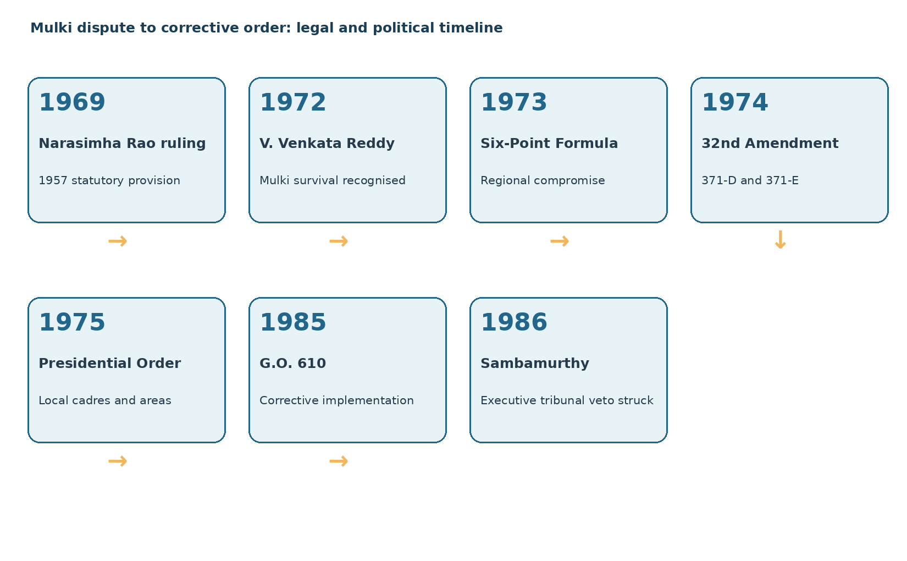
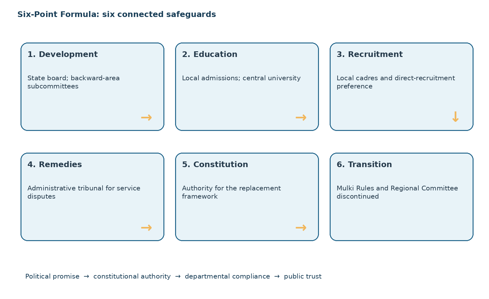
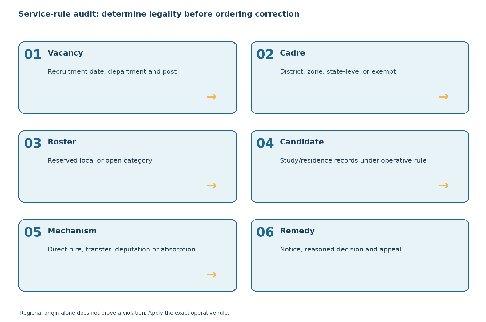

# Paper VI · Unit II · Topic 1 — Mulki Judgments, Jai Andhra, the Six-Point Formula, Article 371-D and G.O. 610

**TGPSC Group I Mains | Telangana Movement and State Formation | Original English study manuscript | 25 October 2026 | Draft: independent academic review pending**

> **Syllabus authentication.** The commission-hosted 2022 Group-II Paper-IV syllabus directly indexed the following item: “Court Judgements on Mulki Rules- Jai Andhra Movement and its Consequences- Six Point Formula 1973, and its Provisions; Article 371-D, Presidential Order, 1975-Officers (Jayabharat Reddy) Committee Report- G.O. 610 (1985); its Provisions and Violation-Reaction and Representations of Telangana Employees.” This is corroboration of the topic wording, **not** direct authentication of the original Group-I Notification 02/2024, which was not retrievable in this run.

> **Question integrity.** All MCQs and mains prompts in this chapter are newly authored practice, not verified TGPSC previous-year questions. An official previous-year label requires the original question paper, examination year, and question number.

## Syllabus map

| Exact syllabus component | Study sections | What to demonstrate in mains |
|---|---|---|
| Court judgments on Mulki Rules | 1–6 | Distinguish constitutional competence, survival of pre-Constitution rules, and later remedies |
| Jai Andhra movement and consequences | 7–10 | Explain why the 1972 decision mobilised a counter-movement |
| Six-Point Formula 1973 | 11–15 | Explain six commitments and the transition from old safeguards |
| Article 371-D | 16–19 | Identify constitutional powers, tribunal and judicial review |
| Presidential Order 1975 | 20–23 | Apply local cadre, local area and local-candidate tests |
| Officers Committee and G.O. 610 | 24–29 | Trace findings, corrective orders and implementation gaps |
| Telangana employees' representations | 30–33 | Discuss evidence, unions, grievance pathways and administrative reform |
| Applied cases, revision and answer writing | Appendices | Analyse problems instead of reproducing slogans |

## 1. The constitutional problem: why employment safeguards became a federal crisis

A rule allocating government jobs by residence looks like an administrative technicality, but in post-1956 Andhra Pradesh it embodied a foundational political promise. Telangana had entered the enlarged state after decades under Hyderabad's administrative system. Public employment was an especially visible measure of whether residents of the former Hyderabad region retained access to opportunities for which they had prepared. The issue was not simply whether a candidate had a Telugu mother tongue; it was whether a legally defined local status, a specific cadre and a specific recruiting authority made an appointment lawful. Those questions became politically explosive because legal victories and perceived administrative non-compliance occurred alongside inequalities in educational access and influence over appointments.

The Constitution contains two relevant principles. Article 16 generally protects equality of opportunity in public employment. Article 16(3) reserves to **Parliament**, rather than a state legislature, the authority to prescribe residence requirements for classes of employment. Article 35(b) preserved certain pre-Constitution laws until altered or repealed by a competent legislature. Consequently, a state could not simply invent an unrestricted district-residence rule; yet a rule already in force under Hyderabad law might survive the constitutional transition. The Mulki litigation required courts to separate those propositions. A sound answer should identify the source and timing of a rule, not merely declare that “the Supreme Court supported locals.”

This controversy reveals a deeper federal-design problem. A protective rule may be constitutionally defensible but politically unpopular outside the protected region; an apparently uniform recruitment regime may be politically attractive but perceived as breaking merger safeguards. Courts determine validity and interpretation, not the distributional legitimacy of an entire state-building bargain. Political leaders therefore needed a new settlement that could both survive judicial scrutiny and persuade communities that recruitment would be administered fairly.

## 2. Mulki status: Hyderabad origin, scope and documentary proof

The Mulki Rules originated in the Hyderabad civil-service regime and were associated with a Nizam's Farman and the Hyderabad Civil Service Regulations. The familiar historical shorthand is that a Mulki was a local subject eligible under defined criteria, including birth, domicile or long residence in the former Hyderabad State. The legal meaning was not a modern identity label for everyone who called themselves a Telanganite. It was a category whose conditions and evidentiary rules had to be read from the regulation applicable to the appointment. Students should distinguish a Hyderabad-era certificate from the later Presidential Order's definition of a “local candidate” based substantially on periods of study or residence in specified local areas.

The geography also changed. Hyderabad State before 1956 was not identical to the Telangana region of Andhra Pradesh after merger. This matters because a rule originally designed for Hyderabad subjects could protect people from portions of the former state that were not part of the later Telangana area. The 1972 litigation raised questions about this continued scope. It is historically inaccurate to describe every beneficiary of the original Mulki definition as necessarily born in one of today's Telangana districts. Equally, it is wrong to assume that every person migrating to Hyderabad automatically qualified for a protected job.

An employment-file audit must ask: What was the date of the vacancy? Which department and cadre recruited? What definition applied? Was the candidate appointed through direct recruitment, transfer, promotion or regularisation? What evidence of local status existed at the relevant time? A historian's claim of discrimination is strengthened by such records, whereas a bare assertion about surnames or place of birth proves little. This document-by-document approach is essential when evaluating later allegations under G.O. 610.

## 3. The 1957 Public Employment Act and the 1969 constitutional judgment

After the reorganisation of states, Parliament enacted the Public Employment (Requirement as to Residence) Act, 1957. The legislation attempted to address residence-based public employment questions arising from reorganisation, including provisions relating to Telangana. In **A.V.S. Narasimha Rao v. State of Andhra Pradesh**, decided on 28 March 1969, the Supreme Court held the relevant Telangana provision unconstitutional in the form considered. The legal point was not that local opportunity could never be protected. The difficulty concerned the constitutional authority and form of the residence requirement under Article 16(3), including whether Parliament could authorise a sub-state-area residence preference in the manner attempted.

The judgment destabilised expectations that employment safeguards would automatically follow from the 1956 settlement. It intensified demands for an administrative remedy, but the court left a separate question open: whether the older Mulki Rules continued under Article 35(b) despite changes in state boundaries and the 1957 Act. Students frequently conflate the 1969 ruling with the later 1972 judgment and therefore write that the Supreme Court “struck down Mulki Rules in 1969 and restored them in 1972.” That is a misleading compression. The two cases involved different legal instruments and questions.

For mains writing, state the legal issue, the holding, the unanswered question and the political consequence in that order. Also separate judicial holdings from protesters' interpretations. A judgment may trigger mobilisation because citizens believe it destroys a safeguard, even if the precise legal effect is narrower. That distinction explains why public controversy can intensify while litigation continues.

**Distinguish the legal questions.** A candidate who says that the 1969 judgment extinguished every Hyderabad-era Mulki rule has confused two different instruments. The 1969 case examined the Telangana residence provision in the 1957 parliamentary legislation, while the survival of the older rules required a separate constitutional-saving and repeal analysis. The October 1972 decision addressed that second question. For an answer, create a four-column matrix: challenged instrument, constitutional provision, actual holding, and unresolved issue. Do not describe the later ruling as simply reversing the first. A political reaction to a judgment can be broader than the judgment's precise legal effect. This explanatory distinction is supported by later case-law discussions already recorded in the source register; the signed 1969 judgment was not freshly retrieved in this cycle.

## 4. The October 1972 Mulki judgment: Director of Industries v. V. Venkata Reddy

In **Director of Industries and Commerce, Government of Andhra Pradesh v. V. Venkata Reddy**, decided on **3 October 1972**, the Supreme Court considered the survival of the Hyderabad Mulki Rules. The decision is reported as **[1973] 2 SCR 562**. The Court held, in substance, that the rules had not ceased to operate merely because of the Constitution, the States Reorganisation Act, or the 1957 residence legislation. Their continued operation followed the constitutional saving of pre-existing law and the statutory context considered by the Court. This was a legally distinct holding from the 1969 case.

The decision mattered in two opposing ways. For Telangana employees and safeguard advocates, it provided judicial support for a longstanding claim that the historical service rules still had force. For many residents of coastal Andhra and Rayalaseema, it raised fears that recruitment and career prospects in Hyderabad and parts of the enlarged state would be constrained by an inherited local-status regime. The court had not ordered the creation of two states; it had answered a legal question about the continued validity of service rules. Political movements transformed that answer into competing visions of a fair state.

The **date distinction** is important: the judgment was delivered in 1972, although its Supreme Court Reports citation is from 1973. An exam answer that calls it a “1973 Supreme Court judgment” without qualification risks confusion with subsequent political settlements. Explain the difference between date of decision, reporting year and date of implementation. A historical timeline should place the October 1972 judgment before the subsequent Jai Andhra agitation and before the September 1973 Six-Point Formula.

## 5. The limits of court judgments in resolving a regional bargain

A court can determine whether a regulation survives constitutional and statutory changes; it cannot by that act guarantee administrative enforcement, equitable educational preparation or political trust. The Mulki decisions exposed this difference. A judgment in favour of the legal survival of rules did not identify every appointment that should be reversed. Nor did it automatically resolve whether employees hired under different understandings of the law deserved protection. Implementing legal doctrine across thousands of service files required classification, notices, appeals and a credible grievance mechanism.

For Telangana claimants, repeated litigation could seem proof that safeguards lacked political commitment. For Andhra claimants, judicial recognition of inherited rules could seem to create unequal citizenship inside a state formed around a shared language. Neither perception should be substituted for the Court's actual holding. The constitutional system had to reconcile equality, transitional legal continuity and the promise of regionally equitable opportunity. The later Six-Point Formula was an attempt to replace contentious inherited protections with a new constitutionally authorised system of local cadres and educational preferences.

A useful analytical framework distinguishes four layers: **norm** (what the law promises), **jurisdiction** (who may legislate or decide), **administration** (how posts and candidates are classified), and **legitimacy** (whether affected citizens accept the bargain). The history becomes intelligible when these layers are kept separate. A mains answer that discusses only agitations, or only constitutional articles, misses the mechanism connecting the two.

## 6. Legal chronology and common examination traps

The essential sequence is: Hyderabad-era Mulki regulations; 1956 state reorganisation; 1957 parliamentary residence legislation; the 1969 Supreme Court ruling on the later statutory provision; the **3 October 1972** Supreme Court ruling sustaining the older Mulki Rules; the Jai Andhra mobilisation; the **21 September 1973** Six-Point Formula; the Constitution (Thirty-second Amendment) Act, 1973, enacted in **May 1974** and brought into force in July 1974; and the **18 October 1975** Presidential public-employment order. This is a sequence of different kinds of acts, not a single continuous statute.

A second distinction concerns legal survival versus political repeal. The fact that a court recognised a rule's continuing force in October 1972 does not mean the rule could never subsequently be repealed by competent legislation. The later settlement explicitly contemplated replacing the older Mulki and Regional Committee mechanisms. A third distinction concerns local **candidate** and local **cadre**. A local cadre is an organised group of posts tied to a specified territory; a local candidate is a person meeting the recruitment rule's criteria. The concepts interact but are not interchangeable.

A fourth trap is assuming that Article 371-D was inserted in 1973 simply because the amendment bears that year. The amending Act received assent in 1974, and the operative commencement date was separately notified. A fifth trap is treating G.O. 610 as a constitutional amendment. It was a state government corrective order issued under the service-policy framework, not the legal instrument that inserted Article 371-D. Precise identification of instruments earns more marks than a memorised chain of dates without legal meaning.

*Existing original instructional diagram; concept labels visually inspected, archival certification pending.*

## 7. The Jai Andhra movement: origin, social base and demands

The **Jai Andhra movement** arose in 1972 as a major political mobilisation in the coastal Andhra and Rayalaseema regions. The October Mulki judgment became a focal point for opposition to perceived employment restrictions and to the terms of regional safeguards. The movement demanded a separate Andhra state in some of its prominent formulations. It drew support from students, employees, elected representatives and sections of the regional political leadership. As with Jai Telangana, its participants did not all share one motive or tactic; employment concerns, regional dignity, political competition and anxieties about Hyderabad's place in the state intersected.

The movement is sometimes described as simply “anti-Telangana.” That formulation is too crude for historical analysis. The direct political target was a state structure seen by participants as imposing unequal recruitment rules or political obligations. Nevertheless, the movement's programme and rhetoric could conflict sharply with Telangana demands for safeguarded employment. The same united state therefore faced two regionally grounded claims of unfairness. A balanced answer can acknowledge the legal legitimacy of Telangana's inherited-rule claim while explaining why the Court's ruling was politically unsettling elsewhere.

The crisis affected normal administration through protests, resignations and disruption. It forced the central leadership to seek a settlement acceptable across regions. For examinations, do not merge the **1969 Jai Telangana movement** and the **1972 Jai Andhra movement** into a single agitation; compare their origins, central grievances, geography and immediate triggers. Their interaction created the setting for the Six-Point Formula.

## 8. Political escalation, state governance and the search for a compromise

The Jai Andhra agitation developed in a political system already strained by the 1969 Telangana movement. Demonstrations and confrontations weakened the credibility of routine administrative responses. Regional leaders had to decide whether to pursue separation, enforce a uniform service system, or accept a new formula for jobs and development. Central intervention was important because the Constitution limited the state's ability to design residence-based employment rules unilaterally, and a durable settlement required constitutional and parliamentary action.

The question was not only which region would receive a given vacancy. There were broader concerns about student admissions, backward-area investment, promotion prospects and whether an independent grievance body could be trusted. A narrow repeal of Mulki rules might have addressed one Andhra demand while intensifying Telangana fears. Conversely, rigid application without a new political bargain risked prolonging unrest outside Telangana. The policy solution therefore had to combine local opportunity with regionally balanced development and a new administrative dispute-resolution mechanism.

The resulting compromise was not a referendum on statehood. It emerged through political negotiation under pressure and attempted to stabilise the existing state. Its success must be judged on two axes: whether it restored immediate order, and whether it produced sustained compliance over subsequent decades. A policy may achieve the first and fail the second. This distinction helps explain why G.O. 610 and later employee representations became necessary after the Six-Point Formula was announced.

## 9. Consequences of Jai Andhra: political and administrative dimensions

One immediate consequence was recognition that the earlier safeguards regime had become politically unworkable for a substantial section of the state's population. The movement contributed to a negotiated replacement of the old framework, including the end of Mulki Rules and the Telangana Regional Committee as the principal safeguard institutions. This should not be portrayed as a victory without costs for either region. The replacement formula promised wider local opportunities but altered the protections that Telangana leaders had previously demanded.

Administratively, the controversy exposed weaknesses in recruitment record-keeping and the difficulty of retrospectively determining local entitlement. The later local-cadre system was designed to make territorial allocation more explicit. Politically, the crisis strengthened the idea that national-level constitutional engineering could substitute for an unstable regional political bargain. But constitutional text could not, by itself, ensure that appointing authorities classified posts correctly or respected local preferences. Implementation therefore remained contested.

A long-term consequence was the creation of a new vocabulary of grievance. Instead of debating only Mulki certificates, employees increasingly discussed zones, cadres, Presidential Order exceptions, inter-zonal transfers and regularisation. Telangana organisations later alleged that the new system too had been circumvented. A mains answer should connect the 1972 movement to the 1973 compromise and then to the 1985 corrective order, while avoiding the deterministic claim that the 1972 agitation alone caused all later events.

## 10. Telangana and Andhra perspectives: a disciplined comparison

From a Telangana-safeguard perspective, the key concern was that formal state integration had not yielded equivalent access to government employment, education and public resources. The Mulki Rules were understood as a protective entitlement rooted in the terms of regional integration. Replacing them with a new system was acceptable only if local cadres, education preferences and grievance redress actually worked. Failure to implement these safeguards could be interpreted as repeated breach rather than a technical error.

From a Jai Andhra perspective, the inherited Mulki regime could appear anomalous in a unified linguistic state. Applicants outside the former Hyderabad region feared that access to important employment centres, including Hyderabad, would be constrained by rules they had not expected to endure indefinitely. They demanded a fairer state-wide settlement or separation. These viewpoints are not equivalent claims in every legal respect; the courts had recognised specific historical rules. They are competing political assessments of the same administrative structure.

The analytical question is what a constitutional democracy should do when region-specific transitional protections remain important to one population but appear exclusionary to another. The Six-Point Formula answered with locally structured opportunity and development planning. Whether that answer was adequate depends on empirical implementation: how many posts were correctly assigned, which exemptions were used, and how complaints were adjudicated. A candidate should avoid partisan labels and instead show how law, political bargaining and distributive justice interacted.

## 11. The Six-Point Formula: negotiation and chronology

On **21 September 1973**, leaders proposed the measures that became known as the **Six-Point Formula**. The official statement of objects and reasons for the Thirty-second Amendment records this date and explains the intention to promote balanced development and equitable opportunities in education and public employment. A Ministry of Home Affairs retrospective appendix also discusses political statements in September and October 1973. Where secondary notes give a different announcement date, prefer the dated constitutional legislative record and distinguish a proposal, endorsement and later implementation.

The formula was a political package, not itself a complete statute. Its clauses required different institutions to act: development planning machinery, universities and education authorities, state recruiting agencies, a tribunal, Parliament and the President. This division matters because political agreement can be reached in a day while legal instruments and operational rules take months or years. The 1974 constitutional amendment and 1975 Presidential Order were separate implementation stages.

The bargain addressed both Telangana's need for credible local opportunity and the other regions' objections to older safeguards. Its guiding language was “equitable opportunities” rather than the preservation of the exact pre-1956 employment system. The formula also proposed that the older Mulki Rules and Telangana Regional Committee would no longer be necessary. A high-scoring answer identifies this trade-off explicitly: **old safeguards surrendered in exchange for constitutionally authorised new safeguards**.

## 12. Six points, explained as a policy architecture

**Point 1 — Backward-area development.** A state-level planning board and subcommittees for backward regions would focus attention on regional disparities. The problem was not only a lack of funds but also the absence of visible institutions tracking allocation and outcomes. **Point 2 — Education.** Preference for local candidates in educational admissions and a central university at Hyderabad would address unequal access to qualifications that shaped later employment competition. These measures complemented rather than duplicated job reservations.

**Point 3 — Employment.** Specified local preferences in direct recruitment and organisation of local cadres would replace the contentious inherited Mulki approach with a new territorial service structure. **Point 4 — Grievance redress.** An administrative tribunal would hear defined service disputes, offering an institutional remedy when recruitment or seniority decisions were challenged. **Point 5 — Constitutional change.** The Constitution would be amended to give the package a secure legal foundation rather than relying solely on ordinary executive instructions. **Point 6 — Discontinuance of older safeguards.** Mulki Rules and the Telangana Regional Committee were regarded as unnecessary once the replacement arrangement functioned.

The six points are best remembered as a causal chain: **development → education → recruitment → remedies → constitutional authority → replacement of older institutions**. The final point is controversial because it assumes successful implementation of the earlier points. Telangana critics later argued that giving up older protections before securing effective compliance made the bargain vulnerable. Defenders argued that the new formula was more comprehensive and constitutionally workable. Both views should be evaluated against administrative evidence.

**Test the six promises through different evidence.** A development commitment needs project allocations and completed outputs; an education commitment needs admission rules and institution-building evidence. Recruitment safeguards need notified local cadres, correct vacancy rosters and eligibility records. A tribunal promise needs an enforceable decision, while a constitutional amendment must be distinguished from the political statement that preceded it. The final promise to discontinue Mulki Rules and the Regional Committee must be evaluated against the performance of the replacement arrangements. The Six-Point Formula statement of 21 September 1973 and the leaders' clarifications of 22 October 1973 are distinct sources. Do not attribute a detailed implementation procedure to the earlier statement without checking it. The resulting analytical chain is political bargain, enabling amendment, Presidential Order, departmental implementation, and later corrective review. Each stage may succeed or fail independently.

*Existing original instructional diagram; concept labels visually inspected, archival certification pending.*

## 13. Development planning and the meaning of regional equity

A development board can be a symbol or a real fiscal instrument. For the Six-Point Formula to reduce disparity, the board and regional subcommittees would need reliable regional statistics, authority to review projects, transparent criteria for backwardness and an ability to follow up on spending. Equal nominal allocations do not necessarily mean equitable opportunity. A region with a large backlog in irrigation, schools or hospitals may need more investment per person for a period to achieve comparable outcomes. Conversely, investment in a major city can benefit multiple regions, complicating simple geographic accounting.

In Telangana's case, employment grievances were linked to broader concerns about educational access, irrigation and industrial development. If a district had fewer colleges, its candidates could be disadvantaged in competitive recruitment even when formal rules appeared neutral. Education preference without improving school quality might help some applicants but leave deeper structural inequality intact. Development planning was therefore not a decorative addition to the employment settlement; it addressed conditions that generated unequal competition.

A rigorous evaluation should use district-level baselines, budget estimates versus actual expenditure, project completion dates and changes in outcomes. Beware of using post-2014 Telangana district boundaries to describe the 1970s without conversion. Also distinguish Hyderabad metropolitan growth from development in rural Telangana. A mains answer should connect local-cadre rules to human-capital development and explain why one cannot substitute for the other.

## 14. Education safeguards and the Central University commitment

Education was central to the compromise because access to state jobs depends on qualifications and examination preparation. Local preferences in admissions were intended to prevent students from disadvantaged areas being crowded out of institutions in their own region. The formula also contemplated establishing a Central University at Hyderabad, later given a constitutional enabling provision through Article 371-E. This did not mean every university seat or every course was reserved by a single uniform rule. The applicable admission framework depended on the institution, programme and legal instrument.

The policy challenge is balancing regional access with merit-based selection, mobility and institutional quality. A local preference may improve representation but cannot compensate fully for poor schools, language disadvantages or lack of affordable coaching. It can also create boundary disputes for students who move across districts or attend school away from their family residence. Clear definitions of “local candidate” and transparent certification procedures are therefore essential.

The distinction between **Article 371-D** and **Article 371-E** is exam-worthy. Article 371-D authorises special arrangements for equitable opportunities in public employment and education; Article 371-E empowers Parliament to establish a Central University in the state. They were inserted through the same constitutional amendment but perform different legal functions. Treating Article 371-E as a direct recruitment-reservation clause is incorrect. In a mains answer, explain how the education and employment components were complementary parts of a regional-equality strategy.

## 15. The formula's limitations and contested political legitimacy

The Six-Point Formula reduced immediate political confrontation, but its success depended on enforcement by the same broad administrative machinery whose earlier performance had generated distrust. It replaced a relatively familiar historical local-status framework with complex zones, cadres, exceptions and certification tests. Complexity can be necessary for fairness, yet it can also conceal departures from the rules. The risk was greatest where appointing authorities controlled the classification of a post and the evidence used to justify an exception.

Another limitation was that development commitments were harder to litigate than a clearly defined appointment rule. A court could determine whether a candidate met a local-area criterion; it was harder to determine whether a region had received a fair share of long-term investment. Thus the package contained both justiciable service rights and politically monitored development promises. The two did not have identical enforcement strength.

The discontinuance of the Telangana Regional Committee also reduced a region-specific political forum that had previously been presented as a safeguard. Defenders considered the new planning and tribunal institutions adequate substitutes; critics argued that the replacement was more technocratic and less politically accountable. The later creation of committees and G.O. 610 indicates that implementation concerns did not disappear. A balanced conclusion is that the formula was an important constitutional innovation but not a self-executing guarantee of distributive justice.

## 16. The Thirty-second Constitutional Amendment: why it mattered

The **Constitution (Thirty-second Amendment) Act, 1973** received assent on **3 May 1974** and was brought into force on **1 July 1974**. It inserted Articles **371-D and 371-E**, altered Article 371 and made related changes. The official statement of objects and reasons directly connects the amendment to the September 1973 Six-Point Formula, backward-area development and equitable educational and public-employment opportunities. The title's year identifies the amending legislation; the dates of assent and commencement must be stated separately.

The amendment created constitutional authority for a President's order organising local cadres and specifying local areas, preferences and reservations. It also provided for a service tribunal and validated certain historical appointments against residence-law challenges. This was not merely an administrative circular. The constitutional foundation mattered because ordinary state action would otherwise face the allocation of power under Article 16(3) and Article 35.

The amendment's validation provision illustrates the settlement's compromise character. It sought to avoid destabilising large numbers of prior appointments while enabling a forward-looking system. Critics might see validation as protecting appointments made under disputed conditions; administrators might regard it as necessary to prevent a collapse of services and endless litigation. The correct legal analysis is to identify the provision's defined temporal scope, not to infer that every later irregular appointment was automatically validated.

## 17. Article 371-D: local cadres, local areas and recruitment preferences

Article **371-D(1)** empowers the President to provide equitable opportunities and facilities for people from different parts of Andhra Pradesh in public employment and education. Clause **(2)** allows orders requiring organisation of posts into local cadres, specifying local areas for recruitment and educational admissions, and defining the extent and conditions of preference or reservation for local candidates. These powers are tailored; the constitutional text does not itself list every district or every recruitment percentage.

A **local cadre** is an organised set of posts attached to a defined territorial unit and service category. A **local area** is the geographic unit used to assess recruitment or admission eligibility. A **local candidate** is someone satisfying the relevant study/residence criteria under the order. These three concepts must be applied in sequence. For example, a candidate who studied in Warangal may be local for a particular zonal recruitment but not necessarily for every district-level post elsewhere. The category of the vacancy and the operative order decide the answer.

The constitutional provision also permits different arrangements for different parts of the state. This is a departure from the idea that formal uniformity alone guarantees fairness. However, it requires clear administration: posts must be correctly organised, recruitment notices must state the applicable local area, and records must support local status. If the cadre itself is wrongly classified, an otherwise careful local-candidate test may still yield an invalid appointment.

## 18. Article 371-D's tribunal and the rule-of-law problem

Article **371-D(3)** authorised a tribunal for specified public-service disputes, including appointment, allotment, promotion, seniority and service conditions. The policy rationale was to offer a dedicated institution for grievances generated by the new cadre system. But creating a tribunal is not enough: its decisions must be independent and enforceable. An executive authority cannot credibly serve as both a litigating party and the final judge of a dispute it has lost.

That problem was examined in **P. Sambamurthy v. State of Andhra Pradesh**, decided by the Supreme Court on **20 December 1986** and reported in **1987**. The Court struck down Article 371-D(5), including the proviso allowing the state government to modify or annul tribunal decisions, because such executive override undermined effective judicial review and the rule of law. The case is especially valuable for mains because it connects Telangana's service-law history with the **basic structure doctrine**.

Do not write that the Supreme Court invalidated Article 371-D in its entirety. The decision targeted the constitutionally objectionable executive-veto mechanism; the broader framework for local opportunities remained. Nor should one assume that a specialised tribunal automatically violates judicial independence. The Court's concern was whether the alternative remedy was sufficiently effective and protected from unilateral interference by a party to the dispute. This nuance differentiates a strong constitutional answer from an inaccurate slogan.

## 19. The administrative meaning of judicial review

Service disputes are often decided years after an appointment, when a worker has built a career and other candidates have lost opportunities. Effective review therefore needs timely access to records, a neutral decision-maker, interim protection where justified, and enforceable final orders. Article 371-D's tribunal scheme attempted to provide specialised adjudication, but the executive-veto provision undermined trust. The Sambamurthy judgment is a reminder that a rights-protecting institution cannot function if its adverse decisions may be nullified by the very government it is meant to scrutinise.

There is a second problem: legal remedies are often individual while recruitment irregularities are systemic. A candidate may challenge one appointment, yet a department may have repeatedly misclassified posts or invoked exceptions. Correcting the system requires periodic audits, not only litigation. Likewise, employees whose appointments are questioned deserve procedural fairness, access to documents and reasoned decisions. A corrective order should avoid treating a broad demographic label as conclusive proof of an individual's ineligibility.

A practical reform framework would publish cadre rosters, vacancy notifications, local-status verification protocols, exception registers, reasoned transfer orders and appeal outcomes. Historical administrators lacked today's digital systems, but the principles are the same. This is why employee unions later demanded not only a legal promise but also disclosure of appointment data and an implementation timetable. Judicial review protects the legality of individual decisions; transparent administration reduces the need for repeated review.

## 20. The Presidential Order of 18 October 1975: legal identity

The key instrument was the **Andhra Pradesh Public Employment (Organisation of Local Cadres and Regulation of Direct Recruitment) Order, 1975**, issued by the President as **G.S.R. 524(E) on 18 October 1975** under Article 371-D. It was republished by the Andhra Pradesh government through **G.O. Ms. No. 674, dated 20 October 1975**. These are two dates for two related documents, not conflicting versions of the same event. A government-hosted retrospective appendix indexes both, although the complete original gazette was not independently downloaded during this run.

The order provided definitions, the organisation of local cadres, allotment principles, local areas, local-candidate tests and recruitment preferences. Its territorial architecture involved districts, zones and special treatment of specified establishments. The exact treatment of a post depended on the relevant paragraph and schedule, including amendments over time. It is therefore inaccurate to apply a single reservation percentage or a single four-year study test to every category of job without checking the operative text.

The order sought to translate the Six-Point Formula into an administrable recruitment system. It also generated new compliance risks: posts could be kept outside a local cadre, a transfer could be disguised as a different kind of appointment, or a local certificate could be assessed using the wrong geographic unit. The legal design is best understood as a set of conditional rules, not as a general prohibition on people from one region working in another.

**Source-critical document identification.** The President's G.S.R. 524(E) dated 18 October 1975 and Andhra Pradesh G.O. Ms. No. 674 dated 20 October 1975 are different instruments in one publication sequence. The Ministry of Home Affairs' indexed Srikrishna Committee appendix reproduces those October dates, yet an indexed appendix heading also contains the inconsistent date 20-02-1975. That discrepancy is not evidence of a February Presidential Order: cite the date in the operative reproduced text, and flag the anomalous heading rather than silently correcting it. Direct retrieval of the government-hosted appendix PDF returned HTTP 404 in this cycle, so only the indexed reproduction was inspected, not the signed Gazette. Subsequent amendments must be identified by date; modern recruitment rules cannot be projected backwards into the 1975 text. A source register should separate the issuing authority, republication, later commentary and actual document-access level.

## 21. District cadres, zones and Hyderabad's special position

The Presidential Order's architecture allocated categories of posts to district or zonal local cadres, with particular provisions for Hyderabad and specified state-level institutions. The historical six-zone arrangement included **Zones V and VI** in Telangana; the districts in those zones should be described using the historical boundaries, not the current Telangana district map. Hyderabad's position was administratively complex because the city contained state-level offices, educational institutions and employment markets serving people from multiple regions.

For examination purposes, do not mechanically say “all Hyderabad jobs were reserved for Telangana residents.” Whether a post was covered by a district cadre, zonal cadre, state-level office or exempt institution could alter the legal analysis. Similarly, a non-local candidate could sometimes compete for the unreserved portion of posts; a local preference was not necessarily an absolute ban on all other candidates. A proper answer should distinguish local preference from total exclusion.

This architecture created incentives for classification disputes. An appointing authority might argue that a particular post belonged to a statewide institution; employees might argue that its actual functions and recruitment history showed it should be a local cadre post. Such disputes cannot be resolved by political labels alone. One must inspect the notification, cadre order, department structure, relevant schedules and amendments. This is precisely why later committees investigated anomalies in the operation of the Presidential Order.

**Hyderabad classification counterexample.** The Ministry of Home Affairs' indexed Srikrishna Committee report discusses, in paragraph 5.31.07, an exemption concerning certain Hyderabad city police posts under paragraph 14(f) of the Presidential Order. This later controversy illustrates why neither all Hyderabad jobs are local nor all capital jobs are statewide is a defensible shortcut. First identify the post category and operative notification; then identify the cadre, roster and legally applicable exception. A district-cadre post and a properly exempt state-level post can coexist in the same city. This is a limited example, not evidence about every department or every appointment in the 1970s. The indexed government paragraph was accessible through search, but the complete report PDF was not directly reopened. Treat this as bounded corroboration and require the operative instrument before drawing an individual legal conclusion.

## 22. Local candidate: study, residence and the evidence test

A candidate's local status under the 1975 order depended on specified periods of study or residence in a defined local area, with rules for cases where a person had not studied in a recognised institution. The legally relevant period and the local area must be identified from the order applicable to the particular recruitment. A person who moved across districts might have a different status for a district-level post than for a zonal post. Family origin alone is not a substitute for the documentary test.

The practical process begins with the recruitment notification. Identify the cadre and local area, then examine the candidate's study certificates or residence documents for the prescribed period. Next determine whether the vacancy belongs to the local-reserved or open category and whether any exception applies. Finally verify that the appointing authority used the correct roster and that the appointment type falls within the order's coverage. An applicant's self-description as a “local” or “non-local” is not a legal finding.

This method also protects candidates from arbitrary discrimination. A person who legally qualifies as local should not be rejected because of surname, language accent or parental birthplace. Conversely, an official should not waive documentary requirements for a favoured candidate. Historical debates about Telangana employment were about institutions and rules, not a licence for ethnic profiling. Mains answers should make that distinction explicit when discussing corrective transfers under G.O. 610.

**Worked hypothetical: split study history.** Imagine an applicant with two years of study in District X and two years in District Y. Birthplace, surname and parental origin do not decide eligibility. The recruiting authority must identify whether the advertised post is district, zonal or exempt; identify the local area in the applicable order; determine the prescribed period and relevant study or residence fallback; and examine the certificates. A candidate may fail one district test but satisfy a properly defined zonal test, depending on the exact rule. The vacancy must then be classified as locally reserved or open, and any exception documented. This example deliberately does not assert a universal four-year test for every historical category. The audit file should preserve the post notification, candidate records, roster position, rule version and reasoned decision. This is a teaching example, not an adjudication of a real applicant.

## 23. Common routes of violation: cadre design, transfers and exemptions

A Presidential Order can be violated without a visibly false local certificate. One route is **misclassification**: treating posts that should be in a district or zonal cadre as if they were statewide. A second is **improper transfer**: moving personnel across local cadres contrary to the order's limits. A third is **irregular deputation or absorption**, where a temporary placement becomes a permanent arrangement without satisfying recruitment conditions. A fourth is **misuse of exceptions**, invoking special-office or project categories beyond their proper scope. A fifth is **faulty seniority or promotion handling** that defeats the order's underlying local-cadre structure.

Not every inter-zonal transfer or statewide appointment is automatically unlawful. Some may be authorised by the order or subsequent lawful amendments. The correct audit question is whether the **specific** act was permitted under the rule then in force. This is also why retrospective claims about tens of thousands of “illegal employees” must be treated carefully. A count of employees born outside a region is not identical to a count of appointments violating a specified provision.

A good audit distinguishes **person-level local status**, **post-level cadre classification**, **appointment mechanism**, **date of recruitment**, and **applicable exemption**. It should preserve the rights of employees who were recruited in good faith while ensuring corrective remedies for excluded local candidates. G.O. 610 arose from concern that this technical compliance structure had not been followed consistently; its implementation required exactly the kind of detailed file analysis that political slogans could not supply.

**Three cases, three possible outcomes.** A non-local candidate appointed to a lawfully open vacancy is not automatically an illegal recruit. A transfer between cadres might be authorised by a specified exception and requires its own order. Permanent absorption after deputation may require separate scrutiny of the approval and appointment mechanism. The employees' places of origin could be identical, yet the legal findings differ. A defensible audit begins with department, post, cadre, recruitment date, roster, candidate evidence and operative exception, not a predetermined number of employees to remove. Classify cases as compliant, irregular or insufficient evidence; then provide notice and a review route before correction. This explains why a reported aggregate of questionable appointments cannot simply be equated with a certified count of unlawful employees. G.O. 610 implementation depended on this case-level evidentiary work.

## 24. The Officers Committee under K. Jayabharat Reddy

During the 1980s, Telangana employees and their organisations raised complaints that the Six-Point Formula and Presidential Order were being circumvented. The Andhra Pradesh government constituted an **Officers Committee**, commonly associated with former Chief Secretary **K. Jayabharat Reddy**, to investigate anomalies in local-cadre organisation and recruitment. The committee is generally dated to **1984–1985** in retrospective accounts. It examined patterns of appointment and transfer and made recommendations for correction. The report is often referred to by the chair's name rather than by a formal commission title.

The committee's importance is institutional. It moved the dispute from general claims of discrimination to categories of administrative irregularity: improper postings, transfers, and appointments in cadres intended to provide local opportunity. The historical record frequently cites a figure of approximately **58,962** or **59,000** in discussion of affected employees. This chapter does **not** present that figure as an independently audited number of unlawful appointments, because the complete original committee tables and counting method were not directly inspected. It is a retrospective reported estimate requiring qualification.

Students should distinguish the committee's identification of anomalies from the later government's power to implement remedies. A fact-finding committee can recommend corrective transfers and procedural changes, but implementation requires orders, departmental action and safeguards for affected employees. The later appointment of a review process associated with **V. Sundaresan** and issuance of G.O. 610 reflected the need to turn findings into executable administrative instructions.

## 25. G.O. Ms. No. 610, 30 December 1985: purpose and scope

**G.O. Ms. No. 610**, issued on **30 December 1985**, became the best-known corrective order concerning implementation of the Presidential Order in Telangana. Its objective was to rectify irregularities involving local cadres, appointments and transfers that had accumulated after 1975. The government sought to address complaints from Telangana non-gazetted employees and restore confidence in the service safeguards. Accounts of the order often mention a target of **31 March 1986** for specified corrective actions; the original signed order was not independently retrieved in this run, so precise clause-by-clause deadlines should be checked against an authenticated copy before being treated as authoritative.

The order was not a new constitutional article, nor did it restore the Hyderabad-era Mulki Rules. It operated within the Article 371-D and 1975 Presidential Order framework. Its central idea was to identify appointments and transfers inconsistent with the local-cadre scheme, return or adjust employees where legally required, and prevent recurrence. A careful answer distinguishes **corrective action** from **punitive dismissal**: rectification can involve repatriation to an appropriate cadre, redeployment or other lawful administrative steps, subject to service rights and due process.

Why did an order become a political symbol? Because a written remedy offers a concrete benchmark against which later performance can be judged. Telangana employees could ask whether departments had supplied lists, completed scrutiny, issued transfers and filled vacancies according to the rules. Delays and exceptions then became evidence in a wider argument about institutional credibility. This made G.O. 610 important long after its issuance.

## 26. G.O. 610 provisions: a compliance framework rather than a slogan

The order's reported operative concerns included identifying personnel appointed or posted contrary to the Presidential Order, correcting inter-zonal irregularities, regulating local-cadre transfers, and addressing disputed arrangements in Hyderabad and other departments. Subsequent implementation discussions emphasised reviewing exceptions, staffing patterns and departmental compliance. The **exact numbered clauses** of G.O. 610 should not be reconstructed from memory or coaching notes as if they were the signed government order. A source audit should obtain the original General Administration Department order and its annexures.

For an exam answer, explain the policy functions: **(1) identification** of questionable appointments; **(2) classification** of each post and candidate under the relevant cadre rules; **(3) lawful correction** of appointments or transfers; **(4) protection of procedural rights**; **(5) monitoring and reporting** to prevent recurrence. These are analytical categories, not a claim that the order contained exactly five clauses. A common weak answer lists a fixed number of provisions without verifying the text and concludes that the government “did nothing.” That substitutes certainty for evidence.

The implementation problem is concrete. If an officer is transferred into a Telangana zonal cadre, an audit must identify the transfer order, statutory authority, employee's original cadre, post category and any permissible exemption. If an appointment is irregular, the remedy must respect existing service-law protections and determine how to fill the vacancy correctly. A G.O. is effective only when these administrative actions occur.

## 27. Violations after G.O. 610: what can be proved and what remains disputed

Later Telangana mobilisation repeatedly cited non-implementation of G.O. 610. Allegations included continued irregular inter-zonal transfers, failure to identify all non-compliant appointments, inconsistent treatment of statewide offices and slow execution of corrective decisions. Some departments may have complied with parts of the order while others delayed or contested applicability. A historically defensible answer should not assume identical performance across every department and decade.

Evidence can be organised into four grades. **Grade A** comprises authenticated appointment orders, cadre registers, court judgments and signed government instructions. **Grade B** comprises official committee findings with disclosed methods. **Grade C** comprises contemporary press accounts and employee-union representations. **Grade D** comprises retrospective political claims without a traceable underlying record. These categories do not mean unions are unreliable; they mean their claims need the appropriate corroboration before a numerical finding is asserted as settled fact.

The critical distinction is between an employee from another region and an **appointment contrary to the rule**. Some non-local appointments were legally permissible, including in unreserved portions or authorised exceptions. Counting every non-local employee as a violation is incorrect. Equally, asserting that the existence of an exception proves compliance is insufficient; the exception must be applicable and documented. This balanced approach is particularly important for mains answers on the consequences of G.O. 610 and the growth of regional distrust.

## 28. Telangana employee unions and their representations

The **Telangana Non-Gazetted Officers (TNGOs)** and other employee organisations were important because they possessed institutional knowledge that student and party movements often lacked. Employees knew where vacancies were advertised, how cadres were organised, which transfers had occurred and how promotions affected career paths. Their memoranda and representations converted a broad political grievance into requests for departmental lists, rule clarification, local-status scrutiny and corrective action. They also linked administrative complaints to the wider Telangana identity debate.

A representation is not merely a protest slogan. An effective submission identifies the rule, the disputed appointment or category, the documentary evidence, the relief sought and the competent authority. Employee groups could seek inquiries, meetings with ministers, implementation timetables, publication of compliance data and independent review. Their advocacy helped keep the issue alive after immediate street mobilisation declined. Yet union statements can also reflect membership interests and should be evaluated alongside official records and affected employees' rights.

For Telangana's political history, the key lesson is that employee associations provided **continuity** between major movement phases. The language of zones, cadres and G.O. 610 later informed broader mobilisation for statehood. A good answer names the organisations and explains their methods rather than saying vaguely that “employees participated.” It should also distinguish the 1980s representations from later reviews, such as the Girglani inquiry of the early 2000s, which belongs to a subsequent phase of the movement.

## 29. Hyderabad, state-level offices and the classification controversy

Hyderabad was the most sensitive administrative location because it combined the state capital's secretariat and statewide departments with local service posts and institutions serving Telangana residents. Some jobs were organised into local cadres; others could fall under legally defined statewide or special categories. The distinction created incentives for controversy. An employee organisation might claim that an office had been labelled statewide merely to avoid local recruitment obligations; the department might argue that its jurisdiction genuinely extended across Andhra Pradesh.

The correct approach is not to decide by geography alone. A building's location in Hyderabad does not automatically determine the cadre of every post inside it. One must inspect the function of the institution, the Presidential Order's definitions, notifications declaring statewide establishments and subsequent lawful amendments. Conversely, a state-level label cannot be assumed valid simply because an administrative file uses it. A sound audit checks the authority and date of classification.

This issue also illustrates the difference between **regional representation** and **legal eligibility**. A department might have a low proportion of Telangana-origin employees without necessarily violating a recruitment rule if its posts were lawfully statewide; a district office could have a high proportion of locals yet still make one illegal appointment. Both distributional patterns and individual legality matter, but they answer different questions. Mains essays should keep them separate and propose transparency measures that address both.

**Office location is not a legal classification.** Two employees in the same Hyderabad building can occupy posts governed by different recruitment rules. One may serve a territorially defined local cadre; another may hold a properly notified statewide or exempt post. Examine the creating order, functions, territorial jurisdiction, cadre schedule, exception notification and appointment date. An administrative label on stationery is not sufficient proof of exemption, but the employee's home district is not proof of violation either. The indexed official Srikrishna Committee discussion of Hyderabad police posts provides a narrow example of the distinction; it does not resolve all Hyderabad office disputes. A strong mains answer separates the legality of an individual appointment from the aggregate regional composition of a department and from broader perceptions of equitable opportunity. Those are different questions requiring different evidence and remedies.

## 30. A worked administrative audit: from allegation to finding

Imagine a 1982 recruitment to a post in a Warangal-linked zonal cadre. An employee union alleges that a candidate from another zone was appointed in a position reserved for locals. An investigator should first locate the recruitment notification and identify the exact cadre, roster point and applicable Presidential Order paragraph. Next obtain the candidate's study/residence evidence and determine local status under the rule operative in 1982. Then inspect whether the post belonged to a reserved or open category, whether an authorised exemption applied, and whether the appointment was direct recruitment or a transfer.

Suppose the file shows a zonal reserved vacancy, no valid local qualification and no authorised exemption. That supports a prima facie irregularity, but the employee should receive notice and an opportunity to respond before a final order. A remedy may involve lawful repatriation or other adjustment, rather than summary dismissal. Now change one fact: the vacancy was in the unreserved portion. The same employee's regional origin alone no longer proves violation. Change another fact: the post was validly declared statewide. The relevant legal test changes again.

This example demonstrates why aggregate accusations are insufficient. A defensible finding is a chain of **document → rule → classification → application → remedy**. It also explains why corrective orders take time: each file may raise different facts and service rights. The same audit logic can be used in present-day public administration, though contemporary rules must not be confused with the 1975 historical framework.

*Existing original instructional diagram; concept labels visually inspected, archival certification pending.*

## 31. The later Girglani inquiry and continuity of the grievance

The **J.M. Girglani** inquiry was constituted in the early 2000s to examine implementation problems concerning the Six-Point Formula and G.O. 610. It falls outside the core **1971–1990** syllabus period but is important as evidence of the long life of the grievance. The fact that further inquiry was considered necessary does not prove that every earlier allegation was correct; it shows that government and employees continued to dispute the adequacy of compliance and remedies. The inquiry should therefore be presented as a later review, not as an institution created by the 1985 G.O. itself.

The recurring cycle was: a protective bargain, administrative complaints, an inquiry, a corrective order, implementation disputes and renewed mobilisation. This pattern helps explain why service-law technicalities became symbols of regional identity and statehood. It also demonstrates a general weakness in governance: corrective orders without transparent monitoring can multiply rather than settle disputes. Repeated inquiries may collect valuable evidence, but their legitimacy depends on whether recommendations lead to verifiable changes.

For a balanced conclusion, recognise the administrative complexity of retroactive corrections while demanding accountability. A government can protect employee due process and still disclose the number of files examined, categories of violation, action taken and unresolved appeals. Such transparency would have allowed citizens to evaluate implementation on evidence rather than on competing claims. This is the principal governance lesson of the Mulki–G.O. 610 sequence.

## 32. Interpretive debates: unity, equality and asymmetric safeguards

The history raises a constitutional dilemma: should a linguistically unified state apply identical recruitment rules everywhere, or may it give different opportunities to regions with different historical disadvantages? Formal equality treats applicants alike; substantive equality considers unequal starting positions. Article 371-D represents a constitutionally authorised response to the latter concern, but its legitimacy depends on clarity, proportionality and implementation. The aim is not perpetual exclusion of outsiders; it is credible access for residents of different areas within a common political framework.

A second debate concerns federal political trust. The 1956 settlement relied on safeguards; the 1973 settlement replaced them with a different architecture. If the second arrangement is perceived as violated, citizens may question not merely an individual appointment but the reliability of state institutions. This is why the employee movement had implications beyond the service sector. A third debate concerns judicial and executive roles. Courts can correct unlawful decisions, but systematic compliance requires administrative discipline and political accountability. The Sambamurthy judgment sharply illustrates the need for an independent reviewer.

A strong mains answer avoids claiming that one region was uniformly victim or beneficiary across all sectors and decades. It asks which law applied, which institution controlled the decision, what evidence supports the grievance and how a remedy affects other rights. The history is most useful when treated as an institutional case study in constitutional accommodation and the limits of negotiated safeguards.

## 33. Synthesis: from the Mulki decision to a new vocabulary of Telangana mobilisation

The October 1972 Mulki judgment recognised the survival of Hyderabad-era rules; the Jai Andhra movement challenged the resulting political arrangement; the Six-Point Formula proposed a new bargain; the Thirty-second Amendment supplied constitutional authority; the 1975 Presidential Order created local cadres and recruitment rules; the Jayabharat Reddy Officers Committee identified implementation concerns; and G.O. 610 attempted administrative correction. These were distinct responses to related questions of regional fairness. Their sequence is more informative than any single event considered in isolation.

The central paradox is that a settlement designed to end regional conflict became the basis for new grievances when its implementation was contested. Local cadres were meant to clarify opportunity, yet classification and transfer disputes persisted. Tribunals were meant to supply remedies, yet executive interference required constitutional correction. Government orders promised rectification, yet employees continued to seek evidence of compliance. The lesson is not that safeguards are futile; it is that **safeguards must be legally clear, independently reviewable and administratively measurable**.

For TGPSC mains, conclude with a precise distinction: the historical issue was neither simply an identity dispute nor simply a technical recruitment dispute. It was the interaction of law, state reorganisation, regional opportunity and political trust. An answer that identifies the legal instruments, explains the competing regional perspectives and proposes document-based compliance oversight will be stronger than a chronology of slogans.

## Comparative table: instruments that must not be confused

| Instrument or event | Date | Legal or political character | Main consequence |
|---|---|---|---|
| Mulki Rules | Hyderabad-era, before 1956 | Pre-Constitution service rules | Historical local-status eligibility |
| A.V.S. Narasimha Rao decision | 28 March 1969 | Supreme Court judgment | Relevant 1957 Act provision invalidated; older-rule survival left open |
| V. Venkata Reddy decision | 3 October 1972 | Supreme Court judgment | Survival of Mulki Rules recognised |
| Jai Andhra movement | 1972–73 | Regional political mobilisation | Demand for altered settlement or separation |
| Six-Point Formula | 21 September 1973 proposal | Political compromise | Development, education, employment and remedy package |
| Thirty-second Amendment | 1973 Act; May/July 1974 enactment/commencement | Constitutional amendment | Articles 371-D and 371-E |
| Presidential Order | 18 October 1975 | Order under Article 371-D | Local cadres, local areas and recruitment preferences |
| G.O. Ms. No. 674 | 20 October 1975 | State republication | Publishes the Presidential Order |
| Officers Committee | 1984–85 | Administrative inquiry | Reviews alleged implementation anomalies |
| G.O. Ms. No. 610 | 30 December 1985 | Corrective state order | Seeks to remedy service-rule irregularities |
| P. Sambamurthy decision | 20 December 1986 | Supreme Court judgment | Executive veto over tribunal decisions unconstitutional |

## Appendix A — Standalone quick revision

**The one-minute chain:** Hyderabad Mulki Rules → 1956 Andhra Pradesh → 1957 Public Employment Act → 1969 *Narasimha Rao* ruling on the statutory provision → **3 October 1972** *V. Venkata Reddy* ruling on survival of older rules → 1972 Jai Andhra agitation → **21 September 1973** Six-Point Formula → **3 May 1974** Thirty-second Amendment assent; **1 July 1974** commencement → **18 October 1975** Presidential Order → 1984–85 Officers Committee → **30 December 1985** G.O. 610 → **20 December 1986** *P. Sambamurthy* judgment.

**Six-Point Formula:** (1) backward-area planning board/subcommittees, (2) local educational preference and central university, (3) local preferences in direct recruitment and cadres, (4) service tribunal, (5) constitutional authority, (6) replacement of Mulki Rules and Regional Committee. The last point depends politically on implementation of the first five.

**Article distinctions:** 16(3) = Parliament's residence-rule competence; 35(b) = saving of certain existing laws; 371-D = equitable employment and education, local cadres, tribunal; 371-E = enabling provision for a Central University. **Order distinctions:** G.S.R. 524(E) is the Presidential Order dated 18 October 1975; G.O. Ms. No. 674 republishes it on 20 October; G.O. Ms. No. 610 of 1985 is a later corrective order, not a constitutional amendment.

**Legal distinctions:** 1969 statutory invalidation is not the same holding as the 1972 survival of Mulki Rules. The 1986 *Sambamurthy* decision did not invalidate all of Article 371-D; it invalidated the executive-veto arrangement over tribunal decisions. **Audit test:** vacancy date → cadre and local area → roster category → candidate's study/residence evidence → appointment type → exemption → notice and lawful remedy.

**Historical interpretation:** Telangana safeguards, Jai Andhra counter-mobilisation and Six-Point compromise represent competing visions of regional fairness. Avoid treating every non-local employee as illegally appointed. Avoid claiming that a reported committee estimate is an audited count without the original tables. Do not project modern Telangana district boundaries onto the six-zone map of 1975.

## Appendix B — Six original applied administrative cases

### Case 1. A non-local candidate appointed against an open roster point

A recruitment register shows that an applicant from coastal Andhra was appointed to an **unreserved** vacancy in a Telangana zonal cadre. A union memorandum describes the appointment as illegal solely because of the applicant's region. **Analysis:** Identify the exact order and roster first. Local reservation is not necessarily total exclusion of non-locals. If the post was lawfully open and all eligibility rules were met, regional origin alone does not establish illegality. A finding requires the vacancy category and operative recruitment rules, not only demographic data.

### Case 2. A zonal employee permanently absorbed after deputation

An employee originally allocated to a different zone is deputed to a Telangana office and later absorbed without a documented cadre-transfer authority. **Analysis:** Deputation, transfer and absorption have different legal consequences. Obtain original cadre records, deputation sanction, absorption order and applicable exemptions. If the Presidential Order restricted the absorption, the appointing authority must consider correction, but it must issue notice and a reasoned order. A broad instruction to “remove outsiders” is not a lawful substitute for an individual inquiry.

### Case 3. Hyderabad secretariat versus district office

Two employees work in Hyderabad. One holds a post in a properly notified statewide secretariat establishment; the other holds a district-cadre post in an office physically located in the city. **Analysis:** The physical address does not decide the legal classification. Inspect the establishment notification and cadre organisation order. The two employees may be governed by different local-area tests. A correct answer identifies the legal unit of the post before asking where the candidate studied.

### Case 4. A four-year study history split across districts

A candidate studied in two districts and seeks a post advertised under a zonal local area. **Analysis:** Determine the historical operative local-candidate definition, the specified period of study and the precise zonal boundary. A candidate may qualify under one recruitment rule but not another. The recruiter must not invent an intuitive “native place” test. When the prescribed records are missing, the order may provide an alternative residence test; it should be applied rather than guessed.

### Case 5. The government loses before a tribunal

A service tribunal finds that a government department incorrectly denied an employee's promotion. The executive proposes to cancel the tribunal's final order because the outcome is inconvenient. **Analysis:** *P. Sambamurthy* establishes why an executive veto over an adjudicatory decision is incompatible with effective judicial review. The government may pursue a lawful appellate remedy, but cannot be the final judge in its own case. Cite the basic structure and rule-of-law reasoning rather than claiming that all tribunals are unconstitutional.

### Case 6. A reported total of 59,000 questionable appointments

A newspaper says that “59,000 non-locals illegally occupied Telangana jobs.” The available summary of a committee report refers to approximately that number but does not disclose a file-level audit. **Analysis:** Do not equate a demographic count, a list of disputed cases and final legal findings. Ask for the original committee tables, definitions, exemptions, dates and department-level outcomes. State the reported figure with attribution and qualification. The policy response should combine transparent review, remedies for genuine violations and due process for affected employees.

## Appendix C — Answer-writing blueprints

**Blueprint 1 — Mulki judgments and Jai Andhra:** Context of 1956 safeguards → Article 16(3)/35(b) → contrast 1969 and 1972 holdings → Andhra mobilisation → Six-Point compromise → balanced assessment.

**Blueprint 2 — Six-Point Formula:** Two movements and failure of earlier safeguards → six measures grouped as development/education/employment/remedies/constitution/replacement → Article 371-D/E → limitations of implementation → conclusion.

**Blueprint 3 — Article 371-D and Presidential Order:** Constitutional authority → local cadres/local areas/local candidate → 1975 order and two dates → tribunal and *Sambamurthy* → audit safeguards → conclusion.

**Blueprint 4 — Jayabharat Reddy and G.O. 610:** Employee complaints → committee remit and qualified reported findings → corrective G.O. → misclassification/transfers/exemptions → implementation obstacles → remedies and conclusion.

**Blueprint 5 — Employee unions:** Background → evidence collection and memoranda → government responses → legal and political significance → limits of union estimates → accountable grievance system.

**Blueprint 6 — Federalism and regional equity:** Formal/substantive equality → competing regional perceptions → constitutional asymmetry → enforceability, tribunal independence and administrative audit → balanced conclusion.

## Appendix D — Six complete original mains model answers

### Mains 1. How did judicial decisions on Mulki Rules contribute to the Jai Andhra movement and the Six-Point Formula?

**Introduction — A legal question became a political crisis.** The Mulki dispute concerned the survival of Hyderabad-era residence qualifications for certain public jobs after the formation of Andhra Pradesh in 1956. It linked constitutional competence to competing regional expectations.

**The 1969 and 1972 decisions.** In *A.V.S. Narasimha Rao*, the Supreme Court invalidated the relevant provision of the 1957 residence legislation while leaving the survival of older Mulki Rules unresolved. On 3 October 1972, *Director of Industries v. V. Venkata Reddy* recognised the continued force of those earlier rules. The cases must not be collapsed into one judgment.

**Jai Andhra mobilisation.** Many students, employees and political leaders in coastal Andhra and Rayalaseema considered the 1972 ruling inconsistent with fair access to employment in the enlarged state. Their mobilisation, including demands for separation, deepened the governance crisis already shaped by Telangana's 1969 agitation.

**Political settlement.** The September 1973 Six-Point Formula proposed backward-area development, educational preferences, local recruitment cadres, a tribunal and constitutional authority. It envisaged replacing Mulki Rules and the Telangana Regional Committee.

**Conclusion — Courts and politics have different functions.** The Court clarified legal continuity; political negotiation redesigned the safeguard system. The settlement's durability depended on implementation, not merely constitutional drafting. Its history demonstrates that a judicial victory for one region can trigger an opposing political claim without altering the legal correctness of the judgment.

### Mains 2. Explain the Six-Point Formula of 1973 and critically examine its safeguards for Telangana.

**Background — Competing regional grievances.** The Telangana agitation of 1969 and Jai Andhra mobilisation of 1972 revealed the instability of the earlier employment and development settlement. Leaders proposed the Six-Point Formula on 21 September 1973 to retain a united state while promising equitable opportunities.

**Development and education.** The first point envisaged a state planning board and backward-area subcommittees. The second provided for local educational preference and a central university at Hyderabad. These recognised that job competition depended partly on earlier inequalities in schooling and investment.

**Employment and adjudication.** The third point introduced specified local preferences in direct recruitment and local cadres. The fourth envisaged a tribunal for service disputes. The fifth called for constitutional amendment, implemented through Articles 371-D and 371-E. The sixth regarded Mulki Rules and the Telangana Regional Committee as unnecessary under the replacement system.

**Limitations.** The bargain depended on correct cadre classification, lawful transfers, transparent local-status tests and effective remedies. Development commitments were harder to enforce than specific recruitment rules. The later Jayabharat Reddy inquiry and G.O. 610 reflected continuing complaints about implementation.

**Conclusion — Innovation without automatic compliance.** The formula was a significant constitutional accommodation, but its credibility required measurable administrative performance and independent grievance review. Periodic public audits of cadre allocations, education access and development expenditure would have helped citizens distinguish genuine progress from assurances without measurable results.

### Mains 3. Discuss Article 371-D and the 1975 Presidential Order as instruments of regional employment equity.

**Introduction — Constitutional response.** Article 371-D was inserted by the Thirty-second Constitutional Amendment, enacted in 1974, to authorise special arrangements for equitable public employment and education in Andhra Pradesh.

**Local cadres and areas.** The article empowered the President to require organisation of posts into local cadres, specify local areas and prescribe preferences or reservations for qualifying candidates. The President issued the Andhra Pradesh Public Employment Order as G.S.R. 524(E) on 18 October 1975; the state republished it through G.O. Ms. No. 674 on 20 October.

**Application.** A lawful recruitment requires identification of the post's cadre, territorial unit, roster category, candidate's study or residence evidence and any valid exception. Hyderabad's state-level offices cannot automatically be treated like district cadres merely because they share a location.

**Tribunal and judicial review.** Article 371-D also authorised a service tribunal. In *P. Sambamurthy* (1986), the Supreme Court invalidated the executive power to modify or annul tribunal decisions, holding that such a veto undermined the rule of law. It did not invalidate the entire local-cadre framework.

**Conclusion — Rules need records.** Constitutional authority created a workable framework, but compliance depended on accurate classifications, transparent appointments and independent remedies. The strongest safeguard is a public audit trail that allows both local applicants and affected employees to test the legality of decisions.

### Mains 4. Assess the Jayabharat Reddy Officers Committee and G.O. 610 in correcting service-rule violations.

**Background — A second safeguard controversy.** After the 1975 Presidential Order, Telangana employee organisations alleged that recruitment, transfers and cadre classifications had not consistently followed the local-opportunity framework.

**Committee inquiry.** The Officers Committee associated with K. Jayabharat Reddy examined reported anomalies during the mid-1980s. Retrospective accounts cite approximately 59,000 affected employees, but this should be treated as a reported estimate rather than an independently audited count of illegal appointments without the original tables.

**Corrective order.** Andhra Pradesh issued G.O. Ms. No. 610 on 30 December 1985 to rectify irregularities under the Presidential Order. Its policy concerns included scrutiny of questionable appointments, correction of improper postings and improved compliance with local-cadre rules.

**Implementation difficulties.** An employee from another region was not automatically illegally appointed: open-category posts and lawful exceptions mattered. Every disputed case required verification of cadre, roster, appointment date, eligibility and service rights. Administrative delay, disputed exemptions and inadequate public reporting undermined confidence.

**Way forward.** Publish department-wise audit results, document legal exceptions, provide notice to affected employees and use independent appeals.

**Conclusion — Accountability determines success.** G.O. 610 supplied a corrective benchmark; its value depended on evidence-based execution rather than repeated promises. A lawful audit must separate a permitted non-local appointment from a genuine rule breach and record the outcome department by department.

### Mains 5. Explain the role of Telangana employees and their organisations in sustaining the movement for local employment safeguards.

**Introduction — Institutional knowledge as mobilisation.** Telangana employees transformed regional complaints into service-law demands by identifying disputed recruitments, transfers and cadre arrangements under the Six-Point Formula and Presidential Order.

**Evidence and representation.** Organisations including the Telangana Non-Gazetted Officers collected information from departments, submitted memoranda and pressed the government for inquiries and remedial action. Their demands were more specific than a general claim of regional neglect: they sought lists, local-status verification, implementation timetables and corrections to irregular appointments.

**Institutional outcomes.** Continued representations helped create pressure for the Jayabharat Reddy Officers Committee and the 1985 G.O. 610. Employee advocacy also kept the issue visible between major student and political agitations. The vocabulary of zones, cadres and service-rule compliance became part of wider Telangana mobilisation.

**Limits and fairness.** Union claims require corroboration against appointment orders and applicable law. Not every non-local employee occupied an unlawful post. Corrective action must protect both excluded eligible candidates and the due-process rights of employees whose appointments are challenged.

**Conclusion — From grievance to governance.** Employee organisations supplied continuity and administrative expertise, but durable justice required transparent records, independent review and measurable implementation of lawful safeguards. Their contribution was strongest when a representation specified a disputed order, relevant rule, documentary proof and practical remedy rather than relying on aggregate allegations.

### Mains 6. Evaluate the Mulki–Six-Point–G.O. 610 sequence as a case study in Indian federalism.

**Introduction — Regional equity within a linguistic state.** Andhra Pradesh's post-1956 history demonstrates that common language does not erase differences in educational access, administrative inheritance and regional trust.

**Constitutional tension.** Article 16 protects equal opportunity, while historically disadvantaged regions sought local safeguards. The 1972 Mulki ruling recognised surviving Hyderabad rules, but the Jai Andhra response showed that legally valid protections could remain politically contested.

**Negotiated accommodation.** The Six-Point Formula proposed development planning, education preference, local cadres and a tribunal. Articles 371-D and 371-E supplied constitutional authority, and the 1975 Presidential Order operationalised public-employment protections. This was an example of asymmetric arrangements intended to achieve substantive rather than merely formal equality.

**Implementation and rule of law.** Alleged violations led to the Officers Committee and G.O. 610. The *P. Sambamurthy* judgment demonstrated that grievance institutions lose legitimacy when the executive can override their decisions. Accurate cadre records and impartial adjudication were as important as constitutional language.

**Conclusion — Trust requires verification.** Federal compromise can accommodate regional differences, but safeguards must be transparent, enforceable and periodically audited. Otherwise a settlement designed to restore unity can reproduce the grievances it was intended to resolve. This case shows why regional protection and national equality are not automatically opposites: constitutionally authorised, proportionate safeguards can serve both when implemented fairly.

## Appendix F — Thirty original explained MCQs (not official PYQs)

**Q1. Which constitutional provision chiefly reserves to Parliament the power to prescribe residence requirements for public employment?**

A. Article 19(1)(a)  
B. Article 16(3)  
C. Article 21  
D. Article 368  

**Answer: B.** Article 16(3) assigns the competence to Parliament. A state government cannot invent an unrestricted residence requirement merely by executive instruction.

**Q2. Which provision helped preserve certain pre-Constitution laws, relevant to the Mulki dispute?**

A. Article 35(b)  
B. Article 280  
C. Article 324  
D. Article 356  

**Answer: A.** Article 35(b) concerns continuity of specified existing laws until alteration or repeal by the competent legislature.

**Q3. The 1969 A.V.S. Narasimha Rao decision principally addressed which instrument?**

A. The 1985 G.O. 610  
B. The 1975 Presidential Order  
C. The 1957 Public Employment residence legislation  
D. The 1973 Six-Point Formula  

**Answer: C.** The 1969 case concerned a provision of the 1957 Act. It did not settle every question about the older Hyderabad Mulki Rules.

**Q4. When did the Supreme Court deliver the V. Venkata Reddy Mulki judgment?**

A. 3 October 1972  
B. 21 September 1973  
C. 18 October 1975  
D. 30 December 1985  

**Answer: A.** The decision date was 3 October 1972, though the report citation is [1973] 2 SCR 562.

**Q5. What did the 1972 V. Venkata Reddy ruling substantially recognise?**

A. That Article 371-D was invalid  
B. That the earlier Mulki Rules continued in force  
C. That Andhra Pradesh must be divided immediately  
D. That all jobs in Hyderabad were state-level  

**Answer: B.** The case recognised the survival of the pre-existing Mulki Rules. It was not a judicial order for state bifurcation.

**Q6. The Jai Andhra movement arose prominently in response to which event?**

A. The 2014 Telangana formation  
B. The October 1972 Mulki judgment  
C. The 1986 Sambamurthy decision  
D. The 1955 SRC report alone  

**Answer: B.** The October 1972 ruling became a focal point for counter-mobilisation in coastal Andhra and Rayalaseema.

**Q7. Which date is recorded in the official Thirty-second Amendment statement as the proposal of the Six-Point Formula?**

A. 21 September 1973  
B. 1 November 1956  
C. 3 May 1974  
D. 20 October 1975  

**Answer: A.** The official statement of objects and reasons records 21 September 1973; later endorsement and implementation dates must be distinguished.

**Q8. Which was NOT one of the Six-Point Formula policy objectives?**

A. Backward-area development  
B. Local educational opportunity  
C. A service grievance tribunal  
D. A permanent constitutional ban on inter-state migration  

**Answer: D.** The formula addressed planning, education, local recruitment, grievance redress and constitutional authority; it did not ban migration.

**Q9. Which institution was envisaged to address regional development disparities?**

A. Election Commission alone  
B. State-level planning board and backward-area subcommittees  
C. National Human Rights Commission  
D. Supreme Court registry  

**Answer: B.** The development component called for planning machinery, not merely a change to recruitment rules.

**Q10. What did the Six-Point Formula envisage concerning Mulki Rules and the Telangana Regional Committee?**

A. Automatic strengthening without change  
B. Replacement once new arrangements operated  
C. Immediate creation of three states  
D. Transfer of all functions to the Election Commission  

**Answer: B.** The package regarded older safeguards as unnecessary under the new framework, a politically contested trade-off.

**Q11. Which amendment inserted Articles 371-D and 371-E?**

A. Twenty-fourth  
B. Forty-second  
C. Thirty-second  
D. Seventy-third  

**Answer: C.** The Thirty-second Amendment created constitutional authority for the new arrangements.

**Q12. The Thirty-second Amendment Act received assent in which year?**

A. 1972  
B. 1973  
C. 1974  
D. 1975  

**Answer: C.** Although titled the 1973 Act, it received assent on 3 May 1974 and came into force on 1 July 1974.

**Q13. Article 371-E concerns which subject?**

A. A central university in Andhra Pradesh  
B. Municipal taxation  
C. Election delimitation  
D. Fundamental duties  

**Answer: A.** Article 371-E is the enabling provision for establishing a central university; Article 371-D concerns employment and educational opportunities.

**Q14. Article 371-D(2) empowers orders addressing which of the following?**

A. Only legislative salaries  
B. Local cadres, local areas and recruitment preferences  
C. Only interstate river tribunals  
D. Only emergency powers  

**Answer: B.** Clause (2) provides for organising posts into local cadres and defining local areas and preference conditions.

**Q15. Which instrument was issued on 18 October 1975?**

A. G.O. 610  
B. Presidential Order G.S.R. 524(E)  
C. The 1957 Act  
D. Thirty-second Amendment assent  

**Answer: B.** The Presidential public-employment order is dated 18 October 1975; G.O. Ms. No. 674 republished it on 20 October.

**Q16. What is the significance of G.O. Ms. No. 674 dated 20 October 1975?**

A. It was the original 1972 Supreme Court ruling  
B. It republished the Presidential public-employment order  
C. It formed Telangana State  
D. It abolished Article 16  

**Answer: B.** The state G.O. republished the President’s order; it must not be confused with G.O. 610 of 1985.

**Q17. What is a local cadre?**

A. Every employee residing in a state  
B. An organised category of posts assigned to a defined area  
C. Any political association  
D. A certificate of birthplace alone  

**Answer: B.** Cadre describes posts and their territorial organisation; local candidate describes a person’s eligibility.

**Q18. Which evidence is most relevant to deciding a candidate’s local status under a specified recruitment order?**

A. Surname alone  
B. Party membership  
C. Prescribed study/residence records  
D. Language accent  

**Answer: C.** Eligibility turns on the operative legal test and documentary evidence, not perceived identity.

**Q19. A candidate from outside the local area fills an open-category post lawfully. What follows?**

A. It is automatically a violation  
B. The candidate must be dismissed  
C. Regional origin alone does not prove violation  
D. The entire cadre becomes statewide  

**Answer: C.** Open positions and authorised exceptions matter. One must inspect the roster and the operative order.

**Q20. A department calls a Hyderabad post statewide. What is the first legal check?**

A. The building address alone  
B. The post’s notified cadre classification and authority  
C. The officer’s surname  
D. The nearest bus stop  

**Answer: B.** Physical location does not decide cadre status; notification and legal authority do.

**Q21. The P. Sambamurthy judgment was delivered in which year?**

A. 1969  
B. 1972  
C. 1986  
D. 2001  

**Answer: C.** The Supreme Court decided the case on 20 December 1986; it was reported in 1987.

**Q22. Which aspect of Article 371-D was held unconstitutional in Sambamurthy?**

A. The entire local-cadre scheme  
B. The executive veto over tribunal decisions under clause (5)  
C. Article 371-E in full  
D. All educational preferences  

**Answer: B.** The Court invalidated the government’s power to modify or annul tribunal decisions, not the entire Article 371-D framework.

**Q23. Why was the executive veto over tribunal decisions constitutionally objectionable?**

A. It required more staff  
B. It allowed a litigating party to override an independent decision  
C. It increased university admissions  
D. It required local certificates  

**Answer: B.** Allowing the state to override an adverse tribunal decision undermines judicial review and the rule of law.

**Q24. The Officers Committee associated with K. Jayabharat Reddy was concerned primarily with what?**

A. Irrigation dam design  
B. Implementation anomalies in local-cadre recruitment and transfers  
C. Parliamentary constituency delimitation  
D. Forest biodiversity inventories  

**Answer: B.** The committee reviewed service-rule irregularities under the Presidential Order framework.

**Q25. Which date is associated with G.O. Ms. No. 610?**

A. 30 December 1985  
B. 18 October 1975  
C. 3 October 1972  
D. 1 July 1974  

**Answer: A.** G.O. 610 was a corrective government order issued on 30 December 1985.

**Q26. G.O. 610 is best characterised as what?**

A. A constitutional amendment  
B. A Supreme Court judgment  
C. A state corrective order concerning service-rule compliance  
D. A treaty with another country  

**Answer: C.** It was a state executive order intended to rectify irregularities under the 1975 framework.

**Q27. Why should a figure of roughly 59,000 employees be qualified in a mains answer?**

A. Numbers can never be used in history  
B. The original committee counting tables were not independently audited here  
C. Every employee was necessarily local  
D. The figure concerns university admissions only  

**Answer: B.** A reported aggregate cannot be asserted as a certified count of illegal appointments without the original methodology and files.

**Q28. Which sequence is appropriate for investigating a disputed appointment?**

A. Surname → rumour → dismissal  
B. Cadre → roster → local-status evidence → appointment type → lawful remedy  
C. Political party → district → dismissal  
D. Residence alone → promotion  

**Answer: B.** A defensible service audit applies the operative rule to the classified post and documented candidate facts before recommending action.

**Q29. What was a central contribution of Telangana employee unions?**

A. Replacing all courts  
B. Collecting appointment grievances and pressing for audits and corrections  
C. Writing the Constitution independently  
D. Conducting national censuses  

**Answer: B.** Employee organisations converted general grievances into memoranda, service-rule disputes and demands for corrective implementation.

**Q30. Which statement best captures the long-term historical lesson?**

A. A signed formula guarantees implementation  
B. Judicial rulings automatically end political disagreement  
C. Safeguards require transparent administration and independent review  
D. Every local preference is unconstitutional  

**Answer: C.** The recurring controversies show that legal promises need measurable compliance, neutral remedies and political legitimacy.

## Appendix E — Dated primary-source register and evidence audit

1. **Supreme Court, *A.V.S. Narasimha Rao v. State of Andhra Pradesh*, judgment 28 March 1969.** Legal issue: residence legislation and Article 16(3). Primary judgment not independently downloaded in this run; later Supreme Court judgment confirms its holding. Status: **primary corroboration through later official judgment**, not original judgment inspection.
2. **Supreme Court, *Director of Industries and Commerce v. V. Venkata Reddy*, judgment 3 October 1972, [1973] 2 SCR 562.** Historical Mulki survival holding. Accessible legal reproduction and Supreme Court's later official discussion checked; original 1972 official PDF not independently obtained. Status: **corroborated, original PDF pending**.
3. **Government of India, Ministry of Law and Justice, Constitution (Thirty-second Amendment) Act, 1973; assent 3 May 1974, commencement 1 July 1974.** Original government-hosted amendment PDF opened and inspected. Status: **direct primary verification**.
4. **Government of India, Six-Point Formula, proposed 21 September 1973.** Date and purpose recorded in the official amendment's statement of objects and reasons. Status: **direct primary verification through parliamentary document**.
5. **Government of India, Constitution of India, Article 371-D and 371-E, current official consolidated text.** Used to explain constitutional authorisation; later judicial modifications must be considered. Status: **direct government-source inspection**.
6. **President of India, G.S.R. 524(E), Andhra Pradesh Public Employment Order, 18 October 1975; G.O. Ms. No. 674, 20 October 1975.** Government-hosted MHA appendix search-indexes the text and dates, independently corroborated in case law. Status: **official indexed reproduction; signed Gazette original pending**.
7. **Supreme Court, *P. Sambamurthy v. State of Andhra Pradesh*, judgment 20 December 1986, 1987 SCR (1) 879.** Official Supreme Court PDF directly opened; constitutional tribunal holding checked. Status: **direct primary verification**.
8. **Government of Andhra Pradesh, Officers Committee chaired by K. Jayabharat Reddy, mid-1980s.** Findings and dates discussed in official retrospective materials. Full signed report and original data tables not directly obtained. Status: **official retrospective evidence, original report pending**.
9. **Government of Andhra Pradesh, G.O. Ms. No. 610, General Administration Department, 30 December 1985.** Existence and purpose corroborated in retrospective materials. Original signed G.O. and annexures not independently retrieved. Status: **original instrument pending; no invented clause numbers**.
10. **Ministry of Home Affairs, Committee for Consultations on the Situation in Andhra Pradesh (Srikrishna Committee), report published 2011.** Official ministry-hosted report and appendix indexed; direct old static PDF URLs failed. Status: **official indexed retrospective source; full document reinspection pending**.
11. **Telangana State Public Service Commission, Group-II notification syllabus published 2022 (commission-hosted).** Direct search indexing corroborates Paper IV Telangana Movement Item 1 under the Mobilisational Phase. Status: **official indexed syllabus; original Group-I 02/2024 direct inspection pending**.
12. **J.M. Girglani inquiry, constituted 2001, later report.** Used only to explain the persistence of service-rule grievances after the core syllabus period. Original inquiry report not independently retrieved. Status: **contextual retrospective reference, not a direct 1970s source**.

**Official and institutional URLs (for independent verification):**

- Constitution (Thirty-second Amendment) Act: https://www.legislative.gov.in/static/uploads/2025/07/86861e79e41f499cf994f1f13da1df46.pdf
- Official Constitution compilation: https://www.legislative.gov.in/static/uploads/2025/08/cb1b190ea633a1746368ed1fac35fb30.pdf
- Supreme Court *P. Sambamurthy* judgment: https://api.sci.gov.in/jonew/judis/8854.pdf
- Ministry of Home Affairs Srikrishna Committee reports: https://www.mha.gov.in/ccsap-justice-retd-b-n-srikrishna-reports
- Ministry of Home Affairs appendix search index: https://www.mha.gov.in/sites/default/files/2022-08/CCSAP-Appendix-060111%5B1%5D.pdf
- Commission-hosted 2022 syllabus: https://websitenew.tgpsc.gov.in/preview/RElSRUNUUkVDUlVJVE1FTlROT1RJLzIwMjItR1JPVVAtSUlfMjBTRVJWSUNFUy1OT1RJRk5fMjBGSU5BTDIwMjIxMjI5MjM0NzQxMjAyMzAxMTgxMDI2MjgucGRmr95v17a0y2d8i13v

**Source caution:** Official documents have different evidentiary weights. The signed amendment and Supreme Court judgment were directly opened; the original G.O. 610, Officers Committee tables, original 1975 Gazette and 2024 Group-I Notification were not. No student-facing section asserts an uninspected page number or an uncertified count as established fact.

13. **MHA Srikrishna Committee appendix 1.11 (indexed government reproduction).** G.S.R. 524(E) 18 October 1975 and G.O. 674 20 October 1975 are reproduced in search-indexed text; one indexed heading anomalously says 20-02-1975. Direct PDF retrieval failed (HTTP 404, 29 October 2026); signed original NOT inspected. https://www.mha.gov.in/sites/default/files/2022-08/CCSAP-Appendix-060111%5B1%5D.pdf
14. **MHA Srikrishna Committee report paragraph 5.31.07 (2011).** Indexed government text discusses a Hyderabad city police paragraph 14(f) exception; it does not establish every Hyderabad cadre's status. Complete report PDF not directly reopened. https://www.mha.gov.in/sites/default/files/2022-08/CCSAP-REPORT-060111%5B1%5D.pdf

## Final topic summary

The Mulki litigation, Jai Andhra movement and Six-Point Formula show how regional employment safeguards can become a constitutional and political problem. Article 371-D and the 1975 Presidential Order created a new legal architecture, but subsequent complaints led to the Jayabharat Reddy Officers Committee and G.O. 610. The enduring lesson is that **regional equity requires accurate cadre classification, transparent recruitment, independent review and credible implementation**, not merely a promise in an agreement or government order.
