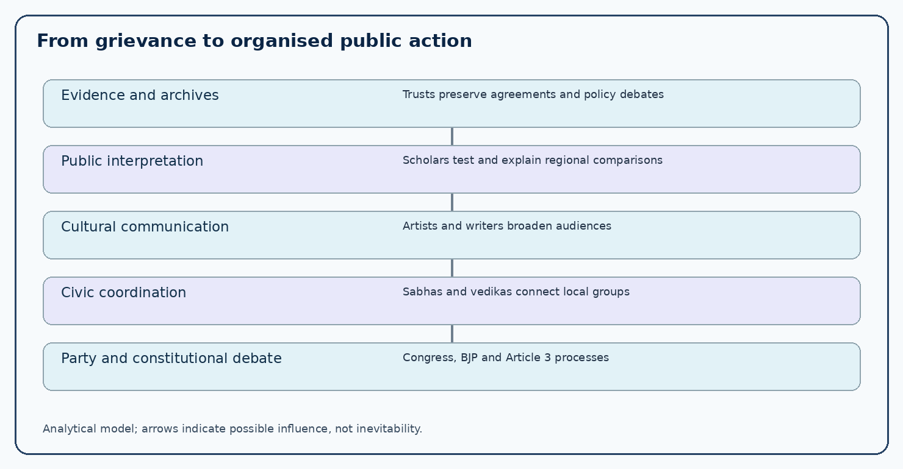
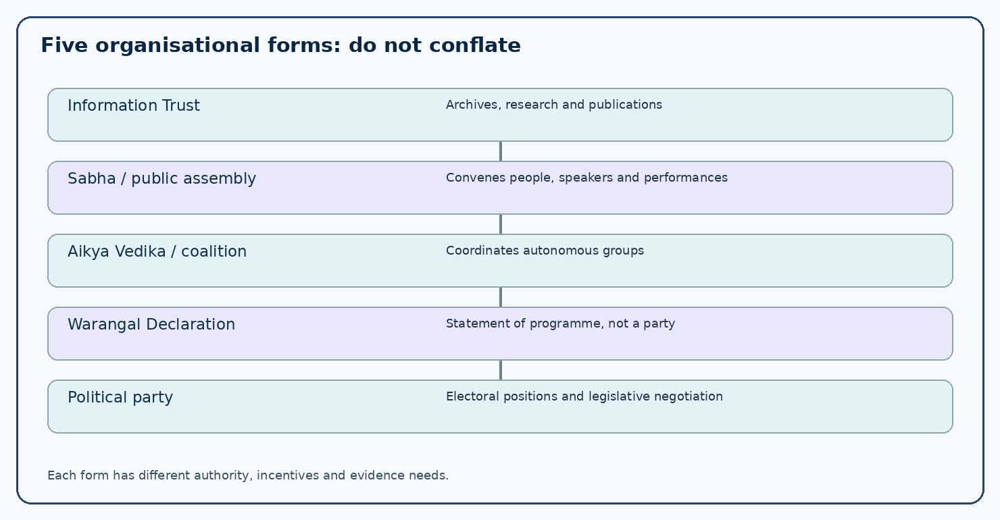
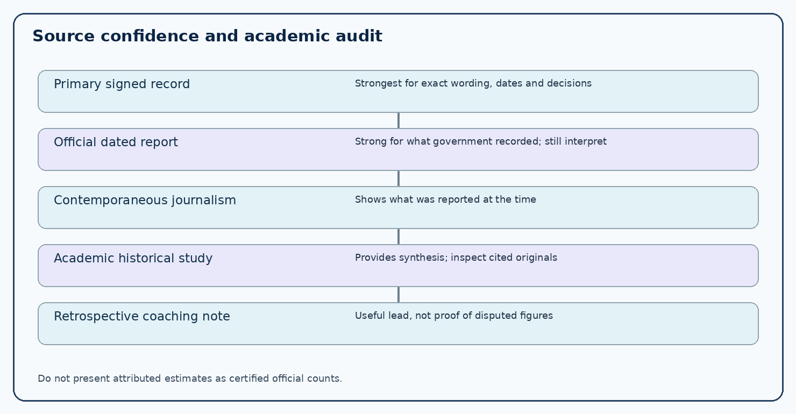

# Paper VI — Unit III — Topic 1: Public Awakening, Civil Society and the Articulation of Telangana Identity (1988–2004)

**TGPSC Group I Mains | Original English study draft | 25 October 2026 | Independent academic review pending**

**Source warning:** Original commission-hosted Notification 02/2024 returned HTTP 403 in this run; the exact item is corroborated by its indexed transcription. Original organisational minutes and attendance registers were not obtained. No practice question is an official PYQ.

**Thesis.** The late-1980s to early-2000s Telangana revival created an infrastructure of public reasoning: documentary trusts preserved the record of earlier safeguards; writers and scholars explained regional disparities; 1997–98 conferences connected civic constituencies; coalitions tried to coordinate them; and Congress and BJP actors moved the question into party and constitutional debate. These steps built capacity, not an inevitable path to 2014. The period contains genuine disagreement over dates, leadership, ideology and the meaning of development. Every source-dependent claim must be checked independently before academic approval.

# Syllabus index and verification

**Working transcription of Paper VI, Unit III, Item 1 (original spelling preserved):**

> Public awakening and Intellectual reaction against discrimination- formation of Civil society organisation, Articulation of separate Telanagana Identity; Initial organisations raised the issues of separate Telangana; Telangana Information Trust - Telangana Aikya Vedika, Bhuvanagiri Sabha - Telangana Jana Sabha, Telangana Maha Sabha - Warangal Decleration - Telangana Vidyavanthula Vedika; etc., Efforts of Telangana Congress & BJP in highlighting the issue.

**Verification:** Commission-hosted original 50-page Notification 02/2024 returned HTTP 403 on this run; independently indexed reproduction of the commission document was opened. This is corroborated wording, not direct line-by-line commission PDF extraction in this run.

| Syllabus element | Coverage |
|---|---|
| Public awakening / intellectual reaction | Historical grievance, evidence collection, students, artists and professional groups |
| Initial organisations / Information Trust | Late-1980s documentation, Ma Telangana print and institutional memory |
| Bhuvanagiri / Maha Sabha / Jana Sabha | 1997–98 public meetings, cultural participation, grassroots organising |
| Aikya Vedika | 1997 coalition-building, coordination and internal disagreements |
| Warangal Declaration | Late-1997 social-justice programme and democratic Telangana |
| Vidyavanthula Vedika | 2004 intellectual outreach and policy literacy |
| Congress and BJP efforts | 1997 Kakinada position, 2000–01 Congress forums and coalition constraints |

## Overview and chronology

| Period | Institution or event | Distinct contribution |
|---|---|---|
| Late 1980s | Information Centre and Information Trust | Archive and circulate policy records |
| 1989 (attributed) | Ma Telangana | Print public sphere |
| 8–9 March 1997 | Bhuvanagiri Sabha | Civic-cultural mass awakening |
| 1997 (precise day disputed) | Telangana Maha Sabha, Suryapet | Agrarian and social-justice debate |
| 1997 (precise day disputed) | Telangana Aikya Vedika | Coalition of civic organisations |
| 28–29 December 1997 | Warangal Declaration | Democratic Telangana programme |
| 1998 | Telangana Jana Sabha activity | Continued grassroots meetings |
| 1997–2001 | BJP Kakinada / Telangana Congress forums | Party-level consideration |
| March 2004 (attributed) | Telangana Vidyavanthula Vedika | Intellectual and policy outreach |

## 1. Syllabus boundaries and the problem of periodisation

The official Paper VI Unit III places this topic within the 1991–2014 movement towards Telangana statehood, but the specified organisations emerged across a longer chronology. The Telangana Information Trust belongs to the late 1980s; major conferences clustered in 1997–98; the Telangana Vidyavanthula Vedika belongs to 2004. A sound history does not move the dates merely to fit the unit heading. The syllabus is asking how dispersed grievances became a durable public movement before and alongside party politics, not for an undifferentiated list of names.

Five analytical questions organise the chapter. Who gathered evidence of alleged discrimination? Who translated that evidence into accessible language? Which associations connected teachers, lawyers, students, artists and farmers? How did conferences create common demands without erasing ideological differences? Finally, how did Congress and BJP actors take up the question within electoral institutions? The chronological account answers each question while separating documented institutional acts from retrospective recollections. No claim that every resident favoured statehood is justified: the political field contained integrationists, autonomists, supporters of separate Telangana and people whose priority was livelihood rather than boundaries.

## 2. Why public awakening revived after earlier movements

The 1969 Jai Telangana agitation had created a powerful repertoire of protest, martyrs' memory, student action and claims about employment. Yet its failure to produce a state did not extinguish the grievances. The 1973 Six-Point Formula, Article 371-D, the 1975 Presidential Order and subsequent arguments about local recruitment gave later activists a legal vocabulary. The 1985 G.O. 610 debate added a second question: even where safeguards existed, had they been implemented fairly? This was a dispute over administrative performance as well as identity.

By the late 1980s and 1990s, changes in irrigation, higher education, the Hyderabad economy, private investment and migration made comparisons across regions more salient. Civil-society groups were not simply miniature political parties. They could preserve records, host seminars, distribute pamphlets and develop cultural arguments when no dominant electoral party made statehood its central programme. The relationship was reciprocal: organisations needed public resonance to survive, while political actors later relied on the vocabulary and networks that civic forums had already built. The crucial transition was from an intermittent complaint to a reproducible public argument that could be carried across districts and generations.

## 3. What discrimination meant: a testable claim, not a slogan

Activists used discrimination to describe perceived differences in recruitment, education, irrigation and resource allocation. The term must be analysed carefully. Unequal outcomes do not by themselves prove unlawful treatment: rainfall, settlement history, industrial location, topography and population structure may differ. Conversely, a formal rule promising equal opportunity does not prove that actual selection, postings or expenditures complied with it. The correct evidentiary sequence is to identify a rule or benchmark, reconstruct the eligible population and time period, inspect administrative decisions, and test whether departures were lawful and explained.

For example, to assess a claim that Telangana candidates lost posts, a researcher should examine the local cadre under the applicable Presidential Order, notified vacancies, candidate eligibility, selection lists, transfer orders and remedies. To assess an irrigation claim, compare proposed allocations, actual releases, command-area utilisation, water availability and project costs rather than quoting a single reservoir capacity. Civil-society research mattered because it made these questions public. The quality of a statehood argument depends on the quality of its evidence; strong evidence can support criticism without treating every grievance as conclusively established.

## 4. Telangana Information Centre: preservation as political action

Accounts of the late-1980s revival describe a Telangana Information Centre associated with scholars and activists including K. Jayashankar, Keshav Rao Jadhav and T. Prabhakar. Its significance was methodological. Older agreements, reports and pamphlets could be scattered across university libraries, private collections and government offices. Reproducing them helped a new generation examine the history of the 1956 merger, the States Reorganisation Commission, the 1969 agitation and subsequent safeguards. A historical document becomes politically influential when readers can obtain it, compare it with official claims and debate its implications.

The centre should not be confused with a statutory commission or a government records office. It was a civic documentation initiative, and its publications reflected the questions and priorities of participants. A candidate should distinguish the primary document being reprinted from the commentary surrounding it. The original agreement may be strong evidence that a promise was made, while a pamphlet's claim that it was violated requires separate administrative records. The centre's enduring contribution was to connect archival retrieval with civic education, making evidence accessible beyond specialist historians.

## 5. Telangana Information Trust and its publishing mission

Retrospective histories place the Telangana Information Trust's formation in July 1988, often specifying 14 July; a contemporaneous registration certificate has not been independently inspected here, so the precise day remains provisionally attributed. The trust built on the information-centre approach by encouraging studies, publications and circulation of documents about Telangana's development and governance. Its name matters because it signals a change in scale: from collecting material to institutionalising its dissemination.

One can understand the trust through three functions. Archival function: preserving policy documents and historical debates. Analytical function: placing revenue, irrigation, employment and education claims in comparative frames. Communication function: enabling lectures, press discussion and public reading. These functions created a bridge between the 1969 generation and activists who entered public life in the 1990s. Yet a trust's advocacy is not neutral verification. A well-prepared answer should note both its agenda and its value as a carrier of sources, then distinguish what can be confirmed from documents from what rests on retrospective movement narratives. The organisation's importance lies in the infrastructure of public reasoning, not an unsupported assertion that one institution single-handedly revived the movement.

## 6. Ma Telangana and the politics of the printed page

Movement histories associate the trust with the publication Ma Telangana, commonly dated to August 1989. Print provided a durable form for arguments that might otherwise circulate only through speeches. A newspaper or periodical could report on a public meeting, reproduce a historical agreement, publish a comparative table and give geographically separated readers a shared set of issues. The title itself expressed a regional public: the idea that Telangana's experience deserved to be narrated in its own voice.

This was not merely a matter of language sentiment. Publishing made it possible to preserve claims for later scrutiny. An article alleging unequal irrigation could be challenged with project records; an interview could document an activist's recollection but not substitute for an official order. Print also had limits: circulation, funding, literacy, editorial selection and the availability of archives shaped who heard the argument. Digital access to complete original issues is not established in this audit. Therefore the chapter treats reported launch dates and specific issue contents as leads for further archival verification rather than presenting every later textbook anecdote as an independently checked contemporary fact.

## 7. K. Jayashankar: scholarship, advocacy and intellectual continuity

Professor Kothapalli Jayashankar, an economist and university administrator, became a prominent intellectual advocate of Telangana statehood. His role was to give economic and institutional form to grievances often expressed as personal injustice. In speeches and studies associated with him, irrigation, educational opportunity, public employment and regional spending were analysed as interrelated development questions. His association with research and civic platforms helped connect local experiences with arguments about constitutional federalism.

It is important not to turn the biography into a substitute for evidence. An economist's authority comes from methods, transparent assumptions and data, not simply reputation. When a regional expenditure figure is attributed to Jayashankar, an academic audit should identify the original study, its reference year, district boundaries and accounting basis. His political commitment to Telangana was explicit; that does not automatically invalidate his analysis, but it requires the same scrutiny applied to opposing claims. His significance for the mains answer is as a long-term connector between the 1969 memory, documentation in the 1980s, public conferences of the 1990s and later organised political mobilisation.

## 8. Keshav Rao Jadhav, Kaloji and the cross-generational bridge

Keshav Rao Jadhav and Kaloji Narayana Rao figure prominently in accounts of the civil-society revival. Jadhav is associated with civic coordination and the information movement, while Kaloji's literary and public persona connected Telangana's dialect, democratic dissent and earlier struggles. Their importance is not reducible to formal office. A respected writer can legitimate a meeting for audiences who distrust party leaders; an organiser can keep separate professional and district groups in conversation.

The bridge was also cultural. Dialect, songs, humour and memories of the Hyderabad State could communicate a political critique without demanding that listeners first understand complex constitutional provisions. However, a regional public was never culturally homogeneous: Deccani Urdu, tribal languages, caste histories and urban experiences belonged to Telangana as well. A credible movement narrative must therefore show how a shared identity was negotiated among different groups rather than assuming that a single Telugu dialect spoke for everyone. This is especially relevant when assessing the inclusive ambitions and limitations of civil-society organisations.

## 9. The Bhuvanagiri Sabha of 8–9 March 1997

The Bhuvanagiri (Bhongir) Sabha of 8–9 March 1997 is a widely documented milestone in the revived statehood movement. The location in the then Nalgonda district mattered: it showed that mobilisation was not confined to Hyderabad's universities or government offices. Writers, journalists, lawyers, academics and cultural performers participated in a forum where historical grievances were expressed through both argument and performance. The phrase Dagapadda Telangana, commonly associated with the event, framed the region's experience as a history of promises perceived to have been broken.

The meeting's contribution was organisational rather than legislative. It provided a public venue in which different groups could recognise one another, establish common vocabulary and reach audiences beyond their immediate networks. Retrospective sources mention Kaloji, Jayashankar, Jaini Mallaiah Gupta and cultural figures such as Belli Lalitha; exact speaker lists and attendance counts require original programmes and press archives. Claims of forty thousand participants appear in secondary accounts but are not independently certified here. For a mains answer, emphasise its role in widening the constituency and linking cultural expression to political argument, rather than relying on a disputed crowd figure.

## 10. Why Bhuvanagiri changed the repertoire of mobilisation

A conference is significant when it changes what a movement can do next. Bhuvanagiri supplied at least four resources: visibility, shared grievance language, networks among organisers, and a model for subsequent district-level meetings. A poet's performance could draw people who would not attend a technical seminar; a legal professional could translate anger into rights-based demands; a scholar could give comparative evidence; a journalist could circulate proceedings. These functions reinforced one another without being identical.

The meeting also illustrates a limitation of conference politics. A large gathering cannot itself appoint a unified leadership, compel the state to change policy or demonstrate that all participants agree on strategy. Cultural unity may coexist with disagreements over caste, land redistribution, nonviolence, party alliances and the role of radical organisations. The historical value of Bhuvanagiri is therefore as a catalytic moment in a longer sequence, not as the sole origin of the later Telangana movement. Examiners reward this distinction between event, mechanism and outcome.

## 11. Telangana Maha Sabha and the Suryapet mobilisation

A Telangana Maha Sabha associated with Suryapet in 1997 placed agrarian, social-justice and regional questions on a common platform. Movement narratives associate it with Maroju Veeranna and cultural performers including Belli Lalitha. Accounts vary on the exact day and on the naming of distinct Suryapet meetings; some cite April 1997 and others August 1997. Without a contemporaneous invitation or proceedings, this chapter records the year and place with confidence and marks precise-date attribution as contested.

The political content was wider than administrative separation. Participants raised concerns about land redistribution, rural exploitation, irrigation, privatisation, police violence and the rights of disadvantaged communities. This breadth explains why the movement could attract supporters who interpreted regional injustice through caste and class as well as through territory. It also created tensions: a platform prioritising redistribution might disagree with business-oriented supporters of statehood about the future economic model. The important analytical point is that a demand for a state could carry competing visions of what the new state should do.

## 12. Telangana Jana Sabha: continuity, reorganisation and mobilisation

The name Telangana Jana Sabha appears in accounts of late-1990s mobilisation, particularly meetings in 1998. Some sources describe a revival or reconstitution rather than a first founding, and the spelling of the organisation's name varies across accounts. This is an archival warning: do not automatically treat every similarly named meeting, front or association as one uninterrupted legal body. The relevant question is how public forums attempted to turn episodic meetings into continuing grassroots work.

The Jana Sabha model emphasised assemblies, local mobilisation and social participation. Unlike a parliamentary party, such a platform did not require an electoral manifesto or candidate list to exert influence. It could convene debates, protest specific policies and place statehood within everyday issues of land, jobs and education. The weakness was organisational durability: voluntary groups depended on funding, personal relationships and the ability to agree on methods. Later retrospective histories often merge multiple streams into a single triumphant narrative; a careful candidate should separate institutional chronology from the broader social process.

## 13. Telangana Aikya Vedika: the coalition problem

Telangana Aikya Vedika, also rendered Telangana United Front in English accounts, is associated with an attempt in 1997 to coordinate numerous civic organisations. Retrospective narratives often describe roughly twenty-eight participating bodies and identify Jayashankar and Keshav Rao Jadhav among prominent figures. Exact formation dates vary between late September and October 1997, and the original signed founding minutes have not been reviewed. The safe exam formulation is that the coalition emerged in 1997 to bring separate groups into a more coordinated statehood campaign.

A coalition can aggregate credibility and reach without requiring members to surrender their identities. Teachers may prioritise appointments, farmers irrigation, artists cultural dignity and lawyers constitutional remedies. A common platform allows these demands to reinforce one another. But coalitions are fragile: groups differ in ideology, methods, funding, and willingness to cooperate with parties. Aikya Vedika is best understood as an experiment in coordination that helped prepare the organisational environment for later political mobilisation, not as a government institution or a party that exercised formal power.

## 14. The Warangal Declaration: programme beyond a boundary

The Warangal gathering of late December 1997, usually dated 28–29 December, is remembered for articulating a democratic Telangana programme. Accounts connect it with the All India People's Resistance Forum and the involvement of activists, writers and scholars. Retrospective sources sometimes assign a precise number of resolutions, but the complete signed declaration and voting record have not been independently obtained in this run. Consequently, the chapter discusses the reliably recurring themes rather than treating every reported clause as authenticated text.

The declaration is important because it framed statehood as a means to social and political change, not only the redrawing of an administrative map. Land and tenancy, tribal autonomy, irrigation, democratic rights, language, culture and opposition to arbitrary coercion appear in descriptions of its programme. This created a more radical conception of Telangana than a purely technocratic claim about administrative efficiency. A useful comparison is with the Bhuvanagiri Sabha: the latter widened public awakening through cultural and civic gathering, while Warangal gave greater prominence to a proposed social agenda. Both were components of a heterogeneous movement.

## 15. Warangal's social-justice dimension and ideological debate

The word democratic in descriptions of the Warangal programme was not decorative. For participants who emphasised agrarian relations, the question was whether a new state would change the position of landless labourers, tenant cultivators and tribal communities. For civil-liberties advocates, the question concerned policing, dissent and due process. For cultural activists, it concerned recognition of locally rooted expression. These were overlapping but distinct visions of justice.

An examiner may ask whether the 1997 movement was only regional nationalism. The answer is no: regional identity became a framework in which class, caste, land and democratic rights could be argued. But it would also be wrong to claim that all statehood advocates endorsed the same redistributive programme. Business groups, professional associations, mainstream politicians and radical organisations could agree on statehood while disagreeing about property, development or political strategy. This tension is not a weakness of historical analysis; it is the evidence that the movement was a coalition, not a single ideology.

## 16. Telangana Vidyavanthula Vedika and the educated public

Telangana Vidyavanthula Vedika, commonly translated as a forum of educated people or intellectuals, is associated with a March 2004 formation in movement histories. Accounts identify academics and activists including M. Kodandaram, Burra Ramulu and Jayashankar. Its role was to sustain research, public discussion, district-level outreach and the interpretation of policy controversies. It linked academic analysis to citizens who needed concise explanations of water projects, recruitment rules, budgets and political developments.

The term educated must not imply that other participants lacked knowledge. Farmers and workers possessed practical expertise about tanks, cropping, local hiring and public services. The forum's contribution was to combine professional research skills with lived evidence and communicate it through meetings, pamphlets and debates. As with the Information Trust, advocacy and verification must be distinguished. A public lecture may identify a serious anomaly; proving the anomaly requires original records. The Vedika also belongs chronologically to the era when a dedicated statehood party already existed, showing that civic organisations did not disappear when electoral mobilisation expanded.

## 17. Civil society was not a single institution

The syllabus lists trusts, sabhas, vedikas and declarations because each represents a different organisational form. A trust can preserve and publish documents. A sabha is a public assembly or convening platform. A vedika is a forum that coordinates discussion and campaigning. A declaration is a programme or statement adopted at an event; it is not itself an organisation. A party competes for elected office and can negotiate legislation or executive policy. Confusing these forms leads to incorrect MCQs and weak mains answers.

Their strengths and constraints differ. A documentation body has archival depth but may lack mass reach. A cultural assembly can reach many people but may not survive as a permanent organisation. A coalition can link groups but faces internal disputes. A political party can turn demands into manifestos and alliances but may compromise under electoral pressures. Telangana's civil-society phase matters precisely because these forms interacted. An analytical answer should identify each body's function and demonstrate the mechanism by which it affected the wider movement.

## 18. Students, universities and the transmission of memory

Students at Osmania and Kakatiya universities formed a critical audience for the revival. Universities provided meeting spaces, libraries, debate cultures and networks through which arguments moved between districts. The memory of 1969 was particularly influential, but a student entering university in 1997 had different experiences of employment competition, fee burdens and urban change. Civic activists translated older safeguard disputes into questions relevant to the next generation.

University participation was not uniform, nor should it be described only as spontaneous emotion. Student associations had organisational structures, ideological differences and their own demands. A meeting might attract students through a cultural programme and then expose them to debates about irrigation or Article 371-D. At the same time, exam candidates should avoid projecting the later 2009–11 campus agitation backwards into the 1990s. This topic concerns the earlier development of networks and ideas; later mass mobilisation belongs to subsequent syllabus items.

## 19. Teachers, employees, lawyers and the professional middle class

The participation of teachers, government employees, lawyers, journalists and doctors gave the movement specialised forms of knowledge. Employees could identify posting practices and service-rule disputes; lawyers could examine legal remedies; teachers could communicate history to young people; journalists could investigate discrepancies and distribute arguments; doctors and other professionals could bring civic credibility to district meetings. These roles did not imply that every professional association supported statehood.

Professional mobilisation also posed a question of public ethics. A claim about recruitment should be supported by service rules and rosters rather than assumptions about an employee's birthplace or surname. A journalist should distinguish allegation from finding. A lawyer must separate constitutional possibility from political inevitability. The movement gained persuasive power when professionals used their skills to make grievances testable. Its credibility could suffer when numbers were repeated without sources. This is why an exam answer should pair each occupational group with its distinctive contribution rather than simply listing categories of supporters.

## 20. Folk arts, Belli Lalitha and the cultural public sphere

Cultural expression gave the renewed movement a language that could reach beyond policy specialists. Songs about drought, village labour, migration, dignity and regional memory condensed complex grievances into memorable narratives. Belli Lalitha is frequently associated with 1997 cultural programmes and later Telangana cultural mobilisation. Kaloji's writing and the performance traditions of the Deccan similarly helped challenge the marginalisation of Telangana idioms in dominant media.

Culture should not be treated as propaganda without agency. Performers interpreted social experience, sometimes criticised their own movement's leadership, and could bring caste and gender perspectives into public discussion. Women artists' participation also exposes a limitation of male-centred histories that name political leaders but overlook cultural organisers. A responsible account must not romanticise violence or reduce a person's life to martyrdom. To understand impact, ask where performances occurred, who organised them, which messages circulated and how they altered public participation. Lyrics and exact programme rosters require original recordings or published archives before they can be quoted as verified historical evidence.

## 21. Language, dialect and the meaning of recognition

Telangana identity was articulated partly through the status of regional Telugu forms in education, cinema, theatre and official discourse. Activists objected when local pronunciation or vocabulary was portrayed as inferior or comic. Recognition was not merely symbolic: a student's confidence in classroom speech, a writer's publishing opportunities and a citizen's access to administration can all be affected by linguistic hierarchies. Yet Telangana has never been linguistically singular. Deccani Urdu, Lambadi, Gondi and other languages form part of its social landscape.

The normative challenge is to celebrate Telangana speech without constructing a new exclusion. A separate state cannot be justified as an instrument to demean speakers from another region. The most defensible cultural argument is for equal dignity, inclusive public institutions and space for local expression. This distinction is useful in mains answers because it connects cultural identity to constitutional pluralism rather than ethnic antagonism. The intellectual movement's most constructive claim was that common Telugu identity and Telangana distinctiveness could both be historically real.

## 22. Irrigation and agriculture as public evidence

Water allocation was a recurring subject of intellectual debate. Telangana's dryland agriculture, tank systems and hard-rock groundwater conditions differed from the deltaic canal agriculture of parts of coastal Andhra. Activists questioned the distribution of project investment and dependable irrigation. However, an accurate comparison must distinguish potential irrigation area from area actually watered, budget allocation from expenditure, and sanctioned projects from completed infrastructure. River gradients, dam locations, inter-state obligations and crop patterns also matter.

A civil-society seminar could make a technically complex issue intelligible by tracing a project from design through allocation and delivery. This is why irrigation was more than an economic grievance: it became a test of whether regional voices were represented in planning decisions. Opponents of the statehood demand could point to projects undertaken in Telangana or statewide sharing needs; these claims also require evidence. For examination purposes, present the competing interpretations and propose a transparent comparison, rather than asserting an unsourced percentage of water diverted or withheld.

## 23. Employment, Article 371-D and the credibility of safeguards

The local-employment controversy linked everyday opportunity with the constitutional history of Andhra Pradesh. Article 371-D and the Presidential Order of 1975 created a special framework for equitable opportunities and local cadres. Later allegations of irregular postings, transfers and recruitment were central to Telangana employee associations. G.O. 610 of 1985 became an emblem of the distance between a protective rule and perceived administrative implementation.

A sound answer must distinguish the existence of a safeguard, a government direction to remedy violations, the extent of actual compliance and a judicially established breach in a particular case. The documentary chain includes cadre notifications, eligibility criteria, recruitment records, transfer orders and court decisions. Civil-society groups helped publicise the controversy, but they did not have the authority to adjudicate individual appointments. Their contribution was to keep administrative accountability visible. The issue also illustrates why regional identity could be framed as a demand for enforceable rights rather than only cultural pride.

## 24. Budget disparities and the arithmetic of grievance

Regional budget comparisons are deceptively difficult. A project physically located in Hyderabad may serve the entire state; an expenditure booked to a headquarters may not represent a benefit exclusively to the city. Conversely, statewide accounting can hide unequal service delivery in remote districts. Activists therefore needed to specify whether they compared per-capita spending, capital investment, schools, hospitals, irrigation coverage or actual outcomes. They also needed to adjust for inflation, district boundaries and the relevant time period.

The intellectual revival is important because it encouraged citizens to ask these accounting questions publicly. But a table in a pamphlet is not self-validating. A good mains answer can explain a five-step audit: define the region and years; choose an appropriate denominator; distinguish planned and realised expenditure; assess service outcomes; and consider geography and historical baselines. This method is more defensible than declaring all disparity proof of deliberate discrimination. It also makes room for corrective policies short of statehood, which were part of the wider political debate.

## 25. Caste, tribal rights and the limits of a unified regional narrative

A Telangana identity movement could unite people around territory while still containing deep differences of caste, landownership and social power. Dalit movements, including Madiga Dandora, and Adivasi rights campaigns raised questions that regional elites might otherwise neglect. The Warangal programme's attention to land and tribal autonomy reflects one attempt to make the statehood demand socially transformative. Other organisations placed greater emphasis on administrative autonomy or cultural recognition.

This diversity requires a critical question: whose Telangana was being imagined? A new boundary would not automatically redistribute land, remove caste exclusion or secure forest rights. Women, tenant farmers, migrant workers and tribal communities might face different priorities. For a strong mains answer, explain how civic platforms could broaden participation and also why they needed internal accountability. Avoid treating the movement as either a seamless people's will or a cynical elite conspiracy; the historical record contains multiple actors with both common demands and conflicting interests.

## 26. Telangana Congress: internal forums and cautious institutional politics

The Congress response evolved through the late 1990s and early 2000s. Telangana-region legislators and leaders increasingly pressed the party leadership to consider statehood, including through the Telangana Congress Legislators Forum. Contemporary reporting from 2001 records debates over a second States Reorganisation Commission and differences within the party. The existence of pro-statehood legislators did not mean that the entire Congress organisation held a uniform position at every point.

Congress actors had two advantages over civic forums: they could raise the issue within legislative and party structures, and they could influence coalition negotiations. Their constraint was internal division across regions and the need to reconcile the Telangana demand with broader electoral calculations. A mains answer should distinguish memoranda, public resolutions, formal party commitments and actual governmental action. The request for another SRC was a procedural position, not itself a legal decision to create Telangana. The party's later 2004 electoral alignment belongs to the next topic and should be used here only as evidence of how earlier debates entered formal politics.

## 27. BJP: Kakinada resolution and the small-states argument

The BJP's Andhra Pradesh unit is associated with a 1997 Kakinada resolution supporting a separate Telangana, often remembered through the phrase one vote, two states. The party connected the demand to a broader argument for smaller states and administrative responsiveness. Its position is historically significant because it placed statehood within the agenda of a national party before the formation of the TRS in 2001.

Yet a resolution is not the same as implementation. During the BJP-led NDA period, the political position of coalition partners, particularly the Telugu Desam Party, affected the feasibility of Andhra Pradesh's division. The Ministry of Home Affairs' 2010 Srikrishna Committee report retrospectively discussed this tension. An accurate answer should therefore separate public commitment, coalition constraints and constitutional procedure. One must not claim that the Kakinada resolution legally created a state or that the 2000 formation of other small states automatically required Telangana's formation. It is an example of how a regional demand entered national coalition politics while remaining contested.

## 28. Civil society and parties: complementarity without equivalence

Civil-society organisations and parties operated through different incentives. A trust could publish a critical report without contesting an election. A sabha could adopt a declaration without negotiating a cabinet portfolio. A party had to choose candidates, alliances and electoral messaging. These differences created both cooperation and mistrust. Civic activists sometimes feared that party leaders would dilute demands for electoral advantage; parties sometimes found movement organisations too ideologically divided to serve as unified negotiating partners.

The interaction nevertheless mattered. Public meetings made a demand visible, research supplied arguments, cultural programmes broadened participation, and political forums carried the issue into legislative and national-party deliberation. The sequence was not linear: parties influenced public debate, while civic groups criticised party positions. Avoid the teleological claim that every 1997 meeting was consciously preparing the 2014 state. Historical outcomes depended on later decisions, crises, alliances and constitutional processes. The correct concept is mutual reinforcement under conditions of uncertainty.

## 29. A comparative timeline, 1988–2004

A useful chronology begins with the Information Trust in the late 1980s and Ma Telangana in 1989, then moves to the clustering of civic meetings in 1997: Bhuvanagiri in March, Suryapet in 1997, Aikya Vedika in the second half of the year, and Warangal in December. The Jana Sabha activity of 1998 and the intellectual forums of subsequent years illustrate organisational persistence. In 1997, the BJP's Kakinada position entered party politics. By 2000–01, Telangana Congress legislators and national-party leaders were debating possible constitutional pathways. The Vidyavanthula Vedika emerged in 2004 in a different political environment.

The timeline is a scaffold, not an excuse for false precision. The original minutes of several organisations are unavailable, and published accounts disagree over certain formation days and Suryapet dates. A high-scoring answer should anchor the well-corroborated sequence and flag the disputed micro-dates. This protects the student from memorising one coaching-source chronology as if it were an official archival record. It also preserves the important causal sequence: documentation, public assembly, coalition-building, ideological declaration and political negotiation.

## 30. Bhuvanagiri versus Warangal: different contributions

Bhuvanagiri and Warangal are often placed together in short notes, but they served different historical functions. Bhuvanagiri in March 1997 foregrounded the public articulation of grievance through a mix of literature, cultural performance, debate and local mobilisation. Its strength lay in expanding the audience and giving legitimacy to regional expression. Warangal in December 1997 is remembered more for an articulated programme connecting democratic Telangana with land, tribal rights, water and civil liberties. Its strength lay in defining substantive objectives.

The distinction is not absolute. Both events had intellectual and cultural dimensions, and both drew on prior activism. But in an exam, identifying their dominant roles prevents a rote list. A comparison table should include approximate date, location, organisational form, major emphasis and evidentiary caveat. Neither event created a separate state or possessed statutory authority. Both helped shape the public sphere within which later party mobilisation became possible.

## 31. Why the 1997 conferences mattered beyond their attendance

The significance of a historical meeting is measured by its afterlife: whether it generated follow-up organisations, publications, debates, district contacts and a durable vocabulary. Crowd figures are especially vulnerable to retrospective exaggeration, selective press reporting and differences between estimated turnout and registered participants. For Bhuvanagiri and Warangal, a stronger explanation traces how writers, academics, employees and rural organisers came to recognise common issues despite differing priorities.

This approach also corrects a common mains weakness. Students often write that a conference created awareness, which is too vague. Explain the mechanism: a cultural performance attracts participation; speakers connect grievances to named policies; press coverage carries the discussion to other towns; volunteers exchange contacts; later forums use the resolutions to frame demands. Each stage is a plausible route from event to movement capacity. Without contemporary records, do not claim a precise number of newly formed committees or a verified causal effect on an election.

## 32. The difference between memory, testimony and documentary proof

Much of the late-1990s Telangana movement is remembered through interviews, commemorative articles, coaching notes and retrospective political histories. These sources are useful but not interchangeable. An organiser's recollection can establish how participants interpreted a meeting; a newspaper report can document what was publicly reported at the time; a signed declaration can verify exact resolutions; a government order can establish formal policy. A university thesis may synthesise interviews and archived newspapers, but its citations must still be checked.

This chapter uses a source hierarchy. Highest weight goes to original legal texts, dated official reports and contemporaneous documents. Academic studies provide context and interpretive debate. Retrospective press and study guides provide leads for dates and names, flagged when uncorroborated. This is particularly important for competing Suryapet and Aikya Vedika dates, exact attendee counts and claimed numbers of resolutions. Academic approval remains pending until a second reviewer checks the original sources and historical interpretations independently.

## 33. Constitutional pathways: why civic demand did not equal statehood

Under Article 3 of the Indian Constitution, Parliament can form new states through legislation, subject to the prescribed procedure including a presidential reference to the affected state legislature for its views. The state legislature's views are relevant to the process but are not an absolute veto over Parliament's power. Civic associations could advocate, lobby and petition; they could not themselves reorganise state boundaries. The distinction between moral legitimacy and legal competence is central to this topic.

This helps explain why organisations pressed Congress and BJP leaders to take positions. Without legislative action and national political negotiation, even a widely supported public demand could remain unresolved. At the same time, the existence of Article 3 did not make statehood automatic: federal, economic, administrative and political concerns had to be debated. The exam-ready formulation is that civil society built the case and constituency for statehood while constitutional institutions retained authority to decide it. Do not substitute later 2014 legislation for the historical choices faced by activists in 1997.

## 34. Competing viewpoints: regional justice and integrated development

Statehood advocates argued that repeated safeguard controversies, limited political voice and persistent disparities justified a separate state with greater accountability to Telangana's people. Some emphasised the cultural right to dignity; others emphasised water, employment, land or democratic control. Supporters of a united Andhra Pradesh argued that economic integration, shared investments, common markets and interregional cooperation could deliver development without partition. Some preferred stronger implementation of safeguards or decentralisation rather than a new boundary.

Neither side should be reduced to a caricature. A large city such as Hyderabad benefited from statewide and national networks, while rural Telangana had distinctive concerns. Residents could simultaneously value common Telugu culture and Telangana's regional identity. An analytically strong answer asks which remedy would improve representation and service delivery, what costs it would impose, and how minority and migrant rights would be protected. The later creation of Telangana does not prove that every earlier assertion by statehood advocates was factually correct or that every concern of integrationists was insincere.

## 35. Applied case: a disputed local recruitment list

Imagine a district employees' forum receiving complaints that candidates recruited to a notified local cadre did not meet applicable local-area criteria. The forum should first obtain the recruitment notification, identify the relevant Presidential Order provisions and confirm whether the posts actually belong to the local cadre. It should then compare eligibility documents, selection records and any permitted exceptions. A simple list of surnames or places of birth cannot establish illegality.

If an apparent discrepancy survives, the group can seek administrative clarification, make a reasoned representation and use lawful review mechanisms. Publishing personal details without verification risks unfairly targeting individuals. This hypothetical shows the constructive function of a civil-society organisation: translating a grievance into a verifiable institutional question. It also shows why advocacy must be distinguished from adjudication. The lesson is directly relevant to the historical employment debates that animated Telangana's public awakening.

## 36. Applied case: irrigation allocations and misleading percentages

Suppose two campaign pamphlets quote different percentages for Telangana's irrigation share. One measures sanctioned project capacity; another measures actual irrigated area in a drought year. They may appear contradictory even when both calculations are internally correct. A civic research forum should identify the numerator, denominator, river basin, crop season, year and source of each figure. It should distinguish surface-water command area from wells and tanks, and include changes in district boundaries.

The public debate can then focus on what is actually at issue: planned investment, delivery, maintenance, equitable allocation or hydrological feasibility. This hypothetical illustrates why documentation initiatives mattered. They could improve the quality of public reasoning by teaching people how to read administrative statistics. The same method applies to education and health comparisons. Do not memorise an isolated number from a secondary study guide without its year and measurement definition.

## 37. Applied case: a village cultural meeting

A cultural collective plans a village event featuring songs about drought and the dignity of Telangana speech. It invites farmers, women, youth and local teachers. To make the event politically meaningful rather than merely celebratory, organisers also arrange a discussion of tank maintenance, school access and the history of regional safeguards. Participants are encouraged to disagree without intimidation, and speakers are asked to separate personal experiences from independently documented statistics.

This hypothetical demonstrates how cultural mobilisation and policy literacy can reinforce one another. The song creates an emotional entry point; the discussion identifies a public problem; the meeting produces a petition or follow-up committee. Its limits are equally important. Attendance does not establish consensus, and a performance cannot replace a technical audit. The model explains why folk artists and civic associations were both relevant to the 1990s revival.

## 38. Applied case: an inclusive coalition charter

Imagine a Telangana coalition composed of teachers, tribal-rights groups, students, farmers and business representatives. All favour stronger regional decision-making but disagree about land redistribution and private investment. A workable charter separates shared objectives from contested policies. It can commit to evidence-based representation, democratic methods, equal civic rights and public consultation while creating forums for substantive disagreement.

This mirrors the organisational challenge faced by Aikya Vedika and other broad platforms. A coalition's strength is the capacity to aggregate different constituencies; its weakness is the temptation to hide disagreement until it becomes a leadership crisis. A credible statehood movement must protect dissent within its own ranks. In mains answers, this example demonstrates the difference between a minimum common programme and a fully unified ideology. Both may be politically useful, but they are not the same.

## 39. Applied case: a contested historical date

Two study manuals give different formation dates for a 1997 Telangana association. The responsible researcher should not choose whichever date appears most often on search results. First identify whether the sources refer to a preparatory meeting, public announcement, registration, or first conference. Then seek original invitations, minutes, newspaper archives and participant interviews. A later anniversary article may commemorate the date of a public rally rather than the legal founding.

Until this is resolved, write 'formed in 1997' and record the competing exact dates in the source audit. This is not indecision; it is disciplined historical method. Examiners generally reward correct sequence and explanation over an unsupported exact day. The case applies directly to Aikya Vedika and certain Suryapet accounts in the available secondary literature.

## 40. Applied case: a party resolution and an alliance constraint

A regional party committee passes a resolution favouring a separate state, but the party later joins a national coalition dependent on an ally opposed to division. What has changed? The policy preference expressed by the committee may remain, while the coalition's bargaining constraints alter the government's willingness to act. To analyse the case, compare the resolution, manifesto, cabinet programme, parliamentary conduct and public explanations rather than assuming either perfect consistency or deliberate deception.

The BJP's Kakinada position and the NDA-era constraints provide a historical context for this hypothetical. Congress's internal forums present a parallel lesson: individual legislators' demands, a national party's procedural resolution and a binding government decision are different stages. The broader insight is that civil society can sustain an issue across electoral cycles, but formal statehood requires political agreement and constitutional action.

## 41. What the movement achieved by the early 2000s

By the early 2000s, the Telangana question had a denser public infrastructure than in the immediate aftermath of 1969. Documentation initiatives preserved older evidence; conferences made statehood publicly discussable; cultural organisations challenged stereotypes; coalitions connected district groups; and national parties faced pressure to articulate positions. These developments did not produce a state immediately, but they changed the terms of political debate.

The outcome should be described as capacity-building rather than inevitability. Organisational continuity varied, some platforms faded, and ideological disagreements persisted. The Telangana Rashtra Samithi's formation in 2001 and later electoral alliances are the focus of the next syllabus item, not the centre of this chapter. Here the analytical conclusion is that civil society supplied memory, evidence, networks and public language. Political institutions then had to negotiate the constitutional question. This division of labour is the chapter's central historical explanation.

## 42. Mains-writing framework and common traps

For a 10- or 15-mark answer, begin with the problem of revived regional grievance and the late-1980s documentation phase. Organise the body under research initiatives, 1997–98 public conferences, coalition building, cultural mobilisation, and Congress–BJP political efforts. Use a dated but qualified timeline. For each named organisation state what it did and why it mattered, not merely the founder's name. End with the transition from civic consciousness to organised statehood politics and acknowledge internal diversity.

Avoid six traps: treating all sabhas as the same institution; calling a declaration a political party; presenting disputed micro-dates as settled; equating uneven development automatically with proven legal discrimination; attributing the 2014 outcome directly to one 1997 event; and labelling generated questions as official PYQs. A strong answer links cause, actor, method, evidence, limitation and consequence. It can also distinguish cultural recognition from exclusionary regionalism and civic advocacy from statutory decision-making. These analytical distinctions often matter more than a long unverified list of leaders.

## Standalone quick revision — read without the full chapter

**The sequence:** late-1980s Information Centre and Information Trust → *Ma Telangana* print activism (1989) → Bhuvanagiri Sabha (8–9 March 1997) → Telangana Maha Sabha / Suryapet debates (1997; precise dates disputed) → Aikya Vedika civic coordination (1997; exact day disputed) → Warangal Declaration (late December 1997) → Jana Sabha activity (1998) → Congress forums and BJP policy debates (1997–2001) → Telangana Vidyavanthula Vedika (March 2004, attributed).

**Seven one-line distinctions:** Trust = archival documentation. Sabha = public gathering. Vedika = organising forum. Declaration = stated programme, not an organisation. Party = electoral and legislative actor. Article 3 = Parliament's state-formation procedure. Identity = sense of belonging; statehood = one possible constitutional remedy.

**High-value actors:** K. Jayashankar (economic and institutional arguments); Keshav Rao Jadhav (civic coordination); Kaloji Narayana Rao (literary and democratic public voice); Belli Lalitha (cultural mobilisation); Congress Telangana legislators (internal party pressure); BJP state unit (1997 Kakinada resolution).

**Why the meetings mattered:** Bhuvanagiri expanded the civic-cultural audience; Warangal articulated a wider democratic and social programme. Aikya Vedika tried to coordinate diverse organisations. These were not statutory bodies.

**Evidence traps:** The original Information Trust registration, signed Aikya Vedika minutes, Suryapet meeting programme, complete Warangal resolutions and certified crowd figures were not independently obtained. Do not memorise conflicting exact dates as certain. Do not call these original practice MCQs official PYQs.

**Mains formula:** Background → organisations and their distinct functions → 1997–98 conferences → culture, employment, irrigation and social justice → Congress/BJP institutional politics → limitations and inclusive conclusion.

## Original visual diagrams

# 30 original explained practice MCQs — NOT official TGPSC PYQs

**Q1. Which is the best description of the Telangana Information Trust?**

- A. A government recruitment tribunal
- B. A civic documentation and publication initiative
- C. A statutory river board
- D. A political party formed in 2001

**Answer: B.** It helped preserve and circulate historical and policy material; it did not possess statutory adjudicatory power.

**Q2. Which year is commonly associated with the Information Trust?**

- A. 1969
- B. 1975
- C. 1988
- D. 2009

**Answer: C.** Retrospective histories place its formation in 1988; the precise July day requires original registration evidence.

**Q3. Ma Telangana is most closely associated with which medium?**

- A. A 1989 print publication
- B. A 1973 constitutional formula
- C. A 2014 parliamentary act
- D. A government irrigation tribunal

**Answer: A.** The periodical illustrates how print carried regional arguments beyond meetings.

**Q4. Which gathering is firmly associated with 8–9 March 1997?**

- A. Warangal Declaration
- B. Bhuvanagiri Sabha
- C. 2004 Vidyavanthula Vedika
- D. 1956 SRC

**Answer: B.** The Bhuvanagiri Sabha took place in March 1997 and brought cultural and intellectual voices together.

**Q5. The dominant historical contribution of Bhuvanagiri was:**

- A. Passing Article 3 legislation
- B. Appointing the Governor
- C. Widening civic and cultural mobilisation
- D. Issuing a Presidential Order

**Answer: C.** It was a public assembly, not a statutory institution.

**Q6. Which organisation is most closely associated with a broad civic coalition in 1997?**

- A. Telangana Aikya Vedika
- B. Finance Commission
- C. National Human Rights Commission
- D. Andhra Pradesh High Court

**Answer: A.** Aikya Vedika coordinated separate civic groups; it did not exercise constitutional authority.

**Q7. Which statement about Aikya Vedika dates is most defensible?**

- A. It was legally formed in 2014
- B. Exact late-1997 day is disputed in available retrospective accounts
- C. It was formed in 1956
- D. It began only after 2009

**Answer: B.** Sources disagree between late September and October; original signed minutes were not checked.

**Q8. The Warangal Declaration is commonly dated to:**

- A. 28–29 December 1997
- B. 8–9 March 1997
- C. 1 November 1956
- D. 2 June 2014

**Answer: A.** Retrospective accounts consistently place the Warangal gathering in late December 1997.

**Q9. A declaration differs from a political party because it is:**

- A. A constitutional court
- B. A public statement of programme
- C. A government service rule
- D. An elected legislature

**Answer: B.** A declaration articulates demands but does not by itself contest elections or enact law.

**Q10. Which issue appeared in the social-justice interpretation of the Warangal programme?**

- A. Land and tribal rights
- B. Exclusive foreign policy control
- C. Replacing Parliament
- D. Abolishing all local governments

**Answer: A.** Accounts emphasise land, democratic rights and tribal autonomy alongside statehood.

**Q11. Which person is strongly associated with Telangana economic and institutional research?**

- A. K. Jayashankar
- B. Lord Curzon
- C. Warren Hastings
- D. Mountbatten

**Answer: A.** Jayashankar's role linked economic analysis with civic advocacy.

**Q12. Kaloji Narayana Rao is most relevant here as:**

- A. An eighteenth-century Nizam
- B. A literary and democratic public voice
- C. The author of Article 371-D
- D. Chair of the 1955 SRC

**Answer: B.** Kaloji linked cultural expression and public dissent across generations.

**Q13. Telangana Vidyavanthula Vedika is generally placed in:**

- A. March 2004
- B. March 1952
- C. December 1972
- D. August 1947

**Answer: A.** Movement histories associate the forum with 2004, after the 1997 civic revival.

**Q14. Which is an appropriate way to evaluate an alleged recruitment violation?**

- A. Infer from a candidate surname
- B. Compare local-cadre rules with recruitment records
- C. Treat a pamphlet as a judgment
- D. Assume every transfer is illegal

**Answer: B.** Legal compliance depends on applicable rules, records and exceptions.

**Q15. A budget claim is strongest when it specifies:**

- A. Only a slogan
- B. Years, region, denominator and realised expenditure
- C. A speaker’s popularity
- D. An unverified attendance estimate

**Answer: B.** Regional comparisons need a transparent measurement basis.

**Q16. Why is a reported conference crowd size not automatically an official fact?**

- A. Public meetings never happen
- B. Retrospective estimates may lack certified records
- C. All newspaper reports are laws
- D. Attendance is always zero

**Answer: B.** Without contemporaneous independent records, turnout remains an attributed estimate.

**Q17. The BJP Kakinada position on Telangana is associated with:**

- A. 1997
- B. 1948
- C. 1961
- D. 2014 only

**Answer: A.** The 1997 resolution is an important early national-party expression of support.

**Q18. Which is the correct constitutional route for forming a new state?**

- A. A civic trust alone
- B. Article 3 parliamentary legislation
- C. A university resolution alone
- D. A district collector’s circular

**Answer: B.** Parliament legislates under Article 3 following the prescribed procedure.

**Q19. Which best captures Congress activity around 2000–01?**

- A. No internal debate existed
- B. Telangana legislators pressed leadership amid party-level disagreement
- C. Congress was a civil trust
- D. Congress passed the 2014 Act in 1997

**Answer: B.** Contemporary reports show internal forums and debates over a second SRC.

**Q20. A call for a second States Reorganisation Commission was:**

- A. Already a new state
- B. A procedural proposal for reconsidering reorganisation
- C. A recruitment appointment
- D. A river award

**Answer: B.** It proposed examination, not automatic state formation.

**Q21. The best distinction between identity and statehood is:**

- A. They are synonyms
- B. Identity is social-cultural; statehood is a constitutional outcome
- C. Identity is a court order
- D. Statehood is a song

**Answer: B.** Regional belonging does not automatically imply one political remedy.

**Q22. Which combination correctly matches institution and function?**

- A. Trust–archives; Sabha–assembly; Party–elections
- B. Trust–elections; Sabha–court; Party–reservoir
- C. Trust–legislature; Sabha–ministry; Party–court
- D. All are identical

**Answer: A.** The syllabus deliberately lists different organisational forms.

**Q23. Why did folk performances matter in the 1990s revival?**

- A. They replaced legislation
- B. They made regional grievances accessible to wider publics
- C. They verified all irrigation statistics
- D. They created a new state

**Answer: B.** Cultural communication broadened participation but did not substitute for documentary evidence.

**Q24. Which is the soundest comparison of Bhuvanagiri and Warangal?**

- A. Both were Parliament sessions
- B. Bhuvanagiri foregrounded civic-cultural awakening; Warangal a wider programme
- C. Both were 1956 agreements
- D. Neither related to Telangana

**Answer: B.** The events had overlapping but distinct emphases in 1997.

**Q25. Which source is strongest for exact Warangal resolution wording?**

- A. A signed contemporary declaration
- B. A later unsourced coaching handout
- C. An unrelated election result
- D. A remembered crowd estimate

**Answer: A.** Original adopted text is needed to verify precise clauses.

**Q26. What is the principal risk of treating the movement as ideologically uniform?**

- A. It recognises pluralism
- B. It erases differences over caste, land and political strategy
- C. It improves source audit
- D. It proves Article 3

**Answer: B.** Coalition participants agreed on some goals but not necessarily on redistribution or methods.

**Q27. Which method best tests an irrigation-disparity allegation?**

- A. Compare only dam heights
- B. Compare allocation, actual use, period and physical constraints
- C. Count speeches
- D. Assume all canals serve one district

**Answer: B.** A fair comparison needs actual delivery and relevant geographic context.

**Q28. Which statement about Telangana Jana Sabha is safest?**

- A. Every similarly named body is one continuous registered institution
- B. Late-1990s Jana Sabha activity is documented, while exact organisational continuity needs records
- C. It is the Supreme Court
- D. It was the 1975 Presidential Order

**Answer: B.** Similar names and retrospective accounts can conflate formation and revival.

**Q29. Which is an example of civil society complementing a political party?**

- A. Research and public debate inform legislative demands
- B. A sabha unilaterally amends the Constitution
- C. A trust appoints ministers
- D. A pamphlet becomes law automatically

**Answer: A.** Civic groups can shape agendas; elected institutions hold formal lawmaking power.

**Q30. Which overall conclusion best fits the late-1980s to early-2000s phase?**

- A. Statehood was inevitable by March 1997
- B. Documentation, culture and coalitions built capacity for later political action
- C. All grievances were judicially proved
- D. No regional disagreements existed

**Answer: B.** The civic infrastructure strengthened the movement without guaranteeing a later outcome.

# Six original mains answer blueprints — not official PYQs

1. **Civil society revival:** background → archival initiatives → sabhas → coalition/declaration → strengths/limits → conclusion.
2. **Bhuvanagiri versus Warangal:** chronology → participants → distinct emphases → social programme → limitations.
3. **Trust, Aikya, Vidyavanthula:** function and year → evidence/coordination/outreach → achievements → constraints.
4. **Congress and BJP:** civic-to-party bridge → Kakinada → Congress forum/SRC → coalition constraints → Article 3.
5. **Research and culture:** archival method → folk arts → joint mechanism → diversity and ethical limits.
6. **Achievements and contradictions:** networks → programmes → caste/class/gender → legal limits → balanced judgement.

# Six original structured mains model answers — NOT authenticated official PYQs

## Mains model answer 1 — Evaluate the role of civil-society organisations in reviving Telangana statehood consciousness from the late 1980s.

**Introduction.** Telangana's statehood demand survived the 1969 agitation through memories of safeguards, employment disputes and regional development concerns. The late-1980s revival turned these memories into sustained public discussion.

**Documentation and research.** The Telangana Information Centre and the Telangana Information Trust collected and circulated historical agreements, reports and arguments about irrigation, jobs and education. Publications associated with the movement, including Ma Telangana, helped readers revisit earlier commitments and compare them with lived experience. Scholars such as K. Jayashankar supplied economic and institutional analysis, although each statistical claim still required source verification.

**Public mobilisation.** The Bhuvanagiri Sabha of March 1997 brought writers, academics, journalists, lawyers and cultural performers together. Telangana Maha Sabha meetings and later Jana Sabha activity broadened the conversation beyond universities. Aikya Vedika attempted to coordinate multiple organisations, while the Warangal Declaration linked statehood with land, tribal rights and democratic accountability.

**Limits.** These bodies differed in ideology, durability and social reach. Attendance estimates and exact founding days are not always independently documented. They could advocate but could not legislate statehood.

**Conclusion.** Civil society did not single-handedly create Telangana. It preserved evidence, widened participation and established the language and networks through which later political actors had to engage with the statehood question.

**Answer length:** 201 words (whitespace count; includes subheadings).

## Mains model answer 2 — Compare the historical significance of the Bhuvanagiri Sabha and the Warangal Declaration in 1997.

**Background.** By the mid-1990s, Telangana's employment, irrigation and cultural grievances had returned to public debate. Two 1997 gatherings illustrate different stages of the revival.

**Bhuvanagiri: widening the public.** Held on 8–9 March 1997, the Bhuvanagiri Sabha brought together cultural performers, journalists, scholars and local organisers. The phrase Dagapadda Telangana captured the perception of broken regional promises. Songs and speeches connected historical memory with contemporary concerns, helping people outside formal party politics enter the debate.

**Warangal: widening the programme.** The late-December 1997 Warangal gathering is remembered for a democratic Telangana declaration. Accounts connect the programme with land redistribution, tribal autonomy, irrigation and civil liberties as well as separate statehood. It suggested that a new state should answer social-justice questions rather than merely change a boundary.

**Comparison.** Bhuvanagiri's dominant contribution was civic-cultural visibility; Warangal's was a more explicit socio-political agenda. Both drew on earlier activism and helped develop networks. Neither had statutory authority to form a state. Claims about precise turnout or the exact number of resolutions need contemporary verification.

**Conclusion.** Together, the meetings moved the cause from scattered grievances towards a broader public and programmatic movement, while retaining significant differences among participating groups. The comparison shows that collective identity and concrete policy programmes can reinforce each other without becoming identical.

**Answer length:** 209 words (whitespace count; includes subheadings).

## Mains model answer 3 — Explain the contributions and limitations of Telangana Information Trust, Aikya Vedika and Vidyavanthula Vedika.

**Introduction.** The renewed Telangana movement used different organisational forms to solve different problems: preserving evidence, coordinating groups and translating policy debates for citizens.

**Information Trust.** Associated with 1988, the Telangana Information Trust built on documentation initiatives that collected historical agreements and published research on regional issues. Its strength was institutional memory. Its limitation was that advocacy publications required independent checks against original administrative data.

**Aikya Vedika.** Emerging in 1997, Telangana Aikya Vedika sought coordination among numerous civic groups. It connected teachers, professionals, artists and district activists without requiring every participant to share one ideology. Coalition breadth increased visibility, but differences over methods, political alliances and economic policy complicated unified action.

**Vidyavanthula Vedika.** Commonly dated to March 2004, this intellectual forum helped interpret irrigation, recruitment and development questions through lectures, pamphlets and public engagement. Its contribution was policy literacy; its limitation was that professional expertise alone could not represent every farmer, worker or marginalised group.

**Comparative assessment.** The trust focused on records, Aikya Vedika on coordination and Vidyavanthula Vedika on intellectual outreach. None was a statutory body or substitute for electoral politics.

**Conclusion.** Their combined work helped convert regional grievances into informed public debate. An academic account should credit that contribution while acknowledging disputed micro-dates, organisational fragmentation, unequal access to platforms and incomplete archives.

**Answer length:** 213 words (whitespace count; includes subheadings).

## Mains model answer 4 — Assess the role of Congress and BJP in bringing the Telangana issue into formal politics before 2004.

**Context.** Civil-society platforms sustained Telangana statehood debates during the 1990s, but constitutional reorganisation required parliamentary and national-party engagement.

**BJP.** Its 1997 Kakinada resolution supported a separate Telangana and connected the issue to the argument for smaller states. This gave the demand a place in national-party discourse. Yet the BJP-led NDA's dependence on allies, particularly the Telugu Desam Party, complicated implementation. A party resolution was a political position, not a state-formation law.

**Congress.** Telangana-region Congress legislators increasingly pressed the leadership around 2000–01. Contemporary reports describe the Telangana Congress Legislators Forum, representations to party leaders and debate over a second States Reorganisation Commission. The demand was not uniformly accepted throughout the party. Proposing another SRC was a procedural option, not a final commitment to division.

**Relationship with civil society.** Research groups, public conferences and cultural organisations helped make the question electorally salient. Parties could carry it into legislatures but also faced coalition calculations and cross-regional disagreement.

**Limitations.** Later claims of consistent support should be checked against dated resolutions, manifestos and governmental actions. Neither party's internal statement automatically created Telangana.

**Conclusion.** Congress and BJP helped institutionalise a civic demand within party politics, but their ambivalent responses demonstrate why public mobilisation and constitutional action remained distinct processes.

**Answer length:** 203 words (whitespace count; includes subheadings).

## Mains model answer 5 — How did cultural expression and intellectual research reinforce one another in the renewed Telangana movement?

**Introduction.** Telangana's late-twentieth-century awakening combined economic evidence with claims for cultural dignity. Neither research nor performance alone explains the movement's reach.

**Intellectual research.** Scholars and documentation initiatives revisited the 1956 merger, safeguards, local employment, irrigation and regional development. Reports and public lectures supplied a language for comparing promises with policy outcomes. A strong argument required dates, definitions and original records rather than unsupported figures.

**Cultural mobilisation.** Writers such as Kaloji Narayana Rao and performers associated with 1997 gatherings, including Belli Lalitha, helped make the experience of drought, labour, migration and linguistic marginalisation accessible. Songs and regional idioms brought audiences to meetings that might otherwise have remained technical discussions.

**Mutual reinforcement.** A cultural programme could create participation; a scholar could explain a grievance; a journalist could circulate it; a local committee could pursue a petition. The Bhuvanagiri Sabha illustrates this interaction particularly well.

**Critical limits.** Telangana was multilingual and socially unequal. Cultural pride could not justify hostility towards other Telugu speakers, and emotional testimony could not substitute for statistical verification. Women and marginalised performers also deserve recognition beyond leader-centred histories.

**Conclusion.** Cultural expression gave the movement reach and moral urgency, while research gave it arguments that could be tested and debated. Together they expanded the regional public sphere.

**Answer length:** 207 words (whitespace count; includes subheadings).

## Mains model answer 6 — Discuss the achievements and contradictions of the 1990s Telangana civil-society phase.

**Background.** After the 1969 agitation, disputes over regional safeguards and development persisted. The late-1980s and 1990s revival created a new organisational infrastructure for public discussion.

**Achievements.** The Information Trust and related initiatives preserved documents and published arguments. Bhuvanagiri and Suryapet meetings widened participation. Aikya Vedika attempted coordination, and the Warangal Declaration connected statehood with democratic and agrarian demands. Cultural performers challenged linguistic stereotypes, while academics made irrigation and employment questions more visible. Congress and BJP actors increasingly faced pressure to respond.

**Contradictions.** Statehood supporters differed over land reform, private investment, party alliances and methods of protest. The regional identity narrative sometimes obscured caste, gender, tribal and class inequalities within Telangana. Some organisations lacked resources for long-term work, while coalition leadership was difficult. Contemporary signed records are unavailable for several commonly repeated exact dates and figures.

**Constitutional limits.** Civic meetings could shape public opinion but could not create a state. Article 3 required parliamentary legislation through the prescribed procedure. Nor did the later 2014 outcome make every earlier demand inevitable or every claim proven.

**Conclusion.** The phase's enduring achievement was capacity-building: it preserved memory, created networks and gave statehood a public vocabulary. Its internal diversity and unfinished social agenda should be analysed, not erased.

**Answer length:** 203 words (whitespace count; includes subheadings).

## Dated evidence and source audit

- **S01 — 19 Feb 2024 | TGPSC Group-I Notification 02/2024, Annexure-II** (Official commission syllabus, primary). https://websitenew.tgpsc.gov.in/preview/RElSRUNUUkVDUlVJVE1FTlROT1RJL05PVElGSUNBVElPTl9OT18wMi0yMDI0X0dyb3VwLUlfU2VydmljZXMgKDEpMjAyNDAyMjAxNDA3MzcucGRmr95v17a0y2d8i13v — **Audit:** Direct document returned HTTP 403 this run; Item 1 wording corroborated from indexed reproduction, not independently extracted from commission PDF.
- **S02 — 2026-10-06 | PrepShark indexed reproduction of Notification 02/2024** (Secondary transcription of primary syllabus). https://prepshark.in/tgpsc/group-1/syllabus — **Audit:** Exact Paper VI Unit III Item 1 indexed; not an official commission domain.
- **S03 — 2010-12 / 2011-01 | Ministry of Home Affairs, Committee for Consultations on Situation in Andhra Pradesh (Srikrishna)** (Official retrospective committee report). https://www.mha.gov.in/ccsap-justice-retd-b-n-srikrishna-reports — **Audit:** MHA landing page directly indexed; linked report PDF did not open in this run; report should be independently reviewed.
- **S04 — 2010-12 / 2011-01 | MHA CCSAP Report indexed PDF text** (Official government report, search-indexed). https://www.mha.gov.in/sites/default/files/2022-08/CCSAP-REPORT-060111%5B1%5D.pdf — **Audit:** Indexed passage about BJP 1997 Kakinada and coalition constraints; PDF direct open returned 404.
- **S05 — University thesis indexed 2022 | University of Hyderabad digital thesis TH12608** (Institutional academic thesis, retrospective). https://igmlnet.uohyd.ac.in/docs/hi-res/hcu_images/TH12608.pdf — **Audit:** Search-indexed thesis details Bhuvanagiri and Warangal; direct PDF open failed, full methods not audited.
- **S06 — 2001-08-17 | Times of India: TCLF wants early decision on Telangana** (Contemporaneous newspaper report). https://timesofindia.indiatimes.com/city/hyderabad/tclf-wants-early-decision-on-telangana/articleshow/894443468.cms — **Audit:** Documents Congress forum debate in 2001; verify statements against party minutes if available.
- **S07 — 2001-12-07 | Times of India: Telangana MLAs to step up pressure on NDA** (Contemporaneous newspaper report). https://timesofindia.indiatimes.com/city/hyderabad/telangana-mlas-to-step-up-pressure-on-nda/articleshow/1685896353.cms — **Audit:** Records second SRC debate; not a government order.
- **S08 — 2023-05-27 | Deccan Chronicle retrospective: BJP Kakinada resolution** (Retrospective newspaper analysis). https://www.deccanchronicle.com/nation/politics/270523/bjp-gave-a-push-to-telangana-statehood-movement.html — **Audit:** Corroborates 1997 BJP position; original resolution minutes not obtained.
- **S09 — 2022 / historical account | Nipuna Telugu study article on Telangana public associations** (Retrospective regional-language educational synthesis). https://nipuna.ntnews.com/study-material/history/telangana-movement-community-associations-561274.html — **Audit:** Corroborates March 1997 Bhuvanagiri, 1997 Aikya, March 2004 Vedika; exact Aikya dates conflict.
- **S10 — 2026 indexed | Telangana movement historical organisation chronology** (Secondary educational synthesis). https://prepshark.in/notes/telangana-movement/public-awakening-intellectual-reaction-against-discrimination-formation-of-civil-society-organization-articulation-of-separate-telangana-identity — **Audit:** Useful discovery and names; not primary verification.
- **S11 — 2026 indexed | Telangana Information Trust historical overview** (Secondary retrospective educational article). https://kpiasacademy.com/telangana-information-trust-history-mission/ — **Audit:** Attributes 14 July 1988 founding; original registration certificate unavailable.
- **S12 — 2026 indexed | Telangana Vidyavanthula Vedika historical overview** (Secondary retrospective educational article). https://kpiasacademy.com/telangana-vidya-vantula-vedika/ — **Audit:** Attributes March 2004 formation; original constitution/minutes unavailable.
- **S13 — 1950 as amended | Constitution of India, Article 3** (Primary constitutional law). https://legislative.gov.in/constitution-of-india/ — **Audit:** Provides constitutional framework for formation of new states; use current authoritative text for legal specifics.
- **S14 — 2013-01-28 | Press Trust of India retrospective on Congress statehood politics** (Retrospective national news report). https://www.business-standard.com/article/pti-stories/cong-raked-up-telangana-statehood-demand-in-1999-113012800385_1.html — **Audit:** Useful contextual check; later recollections require corroboration.

**Unresolved primary-source requests:** certified Telangana Information Trust founding/registration document; original issues of *Ma Telangana*; original Bhuvanagiri and Suryapet invitations and attendance records; signed Aikya Vedika minutes; full adopted Warangal Declaration; original Vidyavanthula Vedika constitution; original Kakinada BJP resolution and Congress forum memoranda. The chapter is a sourced working draft, not an independently approved historical reference.
