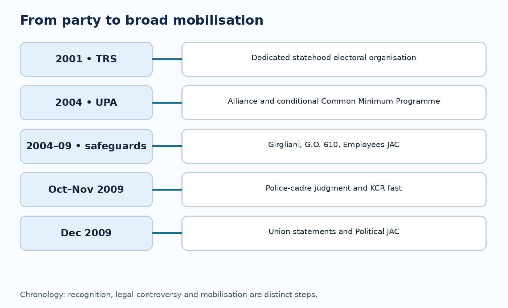
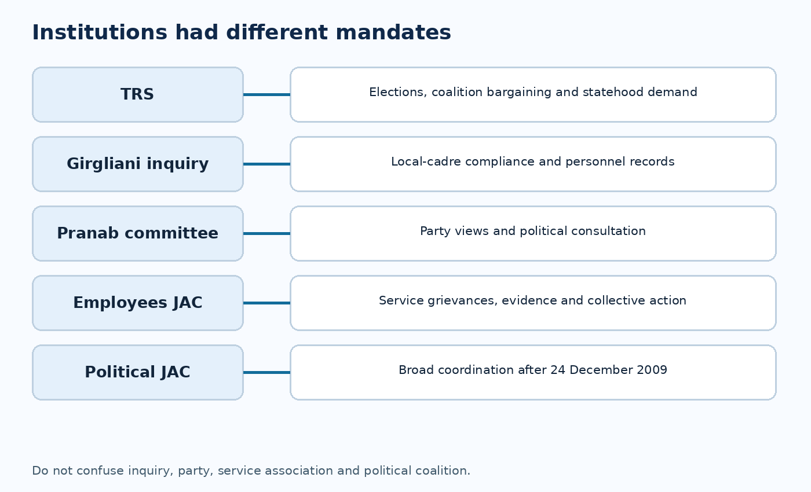
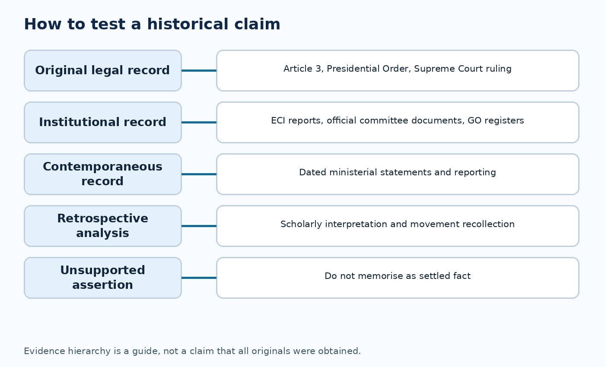

# Paper VI — Unit III — Topic 2: Establishment of TRS, Electoral Realignment, Employment Committees and the 2009 Telangana Turning Point

**TGPSC Group I Mains | Original English study draft | 25 October 2026 | Independent academic review pending**

**Source caution:** Exact syllabus clause was indexed from the original commission-hosted notification, but direct PDF open failed. Full original Girgliani annexures, party manifestos and official December minutes were not obtained. All MCQs and model answers are original practice, NOT authenticated TGPSC PYQs.

**Central thesis.** Between 2001 and 2009 Telangana statehood became an electoral coalition issue and then a broad protest coalition. The story is a sequence of conditional commitments, disputed employment safeguards, legal interpretation and political mobilisation—not an inevitable or single-leader victory.

# Syllabus index and verification

**Original commission-hosted Group I Notification 02/2024, Paper VI, Unit III, Item 2 (indexed wording):**

> Establishment of Telangana Rashtra Samithi in 2001, Political Realignment and Electoral Alliances in 2004 and later Phase of Telangana Movement – TRS in UPA- Girgliani Committee- Telangana Employees Joint Action Committee - Pranab Mukherjee Committee- 2009-Elections-Alliances- Telangana in Election Manifestos- The agitation against Hyderabad as Free-zone - and Demand for separate Statehood- Fast-Unto-Death by K.Chandra Shekar Rao-Formation of Political Joint Action Committee (2009)

**Authentication:** Commission-hosted original 50-page PDF was indexed with the clause; direct re-open returned server error. The wording is treated as strongly corroborated but direct page-image authentication remains outstanding.

| Syllabus component | Chapter sections | Main issue |
|---|---|---|
| TRS establishment 2001 | 4–6 | Party creation and leadership |
| 2004 political realignment and electoral alliances | 7–10 | Coalition incentives and programme |
| TRS in UPA | 9–11, 19 | Institutional leverage and disappointment |
| Girgliani committee | 14–16 | Local-cadre implementation |
| Telangana Employees JAC | 17–18, 33 | Evidence and mobilisation |
| Pranab Mukherjee committee | 12–13 | Political consultations |
| 2009 elections, alliances and manifestos | 20–22 | Mahakutami, ECI, manifesto audit |
| Hyderabad free-zone agitation | 23–25, 43 | Para 14(f), Supreme Court |
| KCR fast | 26–28, 30 | November–December escalation |
| Political JAC 2009 | 33–36, 46 | Coalition formation and limitations |

# Quick chronology and distinctions

| Date/period | Event | What it did not do |
|---|---|---|
| 27 Apr 2001 | TRS founded | Did not itself create a state |
| 2004 | Congress–TRS alliance and UPA programme | Did not provide unconditional deadline |
| 2004–05 | Pranab Mukherjee political consultations | Did not adjudicate local-cadre cases |
| Early 2000s | Girgliani employment inquiry | Did not function as a statehood commission |
| 9 Oct 2009 | P. V. Radha Krishna judgment | Did not open every Hyderabad job |
| 29 Nov 2009 | KCR begins fast | Did not enact Article 3 law |
| 7 Dec 2009 | Andhra Pradesh all-party meeting | Did not bind Parliament |
| 9 Dec 2009 | Union says statehood process to be initiated | Did not establish state immediately |
| 23 Dec 2009 | Union calls for wider consultations | Did not conclude issue |
| 24 Dec 2009 | Political JAC formed | Did not replace parties or Parliament |

## Three original visual explanations

## 1. Periodisation: why 2001–2009 deserves separate study

The second topic in Unit III studies a transition from a durable statehood claim to an organised electoral and cross-sector campaign. It is not a narrative in which one leader alone caused Telangana. The previous topic traced civil-society documentation and cultural conferences; this one follows the party created in April 2001, its negotiations with national parties, the persistence of service-rule grievances, and the December 2009 escalation. The distinction matters because different institutions did different jobs. A political party could contest seats and enter a ministry; an employees' association could scrutinise local cadres; a committee could collect party opinions; students could occupy public space; and the Union government could begin or defer a constitutional process.

A sound chronology also prevents hindsight bias. In 2004 a conditional promise was not the same as a statute creating a state. In 2009 a declaration that a process would be initiated was not a completed parliamentary reorganisation. Each institutional step should be classified as a demand, promise, consultation, administrative inquiry, judicial ruling, mobilisation or legal enactment. The 2014 Act belongs to a later topic. Here the explanatory problem is why a demand already familiar since 1956 and 1969 became politically difficult to postpone by late 2009.

## 2. Long background: merger safeguards and the politics of implementation

The 1956 merger of Telangana with Andhra created an enlarged linguistic state but did not erase differences in land tenure, public employment and educational opportunity. The Gentlemen's Agreement, the Telangana Regional Committee and later recruitment safeguards became reference points for a recurring debate over regional fairness. The 1969 agitation demonstrated the power of student mobilisation, while the 1973 Six-Point Formula and Article 371-D shifted part of the controversy into constitutionally authorised local opportunities and administrative tribunals. The 1975 Presidential Order organised local cadres and admissions arrangements; its detailed exemptions later became central to the Hyderabad police controversy.

These arrangements produced two competing interpretations. Defenders of a united Andhra Pradesh argued that common institutions and statewide investment could advance prosperity and that violations should be corrected within the existing state. Telangana activists argued that repeated promises and correction orders were insufficient if enforcement depended on the same political system that allegedly benefited from departures. Neither position can be evaluated by rhetoric alone. Appointment rosters, departmental exemptions, irrigation expenditures, school places and audited accounts are required. The post-2001 party movement drew legitimacy from precisely this unresolved implementation question.

## 3. Civil-society foundations and the limits of party-centred history

Before TRS appeared, scholars, writers, teachers, lawyers, cultural performers and local organisations had sustained Telangana as a subject of public debate. Information Trust publications and the 1997 meetings at Bhuvanagiri and Warangal widened the audience for historical safeguards and regional-development arguments. The formation of a party did not automatically absorb these networks. Some activists saw an electoral organisation as necessary to create pressure in Delhi; others feared that electoral bargains would subordinate social justice to cabinet posts or constituency arithmetic. That disagreement continued through 2009.

For mains answers, describe a division of labour rather than a hierarchy of heroes. Civil-society research offered a repertoire of facts and grievances; party leaders translated some demands into manifesto language and coalition bargaining; employee bodies supplied technical objections to cadre decisions; student organisations and cultural groups generated participation. This plurality explains both the movement's reach and its recurrent fragmentation. The same network could agree on separate statehood while disagreeing over alliances, land redistribution, minority protections or the future administration of Hyderabad.

## 4. 27 April 2001: the founding of Telangana Rashtra Samithi

K. Chandrashekar Rao, commonly abbreviated KCR, left the Telugu Desam Party and established the Telangana Rashtra Samithi on 27 April 2001. Accounts locate the founding at Jala Drushyam in Hyderabad. The new party's distinctive organising claim was that Telangana statehood should be its central, explicit objective rather than one demand within a statewide development programme. The party later changed its name, but in historical accounts of 2001–09 it must be called TRS, not retroactively renamed BRS.

Founding a party did not confer constitutional power to redraw a boundary. Under Article 3, Parliament acts on state reorganisation following the constitutionally prescribed procedure; an electoral party can build consent, bargain for legislative support and press the Union government, but cannot itself create a state. The party's significance was to establish a repeatable vehicle for campaigns, membership, local candidates, public meetings and negotiations. Its emergence also forced other parties to articulate their own Telangana positions more clearly, even when those positions remained conditional or inconsistent across elections.

## 5. KCR and the relationship between personal leadership and collective organisation

KCR brought experience from legislative politics and a capacity to connect regional demands with party strategy. His public speeches framed statehood as an answer to grievances concerning irrigation, jobs, language and political dignity. Professor K. Jayashankar and other intellectuals contributed long-running analyses of regional development and the historical promises attached to merger. Organisers at district and village level performed the less visible work of meetings, transport, pamphlets and local negotiations. Reducing the movement to a single individual's decision obscures this institutional infrastructure.

Leadership analysis should distinguish three types of power: symbolic authority to represent a grievance, organisational capacity to sustain a party, and bargaining leverage when larger parties require coalition partners. These powers can reinforce one another but also generate tensions. A leader who negotiates a ministry may gain access to national decision-makers while being accused by supporters of compromising the demand. A credible account therefore evaluates both gains and disappointments, including how activists responded when the Union government did not promptly implement the conditional 2004 language.

## 6. From protest to local electoral foothold, 2001–03

The early TRS period involved organisation building rather than an immediate breakthrough in Parliament. Local-body elections, constituency networks and public meetings allowed the party to test whether statehood could mobilise voters beyond a university-centred protest. Panchayat and mandal-level campaigns mattered because a separate state would need sustained legitimacy across districts, rural occupations and caste communities. The party also needed candidates, finance, campaign workers and credible interlocutors with larger parties. Electoral entry brought ordinary trade-offs: constituency-level alliances, competition for nominations and differences between regional aspirations and local issues.

Avoid treating every local result as a referendum on statehood. Voters may support a candidate because of caste networks, welfare, personality, anti-incumbency or the regional cause, and the weights differ by constituency. Equally, electoral weakness does not prove the absence of a movement, because street mobilisation and ballot performance measure different capacities. This distinction becomes especially important when explaining the 2009 election results alongside the rapid mass mobilisation later that year.

## 7. Political realignment: why the Congress–TRS alliance emerged in 2004

By 2004 the Congress sought to dislodge the Telugu Desam government in undivided Andhra Pradesh, while TRS wanted a national and state-level ally capable of moving Telangana from campaign demand to government agenda. Their alliance created a tactical convergence: anti-incumbency, coalition arithmetic and statehood expectations. The parties did not thereby agree on every institutional detail, timetable or future status of Hyderabad. Candidates should separate the electoral alliance itself from the Union government's subsequent Common Minimum Programme language.

Coalitions are negotiated instruments, not proofs of shared ideology. Congress had constituencies in Telangana, Coastal Andhra and Rayalaseema and therefore faced competing regional pressures. TRS had a narrower geographical mandate and a sharper statehood programme. The alliance widened access to legislative institutions but exposed the smaller party to dependence on the larger party's priorities. This asymmetry helps explain both the early optimism and the later dispute about delay. It also explains why the same Telangana issue could be supported in one election and framed more cautiously once the costs of reorganisation became politically immediate.

## 8. The 2004 election: interpreting votes and seats correctly

The 2004 simultaneous Lok Sabha and Assembly elections brought a Congress-led change of government in Andhra Pradesh and the formation of a Congress-led UPA coalition at the Centre. TRS contested as an ally, gained parliamentary and Assembly representation and entered a new phase of bargaining. The most important analytical point is not a memorised seat figure detached from its source; it is the change in institutional access. TRS could now press a Union coalition from within rather than solely from outside.

Any exact seat count should be taken from the Election Commission of India's 2004 statistical reports, with the election type and alliance distinguished. Lok Sabha constituencies, Assembly constituencies and Telangana-region totals are not interchangeable. A candidate should also distinguish seats contested from seats won, and a pre-poll alliance from the coalition subsequently formed. An alliance victory cannot establish that every voter supported Telangana statehood. It did, however, put the demand on the negotiating agenda of the new government and created an expectation that a national process would follow.

## 9. TRS participation in UPA: leverage and constraint

TRS participated in the United Progressive Alliance arrangement after the 2004 election, with leaders holding roles in the Union government. This was a notable institutional step: a regional statehood party had access to cabinet deliberation and national coalition management. Yet participation was not equivalent to a binding schedule for Telangana. The Union government had to consider parties from other regions, Parliament, the Andhra Pradesh government and possible consequences for Hyderabad and resource sharing.

The bargain exposed two distinct political tests. First, could TRS persuade partners that statehood was a feasible and legitimate federal solution? Second, could it convince its own supporters that remaining in government was producing measurable progress? The longer consultations continued without a definitive timetable, the more difficult the second test became. The history should not be simplified into an absolute claim that participation either achieved nothing or guaranteed statehood. It increased visibility and access while also creating the possibility of disillusionment and eventual withdrawal from ministerial arrangements.

## 10. The National Common Minimum Programme: exact conditionality

The UPA's 2004 National Common Minimum Programme acknowledged the demand for Telangana and stated that it would be considered at an appropriate time after consultations and consensus. The qualifiers are central. 'Considered' does not mean 'enacted'; 'appropriate time' supplies no deadline; 'consultations' require engagement with relevant political and regional stakeholders; and 'consensus' can be interpreted differently by parties that disagree over the number and identity of those whose assent is required. Contemporary parliamentary and ministerial references confirm that this conditional language was part of the 2004 political setting.

For a mains answer, analyse the phrase as a coalition compromise. It permitted the demand to enter the Union programme without committing the government to an immediate Bill. Supporters viewed it as recognition that statehood was a legitimate national issue. Critics viewed the absence of a timetable as a device for postponement. A historian should not substitute a stronger promise for the actual wording, nor claim that the Programme itself amended the Constitution. The distinction between political commitments and legal instruments is the most examinable concept here.

## 11. The President’s 2004 address and constitutional symbolism

References to Telangana in the President's address to Parliament in June 2004 elevated the question from regional campaigning to a matter acknowledged in the national government's programme. The President's address outlines the government's priorities; it is not an executive order dividing a state. Its importance is political and procedural: it gives Parliament and the public a text against which later government action can be assessed. The address must be read alongside the Common Minimum Programme rather than presented as a separate unconditional statehood guarantee.

Constitutional symbolism can create expectations without immediately altering legal rights. For Telangana supporters, national acknowledgment demonstrated that the demand had entered mainstream coalition politics. For opponents of bifurcation, the conditionality of consultations remained significant. An examination answer can use this contrast to show why an apparently small phrase in a government programme became a major source of mobilisation: it connected a longstanding regional grievance with the credibility of national institutions.

## 12. Pranab Mukherjee committee: consultation, not a reorganisation commission

A UPA ministerial sub-committee headed by Pranab Mukherjee canvassed political parties' views on Telangana during 2004–05. Contemporary reporting in September 2005 identified Union ministers Raghuvansh Prasad Singh and Dayanidhi Maran as other members and described requests for written party positions. Sources differ on the precise month of its formal constitution, so an official appointment order should be checked before asserting an exact founding date. Its task was political consultation, not the technical boundary, revenue or asset distribution exercise later associated with state reorganisation.

This distinction prevents confusion with the States Reorganisation Commission of 1953–55, the Girgliani employment inquiry and the 2010 Committee for Consultations on the Situation in Andhra Pradesh. The Mukherjee group sought to assess party support and potential consensus. Its limits followed from that design: correspondence with parties could clarify positions but could not itself compel the Union Cabinet to introduce legislation or settle regional objections. The continuing debate over what counted as consensus became one explanation for perceived delay after 2004.

## 13. Consensus as a contested political test

The demand for consensus sounds neutral until the decision rule is specified. Must every recognised party agree, or is a parliamentary majority sufficient? Should legislators from Telangana alone be decisive, or should elected representatives from all regions of Andhra Pradesh be consulted? How should a party's manifesto be weighed against its members' later objections? Different answers produce different claims about whether consensus existed in 2005 or 2009. The Constitution does not make unanimity of every regional party a general condition for Parliament's Article 3 power.

Consultation nevertheless matters in a democratic federation. The distribution of water, public employment, debt, assets and the status of Hyderabad affects people on both sides of a proposed boundary. The proper analysis distinguishes a legal requirement, a political convention and a coalition promise. Treating consensus as an unlimited veto risks indefinite delay; treating it as irrelevant risks alienating affected groups. The 2004–09 period demonstrates the difficulty of designing a credible process when participants disagree not only over the outcome but also over who may decide.

## 14. Girgliani committee: why employment records returned to centre stage

The J. M. Girgliani inquiry, established in the early 2000s, investigated alleged violations of the Presidential Order governing local cadres and related public-employment arrangements. It belongs to a long sequence of attempts to implement safeguards after the 1973 Six-Point Formula and G.O. 610 of 1985. Its political relevance was immediate: regional claims could be tied to appointments, deputations, transfers, exemptions and cadre structures that might be examined through departmental records rather than only speeches.

The inquiry should not be described as a committee to recommend a separate state. Its focus was administrative compliance. An alleged violation might involve recruiting against the wrong local area, improper absorption, irregular deputation or a misclassified post. Establishing a violation requires identifying the applicable Presidential Order provision, the recruitment year, the competent appointing authority and the personnel file. Aggregate claims about 'outsiders' cannot substitute for this legal analysis. The original signed full report and annexures should be consulted before asserting precise counts of violations or employees affected.

## 15. Girgliani recommendations: diagnosis versus enforcement

The political importance of an inquiry is not exhausted by submitting a report. Implementation requires departments to identify affected posts, verify service records, give legally required hearings, respect seniority and appeals, and issue executable orders. Even an accurately diagnosed irregularity may be hard to correct after years of promotions, transfers and retirement. The Girgliani debate therefore illustrates the difference between recommending administrative compliance and achieving it. Employees' associations could regard slow implementation as evidence that safeguards were ineffective.

A nuanced answer should acknowledge both the grievance and due process. A government cannot lawfully repatriate or penalise an employee solely because of regional identity; it must apply the specific cadre rules to each case. Conversely, an administrative department cannot invoke complexity to avoid checking its own orders indefinitely. Strong institutional reform requires transparent post-wise data, a time-bound review mechanism, independent appeal channels and published compliance outcomes. These are the concrete governance lessons of the Girgliani controversy.

## 16. G.O. 610 as an inherited controversy in the 2000s

G.O. Ms. No. 610, issued in 1985, became shorthand in Telangana politics for the promise to correct certain local-cadre and recruitment irregularities. By the 2000s it symbolised the gap between government orders and implementation. The order should be understood with the 1975 Presidential Order and subsequent judicial interpretation; it did not independently create Telangana's local-reservation system. A serious account identifies which departments and posts were covered, which exemptions applied, and how alleged deviations were to be rectified.

The movement's repeated invocation of G.O. 610 performed two functions. It supplied a legally specific basis for some complaints and also provided a powerful public symbol of unfulfilled assurances. These functions must not be conflated. A slogan about implementation may be historically important even where a particular employee's case is legally complex. For administrative examinations, propose an auditable compliance matrix: department, cadre, local area, order, appointment date, exception claimed, review finding, remedy and appeal status. This is more useful than an unsupported statewide count.

## 17. Telangana Employees Joint Action Committee: collective bargaining and evidence

Telangana employee organisations and joint-action formations linked service-rule grievances to the statehood campaign. Their technical contribution lay in familiarity with recruitment notifications, seniority lists, local-cadre organisation, deputation practices and departmental orders. Employees also had practical leverage through representations, demonstrations and, when legally organised, collective action. The syllabus uses the term Telangana Employees Joint Action Committee, which must be distinguished from the later, broader Political Joint Action Committee formed in December 2009.

An employees' JAC was not a constitutional court or a substitute for a departmental service tribunal. Its claims required verification, and its protest strategies had to balance workers' rights with continuity of public services. Yet the association could make obscure administrative questions intelligible to the wider public. The most important causal link is between a seemingly technical dispute over recruitment and a broader belief that the existing state lacked either the willingness or the capacity to enforce regional safeguards fairly. The movement gained breadth when legal grievance, livelihood interest and political identity reinforced one another.

## 18. How to audit an employment grievance: a practical case

Consider a hypothetical 2007 recruitment to a district-level post in a local cadre. An employee association alleges that applicants from outside the local area were improperly selected. The first task is to identify the category of post and the Presidential Order provision governing it. Next, inspect the notification, sanctioned vacancies, applicable local-reservation percentage, eligibility certificates, merit lists and appointment orders. Some posts may be exempt; some candidates may qualify as local under legally specified residence or study rules. A surname or birthplace alone does not establish eligibility.

If an irregularity is established, the government must consider a lawful remedy that respects notice, appeal and the rights of affected employees. An aggregate press claim cannot replace the post-wise record. The case illustrates why the Girgliani and employees' movements were politically potent: administrative justice could be tested against documents. It also demonstrates why a statehood demand and an individual service remedy are different legal questions. One is a constitutional political decision; the other requires application of existing service law.

## 19. TRS and UPA: withdrawal, protest and credibility

As the Union government did not promptly initiate a decisive statehood process, TRS leaders faced increasing pressure to demonstrate that participation in the coalition was producing results. Their eventual exit from ministerial roles and changing alliances should be interpreted as a struggle over credibility, not as a single mechanical cause of the 2009 agitation. In regional movements, coalition access can be an asset when negotiations advance but a liability when supporters believe that promises are being deferred.

A historian should ask what the party gained from being inside government: national visibility, parliamentary contacts, access to decision-makers and a record of commitments. Then ask what it could not guarantee: a timetable, an agreed Hyderabad settlement, cooperation from all Andhra Pradesh regions and enactment of Article 3 legislation. The tension between these two lists shaped the party's electoral decisions. Avoid equating cabinet resignation with an automatic legal step toward statehood; it was a political signal intended to change incentives.

## 20. The 2009 alliance realignment: Mahakutami and strategic calculation

In 2009 TRS joined an opposition electoral combination generally described as the Mahakutami or Grand Alliance, involving the Telugu Desam Party and Left parties in Andhra Pradesh. This differed from its 2004 alliance with Congress. The shift shows that statehood politics operated within competitive party arithmetic: regional parties could bargain with different statewide formations to obtain public commitments and contest seats. Yet alliance partners had distinct constituencies and histories. The Telugu Desam Party had earlier been associated with a unified Telugu identity, while Left parties did not hold identical positions on reorganisation.

For examination purposes, do not present a pre-election coalition as proof that every constituent adopted an identical, permanent Telangana programme. Study the written manifestos and constituency-specific campaign statements. Coalition arithmetic may increase the visibility of a demand without eliminating disagreement over its implementation. The 2009 result also reminds us that a party's ballot performance can be modest even when the cause later attracts mass mobilisation. The distinction between political demand, electoral representation and public agitation is essential.

## 21. Election manifestos: compare language, not labels

The syllabus explicitly asks for Telangana in election manifestos. A manifesto is evidence of what a party publicly offered at a particular election, not conclusive evidence that it later implemented the promise. In 2009 the major parties' formulations varied, and the Communist Party of India (Marxist) opposed division of Andhra Pradesh. Congress, TDP, TRS, BJP, CPI and other parties should therefore be compared using their exact contemporary documents rather than a retrospective table assigning everyone a simple yes or no.

A defensible comparison records the document date, issuing party, territorial scope, exact Telangana clause, qualifications, and any promise of Assembly resolution or Union action. It then compares these words with the party's conduct after December 9. The analytical payoff is that political alignment on a slogan can conceal differences about timing, procedure and Hyderabad. Since original signed 2009 manifestos were not obtained in this run, the chapter does not attribute unverified verbatim wording to individual parties. Contemporary ministerial accounts provide evidence of shifting positions but do not replace the manifestos themselves.

## 22. What the 2009 election results can and cannot prove

The 2009 Assembly election returned a Congress government in undivided Andhra Pradesh. Contemporary compiled figures report Congress 157 of 294 Assembly seats, TDP 90 and TRS 10; the authoritative source for final constituency totals is the Election Commission's statistical report. A candidate should distinguish a party's statewide tally from its Telangana-region vote and from the later composition of the Political JAC. The 2009 result did not produce a statehood mandate through TRS alone.

That does not mean the movement lacked social support. Elections aggregate many issues, candidates and alliances. The dramatic escalation in November–December reflected a new conjunction of a hunger strike, student protests, regional political competition and central-government decisions. A good answer should therefore reject two simplistic inferences: that a low TRS seat tally proves the statehood issue was marginal, and that subsequent protests retrospectively make the party the winner of the 2009 election. Both claims confuse different forms of political participation.

**How to test the electoral claim.** Begin with the Election Commission of India's *2009 Andhra Pradesh Legislative Assembly statistical report*, not a later newspaper chart or a Lok Sabha table. Record each party's candidates contested, seats won, votes and alliance partners. For a region-specific inference, first define which Assembly constituencies constituted Telangana in 2009 and aggregate those constituencies consistently. Compare both vote share and seat share: a first-past-the-post alliance can win fewer seats than its statewide votes might suggest, and allies may avoid contesting the same seats. Do not add party vote shares across constituencies in which a party did not stand without explaining the denominator. The often-repeated statewide Congress 157, TDP 90 and TRS 10 Assembly-seat figures are retained here as *secondary-report figures pending direct tabulation from the original ECI Assembly PDF*; they are not promoted to independently authenticated totals. In contrast, the ECI's separate 2009 **Lok Sabha** state-party table records two TRS parliamentary seats in Andhra Pradesh. Those two parliamentary seats must never be confused with the reported ten Assembly seats. Source: [ECI official statistical-report directory](https://www.eci.gov.in/statistical-reports); [ECI 2009 Lok Sabha state-party performance](https://www.eci.gov.in/eci-backend/public/api/download?url=LMAhAK6sOPBp%2FNFF0iRfXbEB1EVSLT41NNLRjYNJJP1KivrUxbfqkDatmHy12e%2FzVx8fLfn2ReU7TfrqYobgIsyRqfwDsMRwjg55m3U55yjlHajGO83WQ%2BnUj1iuR8%2FI7hZAwKYinrW9NRWyF5DKV71v01E%2BQDZgrN9kVasKh8g5Kndo6aDzVd7ZvbYRlcVl).

## 23. Hyderabad as a “free zone”: the legal vocabulary

The agitation against Hyderabad as a 'free zone' concerned the treatment of certain police posts under the Andhra Pradesh Public Employment (Organisation of Local Cadres and Regulation of Direct Recruitment) Order, 1975. Paragraph 14(f) contained an exception for specified Hyderabad City Police posts. The legal issue was not whether every public job in Hyderabad was open without local rules. Nor was Hyderabad constitutionally declared an independent employment zone for all departments. Such shorthand exaggerates the scope of the dispute.

The correct sequence is to identify the precise class of police posts, the wording of the exception, the history of cadre organisation and the judgment interpreting those provisions. In October 2009 the Supreme Court's decision in P. V. Radha Krishna and others v. State of Andhra Pradesh and others became a major flashpoint. The decision's legal holding must be distinguished from popular fears that the principle would spread to unrelated posts. This is a case where a narrow statutory or constitutional interpretation acquired far wider political significance.

## 24. P. V. Radha Krishna (9 October 2009): holding and limits

The Supreme Court's 9 October 2009 judgment examined the operation of the Presidential Order and the Hyderabad City Police exception. The Court rejected key High Court conclusions concerning the absence of a separate Hyderabad City Police cadre and the non-application of paragraph 14(f) to relevant police officers. The case arose from service and transfer disputes and involved the legal status of specified posts. It should not be summarised as a ruling abolishing all local reservations in Hyderabad.

For a law-focused mains answer, identify the parties, date, legal instrument, contested paragraph and operative result. Then explain the political reception separately. Telangana employee associations and activists viewed the decision as threatening local opportunities and demanded corrective action. A judicial interpretation can be legally limited yet symbolically powerful when citizens already distrust administrative implementation. Readers should consult the official Supreme Court judgment before making fine-grained claims about which post categories were included. Public legal reproductions are secondary access routes, not substitutes for the certified record.

## 25. Why the free-zone dispute intensified regional distrust

The free-zone controversy mattered because Hyderabad combined the region's largest concentration of public employment, educational institutions and administrative authority with an unresolved political debate over regional access. A recruitment exception could therefore be read as a test of whether the capital's benefits were being shared equitably. Activists connected the judgment with earlier controversies over G.O. 610 and local-cadre enforcement, giving the legal issue a history larger than the individual appeal.

The state government faced a difficult task: comply with a binding judgment, communicate its limited scope accurately, and consider constitutionally valid remedial steps without prejudicing employees whose appointments were lawful. For the movement, the episode strengthened the claim that repeated legal and administrative fixes had not produced stable confidence. An answer should explain this feedback loop without asserting that a judicial ruling itself created a free-standing political right to statehood. It was one catalyst among several.

## 26. The November 2009 fast: launch and immediate setting

K. Chandrashekar Rao began a fast-unto-death campaign on 29 November 2009, demanding a definite step toward Telangana statehood. The event followed the 2009 election, mounting anger over the Hyderabad police controversy and continued disappointment with earlier coalition promises. A hunger strike has distinctive political dynamics: it concentrates attention on an individual's health, creates a visible deadline for government response and invites solidarity from people who may not otherwise attend party meetings.

The fast was not a parliamentary procedure and did not itself amend the Constitution. Its effect depended on the response of students, employee groups, media, other political parties and the Union government. Reports describe Rao's detention, medical supervision and eventual treatment at NIMS in Hyderabad. Exact medical claims should not be inferred from political reporting without hospital records. The relevant historical fact is that concern about his condition intensified the political urgency and helped move the demand from routine negotiations to an immediate national crisis.

## 27. Students, especially Osmania University, and the enlargement of protest

Students became prominent participants in the late-2009 agitation, particularly around Osmania University in Hyderabad. Their actions linked regional identity to concerns about future employment, access to higher education and political recognition. Universities served as organising spaces because they concentrated young people, hostels, associations, public debate and communication networks. Student participation also meant the movement could not be understood solely as a party-directed campaign. Campus organisations had their own leadership, tactics and grievances.

Public-order responses created further controversy. Restrictions on assemblies, detentions and policing could be defended as necessary to prevent violence but also criticised when they burdened peaceful expression. A balanced analysis separates peaceful protest, unlawful violence, police accountability and the constitutional rights of assembly and speech. Avoid unverified casualty or detention totals. The political importance of student action lies in its capacity to broaden the movement and raise the cost of ignoring the demand, while also creating risks that organisers and government had to manage responsibly.

## 28. The role of employees, teachers, lawyers and other professions in 2009

Employees and professional associations connected the fast to ongoing grievances in administration and public services. Teachers could explain the historical and constitutional case; lawyers could analyse the Presidential Order and the free-zone judgment; employees could provide recruitment examples; cultural groups could communicate in accessible idioms. Each group brought a different kind of credibility. This diversity mattered because a single-party protest might be dismissed as electoral bargaining, whereas a broader coalition could claim that the issue affected institutions and livelihoods across society.

Such coalitions are not frictionless. Government employees have service obligations, students have academic commitments, and political parties compete for credit. Their agreement on a separate state does not imply unanimity on tactics or post-statehood policy. A useful administrative lesson is to maintain grievance-redress channels even during a political crisis: credible, timely responses to specific service-rule complaints can reduce unnecessary escalation without prejudging the larger constitutional question.

## 29. 7 December 2009: Andhra Pradesh all-party consultations

On 7 December 2009 Andhra Pradesh Chief Minister K. Rosaiah convened a meeting of political parties amid the intensifying agitation. In a public explanation on 31 December, Union Home Minister P. Chidambaram said that the Centre received the minutes on 8 December and relied on them when announcing a step toward Telangana on 9 December. He also stated that the CPI(M) held a different position and that MIM preferred the Assembly as the forum for expressing its view. These distinctions are important because they qualify the phrase 'all-party consensus'.

The meeting was a political consultation, not a binding plebiscite or an Article 3 resolution. The exact minutes should be obtained before attributing verbatim commitments to every participant. Its significance was that the Union government could point to an apparent basis for proceeding, while later disagreements exposed the fragility of that basis. In a mains answer, distinguish the meeting's political signal from the formal legislative steps that would still have been necessary.

## 30. 9 December 2009: Chidambaram's first statement

On the night of 9 December 2009 Union Home Minister P. Chidambaram announced that the process of forming Telangana would be initiated and that an appropriate resolution would be moved in the Andhra Pradesh Assembly. He also requested withdrawal of cases arising from the current agitation and appealed for the fast and protests to end. The wording is decisive: the statement promised the initiation of a process; it did not declare that a new state had already been created, specify a boundary settlement or pass a parliamentary law.

Contemporary reporting records that KCR ended his fast following the announcement. For examination purposes, explain why the statement was simultaneously a breakthrough and an incomplete outcome. It represented explicit Union-level movement toward the demand and validated the political urgency of the agitation. But it left the legislative route, regional consultations, Hyderabad's status and the timetable unresolved. The gap between the public expectation of imminent statehood and the legal reality of an unfinished process became central to the events of the next two weeks.

**A source-and-institution timeline.** Reconstruct the 9 December announcement as an executive communication rather than a self-executing constitutional instrument. First, distinguish the 7 December state-level party consultation from the Union Home Minister's later announcement; a political consultation produces opinions and minutes, not a law. Second, distinguish the minister's words about *initiating* a process from the constitutional steps needed to introduce and pass a reorganisation bill. Third, record what followed: KCR's fast ended after the announcement, while leaders and organisations in Coastal Andhra and Rayalaseema raised competing objections. The Union's 23 December statement called for wider consultations; it was not a final rejection enacted by Parliament. The Ministry of Home Affairs' later Srikrishna Committee report provides an official retrospective narrative of the crisis, but a later committee's reconstruction must not be passed off as the signed original 9 December ministerial statement. For precise quotation, consult the contemporary statement reproduction already listed in this chapter's source register; for legal effect, consult the Constitution. This separation of *event*, *document*, *legal power* and *political reaction* prevents a common mains-answer error: describing 9 December 2009 as the date Telangana was legally created. The state was formed only after later parliamentary legislation and the appointed day in 2014.

## 31. What an Assembly resolution can and cannot do under Article 3

Article 3 gives Parliament authority to form a new state, subject to constitutional procedure, including the President's recommendation for introduction of the Bill and reference of relevant proposals to the affected state legislature for its views. The legislature's views are constitutionally important but are not the same as an absolute veto over Parliament's power. A minister's promise to move an 'appropriate resolution' should therefore be read as part of a proposed political and legislative route, not as the complete constitutional mechanism.

This distinction helps explain the 2009 confusion. Some supporters interpreted the Union statement as a decisive commitment; opponents sought broader consultations and questioned the implications for the existing state. Both could use the absence of a precise timetable to advance their positions. An examiner may ask whether the Andhra Pradesh Assembly could itself create Telangana: it could not. The eventual legal act required parliamentary legislation, which belongs to the later 2014 stage. Here the constitutional principle is the separation between executive announcement, state-legislature opinion and parliamentary enactment.

**Constitutional decision chain.** Article 3 permits Parliament to form a new state, alter boundaries or names, and combine or separate territories, but the bill must be introduced on the President's recommendation. Where a proposal affects an existing state's area, boundaries or name, the President refers it to that state's legislature for its views within the specified or extended period. The Constitution requires the opportunity to express views; it does not make that legislature's affirmative consent an absolute condition of Parliament's legislative competence. The distinction is between a *consultative reference* and a *binding veto*. The affected legislature may support, oppose or propose changes, yet Parliament retains the constitutional decision. Article 4 permits supplementary, incidental and consequential provisions, including necessary First and Fourth Schedule amendments, in a law under Article 3. Article 4 also specifies that such a law is not deemed a constitutional amendment for Article 368 purposes merely because it contains those provisions. This is why the examination answer should not casually say that every new-state law needs the special constitutional-amendment procedure. A cabinet announcement, party manifesto, state Assembly resolution and Parliament's enacted law are four different legal and political objects. Consult the [Government of India's published Constitution](https://www.legislative.gov.in/static/uploads/2025/08/7af1daa22d65f9d04c00ae9b9aa5a799.pdf), Articles 3–4; the direct text is the authority for these procedural distinctions.

## 32. Reactions in Coastal Andhra and Rayalaseema: competing claims

The 9 December announcement triggered significant opposition in Coastal Andhra and Rayalaseema, including resignations and protests by political representatives who feared the consequences of division. Concerns included Hyderabad's economic importance, education and employment access, shared assets, water projects and the political meaning of Telugu linguistic unity. These concerns cannot be dismissed as irrelevant simply because Telangana's grievances were substantial. State reorganisation affects multiple populations with legitimate interests.

At the same time, regional opposition should not be used to deny that Telangana residents had sustained a separate-state claim over decades. A balanced analysis asks which concerns could be addressed through negotiated transitional arrangements, statutory guarantees and inter-state institutions, and which reflected an irreconcilable preference for a unified state. The history is not a morality play with one region entirely virtuous and another entirely culpable. It is a federal conflict over identity, distribution and decision-making that required constitutional accommodation.

## 33. 23 December 2009: the second central statement

On 23 December 2009 the Union government emphasised that the situation had changed after its 9 December announcement and that wide-ranging consultations with political parties and groups were needed. This shift was widely interpreted by Telangana supporters as a retreat or postponement. Union ministers defended it as a response to divisions that had become visible after the first statement. Both descriptions reflect real political perceptions, but neither should be substituted for the wording of the statements themselves.

The sequence demonstrates a governance failure of expectation management. A high-stakes announcement without a published roadmap can generate incompatible assumptions among stakeholders. Once protests and resignations spread, the government faced pressure to slow down and consult more widely, which in turn weakened trust among those who believed the first announcement had settled the issue. The lesson is not that consultation is unnecessary; it is that consultation should have a clear scope, deadline, evidence base and relationship to the final constitutional decision.

## 34. 24 December 2009: formation of the Political Joint Action Committee

The Telangana Political Joint Action Committee was constituted on 24 December 2009, shortly after the Union government's 23 December statement. M. Kodandaram, an academic and activist, became its leading convenor. Contemporary reporting confirms the date and his role. The organisation aimed to coordinate political parties, students, employees and civil-society bodies around the demand for Telangana. It was a coalition platform, not a new government department or a single political party.

Its formation responded to a coordination problem. Separate groups could mobilise independently, but fragmented protests risked conflicting schedules, messages and negotiating claims. A joint platform could establish common programmes while allowing members to retain their identities. That design also produced tension: parties had electoral incentives, while students and civic organisations often demanded more sustained agitation. Some participants, including Telangana TDP legislators, withdrew or worked independently soon after formation. Thus the JAC's history should be written as an evolving coalition, not as permanent unanimity from its first day.

## 35. Political JAC versus Employees JAC: institutional comparison

The Employees Joint Action Committee and Political Joint Action Committee shared the Telangana cause but differed in composition, purpose and methods. Employees' bodies concentrated on recruitment safeguards, cadre implementation and service grievances; the Political JAC sought to coordinate parties and a wider social movement after December 2009. Confusing them erases the movement's organisational diversity and can lead to inaccurate answers about who had authority to negotiate or call a protest.

The two structures also operated on different evidence bases. An employees' representation might include departmental rosters, government orders and tribunal proceedings. A political JAC statement might seek a roadmap for statehood, a protest programme or a response to Union announcements. They could support each other, but the legal validity of an employment claim did not automatically establish the constitutional desirability of statehood, and the strength of a statehood demand did not resolve every individual service case. An analytical answer should show the connection without collapsing these separate questions.

## 36. Kodandaram's role: coordinating without eliminating disagreement

Professor M. Kodandaram brought credibility from academic and civil-rights circles to the Political JAC. As convenor he represented a bridge between party politics and non-party organisations, making it easier for students, employees and civil-society activists to cooperate without formally joining TRS. This role was distinct from KCR's leadership of a registered political party. The distinction is useful in explaining why the agitation could persist through changing alliances and disputes among elected representatives.

Coalition convenors have limited coercive power. They must persuade groups with different interests, maintain trust and prevent tactical disputes from undermining the common demand. Kodandaram's significance therefore lies in organisational mediation and public legitimacy rather than unilateral command. A good mains answer avoids portraying the JAC as entirely independent of political parties or as a mere branch of TRS. Its membership, influence and internal balances changed over time, and its later protest programmes fall primarily in subsequent syllabus topics.

## 37. December 2009 as a turning point, not the final victory

The last weeks of 2009 joined several streams: an electoral party founded in 2001, a conditional national commitment in 2004, administrative grievances investigated by Girgliani, a court-triggered employment controversy, a hunger strike, student mobilisation, an apparent Union breakthrough and then renewed consultation. The Political JAC emerged as a mechanism to sustain coordination after the central position became uncertain. These were mutually reinforcing developments, not a single inevitable chain.

The state was not created in December 2009. Parliament enacted the Andhra Pradesh Reorganisation Act in 2014, and Telangana came into existence on 2 June 2014. Reading those later facts backwards risks misrepresenting uncertainty in 2009. At that point important issues remained unresolved: the Union's timetable, legislative procedure, Hyderabad, resources, political-party positions and the relationship between protest and constitutional negotiation. The movement's subsequent intensity becomes intelligible precisely because the 2009 announcements left these matters open.

## 38. Contrasting interpretations: regional justice and integrated development

A Telangana statehood argument emphasised perceived failures to honour safeguards, uneven opportunities, cultural recognition and the need for a government directly accountable to the region. Its strongest version relies on verifiable administrative records and explains how a new state might improve representation and policy design. A united-state argument emphasised economies of scale, shared institutions, common infrastructure and potential costs of dividing a large linguistic state. Its strongest version acknowledges past violations and offers credible mechanisms to correct them.

Neither side should be caricatured. Development indicators can vary within Telangana and within Coastal Andhra or Rayalaseema; wealthy urban areas may coexist with deprived rural districts. The presence of inequality alone does not prove that a boundary change will solve it, but repeated implementation failure can rationally weaken confidence in promised safeguards. A high-quality mains answer compares institutional alternatives, the evidence for grievances, the distribution of costs and the democratic legitimacy of the proposed decision.

## 39. Hyderabad: employment, capital and the problem of scale

Hyderabad appeared in the 2009 debate as an administrative capital, economic centre, higher-education hub and symbol of regional identity. Different controversies used the city's name in different ways. The free-zone litigation concerned specified police cadres under the Presidential Order; the statehood debate concerned the future location and governance of a major metropolitan economy. Treating these as one legal issue is a serious error. An employee's local status is not the same as the ownership or constitutional status of a city.

Any division would raise questions about common institutions, land and property, debt, public enterprises, employee allocation, water and access to education. These questions require technical negotiation. At the same time, the city's economic growth was the product of investments and labour from multiple regions, a fact that informed political fears and claims on all sides. A fair analysis recognises both the historic territorial identity of Telangana and the need for transparent transitional arrangements affecting people across the former state.

## 40. A source-criticism protocol for Telangana movement history

The most common errors in study notes are collapsing different committees into one, treating a newspaper's estimate as an official statistic, attributing exact manifesto language without a copy, and confusing a political announcement with a law. A reliable researcher begins with the original TGPSC syllabus; then seeks Election Commission statistical reports, Union programme documents, the Presidential Order, signed government orders, the Supreme Court judgment and contemporaneous ministerial statements. Retrospective histories can explain interpretation but must not silently replace primary records.

Where the original is inaccessible, identify the best available reproduction and label its evidentiary status. Do not manufacture the date of a Girgliani annexure, the number of affected employees, an exact fasting medical diagnosis or a casualty count. For the 2009 free-zone case, read the operative judgment rather than a headline. For party positions, read the election-year manifesto rather than a post-2014 recollection. This discipline makes an answer more credible and protects students from confidently memorising uncertain details.

## 41. Case study 1: a disputed local-cadre recruitment

A Telangana employees' association complains that a 2008 recruitment panel appointed candidates who did not qualify as local for a specified category. A district collector should not decide the case from slogans or personal identity. The administration must obtain the vacancy notification, cadre classification, Presidential Order provisions, local-status evidence and appointment records. If the post is exempt, that fact must be explained; if it is not exempt and a violation is established, the lawful remedy must follow notice and appeal. Publishing anonymised compliance data can restore confidence without exposing personal records.

This case connects Girgliani's diagnostic work to the political demand for accountability. It also shows that service justice and state reorganisation are analytically distinct. Correcting one recruitment may resolve an individual grievance while leaving broader representation disputes unsettled. Conversely, creating a state would not retroactively legalise every employment remedy. In a mains answer, state the governing rule, evidence, due process and institutional remedy before drawing a political conclusion.

## 42. Case study 2: reading the 2004 UPA promise as a citizen

A citizens' forum asks whether the 2004 Common Minimum Programme legally guaranteed Telangana by 2006. The correct answer is no: the text contemplated consideration at an appropriate time after consultations and consensus, without an enforceable deadline. That does not make the promise politically meaningless. Parties can be judged against the commitments they publicly make, and delay can reduce trust even where no court-enforceable deadline exists. The forum should request the original programme, related parliamentary statements and records of the Mukherjee committee's consultations.

The case teaches three categories: a political assurance creates public expectation; an administrative committee collects information and advice; constitutional reorganisation requires legislative action. Confusing them produces exaggerated claims of both success and betrayal. A careful civic argument can criticise indefinite postponement while quoting the actual conditional language. For an administrator, the practical lesson is to communicate milestones and the status of consultation clearly instead of allowing ambiguous promises to accumulate.

## 43. Case study 3: a journalist reporting the Hyderabad free-zone ruling

A reporter is preparing a headline after the October 2009 Supreme Court judgment. 'All Hyderabad jobs opened to everyone' would be misleading because the case concerned specified police posts and paragraph 14(f) of the Presidential Order. A responsible report should name the judgment, explain the affected cadre and distinguish the Court's legal holding from the broader political interpretation. It should also report why employees' organisations feared that the decision would undermine safeguards.

The distinction is not a technicality. Incorrect headlines can expand the perceived scope of a judgment, trigger anxiety among applicants and make later clarification appear evasive. The reporter should consult the text of the order and ask government departments which recruitments are actually affected. A strong mains answer uses this example to connect constitutional interpretation, public communication and political mobilisation without pretending that a media controversy is itself a new legal rule.

## 44. Case study 4: designing a fair all-party consultation

Imagine the Union government is designing consultations after the 9 December 2009 statement. A credible process would publish its purpose, invite recognised political parties and relevant regional stakeholders, record disagreements, specify the evidence required on Hyderabad, water, employees and finances, and set a realistic timeline for reporting back. It should distinguish consultation from consent: hearing a party's objection does not necessarily give it a veto, but ignoring the objection undermines legitimacy. The government should also explain how the eventual recommendation relates to Article 3.

The case illustrates why the December 23 response was so contentious. A consultation process announced only after a seemingly decisive statement can look like reversal even when it responds to real opposition. Clear sequencing, public minutes and legally accurate communication are essential. Candidates should resist the temptation to present consensus as either a magic solution or a meaningless obstacle. Its democratic value depends on rules, inclusion and transparent decision-making.

## 45. Case study 5: students, public order and constitutional rights

Suppose student groups call a peaceful march near the Assembly in December 2009. Police must assess specific safety risks, traffic, competing assemblies and credible threats rather than automatically treating political disagreement as disorder. Restrictions must have a legal basis and be proportionate. Organisers should communicate routes, safety arrangements and a non-violence code; institutions should preserve students' academic interests while recognising their right to public participation.

This case helps separate three questions often conflated in movement narratives: whether the statehood demand is politically justified, whether a particular protest is lawful, and whether the police response is proportionate. One answer cannot settle all three. Documented incidents should be described from verified records; unverified casualty or arrest figures should not be repeated. The administrative lesson is that fair public-order management can prevent a constitutional dispute from becoming a wider crisis of trust.

## 46. Case study 6: coordinating a broad Political JAC

A newly formed Political JAC contains representatives of parties, employees, students and civil-society organisations. Members agree on separate Telangana but disagree over whether to suspend protests during consultations. A workable charter would identify common minimum demands, voting rules, authorised spokespersons, a conflict-resolution procedure and safeguards against unilateral attribution of statements to every member. It should keep legal claims separate from mobilisation rhetoric and avoid coercion of dissenting organisations.

The December 2009 JAC's early difficulties illustrate this challenge. Coalition membership changed rapidly, and the withdrawal of some participants did not eliminate the wider cause. A candidate should explain that coordination is a political achievement requiring continuing negotiation, not a static photograph of unity. The practical benefit is sustained collective action; the risk is that party rivalry, media incentives or unclear authority may fragment the coalition. The case provides a bridge to the later syllabus topic on mass protest forms after 2009.

## 47. Mains synthesis: six causal links rather than a list of events

The most effective explanation of 2001–09 connects six mechanisms. First, the unresolved history of safeguards supplied the grievance. Second, TRS created a dedicated electoral vehicle in 2001. Third, the 2004 alliance and UPA programme gave the demand national recognition but no binding deadline. Fourth, the Girgliani inquiry and employee organisations kept implementation disputes alive. Fifth, the October 2009 police-cadre judgment and November fast transformed urgency and participation. Sixth, the 9 and 23 December Union statements created both hope and uncertainty, leading to the Political JAC's formation.

These links do not prove inevitability. They show how institutional access, administrative evidence, judicial interpretation and street mobilisation interacted. A strong conclusion recognises that a new state required parliamentary action and that Telangana's eventual formation was neither completed in 2004 nor accomplished by the December 2009 announcement. This structure answers why the movement accelerated without overstating the authority of any single actor or institution.

# Exam practice and complete mains answers

# 30 original explained practice MCQs — NOT official TGPSC PYQs

**Q1. TRS was established on which date?**

- A. 27 April 2001
- B. 2 June 2014
- C. 9 December 2009
- D. 23 December 2009

**Answer: A.** The 2001 founding created a dedicated electoral vehicle; 2014 marks state formation and the December dates are Union announcements.

**Q2. The central political objective of TRS at its founding was:**

- A. Replacing Article 3
- B. A separate Telangana state
- C. Establishing a national civil service
- D. A new Supreme Court

**Answer: B.** TRS organised around statehood; it could not independently alter constitutional boundaries.

**Q3. Which leader founded TRS after leaving Telugu Desam Party?**

- A. Pranab Mukherjee
- B. M. Kodandaram
- C. K. Chandrashekar Rao
- D. P. Chidambaram

**Answer: C.** KCR founded the party; the other named individuals had different roles in consultation or mobilisation.

**Q4. The Congress–TRS pre-election alliance is associated with:**

- A. 1956
- B. 1973
- C. 2014
- D. 2004

**Answer: D.** Their 2004 alliance gave the Telangana issue a route into UPA coalition bargaining.

**Q5. Which phrase best describes the 2004 UPA Telangana commitment?**

- A. Consideration after consultations and consensus
- B. Immediate unconditional enactment
- C. A Supreme Court decree
- D. A completed Article 3 Act

**Answer: A.** The Common Minimum Programme used conditional language without a binding deadline.

**Q6. Which institution has constitutional power to form a new state under Article 3?**

- A. District collector
- B. Parliament
- C. State Election Commission
- D. A political JAC

**Answer: B.** Article 3 assigns the state-formation law to Parliament through the prescribed procedure.

**Q7. The Pranab Mukherjee sub-committee primarily sought:**

- A. Local-cadre personnel files
- B. Hydrological project clearances
- C. Political-party views and consensus
- D. A judicial appeal

**Answer: C.** It was a Union political consultation mechanism, not the Girgliani employment inquiry.

**Q8. Which pair were reported as members of the Pranab Mukherjee group?**

- A. Fazal Ali and K. M. Panikkar
- B. M. Kodandaram and KCR
- C. J. M. Girgliani and Justice Srikrishna
- D. Raghuvansh Prasad Singh and Dayanidhi Maran

**Answer: D.** Contemporary 2005 reporting names the two Union ministers alongside Mukherjee.

**Q9. Girgliani inquiry concerned principally:**

- A. Implementation of local-cadre safeguards
- B. International boundaries
- C. Hyderabad metro fares
- D. Assembly constituency delimitation

**Answer: A.** Its relevance lay in public-employment and Presidential Order compliance.

**Q10. G.O. 610 is most closely associated with:**

- A. Creation of TRS
- B. Rectification of local employment irregularities
- C. Appointment of the President
- D. 2009 Assembly dissolution

**Answer: B.** The 1985 order became a symbol of disputed implementation of employment safeguards.

**Q11. A legally sound investigation of a local recruitment complaint first needs:**

- A. Candidate surnames alone
- B. Newspaper vote counts
- C. Cadre rules and appointment records
- D. Only a party manifesto

**Answer: C.** Post classification, eligibility and appointments determine legal compliance, not regional stereotypes.

**Q12. The Telangana Employees JAC is distinct from the Political JAC because it focused especially on:**

- A. Article 3 enactment by itself
- B. Supreme Court appointments
- C. International treaties
- D. Service-rule and recruitment grievances

**Answer: D.** Employee organisations contributed technical cadre evidence; the Political JAC coordinated a broader movement.

**Q13. The 2009 opposition electoral alliance including TRS and TDP was commonly called:**

- A. Mahakutami
- B. UPA I
- C. SRC
- D. Six-Point Formula

**Answer: A.** Mahakutami refers to a pre-election alliance, not a constitutional commission.

**Q14. A 2009 party manifesto is best treated as evidence of:**

- A. An enacted statute
- B. A public electoral commitment
- C. An official casualty register
- D. A court holding

**Answer: B.** Manifestos express promises and positions; subsequent implementation must be assessed separately.

**Q15. A commonly reported TRS tally in the 2009 Andhra Pradesh Assembly election is:**

- A. 157 seats
- B. 90 seats
- C. 10 seats
- D. 294 seats

**Answer: C.** Compiled election summaries report TRS 10, Congress 157, TDP 90 of 294; check the ECI statistical report for final constituency detail.

**Q16. The Hyderabad free-zone dispute in 2009 concerned especially:**

- A. All jobs in Hyderabad
- B. Every private employer
- C. All university admissions
- D. Specified Hyderabad City Police posts

**Answer: D.** Paragraph 14(f) of the 1975 Presidential Order contained a specific police-post exception.

**Q17. Which paragraph of the 1975 Presidential Order featured in the police free-zone controversy?**

- A. 14(f)
- B. Article 356
- C. Section 370
- D. Schedule XI

**Answer: A.** The controversy turned on paragraph 14(f), not a general constitutional exemption for Hyderabad.

**Q18. The Supreme Court judgment P. V. Radha Krishna is dated:**

- A. 27 April 2001
- B. 9 October 2009
- C. 9 December 2009
- D. 2 June 2014

**Answer: B.** The October 2009 service-law decision preceded the November fast and December political escalation.

**Q19. A correct interpretation of the free-zone judgment is:**

- A. It abolished all local reservations statewide
- B. It created Telangana
- C. It addressed specified police cadres
- D. It enacted G.O. 610

**Answer: C.** The judgment must not be inflated into a ruling about every public job.

**Q20. KCR began the late-2009 fast-unto-death on:**

- A. 24 December 2009
- B. 7 December 2009
- C. 1 January 2010
- D. 29 November 2009

**Answer: D.** The fast began in late November and ended following the 9 December announcement.

**Q21. Which university became a prominent centre of student mobilisation in 2009?**

- A. Osmania University
- B. Nalanda University
- C. Delhi University
- D. Aligarh Muslim University

**Answer: A.** Osmania University in Hyderabad became a key site of student activism.

**Q22. The Andhra Pradesh all-party meeting immediately preceding the Union announcement occurred on:**

- A. 27 April 2001
- B. 7 December 2009
- C. 23 December 2009
- D. 5 January 2010

**Answer: B.** Chidambaram later stated the Centre received its minutes on 8 December.

**Q23. On 9 December 2009 the Union government announced:**

- A. Completion of a new state
- B. Promulgation of the 2014 Act
- C. Initiation of a Telangana formation process
- D. A final Supreme Court decree

**Answer: C.** The language promised a process and an appropriate Assembly resolution, not immediate statehood.

**Q24. Which leader made the 9 December 2009 Union statement?**

- A. K. M. Munshi
- B. Fazal Ali
- C. J. M. Girgliani
- D. P. Chidambaram

**Answer: D.** The then Union Home Minister P. Chidambaram issued the statement.

**Q25. Why was the 23 December 2009 Union statement controversial?**

- A. It called for wider consultations after the earlier announcement
- B. It completed bifurcation
- C. It abolished Parliament
- D. It formed TRS

**Answer: A.** Supporters interpreted renewed consultations as a retreat from the 9 December promise.

**Q26. The Telangana Political JAC was constituted on:**

- A. 27 April 2001
- B. 24 December 2009
- C. 9 October 2009
- D. 2 June 2014

**Answer: B.** The platform emerged immediately after the 23 December Union statement.

**Q27. The leading convenor of the Political JAC was:**

- A. J. M. Girgliani
- B. Dayanidhi Maran
- C. M. Kodandaram
- D. P. V. Radha Krishna

**Answer: C.** Kodandaram helped coordinate parties and civil-society groups.

**Q28. Which statement about the Political JAC is most accurate?**

- A. Every party remained permanently united
- B. It was a statutory court
- C. It was identical to TRS
- D. Membership and tactics changed over time

**Answer: D.** The coalition brought diverse groups together but experienced withdrawals and disagreements.

**Q29. Which distinction is essential when evaluating the 2009 statements?**

- A. Executive announcement versus parliamentary enactment
- B. Speech versus geography only
- C. Voting versus rainfall
- D. Local job versus private salary only

**Answer: A.** An announcement of intent did not itself satisfy Article 3 legislative procedure.

**Q30. Which source best establishes final 2009 constituency-wise election results?**

- A. An unsourced poster
- B. Election Commission statistical report
- C. A retrospective party speech
- D. A fictional case study

**Answer: B.** ECI statistical tables are the primary election record; slogans and recollections are not substitutes.

# Six original structured mains model answers — NOT authenticated official PYQs

## Mains model answer 1 — Analyse the role of TRS in transforming the Telangana demand into an electoral and national coalition issue between 2001 and 2004.
**Introduction.** The Telangana demand predated TRS, but the party founded by K. Chandrashekar Rao on 27 April 2001 gave it a dedicated electoral organisation. Its emergence connected civil-society arguments to candidates, constituencies and national bargaining.

**Organisational contribution.** TRS built local networks, held meetings and articulated statehood as a central objective rather than a peripheral regional complaint. It drew upon earlier debates about the 1956 merger, employment safeguards, irrigation and cultural recognition. Scholars and civic groups retained independent roles; the party did not invent the grievances.

**Electoral and coalition strategy.** The 2004 alliance with Congress gave TRS representation and access to a UPA coalition. The National Common Minimum Programme recognised the Telangana demand but promised consideration after consultations and consensus, not immediate creation. Participation therefore enlarged the issue’s national visibility while making the smaller party dependent on its partner’s priorities.

**Limitations.** Coalition bargaining created tension between office and movement credibility. Electoral results also reflected many issues besides statehood, so party votes cannot be read as a complete regional plebiscite. Civil-society and employee organisations continued to provide evidence and pressure outside formal party structures.

**Conclusion.** TRS helped institutionalise and nationalise the demand, but the 2004 breakthrough remained conditional. Its significance was political leverage and sustained organisation, not a completed constitutional reorganisation.
**Body-only word count (Cycle75): 202 words.**

## Mains model answer 2 — Evaluate the 2004 UPA Common Minimum Programme and Pranab Mukherjee Committee in the Telangana statehood debate.
**Introduction.** The 2004 Congress–TRS alliance brought Telangana into the agenda of the new Union coalition. The National Common Minimum Programme and subsequent ministerial consultation were important political steps, but neither created a state.

**Programme language.** The UPA formulation contemplated considering Telangana at an appropriate time after consultations and consensus. This wording acknowledged the legitimacy of the demand while leaving its timing and decision rule open. A manifesto or programme is a political commitment; it does not substitute for Parliament’s Article 3 legislation.

**Committee role.** A sub-committee headed by Pranab Mukherjee canvassed parties’ positions in 2004–05. Contemporary reporting identified Raghuvansh Prasad Singh and Dayanidhi Maran as other members. Its purpose was to explore political consensus, not to adjudicate local-cadre violations or determine final inter-state asset sharing.

**Achievements and shortcomings.** The demand acquired national visibility and a consultative forum. However, no binding deadline followed, and parties disagreed about whose consent constituted consensus. The lack of a transparent roadmap created space for postponement and frustration among supporters. Wider regional consultation was legitimate but could not be allowed to become an undefined veto.

**Conclusion.** The programme and committee converted the issue into national coalition politics while exposing the limits of conditional assurances. Their central lesson is the need to distinguish recognition, consultation and enforceable constitutional action.
**Body-only word count (Cycle75): 208 words.**

## Mains model answer 3 — Explain how the Girgliani Committee and Telangana Employees Joint Action Committee influenced the separate-state movement.
**Introduction.** Employment safeguards were a recurring Telangana grievance after the Six-Point Formula, Article 371-D and the 1975 Presidential Order. The Girgliani inquiry and employee associations made implementation a central public question in the 2000s.

**Girgliani inquiry.** J. M. Girgliani examined alleged departures from local-cadre and recruitment provisions. The issue was administrative compliance, not an official recommendation on whether Telangana should become a state. Proper verification required identifying the post, local area, applicable exemption, appointment date and personnel records.

**Employee mobilisation.** Telangana employees’ joint-action organisations used representations, protests and technical knowledge of service rules to press for correction. G.O. 610 of 1985 became a powerful symbol of earlier promises and contested implementation. Their evidence connected individual careers with broader claims about regional accountability.

**Limitations and safeguards.** A regional allegation does not automatically prove every appointment unlawful. Correction must follow due process, individual hearings and appeal rights. Original committee annexures and departmental rosters are necessary before claiming exact violation counts. Transparent compliance reporting should distinguish exemptions, lawful transfers and established irregularities. The Employees JAC should not be confused with the Political JAC formed in December 2009.

**Conclusion.** These institutions turned a broad political grievance into testable administrative questions. Their influence lay in linking documentary accountability, livelihood concerns and regional mobilisation while revealing the difficulty of implementing longstanding safeguards.
**Body-only word count (Cycle75): 212 words.**

## Mains model answer 4 — Discuss the Hyderabad free-zone controversy and its contribution to the 2009 Telangana agitation.
**Introduction.** The 2009 Hyderabad free-zone dispute arose from the treatment of specified police posts under the 1975 Presidential Order. It became a political catalyst because employment safeguards were already a sensitive Telangana issue.

**Legal foundation.** Paragraph 14(f) provided an exception relevant to Hyderabad City Police posts. In P. V. Radha Krishna v. State of Andhra Pradesh, decided on 9 October 2009, the Supreme Court rejected important High Court conclusions about the police cadre and application of the exception. The ruling did not abolish local reservations for all Hyderabad jobs.

**Political reception.** Employee associations feared erosion of local opportunities and connected the decision with earlier complaints about G.O. 610 and the Girgliani inquiry. Hyderabad’s importance as capital and employment centre made the controversy highly visible. The perceived implications were wider than the narrow service-law dispute.

**Administrative response.** Authorities needed to explain the precise post categories, comply with the judgment and consider lawful remedies without prejudicing valid appointments. Journalists and campaigners also had a duty not to convert a limited exception into a claim that the entire city was unrestricted for every department.

**Conclusion.** The controversy strengthened distrust of existing safeguards and helped intensify mobilisation before KCR’s November fast. Its significance was the interaction of a specific judicial interpretation with longstanding political grievances, not a judicial order creating Telangana.
**Body-only word count (Cycle75): 213 words.**

## Mains model answer 5 — Trace the events from KCR’s November 2009 fast to the two Union statements in December 2009.
**Introduction.** Late 2009 was a turning point because party mobilisation, student activism, employment disputes and central-government decisions converged. The fast created urgency but did not itself initiate a constitutional reorganisation.

**Fast and participation.** K. Chandrashekar Rao began a fast-unto-death on 29 November 2009. Students, notably at Osmania University, and employee and civic organisations expanded the campaign. Concern about Rao’s health increased pressure for a response. Contemporary reports record detention, medical supervision and intense public protest.

**First announcement.** Following an Andhra Pradesh all-party meeting on 7 December, Union Home Minister P. Chidambaram announced on 9 December that the process of forming Telangana would be initiated and an appropriate Assembly resolution moved. KCR ended the fast. The wording promised a process, not immediate legal statehood.

**Second announcement.** Opposition and resignations in Coastal Andhra and Rayalaseema followed. On 23 December the Centre said circumstances had changed and wider consultations were necessary. Telangana supporters regarded this as postponement; the government argued that emerging divisions required further dialogue.

**Conclusion.** The sequence shows the cost of announcing a major constitutional intention without a transparent roadmap. It produced a breakthrough in recognition but also fresh distrust, leading directly to the Political Joint Action Committee’s formation. Article 3 still required Parliament to complete the prescribed constitutional process.
**Body-only word count (Cycle75): 204 words.**

## Mains model answer 6 — Assess the significance and limitations of the Telangana Political Joint Action Committee formed in December 2009.
**Introduction.** The Political Joint Action Committee emerged on 24 December 2009 after the Union government’s second statement. It sought to coordinate a broad Telangana campaign during uncertainty over the statehood process.

**Composition and leadership.** M. Kodandaram became its leading convenor. Political parties, students, employees and civil-society groups participated in an umbrella structure. This differed from TRS, a registered political party, and from employees’ joint-action bodies focused primarily on service-rule grievances.

**Functions.** A common platform could coordinate protest programmes, communicate demands and prevent fragmentation across institutions. Its academic and civic leadership offered legitimacy beyond electoral party competition. It also linked the historical grievance narrative to immediate demands for a Union roadmap and constitutional action.

**Constraints.** The coalition was never permanently unanimous. Members disagreed over tactics and party rivalry; some Telangana TDP representatives withdrew or acted separately soon after its creation. A JAC could mobilise and negotiate, but it could not enact an Article 3 law or compel every member to follow a single line.

**Conclusion.** The Political JAC transformed scattered mobilisation into a more durable coordinating network. Its importance lay in coalition management and broad participation, while its limits demonstrate that unity around statehood did not erase ideological, electoral or organisational differences. Its subsequent protest programmes require separate study beyond 2009.
**Body-only word count (Cycle75): 206 words.**

# Dated source register and evidence audit

**Method:** Primary/institutional sources preferred; contemporaneous reporting explicitly labelled as reproduction. No student-facing PDF page-number citations. A linked source is not proof that every historical claim has been independently verified.

| Date | Source | Verification status |
|---|---|---|
| 2024-02-19 | [TGPSC original Group I Notification 02/2024, commission-hosted indexed 50-page PDF](https://uat3.cgg.gov.in/website/preview/RElSRUNUUkVDUlVJVE1FTlROT1RJL05PVElGSUNBVElPTl9OT18wMi0yMDI0X0dyb3VwLUlfU2VydmljZXMyMDI0MDIxOTIxNTE1Ni5wZGY%3Dr95v17a0y2d8i13v) | Exact Item 2 indexed and retrieved via search; direct PDF open returned server error; source is original commission-hosted but not visually reopened |
| 2011-01-06 | [Ministry of Home Affairs, Committee for Consultations on the Situation in Andhra Pradesh (Srikrishna) Report](https://www.mha.gov.in/ccsap-justice-retd-b-n-srikrishna-reports) | MHA catalogue directly opened; report text indexed; 11.43 MB full PDF too large for web open |
| 2004/2009 | [Election Commission of India, statistical reports for Andhra Pradesh Assembly elections](https://www.eci.gov.in/statistical-reports) | Official statistical-report index opened; individual constituency tables not extracted |
| 2009-10-09 | [Supreme Court, P. V. Radha Krishna v. State of Andhra Pradesh, Civil Appeal 5141/2002](https://sooperkanoon.com/case/673471/p-v-radha-krishna-vs-state) | Contemporaneous judgment text accessible via third-party legal reproduction; certified court-hosted copy not obtained |
| 2009-12-09 | [P. Chidambaram, Union Home Minister statement, contemporaneous verbatim reproduction](https://www.ndtv.com/india-news/home-ministers-statement-on-telangana-406511) | Verbatim reproduction accessible; original PIB archive not independently opened |
| 2009-12-23 | [Union Home Minister second Telangana statement, contemporary reporting](https://www.indiatoday.in/india/story/govt-backtracks-on-telangana-trs-on-warpath-63590-2009-12-22) | Contemporaneous press reproduction; original signed release not obtained |
| 2009-12-31 | [P. Chidambaram public explanation of December 7/9/23 events](https://indianexpress.com/article/political-pulse/no-flipflop-on-telangana-chidambaram/) | Contemporaneous account of minister’s statement; official transcript not obtained |
| 2009-12-24 | [Political JAC formation and Kodandaram leadership, contemporary January 2010 report](https://timesofindia.indiatimes.com/city/hyderabad/Kodandaram-Rise-of-a-T-roubleshooter/articleshow/5486454.cms) | Contemporaneous reporting identifies formation date and convenor |
| 2009-12-25 | [Telangana TDP MLAs leave Political JAC, contemporary report](https://www.indiatoday.in/india/story/tdp-mlas-from-telangana-walk-out-of-joint-action-committee-63712-2009-12-24) | Contemporaneous account supports coalition fluidity |
| 2005-09-24 | [Pranab Mukherjee committee membership and party consultations](https://timesofindia.indiatimes.com/city/hyderabad/pranab-blames-bjp-for-delay/articleshow/1241248.cms) | Contemporaneous reporting; formal appointment order unavailable |
| 2014-03-05 | [2009 AP Assembly statewide party tallies in historical compilation](https://www.business-standard.com/article/news-ians/andhra-pradesh-2009-results-at-a-glance-114030500732_1.html) | Secondary election summary; use ECI as final primary source |
| 2009-12-09 | [Contemporary report on KCR ending fast after Union statement](https://www.ndtv.com/india-news/centre-says-yes-to-telangana-kcr-ends-fast-406510) | Contemporary press corroboration; not a medical record |
| 1973–75 | [Constitution Article 371-D and 1975 Presidential Order legal context](https://www.indiacode.nic.in/) | Official legal portal for authoritative texts; exact Gazette image not independently retrieved |
| 2014-03-01 | [Andhra Pradesh Reorganisation Act, 2014, retrospective endpoint](https://www.indiacode.nic.in/) | Official statutory portal; included only to distinguish 2009 announcement from eventual enactment |

| 2026-10-29 | [ECI original statistical-report directory](https://www.eci.gov.in/statistical-reports) | Directly opened index; 2009 Andhra Pradesh Assembly constituency PDF not downloaded; Assembly totals remain secondary pending audit |
| 2009 | [ECI 2009 Lok Sabha state-party performance](https://www.eci.gov.in/eci-backend/public/api/download?url=LMAhAK6sOPBp%2FNFF0iRfXbEB1EVSLT41NNLRjYNJJP1KivrUxbfqkDatmHy12e%2FzVx8fLfn2ReU7TfrqYobgIsyRqfwDsMRwjg55m3U55yjlHajGO83WQ%2BnUj1iuR8%2FI7hZAwKYinrW9NRWyF5DKV71v01E%2BQDZgrN9kVasKh8g5Kndo6aDzVd7ZvbYRlcVl) | Directly indexed ECI table records two TRS Lok Sabha seats in Andhra Pradesh; NOT the Assembly seat tally |
| 2025 published Constitution | [Government of India Constitution, Articles 3–4](https://www.legislative.gov.in/static/uploads/2025/08/7af1daa22d65f9d04c00ae9b9aa5a799.pdf) | Government-hosted constitutional text used for legislative-versus-consultative distinctions; not evidence that 2009 announcement enacted statehood |

## Unresolved verification tasks

- Obtain direct commission PDF rendering for Item 2, though its original indexed text matches the syllabus clause above.
- Obtain the original signed Girgliani report and annexures, G.O. 610 and complete 1975 Presidential Order Gazette; avoid exact counts until audited.
- Obtain the Pranab Mukherjee committee’s original appointment order and correspondence, and the 2004 and 2009 party manifestos.
- Obtain certified Supreme Court judgment from the court archive rather than relying only on legal reproduction.
- Obtain original December 7 all-party minutes and Union signed releases; contemporaneous statements support the sequence.
- No independent academic expert has reviewed the complete chapter.

# Final summary

The 2001–09 period shows the difference between a political demand, a party programme, an administrative inquiry, a judicial decision, a public protest and an enacted law. Telangana statehood gained sustained organisation and national recognition, but the 2004 conditional promise and December 2009 announcements did not themselves create a state. The decisive historical lesson is how competing institutions shaped public trust, legitimacy and federal negotiation.
